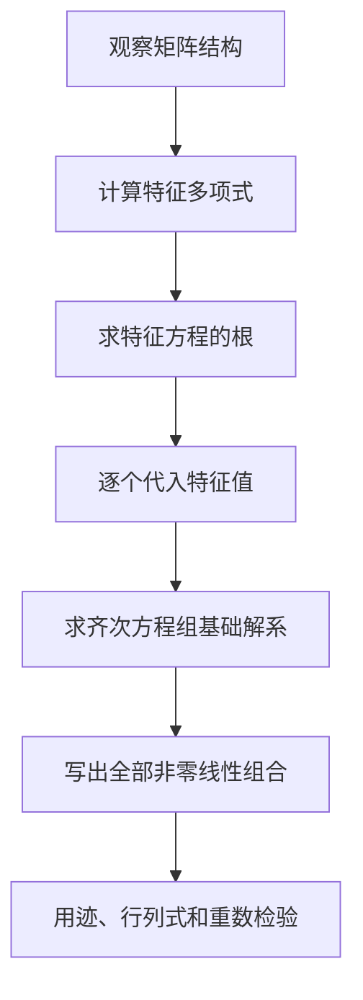
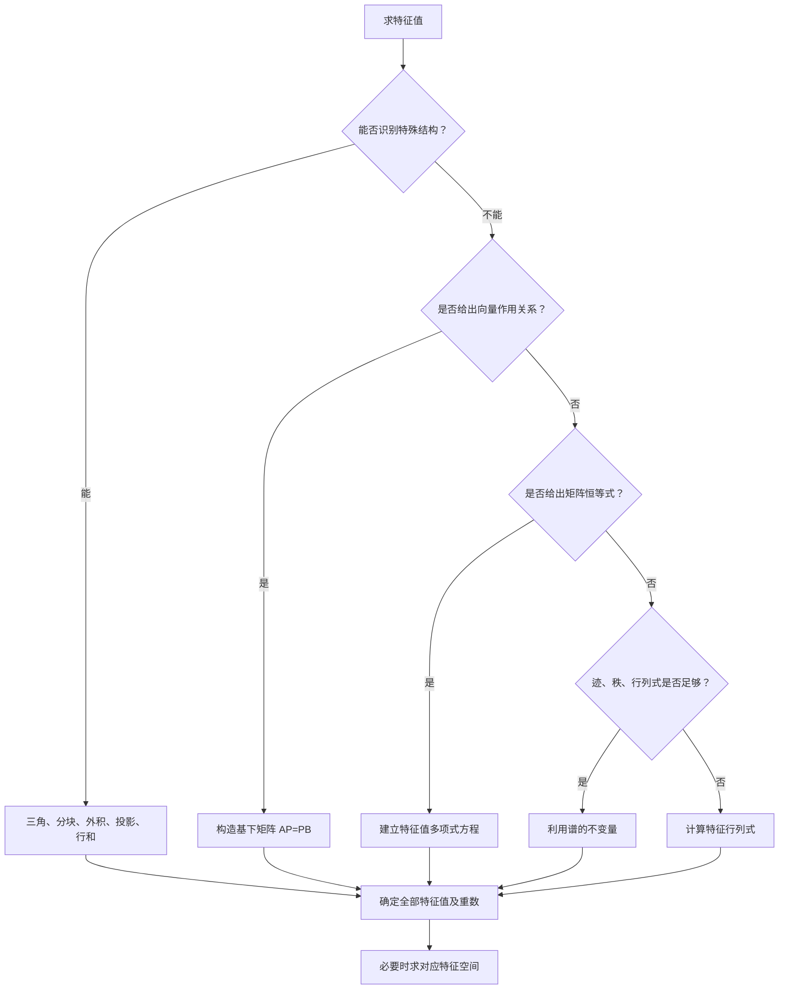

**适用范围：考研数学一｜基础知识、强化题型、历年真题、综合创新题**

本节是线性代数从矩阵、向量、线性方程组过渡到相似对角化、实对称矩阵以及二次型的核心枢纽。

前面几章学习的是矩阵的运算、向量之间的关系、矩阵的秩以及线性方程组的解；而从这一节开始，我们研究的是：

**矩阵作用于向量之后，哪些方向能够保持不变，以及矩阵在这些方向上产生怎样的伸缩。**

一旦真正理解了这个思想，很多原本需要计算高阶矩阵、复杂行列式、逆矩阵、伴随矩阵的问题，都可以转化为简单的数值运算。

## 核心题型

| 题型             | 核心工具        | 重要程度  |
| -------------- | ----------- | ----- |
| 具体矩阵求特征值与特征向量  | 特征方程、齐次方程组  | ★★★★★ |
| 已知特征值或特征向量反求参数 | 定义、行列式、秩    | ★★★★★ |
| 抽象矩阵与基下表示      | $AP=PB$ | ★★★★★ |
| 秩一矩阵、全一矩阵      | 外积结构、迹、零空间  | ★★★★★ |
| 矩阵多项式、逆矩阵、伴随矩阵 | 谱映射         | ★★★★★ |
| 特征值重数与特征空间维数   | 秩—零度定理      | ★★★★★ |
| 特征向量线性组合及相关性   | 线性无关、比较系数   | ★★★★★ |
| 矩阵恒等式与特征向量链    | 因式分解、零乘积    | ★★★★★ |
| 转置、乘积矩阵、递推问题   | 特征向量传递与基分解  | ★★★★☆ |

这九类题型并不是彼此独立的。综合题通常是将其中两到四种思想结合起来。

## 第一部分：基础概念与底层逻辑

### 一、特征值与特征向量究竟是什么？

**1. 基本定义**

设 $A$ 为 $n$ 阶矩阵，如果存在数 $\lambda$ 和非零向量 $\alpha$，使得

$$
\boxed{A\alpha=\lambda\alpha,\qquad \alpha\ne0}
$$

那么称：

- $\lambda$ 为矩阵 $A$ 的一个特征值；
- $\alpha$ 为矩阵 $A$ 对应于特征值 $\lambda$ 的特征向量。

这里最重要的是两个条件：

$$
A\alpha=\lambda\alpha,\qquad \alpha\ne0.
$$

特征值可以为零，特征向量绝对不能为零。

**2. 直观理解：特征向量是矩阵作用下的特殊方向**

例如，

$$
A=\begin{pmatrix} 2&0\\ 0&\frac12 \end{pmatrix}.
$$

对于向量

$$
\alpha_1=\begin{pmatrix}1\\0\end{pmatrix}, \qquad \alpha_2=\begin{pmatrix}0\\1\end{pmatrix},
$$

有

$$
A\alpha_1=2\alpha_1, \qquad A\alpha_2=\frac12\alpha_2.
$$

水平方向被拉长为原来的两倍，竖直方向被压缩为原来的一半。

但是对于

$$
\beta=\begin{pmatrix}1\\1\end{pmatrix},
$$

有

$$
A\beta=\begin{pmatrix}2\\\frac12\end{pmatrix},
$$

它与原向量不共线，所以 $\beta$ 不是特征向量。

水平轴与竖直轴是两个特征方向，而斜率为1的向量经过矩阵作用后，方向发生改变，斜率变为四分之一。

| 特征值               | 对特征方向的作用 |
| ----------------- | -------- |
| $\lambda=1$   | 保持向量不变   |
| $\lambda=-1$  | 向量反向     |
| $\lambda>1$   | 同向拉伸     |
| $0<\lambda<1$ | 同向压缩     |
| $\lambda=0$   | 压缩为零向量   |
| $\lambda<-1$  | 反向拉伸     |

所以，特征向量不一定保持原来的朝向，但当特征值非零时，一定保持在原来的一维直线上。

### 二、特征值问题的本质：齐次线性方程组

由定义，

$$
A\alpha=\lambda\alpha
$$

移项得到

$$
(A-\lambda E)\alpha=0.
$$

由于 $\alpha\ne0$，所以这个齐次线性方程组必须具有非零解。

结合第三章的知识，有以下非常重要的等价关系：

$$
\boxed{ \begin{aligned} &\lambda\text{ 是 }A\text{ 的特征值}\\ \Longleftrightarrow\;& (A-\lambda E)x=0\text{ 有非零解}\\ \Longleftrightarrow\;& r(A-\lambda E)<n\\ \Longleftrightarrow\;& A-\lambda E\text{ 不可逆}\\ \Longleftrightarrow\;& |A-\lambda E|=0. \end{aligned}}
$$

这条等价链贯穿本节所有题型。

不同题目提供不同的信息，你需要做的是在这些等价条件之间灵活转换。

例如，张宇1000题基础部分第4题，询问 $-1$ 是 $A$ 的特征值的充分必要条件。

直接得到

$$
\boxed{r(A+E)<n}.
$$

根本不需要知道矩阵 $A$ 的具体元素。

**特殊情况：零特征值**

令 $\lambda=0$，得到

$$
\boxed{ \begin{aligned} 0\text{ 是 }A\text{ 的特征值} &\Longleftrightarrow |A|=0\\ &\Longleftrightarrow r(A)<n\\ &\Longleftrightarrow A\text{ 不可逆}. \end{aligned}}
$$

所以，如果题目告诉你一个矩阵不可逆，实际上已经告诉你它至少有一个零特征值。

### 三、特征多项式与特征方程

定义矩阵 $A$ 的特征多项式为

$$
\boxed{f_A(t)=|tE-A|}.
$$

令其等于零，得到特征方程：

$$
|tE-A|=0.
$$

该方程的根就是矩阵 $A$ 的特征值。

注意两种写法：

$$
|tE-A|,\qquad |A-tE|.
$$

二者满足

$$
|A-tE|=(-1)^n|tE-A|.
$$

因此求特征值时，两种写法都可以使用。但是当涉及特征多项式系数、行列式具体数值时，必须注意符号。

**1. 二阶矩阵的快速公式**

设

$$
A=\begin{pmatrix}a&b\\c&d\end{pmatrix},
$$

则

$$
\begin{aligned} f_A(t) &=(t-a)(t-d)-bc\\ &=t^2-(a+d)t+ad-bc. \end{aligned}
$$

即

$$
\boxed{ f_A(t)=t^2-\operatorname{tr}(A)t+|A| }.
$$

所以二阶矩阵求特征值时，往往只需要计算迹与行列式。

**2. 三阶矩阵的特征多项式**

设三阶矩阵的特征值为

$$
\lambda_1,\lambda_2,\lambda_3,
$$

则

$$
\begin{aligned} f_A(t) ={}&t^3-(\lambda_1+\lambda_2+\lambda_3)t^2\\ &+(\lambda_1\lambda_2+\lambda_1\lambda_3 +\lambda_2\lambda_3)t\\ &-\lambda_1\lambda_2\lambda_3. \end{aligned}
$$

也可以写为

$$
\boxed{ f_A(t)=t^3-\operatorname{tr}(A)t^2 +\operatorname{tr}(A^*)t-|A| }.
$$

其中 $A^*$ 表示伴随矩阵，$\operatorname{tr}(A^*)$ 等于三个二阶主子式之和。

**3. 两条必须熟练掌握的公式**

对于任意 $n$ 阶矩阵，其全部特征值计代数重数，有

$$
\boxed{\sum_{i=1}^n\lambda_i =\operatorname{tr}(A) =\sum_{i=1}^na_{ii}}
$$

以及

$$
\boxed{\prod_{i=1}^n\lambda_i=|A|}.
$$

进一步，

$$
\boxed{\operatorname{tr}(A^k) =\sum_{i=1}^n\lambda_i^k}.
$$

这些公式不要求 $A$ 可相似对角化。

例如，

$$
\operatorname{tr}(A^2) =(\lambda_1+\lambda_2+\lambda_3)^2 -2\sum_{i<j}\lambda_i\lambda_j.
$$

如果只要求特征值之和、积、平方和，不一定需要将每个特征值求出来。

**4. 实矩阵的特征值不一定都是实数**

例如

$$
A=\begin{pmatrix} 0&-1\\ 1&0 \end{pmatrix},
$$

其特征多项式为

$$
f_A(t)=t^2+1.
$$

它没有实特征值。

需要区分：

| 矩阵条件   | 能得到的结论     |
| ------ | ---------- |
| 一般实矩阵  | 特征值可能为复数   |
| 奇数阶实矩阵 | 至少存在一个实特征值 |
| 实对称矩阵  | 全部特征值均为实数  |
| 实三角矩阵  | 特征值是主对角线元素 |

当题目要求的是“实特征值”时，必须单独筛选实根。

### 四、特征子空间、代数重数与几何重数

这是本节最容易被忽略、也是综合题最喜欢考查的概念。

**1. 特征子空间**

对应于特征值 $\lambda$ 的特征子空间为

$$
V_\lambda=\ker(A-\lambda E).
$$

也就是齐次线性方程组

$$
(A-\lambda E)x=0
$$

的全部解所构成的空间。

特征子空间包括零向量，但特征向量不包括零向量。

如果方程组的基础解系为

$$
\alpha_1,\alpha_2,\ldots,\alpha_s,
$$

那么全部对应特征向量为

$$
\boxed{ x=k_1\alpha_1+\cdots+k_s\alpha_s, \quad(k_1,\ldots,k_s)\ne(0,\ldots,0) }.
$$

**2. 代数重数**

特征值 $\lambda$ 在特征多项式中出现的次数，称为代数重数，记作 $m_\lambda$。

例如，

$$
f_A(t)=(t-1)^2(t-3),
$$

则特征值1的代数重数为2，特征值3的代数重数为1。

**3. 几何重数**

对应特征空间的维数，称为几何重数，记作 $g_\lambda$。

$$
\boxed{g_\lambda=n-r(A-\lambda E)}.
$$

几何重数就是对应于该特征值的线性无关特征向量的最大个数。

两者永远满足

$$
\boxed{1\le g_\lambda\le m_\lambda}.
$$

**4. 为什么重特征值不一定对应多个独立特征向量？**

考虑两个矩阵：

$$
A=\begin{pmatrix}2&0\\0&2\end{pmatrix}, \qquad B=\begin{pmatrix}2&1\\0&2\end{pmatrix}.
$$

它们的特征多项式完全相同：

$$
f_A(t)=f_B(t)=(t-2)^2.
$$

但是对于 $A$：

$$
r(A-2E)=0,
$$

所以

$$
g_2=2.
$$

对于 $B$：

$$
B-2E=\begin{pmatrix}0&1\\0&0\end{pmatrix},
$$

所以

$$
g_2=2-1=1.
$$

| 性质         | 矩阵 $A$ | 矩阵 $B$ |
| ---------- | ---------- | ---------- |
| 特征值        | 2，2        | 2，2        |
| 代数重数       | 2          | 2          |
| 几何重数       | 2          | 1          |
| 最大独立特征向量个数 | 2          | 1          |
| 能否相似对角化    | 能          | 不能         |

**拥有相同的特征值，不代表拥有相同的特征向量结构。**

尤其注意：

$$
r(A)=r
$$

只能说明零空间的维数为

$$
n-r.
$$

不能直接断言零特征值的代数重数恰好为 $n-r$，除非已经知道矩阵可以相似对角化等充分条件。

## 第二部分：特征值与特征向量的重要性质

### 五、特征向量的线性相关与线性无关

**性质1：非零倍数仍是特征向量**

若

$$
A\alpha=\lambda\alpha,
$$

则对任意 $k\ne0$，

$$
A(k\alpha)=\lambda(k\alpha).
$$

所以 $k\alpha$ 仍然是对应于 $\lambda$ 的特征向量。

**性质2：同一特征值的特征向量可以线性组合**

若

$$
A\alpha=\lambda\alpha,\qquad A\beta=\lambda\beta,
$$

则

$$
A(k_1\alpha+k_2\beta) =\lambda(k_1\alpha+k_2\beta).
$$

只要组合结果不为零，它就仍然是对应于 $\lambda$ 的特征向量。

**性质3：不同特征值对应的特征向量必线性无关**

设

$$
A\alpha_1=\lambda_1\alpha_1,\qquad A\alpha_2=\lambda_2\alpha_2,
$$

其中

$$
\lambda_1\ne\lambda_2.
$$

若存在

$$
k_1\alpha_1+k_2\alpha_2=0,
$$

两边左乘 $A$，得到

$$
k_1\lambda_1\alpha_1+ k_2\lambda_2\alpha_2=0.
$$

再用第二式减去第一式的 $\lambda_2$ 倍：

$$
k_1(\lambda_1-\lambda_2)\alpha_1=0.
$$

因为

$$
\lambda_1-\lambda_2\ne0,\qquad \alpha_1\ne0,
$$

所以 $k_1=0$，进而 $k_2=0$。

因此 $\alpha_1,\alpha_2$ 线性无关。

更一般地，如果从不同特征子空间分别取出若干组线性无关的特征向量，将这些向量合并，所得向量组依然线性无关。

**性质4：不同特征值的特征向量不一定正交**

这是一个高频判断陷阱。

例如

$$
A=\begin{pmatrix}1&1\\0&2\end{pmatrix}.
$$

对应于特征值1、2的特征向量分别可以取

$$
\alpha=\begin{pmatrix}1\\0\end{pmatrix}, \qquad \beta=\begin{pmatrix}1\\1\end{pmatrix}.
$$

它们线性无关，但

$$
\alpha^T\beta=1\ne0.
$$

只有当 $A$ 为实对称矩阵等满足相应条件时，才能保证不同特征值对应的特征向量正交。

### 六、矩阵运算后的特征值：谱映射

这是本节计算效率提升最大的知识点。

如果

$$
A\alpha=\lambda\alpha,
$$

那么

$$
A^2\alpha=\lambda^2\alpha,
$$

进一步，

$$
A^k\alpha=\lambda^k\alpha.
$$

如果

$$
p(t)=a_mt^m+\cdots+a_1t+a_0,
$$

则

$$
\boxed{p(A)\alpha=p(\lambda)\alpha}.
$$

这意味着：**在特征向量方向上，矩阵多项式运算可以直接转化为普通数的运算。**

**1. 核心公式总表**

设 $(\lambda,\alpha)$ 是 $A$ 的一组特征值、特征向量。

| 新矩阵            | 对应特征值                       | 特征向量               | 条件          |
| -------------- | --------------------------- | ------------------ | ----------- |
| $kA$       | $k\lambda$              | $\alpha$       | 无           |
| $A+kE$     | $\lambda+k$             | $\alpha$       | 无           |
| $A^m$      | $\lambda^m$             | $\alpha$       | 正整数 $m$ |
| $p(A)$     | $p(\lambda)$            | $\alpha$       | 多项式         |
| $A^{-1}$   | $\frac1\lambda$         | $\alpha$       | $A$ 可逆  |
| $A^*$     | $\frac{\|A\|}{\lambda}$ | $\alpha$       | $A$ 可逆  |
| $P^{-1}AP$ | $\lambda$               | $P^{-1}\alpha$ | $P$ 可逆  |
| $A^T$      | $\lambda$               | 不一定是 $\alpha$  | 无           |

如果 $A$ 的全部特征值为 $\lambda_1,\ldots,\lambda_n$，则 $p(A)$ 的全部特征值计重数为

$$
p(\lambda_1),\ldots,p(\lambda_n).
$$

由此得到

$$
\boxed{|p(A)|=\prod_{i=1}^np(\lambda_i)}
$$

和

$$
\boxed{\operatorname{tr}(p(A)) =\sum_{i=1}^np(\lambda_i)}.
$$

对于有理式同样可以使用，但必须保证涉及求逆的矩阵确实可逆。

**2. 谱映射的反向推导陷阱**

若

$$
A^2\alpha=4\alpha,
$$

不能直接推出

$$
A\alpha=2\alpha.
$$

甚至不能保证 $\alpha$ 是 $A$ 的特征向量。

例如

$$
A=\begin{pmatrix}2&0\\0&-2\end{pmatrix},
$$

则

$$
A^2=4E.
$$

任何非零向量都是 $A^2$ 的特征向量，但不一定是 $A$ 的特征向量。

因此：

$$
\alpha\text{ 是 }A\text{ 的特征向量} \Longrightarrow \alpha\text{ 是 }p(A)\text{ 的特征向量}.
$$

反方向一般不成立。

这是张宇1000题基础部分第1题以及多道分类模拟题共同考查的思想。

### 七、逆矩阵与伴随矩阵的特征值

**母题1：1989年数学一真题**

设 $\lambda$ 为 $n$ 阶可逆矩阵 $A$ 的一个特征值，证明：

（1）$\dfrac1\lambda$ 是 $A^{-1}$ 的特征值；

（2）$\dfrac{|A|}{\lambda}$ 是 $A^*$ 的特征值。

**解答**

设对应的非零特征向量为 $\alpha$，则

$$
A\alpha=\lambda\alpha.
$$

因为 $A$ 可逆，所以 $\lambda\ne0$。

两边左乘 $A^{-1}$：

$$
\alpha=\lambda A^{-1}\alpha.
$$

于是

$$
A^{-1}\alpha=\frac1\lambda\alpha.
$$

又因为

$$
A^*=|A|A^{-1},
$$

所以

$$
A^*\alpha =|A|A^{-1}\alpha =\frac{|A|}{\lambda}\alpha.
$$

命题得证。

这道真题虽然简单，但它是后续几十种伴随矩阵题目的共同基础。

**1. 奇异矩阵的伴随矩阵怎么办？**

当 $A$ 不可逆时，不能使用

$$
A^*=|A|A^{-1}.
$$

但仍然可以通过

$$
AA^*=A^*A=|A|E
$$

进行分析。

设

$$
A\alpha=\lambda\alpha,\qquad \lambda\ne0,
$$

左乘 $A^*$：

$$
|A|\alpha=\lambda A^*\alpha.
$$

因此

$$
A^*\alpha=\frac{|A|}{\lambda}\alpha.
$$

所以，只要当前特征值不为零，即使 $A$ 不可逆，上述针对这个特征向量的公式依然成立。

**2. 伴随矩阵全部特征值的通用公式**

如果 $A$ 的全部特征值为

$$
\lambda_1,\lambda_2,\ldots,\lambda_n,
$$

那么 $A^*$ 的全部特征值为

$$
\boxed{ \mu_i=\prod_{j\ne i}\lambda_j, \qquad i=1,\ldots,n. }
$$

这个公式即使在 $A$ 奇异时也成立，而且不要求 $A$ 可对角化。

例如，三阶矩阵 $A$ 的特征值为

$$
0,2,3,
$$

则 $A^*$ 的特征值为

$$
6,0,0.
$$

如果 $A$ 的特征值为

$$
0,0,3,
$$

则 $A^*$ 的特征值全部为零。

需要注意：全部特征值为零，并不意味着伴随矩阵本身一定为零。

**3. 伴随矩阵的秩与特征值结合**

对于 $n\ge2$，

$$
\boxed{ r(A^*)= \begin{cases} n,&r(A)=n,\\ 1,&r(A)=n-1,\\ 0,&r(A)\le n-2. \end{cases}}
$$

结合特征值，可以处理许多矩阵秩与伴随矩阵的综合题。

## 第三部分：具体矩阵计算与含参问题

### 八、题型一：直接求特征值、特征向量

**标准解题流程**

实际上，第一步观察结构比机械展开行列式更重要。

**母题2：李正元第五章，计算题第16条**

设

$$
A=\begin{pmatrix} 1&2&1\\ -2&-3&0\\ 0&0&2 \end{pmatrix}.
$$

求全部特征值、特征向量。

<Steps>

<Step>

### 第一步：计算特征多项式 [!toc]

由于矩阵是分块上三角矩阵，沿第三行展开：

$$
\begin{aligned} |tE-A| &=(t-2) \begin{vmatrix} t-1&-2\\ 2&t+3 \end{vmatrix}\\ &=(t-2)[(t-1)(t+3)+4]\\ &=(t-2)(t+1)^2. \end{aligned}
$$

所以特征值为

$$
\boxed{2,-1,-1}.
$$

</Step>

<Step>

### 第二步：求对应于特征值2的特征向量 [!toc]

解

$$
(A-2E)x=0,
$$

得到

$$
\begin{pmatrix} -1&2&1\\ -2&-5&0\\ 0&0&0 \end{pmatrix} \begin{pmatrix}x_1\\x_2\\x_3\end{pmatrix} =0.
$$

由第二行，

$$
2x_1+5x_2=0.
$$

令

$$
x_2=2k,
$$

则

$$
x_1=-5k,\qquad x_3=-9k.
$$

所以全部对应特征向量为

$$
\boxed{x=k(-5,2,-9)^T,\quad k\ne0}.
$$

</Step>

<Step>

### 第三步：求对应于特征值 $-1$ 的特征向量 [!toc]

解

$$
(A+E)x=0.
$$

即

$$
\begin{pmatrix} 2&2&1\\ -2&-2&0\\ 0&0&3 \end{pmatrix} x=0.
$$

得到

$$
x_3=0,\qquad x_1=-x_2.
$$

所以

$$
\boxed{x=k(1,-1,0)^T,\quad k\ne0}.
$$

</Step>

<Step>

### 第四步：检查重数 [!toc]

特征值 $-1$ 虽然是二重根，却只有一个线性无关的特征向量。

$$
m_{-1}=2,\qquad g_{-1}=1.
$$

这意味着矩阵 $A$ 不能相似对角化。

</Step>

</Steps>

**题型总结**

求出一个重特征值之后，千万不能直接按照它的代数重数写出同样数量的独立特征向量。

必须实际求解

$$
(A-\lambda E)x=0.
$$

### 九、题型二：已知特征值或特征向量反求参数

这类问题有三种最主要的入口。

| 已知条件                  | 优先使用的方法                            |
| --------------------- | ---------------------------------- |
| 已知特征值 $\lambda$   | $\|\lambda E-A\|=0$            |
| 已知特征向量 $\alpha$   | $A\alpha=\lambda\alpha$        |
| 已知特征向量的最大无关个数 $s$ | $r(A-\lambda E)=n-s$           |
| 已知 $\lambda$ 是重根  | $f_A(\lambda)=f_A'(\lambda)=0$ |

**母题3：2017年数学二真题**

这道题虽然不是数学一真题，但考查内容完全适用于数学一。

设

$$
A=\begin{pmatrix} 4&1&-2\\ 1&2&a\\ 3&1&-1 \end{pmatrix},
$$

已知

$$
\alpha=(1,1,2)^T
$$

是 $A$ 的特征向量，求 $a$。

由定义，

$$
A\alpha=\lambda\alpha.
$$

直接计算：

$$
\begin{pmatrix} 1\\3+2a\\2 \end{pmatrix} = \begin{pmatrix} \lambda\\\lambda\\2\lambda \end{pmatrix}.
$$

从第一分量得到

$$
\lambda=1.
$$

再由第二分量，

$$
3+2a=1,
$$

所以

$$
\boxed{a=-1}.
$$

**这类题不要先计算特征行列式。**

已知特征向量时，直接按分量比较通常比求全部特征值简单得多。

但如果向量的某个分量为零，则该位置的矩阵乘积也必须为零，不能进行除法。

**母题4：张宇1000题基础部分第2题**

设

$$
A=\begin{pmatrix} 3&-4&0\\ 4&-5&0\\ a&2&-1 \end{pmatrix},
$$

且 $A$ 的三重特征值对应的特征空间为二维，求 $a$。

第一步，求特征多项式：

$$
\begin{aligned} f_A(t) &=(t+1) \begin{vmatrix} t-3&4\\ -4&t+5 \end{vmatrix}\\ &=(t+1)^3. \end{aligned}
$$

所以唯一特征值为

$$
\lambda=-1.
$$

第二步，将特征空间维数转化为秩：

$$
\dim\ker(A+E)=2.
$$

即

$$
r(A+E)=1.
$$

又

$$
A+E=\begin{pmatrix} 4&-4&0\\ 4&-4&0\\ a&2&0 \end{pmatrix}.
$$

前两行相同且非零，因此第三行必须与第一行成比例。

$$
(a,2)=k(4,-4).
$$

由

$$
2=-4k
$$

得到

$$
k=-\frac12.
$$

因此

$$
\boxed{a=-2}.
$$

这道题的本质不是特征值计算，而是第三章秩与基础解系知识的重新应用。

**重根问题的通用处理**

若题目告诉你 $\lambda_0$ 是特征多项式的重根，则必须满足

$$
\boxed{ f_A(\lambda_0)=0,\qquad f_A'(\lambda_0)=0. }
$$

如果要求恰好是二重根，还应检查

$$
f_A''(\lambda_0)\ne0.
$$

但是只说“重根”，并没有排除三重根。

这一点将在2025年数学一真题中再次出现。

### 十、题型三：特殊结构矩阵的快速计算

**1. 三角矩阵**

如果

$$
A=\begin{pmatrix} a&b&c\\ 0&d&e\\ 0&0&f \end{pmatrix},
$$

则

$$
|tE-A|=(t-a)(t-d)(t-f).
$$

因此

$$
\boxed{\lambda_1=a,\quad\lambda_2=d,\quad\lambda_3=f}.
$$

但要注意，三角矩阵的对角元素是特征值，不代表标准基向量全部是其特征向量。

**2. 分块三角矩阵**

若

$$
A=\begin{pmatrix} B&C\\ O&D \end{pmatrix},
$$

其中 $B,D$ 都为方阵，则

$$
\boxed{f_A(t)=f_B(t)f_D(t)}.
$$

于是 $A$ 的全部特征值就是两个对角块的全部特征值合并。

右上角分块 $C$ 不影响特征值，但可能影响特征向量和对角化性质。

**3. 各行元素之和相同**

设

$$
e=(1,1,\ldots,1)^T.
$$

若矩阵 $A$ 的每一行元素之和均为 $c$，则

$$
Ae=ce.
$$

所以

$$
\boxed{c\text{ 是 }A\text{ 的特征值，}e\text{ 是对应特征向量}}.
$$

若每一列元素之和均为 $c$，则

$$
A^Te=ce.
$$

因此 $c$ 依然是 $A$ 的特征值，但 $e$ 不一定是 $A$ 的特征向量。

### 十一、近年创新母题：2026年数学一真题

设

$$
A=\begin{pmatrix} 1&0&0\\ 2&a&2\\ 0&2&a \end{pmatrix}, \qquad B=\begin{pmatrix} a&-1&-1\\ -1&2&1\\ -1&-1&a \end{pmatrix}.
$$

记 $m(X)$ 为矩阵 $X$ 所有实特征值中的最大值。

求满足

$$
m(A)<m(B)
$$

的参数 $a$ 的取值范围。

<Steps>

<Step>

### 第一步：识别矩阵 $A$ 的分块结构 [!toc]

$$
\begin{aligned} |tE-A| &=(t-1) \begin{vmatrix} t-a&-2\\ -2&t-a \end{vmatrix}\\ &=(t-1)[(t-a)^2-4]\\ &=(t-1)(t-a-2)(t-a+2). \end{aligned}
$$

所以特征值为

$$
1,\quad a+2,\quad a-2.
$$

显然 $a+2>a-2$，因此

$$
m(A)=\max\{1,a+2\}.
$$

</Step>

<Step>

### 第二步：计算矩阵 $B$ 的特征多项式 [!toc]

$$
|tE-B|= \begin{vmatrix} t-a&1&1\\ 1&t-2&-1\\ 1&1&t-a \end{vmatrix}.
$$

观察第一行和第三行的结构，将第一行减去第三行：

$$
= \begin{vmatrix} t-a-1&0&-(t-a-1)\\ 1&t-2&-1\\ 1&1&t-a \end{vmatrix}.
$$

提取公因式：

$$
=(t-a-1) \begin{vmatrix} 1&0&-1\\ 1&t-2&-1\\ 1&1&t-a \end{vmatrix}.
$$

再作列变换 $C_3\leftarrow C_3+C_1$，得到

$$
=(t-a-1)(t-2)(t-a+1).
$$

所以 $B$ 的特征值为

$$
2,\quad a+1,\quad a-1.
$$

因此

$$
m(B)=\max\{2,a+1\}.
$$

</Step>

<Step>

### 第三步：将线性代数问题转化为分段函数问题 [!toc]

需要解的是

$$
\max\{1,a+2\}<\max\{2,a+1\}.
$$

两个分界点分别为

$$
a=-1,\qquad a=1.
$$

两个函数的交点为 $a=0$。逐段比较如下：

| 参数范围            | $m(A)$ | $m(B)$ | 不等式结果        |
| --------------- | ---------- | ---------- | ------------ |
| $a<-1$      | 1          | 2          | 恒成立          |
| $-1\le a<1$ | $a+2$  | 2          | 要求 $a<0$ |
| $a\ge1$     | $a+2$  | $a+1$  | 不成立          |

综合得到

$$
\boxed{a\in(-\infty,0)}.
$$

</Step>

</Steps>

**这道题的创新价值**

它并没有引入陌生的线性代数定理，而是改变了问题的最终目标。

传统问题是求特征值，而这道题求的是特征值的最大值函数，再比较两个矩阵的谱。

未来同类创新题还可能要求

$$
\max_i|\lambda_i|,
$$

或者

$$
\min_i\lambda_i,\qquad \sum_i|\lambda_i|.
$$

其中

$$
\rho(A)=\max_i|\lambda_i|
$$

称为谱半径，它与最大实特征值并不是一回事。

例如特征值为 $-5,2,3$ 时，最大实特征值为3，谱半径却为5。

面对这类新题，应先准确求出特征值，再根据题目所定义的函数进行分类讨论，不要把传统题型的结论机械套用。

## 第四部分：抽象矩阵与基下表示

### 十二、题型四：已知矩阵对一组向量的作用

这是考研线性代数中非常值得掌握的通法。

题目不一定给出矩阵 $A$ 的具体元素，而只告诉你：

$$
A\alpha_1=\cdots,\qquad A\alpha_2=\cdots,\qquad A\alpha_3=\cdots.
$$

如果

$$
\alpha_1,\alpha_2,\alpha_3
$$

线性无关，实际上矩阵 $A$ 在这组基下的表示已经确定。

设

$$
P=(\alpha_1,\alpha_2,\ldots,\alpha_n),
$$

如果

$$
A\alpha_j=\sum_{i=1}^nb_{ij}\alpha_i,
$$

则

$$
\boxed{AP=PB}.
$$

由 $P$ 可逆，得到

$$
\boxed{P^{-1}AP=B}.
$$

所以 $A$ 与 $B$ 具有相同的特征值。

**记住：每个** $A\alpha_j$ **的展开系数组成矩阵** $B$ **的第** $j$ **列，而不是第** $j$ **行。**

**母题5：2008年数学一真题**

设 $A$ 为二阶矩阵，$\alpha_1,\alpha_2$ 为线性无关的二维列向量，满足

$$
A\alpha_1=0,
$$

$$
A\alpha_2=2\alpha_1+\alpha_2.
$$

求 $A$ 的非零特征值。

令

$$
P=(\alpha_1,\alpha_2).
$$

由线性无关性，$P$ 可逆。

于是

$$
\begin{aligned} AP &=(A\alpha_1,A\alpha_2)\\ &=(0,2\alpha_1+\alpha_2)\\ &=P\begin{pmatrix}0&2\\0&1\end{pmatrix}. \end{aligned}
$$

所以

$$
P^{-1}AP=\begin{pmatrix}0&2\\0&1\end{pmatrix}.
$$

右侧是上三角矩阵，特征值为0和1。

因此所求非零特征值为

$$
\boxed{1}.
$$

**深入一步：对应的特征向量是什么？**

显然，

$$
A\alpha_1=0,
$$

所以 $\alpha_1$ 是零特征值对应的特征向量。

但是 $\alpha_2$ 本身不是对应于1的特征向量，因为

$$
A\alpha_2=2\alpha_1+\alpha_2\ne\alpha_2.
$$

设

$$
\beta=x\alpha_1+y\alpha_2.
$$

要求

$$
A\beta=\beta.
$$

则

$$
2y\alpha_1+y\alpha_2 =x\alpha_1+y\alpha_2.
$$

由线性无关性，

$$
x=2y.
$$

因此可以取

$$
\boxed{\beta=2\alpha_1+\alpha_2}.
$$

这就体现了基下表示的完整方法：先求坐标矩阵的特征向量，再转换回原来的向量。

**同类强化：2018年数学二真题**

设

$$
\begin{aligned} A\alpha_1&=2\alpha_1+\alpha_2+\alpha_3,\\ A\alpha_2&=\alpha_2+2\alpha_3,\\ A\alpha_3&=-\alpha_2+\alpha_3, \end{aligned}
$$

且三个向量线性无关，求 $A$ 的全部实特征值。

直接构造

$$
B=\begin{pmatrix} 2&0&0\\ 1&1&-1\\ 1&2&1 \end{pmatrix}.
$$

则

$$
A\sim B.
$$

利用分块三角结构，

$$
f_A(t) =(t-2)[(t-1)^2+2].
$$

第二个因子没有实根，因此唯一的实特征值为

$$
\boxed{2}.
$$

这一类题的真正考点就是把抽象向量关系翻译成具体矩阵，而不是试图求原矩阵的元素。

### 十三、题型五：循环向量与递推关系

当题目出现

$$
\alpha,\ A\alpha,\ A^2\alpha
$$

线性无关时，要立即想到把它们组成矩阵

$$
P=(\alpha,A\alpha,A^2\alpha).
$$

这类题是基下表示的进一步发展。

**母题6：李林880题**

设

$$
P=(\alpha,A\alpha,A^2\alpha)
$$

可逆，并且

$$
A^3\alpha+2A^2\alpha=3A\alpha.
$$

求 $A$ 的特征值以及 $|A+E|$。

第一步，将递推关系写成

$$
A^3\alpha=3A\alpha-2A^2\alpha.
$$

第二步，构造基下矩阵：

$$
\begin{aligned} AP &=(A\alpha,A^2\alpha,A^3\alpha)\\ &=P \begin{pmatrix} 0&0&0\\ 1&0&3\\ 0&1&-2 \end{pmatrix}. \end{aligned}
$$

所以

$$
P^{-1}AP=C= \begin{pmatrix} 0&0&0\\ 1&0&3\\ 0&1&-2 \end{pmatrix}.
$$

第三步，求特征多项式：

$$
\begin{aligned} f_A(t) &=t \begin{vmatrix} t&-3\\ -1&t+2 \end{vmatrix}\\ &=t(t^2+2t-3)\\ &=t(t-1)(t+3). \end{aligned}
$$

于是

$$
\boxed{\lambda_1=0,\quad\lambda_2=1,\quad\lambda_3=-3}.
$$

进而

$$
\begin{aligned} |A+E| &=(0+1)(1+1)(-3+1)\\ &=-4. \end{aligned}
$$

所以

$$
\boxed{|A+E|=-4}.
$$

**更深层的理解：为什么可以直接从递推式读出特征多项式？**

令

$$
q(t)=t^3+2t^2-3t.
$$

由题设，

$$
q(A)\alpha=0.
$$

由于 $q(A)$ 与 $A$ 可交换，

$$
q(A)A\alpha=Aq(A)\alpha=0,
$$

同理，

$$
q(A)A^2\alpha=0.
$$

所以

$$
q(A)P=O.
$$

而 $P$ 可逆，故

$$
q(A)=O.
$$

此处又有三阶循环基，因此可以通过前面构造的矩阵证明，$q(t)$ 恰好就是特征多项式。

**关键条件是循环向量组线性无关。**

如果只知道

$$
q(A)\alpha=0,
$$

而不知道 $\alpha,A\alpha,A^2\alpha$ 是否构成一组基，就不能直接断言 $q(A)=O$。

**一般结论**

若

$$
P=(\alpha,A\alpha,\ldots,A^{n-1}\alpha)
$$

可逆，且

$$
A^n\alpha=c_0\alpha+c_1A\alpha+\cdots+c_{n-1}A^{n-1}\alpha,
$$

则

$$
\boxed{ f_A(t)=t^n-c_{n-1}t^{n-1}-\cdots-c_1t-c_0 }.
$$

这个结论在抽象矩阵、向量组线性无关、矩阵递推、特征值综合题中都非常有用。

## 第五部分：秩一矩阵与投影矩阵

### 十四、题型六：秩一矩阵的特征值与特征向量

这是本节最具有代表性、最值得彻底掌握的一类特殊矩阵。

设

$$
\boxed{A=\alpha\beta^T},
$$

其中 $\alpha,\beta$ 均为 $n$ 维非零列向量，$n\ge2$。

注意区分

$$
\alpha^T\beta
$$

与

$$
\alpha\beta^T.
$$

前者是一个数，后者是一个 $n$ 阶矩阵。

**1. 秩一矩阵的核心结构**

对于任意向量 $x$，

$$
Ax=\alpha(\beta^Tx).
$$

所以不论输入什么向量，输出向量始终位于 $\alpha$ 所张成的直线上。

因此

$$
r(A)=1.
$$

同时

$$
Ax=0 \Longleftrightarrow \beta^Tx=0.
$$

所以

$$
\boxed{\ker A=\ker\beta^T},
$$

并且

$$
\boxed{\dim\ker A=n-1}.
$$

**2. 秩一矩阵最重要的计算公式**

令

$$
s=\beta^T\alpha.
$$

那么

$$
A\alpha =\alpha\beta^T\alpha =s\alpha.
$$

所以 $s$ 是一个特征值。

另一方面，

$$
\begin{aligned} A^2 &=(\alpha\beta^T)(\alpha\beta^T)\\ &=\alpha(\beta^T\alpha)\beta^T\\ &=sA. \end{aligned}
$$

因此

$$
\boxed{A^2=sA}.
$$

进一步，

$$
\boxed{A^k=s^{k-1}A,\qquad k\ge2}.
$$

同时，

$$
\boxed{\operatorname{tr}(A)=s}.
$$

秩一矩阵的特征多项式为

$$
\boxed{f_A(t)=t^{n-1}(t-s)}.
$$

于是全部特征值为

$$
\boxed{s,\underbrace{0,\ldots,0}_{n-1\text{个}}}.
$$

**3. 必须区分的两种情况**

| 性质        | $s\ne0$        | $s=0$   |
| --------- | ------------------ | ----------- |
| 特征值       | $s,0,\ldots,0$ | 全部为0        |
| 零特征值的代数重数 | $n-1$          | $n$     |
| 零特征值的几何重数 | $n-1$          | $n-1$   |
| 平方        | $A^2=sA$       | $A^2=O$ |
| 是否可对角化    | 可以                 | 不可以         |

当 $s\ne0$ 时，

$$
V_s=\operatorname{span}\{\alpha\}, \qquad V_0=\ker\beta^T.
$$

当 $s=0$ 时，所有特征向量都属于

$$
\ker\beta^T,
$$

但必须排除零向量。

因此对于非零外积矩阵，有

$$
\boxed{ \alpha\beta^T\text{ 可相似对角化} \Longleftrightarrow \beta^T\alpha\ne0. }
$$

**母题7：2009年数学一真题**

已知三维列向量 $\alpha,\beta$ 满足

$$
\alpha^T\beta=2.
$$

求

$$
A=\beta\alpha^T
$$

的非零特征值。

直接利用

$$
A\beta =\beta(\alpha^T\beta) =2\beta.
$$

因为 $\beta\ne0$，所以2是 $A$ 的特征值。

又因为 $A$ 的秩为1，所以全部特征值为

$$
2,0,0.
$$

答案为

$$
\boxed{2}.
$$

不需要展开任何行列式。

**同类母题：1998年数学三真题**

如果将上述条件改为

$$
\alpha^T\beta=0, \qquad A=\alpha\beta^T,
$$

则

$$
A^2=O.
$$

但是由于 $\alpha,\beta$ 都非零，

$$
A\ne O.
$$

此时 $A$ 的全部特征值都是零，全部特征向量为

$$
\boxed{\{x:\beta^Tx=0,\ x\ne0\}}.
$$

这道题可以反驳下面三个错误命题：

$$
A^2=O\Longrightarrow A=O;
$$

$$
\text{所有特征值为零}\Longrightarrow A=O;
$$

$$
r(A)=1\Longrightarrow A\text{ 恰有一个非零特征值}.
$$

这三个命题对于一般矩阵都不成立。

### 十五、全一矩阵及等对角、等非对角矩阵

**母题8：1999年数学一真题**

设 $n$ 阶矩阵 $J$ 的全部元素均为1，求全部特征值。

令

$$
e=(1,1,\ldots,1)^T.
$$

则

$$
J=ee^T.
$$

所以

$$
Je=e(e^Te)=ne.
$$

对应的非零特征值为 $n$。

由于

$$
r(J)=1,
$$

其余 $n-1$ 个特征值全为零。

因此

$$
\boxed{n,0,\ldots,0}.
$$

对应的特征空间分别为

$$
V_n=\operatorname{span}\{e\},
$$

$$
V_0=\left\{ x=(x_1,\ldots,x_n)^T: \sum_{i=1}^nx_i=0 \right\}.
$$

同时，

$$
\boxed{J^2=nJ}.
$$

**重要推广：主对角元素相同，其余元素相同**

设

$$
A=\begin{pmatrix} a&b&\cdots&b\\ b&a&\cdots&b\\ \vdots&\vdots&\ddots&\vdots\\ b&b&\cdots&a \end{pmatrix}.
$$

可以拆成

$$
\boxed{A=(a-b)E+bJ}.
$$

由于 $J$ 的特征值为 $n,0,\ldots,0$，根据谱映射，

$$
\boxed{ \begin{aligned} \lambda_1&=a+(n-1)b,\\ \lambda_2=\cdots=\lambda_n&=a-b. \end{aligned}}
$$

因此

$$
\boxed{|A|=[a+(n-1)b](a-b)^{n-1}}.
$$

若 $b\ne0$，对应特征空间为

$$
V_{a+(n-1)b}=\operatorname{span}\{e\},
$$

$$
V_{a-b}=\ker e^T.
$$

若 $b=0$，矩阵就是 $aE$，所有非零向量均为特征向量。

这个结论直接覆盖：

李林880题ID尾号011、040，李正元练习题ID尾号017，以及后面要讲解的2003年数学一综合题。

### 十六、秩一投影矩阵

设 $\alpha$ 为非零实列向量，

$$
\boxed{P=\frac{\alpha\alpha^T}{\alpha^T\alpha}}.
$$

则对于任意向量 $x$，

$$
Px=\frac{\alpha^Tx}{\alpha^T\alpha}\alpha.
$$

这正是将 $x$ 正交投影到 $\alpha$ 方向上的公式。

因此

$$
P^2=P.
$$

并且

$$
P\alpha=\alpha.
$$

如果

$$
\alpha^Tx=0,
$$

则

$$
Px=0.
$$

所以 $P$ 的特征值为

$$
1,0,\ldots,0.
$$

它在 $\alpha$ 方向上保留向量，在垂直于 $\alpha$ 的方向上消去向量。

**母题9：张宇1000题**

设

$$
A=E-\frac{3}{\alpha^T\alpha}\alpha\alpha^T.
$$

求 $A^2,A^{-1}$，并说明其特征值及特征向量结构。

<Steps>

<Step>

### 第一步：引入投影矩阵 [!toc]

令

$$
P=\frac{\alpha\alpha^T}{\alpha^T\alpha}.
$$

则

$$
A=E-3P,\qquad P^2=P.
$$

因此

$$
\begin{aligned} A^2 &=(E-3P)^2\\ &=E-6P+9P^2\\ &=E+3P. \end{aligned}
$$

即

$$
\boxed{A^2=E+\frac{3}{\alpha^T\alpha}\alpha\alpha^T}.
$$

</Step>

<Step>

### 第二步：求逆矩阵 [!toc]

设

$$
A^{-1}=E+cP.
$$

则

$$
(E-3P)(E+cP)=E+(-3-2c)P.
$$

要使乘积为 $E$，必须有

$$
-3-2c=0.
$$

得到

$$
c=-\frac32.
$$

因此

$$
\boxed{A^{-1}=E-\frac{3\alpha\alpha^T}{2\alpha^T\alpha}}.
$$

</Step>

<Step>

### 第三步：求特征值 [!toc]

由于

$$
P\alpha=\alpha,
$$

所以

$$
A\alpha=(E-3P)\alpha=-2\alpha.
$$

对于任意与 $\alpha$ 正交的非零向量 $x$，有

$$
Px=0,
$$

故

$$
Ax=x.
$$

因此全部特征值为

$$
\boxed{-2,\underbrace{1,\ldots,1}_{n-1\text{个}}}.
$$

</Step>

</Steps>

**一般公式**

对于矩阵

$$
A=aE+bP, \qquad P^2=P,
$$

如果 $P$ 是秩为 $r$ 的投影矩阵，则 $A$ 的全部特征值为

$$
\boxed{ \underbrace{a+b,\ldots,a+b}_{r\text{个}}, \quad \underbrace{a,\ldots,a}_{n-r\text{个}} }.
$$

当 $k$ 为正整数时，

$$
\boxed{ (aE+bP)^k =a^kE+[(a+b)^k-a^k]P }.
$$

特别地，对于秩一外积矩阵加单位矩阵，还可得到

$$
\boxed{ (E+\alpha\beta^T)^{-1} =E-\frac{\alpha\beta^T}{1+\beta^T\alpha} }
$$

适用条件为

$$
1+\beta^T\alpha\ne0.
$$

相应的行列式为

$$
\boxed{|E+\alpha\beta^T|=1+\beta^T\alpha}.
$$

这些公式无需死记，通过 $A^2=sA$ 或特征值结构即可随时推导。

### 十七、2024年数学一真题：从抽象条件识别投影

设 $A$ 为秩为2的三阶矩阵，$\alpha$ 为满足

$$
A\alpha=0
$$

的非零向量。

若对所有满足

$$
\beta^T\alpha=0
$$

的向量 $\beta$，均有

$$
A\beta=\beta.
$$

判断给出的关于 $A^2,A^3$ 的迹的结论。

<Steps>

<Step>

### 第一步：识别零特征值 [!toc]

由

$$
A\alpha=0,\qquad \alpha\ne0,
$$

可知0是 $A$ 的特征值。

</Step>

<Step>

### 第二步：识别二维特征空间 [!toc]

条件

$$
\beta^T\alpha=0
$$

构成一个二维子空间。

可在其中选取两个线性无关的非零向量 $\beta_1,\beta_2$。

因为

$$
A\beta_1=\beta_1,\qquad A\beta_2=\beta_2,
$$

所以它们都是对应于特征值1的特征向量。

又由于

$$
\alpha,\beta_1,\beta_2
$$

线性无关，故全部特征值为

$$
0,1,1.
$$

于是

$$
\operatorname{tr}(A^3)=0^3+1^3+1^3=2.
$$

因此正确结论是

$$
\boxed{\operatorname{tr}(A^3)=2}.
$$

</Step>

</Steps>

**进一步挖掘隐藏结构**

实际上题设已经唯一确定了矩阵的作用：

$$
\boxed{A=E-\frac{\alpha\alpha^T}{\alpha^T\alpha}}.
$$

这个矩阵将所有向量正交投影到与 $\alpha$ 垂直的平面上。

因此还可以直接得到

$$
A^2=A,\qquad A^3=A,
$$

以及

$$
\operatorname{tr}(A^k)=2,\qquad k\ge1.
$$

2024年这道真题并没有直接出现“投影矩阵”这个名称，而是通过齐次方程组、正交关系、向量作用来描述投影。

**未来出现类似抽象条件时，要学会从矩阵对不同子空间的作用反向识别矩阵结构。**

## 第六部分：伴随矩阵与谱映射综合题

### 十八、2003年数学一综合真题

设

$$
A=\begin{pmatrix} 3&2&2\\ 2&3&2\\ 2&2&3 \end{pmatrix},
$$

$$
P=\begin{pmatrix} 0&1&0\\ 1&0&1\\ 0&0&1 \end{pmatrix}, \qquad B=P^{-1}A^*P.
$$

求 $B+2E$ 的全部特征值及对应特征向量。

这道题综合了全一矩阵、伴随矩阵、相似变换、特征向量变换，是本节非常重要的母题。

<Steps>

<Step>

### 第一步：识别矩阵 $A$ 的结构 [!toc]

显然

$$
A=E+2J.
$$

其中 $J$ 为三阶全一矩阵。

由于 $J$ 的特征值为

$$
3,0,0,
$$

所以 $A$ 的特征值为

$$
7,1,1.
$$

对应于7的特征向量可取

$$
\alpha_1=(1,1,1)^T.
$$

对应于1的两个线性无关特征向量可取

$$
\alpha_2=(1,-1,0)^T,
$$

$$
\alpha_3=(1,0,-1)^T.
$$

</Step>

<Step>

### 第二步：求伴随矩阵的特征值 [!toc]

由于

$$
|A|=7,
$$

故

$$
A^*=7A^{-1}.
$$

因此 $A^*$ 的特征值为

$$
1,7,7.
$$

原来的三个特征向量仍然有效。

</Step>

<Step>

### 第三步：利用相似关系 [!toc]

由于

$$
B=P^{-1}A^*P,
$$

所以 $B$ 的特征值不变，仍为

$$
1,7,7.
$$

于是 $B+2E$ 的特征值为

$$
\boxed{3,9,9}.
$$

</Step>

<Step>

### 第四步：转换特征向量 [!toc]

设

$$
A^*\alpha=\mu\alpha.
$$

则

$$
\begin{aligned} B(P^{-1}\alpha) &=P^{-1}A^*PP^{-1}\alpha\\ &=P^{-1}A^*\alpha\\ &=\mu P^{-1}\alpha. \end{aligned}
$$

因此新的特征向量是

$$
\boxed{P^{-1}\alpha}.
$$

计算得到

$$
P^{-1}= \begin{pmatrix} 0&1&-1\\ 1&0&0\\ 0&0&1 \end{pmatrix}.
$$

所以

$$
P^{-1}\alpha_1=(0,1,1)^T,
$$

$$
P^{-1}\alpha_2=(-1,1,0)^T,
$$

$$
P^{-1}\alpha_3=(1,1,-1)^T.
$$

最终答案为：

对应于特征值3，

$$
\boxed{x=k(0,1,1)^T,\qquad k\ne0}.
$$

对应于特征值9，

$$
\boxed{ x=k_1(-1,1,0)^T+k_2(1,1,-1)^T }
$$

其中

$$
(k_1,k_2)\ne(0,0).
$$

</Step>

</Steps>

**从这道题中提炼出的通法**

当题目要求

$$
P^{-1}p(A)P+cE
$$

的特征值、特征向量时，始终分两条线处理：

$$
\boxed{\lambda\longrightarrow p(\lambda)\longrightarrow p(\lambda)+c}
$$

以及

$$
\boxed{\alpha\longrightarrow\alpha\longrightarrow P^{-1}\alpha}.
$$

不要为了求特征值先把伴随矩阵、相似矩阵以及矩阵多项式全部展开。

对于一般多项式，如果不同特征值经过映射后变成同一个特征值，而且原矩阵不能对角化，则还可能出现新的特征向量。此时若要求全部特征向量，需要进一步检查相应零空间。

### 十九、2021年数学一真题：伴随矩阵行和

设 $A=(a_{ij})$ 为三阶矩阵，$A_{ij}$ 为 $a_{ij}$ 的代数余子式。

已知 $A$ 每一行元素之和均为2，且

$$
|A|=3.
$$

求

$$
A_{11}+A_{21}+A_{31}.
$$

<Steps>

<Step>

### 第一步：将行和转化为特征向量 [!toc]

令

$$
e=(1,1,1)^T.
$$

由题意，

$$
Ae=2e.
$$

所以2是 $A$ 的特征值。

</Step>

<Step>

### 第二步：传递到伴随矩阵 [!toc]

由于

$$
|A|=3\ne0,
$$

因此

$$
A^*e=\frac32e.
$$

这说明 $A^*$ 的每一行元素之和均为

$$
\frac32.
$$

</Step>

<Step>

### 第三步：注意伴随矩阵的转置结构 [!toc]

伴随矩阵为

$$
A^*= \begin{pmatrix} A_{11}&A_{21}&A_{31}\\ A_{12}&A_{22}&A_{32}\\ A_{13}&A_{23}&A_{33} \end{pmatrix}.
$$

题目所要求的恰好是第一行元素之和。

所以

$$
\boxed{A_{11}+A_{21}+A_{31}=\frac32}.
$$

这道题的计算量几乎为零，但要求你在行和、特征值和伴随矩阵三种表达方式之间快速转换。

</Step>

</Steps>

**同类推广**

若 $A$ 每行元素之和为 $c\ne0$，则

$$
Ae=ce.
$$

即使 $A$ 不可逆，也可以通过左乘 $A^*$ 得到

$$
|A|e=cA^*e.
$$

所以

$$
\boxed{A^*e=\frac{|A|}{c}e}.
$$

也就是伴随矩阵每行元素之和为

$$
\boxed{\frac{|A|}{c}}.
$$

但如果 $c=0$，不能使用这个除法。

### 二十、补充模拟题：从谱映射结果反推原矩阵

**李林六套卷第1套第7题**

设 $A$ 为三阶实矩阵。以下条件哪一个能保证 $A$ 必有特征值1？

| 选项 | 条件                     |
| -- | ---------------------- |
| A  | 2是 $A+A^{-1}$ 的特征值 |
| B  | 2是 $A+A^T$ 的特征值    |
| C  | 2是 $A+A^*$ 的特征值   |
| D  | 2是 $A+A^2$ 的特征值    |

**分析选项A**

存在非零向量 $x$，使

$$
(A+A^{-1})x=2x.
$$

两边左乘 $A$：

$$
(A^2-2A+E)x=0.
$$

即

$$
(A-E)^2x=0.
$$

所以

$$
|(A-E)^2|=0.
$$

即

$$
|A-E|^2=0.
$$

因此

$$
|A-E|=0,
$$

说明1必为 $A$ 的特征值。

**分析选项D**

如果

$$
(A+A^2)x=2x,
$$

则

$$
(A^2+A-2E)x=0.
$$

分解得到

$$
(A-E)(A+2E)x=0.
$$

因此

$$
|A-E||A+2E|=0.
$$

只能说明1或者 $-2$ 至少有一个是 $A$ 的特征值。

并不能保证1一定是特征值。

反例：

$$
A=\operatorname{diag}(-2,0,0).
$$

此时

$$
A+A^2=\operatorname{diag}(2,0,0),
$$

但 $A$ 不具有特征值1。

**分析选项B、C**

一般情况下，$A$ 与 $A^T$ 不共享全部特征向量。

对于 $A+A^*$，若没有进一步条件，伴随矩阵的谱与原矩阵特征值的对应关系也不足以唯一反推出1。

例如

$$
A=\operatorname{diag}(2,0,0),
$$

此时 $A^*=O$，所以 $A+A^*$ 具有特征值2，但 $A$ 没有特征值1。

对于B，可以取

$$
A=\begin{pmatrix} 1&1&0\\ -1&0&0\\ 0&0&2 \end{pmatrix}.
$$

于是

$$
A+A^T=\operatorname{diag}(2,0,4),
$$

但 $|A-E|=1\ne0$，故1也不一定是 $A$ 的特征值。

因此正确选项为

$$
\boxed{\text{A}}.
$$

**这类题的统一思想**

若 $p(A)$ 存在特征值 $\mu$，则

$$
|p(A)-\mu E|=0.
$$

如果可以因式分解为

$$
p(t)-\mu=c(t-\lambda_1)\cdots(t-\lambda_s),
$$

那么至少有一个因子满足

$$
|A-\lambda_iE|=0.
$$

当所有可能的根都相同时，就能唯一反推原特征值。

当存在多个不同的候选根时，必须结合其他已知条件继续筛选。

### 二十一、补充模拟题：利用特征值计算平方和

**李永乐六套卷第4套第7题**

设三阶矩阵 $A$ 满足

$$
|A|=8,\qquad |2E-A|=0,
$$

$$
|-2E-A|=-72.
$$

求

$$
\lambda_1^2+\lambda_2^2+\lambda_3^2.
$$

由

$$
|2E-A|=0,
$$

可知一个特征值为2。

设其余两个为 $u,v$。

由

$$
2uv=8,
$$

得到

$$
uv=4.
$$

又因为

$$
|-2E-A|=(-4)(-2-u)(-2-v)=-72,
$$

所以

$$
(2+u)(2+v)=18.
$$

展开：

$$
4+2(u+v)+uv=18.
$$

代入 $uv=4$，得到

$$
u+v=5.
$$

于是无需单独求解 $u,v$，直接利用

$$
u^2+v^2=(u+v)^2-2uv=25-8=17.
$$

因此

$$
\boxed{\lambda_1^2+\lambda_2^2+\lambda_3^2=4+17=21}.
$$

这类题最重要的思想是：

**已知行列式条件，本质上是在给特征多项式提供若干个函数值。**

### 二十二、进阶练习：奇异矩阵的伴随矩阵

**张宇1000题强化部分**

设

$$
A=\begin{pmatrix} 1&0&a\\ b&2&0\\ 0&c&3 \end{pmatrix}, \qquad abc=-6.
$$

求 $A^*$ 的非零特征值。

计算

$$
\begin{aligned} f_A(t) &=(t-1)(t-2)(t-3)-abc\\ &=t^3-6t^2+11t\\ &=t(t^2-6t+11). \end{aligned}
$$

所以零是一个单特征值，其余两个特征值满足

$$
\lambda_2+\lambda_3=6,\qquad \lambda_2\lambda_3=11.
$$

利用伴随矩阵的谱公式，其全部特征值为

$$
\lambda_2\lambda_3,\quad0,\quad0.
$$

因此

$$
\boxed{A^*\text{ 的非零特征值为 }11}.
$$

这道题的特殊之处在于，$A$ 的另外两个特征值其实为

$$
3+i\sqrt2,\qquad 3-i\sqrt2.
$$

但是完全不需要进行复数计算。

用特征多项式系数与韦达定理，就可以直接得到伴随矩阵的实特征值。

## 第七部分：矩阵恒等式、零乘积与特征值重数

### 二十三、题型七：已知矩阵满足多项式恒等式

如果题目给出

$$
p(A)=O,
$$

那么对于 $A$ 的任意特征值 $\lambda$，取对应非零特征向量 $\alpha$，有

$$
p(A)\alpha=p(\lambda)\alpha=0.
$$

由于 $\alpha\ne0$，

$$
\boxed{p(\lambda)=0}.
$$

这就将矩阵方程转化成普通代数方程。

**常见矩阵恒等式及其结论**

| 已知矩阵恒等式           | 特征值可能的取值     |
| ----------------- | ------------ |
| $A^2=A$       | 0，1          |
| $A^2=E$       | 1，$-1$   |
| $A^2=O$       | 0            |
| $A^m=O$       | 0            |
| $A^2-3A+2E=O$ | 1，2          |
| $A^3=A$       | $-1$，0，1 |
| $A^2+A+E=O$   | 无实特征值        |

必须注意：

$$
p(A)=O\Longrightarrow p(\lambda_i)=0
$$

成立。

反过来，即使所有特征值都满足

$$
p(\lambda_i)=0,
$$

也不能保证

$$
p(A)=O.
$$

例如

$$
A=\begin{pmatrix}1&1\\0&1\end{pmatrix},
$$

其全部特征值都是1，满足

$$
\lambda^2-\lambda=0,
$$

但

$$
A^2-A=\begin{pmatrix}0&1\\0&0\end{pmatrix}\ne O.
$$

原因是特征值只能描述矩阵作用的一部分性质，不能完全描述重根对应的矩阵结构。

### 二十四、幂等矩阵的完整结论

若

$$
\boxed{A^2=A},
$$

则称 $A$ 为幂等矩阵。

此时全部特征值只能是0和1。

如果

$$
r(A)=r,
$$

则实际上可以确定全部特征值：

$$
\boxed{ \underbrace{1,\ldots,1}_{r\text{个}}, \quad \underbrace{0,\ldots,0}_{n-r\text{个}}. }
$$

为什么可以直接利用秩确定代数重数？

因为幂等矩阵一定可相似对角化。

**一个不依赖高级理论的证明**

由

$$
A^2=A,
$$

得到

$$
A(E-A)=O.
$$

因此

$$
r(A)+r(E-A)\le n.
$$

另一方面，

$$
n=r(E)=r[A+(E-A)] \le r(A)+r(E-A).
$$

综合得到

$$
\boxed{r(A)+r(E-A)=n}.
$$

所以

$$
\dim\ker A=n-r,
$$

而

$$
\dim\ker(E-A)=r.
$$

这两个特征空间一共提供 $n$ 个线性无关的特征向量。

因此 $A$ 可相似对角化。

**李林880题**

设

$$
A^2=A,\qquad r(A)=r,
$$

求

$$
|3E-A|.
$$

根据上述结论，$3E-A$ 的特征值为

$$
\underbrace{2,\ldots,2}_{r\text{个}}, \quad \underbrace{3,\ldots,3}_{n-r\text{个}}.
$$

所以

$$
\boxed{|3E-A|=2^r3^{n-r}}.
$$

这里不要求 $A$ 是实对称矩阵。

需要区分：幂等矩阵一定对应某种投影，但不一定是正交投影；只有再满足 $A^T=A$ 等相应条件，才是正交投影矩阵。

### 二十五、幂零矩阵：平方为零不等于矩阵为零

如果

$$
A^m=O
$$

对某个正整数 $m$ 成立，则称 $A$ 为幂零矩阵。

任意特征值满足

$$
\lambda^m=0,
$$

故

$$
\boxed{\lambda=0}.
$$

所以幂零矩阵的全部特征值都是0。

如果 $A\ne O$，则它不能相似对角化。

**特别重要：平方零矩阵的秩**

若

$$
A^2=O,
$$

则

$$
\operatorname{Im}(A)\subseteq\ker A.
$$

因为 $A$ 的任意列向量都是方程组 $Ax=0$ 的解。

所以

$$
r(A)\le n-r(A),
$$

即

$$
\boxed{r(A)\le\left\lfloor\frac n2\right\rfloor}.
$$

**母题10：2026年数学二真题**

与李林880题ID尾号029几乎是同一母题。

设三阶矩阵 $A,B$ 满足

$$
AB+BA=A^2+B^2,
$$

且

$$
A\ne B.
$$

求 $A-B$ 的特征值及线性无关特征向量的最大个数。

令

$$
C=A-B.
$$

由题意，

$$
\begin{aligned} C^2 &=(A-B)^2\\ &=A^2-AB-BA+B^2\\ &=O. \end{aligned}
$$

又 $A\ne B$，所以 $C\ne O$。

根据平方零矩阵的性质，

$$
r(C)\le\left\lfloor\frac32\right\rfloor=1.
$$

结合 $C\ne O$，得到

$$
r(C)=1.
$$

所以

$$
\dim\ker C=3-1=2.
$$

而 $C$ 的全部特征值均为零，因此

$$
\boxed{ A-B\text{ 的特征值全为零，且恰有两个线性无关的特征向量方向可作为基}. }
$$

更准确地说，其特征空间为二维，线性无关特征向量的最大个数是2。

**为什么这道题值得重视？**

因为它将三个章节串联在一起：

矩阵运算中的非交换性，矩阵秩的不等式，以及特征空间的维数。

注意必须保留

$$
(A-B)^2=A^2-AB-BA+B^2,
$$

不能擅自写成

$$
A^2-2AB+B^2,
$$

除非已知 $AB=BA$。

**额外推论：幂零矩阵的逆**

若

$$
A^m=O,
$$

则

$$
(E-A)(E+A+\cdots+A^{m-1})=E.
$$

所以

$$
\boxed{(E-A)^{-1}=E+A+\cdots+A^{m-1}}.
$$

这正是李正元第五章选择题ID尾号006考查的一个重要结论。

### 二十六、零乘积结构与特征空间

**补充模拟题：李永乐六套卷第1套第6题**

已知三阶矩阵 $A,B$ 满足

$$
AB=A-B+E,
$$

且

$$
r(B-E)=2.
$$

判断 $A$ 关于特征值 $-1$ 的特征向量结构。

<Steps>

<Step>

### 第一步：移项因式分解 [!toc]

$$
AB-A+B-E=O.
$$

所以

$$
\boxed{(A+E)(B-E)=O}.
$$

</Step>

<Step>

### 第二步：使用零乘积的秩不等式 [!toc]

$$
r(A+E)+r(B-E)\le3.
$$

因为

$$
r(B-E)=2,
$$

所以

$$
r(A+E)\le1.
$$

</Step>

<Step>

### 第三步：转化为特征空间维数 [!toc]

$$
\dim\ker(A+E) =3-r(A+E)\ge2.
$$

因此 $A$ 至少有两个线性无关的对应于 $-1$ 的特征向量。

注意这里是“至少两个”，不一定恰好两个。

因为 $A=-E$ 时，特征空间维数就是3。

</Step>

</Steps>

**一般化结论**

若

$$
(A-\lambda E)B=O
$$

且

$$
r(B)=s,
$$

那么

$$
\boxed{\dim\ker(A-\lambda E)\ge s}.
$$

因此当 $s>0$ 时，$\lambda$ 是 $A$ 的特征值，且其几何重数至少为 $s$。

若题目给出的是

$$
B(A^T-\lambda E)=O,
$$

则先转置：

$$
(A-\lambda E)B^T=O,
$$

再使用相同的方法。

这个推广正是李林880题ID尾号028、张宇1000题ID尾号048的核心思想。

**综合推论**

假设

$$
(A+E)C=O,
$$

$$
B(A^T-2E)=O,
$$

且

$$
r(B)+r(C)=n.
$$

那么

$$
g_{-1}\ge r(C),
$$

$$
g_2\ge r(B).
$$

由于不同特征值对应的特征空间直和，且两者维数之和不能超过 $n$，所以

$$
g_{-1}=r(C),\qquad g_2=r(B).
$$

这意味着整个空间都由这两个特征空间张成，故

$$
A\sim \operatorname{diag}( \underbrace{-1,\ldots,-1}_{r(C)}, \underbrace{2,\ldots,2}_{r(B)} ).
$$

并且

$$
(A+E)(A-2E)=O.
$$

即

$$
\boxed{A^2-A-2E=O}.
$$

这就是通过矩阵秩条件反推出完整谱结构，再反推出矩阵恒等式的方法。

## 第八部分：2025年数学一重根与特征向量链

### 二十七、本节综合性最强的母题之一

**来源：2025年数学一真题。**

设

$$
A=\begin{pmatrix} 0&-1&2\\ -1&0&2\\ -1&-1&a \end{pmatrix},
$$

已知1是 $A$ 的特征多项式的重根。

（1）求 $a$。

（2）求所有非零列向量 $\alpha,\beta$，使得

$$
A\alpha=\alpha+\beta,
$$

$$
A^2\alpha=\alpha+2\beta.
$$

这道题把重特征值、矩阵的秩、非齐次方程组以及特征向量链融合在一起。

**第（1）问：利用重根条件求参数**

计算

$$
f_A(t)= \begin{vmatrix} t&1&-2\\ 1&t&-2\\ 1&1&t-a \end{vmatrix}.
$$

将第一行减去第二行：

$$
= \begin{vmatrix} t-1&-(t-1)&0\\ 1&t&-2\\ 1&1&t-a \end{vmatrix}.
$$

提取公因式：

$$
=(t-1) \begin{vmatrix} 1&-1&0\\ 1&t&-2\\ 1&1&t-a \end{vmatrix}.
$$

展开得

$$
f_A(t) =(t-1)[t^2+(1-a)t+4-a].
$$

因为1是重根，所以第二个因式在 $t=1$ 时也必须为零。

$$
1+(1-a)+4-a=0.
$$

所以

$$
6-2a=0.
$$

得到

$$
\boxed{a=3}.
$$

代入原特征多项式：

$$
f_A(t)=(t-1)^3.
$$

这里1实际是三重根。

不能因为题目说“重根”就认为它一定是二重根。

**第（2）问：先从抽象关系中识别特征向量**

题设

$$
A\alpha=\alpha+\beta.
$$

两边再左乘 $A$：

$$
A^2\alpha=A\alpha+A\beta.
$$

代入已知关系：

$$
\alpha+2\beta =\alpha+\beta+A\beta.
$$

化简得到

$$
\boxed{A\beta=\beta}.
$$

因此，$\beta$ 是对应于特征值1的非零特征向量。

但仅仅求出1对应的全部特征向量，还不足以完成本题。

同时需要满足

$$
(A-E)\alpha=\beta.
$$

<Steps>

<Step>

### 第三步：引入新矩阵简化问题 [!toc]

令

$$
N=A-E.
$$

则原条件等价于

$$
\boxed{ N\alpha=\beta,\qquad N\beta=0,\qquad \beta\ne0. }
$$

当 $a=3$ 时，

$$
N= \begin{pmatrix} -1&-1&2\\ -1&-1&2\\ -1&-1&2 \end{pmatrix}.
$$

识别外积结构：

$$
N= \begin{pmatrix}1\\1\\1\end{pmatrix} \begin{pmatrix}-1&-1&2\end{pmatrix}.
$$

令

$$
e=(1,1,1)^T.
$$

则

$$
N\alpha=e(-\alpha_1-\alpha_2+2\alpha_3).
$$

因此 $N\alpha$ 必定在 $e$ 所张成的直线上。

所以

$$
\boxed{\beta=k(1,1,1)^T,\qquad k\ne0}.
$$

又因为

$$
Ne=0,
$$

故这样的 $\beta$ 自动满足

$$
N\beta=0.
$$

</Step>

<Step>

### 第四步：求非齐次线性方程组的全部解 [!toc]

要求

$$
N\alpha=ke,
$$

等价于

$$
-\alpha_1-\alpha_2+2\alpha_3=k.
$$

其一个特解可以取

$$
\alpha_0=(-k,0,0)^T.
$$

对应齐次方程组

$$
-x_1-x_2+2x_3=0
$$

的一组基础解系为

$$
\eta_1=(2,0,1)^T,\qquad \eta_2=(0,2,1)^T.
$$

所以全部解为

$$
\alpha= (-k,0,0)^T+s(2,0,1)^T+t(0,2,1)^T.
$$

因此最终答案为

$$
\boxed{ \begin{aligned} \beta&=k(1,1,1)^T,\\ \alpha&=(-k,0,0)^T +s(2,0,1)^T+t(0,2,1)^T, \end{aligned} }
$$

其中

$$
k\ne0,\qquad s,t\in\mathbb R.
$$

因为 $N\alpha=\beta\ne0$，所以 $\alpha\ne0$ 自动成立。

</Step>

<Step>

### 第五步：验证解的完整性 [!toc]

只要上述条件成立，就有

$$
N\alpha=\beta,\qquad N\beta=0.
$$

于是

$$
A\alpha=(E+N)\alpha=\alpha+\beta,
$$

以及

$$
\begin{aligned} A^2\alpha &=(E+N)^2\alpha\\ &=\alpha+2N\alpha+N^2\alpha\\ &=\alpha+2\beta. \end{aligned}
$$

所以所求向量对既满足原题，也覆盖了全部可能情况。

</Step>

</Steps>

### 二十八、深入理解2025年真题的创新之处

这道题实际考查的是

$$
\beta\in\operatorname{Im}(N)\cap\ker N.
$$

其中

$$
N=A-E.
$$

普通特征向量只需要满足

$$
\beta\in\ker N.
$$

而题目中的 $\beta$ 还必须能够表示成

$$
\beta=N\alpha.
$$

因此它必须同时属于值域和零空间。

本题中

$$
\operatorname{Im}(N)=\operatorname{span}\{e\},
$$

$$
\ker N=\{x:-x_1-x_2+2x_3=0\},
$$

而且

$$
\operatorname{Im}(N)\subseteq\ker N.
$$

所以最后的 $\beta$ 只有一个自由方向，而 $\alpha$ 有两个额外的自由参数。

**同类型题目的通用方法**

如果题目出现

$$
A\alpha=\lambda\alpha+\beta,
$$

$$
A\beta=\lambda\beta,
$$

应立即令

$$
N=A-\lambda E.
$$

于是

$$
\boxed{N\alpha=\beta,\qquad N\beta=0}.
$$

这是一条长度为2的特征向量链，$\alpha$ 有时被称为广义特征向量。

考研不需要完整学习若尔当标准形理论，但需要掌握这种通过矩阵作用关系构造、证明向量组线性无关的思路。

**证明链中两个向量线性无关**

如果

$$
c_1\alpha+c_2\beta=0,
$$

两边左乘 $N$：

$$
c_1\beta=0.
$$

因为 $\beta\ne0$，所以

$$
c_1=0.
$$

再代回原式得到

$$
c_2=0.
$$

因此

$$
\boxed{\alpha,\beta\text{ 线性无关}}.
$$

进一步，由

$$
A\alpha=\lambda\alpha+\beta,\qquad A\beta=\lambda\beta,
$$

可得到

$$
\boxed{A^k\alpha=\lambda^k\alpha+k\lambda^{k-1}\beta}
$$

对于 $k\ge2$ 成立；$k=1$ 就是原式。

其推导可以使用二项式展开，也可以用数学归纳法。

这类结果能够进一步延伸到矩阵高次幂、递推关系和极限问题。

### 二十九、强化母题：长度为3的特征向量链

**李林880题**

设 $\alpha_1\ne0$ 为三阶矩阵 $A$ 对应于非零特征值 $\lambda$ 的特征向量，且

$$
(\lambda E-A)\alpha_2=\alpha_1,
$$

$$
(\lambda E-A)\alpha_3=\alpha_2.
$$

证明 $\alpha_1,\alpha_2,\alpha_3$ 线性无关，并求

$$
|A+A^*|.
$$

令

$$
T=\lambda E-A.
$$

则

$$
T\alpha_1=0,\qquad T\alpha_2=\alpha_1,\qquad T\alpha_3=\alpha_2.
$$

<Steps>

<Step>

### 第一步：通过连续作用证明无关 [!toc]

假设

$$
c_1\alpha_1+c_2\alpha_2+c_3\alpha_3=0.
$$

左乘 $T^2$：

$$
c_3\alpha_1=0.
$$

所以 $c_3=0$。

再左乘 $T$，得到

$$
c_2\alpha_1=0,
$$

故 $c_2=0$。

最后 $c_1=0$。

因此三个向量线性无关。

</Step>

<Step>

### 第二步：构造基下矩阵 [!toc]

令

$$
P=(\alpha_1,\alpha_2,\alpha_3).
$$

则

$$
P^{-1}AP= \begin{pmatrix} \lambda&-1&0\\ 0&\lambda&-1\\ 0&0&\lambda \end{pmatrix}.
$$

所以 $A$ 的全部特征值均为 $\lambda$，即

$$
|A|=\lambda^3.
$$

</Step>

<Step>

### 第三步：使用谱映射 [!toc]

因为 $\lambda\ne0$，$A$ 可逆。

伴随矩阵的全部特征值为

$$
\lambda^2,\lambda^2,\lambda^2.
$$

又

$$
A+A^*=A+\lambda^3A^{-1}
$$

是 $A$ 的有理式，因此其全部特征值为

$$
\lambda+\lambda^2.
$$

故

$$
\boxed{|A+A^*|=(\lambda+\lambda^2)^3}.
$$

也就是

$$
\boxed{|A+A^*|=\lambda^3(1+\lambda)^3}.
$$

注意，当 $\lambda=-1$ 时，答案为零，并不与 $A$ 可逆矛盾。

**原矩阵可逆不代表对其进行加减运算后所得矩阵仍然可逆。**

</Step>

</Steps>

## 第九部分：特征向量组合与线性相关性

### 三十、2018年数学一真题

二阶矩阵 $A$ 有两个不同的特征值，$\alpha_1,\alpha_2$ 为对应特征向量。

若

$$
A^2(\alpha_1+\alpha_2) =\alpha_1+\alpha_2,
$$

求

$$
|A|.
$$

设

$$
A\alpha_1=\lambda_1\alpha_1,\qquad A\alpha_2=\lambda_2\alpha_2.
$$

则

$$
A^2\alpha_1=\lambda_1^2\alpha_1,
$$

$$
A^2\alpha_2=\lambda_2^2\alpha_2.
$$

代入原式：

$$
(\lambda_1^2-1)\alpha_1+ (\lambda_2^2-1)\alpha_2=0.
$$

由于不同特征值对应的特征向量线性无关，所以

$$
\lambda_1^2-1=0, \qquad \lambda_2^2-1=0.
$$

因此

$$
\lambda_1,\lambda_2\in\{-1,1\}.
$$

又因为 $\lambda_1\ne\lambda_2$，所以它们恰好为1和 $-1$。

故

$$
\boxed{|A|=-1}.
$$

**这类题的一般形式**

设 $\alpha_i$ 为两两不同特征值 $\lambda_i$ 对应的特征向量，并且

$$
v=c_1\alpha_1+\cdots+c_s\alpha_s.
$$

那么

$$
p(A)v=\sum_{i=1}^sc_ip(\lambda_i)\alpha_i.
$$

如果题目给出

$$
p(A)v=0,
$$

则由线性无关性，

$$
\boxed{c_ip(\lambda_i)=0,\qquad i=1,\ldots,s}.
$$

所以当 $c_i\ne0$ 时，必须有

$$
p(\lambda_i)=0.
$$

这一条方法可以解决大量抽象矩阵题。

特别注意，如果某个 $c_i=0$，那么这个等式不一定能够对相应特征值产生约束。

### 三十一、不同特征值的特征向量之和

**经典母题：1990年数学三真题**

设 $\alpha_1,\alpha_2$ 分别属于不同特征值 $\lambda_1,\lambda_2$。

证明

$$
\alpha_1+\alpha_2
$$

不是 $A$ 的特征向量。

假设它是对应于特征值 $\lambda$ 的特征向量，则

$$
A(\alpha_1+\alpha_2) =\lambda(\alpha_1+\alpha_2).
$$

另一方面，

$$
A(\alpha_1+\alpha_2) =\lambda_1\alpha_1+\lambda_2\alpha_2.
$$

因此

$$
(\lambda_1-\lambda)\alpha_1+ (\lambda_2-\lambda)\alpha_2=0.
$$

由于 $\alpha_1,\alpha_2$ 线性无关，

$$
\lambda_1=\lambda=\lambda_2.
$$

矛盾。

所以

$$
\boxed{\alpha_1+\alpha_2\text{ 不是 }A\text{ 的特征向量}}.
$$

**推广到矩阵多项式**

虽然

$$
\alpha_1+\alpha_2
$$

不是 $A$ 的特征向量，却可能是 $p(A)$ 的特征向量。

充要条件为

$$
\boxed{p(\lambda_1)=p(\lambda_2)}.
$$

例如

$$
\lambda_1=1,\qquad\lambda_2=-1,
$$

则

$$
\lambda_1^2=\lambda_2^2=1.
$$

因此

$$
A^2(\alpha_1+\alpha_2)=\alpha_1+\alpha_2.
$$

这实际上就是上一道2018年数学一真题的逆向思维。

### 三十二、补充模拟题：特征向量线性组合的相关性

**张宇8套卷第8套第6题**

设 $\lambda_1,\lambda_2$ 是三阶矩阵 $A$ 的两个不同特征值。

$\alpha_1,\alpha_2$ 是对应于 $\lambda_1$ 的两个线性无关特征向量，$\alpha_3$ 对应于 $\lambda_2$。

求下列三个向量线性相关的充要条件：

$$
\alpha_1+A\alpha_3,
$$

$$
A(\alpha_2-\alpha_3),
$$

$$
A\alpha_1+\alpha_3.
$$

<Steps>

<Step>

### 第一步：去掉矩阵符号 [!toc]

利用特征向量定义：

$$
\alpha_1+A\alpha_3 =\alpha_1+\lambda_2\alpha_3,
$$

$$
A(\alpha_2-\alpha_3) =\lambda_1\alpha_2-\lambda_2\alpha_3,
$$

$$
A\alpha_1+\alpha_3 =\lambda_1\alpha_1+\alpha_3.
$$

</Step>

<Step>

### 第二步：构造系数矩阵 [!toc]

将这三个向量合并：

$$
(\alpha_1,\alpha_2,\alpha_3) \begin{pmatrix} 1&0&\lambda_1\\ 0&\lambda_1&0\\ \lambda_2&-\lambda_2&1 \end{pmatrix}.
$$

因为 $\alpha_1,\alpha_2,\alpha_3$ 线性无关，所以所给三个向量线性相关等价于系数矩阵不可逆。

</Step>

<Step>

### 第三步：计算行列式 [!toc]

$$
\begin{aligned} |C| &=\begin{vmatrix} 1&0&\lambda_1\\ 0&\lambda_1&0\\ \lambda_2&-\lambda_2&1 \end{vmatrix}\\ &=\lambda_1(1-\lambda_1\lambda_2). \end{aligned}
$$

于是

$$
\boxed{ \lambda_1=0 \quad\text{或}\quad \lambda_1\lambda_2=1 }.
$$

</Step>

</Steps>

**这种题型的识别方法**

如果题目问若干由特征向量经过矩阵运算得到的新向量是否线性相关，不要急着逐个构造线性方程组。

首先利用谱映射将它们全部化为原特征向量的线性组合，然后研究系数矩阵的秩。

一般来说，若 $P$ 的列向量线性无关，则

$$
\boxed{r(PC)=r(C)}.
$$

这不仅适用于方阵 $P$，只要 $P$ 满列秩即可。

### 三十三、范德蒙德行列式与循环向量组

**李林880题**

同类题也出现在张宇1000题ID尾号022。

设三阶矩阵 $A$ 有三个互不相同的特征值

$$
\lambda_1,\lambda_2,\lambda_3,
$$

相应特征向量为

$$
\alpha_1,\alpha_2,\alpha_3.
$$

令

$$
\beta=\alpha_1+\alpha_2+\alpha_3.
$$

（1）证明 $\beta,A\beta,A^2\beta$ 线性无关。

（2）若 $A^3\beta=A\beta$，求 $r(A-E)$。

**第（1）问：方法一，构造范德蒙德行列式**

由于

$$
\begin{aligned} \beta&=\alpha_1+\alpha_2+\alpha_3,\\ A\beta&=\lambda_1\alpha_1+\lambda_2\alpha_2+\lambda_3\alpha_3,\\ A^2\beta&=\lambda_1^2\alpha_1+\lambda_2^2\alpha_2+\lambda_3^2\alpha_3, \end{aligned}
$$

所以

$$
(\beta,A\beta,A^2\beta) =(\alpha_1,\alpha_2,\alpha_3) \begin{pmatrix} 1&\lambda_1&\lambda_1^2\\ 1&\lambda_2&\lambda_2^2\\ 1&\lambda_3&\lambda_3^2 \end{pmatrix}.
$$

右侧系数矩阵的行列式为

$$
(\lambda_2-\lambda_1) (\lambda_3-\lambda_1) (\lambda_3-\lambda_2).
$$

由于特征值两两不同，所以行列式非零。

因此

$$
\boxed{\beta,A\beta,A^2\beta\text{ 线性无关}}.
$$

**第（1）问：方法二，多项式零点个数**

假设

$$
c_0\beta+c_1A\beta+c_2A^2\beta=0.
$$

展开得到

$$
\sum_{i=1}^3 (c_0+c_1\lambda_i+c_2\lambda_i^2)\alpha_i=0.
$$

由线性无关性，

$$
c_0+c_1\lambda_i+c_2\lambda_i^2=0, \quad i=1,2,3.
$$

这意味着一个至多二次的多项式具有三个不同的根。

因此它只能是零多项式：

$$
c_0=c_1=c_2=0.
$$

同样证明了线性无关。

这种方法不需要计算范德蒙德行列式，也更容易推广到 $n$ 阶矩阵。

**第（2）问：直接比较特征方向**

由

$$
A^3\beta=A\beta,
$$

得到

$$
\sum_{i=1}^3(\lambda_i^3-\lambda_i)\alpha_i=0.
$$

所以

$$
\lambda_i(\lambda_i-1)(\lambda_i+1)=0.
$$

三个特征值互不相同，因此恰好为

$$
-1,0,1.
$$

由于1是单特征值，其特征空间维数为1，所以

$$
\boxed{r(A-E)=3-1=2}.
$$

**更一般的结论**

假设 $\beta$ 可以分解到 $s$ 个不同的特征值方向：

$$
\beta=v_1+\cdots+v_s,
$$

其中每个 $v_i\ne0$，且

$$
Av_i=\lambda_i v_i,
$$

各个 $\lambda_i$ 互不相同，那么

$$
\boxed{ r(\beta,A\beta,\ldots,A^{m-1}\beta) =\min\{m,s\}. }
$$

这意味着矩阵连续作用于同一个向量所产生的独立方向数，取决于它实际包含多少种不同的特征值方向。

这个结论是本节循环向量题的高阶统一思想。

## 第十部分：转置矩阵、乘积矩阵与特征向量传递

### 三十四、转置矩阵的特征值与特征向量

因为

$$
|tE-A^T| =|(tE-A)^T| =|tE-A|,
$$

所以

$$
\boxed{A\text{ 与 }A^T\text{ 的特征多项式相同}}.
$$

它们的特征值以及各个特征值的代数重数完全相同。

另外，

$$
r(A^T-\lambda E)=r(A-\lambda E),
$$

所以对应特征空间的维数也相同。

但是它们的特征向量一般不同。

**左右特征向量的正交性**

这是比“实对称矩阵不同特征值对应的特征向量正交”更一般的结论。

若

$$
A\alpha=\lambda\alpha,
$$

$$
A^T\beta=\mu\beta,
$$

则

$$
\begin{aligned} \beta^TA\alpha &=\lambda\beta^T\alpha,\\ \beta^TA\alpha &=(A^T\beta)^T\alpha\\ &=\mu\beta^T\alpha. \end{aligned}
$$

相减得到

$$
\boxed{(\lambda-\mu)\beta^T\alpha=0}.
$$

因此当 $\lambda\ne\mu$ 时，

$$
\boxed{\beta^T\alpha=0}.
$$

这个结论不要求矩阵 $A$ 为实对称矩阵。

**补充模拟题：李永乐六套卷第1套第7题**

设 $A$ 可逆，且

$$
A^{-1}\alpha=2\alpha,
$$

$$
A^T\beta=\frac12\beta,
$$

$$
A^T\gamma=3\gamma.
$$

其中三个向量均非零。判断哪些向量一定正交。

由

$$
A^{-1}\alpha=2\alpha
$$

得到

$$
A\alpha=\frac12\alpha.
$$

而

$$
A^T\gamma=3\gamma.
$$

由于对应的两个特征值不同，根据上述结论，

$$
\left(\frac12-3\right)\gamma^T\alpha=0.
$$

所以

$$
\boxed{\alpha\perp\gamma}.
$$

但 $\alpha,\beta$ 对应的特征值相同，不能推出二者正交。

同时，$\beta,\gamma$ 虽然都是 $A^T$ 的特征向量，且对应不同特征值，但一般矩阵的不同特征向量不一定正交。

**必须区分的三个命题**

| 条件                                                                    | 能否推出正交 |
| --------------------------------------------------------------------- | ------ |
| $A\alpha=\lambda\alpha,\ A\beta=\mu\beta,\ \lambda\ne\mu$         | 不一定    |
| $A\alpha=\lambda\alpha,\ A^T\beta=\mu\beta,\ \lambda\ne\mu$       | 一定     |
| $A=A^T,\ A\alpha=\lambda\alpha,\ A\beta=\mu\beta,\ \lambda\ne\mu$ | 一定     |

### 三十五、乘积矩阵 $AB$ 与 $BA$

**1. 特征向量如何传递？**

假设

$$
AB\alpha=\lambda\alpha, \qquad \alpha\ne0.
$$

两边左乘 $B$：

$$
BA(B\alpha)=\lambda(B\alpha).
$$

只要

$$
B\alpha\ne0,
$$

就能说明 $B\alpha$ 是 $BA$ 对应于 $\lambda$ 的特征向量。

什么时候一定有 $B\alpha\ne0$？

如果 $\lambda\ne0$，而假设 $B\alpha=0$，则

$$
AB\alpha=0=\lambda\alpha,
$$

这与 $\lambda\ne0,\alpha\ne0$ 矛盾。

因此

$$
\boxed{ \lambda\ne0,\ AB\alpha=\lambda\alpha \Longrightarrow BA(B\alpha)=\lambda(B\alpha) }.
$$

**2. 两个同阶方阵的乘积具有相同特征值**

对于同阶方阵 $A,B$，

$$
\boxed{|tE-AB|=|tE-BA|}.
$$

所以 $AB$ 与 $BA$ 的全部特征值，包括代数重数，均相同。

如果 $B$ 可逆，则

$$
B(AB)B^{-1}=BA.
$$

所以进一步有

$$
AB\sim BA.
$$

如果 $A,B$ 均不可逆，则一般不能保证二者相似。

例如

$$
A=\begin{pmatrix}1&0\\0&0\end{pmatrix}, \qquad B=\begin{pmatrix}0&1\\0&0\end{pmatrix}.
$$

则

$$
AB=\begin{pmatrix}0&1\\0&0\end{pmatrix},
$$

而

$$
BA=\begin{pmatrix}0&0\\0&0\end{pmatrix}.
$$

两者的特征值完全相同，都是0，但秩不同，所以不相似。

这也是张宇1000题ID尾号014、031以及李林880题ID尾号046所考查的重要思想。

**3. 矩形矩阵的推广**

如果

$$
A\in\mathbb R^{m\times n}, \qquad B\in\mathbb R^{n\times m},
$$

则 $AB$ 与 $BA$ 的阶数可能不同，但它们具有相同的非零特征值，包括重数。

特别是

$$
AB=\alpha\beta^T,\qquad BA=\beta^T\alpha
$$

时，就重新得到了前面的秩一矩阵特征值公式。

### 三十六、补充模拟题：汤家凤八套卷第4套第6题

设 $A$ 为 $n$ 阶实矩阵，判断关于

$$
A^TA,\qquad AA^T
$$

的结论。

由乘积矩阵谱的性质，

$$
\boxed{A^TA\text{ 与 }AA^T\text{ 的全部特征值相同}}.
$$

同时它们均为实对称矩阵，因此都可以正交相似对角化。

但不能保证二者的特征向量相同。

此外，如果

$$
A^TA\alpha=\lambda\alpha,
$$

左乘 $\alpha^T$：

$$
\alpha^TA^TA\alpha =\lambda\alpha^T\alpha.
$$

即

$$
\|A\alpha\|^2=\lambda\|\alpha\|^2.
$$

所以

$$
\boxed{\lambda\ge0}.
$$

由此可以得到一个非常重要的结论：

$$
\boxed{A^TA,\ AA^T\text{ 的全部特征值均非负}}.
$$

这个结论在下一节实对称矩阵以及第五章二次型中还会反复使用。

## 第十一部分：矩阵幂与递推问题

### 三十七、2000年数学一应用真题

某生产线每年年初将六分之一的熟练工调往其他部门，缺额由新招收的非熟练工补齐。经过培训，到年终有五分之二的非熟练工成为熟练工。

设第 $n$ 年年初两类人员的比例分别为 $x_n,y_n$。

求状态转移矩阵，并在初始比例均为二分之一时，求第 $n+1$ 年的比例。

<Steps>

<Step>

### 第一步：建立递推模型 [!toc]

调离后剩余熟练工比例为

$$
\frac56x_n.
$$

待培训的非熟练工比例为

$$
\frac16x_n+y_n.
$$

所以

$$
\begin{aligned} x_{n+1} &=\frac56x_n+\frac25\left(\frac16x_n+y_n\right)\\ &=\frac9{10}x_n+\frac25y_n, \end{aligned}
$$

以及

$$
\begin{aligned} y_{n+1} &=\frac35\left(\frac16x_n+y_n\right)\\ &=\frac1{10}x_n+\frac35y_n. \end{aligned}
$$

于是

$$
\begin{pmatrix} x_{n+1}\\y_{n+1} \end{pmatrix} =A\begin{pmatrix}x_n\\y_n\end{pmatrix},
$$

其中

$$
\boxed{ A=\begin{pmatrix} \frac9{10}&\frac25\\ \frac1{10}&\frac35 \end{pmatrix} }.
$$

</Step>

<Step>

### 第二步：求特征值与特征向量 [!toc]

可以验证

$$
\eta_1=(4,1)^T
$$

满足

$$
A\eta_1=\eta_1.
$$

而

$$
\eta_2=(-1,1)^T
$$

满足

$$
A\eta_2=\frac12\eta_2.
$$

因此

$$
\lambda_1=1,\qquad \lambda_2=\frac12.
$$

</Step>

<Step>

### 第三步：将初始向量分解为特征向量的线性组合 [!toc]

设

$$
\begin{pmatrix}\frac12\\\frac12\end{pmatrix} =c_1\eta_1+c_2\eta_2.
$$

比较系数：

$$
\begin{cases} 4c_1-c_2=\frac12,\\ c_1+c_2=\frac12. \end{cases}
$$

得到

$$
c_1=\frac15,\qquad c_2=\frac3{10}.
$$

</Step>

<Step>

### 第四步：直接计算矩阵连续作用 [!toc]

$$
\begin{aligned} \begin{pmatrix}x_{n+1}\\y_{n+1}\end{pmatrix} &=A^n\begin{pmatrix}\frac12\\\frac12\end{pmatrix}\\ &=\frac15A^n\eta_1+\frac3{10}A^n\eta_2\\ &=\frac15\eta_1+\frac3{10}\left(\frac12\right)^n\eta_2. \end{aligned}
$$

所以

$$
\boxed{ \begin{pmatrix}x_{n+1}\\y_{n+1}\end{pmatrix} =\frac1{10} \begin{pmatrix} 8-3\cdot2^{-n}\\ 2+3\cdot2^{-n} \end{pmatrix} }.
$$

当 $n\to\infty$ 时，

$$
\boxed{ \lim_{n\to\infty} \begin{pmatrix}x_{n+1}\\y_{n+1}\end{pmatrix} = \begin{pmatrix}\frac45\\\frac15\end{pmatrix} }.
$$

实际递推只在整数 $n$ 处取值。两个比例分别趋于0.8和0.2。

</Step>

</Steps>

**本题的底层思想**

只要能够将初始状态分解为

$$
v=c_1\alpha_1+\cdots+c_n\alpha_n,
$$

其中各个 $\alpha_i$ 为特征向量，则

$$
\boxed{ A^kv=c_1\lambda_1^k\alpha_1+\cdots+ c_n\lambda_n^k\alpha_n }.
$$

原本复杂的矩阵幂运算就变成了普通数的幂运算。

对于每个实际参与的特征方向：

| 特征值情况               | 高次幂的变化 |
| ------------------- | ------ |
| $\|\lambda\|<1$ | 逐渐衰减至0 |
| $\lambda=1$     | 保持不变   |
| $\lambda=-1$    | 正负交替   |
| $\|\lambda\|>1$ | 大小不断增长 |

这里的讨论建立在已经分解为普通特征向量的条件下。一般不可对角化矩阵的高次幂还可能包含 $k\lambda^{k-1}$ 等额外项。

## 第十二部分：考场题型识别与最优解法选择

### 三十八、看到题目条件，应该立即想到什么？

这是本节最需要形成条件反射的地方。

| 题目关键词或条件                                 | 第一反应                        |
| ---------------------------------------- | --------------------------- |
| 已知 $\lambda$ 是特征值                    | $\|A-\lambda E\|=0$     |
| 已知 $\alpha$ 是特征向量                    | $A\alpha=\lambda\alpha$ |
| 已知特征值是重根                                 | 特征多项式及其导数                   |
| 已知有几个独立特征向量                              | $n-r(A-\lambda E)$      |
| 已知矩阵不可逆                                  | 0是特征值                       |
| 已知矩阵每行和相同                                | $Ae=ce$                 |
| 主对角线元素相同，其余相同                            | 拆成 $aE+bJ$              |
| 出现 $\alpha\beta^T$                   | 内积、秩一矩阵                     |
| 出现 $\alpha\alpha^T/(\alpha^T\alpha)$ | 投影矩阵                        |
| 出现 $A^*,A^{-1},A^k$                 | 谱映射                         |
| 出现 $\|A-\lambda E\|$ 的具体值            | 特征值乘积                       |
| 出现 $\operatorname{tr}(A^k)$          | 特征值幂之和                      |
| 出现 $p(A)=O$                          | $p(\lambda)=0$          |
| 出现 $(A-\lambda E)B=O$                | 特征空间维数与秩                    |
| 已知一组基的作用关系                               | $AP=PB$                 |
| 出现 $\alpha,A\alpha,A^2\alpha$ 无关     | 循环基、递推关系                    |
| 出现 $A\alpha=\lambda\alpha+\beta$     | 令 $N=A-\lambda E$       |
| 出现 $A$ 与 $A^T$ 的特征向量             | 比较 $\beta^TA\alpha$     |
| 出现 $AB,BA$                           | 特征向量传递、同谱                   |
| 求新向量组的线性相关性                              | 构造系数矩阵                      |
| 比较最大特征值                                  | 先求谱，再分类讨论                   |

### 三十九、求特征值的方法优先级

考试时不要一见矩阵就机械计算三阶行列式。

优先识别结构，实在无法简化时，再回到特征方程这个万能方法。

## 第十三部分：本节最容易失分的十八个陷阱

### 四十、判断题反例库

很多线性代数选择题并不是计算题，而是在检验你是否准确理解了定理的适用条件。

| 常见错误说法                           | 正确结论            |
| -------------------------------- | --------------- |
| 零向量可以是特征向量                       | 特征向量必须非零        |
| 特征值不能为零                          | 零是合法特征值         |
| 实矩阵的特征值一定是实数                     | 一般不成立           |
| 不同特征值的特征向量必正交                    | 一般只能保证线性无关      |
| 同一特征值的特征向量必线性相关                  | 可能线性无关          |
| 两个特征向量之和还是特征向量                   | 需要相同特征值且和非零等条件  |
| 二重特征值必有两个独立特征向量                  | 几何重数可能为1        |
| 零特征值重数一定为 $n-r(A)$           | 几何重数才一定等于该值     |
| 所有特征值均为零，矩阵就是零矩阵                 | 非零幂零矩阵是反例       |
| $A^2=O$ 可以推出 $A=O$       | 一般不成立           |
| $A^2=E$ 可以推出 $A=E$       | 特征值可能为 $-1$ |
| $A,A^T$ 有相同特征向量              | 只能保证同谱等性质       |
| $AB,BA$ 一定相似                 | 同阶时同谱，但不一定相似    |
| 特征值相同的矩阵一定相似                     | 一般不成立           |
| $p(A)$ 的特征向量必是 $A$ 的特征向量 | 反向一般不成立         |
| 任意矩阵都能用 $A^*=\|A\|A^{-1}$   | 必须保证可逆          |
| 任意初等行变换保持特征值                     | 初等行变换只保证秩不变     |
| $A+B$ 的特征值一定是两者特征值对应相加       | 一般不成立           |

<Callout type="warn" title="特别强调：不能直接对原矩阵做初等行变换求特征值">

例如

$$
A=\begin{pmatrix}2&0\\0&3\end{pmatrix}.
$$

经过初等行变换可以化为单位矩阵，但原矩阵特征值为2、3，单位矩阵特征值为1、1。

所以初等行变换通常改变特征值。

正确做法是，对

$$
tE-A
$$

的行列式进行计算，或者在确定特征值后，对

$$
A-\lambda E
$$

进行行化简来求齐次方程组的解。

另外，如果行变换和列变换恰好组成相似变换

$$
P^{-1}AP,
$$

则可以保持特征值。这就是张宇1000题基础部分第6题设置成配对行、列变换的原因。

</Callout>

## 第十四部分：独立训练与创新题检验

以下为原创变式题，建议独立完成后查看解析。

### 练习一：特征值与几何重数

设

$$
A=\begin{pmatrix} 2&1&0\\ 0&2&a\\ 0&0&2 \end{pmatrix}.
$$

若 $A$ 的特征向量中最多有两个线性无关的向量，求 $a$。

<Accordions>

<Accordion title="解析">

由于 $A$ 为上三角矩阵，所以全部特征值均为2。

又

$$
A-2E=\begin{pmatrix} 0&1&0\\ 0&0&a\\ 0&0&0 \end{pmatrix}.
$$

要求特征空间维数为2，即

$$
r(A-2E)=1.
$$

所以

$$
\boxed{a=0}.
$$

本题检验的是是否能将重特征值与秩建立联系。

</Accordion>

</Accordions>

### 练习二：秩一矩阵与高次幂

设

$$
\alpha=(1,2,1)^T,\qquad \beta=(1,-1,3)^T,
$$

并令

$$
A=\alpha\beta^T.
$$

求 $A$ 的特征值、$A^{10}$ 及 $|E+A|$。

<Accordions>

<Accordion title="解析">

$$
\beta^T\alpha=1-2+3=2.
$$

所以全部特征值为

$$
2,0,0.
$$

又

$$
A^2=2A,
$$

因此

$$
\boxed{A^{10}=2^9A=512A}.
$$

最后，

$$
|E+A|=(1+2)(1+0)^2=3.
$$

故

$$
\boxed{|E+A|=3}.
$$

</Accordion>

</Accordions>

### 练习三：矩阵多项式与伴随矩阵

设三阶矩阵 $A$ 满足

$$
A^2-5A+6E=O,
$$

且

$$
\operatorname{tr}(A)=7.
$$

求 $A$ 的全部特征值、$|A^*+E|$。

<Accordions>

<Accordion title="解析">

由矩阵多项式关系，

$$
\lambda^2-5\lambda+6=0.
$$

即

$$
(\lambda-2)(\lambda-3)=0.
$$

所以全部特征值只能为2或3。

设特征值3出现 $k$ 次，则特征值2出现 $3-k$ 次。

根据迹，

$$
3k+2(3-k)=7.
$$

得到

$$
k=1.
$$

因此

$$
\boxed{\lambda_1=3,\quad\lambda_2=\lambda_3=2}.
$$

又

$$
|A|=3\times2\times2=12.
$$

故 $A^*$ 的特征值为

$$
4,6,6.
$$

于是

$$
\boxed{|A^*+E|=5\times7\times7=245}.
$$

</Accordion>

</Accordions>

### 练习四：抽象矩阵与向量链

设三阶矩阵 $A$ 满足

$$
A\alpha=2\alpha,
$$

$$
A\beta=\alpha+2\beta,
$$

$$
A\gamma=\beta+2\gamma,
$$

其中 $\alpha\ne0$。

证明三个向量线性无关，并求

$$
|A^2+E|,\qquad r(A-2E).
$$

<Accordions>

<Accordion title="解析">

令

$$
N=A-2E.
$$

则

$$
N\alpha=0,\qquad N\beta=\alpha,\qquad N\gamma=\beta.
$$

假设存在

$$
c_1\alpha+c_2\beta+c_3\gamma=0.
$$

左乘 $N^2$，得到

$$
c_3\alpha=0.
$$

故 $c_3=0$。

再左乘 $N$，得到 $c_2=0$，最后得到 $c_1=0$。

所以三个向量线性无关。

在这组基下，

$$
A\sim\begin{pmatrix} 2&1&0\\ 0&2&1\\ 0&0&2 \end{pmatrix}.
$$

所以 $A$ 的全部特征值都是2。

由谱映射，

$$
\boxed{|A^2+E|=5^3=125}.
$$

而

$$
A-2E\sim \begin{pmatrix} 0&1&0\\ 0&0&1\\ 0&0&0 \end{pmatrix}.
$$

因此

$$
\boxed{r(A-2E)=2}.
$$

这道题是2025年数学一真题和李林880特征向量链题的综合变式。

</Accordion>

</Accordions>

### 练习五：创新题——特征值的最值与谱半径

设

$$
A=\begin{pmatrix} a&2&0\\ 2&a&0\\ 0&0&1 \end{pmatrix},
$$

记

$$
\rho(A)=\max_i|\lambda_i|.
$$

若

$$
\rho(A)<4,
$$

求 $a$ 的范围。

<Accordions>

<Accordion title="解析">

特征值为

$$
a+2,\qquad a-2,\qquad1.
$$

所以

$$
\rho(A)=\max\{|a+2|,|a-2|,1\}.
$$

要求谱半径小于4，等价于

$$
\begin{cases} |a+2|<4,\\ |a-2|<4. \end{cases}
$$

第一式给出

$$
-6<a<2,
$$

第二式给出

$$
-2<a<6.
$$

求交集得到

$$
\boxed{-2<a<2}.
$$

这道题由2026年数学一最大特征值问题变形而来，重点在于区分最大实特征值与最大特征值绝对值。

</Accordion>

</Accordions>

### 练习六：创新综合题——低秩更新

设

$$
A=2E+\alpha\beta^T,
$$

其中 $\alpha,\beta$ 为三维非零实列向量，且

$$
\beta^T\alpha=-2.
$$

求：

（1）$A$ 的全部特征值；

（2）$A$ 的秩；

（3）$A^*$ 的全部特征值；

（4）$A^2$ 与 $A$ 的关系。

<Accordions>

<Accordion title="解析">

令

$$
M=\alpha\beta^T.
$$

则 $M$ 的特征值为

$$
-2,0,0.
$$

所以 $A=2E+M$ 的特征值为

$$
\boxed{0,2,2}.
$$

由于

$$
\beta^T\alpha=-2\ne0,
$$

所以 $M$ 可对角化，$A$ 也可对角化。

因此

$$
\boxed{r(A)=2}.
$$

由伴随矩阵的谱公式，

$$
\boxed{A^*\text{ 的特征值为 }4,0,0}.
$$

又

$$
M^2=-2M,
$$

所以

$$
\begin{aligned} A^2 &=(2E+M)^2\\ &=4E+4M+M^2\\ &=4E+2M\\ &=2A. \end{aligned}
$$

即

$$
\boxed{A^2=2A}.
$$

这道题综合了秩一矩阵、谱映射、矩阵秩、伴随矩阵及矩阵恒等式五个知识点。

</Accordion>

</Accordions>

## 分阶段练习

### 四十二、分类模拟题训练建议

| 来源     | 题号      | 主要训练目标      |
| ------ | ------- | ----------- |
| 李林六套卷  | 第1套第7题  | 谱映射的反向推导    |
| 李林六套卷  | 第5套第7题  | 分块矩阵、秩一谱与秩  |
| 李林六套卷  | 第5套第15题 | 矩阵恒等式、逆矩阵与谱 |
| 李永乐六套卷 | 第1套第6题  | 零乘积与特征空间    |
| 李永乐六套卷 | 第1套第7题  | 转置特征向量正交性   |
| 李永乐六套卷 | 第2套第6题  | 矩阵幂与构造特征向量  |
| 李永乐六套卷 | 第4套第7题  | 行列式与谱的平方和   |
| 张宇8套卷  | 第8套第6题  | 向量组的线性相关性   |
| 汤家凤8套卷 | 第4套第6题  | 乘积矩阵同谱      |
| 汤家凤8套卷 | 第6套第15题 | 含参矩阵与伴随矩阵   |

## 第十六部分：考前核心公式速记

### 四十四、必须脱离讲义独立写出的公式

**第一组：定义、秩与特征空间**

$$
\boxed{A\alpha=\lambda\alpha,\quad\alpha\ne0}
$$

$$
\boxed{|tE-A|=0}
$$

$$
\boxed{V_\lambda=\ker(A-\lambda E)}
$$

$$
\boxed{g_\lambda=n-r(A-\lambda E)}
$$

$$
\boxed{1\le g_\lambda\le m_\lambda}
$$

**第二组：特征值的不变量**

$$
\boxed{\operatorname{tr}(A)=\sum_i\lambda_i}
$$

$$
\boxed{|A|=\prod_i\lambda_i}
$$

$$
\boxed{\operatorname{tr}(A^k)=\sum_i\lambda_i^k}
$$

**第三组：谱映射**

$$
\boxed{p(A)\alpha=p(\lambda)\alpha}
$$

$$
\boxed{A^{-1}\alpha=\frac1\lambda\alpha}
$$

$$
\boxed{A^*\alpha=\frac{|A|}{\lambda}\alpha}
$$

$$
\boxed{|p(A)|=\prod_ip(\lambda_i)}
$$

逆矩阵公式要求 $A$ 可逆；伴随矩阵的最后一个向量公式至少要求 $\lambda\ne0$。

**第四组：秩一矩阵**

若

$$
A=\alpha\beta^T,\qquad s=\beta^T\alpha,
$$

则

$$
\boxed{A^2=sA}
$$

$$
\boxed{f_A(t)=t^{n-1}(t-s)}
$$

$$
\boxed{\ker A=\ker\beta^T}
$$

$$
\boxed{\operatorname{tr}(A)=s}
$$

其中两个向量均非零。

**第五组：特殊矩阵**

$$
\boxed{J^2=nJ}
$$

$$
\boxed{\lambda(J)=n,0,\ldots,0}
$$

$$
\boxed{P^2=P \Longrightarrow \lambda(P)\in\{0,1\}}
$$

$$
\boxed{A^2=O \Longrightarrow 2r(A)\le n}
$$

**第六组：抽象矩阵**

$$
\boxed{AP=PB \Longrightarrow A\sim B\quad(P\text{ 可逆})}
$$

$$
\boxed{p(A)=O\Longrightarrow p(\lambda_i)=0}
$$

$$
\boxed{(A-\lambda E)B=O \Longrightarrow \dim\ker(A-\lambda E)\ge r(B)}
$$

$$
\boxed{(\lambda-\mu)\beta^T\alpha=0}
$$

最后一式要求

$$
A\alpha=\lambda\alpha,\qquad A^T\beta=\mu\beta.
$$

## 第十七部分：怎样才算真正掌握这一节？

掌握本节需要达到以下四个层次。

**第一层：基础计算能力。** 能够熟练计算二阶、三阶、分块矩阵的特征值与对应特征向量，准确区分代数重数和几何重数。

**第二层：特殊结构识别能力。** 看到全一矩阵、外积矩阵、投影矩阵、行和相同的矩阵时，不再机械展开特征行列式；看到 $A^{-1}$、$A^*$、$A^k$ 时，优先使用谱映射。

**第三层：抽象关系转换能力。** 能够从矩阵恒等式、向量线性组合、零乘积关系中主动寻找特征值，能够从向量作用关系构造基下矩阵，并利用线性无关性比较系数。

**第四层：综合创新能力。** 能够独立解决2025年数学一的重根与特征向量链问题、2026年数学一的最大实特征值问题，并处理将这些母题与矩阵秩、逆矩阵、伴随矩阵、线性方程组相结合的新题。

### 本节最终总结

整个第四章第一节，可以归结为五种最根本的数学思想：

$$
\boxed{A\alpha=\lambda\alpha}
$$

从定义出发。

$$
\boxed{(A-\lambda E)\alpha=0}
$$

转换为线性方程组。

$$
\boxed{p(A)\alpha=p(\lambda)\alpha}
$$

把矩阵运算转换为数的运算。

$$
\boxed{AP=PB}
$$

用合适的基简化抽象矩阵。

$$
\boxed{\dim\ker(A-\lambda E)=n-r(A-\lambda E)}
$$

将特征值问题与秩、向量组以及方程组联系起来。

**真正学会特征值与特征向量，不是看到矩阵就计算行列式，而是看到矩阵就能思考它在不同向量方向上的作用，寻找不变方向、识别特殊结构，并利用这些结构降低问题的复杂度。**

掌握这五种思想之后，下一节的相似矩阵与相似对角化就不再是一个全新的知识体系，而是本节知识的自然延伸。
