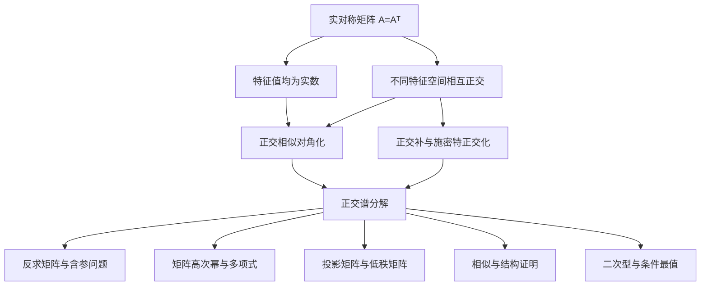
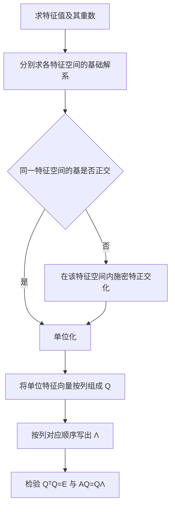
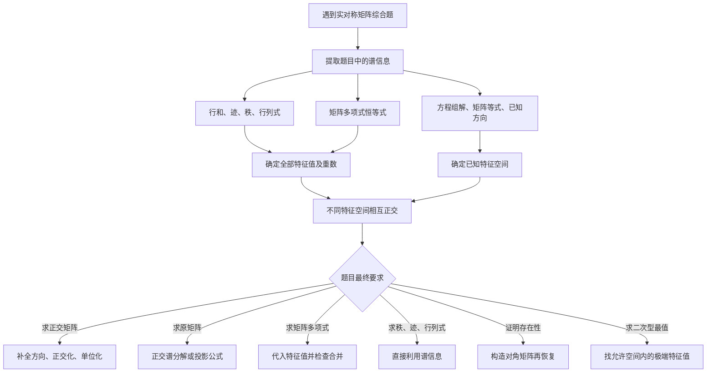

## 一、本节知识体系与考查重点

实对称矩阵是线性代数中综合性最强的知识点之一。它将前面学习的矩阵、秩、向量组、线性方程组、特征值与相似对角化连接起来，同时也是下一章二次型的理论基础。

本节最重要的思想是：

**将复杂的矩阵运算转化为若干相互正交方向上的简单数乘运算。**

掌握了这一思想，很多看似需要大量计算的题目，实际上只需要确定特征值、特征空间及其正交关系。

**1. 知识结构**

**2. 考研核心题型**

| 题型                 | 核心方法         | 重要程度  |
| ------------------ | ------------ | ----- |
| 实对称矩阵性质判断          | 谱定理及逆命题      | ★★★★★ |
| 求正交矩阵 $Q$      | 特征空间、正交化、单位化 | ★★★★★ |
| 已知特征值和特征向量反求矩阵     | 正交谱分解        | ★★★★★ |
| 根据部分特征向量补全特征空间     | 正交补          | ★★★★★ |
| 含参数实对称矩阵           | 正交性、重数、秩     | ★★★★★ |
| 矩阵高次幂与矩阵多项式        | 谱映射、特征空间合并   | ★★★★★ |
| 行和、迹、秩综合问题         | 提取隐藏特征信息     | ★★★★★ |
| 外积与投影矩阵            | 直接作用法、谱分解    | ★★★★☆ |
| 伴随矩阵综合题            | 特征值转换        | ★★★★☆ |
| 正交相似与证明题           | 共同的对角矩阵      | ★★★★☆ |
| $A^TA$ 与双边正交变换 | 半正定性、正交特征基   | ★★★★☆ |
| 二次型条件最值            | 特征值最值        | ★★★★☆ |

学习时尤其要重视后三类综合问题，它们往往不是直接问你实对称矩阵有什么性质，而是将性质隐藏在其他矩阵表达式中。

## 二、基础概念与核心定理

### 2.1 什么是实对称矩阵

设 $A=(a_{ij})_{n\times n}$ 为实矩阵，若

$$
\boxed{A^T=A}
$$

即

$$
a_{ij}=a_{ji},
$$

则称 $A$ 为实对称矩阵。

例如：

$$
A= \begin{pmatrix} 1&2&3\\ 2&4&5\\ 3&5&6 \end{pmatrix}.
$$

需要明确两个条件：元素为实数，并且矩阵关于主对角线对称。

但本节真正重要的不是矩阵元素的对称性，而是这种对称性带来的特征结构。

### 2.2 实对称矩阵的三大核心性质

**性质一：实对称矩阵的特征值全部为实数。**

一般实矩阵的特征值不一定是实数。例如

$$
B=\begin{pmatrix}0&-1\\1&0\end{pmatrix}
$$

的特征值为 $\pm i$。

而实对称矩阵不存在这种问题。

**性质二：属于不同特征值的特征向量必然正交。**

若

$$
A\alpha=\lambda_1\alpha,\qquad A\beta=\lambda_2\beta,
$$

且 $\lambda_1\ne\lambda_2$，则

$$
\boxed{\alpha^T\beta=0}.
$$

这是本节最常使用的性质。

证明如下：

$$
\alpha^TA\beta =\lambda_2\alpha^T\beta.
$$

又因为 $A^T=A$，所以

$$
\begin{aligned} \alpha^TA\beta &=(A\alpha)^T\beta\\ &=\lambda_1\alpha^T\beta. \end{aligned}
$$

两式相减：

$$
(\lambda_1-\lambda_2)\alpha^T\beta=0.
$$

由于 $\lambda_1\ne\lambda_2$，故

$$
\alpha^T\beta=0.
$$

**性质三：实对称矩阵必然可以正交相似对角化。**

对于任意 $n$ 阶实对称矩阵 $A$，必存在正交矩阵 $Q$，使得

$$
\boxed{Q^TAQ=\Lambda}
$$

其中

$$
\Lambda=\operatorname{diag} (\lambda_1,\lambda_2,\ldots,\lambda_n).
$$

等价地，

$$
\boxed{A=Q\Lambda Q^T}.
$$

这个定理称为实对称矩阵的谱定理。

它的意义远远超过普通的相似对角化：不仅能够找到 $n$ 个线性无关的特征向量，而且能够找到 $n$ 个两两正交的单位特征向量。

### 2.3 重特征值的特殊性质

对于一般矩阵，若 $\lambda$ 是 $m$ 重特征值，只能得到

$$
1\leq \dim\ker(A-\lambda E)\leq m.
$$

但对于实对称矩阵，一定有

$$
\boxed{\dim\ker(A-\lambda E)=m}.
$$

因此，若 $A$ 为 $n$ 阶实对称矩阵，$\lambda$ 是 $m$ 重特征值，则

$$
\boxed{r(A-\lambda E)=n-m}.
$$

反过来，

$$
\boxed{m=n-r(A-\lambda E)}.
$$

这是含参数题、秩与特征值综合题中极其重要的结论。

例如，四阶实对称矩阵满足

$$
r(A-2E)=1,
$$

那么 $2$ 一定是三重特征值。

注意：同一特征值对应的特征向量不一定正交。

| 向量关系                | 一般矩阵        | 实对称矩阵       |
| ------------------- | ----------- | ----------- |
| 不同特征值的特征向量          | 线性无关        | 必正交         |
| 同一特征值的特征向量          | 不一定正交       | 也不一定正交      |
| $m$ 重特征值的特征空间维数 | 不超过 $m$ | 恰好为 $m$ |
| 是否一定可对角化            | 否           | 是           |
| 是否一定可正交对角化          | 否           | 是           |

**易错点：实对称矩阵的任意两个线性无关的特征向量，不一定相互正交。** 只有不同特征值对应的特征向量才必然正交。

### 2.4 谱定理的逆命题

对于实方阵 $A$，以下条件等价：

$$
\boxed{ \begin{aligned} &A\text{ 为实对称矩阵}\\ \Longleftrightarrow\;& A\text{ 有一组标准正交实特征基}\\ \Longleftrightarrow\;& A\text{ 可以正交相似对角化}. \end{aligned}}
$$

逆命题的证明非常简单。

若

$$
Q^TAQ=\Lambda,\qquad Q^TQ=E,
$$

则

$$
A=Q\Lambda Q^T.
$$

从而

$$
A^T=Q\Lambda^TQ^T =Q\Lambda Q^T=A.
$$

这也是张宇1000题考查的内容。

但是，可相似对角化不代表矩阵对称。例如

$$
A=\begin{pmatrix}1&1\\0&2\end{pmatrix}
$$

具有两个不同的实特征值，所以可以相似对角化，但显然不是实对称矩阵。

## 三、正交矩阵、施密特正交化与正交对角化

### 3.1 正交矩阵的本质

对于 $n$ 阶实矩阵 $Q$，如果

$$
\boxed{Q^TQ=E},
$$

则称 $Q$ 为正交矩阵。

设

$$
Q=(q_1,q_2,\ldots,q_n),
$$

那么

$$
Q^TQ= \begin{pmatrix} q_1^Tq_1&\cdots&q_1^Tq_n\\ \vdots&\ddots&\vdots\\ q_n^Tq_1&\cdots&q_n^Tq_n \end{pmatrix}.
$$

因此，正交矩阵实际上就是由一组标准正交基构成的矩阵。

它满足：

| 性质    | 公式                                   |
| ----- | ------------------------------------ |
| 逆矩阵   | $Q^{-1}=Q^T$                     |
| 行列式   | $\det Q=\pm1$                    |
| 保持长度  | $\\|Qx\\|=\\|x\\|$           |
| 保持内积  | $(Qx)^T(Qy)=x^Ty$                |
| 保持正交性 | $x\perp y\Rightarrow Qx\perp Qy$ |
| 行向量   | 两两正交且均为单位向量                          |
| 列向量   | 两两正交且均为单位向量                          |

注意，列向量仅仅两两正交还不够，必须全部单位化。

另外，行列式等于 $1$ 或 $-1$，只是正交矩阵的必要条件，不是充分条件。

### 3.2 施密特正交化

假设 $\alpha_1,\alpha_2,\alpha_3$ 线性无关，但不一定正交。

希望将其转化为等价的正交向量组。

首先取

$$
\beta_1=\alpha_1.
$$

然后从 $\alpha_2$ 中减去沿 $\beta_1$ 方向的投影：

$$
\boxed{ \beta_2=\alpha_2- \frac{\alpha_2^T\beta_1}{\beta_1^T\beta_1} \beta_1 }.
$$

再从 $\alpha_3$ 中减去沿前两个正交方向的投影：

$$
\boxed{ \beta_3=\alpha_3- \frac{\alpha_3^T\beta_1}{\beta_1^T\beta_1}\beta_1 - \frac{\alpha_3^T\beta_2}{\beta_2^T\beta_2}\beta_2 }.
$$

一般公式为

$$
\boxed{ \beta_k=\alpha_k- \sum_{i=1}^{k-1} \frac{\alpha_k^T\beta_i}{\beta_i^T\beta_i}\beta_i }.
$$

最后单位化：

$$
q_i=\frac{\beta_i}{\|\beta_i\|}.
$$

**直观理解**

假设 $\alpha_1=(2,0)^T$，$\alpha_2=(3,2)^T$。

第二个向量可以分解为水平方向和竖直方向：

$$
\alpha_2=(3,0)^T+(0,2)^T.
$$

减去沿 $\alpha_1$ 方向的分量，就得到与 $\alpha_1$ 正交的向量 $(0,2)^T$。

施密特正交化的本质不是某种机械计算，而是**逐步消除新向量在已有方向上的分量**。

在考研计算中，正交化之后可以先将分数向量乘以适当的非零常数，化为简单的整数向量，再进行单位化，从而减少计算量。

### 母题1：2021年数学一真题——正交化投影系数

已知

$$
\alpha_1=(1,0,1)^T,
$$

$$
\alpha_2=(1,2,1)^T,
$$

$$
\alpha_3=(3,1,2)^T.
$$

令

$$
\beta_1=\alpha_1, \qquad \beta_2=\alpha_2-l\beta_1,
$$

$$
\beta_3=\alpha_3-l_1\beta_1-l_2\beta_2.
$$

若 $\beta_1,\beta_2,\beta_3$ 两两正交，求 $l_1,l_2$。

<Steps>

<Step>

### 第一步：由正交条件求 $l$ [!toc]

$$
\beta_1^T\beta_2=0.
$$

即

$$
\beta_1^T\alpha_2-l\beta_1^T\beta_1=0.
$$

因此

$$
l=\frac{2}{2}=1.
$$

于是

$$
\beta_1=(1,0,1)^T, \qquad \beta_2=(0,2,0)^T.
$$

</Step>

<Step>

### 第二步：分别求投影系数 [!toc]

由于前两个向量已经正交，

$$
l_1=\frac{\alpha_3^T\beta_1} {\beta_1^T\beta_1} =\frac{3+2}{2} =\frac52.
$$

同理，

$$
l_2=\frac{\alpha_3^T\beta_2} {\beta_2^T\beta_2} =\frac24 =\frac12.
$$

故答案为

$$
\boxed{l_1=\frac52,\qquad l_2=\frac12}.
$$

</Step>

</Steps>

**本题的迁移价值**

以后遇到

$$
x=\alpha-c_1\beta_1-c_2\beta_2
$$

且要求 $x$ 与已有方向正交，只要 $\beta_1,\beta_2$ 已经正交，就可以直接写

$$
c_i=\frac{\alpha^T\beta_i}{\beta_i^T\beta_i}.
$$

如果已有方向不正交，就不能分别套用这个公式，而应建立关于各个系数的联立方程。

### 3.3 正交相似对角化的标准步骤

给定实对称矩阵 $A$，要求正交矩阵 $Q$ 和对角矩阵 $\Lambda$，使

$$
Q^TAQ=\Lambda.
$$

标准流程如下：

特别注意：**只需要在同一个重特征值对应的特征空间内进行正交化。**

不同特征值对应的特征向量本来就是正交的，无须再做施密特正交化。

如果是单根，只需求一个非零特征向量再单位化；如果是 $m$ 重特征值，就求该特征空间的 $m$ 个线性无关的向量，并使它们正交、单位化。

### 母题2：李林880题第十四章第11题——完整正交对角化

设

$$
A= \begin{pmatrix} 1&2&2\\ 2&1&2\\ 2&2&1 \end{pmatrix}.
$$

求全部特征值、特征向量，以及使 $Q^TAQ=\Lambda$ 的正交矩阵 $Q$。

<Tabs items={["方法一：常规方法", "方法二：结构识别法（推荐）"]} defaultIndex={0}>

<Tab value="方法一：常规方法">

计算特征多项式：

$$
|\lambda E-A|=(\lambda-5)(\lambda+1)^2.
$$

因此特征值为

$$
\lambda_1=5,\qquad \lambda_2=\lambda_3=-1.
$$

</Tab>

<Tab value="方法二：结构识别法（推荐）">

观察到

$$
A=-E+2J,
$$

其中

$$
J= \begin{pmatrix} 1&1&1\\ 1&1&1\\ 1&1&1 \end{pmatrix} =ee^T,\qquad e=(1,1,1)^T.
$$

由于

$$
Je=e(e^Te)=3e,
$$

所以

$$
Ae=5e.
$$

另一方面，只要

$$
e^Tx=x_1+x_2+x_3=0,
$$

就有

$$
Jx=0,\qquad Ax=-x.
$$

因此根本不需要展开特征行列式，就可以直接得到全部特征值和特征空间：

$$
V_5=\operatorname{span}\{(1,1,1)^T\},
$$

$$
V_{-1}=\{x:x_1+x_2+x_3=0\}.
$$

</Tab>

</Tabs>

**构造正交特征基**

在 $V_{-1}$ 中可取

$$
v_2=(1,-1,0)^T,
$$

$$
v_3=(1,1,-2)^T.
$$

易知

$$
v_2^Tv_3=0.
$$

将三个向量单位化：

$$
q_1=\frac1{\sqrt3}(1,1,1)^T,
$$

$$
q_2=\frac1{\sqrt2}(1,-1,0)^T,
$$

$$
q_3=\frac1{\sqrt6}(1,1,-2)^T.
$$

因此

$$
\boxed{ Q= \begin{pmatrix} \frac1{\sqrt3}&\frac1{\sqrt2}&\frac1{\sqrt6}\\ \frac1{\sqrt3}&-\frac1{\sqrt2}&\frac1{\sqrt6}\\ \frac1{\sqrt3}&0&-\frac2{\sqrt6} \end{pmatrix} }
$$

以及

$$
\boxed{\Lambda=\operatorname{diag}(5,-1,-1)}.
$$

**母题推广：对角元素相同、非对角元素相同的矩阵**

若

$$
A= \begin{pmatrix} a&b&\cdots&b\\ b&a&\cdots&b\\ \vdots&\vdots&\ddots&\vdots\\ b&b&\cdots&a \end{pmatrix}_{n\times n},
$$

则可以写成

$$
A=(a-b)E+bJ.
$$

直接得到：

$$
\boxed{\lambda_1=a+(n-1)b},
$$

对应全1向量；另外 $n-1$ 个特征值为

$$
\boxed{\lambda_2=\cdots=\lambda_n=a-b}.
$$

当 $b\ne0$ 时，后一个特征值对应的特征空间为

$$
x_1+x_2+\cdots+x_n=0.
$$

若 $b=0$，则 $A=aE$，所有非零向量都是特征向量。

这种矩阵是行列式、逆矩阵、特征值、二次型等多个章节的共同母题。

## 四、正交投影与谱分解——本节最重要的解题工具

如果只掌握传统的

$$
A=Q\Lambda Q^T,
$$

你已经可以解决许多题目。

但如果进一步掌握正交投影与谱分解，很多需要计算逆矩阵、完整特征向量组的题目可以缩短到三四步。

### 4.1 向量内积与外积

对于列向量

$$
v=(a,b,c)^T,
$$

内积

$$
v^Tv=a^2+b^2+c^2
$$

是一个数。

而外积

$$
vv^T= \begin{pmatrix} a^2&ab&ac\\ ab&b^2&bc\\ ac&bc&c^2 \end{pmatrix}
$$

是一个矩阵。

二者不能混淆。

当 $v\ne0$ 时，$vv^T$ 是秩为1的实对称矩阵，并且

$$
(vv^T)v=(v^Tv)v.
$$

因此其唯一的非零特征值为

$$
\boxed{v^Tv=\|v\|^2}.
$$

其他 $n-1$ 个特征值均为0。

### 4.2 一维正交投影矩阵

设 $v\ne0$，定义

$$
\boxed{\Pi_v=\frac{vv^T}{v^Tv}}.
$$

对任意向量 $x$，

$$
\Pi_vx=\frac{v^Tx}{v^Tv}v.
$$

这恰好就是 $x$ 在方向 $v$ 上的正交投影。

它具有以下性质：

$$
\Pi_v^T=\Pi_v,
$$

$$
\Pi_v^2=\Pi_v,
$$

$$
r(\Pi_v)=1.
$$

并且

$$
\Pi_vv=v.
$$

若 $x\perp v$，则

$$
\Pi_vx=0.
$$

所以 $\Pi_v$ 在 $v$ 方向上的特征值为1，在垂直于 $v$ 的所有方向上的特征值为0。

对应地，

$$
E-\Pi_v
$$

就是向 $v^\perp$ 的正交投影矩阵。

### 4.3 正交谱分解公式

设 $u_1,\ldots,u_n$ 为实对称矩阵 $A$ 的标准正交特征向量组，则

$$
\boxed{ A=\sum_{i=1}^n\lambda_i u_iu_i^T }.
$$

如果已有的特征向量 $v_1,\ldots,v_n$ 两两正交，但没有单位化，则

$$
\boxed{ A=\sum_{i=1}^n \lambda_i\frac{v_iv_i^T}{v_i^Tv_i} }.
$$

推导非常简单：

$$
Q=(u_1,\ldots,u_n).
$$

于是

$$
\begin{aligned} A &=Q\Lambda Q^T\\ &=(\lambda_1u_1,\ldots,\lambda_nu_n) \begin{pmatrix} u_1^T\\ \vdots\\ u_n^T \end{pmatrix}\\ &=\lambda_1u_1u_1^T+\cdots+ \lambda_nu_nu_n^T. \end{aligned}
$$

同时，

$$
\boxed{\sum_{i=1}^nu_iu_i^T=E}.
$$

这说明每一个向量都能被分解到各个正交特征方向上，矩阵 $A$ 再对不同方向施加不同倍数的伸缩。

### 4.4 两种特征值时的万能公式

假设 $A$ 是 $n$ 阶实对称矩阵，其特征值为

$$
\lambda,\underbrace{\mu,\ldots,\mu}_{n-1}.
$$

且 $\lambda\ne\mu$，已知 $v$ 是属于单根 $\lambda$ 的特征向量。

那么

$$
\boxed{ A=\mu E+(\lambda-\mu)\frac{vv^T}{v^Tv} }.
$$

这个公式值得重点记忆。

其原理是

$$
A=\lambda\Pi_v+\mu(E-\Pi_v).
$$

不仅如此，任何多项式 $p(A)$ 都有

$$
\boxed{ p(A)=p(\mu)E+ [p(\lambda)-p(\mu)] \frac{vv^T}{v^Tv} }.
$$

这是求实对称矩阵高次幂、逆矩阵、伴随矩阵等问题的强力工具。

### 母题3：1995年数学一真题——已知一个特征方向反求矩阵

设三阶实对称矩阵 $A$ 的特征值为

$$
-1,\quad1,\quad1.
$$

属于特征值 $-1$ 的特征向量为

$$
v=(0,1,1)^T.
$$

求 $A$。

**识别题型**

题目只给了一个特征向量，却给出了全部特征值。

由于另外两个特征值相同，这正是“两种特征值且其中一个为单根”的情形。

直接应用投影公式：

$$
A=E+(-1-1)\frac{vv^T}{v^Tv}.
$$

因为

$$
v^Tv=2,
$$

所以

$$
\begin{aligned} A &=E-vv^T\\ &= \begin{pmatrix} 1&0&0\\ 0&1&0\\ 0&0&1 \end{pmatrix} - \begin{pmatrix} 0&0&0\\ 0&1&1\\ 0&1&1 \end{pmatrix}. \end{aligned}
$$

最终得到

$$
\boxed{ A= \begin{pmatrix} 1&0&0\\ 0&0&-1\\ 0&-1&0 \end{pmatrix} }.
$$

**进一步理解**

这个矩阵在 $v$ 方向上将向量变成相反方向，在与 $v$ 垂直的平面内保持向量不变。

因此它实际上表示关于平面 $v^\perp$ 的镜面反射。

因为反射两次恢复原状，所以无需矩阵乘法即可推出

$$
A^2=E.
$$

进而

$$
A^{2k}=E,\qquad A^{2k+1}=A.
$$

这就是从一道反求矩阵的真题，迁移到矩阵高次幂、逆矩阵和正交矩阵问题。

### 母题4：李正元练习题第20题——重根特征空间与正交补

设三阶实对称矩阵 $A$ 满足

$$
r(A)=2,
$$

且6是其二重特征值，已知

$$
\alpha_1=(1,1,0)^T,
$$

$$
\alpha_2=(2,1,1)^T,
$$

$$
\alpha_3=(-1,2,-3)^T
$$

都是属于6的特征向量，求 $A$。

<Steps>

<Step>

### 第一步：确定全部特征值 [!toc]

由秩为2可知，0是一个单根特征值，因此

$$
\lambda_1=\lambda_2=6,\qquad\lambda_3=0.
$$

</Step>

<Step>

### 第二步：识别冗余信息 [!toc]

虽然题目给了三个特征向量，但6是二重特征值，特征空间只有二维。

事实上，

$$
\alpha_3=5\alpha_1-3\alpha_2.
$$

因此只需使用线性无关的 $\alpha_1,\alpha_2$。

</Step>

<Step>

### 第三步：求零特征方向 [!toc]

设

$$
v=(x,y,z)^T\in V_0.
$$

由不同特征空间正交，

$$
\begin{cases} x+y=0,\\ 2x+y+z=0. \end{cases}
$$

可取

$$
v=(1,-1,-1)^T.
$$

</Step>

<Step>

### 第四步：利用投影公式重建矩阵 [!toc]

$$
A=6E+(0-6)\frac{vv^T}{v^Tv}.
$$

由于 $v^Tv=3$，故

$$
\boxed{ A= \begin{pmatrix} 4&2&2\\ 2&4&-2\\ 2&-2&4 \end{pmatrix} }.
$$

</Step>

</Steps>

**延伸问题**

如果改为求 $A^n$，那么

$$
\boxed{ A^n=6^{n-1}A,\qquad n\ge1 }.
$$

因为

$$
A=6(E-\Pi_v),
$$

而 $E-\Pi_v$ 是幂等矩阵。

**本题核心技巧：当已知的是高维重特征空间时，优先寻找其低维正交补。**

这样通常比对重特征空间的一组基进行施密特正交化更加简单。

## 五、综合真题：从题目中提取隐藏的特征信息

考研大题很少直接将所有特征值、特征向量告诉你。往往要从秩、迹、行和、方程组及矩阵等式中提取。

### 5.1 隐藏特征信息的转换表

| 题目条件                           | 应立即想到                                 |
| ------------------------------ | ------------------------------------- |
| 各行元素之和均为 $c$               | $Ae=ce$，其中 $e=(1,\ldots,1)^T$ |
| $Ax=0$ 的非零解                | 属于特征值0的特征向量                           |
| $Ax=cx$，且 $x\ne0$      | $c$ 是特征值                          |
| $r(A)=r$                   | 实对称矩阵有 $n-r$ 个零特征值                |
| $\operatorname{tr}A=c$     | 所有特征值之和为 $c$                      |
| $\det A=c$                 | 所有特征值之积为 $c$                      |
| $\det(A-cE)=0$             | $c$ 是特征值                          |
| $r(A-cE)=r$                | $c$ 的代数重数为 $n-r$，限实对称等可对角化情形  |
| 两个不同的非齐次方程组解                   | 作差得到齐次解                               |
| $AB=cB$                    | $B$ 的非零列向量属于 $A$ 的特征值 $c$ |
| $Q^TAQ$ 为对角矩阵，且 $Q$ 正交 | $Q$ 的每一列都是单位特征向量                  |

遇到实对称矩阵大题，应先翻译所有已知条件，而不是立即展开特征行列式。

### 母题5：2006年数学一、二、三真题——行和、齐次方程组、正交对角化与高次幂

已知三阶实对称矩阵 $A$ 各行元素之和均为3，且

$$
\alpha_1=(-1,2,-1)^T,
$$

$$
\alpha_2=(0,-1,1)^T
$$

都是方程组 $Ax=0$ 的解。

求：

（1）全部特征值及特征向量；

（2）正交矩阵 $Q$ 和对角矩阵 $\Lambda$，使 $Q^TAQ=\Lambda$；

（3）矩阵 $A$ 和

$$
\left(A-\frac32E\right)^6.
$$

这道题几乎涵盖了本节所有基础解题方法，非常适合作为重点母题。

**第一问：确定特征值与特征空间**

由行和为3，

$$
A(1,1,1)^T=3(1,1,1)^T.
$$

因此

$$
\lambda_1=3,\qquad e=(1,1,1)^T.
$$

又由于

$$
A\alpha_1=A\alpha_2=0,
$$

且 $\alpha_1,\alpha_2$ 线性无关，可得

$$
\boxed{\lambda_2=\lambda_3=0}.
$$

全部特征向量为：

属于3的特征向量：

$$
x=ke,\qquad k\ne0.
$$

属于0的特征向量：

$$
x=k_1\alpha_1+k_2\alpha_2,
$$

其中 $k_1,k_2$ 不全为0。

**第二问：构造正交矩阵**

属于不同特征值的向量天然正交，因此只需要处理零特征空间。

取

$$
\beta_1=\alpha_1=(-1,2,-1)^T.
$$

进行施密特正交化：

$$
\begin{aligned} \beta_2 &=\alpha_2- \frac{\alpha_2^T\beta_1}{\beta_1^T\beta_1}\beta_1\\ &=\alpha_2+\frac12\beta_1\\ &=\frac12(-1,0,1)^T. \end{aligned}
$$

因此可直接选取以下三个正交单位向量：

$$
q_1=\frac{(1,1,1)^T}{\sqrt3},
$$

$$
q_2=\frac{(-1,2,-1)^T}{\sqrt6},
$$

$$
q_3=\frac{(-1,0,1)^T}{\sqrt2}.
$$

从而

$$
\boxed{ Q= \begin{pmatrix} \frac1{\sqrt3}&-\frac1{\sqrt6}&-\frac1{\sqrt2}\\ \frac1{\sqrt3}&\frac2{\sqrt6}&0\\ \frac1{\sqrt3}&-\frac1{\sqrt6}&\frac1{\sqrt2} \end{pmatrix} }
$$

以及

$$
\boxed{\Lambda=\operatorname{diag}(3,0,0)}.
$$

**第三问：恢复矩阵并求高次幂**

利用谱分解，

$$
A=3q_1q_1^T+0q_2q_2^T+0q_3q_3^T.
$$

立即得到

$$
\boxed{ A= \begin{pmatrix} 1&1&1\\ 1&1&1\\ 1&1&1 \end{pmatrix} }.
$$

再考虑

$$
B=A-\frac32E.
$$

它的特征值为

$$
\frac32,-\frac32,-\frac32.
$$

六次方之后，三个特征值都变为

$$
\left(\frac32\right)^6.
$$

因为 $B^6$ 仍为实对称矩阵，所以

$$
\boxed{ \left(A-\frac32E\right)^6 =\frac{729}{64}E }.
$$

整个过程中完全不需要做六次矩阵乘法。

**这一母题的深层结论**

若实对称矩阵 $A$ 只有两个不同的特征值 $a,b$，那么

$$
\boxed{ \left(A-\frac{a+b}{2}E\right)^2 =\frac{(a-b)^2}{4}E }.
$$

因此

$$
\left(A-\frac{a+b}{2}E\right)^{2k} = \left(\frac{a-b}{2}\right)^{2k}E.
$$

题目中的 $\frac32$ 并非偶然，它正是两个不同特征值3和0的平均值。

### 母题6：2011年数学一、二、三真题——矩阵等式拆列

设 $A$ 为三阶实对称矩阵，且 $r(A)=2$，满足

$$
A \begin{pmatrix} 1&1\\ 0&0\\ -1&1 \end{pmatrix} = \begin{pmatrix} -1&1\\ 0&0\\ 1&1 \end{pmatrix}.
$$

求 $A$ 的特征值、特征向量和矩阵 $A$。

<Steps>

<Step>

### 第一步：按列拆分矩阵等式 [!toc]

令

$$
v_1=(1,0,-1)^T,\qquad v_2=(1,0,1)^T.
$$

原等式相当于

$$
Av_1=-v_1,\qquad Av_2=v_2.
$$

所以已知两个特征值：

$$
\lambda_1=-1,\qquad\lambda_2=1.
$$

</Step>

<Step>

### 第二步：利用秩补全特征值 [!toc]

由 $r(A)=2$ 得

$$
\lambda_3=0.
$$

属于0的特征向量必须同时垂直于 $v_1,v_2$。

设 $v_3=(x,y,z)^T$，则

$$
\begin{cases} x-z=0,\\ x+z=0. \end{cases}
$$

故可取

$$
v_3=(0,1,0)^T.
$$

</Step>

<Step>

### 第三步：谱分解 [!toc]

$$
\begin{aligned} A &=-\frac{v_1v_1^T}{2} +\frac{v_2v_2^T}{2}\\ &=\boxed{ \begin{pmatrix} 0&0&1\\ 0&0&0\\ 1&0&0 \end{pmatrix} }. \end{aligned}
$$

</Step>

</Steps>

**母题变形**

如果题目给出

$$
AB=B\Lambda,
$$

其中

$$
B=(b_1,\ldots,b_k), \qquad \Lambda=\operatorname{diag}(\lambda_1,\ldots,\lambda_k),
$$

那么逐列拆开就是

$$
Ab_i=\lambda_i b_i.
$$

只要 $b_i\ne0$，这就是特征向量条件。

因此，矩阵相乘的题目完全可能是隐藏形式的特征值题目。

### 母题7：张宇1000题第50题——非齐次解作差

设三阶实对称矩阵 $A$ 各行元素之和与迹均为2，且

$$
\alpha=(2,1,0)^T,\qquad \beta=(0,1,2)^T
$$

是方程组

$$
(A-E)x=(1,1,1)^T
$$

的两个解，求 $A$。

<Steps>

<Step>

### 第一步：行和给出第一个特征方向 [!toc]

设 $e=(1,1,1)^T$，则

$$
Ae=2e.
$$

因此第一个特征值为2。

</Step>

<Step>

### 第二步：非齐次方程组的两个解作差 [!toc]

$$
(A-E)\alpha=(A-E)\beta.
$$

所以

$$
(A-E)(\alpha-\beta)=0.
$$

而

$$
\alpha-\beta=2(1,0,-1)^T.
$$

取

$$
v=(1,0,-1)^T,
$$

得到

$$
Av=v.
$$

因此第二个特征值为1。

</Step>

<Step>

### 第三步：迹给出第三个特征值 [!toc]

$$
2+1+\lambda_3=2.
$$

所以

$$
\lambda_3=-1.
$$

求与 $e,v$ 都正交的向量，可取

$$
w=(1,-2,1)^T.
$$

</Step>

<Step>

### 第四步：恢复矩阵 [!toc]

$$
A=2\frac{ee^T}{3} +\frac{vv^T}{2} -\frac{ww^T}{6}.
$$

计算得

$$
\boxed{ A= \begin{pmatrix} 1&1&0\\ 1&0&1\\ 0&1&1 \end{pmatrix} }.
$$

这道题的价值在于将第三章非齐次线性方程组与第四章特征值、实对称矩阵完美结合。

以后看到“两个解”，首先想到作差；看到“行和”，首先想到全1向量；看到“迹”，首先想到特征值之和。

</Step>

</Steps>

## 六、含参数实对称矩阵问题

含参数问题是本节最容易将简单题复杂化的部分。

通常有四种解题入口：

| 已知条件           | 首选方法               |
| -------------- | ------------------ |
| 两个不同特征值的含参特征向量 | 内积等于0              |
| 已知正交对角化矩阵的一列   | $Av=\lambda v$ |
| 已知重特征值         | 秩条件                |
| 非齐次方程组有无穷多解    | 奇异性与相容性            |

原则是：**优先使用特征向量和秩确定参数，最后才考虑展开含参数特征多项式。**

### 母题8：汤家凤八套卷第八套第15题——正交性直接求参数

设 $A$ 为三阶实对称矩阵，

$$
\xi_1=(k,-k,1)^T
$$

是 $Ax=0$ 的解，

$$
\xi_2=(k,2,1)^T
$$

是 $(2E-A)x=0$ 的解，且

$$
|E+A|=0.
$$

求 $A$。

<Steps>

<Step>

### 第一步：提取特征信息 [!toc]

由题意，

$$
A\xi_1=0,\qquad A\xi_2=2\xi_2.
$$

因此0和2都是特征值，且两个向量必须正交。

$$
\xi_1^T\xi_2=k^2-2k+1=0.
$$

即

$$
(k-1)^2=0.
$$

得到

$$
\boxed{k=1}.
$$

</Step>

<Step>

### 第二步：补齐第三个特征值与方向 [!toc]

由

$$
|E+A|=0,
$$

可知 $-1$ 是第三个特征值。

前两个特征方向为

$$
v_0=(1,-1,1)^T,
$$

$$
v_2=(1,2,1)^T.
$$

求与二者都正交的向量，可取

$$
v_{-1}=(-1,0,1)^T.
$$

</Step>

<Step>

### 第三步：谱分解 [!toc]

$$
A=2\frac{v_2v_2^T}{6} -\frac{v_{-1}v_{-1}^T}{2}.
$$

从而

$$
\boxed{ A=\frac16 \begin{pmatrix} -1&4&5\\ 4&8&4\\ 5&4&-1 \end{pmatrix} }.
$$

</Step>

</Steps>

<Callout type="warn" title="常见陷阱">

正交条件只能用于不同特征值的特征向量。如果题目给出的两个向量属于同一个特征值，就不能直接令内积为0。

如果求出的参数有多个候选值，也要继续利用题目的其他条件排除不符合要求的参数。

</Callout>

### 母题9：2010年数学二、三真题——给出正交矩阵的一列

设

$$
A= \begin{pmatrix} 0&-1&4\\ -1&3&a\\ 4&a&0 \end{pmatrix}.
$$

正交矩阵 $Q$ 满足 $Q^TAQ$ 为对角矩阵，且 $Q$ 的第一列为

$$
\frac1{\sqrt6}(1,2,1)^T.
$$

求 $a,Q$。

<Steps>

<Step>

### 第一步：将已知列向量视作特征向量 [!toc]

令

$$
v=(1,2,1)^T.
$$

存在特征值 $\lambda$，使

$$
Av=\lambda v.
$$

即

$$
\begin{pmatrix} 2\\5+a\\4+2a \end{pmatrix} = \begin{pmatrix} \lambda\\2\lambda\\\lambda \end{pmatrix}.
$$

比较分量：

$$
\lambda=2,\qquad a=-1.
$$

</Step>

<Step>

### 第二步：求剩余特征向量 [!toc]

代入 $a=-1$，得到

$$
A= \begin{pmatrix} 0&-1&4\\ -1&3&-1\\ 4&-1&0 \end{pmatrix}.
$$

观察矩阵第一、三行的结构，可以尝试向量

$$
v_2=(-1,0,1)^T.
$$

直接验证：

$$
Av_2=-4v_2.
$$

再求与前两个向量都正交的方向：

$$
v_3=(1,-1,1)^T.
$$

验证得

$$
Av_3=5v_3.
$$

故

$$
\boxed{ Q= \begin{pmatrix} \frac1{\sqrt6}&-\frac1{\sqrt2}&\frac1{\sqrt3}\\ \frac2{\sqrt6}&0&-\frac1{\sqrt3}\\ \frac1{\sqrt6}&\frac1{\sqrt2}&\frac1{\sqrt3} \end{pmatrix} }
$$

以及

$$
\Lambda=\operatorname{diag}(2,-4,5).
$$

这道题中，已知 $Q$ 的一列就等于已知一个特征方向。先求参数再求其他特征向量，可以大幅降低计算难度。

</Step>

</Steps>

### 6.2 实对称矩阵与非齐次方程组相容性

这是数学一综合题的重要拓展。

设 $A=A^T$，则

$$
\boxed{\operatorname{Im}A=(\ker A)^\perp}.
$$

其中 $\operatorname{Im}A$ 表示矩阵的列空间，$\ker A$ 表示齐次方程组 $Ax=0$ 的解空间。

证明：

任取 $y\in\operatorname{Im}A$，则存在 $x$，使

$$
y=Ax.
$$

对于任意 $z\in\ker A$，

$$
z^Ty=z^TAx=(Az)^Tx=0.
$$

因此

$$
\operatorname{Im}A\subseteq(\ker A)^\perp.
$$

又因为两个空间维数均为 $r(A)$，所以二者相等。

于是，对于实对称矩阵，

$$
\boxed{ Ax=b\text{ 有解} \Longleftrightarrow b\perp\ker A }.
$$

也就是说，只要检查 $b$ 是否与齐次方程组基础解系中的每个向量正交，就能判断非齐次方程组是否有解。

**典型应用：2001年数学三真题**

$$
A= \begin{pmatrix} 1&1&a\\ 1&a&1\\ a&1&1 \end{pmatrix}, \qquad b=(1,1,-2)^T.
$$

若 $Ax=b$ 有解但不唯一，求 $a$。

首先必须有

$$
|A|=0.
$$

计算得

$$
-(a-1)^2(a+2)=0.
$$

因此候选参数为

$$
a=1\quad\text{或}\quad a=-2.
$$

当 $a=1$ 时，$A=J$，其列空间为

$$
\operatorname{span}\{(1,1,1)^T\}.
$$

显然 $b$ 不属于该空间，所以无解。

当 $a=-2$ 时，

$$
\ker A=\operatorname{span}\{(1,1,1)^T\},
$$

而

$$
b^T(1,1,1)^T=0.
$$

因此方程组有解，又因为 $r(A)=2$，所以有无穷多解。

故

$$
\boxed{a=-2}.
$$

此时三个正交特征方向可以取

$$
(1,1,1)^T,\quad(1,0,-1)^T,\quad(-1,2,-1)^T,
$$

对应特征值分别为 $0,3,-3$，将它们单位化即可完成原真题的正交对角化要求。

**易错点：**$|A|=0$ **只说明不存在唯一解，不说明一定有无穷多解。还可能无解。**

## 七、矩阵多项式、高次幂与特征空间合并

### 7.1 谱映射定理的基本应用

设

$$
A=Q\Lambda Q^T.
$$

则

$$
A^2=Q\Lambda^2Q^T,
$$

$$
A^n=Q\Lambda^nQ^T.
$$

更一般地，对于多项式

$$
p(t)=a_mt^m+\cdots+a_1t+a_0,
$$

有

$$
\boxed{ p(A)=Qp(\Lambda)Q^T }.
$$

因此

$$
\boxed{ p(A)=\sum_{i=1}^np(\lambda_i)u_iu_i^T }.
$$

如果只问 $p(A)$ 的特征值，则直接计算

$$
p(\lambda_1),\ldots,p(\lambda_n).
$$

但是，如果问 $p(A)$ 的**全部特征向量**，还必须考虑不同特征值是否合并。

### 7.2 特征空间合并

假设 $A$ 的不同特征值为 $\lambda_1,\lambda_2$，但

$$
p(\lambda_1)=p(\lambda_2)=c.
$$

那么属于这两个特征空间的任意向量之和，都是 $p(A)$ 关于特征值 $c$ 的特征空间中的向量。

对于实对称矩阵，可以精确写成

$$
\boxed{ V_c(p(A))= \bigoplus_{p(\lambda)=c}V_\lambda(A) }.
$$

这正是矩阵多项式题中容易遗漏的关键步骤。

### 母题10：2007年数学一、二、三真题——特征值合并与直接重建

设三阶实对称矩阵 $A$ 的特征值为

$$
1,\quad2,\quad-2,
$$

其中

$$
v=(1,-1,1)^T
$$

是属于特征值1的特征向量。

令

$$
B=A^5-4A^3+E.
$$

求 $B$ 的全部特征值、特征向量及矩阵 $B$。

<Steps>

<Step>

### 第一步：对原特征值逐个代入 [!toc]

记

$$
p(t)=t^5-4t^3+1.
$$

则

$$
p(1)=1-4+1=-2,
$$

$$
p(2)=32-32+1=1,
$$

$$
p(-2)=-32+32+1=1.
$$

因此 $B$ 的全部特征值为

$$
\boxed{-2,\quad1,\quad1}.
$$

</Step>

<Step>

### 第二步：确定特征空间 [!toc]

属于 $-2$ 的全部特征向量为

$$
x=k(1,-1,1)^T,\qquad k\ne0.
$$

属于1的特征空间是上述方向的正交补：

$$
x_1-x_2+x_3=0.
$$

可取一组基：

$$
w_1=(1,1,0)^T,\qquad w_2=(-1,0,1)^T.
$$

所以全部特征向量可以表示为

$$
x=k_1w_1+k_2w_2,
$$

其中 $k_1,k_2$ 不全为0。

</Step>

<Step>

### 第三步：用两种特征值公式直接求 $B$ [!toc]

$$
\begin{aligned} B &=E+(-2-1)\frac{vv^T}{v^Tv}\\ &=E-vv^T. \end{aligned}
$$

因此

$$
\boxed{ B= \begin{pmatrix} 0&1&-1\\ 1&0&1\\ -1&1&0 \end{pmatrix} }.
$$

</Step>

</Steps>

**为什么这道题值得反复研究？**

题目并未给出 $A$ 的完整特征向量组，实际上也没有足够的信息唯一确定 $A$。

但是由于 $p(2)=p(-2)$，两个原本不同的特征空间在 $B$ 中合并，使 $B$ 可以被唯一确定。

这是一类很重要的创新命题思想：

**不能确定原矩阵，不代表不能确定原矩阵的某个多项式。**

当矩阵多项式消除了某些特征方向之间的差异，就可能不再需要原矩阵的完整信息。

### 7.3 更高效的矩阵多项式公式

如果实对称矩阵 $A$ 只有两个不同特征值 $\lambda,\mu$，则

$$
(A-\lambda E)(A-\mu E)=O.
$$

因此

$$
\boxed{ A^2-(\lambda+\mu)A+\lambda\mu E=O }.
$$

任意高次多项式都可以降为 $A,E$ 的线性组合。

具体地，

$$
\boxed{ p(A)=p(\mu)E+ \frac{p(\lambda)-p(\mu)}{\lambda-\mu} (A-\mu E) }.
$$

如果题目没有要求写出具体矩阵元素，只要求用 $A,E$ 表示高次幂，这个公式尤其方便。

例如张宇1000题第12题：

三阶实对称矩阵各行和为3，且1是二重特征值。

直接得到全部特征值为

$$
3,1,1.
$$

于是

$$
A^n =E+\frac{3^n-1}{2}(A-E).
$$

又因为单根3对应全1向量，

$$
A=E+\frac23J.
$$

因此

$$
\boxed{ A^n=E+\frac{3^n-1}{3}J }.
$$

这种题目不需要求具体的正交矩阵。

## 八、矩阵方程、秩与实对称矩阵的结构判定

### 8.1 由矩阵多项式方程确定特征值

如果

$$
p(A)=O,
$$

且

$$
Av=\lambda v,\qquad v\ne0,
$$

那么

$$
p(A)v=p(\lambda)v=0.
$$

因此

$$
\boxed{p(\lambda)=0}.
$$

也就是说，矩阵 $A$ 的所有特征值都是多项式 $p(t)$ 的根。

但注意：

- 一般矩阵的特征值是多项式的根，不代表多项式一定包含所有这些根作为矩阵的特征值。
- 一般矩阵即使所有特征值都为0，也不一定是零矩阵。
- 实对称矩阵由于必可对角化，所有特征值均为0时，矩阵一定为零。

### 母题11：2010年数学一、二、三真题——多项式与秩

设四阶实对称矩阵 $A$ 满足

$$
A^2+A=O,\qquad r(A)=3.
$$

求 $A$ 相似于哪个对角矩阵。

由矩阵方程得

$$
\lambda^2+\lambda=0.
$$

所以

$$
\lambda=0\quad\text{或}\quad\lambda=-1.
$$

又因为

$$
r(A)=3,
$$

而 $A$ 可对角化，因此0的重数恰好为1。

故其余三个特征值都为 $-1$。

$$
\boxed{ A\sim\operatorname{diag}(-1,-1,-1,0) }.
$$

这道题无需计算任何矩阵元素。

**相关的两道高质量练习**

张宇1000题第13题给出

$$
A+A^2+\frac12A^3=O.
$$

由特征值条件，

$$
\lambda\left(1+\lambda+\frac12\lambda^2\right)=0.
$$

而

$$
1+\lambda+\frac12\lambda^2 =\frac12[(\lambda+1)^2+1]>0.
$$

由于特征值均为实数，只能有 $\lambda=0$。

所以

$$
\boxed{A=O,\qquad r(A)=0}.
$$

张宇1000题第44题给出实对称矩阵 $A$ 满足

$$
A^4=O.
$$

同理所有特征值均为0，所以

$$
\boxed{A=O}.
$$

但如果去掉实对称条件，结论就不一定成立。例如

$$
N=\begin{pmatrix}0&1\\0&0\end{pmatrix}
$$

满足 $N^2=O$，却不是零矩阵。

**重要推论**

对于实对称矩阵 $A$，任意正整数 $m$ 都满足

$$
\boxed{r(A^m)=r(A)},
$$

$$
\boxed{\ker A^m=\ker A}.
$$

更进一步，如果矩阵 $A$ 可逆，

$$
\boxed{r(A^{-1})=n}.
$$

此外，若 $A$ 是实对称矩阵，则以下条件等价：

$$
\boxed{ A^2=O \Longleftrightarrow A^m=O \Longleftrightarrow A=O }
$$

其中 $m$ 为任意正整数。

## 九、谱定理与相似关系证明题

### 母题12：2002年数学一真题——相同特征多项式能否推出相似

这道证明题非常重要，因为它考查的不是机械运算，而是一般矩阵与实对称矩阵的本质区别。

**第一问：证明相似矩阵具有相同的特征多项式**

如果

$$
B=P^{-1}AP,
$$

则

$$
\lambda E-B =P^{-1}(\lambda E-A)P.
$$

两端取行列式：

$$
|\lambda E-B| =|P^{-1}||\lambda E-A||P|.
$$

因为

$$
|P^{-1}||P|=1,
$$

所以

$$
\boxed{|\lambda E-B|=|\lambda E-A|}.
$$

**第二问：证明逆命题一般不成立**

取

$$
A=\begin{pmatrix}0&0\\0&0\end{pmatrix}, \qquad B=\begin{pmatrix}0&1\\0&0\end{pmatrix}.
$$

它们的特征多项式均为

$$
\lambda^2.
$$

但

$$
r(A)=0,\qquad r(B)=1.
$$

由于相似矩阵必具有相同的秩，所以

$$
A\not\sim B.
$$

**第三问：当二者均为实对称矩阵时证明逆命题成立**

由谱定理，存在正交矩阵 $Q_1,Q_2$，使

$$
Q_1^TAQ_1=\Lambda_1,
$$

$$
Q_2^TBQ_2=\Lambda_2.
$$

因为特征多项式相同，全部特征值及其重数相同，适当调整排列次序后，可以令

$$
\Lambda_1=\Lambda_2=\Lambda.
$$

于是

$$
A\sim\Lambda\sim B.
$$

从而

$$
\boxed{A\sim B}.
$$

事实上，令

$$
Q=Q_1Q_2^T,
$$

则 $Q$ 为正交矩阵，且

$$
\begin{aligned} Q^TAQ &=Q_2Q_1^TAQ_1Q_2^T\\ &=Q_2\Lambda Q_2^T\\ &=B. \end{aligned}
$$

因此可以得到更强的结论：

$$
\boxed{ A,B\text{ 为同阶实对称矩阵} \Rightarrow \begin{cases} A\sim B\\ \Updownarrow\\ A,B\text{ 有相同特征值及重数}\\ \Updownarrow\\ A,B\text{ 正交相似} \end{cases} }
$$

### 9.2 相似、合同、正交相似的区别

| 关系   | 表达式              | 保持的主要性质       |
| ---- | ---------------- | ------------- |
| 等价   | $B=PAQ$      | 秩             |
| 相似   | $B=P^{-1}AP$ | 特征值、迹、行列式、秩   |
| 合同   | $B=P^TAP$    | 对实对称矩阵，保持惯性指数 |
| 正交相似 | $B=Q^TAQ$    | 特征值及重数、秩、迹等   |

其中 $P,Q$ 在等价关系中是可逆矩阵；正交相似中的 $Q$ 还必须满足 $Q^TQ=E$。

对于实对称矩阵，普通相似与正交相似作为两个矩阵之间的关系是等价的。但不能将任意实现相似的矩阵 $P$ 都认为是正交矩阵。

同时，正交相似也属于合同关系，原因是

$$
Q^{-1}=Q^T.
$$

例如

$$
A=\operatorname{diag}(1,2), \quad B=\operatorname{diag}(3,4).
$$

二者具有相同的正惯性指数，所以合同，但特征值不同，所以不相似。

这部分知识将在第五章二次型中进一步使用。

## 十、外积矩阵、投影矩阵与低秩结构

这一部分在李林880题、张宇1000题和分类模拟题中都有多种不同的命题形式。

相比单纯的数值矩阵计算，这些题更加考查抽象理解能力，也更有利于应对未来创新题。

### 10.1 正交投影矩阵的判定

设 $P$ 为实方阵，则 $P$ 是某个子空间上的正交投影矩阵，当且仅当

$$
\boxed{ P^T=P,\qquad P^2=P }.
$$

其中：

- $P^2=P$ 表明投影一次和投影多次的结果相同。
- $P^T=P$ 表明其像空间与核空间相互正交。

若

$$
r(P)=k,
$$

则特征值为

$$
\underbrace{1,\ldots,1}_{k}, \quad \underbrace{0,\ldots,0}_{n-k}.
$$

所以

$$
\boxed{r(P)=\operatorname{tr}P}.
$$

对于任意幂等矩阵，即使它不是实对称矩阵，由于它满足 $P(P-E)=O$，且多项式 $t(t-1)$ 没有重根，所以仍然可以相似对角化，且上述秩与迹的结论仍然成立。

区别在于：一般幂等矩阵不一定表示正交投影。

### 10.2 多维正交投影

设

$$
u_1,u_2,\ldots,u_k
$$

是 $n$ 维标准正交向量组，令

$$
U=(u_1,u_2,\ldots,u_k).
$$

注意 $U$ 是 $n\times k$ 矩阵，不一定是方阵。

因为

$$
U^TU=E_k,
$$

所以

$$
\boxed{P=UU^T=\sum_{i=1}^ku_iu_i^T}
$$

是向这 $k$ 个向量所张成的子空间的正交投影。

并且

$$
P^2=U(U^TU)U^T=P.
$$

若 $V$ 的列向量线性无关，但没有正交化，那么更一般的投影公式为

$$
\boxed{P=V(V^TV)^{-1}V^T}.
$$

该公式不是考研必须背诵的基础公式，但可以作为解决抽象投影问题的拓展工具。

### 母题13：李林880题第33题——投影矩阵与伴随行列式

设 $\alpha_1,\ldots,\alpha_k$ 是 $n$ 维标准正交向量组，令

$$
A=\sum_{i=1}^k\alpha_i\alpha_i^T.
$$

求

$$
|(A+E)^*|.
$$

<Steps>

<Step>

### 第一步：识别投影结构 [!toc]

令

$$
U=(\alpha_1,\ldots,\alpha_k).
$$

则

$$
A=UU^T.
$$

因此

$$
A^2=A,\qquad r(A)=k.
$$

其特征值为

$$
1\ (k\text{重}),\qquad 0\ (n-k\text{重}).
$$

</Step>

<Step>

### 第二步：转换特征值 [!toc]

$A+E$ 的特征值为

$$
2\ (k\text{重}),\qquad 1\ (n-k\text{重}).
$$

所以

$$
|A+E|=2^k.
$$

</Step>

<Step>

### 第三步：伴随矩阵行列式公式 [!toc]

对于 $n$ 阶矩阵 $M$，当 $n\ge2$ 时，

$$
|M^*|=|M|^{n-1}.
$$

因此

$$
\boxed{|(A+E)^*|=2^{k(n-1)}}.
$$

</Step>

</Steps>

**母题推广**

若 $P$ 是秩为 $k$ 的 $n$ 阶幂等矩阵，则

$$
\boxed{|aE+bP|=a^{n-k}(a+b)^k}.
$$

并且，在 $a\ne0$、$a+b\ne0$ 时，

$$
\boxed{ (aE+bP)^{-1} =\frac1aE-\frac{b}{a(a+b)}P }.
$$

这两条公式可以直接解决行列式、逆矩阵及矩阵函数的综合题。

### 母题14：张宇1000题第23题——由零空间反求矩阵的幂

设三阶实对称矩阵 $A$ 的迹为1，且 $Ax=0$ 的通解为

$$
x=k_1(-2,1,0)^T+k_2(-3,0,1)^T.
$$

求正整数 $n$ 时的 $A^n$。

<Steps>

<Step>

### 第一步：由核空间维数确定特征值 [!toc]

零空间维数为2，所以

$$
r(A)=1.
$$

因此特征值为

$$
\lambda_1=1,\qquad \lambda_2=\lambda_3=0.
$$

这里唯一的非零特征值等于矩阵的迹。

</Step>

<Step>

### 第二步：利用正交补找非零特征方向 [!toc]

设 $v=(x,y,z)^T$ 属于特征值1，则

$$
\begin{cases} -2x+y=0,\\ -3x+z=0. \end{cases}
$$

可取

$$
v=(1,2,3)^T.
$$

</Step>

<Step>

### 第三步：确定矩阵及高次幂 [!toc]

$$
A=\frac{vv^T}{v^Tv} =\frac1{14} \begin{pmatrix} 1&2&3\\ 2&4&6\\ 3&6&9 \end{pmatrix}.
$$

由于 $A^2=A$，

$$
\boxed{ A^n=A= \frac1{14} \begin{pmatrix} 1&2&3\\ 2&4&6\\ 3&6&9 \end{pmatrix}, \quad n\ge1 }.
$$

</Step>

</Steps>

**深层推广：任意秩一实对称矩阵**

设 $A\ne O$、$A=A^T$、$r(A)=1$。

则存在非零向量 $v$ 和非零实数 $c$，使

$$
\boxed{A=cvv^T}.
$$

其唯一非零特征值为

$$
\lambda=c\,v^Tv=\operatorname{tr}A.
$$

因此

$$
\boxed{ A^n=(\operatorname{tr}A)^{n-1}A, \quad n\ge1 }.
$$

遇到秩一实对称矩阵，优先考虑外积表达式，而不是特征行列式。

### 母题15：李林880题第42题——两个外积之和

设 $\alpha,\beta$ 为三维标准正交向量，令

$$
A=\alpha\beta^T+\beta\alpha^T.
$$

证明 $A$ 可相似对角化，并求其特征值和特征方向。

<Steps>

<Step>

### 第一步：识别实对称性 [!toc]

$$
\begin{aligned} A^T &=\beta\alpha^T+\alpha\beta^T\\ &=A. \end{aligned}
$$

因此 $A$ 必可正交相似对角化。

</Step>

<Step>

### 第二步：直接作用法 [!toc]

由于

$$
\alpha^T\alpha=\beta^T\beta=1, \qquad \alpha^T\beta=0,
$$

所以

$$
A\alpha=\beta,\qquad A\beta=\alpha.
$$

将两式相加：

$$
A(\alpha+\beta)=\alpha+\beta.
$$

将两式相减：

$$
A(\alpha-\beta)=-(\alpha-\beta).
$$

因此

$$
\lambda_1=1,\quad v_1=\alpha+\beta,
$$

$$
\lambda_2=-1,\quad v_2=\alpha-\beta.
$$

对于任意同时垂直于 $\alpha,\beta$ 的非零向量 $\gamma$，都有

$$
A\gamma=0.
$$

所以第三个特征值为0。

原题进一步给出

$$
P=(\gamma,2(\alpha+\beta),\beta-\alpha),
$$

其中 $\gamma\ne0$ 且 $A\gamma=0$，要求 $P^{-1}AP$。

由于列向量对应的特征值依次为 $0,1,-1$，所以

$$
\boxed{ P^{-1}AP=\operatorname{diag}(0,1,-1) }.
$$

但 $P$ 的列向量并非均为单位向量，不能直接将 $P^{-1}$ 改成 $P^T$。

</Step>

</Steps>

**本题的抽象推广**

如果题目出现

$$
A=a\alpha\alpha^T+ b\beta\beta^T+ c(\alpha\beta^T+\beta\alpha^T),
$$

其中 $\alpha,\beta$ 标准正交，则

$$
A\alpha=a\alpha+c\beta,
$$

$$
A\beta=c\alpha+b\beta.
$$

所以 $A$ 在 $\operatorname{span}\{\alpha,\beta\}$ 上的作用，等价于一个二阶实对称矩阵

$$
\boxed{ \begin{pmatrix} a&c\\ c&b \end{pmatrix} }.
$$

而在该平面的正交补上，$A$ 的作用为0。

因此无论原矩阵阶数多大，都可以将特征值问题降为二阶矩阵问题。

这是抽象低秩矩阵创新题的重要突破口。

## 十一、伴随矩阵与实对称矩阵的综合

### 11.1 必须掌握的公式

若 $A$ 可逆，则

$$
\boxed{A^*=|A|A^{-1}}.
$$

如果

$$
Av=\lambda v,
$$

那么

$$
\boxed{ A^*v=\frac{|A|}{\lambda}v }.
$$

因此 $A$ 与 $A^*$ 具有相同的特征向量关系，但对应特征值发生变化。

对于可逆的实对称矩阵，还可以直接写

$$
\boxed{ A^*=\sum_{i=1}^n \frac{|A|}{\lambda_i} \frac{v_iv_i^T}{v_i^Tv_i} }.
$$

若 $A$ 不可逆，则不能再使用 $|A|A^{-1}$ 或直接除以零特征值。

更一般地，实对称矩阵的伴随矩阵可以表示为

$$
A^*=Q \operatorname{diag} \left( \prod_{j\ne1}\lambda_j,\ldots, \prod_{j\ne n}\lambda_j \right)Q^T.
$$

因此，即便存在零特征值，也能通过其他特征值的乘积求出相应的伴随矩阵特征值。

### 母题16：李林880题第9题——伴随矩阵的齐次方程组

设三阶实对称矩阵 $A$ 的特征值为

$$
1,\quad2,\quad-1,
$$

前两个特征值的特征向量分别为

$$
\alpha_1=(2,3,-1)^T,
$$

$$
\alpha_2=(1,a,2a)^T.
$$

求

$$
(A^*-2E)x=0
$$

的通解。

<Steps>

<Step>

### 第一步：利用正交性求参数 [!toc]

$$
\alpha_1^T\alpha_2 =2+3a-2a=0.
$$

所以

$$
a=-2.
$$

从而

$$
\alpha_2=(1,-2,-4)^T.
$$

</Step>

<Step>

### 第二步：判断目标特征值属于哪个矩阵 [!toc]

$$
|A|=1\cdot2\cdot(-1)=-2.
$$

所以 $A^*$ 的特征值为

$$
-2,\quad-1,\quad2.
$$

目标方程为

$$
A^*x=2x.
$$

由

$$
\frac{-2}{\lambda}=2
$$

得到

$$
\lambda=-1.
$$

因此所求实际上是 $A$ 关于特征值 $-1$ 的特征空间。

</Step>

<Step>

### 第三步：利用正交补求方向 [!toc]

设 $x=(x_1,x_2,x_3)^T$，则

$$
\begin{cases} 2x_1+3x_2-x_3=0,\\ x_1-2x_2-4x_3=0. \end{cases}
$$

解得

$$
\boxed{x=k(2,-1,1)^T,\qquad k\in\mathbb R}.
$$

注意这里问的是方程组的通解，包含零向量，所以 $k$ 可以等于0。

如果问的是全部特征向量，才需要限制 $k\ne0$。

</Step>

</Steps>

## 十二、综合模拟题与创新题的突破方法

以下选取分类模拟题的几种重要命题形式。它们是在基础谱定理之上进行变形，特别适合强化和冲刺阶段。

### 母题17：张宇8套卷第四套第21题——隐藏在矩阵乘积中的正交对角化

已知三阶实对称矩阵 $A$ 的特征值为

$$
1,\quad1,\quad-1.
$$

其中

$$
\eta_1=(1,1,1)^T,\qquad \eta_2=(2,2,1)^T
$$

是属于特征值1的特征向量。

求属于特征值 $-1$ 的特征向量，并求可逆矩阵 $P$，使

$$
(AP+P)^T(AP+P)
$$

为对角矩阵。

**第一问：正交补**

设

$$
v=(x,y,z)^T.
$$

由不同特征值的正交性，

$$
\begin{cases} x+y+z=0,\\ 2x+2y+z=0. \end{cases}
$$

得到

$$
z=0,\qquad x=-y.
$$

故属于 $-1$ 的全部特征向量为

$$
\boxed{k(-1,1,0)^T,\quad k\ne0}.
$$

**第二问：拆分复杂矩阵表达式**

$$
AP+P=(A+E)P.
$$

因此

$$
\begin{aligned} (AP+P)^T(AP+P) &=P^T(A+E)^T(A+E)P\\ &=P^T(A+E)^2P. \end{aligned}
$$

注意 $(A+E)^2$ 是实对称矩阵。

所以只需找一个能将 $A$ 正交对角化的矩阵 $P$，自然也能将 $(A+E)^2$ 正交对角化。

对 $\eta_1,\eta_2$ 进行正交化，得到

$$
q_1=\frac{(1,1,1)^T}{\sqrt3},
$$

$$
q_2=\frac{(1,1,-2)^T}{\sqrt6}.
$$

另一个单位特征向量为

$$
q_3=\frac{(-1,1,0)^T}{\sqrt2}.
$$

令

$$
P=(q_1,q_2,q_3).
$$

则

$$
P^TAP=\operatorname{diag}(1,1,-1).
$$

所以

$$
\begin{aligned} P^T(A+E)^2P &=\operatorname{diag}(2,2,0)^2\\ &=\boxed{\operatorname{diag}(4,4,0)}. \end{aligned}
$$

**创新题识别方法**

以后遇到

$$
(AP)^T(AP),
$$

立即改写为

$$
P^TA^TAP.
$$

遇到

$$
(AP+P)^T(AP+P),
$$

立即改写为

$$
P^T(A+E)^T(A+E)P.
$$

遇到

$$
[f(A)P]^T[f(A)P],
$$

则考虑

$$
P^Tf(A)^Tf(A)P.
$$

这类题目表面形式不同，但核心仍然是实对称矩阵的正交对角化。

还要注意，题目如果仅要求 $P$ 可逆，那么正交矩阵只是一个足够好的构造方案，并不是所有满足要求的 $P$ 都必须正交。

### 母题18：李永乐六套卷模拟二第21题——秩一差矩阵与局部信息重建

设三阶实对称矩阵 $A$ 满足

$$
r(A-2E)=1,\qquad |A|=18,
$$

并且

$$
A(1,0,0)^T= \left(\frac{17}{6},\frac56,\frac56\right)^T.
$$

求 $A$ 的特征值及 $A^2$。

<Steps>

<Step>

### 第一步：由秩和行列式确定特征值 [!toc]

因为

$$
r(A-2E)=1,
$$

所以2是二重特征值。

由

$$
2\cdot2\cdot\lambda_3=18
$$

得到

$$
\lambda_3=\frac92.
$$

故全部特征值为

$$
\boxed{2,2,\frac92}.
$$

</Step>

<Step>

### 第二步：提取唯一非零特征方向 [!toc]

令

$$
B=A-2E.
$$

它的特征值为

$$
0,0,\frac52.
$$

而且

$$
B(1,0,0)^T= \frac56(1,1,1)^T.
$$

由于 $B$ 是秩一实对称矩阵，其列空间就是唯一非零特征值对应的特征空间。

因此单根 $\frac92$ 所对应的特征方向为

$$
v=(1,1,1)^T.
$$

</Step>

<Step>

### 第三步：直接应用矩阵多项式公式 [!toc]

$$
A^2=2^2E+ \left[\left(\frac92\right)^2-2^2\right] \frac{vv^T}{v^Tv}.
$$

所以

$$
\boxed{ A^2=4E+\frac{65}{12} \begin{pmatrix} 1&1&1\\ 1&1&1\\ 1&1&1 \end{pmatrix} }.
$$

</Step>

</Steps>

**这一题的创新之处**

给出 $A$ 的一列，通常不足以确定整个矩阵。

但是如果已知 $A-\mu E$ 为秩一实对称矩阵，那么它的任意非零列就可以确定唯一的非零特征方向。

于是，只需要该方向及两个不同的特征值，就可以恢复整个矩阵。

这道题是1995年数学一真题的高质量升级版。

### 母题19：李林六套卷第一套第21题——非对称矩阵转化为实对称矩阵

设

$$
A= \begin{pmatrix} 1&-\frac12&-\frac12\\ 1&-\frac12&-\frac12\\ -2&1&1 \end{pmatrix}.
$$

要求正交矩阵 $Q$，使

$$
Q^TA^TAQ =\operatorname{diag}(\lambda_1,\lambda_2,\lambda_3),
$$

且

$$
\lambda_1\ge\lambda_2\ge\lambda_3.
$$

进一步设 $P=(\beta_1,\beta_2,\beta_3)$ 为正交矩阵，

$$
\beta_1=\frac1{\sqrt{\lambda_1}}A\alpha_1,
$$

其中 $\alpha_1$ 为 $Q$ 的第一列，求

$$
(P^{-1}AQ)^8.
$$

**基础知识**

对于任意实矩阵 $A$，

$$
\boxed{A^TA\text{ 必为实对称矩阵}}.
$$

并且

$$
x^TA^TAx=\|Ax\|^2\ge0.
$$

因此 $A^TA$ 的所有特征值均非负。

还具有

$$
\boxed{\ker(A^TA)=\ker A},
$$

$$
\boxed{r(A^TA)=r(A)}.
$$

这几条结论非常适合考查数学一综合题。

<Steps>

<Step>

### 第一步：识别原矩阵的秩一结构 [!toc]

令

$$
u=(1,1,-2)^T,\qquad v=(2,-1,-1)^T.
$$

则

$$
A=\frac12uv^T.
$$

因此

$$
\begin{aligned} A^TA &=\frac14vu^Tuv^T\\ &=\frac14(u^Tu)vv^T\\ &=\frac32vv^T. \end{aligned}
$$

由 $v^Tv=6$，唯一非零特征值为

$$
\lambda_1=\frac32\cdot6=9.
$$

其余两个特征值为0。

</Step>

<Step>

### 第二步：构造正交特征基 [!toc]

取

$$
\alpha_1=\frac{(2,-1,-1)^T}{\sqrt6},
$$

$$
\alpha_2=\frac{(0,1,-1)^T}{\sqrt2},
$$

$$
\alpha_3=\frac{(1,1,1)^T}{\sqrt3}.
$$

令

$$
Q=(\alpha_1,\alpha_2,\alpha_3).
$$

则

$$
Q^TA^TAQ=\operatorname{diag}(9,0,0).
$$

</Step>

<Step>

### 第三步：理解另一个正交矩阵的作用 [!toc]

由题意

$$
\beta_1=\frac13A\alpha_1.
$$

即

$$
A\alpha_1=3\beta_1.
$$

又由于

$$
\alpha_2,\alpha_3\in\ker(A^TA)=\ker A,
$$

所以

$$
A\alpha_2=A\alpha_3=0.
$$

因此

$$
AQ=(3\beta_1,0,0).
$$

左乘 $P^{-1}$，有

$$
P^{-1}AQ=\operatorname{diag}(3,0,0).
$$

从而

$$
\boxed{ (P^{-1}AQ)^8 =\operatorname{diag}(6561,0,0) }.
$$

</Step>

</Steps>

**本题的迁移价值**

该题实际上使用了奇异值分解的基本思想，不过不需要系统学习奇异值分解理论就能够完成。

必须掌握的是：

$$
A^TA\text{ 的正交特征基}
$$

以及

$$
(A\alpha_i)^T(A\alpha_j) =\alpha_i^TA^TA\alpha_j.
$$

如果

$$
A^TA\alpha_j=\lambda_j\alpha_j,
$$

那么

$$
(A\alpha_i)^T(A\alpha_j) =\lambda_j\alpha_i^T\alpha_j.
$$

所以对于正特征值，将 $A\alpha_i$ 除以 $\sqrt{\lambda_i}$，就能得到标准正交向量。

这是未来可能出现的创新命题方式之一。

### 母题20：汤家凤八套卷第一套第21题——矩阵平方根的存在性

题库中这道题将伴随矩阵、二次型、特征空间合并及矩阵平方根结合起来。

已知三阶实对称矩阵 $A$，二次型 $x^TA^*x$ 经正交变换化为

$$
-y_1^2-2y_2^2+2y_3^2.
$$

且

$$
(A+2E)x=0
$$

的通解为

$$
x=k(-1,0,1)^T.
$$

令

$$
B=A^2+E.
$$

求 $B$，并证明存在可逆矩阵 $C$，使

$$
B=C^2.
$$

<Steps>

<Step>

### 第一步：确定 $A$ 的特征值 [!toc]

由题意，$A^*$ 的特征值为

$$
-1,-2,2.
$$

故

$$
|A^*|=4.
$$

对于三阶矩阵，

$$
|A^*|=|A|^2.
$$

因此

$$
|A|=\pm2.
$$

又由于 $-2$ 是 $A$ 的特征值，结合伴随矩阵的谱映射，

$$
\lambda(A^*)=\frac{|A|}{\lambda(A)},
$$

可以排除 $|A|=-2$。

从而

$$
|A|=2,
$$

且 $A$ 的特征值为

$$
\boxed{-2,-1,1}.
$$

</Step>

<Step>

### 第二步：计算 $B$ 的特征值 [!toc]

由

$$
B=A^2+E
$$

可知其特征值为

$$
5,2,2.
$$

两个原特征值 $-1,1$ 在 $B$ 中合并。

取

$$
v=(-1,0,1)^T.
$$

则

$$
B=2E+3\frac{vv^T}{v^Tv}.
$$

所以

$$
\boxed{ B=\frac12 \begin{pmatrix} 7&0&-3\\ 0&4&0\\ -3&0&7 \end{pmatrix} }.
$$

</Step>

<Step>

### 第三步：构造矩阵平方根 [!toc]

由于 $B$ 是实对称矩阵，存在正交矩阵 $Q$，使

$$
B=Q\operatorname{diag}(5,2,2)Q^T.
$$

令

$$
C=Q\operatorname{diag}(\sqrt5,\sqrt2,\sqrt2)Q^T.
$$

则

$$
C^2=Q\operatorname{diag}(5,2,2)Q^T=B.
$$

而且

$$
|C|=2\sqrt5\ne0.
$$

因此 $C$ 可逆。

</Step>

</Steps>

**一般结论**

若 $B$ 是实对称正定矩阵，则必然存在实对称正定矩阵 $C$，使

$$
\boxed{C^2=B}.
$$

更一般地，实对称矩阵存在实对称平方根的充要条件是其所有特征值非负。

若要求平方根还可逆，则所有特征值必须严格为正。

这与第五章正定矩阵直接相关。

## 十三、实对称矩阵与二次型条件最值

分类模拟题中还出现了单位球面上的二次型最大值以及额外正交约束下的最值问题。

这部分是本节和第五章二次型之间非常重要的桥梁。

### 13.1 二次型的最大值与最小值

设 $A$ 为 $n$ 阶实对称矩阵，特征值按照大小排序：

$$
\lambda_1\ge\lambda_2\ge\cdots\ge\lambda_n.
$$

定义

$$
f(x)=x^TAx,
$$

且

$$
x^Tx=1.
$$

由于

$$
A=Q\Lambda Q^T,
$$

令

$$
x=Qy,
$$

则

$$
x^Tx=y^Ty=1.
$$

于是

$$
f(x)=\lambda_1y_1^2+\cdots+\lambda_ny_n^2.
$$

由于

$$
y_1^2+\cdots+y_n^2=1,
$$

这个表达式实际上是所有特征值的一个加权平均。

因此

$$
\boxed{ \lambda_n\le x^TAx\le\lambda_1 }.
$$

当 $x$ 为最大特征值对应的单位特征向量时，取最大值；当 $x$ 为最小特征值对应的单位特征向量时，取最小值。

所以

$$
\boxed{ \max_{x^Tx=1}x^TAx=\lambda_{\max} },
$$

$$
\boxed{ \min_{x^Tx=1}x^TAx=\lambda_{\min} }.
$$

### 13.2 直观理解

例如

$$
A=\operatorname{diag}(3,1).
$$

在条件 $x^2+y^2=1$ 下，

$$
f(x,y)=3x^2+y^2.
$$

令

$$
x=\cos\theta,\qquad y=\sin\theta,
$$

则

$$
f=1+2\cos^2\theta.
$$

最大值为3，最小值为1。

单位圆与两个二次型等值曲线分别在相应特征方向相切。这就是特征值控制二次型最值的几何意义。

### 13.3 附加正交约束

假设

$$
\lambda_1>\lambda_2>\lambda_3,
$$

对应单位特征向量为

$$
u_1,u_2,u_3.
$$

若要求

$$
x^Tx=1,\qquad x^Tu_1=0,
$$

那么

$$
x=y_2u_2+y_3u_3.
$$

于是

$$
x^TAx=\lambda_2y_2^2+\lambda_3y_3^2.
$$

所以

$$
\boxed{\max x^TAx=\lambda_2},
$$

$$
\boxed{\min x^TAx=\lambda_3}.
$$

这正是分类模拟题中附加正交约束最值选择题的核心思想。

如果去掉最大特征值所在方向，就在剩余特征方向中寻找最大特征值。

但若最大特征值是重根，只排除其中一个特征向量方向，未必能排除整个最大特征空间。这一点在变式题中尤其容易出错。

### 模拟题应用：张宇8套卷第四套第6题

设三阶实对称矩阵 $A$ 各行元素之和均为2，迹为5，秩为2。

求二次型 $x^TAx$ 在 $x^Tx=1$ 下的最大值。

由行和得一个特征值2。

由秩得一个特征值0。

由迹得

$$
\lambda_3=5-2-0=3.
$$

故全部特征值为

$$
2,0,3.
$$

所以

$$
\boxed{\max x^TAx=3}.
$$

无须构造原矩阵，也不需要求特征向量，更不用拉格朗日乘数法。

## 十四、应对未来新题的统一解题体系

本节题型虽然很多，但实际上可以归纳为四个核心任务：

**确定特征值、确定特征空间、确定矩阵在各个方向上的作用、恢复矩阵或计算所需性质。**

### 14.1 考场决策流程

### 14.2 十种题目关键词与应激反应

| 看到的关键词     | 应首先想到                  |
| ---------- | ---------------------- |
| 实对称矩阵      | 谱定理                    |
| 不同特征值      | 特征向量正交                 |
| 二重特征值      | 二维特征空间                 |
| 单根与其余相同的重根 | 一维投影重建公式               |
| 秩一实对称矩阵    | $cvv^T$            |
| 非齐次方程组两个解  | 作差                     |
| 矩阵各行和相同    | 全1特征向量                 |
| 高次幂、多项式    | 对特征值进行运算               |
| 外积矩阵       | 先计算它对已知向量的作用           |
| $A^TA$ | 实对称、半正定、与 $A$ 同核同秩 |

## 十五、常见错误与反例体系

考研选择题经常通过偷换条件制造错误选项。以下结论需要能够立即判断。

| 命题                       | 正误  | 理由             |
| ------------------------ | --- | -------------- |
| 实矩阵的特征值都是实数              | 错   | 实对称矩阵才有此保证     |
| 实对称矩阵必可相似对角化             | 对   | 谱定理            |
| 可相似对角化的实矩阵必对称            | 错   | 普通相似不等于正交相似    |
| 可正交相似对角化的实矩阵必对称          | 对   | 谱定理的逆命题        |
| 同一特征值的特征向量必正交            | 错   | 同一特征空间内不一定正交   |
| 不同特征值的特征向量必正交            | 不一定 | 需要实对称等适当条件     |
| 实对称矩阵所有特征值为0，则 $A=O$ | 对   | 必可对角化          |
| 实对称矩阵只有特征值2，则 $A=2E$ | 对   | 对角矩阵为 $2E$ |
| 同阶实对称矩阵特征多项式相同则相似        | 对   | 都可对角化且同谱       |
| 一般矩阵特征多项式相同则相似           | 错   | 可能具有不同的特征空间结构  |
| 正交矩阵必为实对称矩阵              | 错   | 旋转矩阵即为反例       |
| 实对称矩阵必为正交矩阵              | 错   | 如 $2E$     |
| 幂等矩阵必为实对称矩阵              | 错   | 幂等投影不一定正交      |
| 两个实对称矩阵的乘积必对称            | 错   | 还要求二者可交换       |
| $A^TA$ 必为实对称矩阵       | 对   | 由转置性质直接得到      |

### 15.1 两个实对称矩阵乘积何时对称？

若

$$
A^T=A,\qquad B^T=B,
$$

那么

$$
(AB)^T=B^TA^T=BA.
$$

所以

$$
\boxed{ AB\text{ 对称}\Longleftrightarrow AB=BA }.
$$

而且两个可交换的实对称矩阵能够被同一个正交矩阵同时对角化。

这是一条有用的拓展性质：因为 $B$ 会保持 $A$ 的每个特征空间不变，再在这些特征空间内对 $B$ 进行正交对角化即可。

### 15.2 实对称且正交

如果 $A$ 同时满足

$$
A^T=A,\qquad A^TA=E,
$$

则

$$
A^2=E.
$$

所以全部特征值只能为

$$
1\quad\text{或}\quad-1.
$$

反过来，若实对称矩阵的全部特征值均为1或 $-1$，那么它一定是正交矩阵。

### 15.3 相似矩阵与特征向量的误区

即使

$$
A\sim B,
$$

二者也不一定具有相同的特征向量。

若

$$
B=P^{-1}AP,
$$

且

$$
Av=\lambda v,
$$

则

$$
B(P^{-1}v)=\lambda(P^{-1}v).
$$

只有在多项式 $p(A)$、逆矩阵等特殊结构下，才能直接继承相应的特征向量。

## 十六、强化训练：检验是否真正掌握

以下八题为原创变式，建议先独立完成，再查看参考答案。

### 训练1：性质判断

设五阶实对称矩阵 $A$ 满足

$$
A^3-4A=O,
$$

且

$$
r(A)=3,\qquad\operatorname{tr}A=2.
$$

求 $A$ 的全部特征值。

### 训练2：谱重建

设三阶实对称矩阵 $A$ 的特征值为

$$
2,2,5,
$$

且属于5的特征向量为

$$
v=(1,2,2)^T.
$$

求 $A$ 及 $A^{10}$。

### 训练3：参数与正交性

设三阶实对称矩阵 $A$ 的特征值为

$$
1,2,3,
$$

其中

$$
\alpha_1=(1,a,1)^T, \qquad \alpha_2=(2,1,-1)^T
$$

分别对应1和2。

求参数 $a$ 以及属于特征值3的全部特征向量。

### 训练4：由核空间恢复矩阵

设三阶实对称矩阵 $A$ 满足

$$
\operatorname{tr}A=6,
$$

且 $Ax=0$ 的基础解系为

$$
(1,1,0)^T,\qquad(1,0,1)^T.
$$

求 $A^n$。

### 训练5：特征空间合并

设三阶实对称矩阵 $A$ 的特征值为

$$
1,-1,3,
$$

属于3的特征向量为

$$
v=(1,-1,0)^T.
$$

求

$$
B=A^2-2E.
$$

### 训练6：投影与逆矩阵

设 $P$ 为 $n$ 阶实对称幂等矩阵，且

$$
r(P)=k.
$$

求

$$
|2E+3P|,
$$

以及

$$
(2E+3P)^{-1}.
$$

### 训练7：非齐次方程组相容性

设三阶实对称矩阵 $A$ 的特征值为

$$
0,2,3,
$$

且属于0的特征向量为

$$
v=(1,1,-1)^T.
$$

讨论方程组

$$
Ax=(1,a,2)^T
$$

何时有解，以及解是否唯一。

### 训练8：综合创新题

设三阶实对称矩阵 $A$ 满足

$$
r(A-E)=1,\qquad |A|=4,
$$

且

$$
A(1,0,0)^T=(2,1,1)^T.
$$

求 $A^{-1}$，以及二次型 $x^TAx$ 在 $x^Tx=1$ 下的最大值。

<Accordions>

<Accordion title="强化训练参考答案">

| 题号 | 答案                                                                    | 核心突破口            |
| -- | --------------------------------------------------------------------- | ---------------- |
| 1  | $2,2,-2,0,0$                                                      | 多项式确定候选根，秩与迹确定重数 |
| 2  | $A=2E+\frac13vv^T$；$A^{10}=2^{10}E+\frac{5^{10}-2^{10}}9vv^T$ | 单根投影公式           |
| 3  | $a=-1$，$x=k(0,1,1)^T,\ k\ne0$                                 | 不同特征向量正交         |
| 4  | $A^n=\frac{6^n}{3}vv^T$，其中 $v=(1,-1,-1)^T$                    | 核空间的正交补          |
| 5  | $B=-E+4vv^T$                                                      | $1,-1$ 平方后合并 |
| 6  | $2^{n-k}5^k$；$\frac12E-\frac3{10}P$                           | 幂等矩阵谱分解          |
| 7  | $a=1$ 时有无穷多解，否则无解                                                 | 右端项与核空间正交        |
| 8  | $A^{-1}=E-\frac14J$；最大值为4                                         | 秩一差矩阵、特征值最值      |

如果八道题中第1、2、4、5、8题能够独立完成，说明你已经能够较好地将特征值、特征空间和矩阵运算结合起来。

</Accordion>

</Accordions>

## 十七、分阶段练习

先以母题建立方法，再通过其他题目检验迁移能力。

**第一轮：核心真题，必须独立掌握**

| 来源 | 必须掌握的方法 |
| --- | --- |
| 1995年数学一 | 单根方向与投影重建 |
| 2006年数学一二三 | 正交对角化、行和、高次幂 |
| 2011年数学一二三 | 矩阵等式拆列、秩 |
| 2002年数学一 | 相似关系与证明 |
| 2010年数学一二三 | 多项式方程、秩与重数 |
| 2007年数学一二三 | 特征空间合并 |
| 2021年数学一 | 施密特正交化 |

**第二轮：练习题补充与强化**

| 来源         | 题号       | 强化目标         |
| ---------- | -------- | ------------ |
| 张宇1000题第五章 | 12       | 行和、重根、高次幂    |
| 张宇1000题第五章 | 13、44    | 矩阵多项式方程与秩    |
| 张宇1000题第五章 | 23       | 秩一矩阵重建       |
| 张宇1000题第五章 | 45、46    | 谱定理逆命题、投影扰动  |
| 张宇1000题第五章 | 50       | 非齐次解作差       |
| 李林880题第十四章 | 9        | 伴随矩阵特征向量     |
| 李林880题第十四章 | 11       | 完整正交对角化      |
| 李林880题第十四章 | 19       | 幂等矩阵与行列式     |
| 李林880题第十四章 | 26、32、33 | 零空间、投影矩阵     |
| 李林880题第十四章 | 42、43    | 抽象外积与隐藏特征方向  |
| 李林880题第十四章 | 47、51    | 矩阵方程、含参伴随矩阵  |
| 李正元第五章     | 10、13、20 | 矩阵方程、正交补与谱重建 |

其中李林880题第47题也很值得独立研究，其核心是将矩阵等式整理为

$$
(A+E)(B-E)=O,
$$

再利用秩不等式与 $B$ 的实对称性确定 $B-E$ 的秩一结构。

第51题则适合训练利用不同特征向量的正交性求出多个参数候选值，再根据伴随矩阵特征向量条件排除错误分支。

**第三轮：综合模拟题**

| 分类模拟题来源          | 训练目标              |
| ---------------- | ----------------- |
| 张宇8套卷第四套第21题     | 隐藏的正交对角化          |
| 李永乐六套卷模拟二第21题    | 秩一差矩阵的重建          |
| 汤家凤八套卷第八套第15题    | 正交条件求参数           |
| 李林六套卷第一套第21题     | $A^TA$、双边正交变换 |
| 汤家凤八套卷第一套第21题    | 伴随矩阵与平方根          |
| 张宇8套卷第四套第6题      | 二次型最值             |
| 分类模拟题中的正交约束最值第7题 | 特征方向的限制           |
| 汤家凤八套卷第五套第7题     | 列空间、秩与正交投影        |

最后一道题给出 $AB=B$、$A\ne E$、$r(A)<3$，其核心在于：$B$ 的列空间包含于 $A$ 的特征值1对应的特征空间。确定这一空间为二维后，再由对称性和秩补出第三个特征方向，就能恢复 $A$。

**注意：** 本题默认二次型 $x^TAx$ 中的 $A$ 是对应的实对称矩阵，这也是考研二次型的通常约定。如果允许 $A$ 为任意非对称矩阵，则题设不足以唯一确定 $A$。解题时应意识到这一隐含条件。

## 十八、考前速记：本节核心公式汇总

| 知识点       | 必记公式                                              |
| --------- | ------------------------------------------------- |
| 实对称矩阵     | $A^T=A$                                       |
| 不同特征值的正交性 | $\lambda_i\ne\lambda_j\Rightarrow v_i^Tv_j=0$ |
| 特征空间维数    | $m_\lambda=n-r(A-\lambda E)$                 |
| 正交对角化     | $Q^TAQ=\Lambda$                               |
| 恢复矩阵      | $A=Q\Lambda Q^T$                              |
| 一维正交投影    | $\Pi_v=\frac{vv^T}{v^Tv}$                     |
| 正交谱分解     | $A=\sum_i\lambda_i\frac{v_iv_i^T}{v_i^Tv_i}$  |
| 两种特征值重建   | $A=\mu E+(\lambda-\mu)\Pi_v$                  |
| 矩阵高次幂     | $A^m=Q\Lambda^mQ^T$                           |
| 矩阵多项式     | $p(A)=Qp(\Lambda)Q^T$                         |
| 秩一对称矩阵幂   | $A^m=(\operatorname{tr}A)^{m-1}A$             |
| 像空间与核空间   | $\operatorname{Im}A=(\ker A)^\perp$           |
| 非齐次组相容性   | $Ax=b$ 有解当且仅当 $b\perp\ker A$              |
| 幂等矩阵      | $P^2=P$                                       |
| 伴随矩阵      | $A^*=\|A\|A^{-1}$，要求 $A$ 可逆              |
| 对称矩阵乘积    | $AB=(AB)^T\Longleftrightarrow AB=BA$          |
| 二次型最大值    | $\max_{\\|x\\|=1}x^TAx=\lambda_{\max}$    |
| 二次型最小值    | $\min_{\\|x\\|=1}x^TAx=\lambda_{\min}$    |

上述谱分解公式中的 $v_i$ 必须构成一组两两正交的非零特征向量；两种特征值的重建公式适用于 $\lambda$ 为单根、其余特征值均为 $\mu$ 的情形；秩一矩阵的幂公式要求 $m$ 为正整数。

## 十九、本节最终需要形成的数学思维

学习本节可以分成三个层次。

**第一层：计算能力**

能够熟练完成求特征值、求特征向量、施密特正交化、单位化和构造正交矩阵。

这是基础，也是考研解答题的基本要求。

**第二层：结构识别能力**

看到实对称矩阵，立即想到不同特征空间正交；看到重特征值，立即想到特征空间维数；看到秩一矩阵，立即想到外积；看到部分特征方向，立即想到正交补。

能够达到这一层，就不需要机械地计算所有特征行列式。

**第三层：综合迁移能力**

能够从完全不同的题目形式中识别同一个数学结构，例如：

$$
Ax=0,\qquad AB=B,\qquad (A-E)x=0,
$$

以及

$$
A^5-4A^3+E,\qquad (AP)^T(AP),\qquad x^TAx.
$$

这些表达式虽然不同，却都能够通过实对称矩阵的特征空间结构转化为简单问题。

本节最值得牢记的三个公式是

$$
\boxed{A=Q\Lambda Q^T},
$$

$$
\boxed{ A=\sum_i\lambda_i\frac{v_iv_i^T}{v_i^Tv_i} },
$$

$$
\boxed{ p(A)=\sum_i p(\lambda_i) \frac{v_iv_i^T}{v_i^Tv_i} }.
$$

它们分别代表正交对角化、矩阵的谱重建和矩阵函数的谱映射。

**真正掌握实对称矩阵，不是学会怎样把一个矩阵算成对角矩阵，而是能够从题目中恢复其特征结构，再利用特征结构解决所有后续问题。** 这也是本节能够连接线性方程组、矩阵运算、相似理论和二次型，并不断产生综合题与创新题的根本原因。
