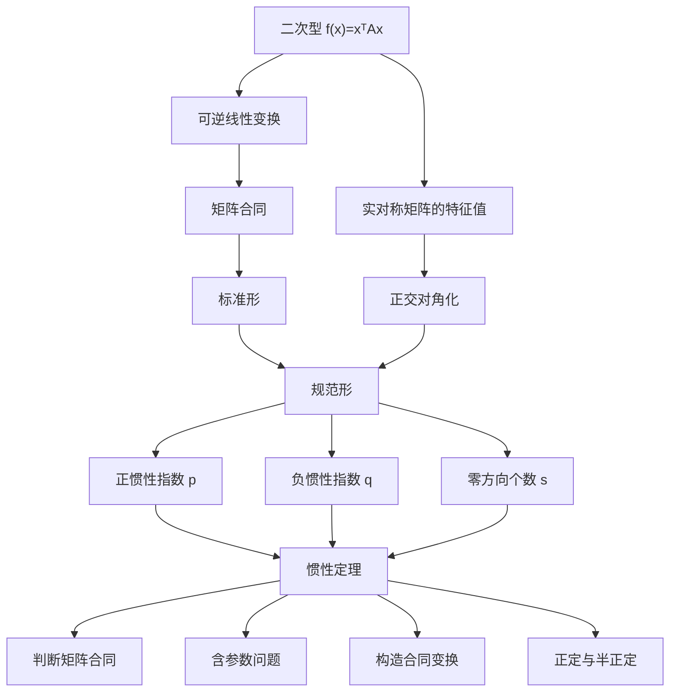
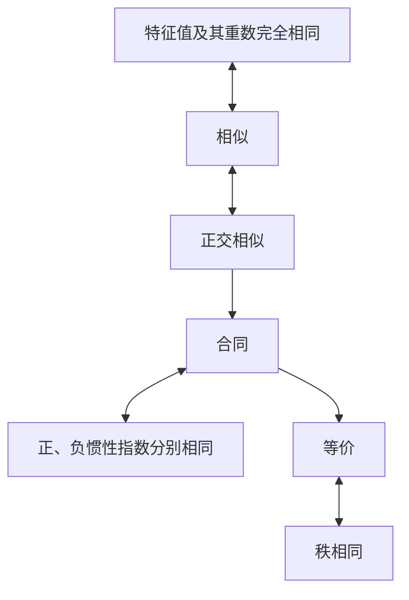
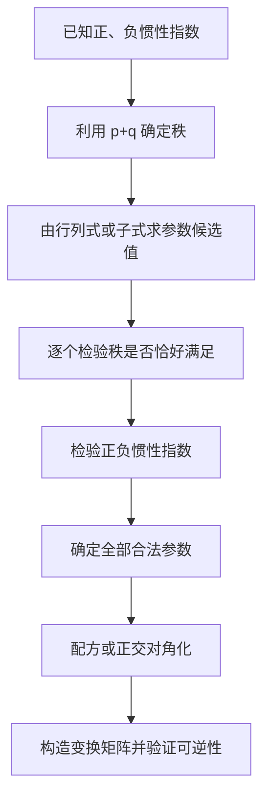
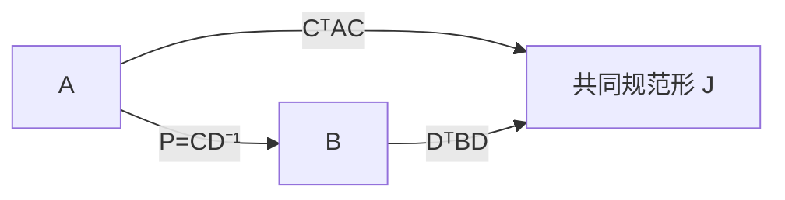
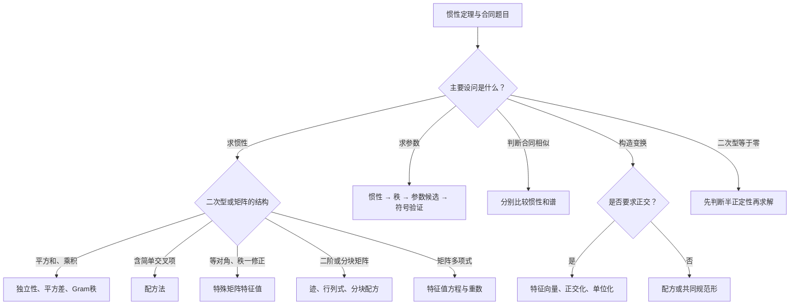

## 第一部分：建立本节的知识体系

### 一、本节究竟在研究什么？

上一节二次型及其标准形，主要研究的是：

> 如何通过变量替换，把含有交叉项的二次型化成没有交叉项的平方和？

而这一节要进一步研究：

> 同一个二次型可以有很多不同的标准形，那么这些标准形有什么始终不变的性质？两个看似完全不同的二次型，什么时候能够通过可逆线性变换相互转化？

这就是惯性定理与合同所要解决的问题。

本节在整个线性代数知识体系中的地位非常重要，因为它将此前学习的矩阵的秩、特征值、相似、正交对角化、线性无关和线性方程组联系起来，并为下一节的正定二次型打下基础。

**1. 本节知识框架**

整个知识体系的核心可以浓缩为一句话：

**相似研究特征值的具体数值，合同研究特征值的正、负、零个数，等价研究矩阵的秩。**

这句话在实对称矩阵的范围内尤其重要。

### 二、合同的基本概念与本质

**1. 矩阵合同的定义**

设 $A,B$ 均为 $n$ 阶实矩阵。如果存在一个 $n$ 阶可逆矩阵 $P$，使得

$$
\boxed{P^TAP=B}
$$

则称矩阵 $A$ 与 $B$ 合同，记为

$$
A\simeq_c B.
$$

注意定义中的三个关键词：

- 左侧乘的是 $P^T$，而不是 $P^{-1}$；
- 右侧乘的是 $P$；
- $P$ 必须可逆，但不一定是正交矩阵。

**2. 为什么合同变换一定是这种形式？**

设原二次型为

$$
f(x)=x^TAx.
$$

进行可逆线性变换

$$
x=Py,
$$

则

$$
\begin{aligned}
f(x)
&=(Py)^TA(Py)\\
&=y^TP^TAPy\\
&=y^TBy.
\end{aligned}
$$

因此

$$
B=P^TAP.
$$

这就是矩阵合同的来源。

**合同的本质是：同一个二次型在不同的可逆线性坐标系下的矩阵表示。**

它改变了二次型的表达方式，但没有改变二次型最根本的正负结构。

**3. 为什么必须要求 $P$ 可逆？**

例如原二次型为

$$
f(x_1,x_2)=x_1^2-x_2^2.
$$

如果允许令

$$
x_1=y_1,\qquad x_2=0,
$$

那么原式将变成

$$
f=y_1^2.
$$

原来的负平方项消失了。

但这并不是合法的合同变换，因为

$$
P=
\begin{pmatrix}
1&0\\
0&0
\end{pmatrix}
$$

不可逆。

这个变换不是单纯更换坐标，而是丢弃了一个维度。

所以，可逆性是惯性指数能够保持不变的根本前提。

**4. 合同的基本性质**

合同具有反身性、对称性和传递性。

若 $A$ 与 $B$ 合同，则：

$$
r(A)=r(B).
$$

若 $A$ 为对称矩阵，则 $B$ 也是对称矩阵，因为

$$
B^T=(P^TAP)^T=P^TA^TP=B.
$$

此外，

$$
\boxed{|B|=|P|^2|A|}
$$

由于 $P$ 可逆且为实矩阵，

$$
|P|^2>0.
$$

因此，合同矩阵的行列式符号相同，但行列式数值不一定相同。

### 三、标准形与规范形

**1. 标准形**

一个实二次型通过可逆线性变换，可以化为

$$
f=d_1y_1^2+d_2y_2^2+\cdots+d_ny_n^2.
$$

这种只含平方项、不含交叉项的形式，称为二次型的标准形。

例如：

$$
f=2y_1^2-3y_2^2+5y_3^2.
$$

以及

$$
f=8z_1^2-12z_2^2+20z_3^2
$$

可以是同一个二次型在不同坐标系下的标准形。

所以，一般可逆线性变换得到的标准形并不唯一。

**2. 规范形**

对于非零平方项 $d_iy_i^2$，令

$$
z_i=\sqrt{|d_i|},y_i,
$$

就有

$$
d_iy_i^2=
\begin{cases}
z_i^2,&d_i>0,\\
-z_i^2,&d_i<0.
\end{cases}
$$

因此，任何实二次型都能够通过可逆线性变换化为

$$
\boxed{
f=z_1^2+\cdots+z_p^2
-z_{p+1}^2-\cdots-z_{p+q}^2
}
$$

对应的规范形矩阵为

$$
\boxed{
J=\operatorname{diag}(I_p,-I_q,O_s)
}
$$

其中

$$
p+q+s=n.
$$

规范形中的非零系数只能是 $1$ 或 $-1$。

**3. 正惯性指数、负惯性指数**

| 符号  | 含义                 |
| --- | ------------------ |
| $p$ | 正惯性指数，即正平方项个数      |
| $q$ | 负惯性指数，即负平方项个数      |
| $s$ | 零特征值个数，即规范形中零系数的个数 |
| $r$ | 二次型的秩，即非零平方项个数     |

四者满足

$$
\boxed{r=p+q}
$$

$$
\boxed{s=n-r=n-p-q}
$$

例如，

$$
f=3y_1^2-5y_2^2+2y_3^2
$$

是一个四元二次型的标准形，则

$$
p=2,\qquad q=1,\qquad r=3,\qquad s=1.
$$

其规范形为

$$
f=z_1^2+z_2^2-z_3^2.
$$

特别注意，零平方项虽然没有写出来，但对应的变量仍然存在。

### 四、惯性定理：本节最核心的定理

**1. 惯性定理的内容**

又称西尔维斯特惯性定理。

设 $A$ 为 $n$ 阶实对称矩阵。无论通过什么样的可逆实线性变换将二次型 $x^TAx$ 化为标准形，其中正平方项和负平方项的个数都保持不变。

即

$$
\boxed{p,q\text{ 不随可逆线性变换而改变}}
$$

由此得到最重要的合同判定定理：

**两个同阶实对称矩阵合同的充分必要条件，是它们的正惯性指数与负惯性指数分别相同。**

$$
\boxed{
A\simeq_c B
\iff
\begin{cases}
p(A)=p(B),\\
q(A)=q(B).
\end{cases}
}
$$

由于矩阵同阶，零特征值个数也自动相同。

等价地，也可以使用

$$
\boxed{
A\simeq_c B
\iff
\begin{cases}
r(A)=r(B),\\
p(A)=p(B).
\end{cases}
}
$$

或者比较秩与负惯性指数。

**2. 惯性定理的直观理解**

考虑二元二次型：

$$
f(x_1,x_2)=x_1^2-x_2^2.
$$

沿 $x_1$ 轴方向，二次型取正值；沿 $x_2$ 轴方向，二次型取负值。

它具有一个正方向和一个负方向。

两组双曲线分别对应二次型取值为 $1$ 和 $-1$，两条直线对应取值为零。

可逆线性变换可以旋转、拉伸、压缩、倾斜这些方向，却不能把整个正负结构任意改变。

更严格地说：

- 正惯性指数是使二次型限制在其上为正定的线性子空间的最大维数；
- 负惯性指数是使二次型限制在其上为负定的线性子空间的最大维数。

可逆线性变换保持这些子空间的维数，所以惯性指数不变。

**3. 惯性定理的证明思想（理解性掌握）**

假设同一个二次型有两个标准形，第一个标准形有 $p$ 个正平方项，第二个标准形有 $p'$ 个正平方项，并假设

$$
p>p'.
$$

第一个标准形存在一个 $p$ 维子空间 $U$，使得对任意非零 $x\in U$，

$$
f(x)>0.
$$

第二个标准形存在一个 $n-p'$ 维子空间 $V$，使得

$$
f(x)\leq 0.
$$

由于

$$
\dim U+\dim V=p+n-p'>n,
$$

根据子空间维数公式，必然有

$$
U\cap V\neq{0}.
$$

于是存在非零向量 $x$，同时满足

$$
f(x)>0,\qquad f(x)\leq0.
$$

矛盾。

所以 $p>p'$ 不成立。同理 $p'<p$ 的反向假设也不成立，故 $p=p'$。对负惯性指数同样证明。

这说明惯性定理并不是某种巧合，而是由线性空间的维数结构决定的。

### 五、惯性指数与特征值的关系

这是连接第四章和第五章的最重要桥梁。

设 $A$ 为实对称矩阵，其特征值为

$$
\lambda_1,\lambda_2,\ldots,\lambda_n.
$$

根据实对称矩阵的正交对角化定理，存在正交矩阵 $Q$，使得

$$
Q^TAQ=
\operatorname{diag}(\lambda_1,\ldots,\lambda_n).
$$

因此二次型在正交变换 $x=Qy$ 下的标准形为

$$
f=\lambda_1y_1^2+\cdots+\lambda_ny_n^2.
$$

由惯性定理可知：

$$
\boxed{
\begin{aligned}
p&=\text{正特征值的个数},\\
q&=\text{负特征值的个数},\\
s&=\text{零特征值的个数}.
\end{aligned}
}
$$

所有特征值均按照重数计算。

进一步，

$$
\boxed{r(A)=p+q}
$$

对于可逆实对称矩阵，还有

$$
\boxed{\operatorname{sgn}|A|=(-1)^q}.
$$

也就是说：

- 行列式为正，说明负惯性指数为偶数；
- 行列式为负，说明负惯性指数为奇数。

但行列式符号一般不能单独确定负惯性指数。

### 六、等价、相似、合同的全面比较

这是本节最重要的选择题考点之一。

| 比较内容            | 等价      | 相似           | 合同        |
| --------------- | ------- | ------------ | --------- |
| 定义              | $B=PAQ$ | $B=P^{-1}AP$ | $B=P^TAP$ |
| 保持秩             | 是       | 是            | 是         |
| 保持行列式数值         | 不一定     | 是            | 不一定       |
| 保持行列式符号         | 不一定     | 是            | 是         |
| 保持迹             | 不一定     | 是            | 不一定       |
| 保持特征值           | 不一定     | 是            | 不一定       |
| 保持对称性           | 不一定     | 不一定          | 是         |
| 保持正负惯性指数（实对称矩阵） | 不一定     | 是            | 是         |

**1. 对一般矩阵**

相似必然推出等价，合同也必然推出等价。

但相似和合同之间不能直接相互推出。

例如

$$
A=
\begin{pmatrix}
1&0\\0&2
\end{pmatrix},\qquad
B=
\begin{pmatrix}
1&1\\0&2
\end{pmatrix}.
$$

两矩阵具有两个不同的特征值 $1,2$，所以相似。

然而 $A$ 对称，$B$ 不对称，所以两者不合同。

这就是一般矩阵相似不能推出合同的反例。

**2. 对实对称矩阵**

结论发生了非常重要的变化。

即

$$
\boxed{
\text{实对称矩阵相似}
\Longrightarrow
\text{合同}
\Longrightarrow
\text{等价}
}
$$

反方向一般不成立。

例如

$$
A=\operatorname{diag}(1,-1),\qquad
B=\operatorname{diag}(2,-3).
$$

两者惯性指数均为 $(1,1)$，所以合同，但不相似。

再例如

$$
C=\operatorname{diag}(1,1).
$$

$A,C$ 都满秩，所以等价，但不合同。

**看到题目中出现“实对称矩阵”几个字，一定要立即想到这一层特殊的逻辑关系。**

## 第二部分：求惯性指数的六种核心方法

考研并不是每道题都需要求特征值。真正需要掌握的是：**根据矩阵或二次型的结构，选择计算量最小的方法。**

### 一、六种方法的适用条件

| 方法         | 题目识别特征           | 推荐程度  |
| ---------- | ---------------- | ----- |
| 直接配方法      | 二次型含有较简单的交叉项     | 极高    |
| 平方差与线性式乘积法 | 存在公因式、乘积、平方和差    | 极高    |
| 特征值法       | 矩阵结构特殊，特征值容易求出   | 极高    |
| 秩、迹与行列式法   | 低阶矩阵，只要求惯性指数     | 很高    |
| 合同初等变换法    | 矩阵较复杂，要求规范形或变换矩阵 | 很高    |
| 分块配方法      | 分块矩阵、外积矩阵、参数矩阵   | 综合题重点 |

下面逐一建立通用解题模型。

### 二、方法一：直接配方法

这是求惯性指数最基础、最常用的方法。

一般地，如果

$$
f=ax_1^2+2x_1L(x_2,\ldots,x_n)+g,
$$

且 $a\neq0$，则

$$
\boxed{
f=a\left(x_1+\frac{L}{a}\right)^2
+g-\frac{L^2}{a}
}
$$

通过这一步消去所有与 $x_1$ 有关的交叉项，再对剩余变量继续配方。

### 母题1：已知惯性指数，反求参数

**来源：2014年数学一、二、三真题。**

设二次型

$$
f=x_1^2-x_2^2+2ax_1x_3+4x_2x_3
$$

的负惯性指数为1，求 $a$ 的取值范围。

<Steps>

<Step>

### 第一步：识别题型 [!toc]

题目给出的不是特征值，而是二次型表达式。

其中 $x_1^2,x_2^2$ 已经分别具有正、负系数，且交叉项集中在 $x_3$ 上。

因此优先配方，不要求三阶特征多项式。

</Step>

<Step>

### 第二步：分别配方 [!toc]

$$
x_1^2+2ax_1x_3
=(x_1+ax_3)^2-a^2x_3^2.
$$

$$
-x_2^2+4x_2x_3
=-(x_2-2x_3)^2+4x_3^2.
$$

所以

$$
\boxed{
f=(x_1+ax_3)^2-(x_2-2x_3)^2
+(4-a^2)x_3^2
}
$$

令

$$
\begin{cases}
y_1=x_1+ax_3,\\
y_2=x_2-2x_3,\\
y_3=x_3.
\end{cases}
$$

变换矩阵为

$$
T=
\begin{pmatrix}
1&0&a\\
0&1&-2\\
0&0&1
\end{pmatrix}.
$$

其行列式恒为1，因此对任意 $a$ 都是可逆变换。

得到标准形

$$
f=y_1^2-y_2^2+(4-a^2)y_3^2.
$$

</Step>

<Step>

### 第三步：根据惯性指数建立不等式 [!toc]

前两项已经贡献一个正平方项、一个负平方项。

题目要求负惯性指数为1，因此第三项不能再贡献负平方项：

$$
4-a^2\geq0.
$$

故

$$
\boxed{-2\leq a\leq2}.
$$

</Step>

</Steps>

**深度分析：为什么必须包含端点？**

| 参数        | 第三个平方项系数 | 正惯性指数 | 负惯性指数 | 秩 |
| --------- | -------- | ----- | ----- | - |
| $\|a\|<2$ | 正        | 2     | 1     | 3 |
| $\|a\|=2$ | 零        | 1     | 1     | 2 |
| $\|a\|>2$ | 负        | 1     | 2     | 3 |

题目只要求负惯性指数为1，并没有要求秩为3。

所以 $a=\pm2$ 完全符合题意。

**母题推广**

如果题目条件改变，答案也随之改变：

| 改变后的条件  | 答案              |
| ------- | --------------- |
| $q=1$   | $-2\leq a\leq2$ |
| $p=2$   | $-2<a<2$       |
| $p=q=1$ | $a=\pm2$        |
| $q=2$   | $\|a\|>2$       |
| $r=2$   | $a=\pm2$        |
| $p=1$   | $\|a\|\geq2$    |
| $f$ 正定  | 无解              |

这道真题几乎可以覆盖配方法求惯性指数的所有常见参数变化。

### 三、方法二：线性式乘积与平方差

**1. 必须熟练掌握的恒等式**

$$
\boxed{uv=\frac14\left[(u+v)^2-(u-v)^2\right]}
$$

如果 $u,v$ 是两个线性无关的实线性式，那么二次型

$$
f=uv
$$

的惯性指数必然为

$$
\boxed{p=q=1,\qquad r=2}.
$$

无论 $u,v$ 中含有多少个变量，只要二者线性无关，这个结论就成立。

如果 $u,v$ 线性相关，例如 $v=ku$，则

$$
f=ku^2.
$$

此时就不一定有一正一负。

因此，**独立性是乘积模型的关键条件。**

### 母题2：线性式乘积的惯性

**来源：2025年数学一真题。**

求二次型

$$
f=x_1^2+2x_1x_2+2x_1x_3
$$

的正惯性指数。

<Tabs items={["解法一：直接配方", "解法二：乘积模型秒杀"]} defaultIndex={0}>

<Tab value="解法一：直接配方">

$$
\begin{aligned}
f
&=x_1^2+2x_1(x_2+x_3)\\
&=(x_1+x_2+x_3)^2-(x_2+x_3)^2.
\end{aligned}
$$

令

$$
\begin{cases}
y_1=x_1+x_2+x_3,\\
y_2=x_2+x_3,\\
y_3=x_3.
\end{cases}
$$

这是可逆线性变换。

于是

$$
f=y_1^2-y_2^2.
$$

故

$$
\boxed{p=1,\quad q=1,\quad r=2}.
$$

</Tab>

<Tab value="解法二：乘积模型秒杀">

原式为

$$
f=x_1(x_1+2x_2+2x_3).
$$

两条线性式显然线性无关。

直接得到

$$
p=q=1.
$$

考试中若只是求正惯性指数，这种方法计算量最小。

</Tab>

</Tabs>

**同类题：张宇1000题第6章**

设

$$
f=(x_1+3x_2+ax_3)(x_1+5x_2+bx_3).
$$

问正惯性指数是否与 $a,b$ 有关。

设

$$
u=x_1+3x_2+ax_3,
\qquad
v=x_1+5x_2+bx_3.
$$

对应系数向量为

$$
\alpha=(1,3,a)^T,\qquad
\beta=(1,5,b)^T.
$$

若它们成比例，则由第一个分量可知比例系数为1，但第二个分量分别为3和5，矛盾。

因此对于任意 $a,b$，两条线性式都线性无关。

故

$$
\boxed{p=q=1}
$$

与参数完全无关。

**遇到线性式乘积题，不要急着展开。先检查两个因子是否独立。**

### 四、方法三：平方和差中的线性相关问题

### 母题3：正平方项的个数不一定等于正惯性指数

**来源：2021年数学一、二、三真题。**

设

$$
f=(x_1+x_2)^2+(x_2+x_3)^2-(x_3-x_1)^2.
$$

求正惯性指数与负惯性指数。

这道题非常具有代表性，因为它考查的不是繁琐计算，而是对惯性定理适用条件的理解。

<Callout type="warn" title="常见错误">

有同学直接认为：

原式有两个正平方项和一个负平方项，所以

$$
p=2,\qquad q=1.
$$

这是错误的。

原因在于这三个平方项里的线性式并不是三个独立变量。

</Callout>

**正确解法一：利用线性相关关系**

令

$$
u=x_1+x_2,\qquad v=x_2+x_3.
$$

注意

$$
x_3-x_1=v-u.
$$

因此

$$
\begin{aligned}
f&=u^2+v^2-(v-u)^2\\
&=2uv\\
&=\frac12(u+v)^2-\frac12(u-v)^2.
\end{aligned}
$$

由于 $u,v$ 线性无关，因此可以补充一个独立变量构成可逆变换。

所以

$$
\boxed{p=1,\qquad q=1}.
$$

规范形为

$$
\boxed{f=z_1^2-z_2^2}.
$$

**正确解法二：秩与不定性**

写成

$$
f=2(x_1+x_2)(x_2+x_3).
$$

两个独立线性式的乘积必为秩2的不定二次型。

所以一个正惯性指数，一个负惯性指数。

**推广：什么时候可以直接数平方项？**

如果

$$
f=\sum_{i=1}^{m}c_iL_i(x)^2,
$$

且所有 $c_i\neq0$，那么只有当 $L_1,\ldots,L_m$ 线性无关时，才能直接根据 $c_i$ 的符号统计正负惯性指数。

如果线性式相关，就必须先消除相关性，再读取惯性指数。

例如

$$
f=(x_1+x_2)^2-(x_1+x_2)^2+x_3^2
$$

实际上只有

$$
f=x_3^2.
$$

它的惯性指数是 $(1,0)$，而不是 $(2,1)$。

这是本节最容易被忽略的概念陷阱之一。

### 五、方法四：特殊矩阵的特征值

**1. 全1矩阵、秩一矩阵模型**

设

$$
e=(1,1,\ldots,1)^T.
$$

全1矩阵可以写成

$$
J_n=ee^T.
$$

因为

$$
J_ne=e(e^Te)=ne,
$$

且对任意满足 $e^Tx=0$ 的向量 $x$，有

$$
J_nx=e(e^Tx)=0,
$$

因此

$$
\boxed{
\lambda(J_n)=
\underbrace{n}*{1\text{ 个}},*
*\underbrace{0,\ldots,0}*{n-1\text{ 个}}
}
$$

更一般地，若 $\alpha\neq0$，则

$$
\alpha\alpha^T
$$

的特征值为

$$
\boxed{|\alpha|^2,0,\ldots,0}.
$$

正惯性指数为1，负惯性指数为0。

### 母题4：合同与相似的区别

**来源：2001年数学一真题。**

设

$$
A=
\begin{pmatrix}
1&1&1&1\\
1&1&1&1\\
1&1&1&1\\
1&1&1&1
\end{pmatrix},
\qquad
B=\operatorname{diag}(4,0,0,0).
$$

判断 $A,B$ 是否合同、是否相似。

由于 $A$ 是四阶全1矩阵，因此特征值为

$$
4,0,0,0.
$$

$B$ 的特征值也为

$$
4,0,0,0.
$$

二者均为实对称矩阵，所以特征值及重数相同即可推出相似。

进而由实对称矩阵相似必合同，得到

$$
\boxed{A,B\text{ 既合同又相似}}.
$$

### 母题5：合同但不相似

**来源：2007年数学一、二、三真题。**

设

$$
A=
\begin{pmatrix}
2&-1&-1\\
-1&2&-1\\
-1&-1&2
\end{pmatrix},
\qquad
B=
\begin{pmatrix}
1&0&0\\
0&1&0\\
0&0&0
\end{pmatrix}.
$$

判断二者的合同、相似关系。

观察到

$$
A=3E-ee^T,
\qquad e=(1,1,1)^T.
$$

全1矩阵 $ee^T$ 的特征值为 $3,0,0$，因此 $A$ 的特征值为

$$
0,3,3.
$$

比较如下：

| 矩阵  | 特征值     | 惯性指数    |
| --- | ------- | ------- |
| $A$ | $3,3,0$ | $(2,0)$ |
| $B$ | $1,1,0$ | $(2,0)$ |

特征值不同，但惯性指数相同。

故

$$
\boxed{A,B\text{ 合同但不相似}}.
$$

这两道真题应该放在一起理解。

2001年真题考查的是同谱且同惯性；2007年真题考查的是同惯性但不同谱。

**2. 高频推广：对角元相等、非对角元相等**

设

$$
A=
\begin{pmatrix}
a&b&\cdots&b\\
b&a&\cdots&b\\
\vdots&\vdots&\ddots&\vdots\\
b&b&\cdots&a
\end{pmatrix}.
$$

则

$$
A=(a-b)E+bJ_n.
$$

所以特征值为

$$
\boxed{
\begin{cases}
a+(n-1)b,&1\text{ 重},\\
a-b,&n-1\text{ 重}.
\end{cases}
}
$$

三阶情形就是

$$
\boxed{a+2b,\quad a-b,\quad a-b}.
$$

这个公式必须熟练掌握。

它同时适用于特征值、秩、行列式、正定性、惯性指数、相似与合同等多个考点。

**同类真题：2016年数学二、三**

二次型

$$
f=a(x_1^2+x_2^2+x_3^2)
+2x_1x_2+2x_2x_3+2x_1x_3
$$

的正、负惯性指数分别为1、2，求 $a$。

对应矩阵的特征值为

$$
a+2,\quad a-1,\quad a-1.
$$

所以必须满足

$$
\begin{cases}
a+2>0,\\
a-1<0.
\end{cases}
$$

得到

$$
\boxed{-2<a<1}.
$$

由于已经要求 $p+q=3$，两个端点均不能取。

### 六、方法五：秩、迹、行列式联合判断

有些题只要求正负特征值的个数，没必要将具体特征值全部算出来。

**1. 二阶实对称矩阵**

设

$$
A=
\begin{pmatrix}
a&b\\
b&c
\end{pmatrix}.
$$

令

$$
D=ac-b^2,\qquad T=a+c.
$$

则

$$
\lambda_1\lambda_2=D,\qquad
\lambda_1+\lambda_2=T.
$$

有以下判断规律：

| 行列式   | 迹     | 惯性指数    |
| ----- | ----- | ------- |
| $D<0$ | 任意    | $(1,1)$ |
| $D>0$ | $T>0$ | $(2,0)$ |
| $D>0$ | $T<0$ | $(0,2)$ |
| $D=0$ | $T>0$ | $(1,0)$ |
| $D=0$ | $T<0$ | $(0,1)$ |
| $D=0$ | $T=0$ | $(0,0)$ |

**李正元经典练习：分块矩阵判定合同**

设

$$
A=
\begin{pmatrix}
1&0&0\\
0&-1&2\\
0&2&2
\end{pmatrix}.
$$

求与其合同的规范形矩阵。

直接分成两个块：

$$
A=\operatorname{diag}(1,B),
\qquad
B=
\begin{pmatrix}
-1&2\\
2&2
\end{pmatrix}.
$$

由于

$$
|B|=-2-4=-6<0,
$$

所以 $B$ 有一个正特征值、一个负特征值。

加上第一个对角元1，得到

$$
p(A)=2,\qquad q(A)=1.
$$

因此

$$
\boxed{
A\simeq_c\operatorname{diag}(1,1,-1)
}
$$

甚至不需要计算任何特征值的具体数值。

**2. 三阶实对称矩阵的快速判断**

若 $A$ 可逆，则行列式符号首先确定负特征值个数的奇偶性。

| 条件        | 可能的惯性指数           |
| --------- | ----------------- |
| $\|A\|>0$ | $(3,0)$ 或 $(1,2)$ |
| $\|A\|<0$ | $(2,1)$ 或 $(0,3)$ |

再结合迹或某个方向的正负性，可以进一步确定答案。

### 母题6：零对角元矩阵

**来源：张宇1000题第6章。**

求二次型

$$
f=-2x_1x_2-2x_1x_3+6x_2x_3
$$

的正惯性指数。

对应矩阵为

$$
A=
\begin{pmatrix}
0&-1&-1\\
-1&0&3\\
-1&3&0
\end{pmatrix}.
$$

有

$$
|A|=6>0,
\qquad
\operatorname{tr}(A)=0.
$$

由于行列式为正，负特征值个数只能是0或2。

如果负特征值个数为0，则三个特征值都为正，它们的和必然大于0。

这与迹为0矛盾。

因此

$$
q=2,\qquad p=1.
$$

答案为

$$
\boxed{p=1}.
$$

**推广：三阶纯交叉项二次型**

设

$$
f=2ax_1x_2+2bx_1x_3+2cx_2x_3.
$$

则矩阵

$$
A=
\begin{pmatrix}
0&a&b\\
a&0&c\\
b&c&0
\end{pmatrix}
$$

满足

$$
|A|=2abc,\qquad \operatorname{tr}(A)=0.
$$

当 $abc\neq0$ 时：

$$
\boxed{
\begin{aligned}
abc>0&\Longrightarrow(p,q)=(1,2),\\
abc<0&\Longrightarrow(p,q)=(2,1).
\end{aligned}
}
$$

当 $abc=0$，但 $a,b,c$ 不全为零时，存在一个非零的二阶主子式，故矩阵秩为2。结合迹为零，两个非零特征值必然异号，于是

$$
(p,q)=(1,1).
$$

若 $a=b=c=0$，则二次型为零。

这个模型比背诵某一道练习题的答案有用得多。

### 七、方法六：合同初等变换与分块消元

**1. 合同初等变换的原则**

如果对矩阵进行某个初等行变换，就必须对对应的列进行相同的初等变换。

例如：

$$
C_i\leftarrow C_i+kC_j
$$

同时进行

$$
R_i\leftarrow R_i+kR_j.
$$

这样才能保证变化前后的矩阵合同。

如果只做行变换，通常只能保证矩阵等价，不能保证惯性指数不变。

例如

$$
A=\operatorname{diag}(1,1).
$$

单独将第一行乘以 $-1$，得到

$$
B=\operatorname{diag}(-1,1).
$$

两个矩阵秩相同，但惯性不同，显然不合同。

**2. 如何同时求出合同变换矩阵？**

将单位矩阵放在 $A$ 的下方：

$$
\left(\begin{array}{c}
A \\
\hline
E
\end{array}\right).
$$

上方对 $A$ 进行成对的行列合同变换；每次列变换也同步作用于下方的单位矩阵，而行变换只作用于上方矩阵。

最终得到

$$
\left(\begin{array}{c}
D \\
\hline
P
\end{array}\right),
$$

则

$$
\boxed{P^TAP=D}.
$$

这里 $P$ 是全部列变换对应的初等矩阵的乘积。

**3. 顺序主子式求惯性的技巧**

记

$$
\Delta_0=1,\qquad
\Delta_k=\text{矩阵左上角 }k\text{ 阶顺序主子式}.
$$

如果

$$
\Delta_1,\ldots,\Delta_{n-1}\neq0,
$$

则可以通过合同消元得到对角矩阵

$$
\boxed{
D=\operatorname{diag}
\left(
\Delta_1,\frac{\Delta_2}{\Delta_1},
\ldots,\frac{\Delta_n}{\Delta_{n-1}}
\right).
}
$$

只需统计这些对角元的符号，就能得到惯性指数。

当所有顺序主子式均非零时，数列

$$
1,\Delta_1,\Delta_2,\ldots,\Delta_n
$$

中符号发生变化的次数，就是负惯性指数。

例如

$$
\Delta_1=2,\quad
\Delta_2=-3,\quad
\Delta_3=6.
$$

则合同对角形为

$$
\operatorname{diag}
\left(2,-\frac32,-2\right).
$$

于是

$$
p=1,\qquad q=2.
$$

注意：**若中间某个顺序主子式为零，不能直接套用这个比值公式。** 此时应改用配方、调整变量顺序、二阶分块消元或者特征值法。

## 第三部分：合同与惯性指数的综合题型

前面的六种方法解决的是“如何计算惯性指数”。接下来进入更重要的部分：**如何利用惯性指数反过来解决参数、矩阵关系、合同变换构造等问题。**

### 题型一：含参数矩阵合同与相似的综合判定

### 母题7：合同但不相似

**来源：2027年张宇8套卷第7套第15题。张宇1000题中也有同结构练习。**

设

$$
A=
\begin{pmatrix}
-3&0&0\\
0&-1&2\\
0&2&2
\end{pmatrix},
\qquad
B=
\begin{pmatrix}
0&3&0\\
3&0&0\\
0&0&k
\end{pmatrix}.
$$

若 $A,B$ 合同但不相似，求 $k$ 的取值范围。

<Steps>

<Step>

### 第一步：判定合同 [!toc]

将 $A$ 分块。

第一个块 $-3$ 贡献一个负特征值。

另一个二阶块的行列式为

$$
\begin{vmatrix}
-1&2\\
2&2
\end{vmatrix}=-6<0.
$$

因此贡献一正一负两个特征值。

故

$$
(p_A,q_A)=(1,2).
$$

矩阵 $B$ 的左上角二阶块的特征值为

$$
3,-3.
$$

为了使整体惯性为 $(1,2)$，必须有

$$
k<0.
$$

</Step>

<Step>

### 第二步：排除相似的情况 [!toc]

求 $A$ 的二阶块的特征值：

$$
\begin{vmatrix}
\lambda+1&-2\\
-2&\lambda-2
\end{vmatrix}
=\lambda^2-\lambda-6.
$$

即

$$
(\lambda-3)(\lambda+2)=0.
$$

所以

$$
\lambda(A):\quad -3,-2,3.
$$

而

$$
\lambda(B):\quad -3,k,3.
$$

相似的充要条件为

$$
k=-2.
$$

因此合同但不相似要求

$$
\boxed{k<0,\qquad k\neq-2}.
$$

</Step>

</Steps>

**更快的考试解法**

第一步通过惯性得到 $k<0$ 后，利用迹排除相似：

$$
\operatorname{tr}(A)=-2,\qquad
\operatorname{tr}(B)=k.
$$

如果相似，必有 $k=-2$。

再检查 $k=-2$ 时两矩阵的特征值确实完全相同，即可得到答案。

**这一类题的固定流程**

$$
\boxed{\text{合同的参数集合}\setminus\text{相似的参数集合}}
$$

先用惯性解决合同，再用特征值、迹、行列式等解决相似。

不要把两种条件混在一起。

**注意：** 若题干只要求合同，则 $k<0$ 即可；只有要求合同但不相似时，才应排除 $-2$。

### 题型二：由合同反求参数，再求正交变换

这是大题非常典型的设问结构。

### 母题8：一般合同与正交合同的递进考查

**来源：2025年数学二真题；张宇1000题、李林880题均有同类模型。**

已知

$$
A=
\begin{pmatrix}
4&1&-2\\
1&1&1\\
-2&1&a
\end{pmatrix},
\qquad
B=
\begin{pmatrix}
k&0&0\\
0&6&0\\
0&0&0
\end{pmatrix}
$$

合同。

（1）求 $a,k$ 的取值范围。

（2）若存在正交矩阵 $Q$，使得

$$
Q^TAQ=B,
$$

求 $k,Q$。

虽然这道题来自数学二，但其中使用的线性代数知识同样是数学一的重要考查内容。

**第一问：一般合同**

首先，

$$
r(B)\leq2.
$$

又因为

$$
\begin{vmatrix}
4&1\\
1&1
\end{vmatrix}=3\neq0,
$$

所以

$$
r(A)\geq2.
$$

合同保持秩，故

$$
r(A)=r(B)=2.
$$

因此

$$
|A|=0.
$$

计算得

$$
|A|=3(a-4).
$$

所以

$$
a=4.
$$

接下来确定惯性指数。

此时特征多项式为

$$
|\lambda E-A|
=\lambda(\lambda-3)(\lambda-6).
$$

故特征值为

$$
0,3,6.
$$

于是

$$
p(A)=2,\quad q(A)=0.
$$

要使 $B$ 与 $A$ 合同，必须有

$$
k>0.
$$

最终第一问答案：

$$
\boxed{a=4,\qquad k>0}.
$$

**第二问：正交变换**

由于 $Q$ 为正交矩阵，

$$
Q^T=Q^{-1}.
$$

因此

$$
Q^TAQ=B
$$

同时是相似变换。

$A,B$ 必须有完全相同的特征值，所以

$$
\boxed{k=3}.
$$

分别求三个特征值对应的特征向量，并单位化：

$$
q_1=\frac1{\sqrt3}
\begin{pmatrix}1\\1\\1\end{pmatrix},
$$

$$
q_2=\frac1{\sqrt2}
\begin{pmatrix}-1\\0\\1\end{pmatrix},
$$

$$
q_3=\frac1{\sqrt6}
\begin{pmatrix}1\\-2\\1\end{pmatrix}.
$$

注意目标对角矩阵是

$$
B=\operatorname{diag}(3,6,0),
$$

因此 $Q$ 的列向量必须按照特征值 $3,6,0$ 的顺序排列。

得到

$$
\boxed{
Q=
\begin{pmatrix}
\frac1{\sqrt3}&-\frac1{\sqrt2}&\frac1{\sqrt6}\\
\frac1{\sqrt3}&0&-\frac2{\sqrt6}\\
\frac1{\sqrt3}&\frac1{\sqrt2}&\frac1{\sqrt6}
\end{pmatrix}.
}
$$

**对比两问的核心区别**

| 第一问      | 第二问     |
| -------- | ------- |
| 普通可逆矩阵   | 正交矩阵    |
| 合同       | 正交相似    |
| 保持惯性指数   | 保持全部特征值 |
| $k>0$ 即可 | $k=3$   |

这类大题的第一问通常给出宽松条件，第二问增加正交性后，将参数范围收缩为具体值。

### 题型三：已知惯性指数与秩，反求参数并构造标准形

### 母题9：行列式零点不一定全部符合条件

**来源：李林880题。**

设二次型

$$
\begin{aligned}
f={}&x_1^2+ax_2^2+x_3^2\\
&+2x_1x_2-2ax_1x_3-2x_2x_3
\end{aligned}
$$

的正、负惯性指数均为1。

求：

（1）参数 $a$；

（2）可逆线性变换 $x=By$，将二次型化为标准形。

<Steps>

<Step>

### 第一步：从惯性指数得到秩 [!toc]

因为

$$
p=q=1,
$$

所以

$$
r(A)=2.
$$

对应矩阵为

$$
A=
\begin{pmatrix}
1&1&-a\\
1&a&-1\\
-a&-1&1
\end{pmatrix}.
$$

由于秩为2，

$$
|A|=0.
$$

计算得

$$
|A|=-(a-1)^2(a+2).
$$

所以

$$
a=1\quad\text{或}\quad a=-2.
$$

</Step>

<Step>

### 第二步：逐个验证参数 [!toc]

当 $a=1$ 时，

$$
A=
\begin{pmatrix}
1&1&-1\\
1&1&-1\\
-1&-1&1
\end{pmatrix}.
$$

它的各行成比例，因此

$$
r(A)=1.
$$

与题设矛盾，排除。

当 $a=-2$ 时，

$$
\begin{vmatrix}
1&1\\
1&-2
\end{vmatrix}=-3\neq0.
$$

结合三阶行列式为零，得到秩恰好为2。

</Step>

<Step>

### 第三步：配方并验证惯性 [!toc]

将 $a=-2$ 代入：

$$
\begin{aligned}
f={}&x_1^2-2x_2^2+x_3^2\\
&+2x_1x_2+4x_1x_3-2x_2x_3\\
={}&(x_1+x_2+2x_3)^2\\
&-3(x_2+x_3)^2.
\end{aligned}
$$

取

$$
\begin{cases}
y_1=x_1+x_2+2x_3,\\
y_2=x_2+x_3,\\
y_3=x_3.
\end{cases}
$$

这是一个可逆变换，而且得到

$$
f=y_1^2-3y_2^2.
$$

因此确实满足 $p=q=1$。

最终

$$
\boxed{a=-2}.
$$

</Step>

<Step>

### 第四步：构造题目要求的变换矩阵 [!toc]

题目要求的是

$$
x=By,
$$

而我们配方得到的是 $y$ 关于 $x$ 的表达式。

需要反解：

$$
\begin{cases}
x_1=y_1-y_2-y_3,\\
x_2=y_2-y_3,\\
x_3=y_3.
\end{cases}
$$

因此

$$
\boxed{
B=
\begin{pmatrix}
1&-1&-1\\
0&1&-1\\
0&0&1
\end{pmatrix}
}
$$

满足

$$
B^TAB=\operatorname{diag}(1,-3,0).
$$

若题目改为求规范形，则进一步令

$$
z_1=y_1,\qquad
z_2=\sqrt3y_2,\qquad
z_3=y_3.
$$

得到

$$
f=z_1^2-z_2^2.
$$

</Step>

</Steps>

**本类题的标准解题模板**

一定要记住：$|A|=0$ 只说明 $A$ 不满秩，并不能自动说明三阶矩阵的秩为2。

### 题型四：构造两个矩阵之间的合同变换

这是本节大题的核心难点。

题目可能已经知道 $A,B$ 合同，但要求真正求出一个可逆矩阵 $P$，使得

$$
P^TAP=B.
$$

**1. 万能方法：通过共同规范形搭桥**

假设分别找到了可逆矩阵 $C,D$，满足

$$
C^TAC=J,
$$

$$
D^TBD=J.
$$

其中 $J$ 是两矩阵共同的规范形。

由第二式得到

$$
B=D^{-T}JD^{-1}.
$$

代入第一式，

$$
B=D^{-T}C^TACD^{-1}.
$$

因此取

$$
\boxed{P=CD^{-1}}
$$

就有

$$
P^TAP=B.
$$

这就是构造一般合同变换的通法。

**2. 通过正交对角化构造**

如果

$$
Q_A^TAQ_A=\Lambda_A,
$$

$$
Q_B^TBQ_B=\Lambda_B,
$$

且两者的特征值按照正、负、零一一对应排列。

对于非零特征值，选择

$$
s_i=\sqrt{\frac{\lambda_i(B)}{\lambda_i(A)}}.
$$

由于对应特征值同号，根号内为正。

对两个零特征值的对应位置，可取 $s_i=1$。

令

$$
S=\operatorname{diag}(s_1,\ldots,s_n).
$$

就有

$$
S^T\Lambda_AS=\Lambda_B.
$$

于是

$$
\boxed{P=Q_ASQ_B^T}.
$$

这种方法通用性极高，但如果二次型容易配方，通常没有必要计算完整的正交特征向量。

### 母题10：利用平方和分解构造合同矩阵

**来源：张宇1000题。**

已知

$$
A=
\begin{pmatrix}
3&2&1\\
2&2&1\\
1&1&1
\end{pmatrix},
\qquad
B=
\begin{pmatrix}
2&0&0\\
0&3&0\\
0&0&1
\end{pmatrix}.
$$

求可逆矩阵 $C$，使

$$
C^TAC=B.
$$

<Steps>

<Step>

### 第一步：把二次型写成平方和 [!toc]

$$
\begin{aligned}
x^TAx
={}&(x_1+x_2+x_3)^2\\
&+(x_1+x_2)^2+x_1^2.
\end{aligned}
$$

因此

$$
A=U^TU,
$$

其中

$$
U=
\begin{pmatrix}
1&1&1\\
1&1&0\\
1&0&0
\end{pmatrix}.
$$

并且

$$
B=V^TV,
\qquad
V=\operatorname{diag}(\sqrt2,\sqrt3,1).
$$

</Step>

<Step>

### 第二步：将矩阵合同转化为普通矩阵方程 [!toc]

要求

$$
C^TU^TUC=V^TV.
$$

只要令

$$
UC=V
$$

即可。

因此

$$
C=U^{-1}V.
$$

计算得到

$$
\boxed{
C=
\begin{pmatrix}
0&0&1\\
0&\sqrt3&-1\\
\sqrt2&-\sqrt3&0
\end{pmatrix}.
}
$$

因为 $U,V$ 均可逆，所以 $C$ 可逆。

</Step>

</Steps>

**3. 正定矩阵之间合同的通法**

如果

$$
A=U^TU,\qquad B=V^TV,
$$

其中 $U,V$ 都可逆，那么

$$
\boxed{P=U^{-1}V}
$$

必满足

$$
P^TAP=B.
$$

这是正定二次型之间构造合同矩阵的快捷方法，也为下一节正定矩阵建立了基础。

### 题型五：平方和、Gram矩阵与二次型的秩

**1. 最重要的秩公式**

对于任意实矩阵 $M$，有

$$
\boxed{r(M^TM)=r(M)=r(MM^T)}.
$$

因为

$$
x^TM^TMx=|Mx|^2.
$$

从而

$$
M^TMx=0
\iff
Mx=0.
$$

所以它们的零空间维数相同。

此外，$M^TM$ 必为实对称半正定矩阵。

如果 $M$ 是 $m\times n$ 矩阵，秩为 $r$，则

$$
\boxed{
\operatorname{In}(M^TM)=(r,0,n-r)
}
$$

这里用 $\operatorname{In}(A)=(p,q,s)$ 表示矩阵的惯性三元组。

同理

$$
\operatorname{In}(MM^T)=(r,0,m-r).
$$

注意 $M^TM$ 和 $MM^T$ 的阶数可能不同。

### 母题11：多个平方项的秩

**来源：张宇1000题第6章。**

已知

$$
\begin{aligned}
f={}&(x_1-x_2+x_3)^2\\
&+(x_2-ax_3)^2+(ax_3+x_1)^2
\end{aligned}
$$

的秩为2，求 $a$。

不要展开二次型，再去求复杂的三阶矩阵行列式。

直接写成

$$
f=|Mx|^2,
$$

其中

$$
M=
\begin{pmatrix}
1&-1&1\\
0&1&-a\\
1&0&a
\end{pmatrix}.
$$

所以二次型矩阵为

$$
A=M^TM.
$$

利用秩恒等式，

$$
r(A)=r(M)=2.
$$

因此

$$
|M|=2a-1=0.
$$

得到

$$
\boxed{a=\frac12}.
$$

又由于 $M$ 的左上角二阶子式恒为1，所以秩恰好为2。

整个二次型都是平方和，因此

$$
p=2,\qquad q=0.
$$

规范形为

$$
\boxed{z_1^2+z_2^2}.
$$

**2. 更一般的平方和模型**

设

$$
f=\sum_{i=1}^{m}(\alpha_i^Tx)^2,
$$

令

$$
M=(\alpha_1,\alpha_2,\ldots,\alpha_m).
$$

那么

$$
f=x^TMM^Tx.
$$

所以

$$
\boxed{
p=r(M),\qquad q=0.
}
$$

**平方和的正惯性指数，等于其中线性式系数向量组的秩。**

即使平方项很多，只要系数向量线性相关，正惯性指数也可能很小。

**同类真题：2026年数学二、三**

设

$$
A=
\begin{pmatrix}
1&b&-1\\
a+2&3&-3a
\end{pmatrix}.
$$

若 $x^TAA^Tx$ 的规范形为 $y_1^2$，求 $a+b$。

由于只有一个正平方项，

$$
r(AA^T)=r(A)=1.
$$

矩阵第一行非零，因此第二行必然与第一行成比例：

$$
(a+2,3,-3a)=t(1,b,-1).
$$

比较第一、第三个分量，

$$
t=a+2=3a.
$$

得到

$$
a=1,\quad t=3.
$$

再比较第二个分量，

$$
3=3b.
$$

所以

$$
b=1.
$$

最终

$$
\boxed{a+b=2}.
$$

### 题型六：矩阵方程、伴随矩阵与规范形

这类题将第二章、第四章、第五章串联起来，是非常值得关注的综合模型。

### 母题12：利用矩阵多项式确定惯性指数

**来源：张宇1000题第6章。**

设 $A$ 为三阶实对称矩阵，满足

$$
r(E-A)=1,
$$

$$
A^2+2A=3E.
$$

求二次型 $x^TAx$ 的规范形。

<Steps>

<Step>

### 第一步：矩阵方程限制特征值 [!toc]

由

$$
A^2+2A-3E=0
$$

得到

$$
(A-E)(A+3E)=0.
$$

所以任意特征值 $\lambda$ 满足

$$
(\lambda-1)(\lambda+3)=0.
$$

即

$$
\lambda=1\quad\text{或}\quad\lambda=-3.
$$

</Step>

<Step>

### 第二步：利用秩确定特征值重数 [!toc]

因为

$$
r(E-A)=1,
$$

所以

$$
\dim\ker(E-A)=3-1=2.
$$

也就是说，属于特征值1的特征子空间维数为2。

由于 $A$ 为实对称矩阵，可对角化，因此特征值1的代数重数也为2。

于是三个特征值为

$$
1,1,-3.
$$

</Step>

<Step>

### 第三步：写出规范形 [!toc]

正交标准形为

$$
f=y_1^2+y_2^2-3y_3^2.
$$

规范形为

$$
\boxed{f=z_1^2+z_2^2-z_3^2}.
$$

</Step>

</Steps>

**可迁移的通用公式**

若 $A$ 为 $n$ 阶实对称矩阵，则特征值 $\lambda$ 的重数为

$$
\boxed{n-r(A-\lambda E)}.
$$

若题目还给出矩阵方程

$$
g(A)=0,
$$

就先求标量方程

$$
g(\lambda)=0
$$

的所有可能根，再利用秩、迹、行列式确定每个根出现的次数。

### 母题13：逆矩阵、伴随矩阵的惯性

**来源：李林880题；2001年数学三真题中也有逆矩阵合同模型。**

设 $A$ 为实对称可逆矩阵，其特征值为

$$
\lambda_1,\ldots,\lambda_n.
$$

则逆矩阵的特征值为

$$
\frac1{\lambda_1},\ldots,\frac1{\lambda_n}.
$$

因为取倒数不改变实数符号，所以

$$
\boxed{A\simeq_c A^{-1}}.
$$

甚至可以直接构造合同矩阵：

$$
P=A^{-1}.
$$

由于 $A$ 实对称，

$$
P^TAP=A^{-1}AA^{-1}=A^{-1}.
$$

**伴随矩阵的惯性规律**

当 $A$ 可逆时，

$$
A^*=|A|A^{-1}.
$$

所以 $A^*$ 的特征值为

$$
\mu_i=\frac{|A|}{\lambda_i}.
$$

如果

$$
|A|>0,
$$

所有特征值的符号保持不变，因此

$$
\boxed{A^*\simeq_c A}.
$$

如果

$$
|A|<0,
$$

所有特征值符号反转，因此

$$
\boxed{
p(A^*)=q(A),\quad q(A^*)=p(A)
}.
$$

注意后一种情况下，如果原矩阵正负惯性指数恰好相等，$A^*$ 仍然可能与 $A$ 合同。

**例题**

已知 $x^TAx$ 经正交变换后得到

$$
f=y_1^2+y_2^2-y_3^2.
$$

则

$$
\lambda(A):1,1,-1.
$$

所以

$$
|A|=-1.
$$

伴随矩阵的特征值为

$$
-1,-1,1.
$$

故其规范形为

$$
\boxed{z_1^2-z_2^2-z_3^2}.
$$

**4. 奇异矩阵的伴随矩阵也要会判断**

不能对奇异矩阵直接使用 $A^*=|A|A^{-1}$，但可以利用正交对角化求出伴随矩阵的特征值。

对于实对称矩阵，

$$
\boxed{
\mu_i=\prod_{j\neq i}\lambda_j
}
$$

无论 $A$ 是否可逆都成立。

因此：

| 原矩阵的秩          | 伴随矩阵的惯性                      |
| -------------- | ---------------------------- |
| $r(A)=n$       | 由 $\|A\|$ 的正负决定是否交换 $p,q$    |
| $r(A)=n-1$     | 只有一个非零特征值，其符号为 $(-1)^{q(A)}$ |
| $r(A)\leq n-2$ | $A^*=O$，正负惯性指数均为0           |

这里假设 $n\geq2$。

**同类拓展：李林880题第十五章**

设

$$
A=
\begin{pmatrix}
a&-\frac12&-\frac12\\
-\frac12&a&-\frac12\\
-\frac12&-\frac12&a
\end{pmatrix}
$$

与

$$
B=\operatorname{diag}(b,b,0),\qquad b\neq0
$$

合同。

利用等对角、等非对角矩阵的谱公式，$A$ 的特征值为

$$
a-1,\quad a+\frac12,\quad a+\frac12.
$$

秩为2要求

$$
a=1.
$$

此时特征值为

$$
\frac32,\frac32,0.
$$

因此一般合同只要求 $b>0$。

若要求正交相似，则

$$
b=\frac32.
$$

同一个正交矩阵 $Q$ 还能够将伴随矩阵对角化：

$$
Q^TA^*Q=\operatorname{diag}
\left(0,0,\frac94\right).
$$

从而

$$
\boxed{
Q^T(A+A^*)Q
=\operatorname{diag}
\left(\frac32,\frac32,\frac94\right).
}
$$

这类综合题完全可以不计算伴随矩阵的具体元素。

## 第四部分：高难度综合题与创新题

这一部分的重点，是在常规计算之外建立结构化思维。考研数学一如果将惯性定理与其他章节综合，下面几类模型尤其值得掌握。

### 一、分块矩阵与Schur补模型

### 母题14：不计算含参特征值，直接确定惯性

**来源：李林880题。**

设

$$
A=
\begin{pmatrix}
-1&1\\
1&1
\end{pmatrix},
\qquad
\alpha=(a,b)^T\neq0.
$$

求矩阵

$$
M=
\begin{pmatrix}
A+\alpha\alpha^T&\alpha\\
\alpha^T&1
\end{pmatrix}
$$

对应二次型的规范形。

<Steps>

<Step>

### 第一步：将分块矩阵还原成二次型 [!toc]

令

$$
X=\begin{pmatrix}u\\t\end{pmatrix},
\qquad
u=\begin{pmatrix}x_1\\x_2\end{pmatrix},
\quad t=x_3.
$$

则

$$
\begin{aligned}
X^TMX
={}&u^T(A+\alpha\alpha^T)u\\
&+2t\alpha^Tu+t^2\\
={}&u^TAu+(\alpha^Tu)^2\\
&+2t\alpha^Tu+t^2.
\end{aligned}
$$

观察到后三项恰好组成完全平方。

因此

$$
\boxed{
X^TMX=u^TAu+(t+\alpha^Tu)^2.
}
$$

</Step>

<Step>

### 第二步：通过可逆变换消去参数 [!toc]

令

$$
v=u,\qquad s=t+\alpha^Tu.
$$

这是一个可逆线性变换。

于是原二次型变为

$$
v^TAv+s^2.
$$

因为

$$
|A|=-2<0,
$$

所以 $A$ 有一个正特征值、一个负特征值。

再加上 $s^2$，整体惯性为

$$
p=2,\qquad q=1.
$$

最终规范形为

$$
\boxed{z_1^2+z_2^2-z_3^2}.
$$

</Step>

</Steps>

**这个模型的本质**

无论 $\alpha$ 取什么值，

$$
\boxed{
\begin{pmatrix}
A+\alpha\alpha^T&\alpha\\
\alpha^T&1
\end{pmatrix}
\simeq_c
\begin{pmatrix}
A&0\\
0&1
\end{pmatrix}.
}
$$

直接对三阶含参矩阵求特征值，反而没有利用题目最重要的结构。

**进一步推广：一般分块矩阵**

设

$$
M=
\begin{pmatrix}
A&B\\
B^T&D
\end{pmatrix},
$$

其中 $A,D$ 为实对称矩阵，且 $A$ 可逆。

对应二次型为

$$
f=x^TAx+2x^TBy+y^TDy.
$$

进行分块配方：

$$
\begin{aligned}
f={}&(x+A^{-1}By)^TA(x+A^{-1}By)\\
&+y^T(D-B^TA^{-1}B)y.
\end{aligned}
$$

因此

$$
\boxed{
M\simeq_c
\operatorname{diag}(A,D-B^TA^{-1}B).
}
$$

矩阵

$$
D-B^TA^{-1}B
$$

称为Schur补（舒尔补）。

从而得到惯性相加公式：

$$
\boxed{\operatorname{In}(M)=\operatorname{In}(A)+\operatorname{In}(D-B^TA^{-1}B)}
$$

右侧按照正、负、零惯性指数分别相加。

这不是必须单独背诵的考研定理名称，但其中的分块配方思想很有价值。它可以统一解决含参数矩阵、分块合同、正定性和秩的问题。

### 二、同一个可逆变换同时化简两个二次型

### 母题15：同时合同对角化

**来源：张宇1000题。**

已知

$$
f=x_1^2+2x_2^2+2x_1x_2,
$$

$$
g=-x_1^2+2x_2^2+2x_1x_2.
$$

求同一个可逆线性变换 $x=Py$，使

$$
f=y_1^2+y_2^2,
$$

同时使

$$
g=k_1y_1^2+k_2y_2^2.
$$

<Steps>

<Step>

### 第一步：建立两个矩阵条件 [!toc]

$$
A=
\begin{pmatrix}
1&1\\
1&2
\end{pmatrix},
\qquad
B=
\begin{pmatrix}
-1&1\\
1&2
\end{pmatrix}.
$$

要求

$$
P^TAP=E,
$$

$$
P^TBP=\Lambda,
$$

其中

$$
\Lambda=\operatorname{diag}(k_1,k_2).
$$

</Step>

<Step>

### 第二步：消去合同变换中的转置 [!toc]

由

$$
P^TAP=E
$$

得到

$$
P^TA=P^{-1}.
$$

因此

$$
P^T=P^{-1}A^{-1}.
$$

代入第二个矩阵方程：

$$
P^{-1}A^{-1}BP=\Lambda.
$$

也就是说，$k_1,k_2$ 实际上是矩阵 $A^{-1}B$ 的特征值。

于是

$$
|B-kA|=0.
$$

计算得

$$
\begin{vmatrix}
-1-k&1-k\\
1-k&2-2k
\end{vmatrix}=0,
$$

即

$$
(k-1)(k+3)=0.
$$

所以

$$
k_1=1,\qquad k_2=-3.
$$

</Step>

<Step>

### 第三步：求对应的广义特征向量 [!toc]

分别解

$$
(B-kA)v=0.
$$

可以取

$$
v_1=(0,1)^T,
\qquad
v_2=(-2,1)^T.
$$

注意，此时不能随意按照普通欧氏长度单位化。

因为需要满足的条件是

$$
P^TAP=E,
$$

所以应按

$$
p_i=\frac{v_i}{\sqrt{v_i^TAv_i}}
$$

进行归一化。

计算得

$$
v_1^TAv_1=v_2^TAv_2=2,
$$

且

$$
v_1^TAv_2=0.
$$

于是

$$
\boxed{
P=
\begin{pmatrix}
0&-\sqrt2\\
\frac1{\sqrt2}&\frac1{\sqrt2}
\end{pmatrix}.
}
$$

最终

$$
\boxed{
f=y_1^2+y_2^2,\qquad
g=y_1^2-3y_2^2.
}
$$

</Step>

</Steps>

**更通用、更稳妥的两步法**

如果 $A$ 为正定矩阵，可以先构造 $C$，使

$$
C^TAC=E.
$$

然后令

$$
H=C^TBC.
$$

由于 $B$ 对称，所以 $H$ 也对称，存在正交矩阵 $Q$，使

$$
Q^THQ=\Lambda.
$$

取

$$
\boxed{P=CQ}.
$$

就同时满足

$$
P^TAP=E,
\qquad
P^TBP=\Lambda.
$$

这个方法对重特征值也适用。它比直接求广义特征向量更容易保证归一化和正交性。

### 三、合同、迹、秩与零空间的综合模拟题

### 母题16：2027年李林六套卷第3套第21题

这是一道值得认真研究的综合模拟大题。

设

$$
A=
\begin{pmatrix}
1&a&a\\
a&1&a\\
a&a&1
\end{pmatrix},
\qquad
B=
\begin{pmatrix}
1&1&0\\
1&1&0\\
0&0&3
\end{pmatrix}
$$

合同。

求：

（Ⅰ）$a$ 的值；

（Ⅱ）一个可逆矩阵 $C$，使

$$
C^TAC=B;
$$

（Ⅲ）若

$$
\operatorname{tr}[A(CX)(CX)^T]=0,
$$

求 $X$。

**第一问：利用等非对角元矩阵的特征值**

矩阵 $A$ 的特征值为

$$
1+2a,\quad1-a,\quad1-a.
$$

矩阵 $B$ 的特征值为

$$
2,0,3.
$$

因此 $B$ 的惯性为

$$
(2,0,1).
$$

要使 $A$ 有两个正特征值和一个零特征值，只能令

$$
1+2a=0,
\qquad
1-a>0.
$$

故

$$
\boxed{a=-\frac12}.
$$

另一个使行列式为零的参数 $a=1$，会导致秩为1，必须排除。

**第二问：如何构造合同矩阵？**

代入后

$$
A=
\begin{pmatrix}
1&-\frac12&-\frac12\\
-\frac12&1&-\frac12\\
-\frac12&-\frac12&1
\end{pmatrix}.
$$

注意

$$
A(1,1,1)^T=0.
$$

而目标矩阵 $B$ 的第一列和第二列相同。

如果令

$$
C=(c_1,c_2,c_3),
$$

则

$$
C^TAC=
\begin{pmatrix}
c_1^TAc_1&c_1^TAc_2&c_1^TAc_3\\
c_2^TAc_1&c_2^TAc_2&c_2^TAc_3\\
c_3^TAc_1&c_3^TAc_2&c_3^TAc_3
\end{pmatrix}.
$$

为了使前两列相同，可以主动选择

$$
c_2-c_1\in\ker A.
$$

取

$$
c_1=(1,0,0)^T,
$$

$$
c_2=c_1+(1,1,1)^T=(2,1,1)^T,
$$

再取

$$
c_3=(0,1,-1)^T.
$$

直接计算可得

$$
c_1^TAc_1=c_1^TAc_2=c_2^TAc_2=1,
$$

$$
c_1^TAc_3=c_2^TAc_3=0,
$$

$$
c_3^TAc_3=3.
$$

所以

$$
\boxed{
C=
\begin{pmatrix}
1&2&0\\
0&1&1\\
0&1&-1
\end{pmatrix}.
}
$$

其行列式为 $-2$，故可逆。

如果考试中想不到这种特殊构造，完全可以使用前面介绍的共同规范形通法。

**第三问：识别迹的循环不变性**

重要恒等式：

$$
\boxed{\operatorname{tr}(Axx^T)=x^TAx}.
$$

因此

$$
\begin{aligned}
\operatorname{tr}[A(CX)(CX)^T]
&=(CX)^TA(CX)\\
&=X^TC^TACX\\
&=X^TBX.
\end{aligned}
$$

于是原条件等价于

$$
(x_1+x_2)^2+3x_3^2=0.
$$

因为两项均为非负数，所以

$$
\begin{cases}
x_1+x_2=0,\\
x_3=0.
\end{cases}
$$

故

$$
\boxed{
X=t(1,-1,0)^T,\qquad t\in\mathbb R.
}
$$

**这道题真正考查了什么？**

第一问考查特征值结构与惯性定理，第二问考查合同矩阵构造，第三问考查迹恒等式与半正定矩阵零空间。

尤其要掌握：

如果 $A$ 实对称且半正定，则

$$
\boxed{x^TAx=0\iff Ax=0}.
$$

但是对于不定矩阵，这个结论一般不成立。

例如

$$
A=\begin{pmatrix}1&0\\0&-1\end{pmatrix},
\qquad x=(1,1)^T.
$$

虽然

$$
x^TAx=1-1=0,
$$

但

$$
Ax=(1,-1)^T\neq0.
$$

所以看到二次型等于零，首先要判断它是否半正定或半负定。

### 四、从三元模型推广到 $n$ 元模型

**来源：2027年李永乐六套卷第2套第7题；李林880题也有同类综合题。**

设

$$
f=n\sum_{i=1}^{n}x_i^2-
\left(\sum_{i=1}^{n}x_i\right)^2.
$$

求其秩及正、负惯性指数。

<Tabs items={["解法一：矩阵结构", "解法二：平方和恒等式"]} defaultIndex={0}>

<Tab value="解法一：矩阵结构">

对应矩阵为

$$
A=nE-ee^T.
$$

其特征值为

$$
\underbrace{n,\ldots,n}_{n-1\text{ 个}},0.
$$

所以

$$
\boxed{r=p=n-1,\qquad q=0}.
$$

规范形为

$$
f=z_1^2+\cdots+z_{n-1}^2.
$$

</Tab>

<Tab value="解法二：平方和恒等式">

利用

$$
\boxed{
n\sum_{i=1}^{n}x_i^2-
\left(\sum_{i=1}^{n}x_i\right)^2
=\sum_{i<j}(x_i-x_j)^2
}
$$

可知原二次型半正定。

又因为

$$
f=0\iff x_1=x_2=\cdots=x_n,
$$

零空间是一维空间，所以

$$
r=n-1.
$$

进而

$$
p=n-1,\qquad q=0.
$$

</Tab>

</Tabs>

**创新题推广：带权平方和**

设

$$
\alpha=(a_1,\ldots,a_n)^T\neq0,
$$

考虑

$$
f=|\alpha|^2|x|^2-(\alpha^Tx)^2.
$$

由柯西—施瓦茨不等式，

$$
f\geq0.
$$

对应矩阵为

$$
A=|\alpha|^2E-\alpha\alpha^T.
$$

其特征值为

$$
\underbrace{|\alpha|^2,\ldots,|\alpha|^2}_{n-1\text{ 个}},0.
$$

因此仍然有

$$
\boxed{p=n-1,\qquad q=0,\qquad r=n-1}.
$$

这个新题看起来与全1矩阵不同，但本质是完全相同的秩一修正模型。

### 五、二次型与空间二次曲面的综合

**来源：2008年数学一真题。**

设 $A$ 为三阶实对称矩阵，二次曲面

$$
(x,y,z)A
\begin{pmatrix}x\\y\\z\end{pmatrix}=1
$$

在正交变换下表示双叶双曲面，求 $A$ 的正特征值个数。

正交对角化后，方程为

$$
\lambda_1u^2+\lambda_2v^2+\lambda_3w^2=1.
$$

双叶双曲面的标准方程为

$$
\frac{u^2}{a^2}
-\frac{v^2}{b^2}
-\frac{w^2}{c^2}=1.
$$

因此只有一个正系数，两个负系数。

故

$$
\boxed{p=1,\qquad q=2}.
$$

**常见曲面与惯性指数的对应关系**

在右端为1、没有一次项的三元二次曲面方程中：

| 惯性三元组     | 曲面类型   |
| --------- | ------ |
| $(3,0,0)$ | 椭球面    |
| $(2,1,0)$ | 单叶双曲面  |
| $(1,2,0)$ | 双叶双曲面  |
| $(2,0,1)$ | 椭圆柱面   |
| $(1,1,1)$ | 双曲柱面   |
| $(1,0,2)$ | 两个平行平面 |
| $p=0$     | 无实点    |

特别注意右端的符号。如果方程右端为 $-1$，应先两边乘以 $-1$，相当于交换正负惯性指数，再判断曲面类型。

## 第五部分：本节常用性质与易错结论汇总

### 一、矩阵运算对惯性的影响

以下均在相关矩阵为实对称矩阵、相应运算合法的条件下成立。

| 矩阵                         | 惯性变化        |
| -------------------------- | ----------- |
| $A$                        | $(p,q,s)$   |
| $-A$                       | $(q,p,s)$   |
| $kA,\ k>0$                 | $(p,q,s)$   |
| $kA,\ k<0$                 | $(q,p,s)$   |
| $A^{-1}$，$A$ 可逆            | $(p,q,0)$   |
| $A^2$                      | $(p+q,0,s)$ |
| $A^{2m}$，$m$ 为正整数          | $(p+q,0,s)$ |
| $A^{2m+1}$，$m$ 为非负整数       | $(p,q,s)$   |
| $P^TAP$，$P$ 可逆             | $(p,q,s)$   |
| $\operatorname{diag}(A,B)$ | 惯性三元组逐项相加   |

特别需要掌握：

$$
\boxed{
A\simeq_c -A
\iff p(A)=q(A).
}
$$

以及

$$
\boxed{
A\simeq_c A^2
\iff q(A)=0.
}
$$

再推广到矩阵多项式 $g(A)$，只要知道 $A$ 的特征值，就可以根据

$$
g(\lambda_1),\ldots,g(\lambda_n)
$$

的正负性确定 $g(A)$ 的惯性。

### 二、十六条高频判断题

| 判断                            | 正误 |
| ----------------------------- | -- |
| 合同矩阵一定同秩                      | 正确 |
| 同秩的实对称矩阵一定合同                  | 错误 |
| 实对称矩阵合同一定相似                   | 错误 |
| 两个实对称矩阵相似一定合同                 | 正确 |
| 任意相似矩阵一定合同                    | 错误 |
| 合同矩阵的行列式一定相等                  | 错误 |
| 实合同矩阵的行列式符号相同                 | 正确 |
| 合同保持矩阵的对称性                    | 正确 |
| 二次型原式的正平方项数目就是正惯性指数           | 错误 |
| 正惯性指数等于秩，则矩阵一定正定              | 错误 |
| 负惯性指数为零，则矩阵一定正定               | 错误 |
| $A$ 实对称时，$A^2$ 一定半正定          | 正确 |
| $A$ 实对称可逆时，$A^2$ 一定正定         | 正确 |
| 任意实矩阵 $A$ 的 $A^TA$ 都半正定       | 正确 |
| $x^TAx=0$ 一定推出 $Ax=0$         | 错误 |
| 同时交换对应的两行与两列，所得矩阵与原矩阵等价、相似且合同 | 正确 |

最后一条值得特别理解。

设 $S$ 为交换两个坐标的初等矩阵，则

$$
S^T=S^{-1}=S.
$$

因此

$$
SAS=S^TAS=S^{-1}AS.
$$

这既是合同变换，也是相似变换，所以也一定是等价变换。

张宇1000题和李林880题中均有这种类型的选择题。

### 三、考研最常见的八个陷阱

**陷阱1：忘记实对称条件。**

惯性指数能够完全决定矩阵的合同关系，要求两个矩阵均为同阶实对称矩阵。

一般非对称矩阵不能直接使用此判据。

**陷阱2：合同与相似的判据混淆。**

合同只需要符号数量一致，相似需要具体特征值及重数一致；对一般矩阵，同谱还未必相似。

**陷阱3：行列式等于零，就认为秩恰好下降1。**

三阶矩阵行列式为零，秩可能是2、1甚至0。必须检验低阶非零子式。

**陷阱4：含参不等式漏掉等号。**

仅要求某一个惯性指数，参数端点未必排除。只有在题目同时要求满秩或特定非零特征值个数时，才有理由排除零特征值。

**陷阱5：没有检查平方项中的线性式是否独立。**

2021年真题就是这一陷阱的典型考查。

**陷阱6：普通标准形的系数当成特征值。**

只有正交变换化成的对角标准形，其系数才必然是原矩阵的特征值。

一般配方得到的标准形，系数可以与原特征值完全不同。

**陷阱7：变换矩阵方向弄反。**

配方通常得到 $y=Cx$，但题目要求 $x=Py$，所以

$$
P=C^{-1},
$$

而不是 $C$。

**陷阱8：将不定二次型等于零误当成齐次线性方程组。**

只有半正定或半负定情形，才能直接由 $x^TAx=0$ 得出 $Ax=0$。

## 第六部分：考场解题决策体系

遇到本节题目，应该先判断题目结构，而不是立即展开计算。

### 一、根据关键词进行快速识别

| 看到的题目特征                    | 第一反应               |
| -------------------------- | ------------------ |
| 正、负惯性指数                    | 统计正负特征值或配方系数       |
| 合同但不相似                     | 同惯性，排除同谱           |
| 已知规范形                      | 立刻得到秩和惯性           |
| 正交变换                       | 特征值、正交特征向量         |
| 平方和                        | 写成 $M^TM$，求 $M$ 的秩 |
| 两个线性式相乘                    | 判断独立性，平方差          |
| 全1矩阵                       | $ee^T$             |
| 对角元相等、其他元素相等               | 秩一修正特征值公式          |
| 伴随矩阵                       | 非零特征值乘积公式          |
| 矩阵多项式                      | 对应特征值方程            |
| 分块矩阵                       | 分块配方               |
| $\operatorname{tr}(Axx^T)$ | $x^TAx$            |
| 两个二次型同时化简                  | 先将正定的一个化为单位阵       |
| 二次曲面                       | 比较平方项正负系数          |

### 二、不同题型的时间分配建议

| 题型         | 熟练后的练习目标 |
| ---------- | -------- |
| 基础概念判断题    | 30秒—1分钟  |
| 简单惯性指数计算   | 1—2分钟    |
| 合同与相似选择题   | 1—3分钟    |
| 含参惯性指数填空题  | 2—4分钟    |
| 含参合同与标准形大题 | 5—8分钟    |
| 多考点综合大题    | 8—12分钟   |

这些是复习时的训练参考，并非必须遵守的考场时间限制。

## 第七部分：针对性训练与新题检验

以下为10道原创变式，建议先独立完成，再核对答案。

### 基础层

**练习1：乘积模型**

求二次型

$$
f=(x_1+2x_2)(3x_1-x_2+ax_3)
$$

的正、负惯性指数与秩。

**练习2：含参配方**

设

$$
f=x_1^2-x_2^2+6x_1x_3+2ax_2x_3.
$$

若负惯性指数为1，求 $a$ 的范围。

**练习3：三阶零迹矩阵**

求

$$
A=
\begin{pmatrix}
0&2&-1\\
2&0&3\\
-1&3&0
\end{pmatrix}
$$

的规范形矩阵。

### 强化层

**练习4：等非对角元矩阵**

设

$$
A=
\begin{pmatrix}
a&2&2\\
2&a&2\\
2&2&a
\end{pmatrix}.
$$

分别求使 $A$ 满足以下条件的参数范围：

（1）正惯性指数为1；

（2）正惯性指数为2；

（3）秩为2；

（4）正定。

**练习5：合同但不相似**

设

$$
A=\operatorname{diag}(2,-3,0),
$$

$$
B=
\begin{pmatrix}
0&2&0\\
2&0&0\\
0&0&k
\end{pmatrix}.
$$

判断是否存在 $k$，使 $A,B$ 合同但不相似。

**练习6：平方和的秩**

设

$$
f=(x_1+x_2)^2+(x_2+x_3)^2
+(x_1+ax_3)^2.
$$

若正惯性指数为2，求 $a$ 及规范形。

**练习7：矩阵多项式**

设 $A$ 为四阶实对称矩阵，

$$
A^2-A-2E=0,
\qquad
r(A+E)=2.
$$

求 $A$ 与 $A^2$ 对应二次型的规范形。

### 综合创新层

**练习8：分块合同**

设

$$
A=\begin{pmatrix}2&1\\1&-1\end{pmatrix},
$$

$$
M=
\begin{pmatrix}
A+\alpha\alpha^T&2\alpha\\
2\alpha^T&4
\end{pmatrix},
\qquad
\alpha\in\mathbb R^2.
$$

求 $M$ 的惯性指数。

**练习9：伴随矩阵**

设四阶实对称矩阵 $A$ 的惯性三元组为

$$
(2,1,1).
$$

求

$$
\operatorname{In}(A^*),\qquad
\operatorname{In}(A^2).
$$

**练习10：两个二次型之间的合同关系**

设

$$
f=(x_1+x_2)^2-2x_3^2,
$$

$$
g=3y_1^2-(y_2-y_3)^2.
$$

判断两者是否合同，并构造一个可逆变换 $x=Py$，使得 $f=g$。

<Accordions>

<Accordion title="参考答案与关键思路">

**练习1**

两个线性式始终线性无关，因此

$$
\boxed{p=q=1,\qquad r=2}.
$$

**练习2**

配方得到

$$
f=(x_1+3x_3)^2-(x_2-ax_3)^2
+(a^2-9)x_3^2.
$$

为使负惯性指数恰为1，需要

$$
a^2-9\geq0.
$$

故

$$
\boxed{|a|\geq3}.
$$

**练习3**

$$
|A|=-12<0,\qquad \operatorname{tr}(A)=0.
$$

所以不能有三个负特征值。

只能是两正一负。

$$
\boxed{J=\operatorname{diag}(1,1,-1)}.
$$

**练习4**

特征值为

$$
a+4,\quad a-2,\quad a-2.
$$

因此

| 条件    | 答案           |
| ----- | ------------ |
| $p=1$ | $-4<a\leq2$ |
| $p=2$ | 无解           |
| $r=2$ | $a=-4$       |
| 正定    | $a>2$        |

第二问非常重要：不是每一个想要的惯性指数组合都能够实现，重特征值可能限制正负方向出现的数量。

**练习5**

$A$ 的惯性为 $(1,1,1)$，而 $B$ 的特征值为

$$
2,-2,k.
$$

合同要求

$$
k=0.
$$

此时两矩阵特征值不同，故不相似。

所以

$$
\boxed{k=0}.
$$

**练习6**

平方项系数矩阵为

$$
M=
\begin{pmatrix}
1&1&0\\
0&1&1\\
1&0&a
\end{pmatrix}.
$$

$$
|M|=a+1.
$$

秩为2要求 $a=-1$，且存在二阶非零子式。

因此

$$
\boxed{a=-1,\qquad f=z_1^2+z_2^2}.
$$

**练习7**

由矩阵方程得到

$$
(\lambda-2)(\lambda+1)=0.
$$

又

$$
\dim\ker(A+E)=2.
$$

因此 $A$ 的特征值为

$$
2,2,-1,-1.
$$

其规范形为

$$
\boxed{z_1^2+z_2^2-z_3^2-z_4^2}.
$$

而 $A^2$ 的特征值为

$$
4,4,1,1.
$$

所以规范形为

$$
\boxed{z_1^2+z_2^2+z_3^2+z_4^2}.
$$

**练习8**

分块配方：

$$
f=u^TAu+(\alpha^Tu+2t)^2.
$$

因为

$$
|A|=-3<0,
$$

故

$$
\boxed{p(M)=2,\qquad q(M)=1}.
$$

**练习9**

原矩阵秩为3，三个非零特征值中有一个负数。

因此伴随矩阵仅有一个非零特征值，且为负。

$$
\boxed{\operatorname{In}(A^*)=(0,1,3)}.
$$

平方后所有非零特征值均为正，所以

$$
\boxed{\operatorname{In}(A^2)=(3,0,1)}.
$$

**练习10**

两个二次型的惯性均为 $(1,1,1)$，所以合同。

令

$$
\begin{cases}
x_1+x_2=\sqrt3y_1,\\
\sqrt2x_3=y_2-y_3,\\
x_2=y_3.
\end{cases}
$$

反解得到

$$
\boxed{
P=
\begin{pmatrix}
\sqrt3&0&-1\\
0&0&1\\
0&\frac1{\sqrt2}&-\frac1{\sqrt2}
\end{pmatrix}.
}
$$

其行列式非零，并且代入后恰好得到 $f=g$。

</Accordion>

</Accordions>

## 第八部分：分阶段练习

围绕母题分阶段训练。

### 第一轮：历年真题，必须掌握

| 优先级 | 真题         | 核心能力       |
| --- | ---------- | ---------- |
| S   | 2001年数学一   | 同谱、合同与相似   |
| S   | 2007年公共真题  | 同惯性、不同谱    |
| S   | 2014年公共真题  | 含参配方、端点处理  |
| S   | 2021年公共真题  | 平方项线性相关    |
| S   | 2025年数学一   | 线性式乘积与规范形  |
| A   | 2008年数学一   | 惯性与二次曲面    |
| A   | 2025年数学二   | 合同、参数与正交变换 |
| A   | 2026年数学二、三 | Gram矩阵与秩   |
| A   | 2001年数学三   | 逆矩阵合同      |

### 第二轮：练习题强化

| 来源 | 训练重点 |
| --- | --- |
| 张宇1000题 | 行列式与迹判断惯性 |
| 张宇1000题 | 平方和与独立线性式乘积 |
| 张宇1000题 | 含参合同、规范形 |
| 张宇1000题 | 矩阵方程与特征值重数 |
| 张宇1000题 | 合同构造、同时对角化 |
| 李林880题 | 合同和正交相似的区分 |
| 李林880题 | 分块矩阵、迹 |
| 李林880题 | 伴随矩阵、含参惯性 |
| 李林880题 | 高阶秩一结构、伴随矩阵综合 |
| 李正元 | 基础合同与惯性判定 |
| 李正元 | 含参秩与规范形构造 |

### 第三轮：分类模拟题

重点模拟题：

| 模拟题          | 训练价值           |
| ------------ | -------------- |
| 张宇8套卷第7套第15题 | 合同但不相似的含参判别    |
| 李林六套卷第3套第21题 | 本节最重要的综合模拟大题之一 |
| 李林六套卷第4套第7题  | 快速比较多个矩阵的惯性与谱  |
| 李永乐六套卷第2套第7题 | $n$ 阶秩一修正与平方和  |

## 第九部分：本节最终必背公式

复习到最后，应当能够不看资料直接写出以下结论。

**1. 合同定义**

$$
\boxed{B=P^TAP,\qquad |P|\neq0}
$$

**2. 实对称矩阵合同判据**

$$
\boxed{A\simeq_c B\iff p_A=p_B,\ q_A=q_B}
$$

**3. 秩与惯性**

$$
\boxed{r=p+q,\qquad s=n-p-q}
$$

**4. 实对称矩阵之间的逻辑关系**

$$
\boxed{\text{相似}\Longrightarrow\text{合同}
\Longrightarrow\text{等价}}
$$

**5. 合同保持行列式符号**

$$
\boxed{|P^TAP|=|P|^2|A|}
$$

**6. 两个独立线性式的乘积**

$$
\boxed{uv=\frac14[(u+v)^2-(u-v)^2]}
$$

**7. Gram矩阵**

$$
\boxed{r(A^TA)=r(AA^T)=r(A)}
$$

**8. 等对角、等非对角矩阵**

$$
\boxed{
\lambda_1=a+(n-1)b,\quad
\lambda_{2,\ldots,n}=a-b
}
$$

**9. 特征值重数（实对称矩阵）**

$$
\boxed{m_\lambda=n-r(A-\lambda E)}
$$

**10. 伴随矩阵的特征值**

$$
\boxed{\mu_i=\prod_{j\neq i}\lambda_j}
$$

**11. 共同规范形构造合同矩阵**

$$
C^TAC=D^TBD=J
$$

$$
\boxed{P=CD^{-1},\quad P^TAP=B}
$$

**12. 分块合同**

$$
\boxed{
\begin{pmatrix}
A&B\\B^T&D
\end{pmatrix}
\simeq_c
\operatorname{diag}(A,D-B^TA^{-1}B)
}
$$

其中 $A$ 可逆，原矩阵实对称。

**13. 迹与二次型**

$$
\boxed{\operatorname{tr}(Axx^T)=x^TAx}
$$

**14. 半正定矩阵的零空间性质**

$$
\boxed{x^TAx=0\iff Ax=0}
$$

## 第十部分：怎样判断自己真正掌握了这一节？

建议将下面的能力作为复习验收标准。

- 能够准确区分标准形、规范形、正交标准形。
- 能够解释惯性定理为什么成立，而不仅是背诵结论。
- 能够区分等价、相似、合同三种矩阵关系。
- 能够不计算全部特征值，快速判断二阶及特殊三阶矩阵的惯性。
- 能够识别线性式乘积、平方和差与线性相关陷阱。
- 能够完整处理含参数的惯性指数问题，包括零点和端点。
- 能够由惯性指数反推出矩阵秩，并检验参数候选值。
- 能够独立构造 $P^TAP=B$ 中的可逆矩阵 $P$。
- 能够解决一般合同与正交变换的综合大题。
- 能够利用Gram矩阵、伴随矩阵、矩阵多项式解决综合问题。
- 能够解决分块矩阵、同时合同对角化等强化题。
- 能够将三阶特殊矩阵的解法推广至 $n$ 阶矩阵。

本节最值得建立的核心思维是：

**看到合同，想到惯性；看到惯性，想到正负方向；看到正负方向，根据题目结构选择配方、特征值、秩或分块消元。**

真正掌握本节，并不是能够机械地计算每一个矩阵的特征值，而是能够在一道陌生题出现时，迅速识别哪些量需要计算、哪些量根本不需要计算。这样才能将惯性定理变成解决后续正定二次型及线性代数综合题的有效工具。
