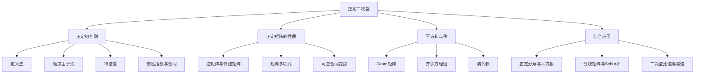
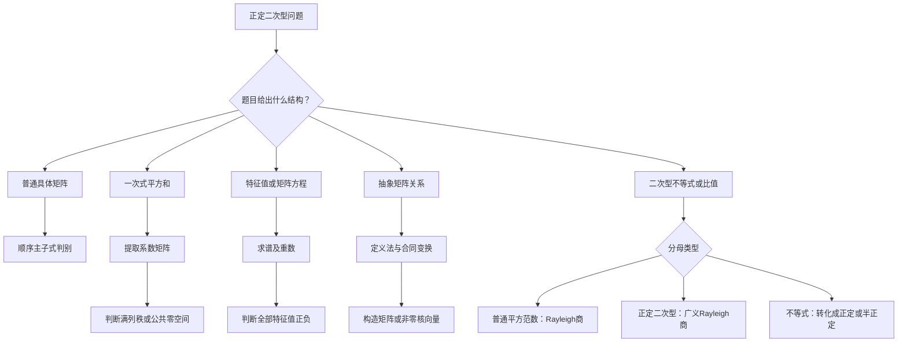

## 知识体系

正定二次型是线性代数最后一个重要综合专题。它把前面学习的行列式、矩阵、秩、线性方程组、特征值、相似、合同等知识全部联系了起来。

**2. 考研复习优先级**

以下星级代表建议掌握程度，并非历年考试频率的统计结果。

| 考点             | 重要程度  |
| -------------- | ----- |
| 正定的充要条件及相互转化   | ★★★★★ |
| 含参数二次型正定范围     | ★★★★★ |
| 平方和、Gram矩阵、满列秩 | ★★★★★ |
| 正定矩阵的性质与证明     | ★★★★★ |
| 特征值平移及矩阵多项式    | ★★★★★ |
| 正定、半正定及边界判断    | ★★★★★ |
| 正定矩阵的分解        | ★★★★  |
| 二次型的比值与最值      | ★★★★  |
| 分块矩阵与Schur补    | ★★★★  |
| 正定平方根与极分解      | ★★★★  |
| 边框行列式          | ★★★   |

**贯穿本节的核心思想：正定性要求二次型在每一个非零方向上都严格为正。**

尤其要注意“每一个”“非零”“严格”这三个关键词。

## 第一部分 基础知识与底层原理

### 二、什么是正定二次型？

**1. 正定二次型的定义**

设实二次型

$$
f(x_1,\ldots,x_n)=X^TAX
$$

其中

$$
X=\begin{pmatrix}
x_1\\x_2\\\vdots\\x_n
\end{pmatrix},\qquad A^T=A.
$$

如果对于任意非零实列向量 $X$，都有

$$
\boxed{X^TAX>0}
$$

则称 $f$ 为正定二次型，称 $A$ 为正定矩阵，记作

$$
A\succ0.
$$

注意，这里的 $A\succ0$ 表示矩阵正定，而不是矩阵中的所有元素均大于零。

例如：

$$
A=\begin{pmatrix}
2&-1\\
-1&2
\end{pmatrix}
$$

虽然存在负元素，但

$$
\begin{aligned}
X^TAX
&=2x_1^2-2x_1x_2+2x_2^2\\
&=(x_1-x_2)^2+x_1^2+x_2^2.
\end{aligned}
$$

对于任意 $X\ne0$，上式严格为正，所以 $A$ 正定。

反过来，矩阵元素全部为正也不能保证矩阵正定。例如

$$
B=\begin{pmatrix}1&2\\2&1\end{pmatrix}
$$

取 $X=(1,-1)^T$，则

$$
X^TBX=-2,
$$

所以 $B$ 不正定。

### 三、二次型的五种定性

设二次型经过正交变换后得到标准形

$$
f=\lambda_1y_1^2+\cdots+\lambda_ny_n^2.
$$

其中 $\lambda_i$ 是实对称矩阵 $A$ 的特征值。

| 类型  | 二次型的取值特征    | 特征值条件      |
| --- | ----------- | ---------- |
| 正定  | 非零向量处恒为正    | 全部为正       |
| 半正定 | 恒非负         | 全部非负       |
| 负定  | 非零向量处恒为负    | 全部为负       |
| 半负定 | 恒非正         | 全部非正       |
| 不定  | 既能取正值，又能取负值 | 同时存在正、负特征值 |

这里半正定采用包含正定情形的广义定义；若要求半正定但不正定，则至少存在一个零特征值。

**直观理解**

考察下面几个二元二次型：

$$
f_1=x^2+y^2
$$

$$
f_2=(x+y)^2
$$

$$
f_3=x^2-y^2.
$$

正定二次型的非零等值线是椭圆；退化的半正定二次型可能存在整条零值方向；不定二次型则在不同方向上具有不同符号。

对于 $f_2$，虽然它是平方形式，但取

$$
x=1,\qquad y=-1
$$

便得到

$$
f_2(1,-1)=0.
$$

这说明它不是正定二次型。

这是考研中极其重要的区别：

$$
\boxed{\text{平方和只能直接保证半正定}}
$$

要想进一步证明正定，还必须排除非零的公共零点。

### 四、正定矩阵的七个等价判据

设 $A$ 为 $n$ 阶实对称矩阵，则以下条件完全等价。

| 判据           | 充要条件                     | 主要使用场景    |
| ------------ | ------------------------ | --------- |
| 定义法          | 对任意 $X\ne0$，$X^TAX>0$    | 抽象证明题     |
| 特征值法         | $\lambda_i>0$，对所有 $i$ 成立 | 已知谱、矩阵多项式 |
| Sylvester判别法 | 各阶顺序主子式均大于零              | 具体含参矩阵    |
| 惯性指数法        | 正惯性指数 $p=n$              | 标准形、规范形   |
| 合同判别法        | $A$ 与单位矩阵 $E$ 合同         | 合同关系综合题   |
| 分解法          | 存在可逆矩阵 $C$，使 $A=C^TC$    | 矩阵分解、平方和  |
| 主子式法         | 所有非空主子式均为正               | 主子矩阵、性质判断 |

应当做到看到任意一个条件，都能够立即联想到其余条件。

**1. 定义法与特征值法为何等价？**

由于 $A$ 是实对称矩阵，存在正交矩阵 $Q$，使得

$$
Q^TAQ=\Lambda
=\operatorname{diag}(\lambda_1,\ldots,\lambda_n).
$$

令

$$
X=QY,
$$

则

$$
\begin{aligned}
X^TAX
&=Y^TQ^TAQY\\
&=Y^T\Lambda Y\\
&=\sum_{i=1}^n\lambda_i y_i^2.
\end{aligned}
$$

因为 $Q$ 可逆，

$$
X\ne0\iff Y\ne0.
$$

当所有特征值都大于零时，上述平方和对于任意非零 $Y$ 严格为正。

反过来，如果存在 $\lambda_i\le0$，只需令对应的 $y_i=1$，其他分量全为零，就可以得到非正的二次型值。

因此

$$
\boxed{A\succ0\iff
\lambda_1,\ldots,\lambda_n>0}.
$$

从几何角度看，特征向量就是二次型的主方向，特征值决定了相应方向上的正负性质。

**2. 正定与惯性定理**

设二次型的规范形为

$$
z_1^2+\cdots+z_p^2
-z_{p+1}^2-\cdots-z_{p+q}^2.
$$

其中 $p$ 为正惯性指数，$q$ 为负惯性指数。

则

$$
r(A)=p+q.
$$

正定的充要条件为

$$
\boxed{p=n}.
$$

也可以写成

$$
\boxed{q=0,\quad r(A)=n}.
$$

特别注意：

$$
q=0
$$

本身只能保证半正定。

例如三元二次型

$$
f=x_1^2+x_2^2
$$

有 $p=2,q=0$，但取 $X=(0,0,1)^T$ 时，二次型等于零。

所以它不是正定二次型。

**3. 正定与单位矩阵合同**

由上一节的惯性定理可知：

$$
\boxed{A\succ0\iff A\simeq_{\mathrm c}E}.
$$

这里 $\simeq_{\mathrm c}$ 表示合同。

即存在可逆矩阵 $P$，使

$$
P^TAP=E.
$$

但绝不能将其误写为

$$
P^{-1}AP=E.
$$

因为后者意味着

$$
A=PEP^{-1}=E.
$$

合同与相似在这一节经常被放在同一个选择题中进行辨析。

| 关系        | 保持不变的量      |
| --------- | ----------- |
| 相似        | 特征值、迹、行列式、秩 |
| 实对称矩阵合同   | 正负惯性指数、秩    |
| 实对称矩阵正交相似 | 特征值与惯性指数    |

例如

$$
A=\begin{pmatrix}2&0\\0&3\end{pmatrix}
$$

显然是正定矩阵，因此与 $E$ 合同，但不与 $E$ 相似。

### 五、Sylvester判别法：最基础的计算工具

**1. 顺序主子式的定义**

对于 $n$ 阶矩阵 $A$，取其左上角 $k$ 行、$k$ 列得到的行列式，称为第 $k$ 阶顺序主子式：

$$
\Delta_k=
\begin{vmatrix}
a_{11}&\cdots&a_{1k}\\
\vdots&\ddots&\vdots\\
a_{k1}&\cdots&a_{kk}
\end{vmatrix}.
$$

Sylvester判别法又称顺序主子式判别法。

对于实对称矩阵 $A$，

$$
\boxed{
A\succ0
\iff
\Delta_1>0,\Delta_2>0,\ldots,\Delta_n>0
}.
$$

**2. 二阶矩阵的必背公式**

若

$$
A=\begin{pmatrix}a&b\\b&c\end{pmatrix},
$$

则

$$
\boxed{A\succ0\iff a>0,\quad ac-b^2>0}.
$$

对应二次型

$$
f=ax_1^2+2bx_1x_2+cx_2^2.
$$

配方可得

$$
f=a\left(x_1+\frac ba x_2\right)^2
+\frac{ac-b^2}{a}x_2^2,
$$

其中 $a\ne0$。

这实际上直接解释了二阶顺序主子式判别法的来源。

另外，对于二阶实对称矩阵，还可以使用

$$
\boxed{A\succ0\iff
\operatorname{tr}(A)>0,\quad \det A>0}.
$$

因为两个实特征值乘积为正且和为正，所以它们必然都为正。

但是这一简单的迹与行列式判据不能直接推广到三阶及更高阶矩阵。

**3. 三阶矩阵的必背公式**

设

$$
A=
\begin{pmatrix}
a&b&c\\
b&d&e\\
c&e&f
\end{pmatrix}.
$$

则

$$
\Delta_1=a,
$$

$$
\Delta_2=ad-b^2,
$$

$$
\Delta_3=adf+2bce-ae^2-dc^2-fb^2.
$$

因此只需要联立

$$
\Delta_1>0,\quad
\Delta_2>0,\quad
\Delta_3>0.
$$

**4. 判别法背后的原理**

当各阶顺序主子式非零时，可以通过合同消元将二次型化为

$$
f=\Delta_1y_1^2+
\frac{\Delta_2}{\Delta_1}y_2^2+
\cdots+
\frac{\Delta_n}{\Delta_{n-1}}y_n^2.
$$

如果各阶顺序主子式都严格为正，则每个平方项系数均为正，所以二次型正定。

因此，顺序主子式判别法并不是孤立的公式，其本质仍然是配方法和合同变换。

**5. 半正定不能直接把严格不等号改成非严格不等号**

一个高频陷阱是认为：

$$
A\succeq0\iff
\Delta_1\ge0,\ldots,\Delta_n\ge0.
$$

这个命题是错误的。

反例：

$$
A=\begin{pmatrix}0&0\\0&-1\end{pmatrix}.
$$

它满足

$$
\Delta_1=0,\qquad\Delta_2=0,
$$

但对应二次型为

$$
f=-x_2^2,
$$

显然不是半正定。

正确结论是：

$$
\boxed{
A\succeq0
\iff A\text{ 的所有特征值非负}
}
$$

也等价于所有主子式非负，而不是仅仅检查顺序主子式。

## 第二部分 含参数正定性问题

这是本节最基本、最容易形成标准化解题流程的题型。

### 六、题型一：利用顺序主子式求参数范围

**母题1：1991年数学三真题**

设二次型

$$
\begin{aligned}
f={}&x_1^2+4x_2^2+4x_3^2\\
&+2\lambda x_1x_2-2x_1x_3+4x_2x_3.
\end{aligned}
$$

求使 $f$ 正定的参数 $\lambda$ 的取值范围。

**第一步：写出二次型矩阵。**

$$
A=\begin{pmatrix}
1&\lambda&-1\\
\lambda&4&2\\
-1&2&4
\end{pmatrix}.
$$

混合项系数必须除以2，再填入矩阵。

**第二步：计算各阶顺序主子式。**

$$
\Delta_1=1>0,
$$

$$
\Delta_2=
\begin{vmatrix}1&\lambda\\\lambda&4\end{vmatrix}
=4-\lambda^2.
$$

计算三阶行列式：

$$
\begin{aligned}
\Delta_3
&=12-\lambda(4\lambda+2)-(2\lambda+4)\\
&=8-4\lambda-4\lambda^2\\
&=-4(\lambda+2)(\lambda-1).
\end{aligned}
$$

**第三步：联立所有不等式。**

$$
\begin{cases}
4-\lambda^2>0,\\
-4(\lambda+2)(\lambda-1)>0.
\end{cases}
$$

即

$$
\begin{cases}
-2<\lambda<2,\\
-2<\lambda<1.
\end{cases}
$$

所以

$$
\boxed{-2<\lambda<1}.
$$

**方法二：利用配方法**

将原二次型写成

$$
\begin{aligned}
f={}&(x_1+\lambda x_2-x_3)^2\\
&+(4-\lambda^2)x_2^2\\
&+2(\lambda+2)x_2x_3+3x_3^2.
\end{aligned}
$$

剩余二元二次型的系数矩阵为

$$
B=\begin{pmatrix}
4-\lambda^2&\lambda+2\\
\lambda+2&3
\end{pmatrix}.
$$

原二次型正定，当且仅当 $B$ 正定。

而

$$
\det B=-4(\lambda+2)(\lambda-1).
$$

于是得到相同结论。

这也是后面要学习的分块正定判别法的具体应用。

**进一步研究：端点发生了什么？**

原题只要求正定范围，但是未来的综合题完全可能继续问：

- 当 $\lambda=-2$ 或 $\lambda=1$ 时，二次型的秩是多少？
- 二次型是否半正定？
- 求相应的规范形与零值方向。

当 $\lambda=-2$ 时，

$$
f=(x_1-2x_2-x_3)^2+3x_3^2.
$$

因此 $f$ 半正定，秩为2。

令 $f=0$，得到

$$
x_3=0,\qquad x_1=2x_2.
$$

其零空间为

$$
\ker A=\operatorname{span}{(2,1,0)^T}.
$$

当 $\lambda=1$ 时，

$$
f=(x_1+x_2-x_3)^2+3(x_2+x_3)^2.
$$

同样半正定，秩为2，且

$$
\ker A=\operatorname{span}{(-2,1,-1)^T}.
$$

当参数落在区间 $[-2,1]$ 之外时，$\det A<0$，同时 $a_{11}=1>0$，故至少存在一个负方向和一个正方向，二次型不定。

由此完成了整个参数轴的分类：

| 参数范围           | 二次型性质   | 秩 |
| -------------- | ------- | - |
| $\lambda<-2$   | 不定      | 3 |
| $\lambda=-2$   | 半正定但不正定 | 2 |
| $-2<\lambda<1$ | 正定      | 3 |
| $\lambda=1$    | 半正定但不正定 | 2 |
| $\lambda>1$    | 不定      | 3 |

这就是从一道普通参数填空题出发，延伸到秩、惯性指数和齐次方程组的综合训练。

**母题2：1997年数学三真题**

设

$$
f=2x_1^2+x_2^2+x_3^2+2x_1x_2+tx_2x_3.
$$

求正定时 $t$ 的取值范围。

写出矩阵：

$$
A=\begin{pmatrix}
2&1&0\\
1&1&t/2\\
0&t/2&1
\end{pmatrix}.
$$

注意 $tx_2x_3$ 对应的矩阵元素是 $t/2$，而不是 $t$。

依次计算：

$$
\Delta_1=2>0,
$$

$$
\Delta_2=1>0,
$$

$$
\Delta_3=1-\frac{t^2}{2}.
$$

故

$$
\boxed{-\sqrt2<t<\sqrt2}.
$$

这道题体现了一种常见命题方式：前几阶顺序主子式恒为正，只有最后一阶含参数。

遇到这种结构，可以主要计算最后一阶行列式，但必须确认前面的条件已经成立。

### 七、题型二：隐藏在行列式中的二次型

**母题3：2025年数学三第7题**

设

$$
A=\begin{pmatrix}1&2\\-2&-a\end{pmatrix},
\qquad
B=\begin{pmatrix}1&0\\1&a\end{pmatrix}.
$$

若

$$
f(x,y)=|xA+yB|
$$

是正定二次型，求 $a$ 的范围。

**解题思路**

这道题不是让你判断 $A$ 或者 $B$ 是否正定。

真正的研究对象是行列式展开后得到的二次型。

先计算

$$
xA+yB=
\begin{pmatrix}
x+y&2x\\
-2x+y&a(y-x)
\end{pmatrix}.
$$

因此

$$
\begin{aligned}
f(x,y)
&=a(x+y)(y-x)-2x(-2x+y)\\
&=(4-a)x^2-2xy+ay^2.
\end{aligned}
$$

对应的实对称矩阵为

$$
H=\begin{pmatrix}4-a&-1\\-1&a\end{pmatrix}.
$$

于是正定的充要条件是

$$
\begin{cases}
4-a>0,\\
a(4-a)-1>0.
\end{cases}
$$

第二个条件等价于

$$
(a-2)^2<3.
$$

从而

$$
\boxed{2-\sqrt3<a<2+\sqrt3}.
$$

**母题迁移**

今后见到以下形式，不要被外观迷惑：

$$
f(X)=X^TMX,
$$

其中 $M$ 不对称；或者

$$
f(x,y)=|xA+yB|.
$$

应该先将其转化为标准实二次型，再判断正定性。

特别地，对于任意实方阵 $M$，恒有

$$
\boxed{
X^TMX=X^T\frac{M+M^T}{2}X
}.
$$

证明如下：

因为 $X^TMX$ 是一个标量，

$$
X^TMX=(X^TMX)^T=X^TM^TX.
$$

所以

$$
2X^TMX=X^T(M+M^T)X.
$$

这意味着一个非对称矩阵产生的二次型，其正定性完全由对称部分决定。

但是，按照考研线性代数通常采用的定义，正定矩阵本身需要是实对称矩阵。

### 八、题型三：特殊结构矩阵的谱判别法

**母题4：张宇1000题强化题**

设

$$
\begin{aligned}
f={}&x_1^2+x_2^2+x_3^2\\
&+2ax_1x_2+2ax_1x_3+2ax_2x_3.
\end{aligned}
$$

求其正定的充要条件。

矩阵为

$$
A=\begin{pmatrix}
1&a&a\\
a&1&a\\
a&a&1
\end{pmatrix}.
$$

**常规方法**

可以计算三阶顺序主子式：

$$
\Delta_1=1,
$$

$$
\Delta_2=1-a^2,
$$

$$
\Delta_3=(1-a)^2(1+2a).
$$

联立得到答案。

**更值得掌握的方法：全一矩阵结构**

令

$$
e=(1,1,1)^T,\qquad J=ee^T.
$$

则

$$
A=(1-a)E+aJ.
$$

因为

$$
Je=3e,
$$

而对于任意满足 $e^TX=0$ 的向量，

$$
JX=e(e^TX)=0.
$$

因此 $J$ 的特征值为

$$
3,\quad0,\quad0.
$$

于是 $A$ 的特征值为

$$
1+2a,\qquad1-a,\qquad1-a.
$$

正定当且仅当

$$
\begin{cases}
1+2a>0,\\
1-a>0.
\end{cases}
$$

所以

$$
\boxed{-\frac12<a<1}.
$$

**一般化：必须掌握的 $n$ 阶矩阵模型**

对于 $n\ge2$，设

$$
A=\begin{pmatrix}
d&c&\cdots&c\\
c&d&\cdots&c\\
\vdots&\vdots&\ddots&\vdots\\
c&c&\cdots&d
\end{pmatrix}.
$$

其特征值为

$$
\boxed{
\lambda_1=d+(n-1)c
}
$$

以及

$$
\boxed{
\lambda_2=\cdots=\lambda_n=d-c
}.
$$

故

$$
\boxed{
A\succ0\iff
\begin{cases}
d+(n-1)c>0,\\
d-c>0.
\end{cases}
}
$$

特别地，对角元为1、非对角元为 $a$ 时，

$$
\boxed{-\frac1{n-1}<a<1}.
$$

如果题目推广为十阶、一百阶矩阵，依然能够立即求解。

**进一步理解参数与特征值**

两条特征值直线同时为正时，对应的参数区间为

$$
-\frac12<a<1.
$$

当 $a=-1/2$ 时，只有一个特征值为零，矩阵秩为2。

当 $a=1$ 时，有两个特征值为零，矩阵秩为1。

由此还能看出：即使两个参数都是正定区间的边界，它们对应的退化程度也可能不同。

### 九、含参正定题的统一解题模板

| 题目特征         | 优先采用的方法     |
| ------------ | ----------- |
| 普通二阶、三阶实对称矩阵 | 顺序主子式       |
| 已知全部特征值      | 特征值严格为正     |
| 各行和相同、秩很低    | 特征值与迹、秩     |
| 对角元相同、非对角元相同 | 全一矩阵分解      |
| 多个一次式的平方和    | 齐次方程组、满列秩   |
| 行列式形式给出二次型   | 先展开，再写对称矩阵  |
| 含绝对值的二次型不等式  | 转化为两个正定矩阵   |
| 分块实对称矩阵      | 合同消元、Schur补 |

最重要的不是每次都用顺序主子式，而是先判断题目是否具有能够大幅减少计算量的特殊结构。

## 第三部分 正定矩阵的性质及综合证明

### 十、正定矩阵的重要性质

设 $A,B$ 均为 $n$ 阶实对称正定矩阵，$P$ 为可逆矩阵，$k>0$。

| 表达式或性质         | 结论     |
| -------------- | ------ |
| $A^{-1}$       | 正定     |
| $A^*$         | 正定     |
| $kA$           | 正定     |
| $A+B$          | 正定     |
| $A^m$，$m$ 为正整数 | 正定     |
| $P^TAP$        | 正定     |
| $ABA$          | 正定     |
| $A+A^{-1}$     | 正定     |
| $A$ 的任意主子矩阵    | 正定     |
| $\det A$       | 严格大于0  |
| $r(A)$         | 等于 $n$ |
| 对角元素 $a_{ii}$ | 严格大于0  |
| $AB$           | 不一定正定  |
| $A-B$          | 不一定正定  |
| $AB+BA$        | 不一定正定  |

前几条是常见证明题的直接工具，最后三条是高频概念陷阱。

**为什么两个正定矩阵的乘积不一定正定？**

虽然 $AB$ 的特征值全部为正，但它未必是实对称矩阵。

例如

$$
A=\begin{pmatrix}1&0\\0&2\end{pmatrix},
\quad
B=\begin{pmatrix}2&1\\1&2\end{pmatrix}.
$$

二者均正定，但

$$
AB=\begin{pmatrix}2&1\\2&4\end{pmatrix}
$$

并不对称。

对于正定矩阵 $A,B$，还有一个值得掌握的结论：

$$
\boxed{AB\text{ 正定}\iff AB=BA}.
$$

证明中的关键是

$$
(AB)^T=BA.
$$

当 $AB=BA$ 时，两个实对称矩阵可以同时正交对角化，此时乘积的特征值都是正数。

一般情形下，

$$
AB\sim A^{1/2}BA^{1/2},
$$

所以 $AB$ 仍具有正特征值。这也说明了为什么“特征值全部为正”对于一般非对称矩阵并不足以判定正定。

### 十一、题型四：证明行列式不等式

**母题5：1991年数学一真题**

设 $A$ 为 $n$ 阶正定矩阵，$E$ 为单位矩阵。

证明

$$
|A+E|>1.
$$

**解题思路**

一旦看到正定矩阵加单位矩阵，并且涉及行列式，优先想到特征值的平移。

设 $A$ 的特征值为

$$
\lambda_1,\ldots,\lambda_n.
$$

由于 $A$ 正定，

$$
\lambda_i>0.
$$

则 $A+E$ 的特征值为

$$
1+\lambda_1,\ldots,1+\lambda_n.
$$

所以

$$
\det(A+E)=\prod_{i=1}^n(1+\lambda_i).
$$

由于每个因子均大于1，

$$
\boxed{\det(A+E)>1}.
$$

证毕。

**李正元练习题第17题**

证明

$$
|A+2E|>2^n.
$$

完全采用相同的方法：

$$
\det(A+2E)
=\prod_{i=1}^n(\lambda_i+2)>2^n.
$$

**母题推广**

对任意 $t>0$，有

$$
\boxed{\det(A+tE)>t^n}.
$$

此外还有

$$
\boxed{\det(A+tE)>\det A}.
$$

甚至可以进一步得到

$$
\det(A+tE)\ge\det A+t^n,
$$

当 $n\ge2$ 时严格大于。

这些不等式都来自特征值乘积，而不是行列式的线性性质。

<Callout type="warn" title="陷阱">

一般不存在

$$
|A+B|=|A|+|B|.
$$

凡是矩阵函数具有 $A+tE$、$A^{-1}$、$A^2$ 等形式时，应当优先从谱的角度研究。

</Callout>

### 十二、题型五：逆矩阵与伴随矩阵的正定性

**母题6：李正元练习题第15题**

若 $A$ 为正定矩阵，证明 $A^{-1}$ 与 $A^*$ 均为正定矩阵。

<Tabs items={["方法一：特征值法", "方法二：二次型定义法"]} defaultIndex={0}>

<Tab value="方法一：特征值法">

设 $A$ 的特征值为

$$
\lambda_1,\ldots,\lambda_n>0.
$$

显然 $A$ 可逆，而且

$$
(A^{-1})^T=(A^T)^{-1}=A^{-1}.
$$

$A^{-1}$ 的特征值为

$$
\frac1{\lambda_1},\ldots,\frac1{\lambda_n}.
$$

全部为正，所以 $A^{-1}$ 正定。

又因为

$$
A^*=(\det A)A^{-1},
$$

且

$$
\det A=\prod_{i=1}^n\lambda_i>0,
$$

所以 $A^*$ 正定。

</Tab>

<Tab value="方法二：二次型定义法">

任取非零向量 $X$，令

$$
Y=A^{-1}X.
$$

由于 $A$ 可逆，$Y\ne0$，并且 $X=AY$。

于是

$$
\begin{aligned}
X^TA^{-1}X
&=(AY)^TA^{-1}(AY)\\
&=Y^TA^TY\\
&=Y^TAY\\
&>0.
\end{aligned}
$$

因此 $A^{-1}$ 正定。

同理

$$
X^TA^*X
=(\det A)X^TA^{-1}X>0.
$$

证毕。

</Tab>

</Tabs>

**深度变式：伴随矩阵正定能否推出原矩阵正定？**

这正是李林880题第十五章基础选择题中的关键考点。

设 $A$ 为 $n$ 阶实对称矩阵，$n\ge2$。

已知

$$
A^*\succ0.
$$

能否推出 $A\succ0$？

首先，$A^*$ 正定，所以可逆。由伴随矩阵的秩性质可知 $A$ 也可逆。

设 $d=\det A$，由

$$
A^*=dA^{-1}
$$

得到

$$
A=d(A^*)^{-1}.
$$

由于 $(A^*)^{-1}$ 正定，所以 $A$ 的正负定性取决于 $d$ 的符号。

当 $n$ 为偶数时，

$$
\det A^*=(\det A)^{n-1}>0.
$$

因为 $n-1$ 为奇数，所以

$$
\det A>0.
$$

故 $A\succ0$。

于是得到

$$
\boxed{
n\text{ 为偶数时},\quad
A^*\succ0\iff A\succ0
}.
$$

当 $n$ 为奇数且 $n\ge3$ 时，这一逆命题不成立。

例如

$$
A=-E_3.
$$

此时

$$
A^*=E_3\succ0,
$$

但 $A$ 是负定矩阵。

对于奇数阶实对称矩阵（$n\ge3$），实际上有

$$
\boxed{
A^*\succ0
\iff
A\succ0\ \text{或}\ A\prec0
}.
$$

**题库解析补充：** 李林880题原解析将 $A$ 正定与 $A^*$ 正定直接写成等价关系。本题的结论没有问题，但证明不能忽略题干的偶数阶条件。上面的推导补全了这一关键环节。

### 十三、题型六：矩阵多项式与正定性

此类题的统一思想是：

若

$$
A\alpha=\lambda\alpha,
$$

则

$$
p(A)\alpha=p(\lambda)\alpha.
$$

对于实对称矩阵 $A$，矩阵多项式 $p(A)$ 仍为实对称矩阵，并且

$$
\boxed{p(A)\succ0\iff
p(\lambda_i)>0\quad(i=1,\ldots,n)}.
$$

**母题7：2002年数学三真题**

设三阶实对称矩阵 $A$ 满足

$$
A^2+2A=O,\qquad r(A)=2.
$$

求 $A$ 的全部特征值，并求 $A+kE$ 正定时 $k$ 的范围。

**第一步：由矩阵方程确定特征值的可能取值。**

$$
\lambda^2+2\lambda=0,
$$

即

$$
\lambda=0\quad\text{或}\quad\lambda=-2.
$$

**第二步：由秩确定重数。**

由于 $A$ 实对称，可对角化。

$$
r(A)=2
$$

说明 $A$ 有两个非零特征值，一个零特征值。

所以

$$
\lambda_1=\lambda_2=-2,\qquad\lambda_3=0.
$$

**第三步：平移特征值。**

$A+kE$ 的特征值为

$$
k-2,\quad k-2,\quad k.
$$

正定要求

$$
k-2>0,\qquad k>0.
$$

故

$$
\boxed{k>2}.
$$

**母题8：1998年数学三真题**

设

$$
A=\begin{pmatrix}
1&0&1\\
0&2&0\\
1&0&1
\end{pmatrix},
\qquad B=(kE+A)^2.
$$

求 $B$ 的相似对角形，并讨论其正定性。

由于 $A$ 的特征值为

$$
2,\quad2,\quad0,
$$

所以

$$
B\sim
\operatorname{diag}\left((k+2)^2,(k+2)^2,k^2\right).
$$

因此

$$
\boxed{B\succ0\iff k\ne-2,\ k\ne0}.
$$

注意这里不是求某个连续的参数区间，而是排除两个特殊值。

因为所有特征值已经是平方，只需要保证不为零即可。

**通用公式**

设 $A$ 为实对称矩阵。

| 矩阵表达式       | 正定的充要条件                         |
| ----------- | ------------------------------- |
| $A+kE$      | $k>-\lambda_{\min}(A)$         |
| $kE-A$      | $k>\lambda_{\max}(A)$          |
| $(A+kE)^2$  | $k\ne-\lambda_i$，对所有 $i$ 成立     |
| $A^2$       | $A$ 可逆                          |
| $A^2+kE$    | $k>-\min_i\lambda_i^2$          |
| $E-A^2$     | 所有 $\lambda_i$ 均属于 $(-1,1)$     |
| $A^2-2A+kE$ | 所有 $\lambda_i^2-2\lambda_i+k>0$ |

其中

$$
\boxed{A^2\succ0\iff A\text{ 可逆}}
$$

必须建立在 $A$ 实对称的条件上。

一般实矩阵 $A$ 应当考虑的是 $A^TA$，而不能直接对 $A^2$ 作出相同判断。

### 十四、题型七：由正交标准形反求矩阵与正定性

**母题9：2010年数学一真题**

已知二次型

$$
f=X^TAX
$$

经过正交变换 $X=QY$ 化为

$$
f=y_1^2+y_2^2,
$$

且 $Q$ 的第三列为

$$
u=\frac1{\sqrt2}(1,0,1)^T.
$$

求矩阵 $A$，并证明 $A+E$ 正定。

**常规解法**

求出另外两个特征向量，构造正交矩阵 $Q$，然后计算

$$
A=Q\Lambda Q^T.
$$

这当然正确，但计算量较大。

**更通用的方法：正交投影**

设

$$
Q=(q_1,q_2,u).
$$

由于

$$
Q^TAQ=\operatorname{diag}(1,1,0),
$$

所以

$$
A=q_1q_1^T+q_2q_2^T.
$$

又因为 $Q$ 是正交矩阵，

$$
QQ^T=q_1q_1^T+q_2q_2^T+uu^T=E.
$$

于是

$$
A=E-uu^T.
$$

直接得到

$$
\boxed{
A=\begin{pmatrix}
\frac12&0&-\frac12\\
0&1&0\\
-\frac12&0&\frac12
\end{pmatrix}
}.
$$

由于 $A$ 的特征值为

$$
1,\quad1,\quad0,
$$

所以 $A+E$ 的特征值为

$$
2,\quad2,\quad1.
$$

全部为正，故 $A+E$ 正定。

**母题推广：只有两个不同特征值的实对称矩阵**

若 $A$ 的特征值为

$$
\lambda_1\quad\text{（一重）},
$$

$$
\lambda_2\quad\text{（}n-1\text{重）},
$$

且 $\lambda_1$ 对应的单位特征向量为 $u$，则

$$
\boxed{
A=\lambda_2E+
(\lambda_1-\lambda_2)uu^T
}.
$$

如果已知的特征向量 $\alpha$ 没有单位化，则公式为

$$
\boxed{
A=\lambda_2E+
(\lambda_1-\lambda_2)
\frac{\alpha\alpha^T}{\alpha^T\alpha}
}.
$$

这个模型可以直接处理李林880题中的重特征值矩阵反求问题，也能够解决大量伴随矩阵、正定平方根和矩阵幂的综合题。

## 第四部分 平方和、Gram矩阵与满列秩

这是本节最重要的综合模块之一。

它将正定二次型与第三章向量、秩、齐次线性方程组的知识连接起来。

### 十五、Gram矩阵的核心定理

设 $B$ 为 $m\times n$ 实矩阵。

考虑

$$
G=B^TB.
$$

首先

$$
G^T=(B^TB)^T=B^TB=G.
$$

因此 $G$ 是实对称矩阵。

对任意 $X\in\mathbb R^n$，有

$$
\begin{aligned}
X^TGX
&=X^TB^TBX\\
&=(BX)^T(BX)\\
&=|BX|^2\\
&\ge0.
\end{aligned}
$$

所以

$$
\boxed{B^TB\succeq0}.
$$

若要求严格正定，则必须保证

$$
X\ne0\Longrightarrow BX\ne0.
$$

这等价于齐次方程组

$$
BX=0
$$

只有零解，也就等价于 $B$ 的列向量组线性无关。

因此

$$
\boxed{B^TB\succ0\iff r(B)=n}.
$$

同理

$$
\boxed{BB^T\succ0\iff r(B)=m}.
$$

二者不能混淆。

| 矩阵     | 阶数    | 正定条件    |
| ------ | ----- | ------- |
| $B^TB$ | $n$ 阶 | $B$ 满列秩 |
| $BB^T$ | $m$ 阶 | $B$ 满行秩 |

另外还有

$$
\boxed{
\ker(B^TB)=\ker B
}
$$

以及

$$
\boxed{
r(B^TB)=r(BB^T)=r(B)
}.
$$

这些都是后续综合题的核心工具。

### 十六、题型八：一般形式 $B^TAB$ 的正定性

**母题10：1999年数学一真题**

设 $A$ 为 $m$ 阶实对称正定矩阵，$B$ 为 $m\times n$ 实矩阵。

证明：

$$
B^TAB\text{ 正定}
\iff r(B)=n.
$$

**标准证明**

令

$$
C=B^TAB.
$$

因为 $A^T=A$，所以

$$
C^T=B^TA^TB=C.
$$

对任意 $X\ne0$，有

$$
X^TCX=(BX)^TA(BX).
$$

由于 $A\succ0$，

$$
(BX)^TA(BX)>0
\iff BX\ne0.
$$

因此

$$
\begin{aligned}
C\succ0
&\iff \forall X\ne0,\ BX\ne0\\
&\iff BX=0\text{ 只有零解}\\
&\iff r(B)=n.
\end{aligned}
$$

即

$$
\boxed{B^TAB\succ0\iff r(B)=n}.
$$

**与张宇8套卷的联系**

张宇8套卷第7套第7题，将问题改成：

> $C=B^TAB$ 与 $n$ 阶单位矩阵 $E$ 合同的充分必要条件是什么？

只需要完成以下转化：

$$
\begin{aligned}
C\simeq_{\mathrm c} E
&\iff C\succ0\\
&\iff r(B)=n\\
&\iff BX=0\text{ 只有零解}.
\end{aligned}
$$

这道模拟题和1999年数学一真题本质上是同一道母题。

**深层推广：不仅能判断正定，还能求秩与规范形**

由于 $A\succ0$，有

$$
\ker(B^TAB)=\ker B.
$$

因此

$$
r(B^TAB)=r(B).
$$

设

$$
r(B)=r.
$$

因为 $B^TAB$ 一定半正定，所以它的正惯性指数为 $r$，负惯性指数为0。

故

$$
\boxed{
B^TAB\simeq_{\mathrm c}
\begin{pmatrix}
E_r&O\\
O&O
\end{pmatrix}
}.
$$

如果未来题目给出 $r(B)$，要求判断 $B^TAB$ 的秩、惯性指数和合同关系，都能直接解决。

但这里必须保留 $A\succ0$ 的条件。

若 $A$ 只是可逆矩阵，上述秩相等关系并不一定成立。例如

$$
A=\begin{pmatrix}1&0\\0&-1\end{pmatrix},
\qquad B=\begin{pmatrix}1\\1\end{pmatrix},
$$

则

$$
B^TAB=0,
$$

但 $r(B)=1$。

### 十七、题型九：若干一次式平方和的正定性

设

$$
f(X)=L_1(X)^2+\cdots+L_m(X)^2,
$$

其中

$$
L_i(X)=b_{i1}x_1+\cdots+b_{in}x_n.
$$

将各个一次式的系数按行排列：

$$
B=\begin{pmatrix}
b_{11}&\cdots&b_{1n}\\
\vdots&\ddots&\vdots\\
b_{m1}&\cdots&b_{mn}
\end{pmatrix}.
$$

则

$$
f(X)=|BX|^2=X^TB^TBX.
$$

所以

$$
\boxed{f\text{ 正定}\iff r(B)=n}.
$$

若平方项恰好有 $n$ 项，则 $B$ 为方阵，可以直接判断

$$
\boxed{\det B\ne0}.
$$

**母题11：李林六套卷第2套第15题**

设

$$
\begin{aligned}
f={}&(2x_2+3x_3)^2\\
&+(x_1+3x_2+ax_3)^2\\
&+(x_1+ax_2-2x_3)^2.
\end{aligned}
$$

求使 $f$ 正定的参数 $a$ 的范围。

**第一步：提取一次式系数矩阵。**

$$
B=\begin{pmatrix}
0&2&3\\
1&3&a\\
1&a&-2
\end{pmatrix}.
$$

**第二步：计算系数矩阵行列式。**

$$
\begin{aligned}
\det B
&=-2(-2-a)+3(a-3)\\
&=5a-5\\
&=5(a-1).
\end{aligned}
$$

**第三步：令行列式非零。**

$$
\det B\ne0
\iff a\ne1.
$$

所以

$$
\boxed{a\in\mathbb R\setminus{1}}.
$$

当 $a=1$ 时，可以找到非零向量

$$
X=(7,-3,2)^T,
$$

使得三个平方项同时为零。

**为什么不应该先展开？**

如果把三个平方全部展开，再写二次型矩阵 $B^TB$，再算各阶顺序主子式，会产生大量不必要的运算。

本题真正要研究的只是

$$
BX=0
$$

有没有非零解。

所以遇到平方和问题，首先考虑原始线性式的系数矩阵，而不是展开后的二次型矩阵。

**母题12：张宇1000题强化题**

设

$$
\begin{aligned}
f={}&(x_1+2x_2+x_3)^2\\
&+[-x_1+(a-4)x_2+2x_3]^2\\
&+(2x_1+x_2+ax_3)^2.
\end{aligned}
$$

求 $f$ 正定时 $a$ 的取值范围。

同理取

$$
B=\begin{pmatrix}
1&2&1\\
-1&a-4&2\\
2&1&a
\end{pmatrix}.
$$

计算得

$$
\begin{aligned}
\det B
&=a^2-4a+13\\
&=(a-2)^2+9\\
&>0.
\end{aligned}
$$

因此无论 $a$ 取什么实数，$B$ 都可逆。

故

$$
\boxed{a\in\mathbb R}.
$$

这个题型告诉我们：含参数正定题的答案不一定是有界区间，也可能是除去个别值，甚至全体实数。

**母题13：李永乐六套卷第5套第7题**

设

$$
B=\begin{pmatrix}
1&1\\
1&1\\
0&a
\end{pmatrix}.
$$

二次型为

$$
f(X)=|BX|^2.
$$

求正定时 $a$ 的条件。

原二次型可以写成

$$
f=2(x_1+x_2)^2+a^2x_2^2.
$$

若 $a\ne0$，则 $f=0$ 要求

$$
x_1+x_2=0,\qquad x_2=0,
$$

从而 $x_1=x_2=0$。

故

$$
\boxed{a\ne0}.
$$

也可以直接判断 $B$ 的列秩：

$$
r(B)=2\iff a\ne0.
$$

本题的特点是系数矩阵不是方阵，不能直接计算 $\det B$，而应当研究列秩。

### 十八、题型十：循环平方和

**母题14：2000年数学三真题**

设 $n\ge2$，且

$$
\begin{aligned}
f(X)={}&(x_1+a_1x_2)^2\\
&+(x_2+a_2x_3)^2+\cdots\\
&+(x_n+a_nx_1)^2.
\end{aligned}
$$

求 $f$ 正定的充要条件。

<Tabs items={["方法一：行列式法", "方法二：直接研究齐次方程组"]} defaultIndex={0}>

<Tab value="方法一：行列式法">

设

$$
M=\begin{pmatrix}
1&a_1&0&\cdots&0\\
0&1&a_2&\cdots&0\\
\vdots&&\ddots&\ddots&\vdots\\
0&\cdots&0&1&a_{n-1}\\
a_n&0&\cdots&0&1
\end{pmatrix}.
$$

则

$$
f(X)=|MX|^2.
$$

根据循环行列式的结构，

$$
\det M=1+(-1)^{n-1}a_1a_2\cdots a_n.
$$

于是

$$
\boxed{
f\text{ 正定}\iff
a_1a_2\cdots a_n\ne(-1)^n
}.
$$

</Tab>

<Tab value="方法二：直接研究齐次方程组">

若 $f(X)=0$，则

$$
\begin{cases}
x_1=-a_1x_2,\\
x_2=-a_2x_3,\\
\vdots\\
x_n=-a_nx_1.
\end{cases}
$$

逐步代入，得到

$$
x_1=(-1)^na_1a_2\cdots a_nx_1.
$$

因此

$$
[1-(-1)^na_1a_2\cdots a_n]x_1=0.
$$

如果

$$
a_1a_2\cdots a_n\ne(-1)^n,
$$

则 $x_1=0$。再由最后一个方程开始反向代入，可以得到所有分量都为零。

反之，当乘积等于 $(-1)^n$ 时，各 $a_i$ 都非零，可以取一个非零初值构造出非零解。

所以结论成立。

</Tab>

</Tabs>

**张宇1000题中的直接变式**

判断以下哪一个二次型正定：

$$
\begin{aligned}
f_1={}&(x_1-x_2)^2+(x_2-x_3)^2\\
&+(x_3-x_4)^2+(x_4-x_1)^2;
\end{aligned}
$$

$$
\begin{aligned}
f_2={}&(x_1+x_2)^2+(x_2+x_3)^2\\
&+(x_3+x_4)^2+(x_4+x_1)^2;
\end{aligned}
$$

$$
\begin{aligned}
f_3={}&(x_1-x_2)^2+(x_2+x_3)^2\\
&+(x_3-x_4)^2+(x_4+x_1)^2;
\end{aligned}
$$

$$
\begin{aligned}
f_4={}&(x_1-x_2)^2+(x_2+x_3)^2\\
&+(x_3+x_4)^2+(x_4+x_1)^2.
\end{aligned}
$$

由于 $n=4$，正定条件为

$$
a_1a_2a_3a_4\ne1.
$$

| 二次型   | 系数乘积 | 是否正定 |
| ----- | ---- | ---- |
| $f_1$ | $1$  | 否    |
| $f_2$ | $1$  | 否    |
| $f_3$ | $1$  | 否    |
| $f_4$ | $-1$ | 是    |

因此答案是

$$
\boxed{f_4}.
$$

掌握循环平方和的母题以后，这道看起来较复杂的四元二次型选择题几乎不需要计算。

### 十九、题型十一：秩一矩阵之和

**母题15：张宇1000题强化题**

设 $\alpha,\beta,\gamma$ 为三维列向量，考虑二次型

$$
f(X)=X^T(\alpha\alpha^T+
\beta\beta^T+\gamma\gamma^T)X.
$$

证明当三个向量线性无关时，$f$ 正定。

令

$$
B=(\alpha,\beta,\gamma).
$$

则

$$
\alpha\alpha^T+\beta\beta^T+\gamma\gamma^T=BB^T.
$$

因而

$$
\begin{aligned}
f(X)
&=(\alpha^TX)^2+(\beta^TX)^2+(\gamma^TX)^2\\
&=|B^TX|^2.
\end{aligned}
$$

由于 $\alpha,\beta,\gamma$ 线性无关，

$$
r(B)=3.
$$

所以 $BB^T\succ0$，原二次型正定。

**原题第二问**

若

$$
\alpha=(1,-1,0)^T,
$$

$$
\beta=(1,1,-2)^T,
$$

$$
\gamma=(1,0,a)^T,
$$

求 $f(X)=0$ 的解与规范形。

由

$$
f(X)=0
$$

得到

$$
\begin{cases}
x_1-x_2=0,\\
x_1+x_2-2x_3=0,\\
x_1+ax_3=0.
\end{cases}
$$

前两个方程给出

$$
x_1=x_2=x_3.
$$

代入第三个方程：

$$
(1+a)x_1=0.
$$

当 $a\ne-1$ 时，只有零解，因此规范形为

$$
z_1^2+z_2^2+z_3^2.
$$

当 $a=-1$ 时，

$$
X=t(1,1,1)^T,\qquad t\in\mathbb R.
$$

此时零空间维数为1，所以秩为2，又因为原二次型半正定，故规范形为

$$
z_1^2+z_2^2.
$$

**一般化**

对于任意 $n$ 维向量 $\alpha_1,\ldots,\alpha_s$，令

$$
A=\sum_{i=1}^s\alpha_i\alpha_i^T.
$$

则

$$
\boxed{
A\succ0
\iff
\operatorname{span}{\alpha_1,\ldots,\alpha_s}
=\mathbb R^n
}.
$$

同时

$$
\boxed{
r(A)=r(\alpha_1,\ldots,\alpha_s)
}.
$$

注意：

这里要求向量组张成整个 $\mathbb R^n$，不一定要求所有向量都线性无关。

当 $s>n$ 时，向量组必然线性相关，但仍然可能张成整个空间，从而使 $A$ 正定。

这是非常适合设计创新选择题的区别。

### 二十、题型十二：Vandermonde矩阵与正定性

**张宇1000题基础解答题**

设

$$
A=
\begin{pmatrix}
1&1&\cdots&1\\
1&2&\cdots&s\\
1&2^2&\cdots&s^2\\
\vdots&\vdots&&\vdots\\
1&2^{n-1}&\cdots&s^{n-1}
\end{pmatrix}.
$$

讨论 $A^TA$ 的正定性。

矩阵 $A$ 有 $n$ 行、$s$ 列。

因此

$$
A^TA\succ0\iff r(A)=s.
$$

当 $s\le n$ 时，取前 $s$ 行构成 $s$ 阶Vandermonde矩阵，其行列式为

$$
\prod_{1\le i<j\le s}(j-i)\ne0.
$$

所以

$$
r(A)=s.
$$

当 $s>n$ 时，

$$
r(A)\le n<s.
$$

不可能满列秩。

故

$$
\boxed{A^TA\succ0\iff s\le n}.
$$

这道题将第一章的Vandermonde行列式、第三章的秩和第五章的正定性完美结合起来。

### 二十一、题型十三：半正定矩阵加单位矩阵

**母题16：1999年数学三真题**

设 $A$ 为 $m\times n$ 实矩阵，

$$
B=\lambda E+A^TA.
$$

证明当 $\lambda>0$ 时，$B$ 正定。

任取 $X\ne0$，有

$$
\begin{aligned}
X^TBX
&=\lambda X^TX+X^TA^TAX\\
&=\lambda|X|^2+|AX|^2\\
&>0.
\end{aligned}
$$

因为第一项严格为正，第二项非负。

故

$$
\boxed{\lambda E+A^TA\succ0\quad(\lambda>0)}.
$$

**更深入的参数问题**

如果题目改成：

求给定矩阵 $A$ 时使 $\lambda E+A^TA$ 正定的充要条件。

则精确答案为

$$
\boxed{
\lambda>-\lambda_{\min}(A^TA)
}.
$$

当 $A$ 不满列秩时，

$$
\lambda_{\min}(A^TA)=0,
$$

所以必须有 $\lambda>0$。

当 $A$ 满列秩时，

$$
\lambda_{\min}(A^TA)>0,
$$

因此某些负的 $\lambda$ 也可以使 $B$ 正定。

这体现了充分条件与充要条件之间的区别。

## 第五部分 正定矩阵的分解与构造

### 二十二、正定矩阵的平方和分解

一个非常重要的充要条件是：

$$
\boxed{
A\succ0
\iff
\exists\text{ 可逆矩阵 }C,\quad A=C^TC
}.
$$

**1. 必要性证明**

若 $A\succ0$，则存在可逆矩阵 $P$，使得

$$
P^TAP=E.
$$

整理得

$$
A=(P^{-1})^TP^{-1}.
$$

令

$$
C=P^{-1},
$$

便得到

$$
A=C^TC.
$$

**2. 充分性证明**

若 $A=C^TC$，且 $C$ 可逆，则任取 $X\ne0$，有

$$
X^TAX=|CX|^2>0.
$$

所以 $A$ 正定。

**3. 如何具体求出 $C$？**

通常有三种方法。

| 方法    | 基本思路                     |
| ----- | ------------------------ |
| 配方法   | 将二次型化成若干独立一次式的平方和        |
| 合同变换法 | 求 $P^TAP=E$，令 $C=P^{-1}$ |
| 谱分解法  | 令 $C=\Lambda^{1/2}Q^T$   |

例如

$$
A=\begin{pmatrix}2&1\\1&2\end{pmatrix}.
$$

对应二次型为

$$
\begin{aligned}
f
&=2x_1^2+2x_1x_2+2x_2^2\\
&=2\left(x_1+\frac12x_2\right)^2
+\frac32x_2^2\\
&=\left(\sqrt2x_1+
\frac1{\sqrt2}x_2\right)^2
+\left(\sqrt{\frac32}x_2\right)^2.
\end{aligned}
$$

因此可以取

$$
C=\begin{pmatrix}
\sqrt2&1/\sqrt2\\
0&\sqrt{3/2}
\end{pmatrix}.
$$

则

$$
C^TC=A.
$$

这种具有正对角元的上三角平方和分解，也称为Cholesky分解。

考研阶段不需要专门记忆复杂的Cholesky算法，熟练使用配方法即可解决大部分具体计算问题。

### 二十三、题型十四：正交变换、反求矩阵与正定分解

**母题17：李林880题**

已知二次型

$$
f=X^TAX
$$

经正交变换 $X=QY$ 化为

$$
f=by_2^2+c^2y_3^2,
$$

其中

$$
Q=\frac1{\sqrt2}
\begin{pmatrix}
1&0&a\\
0&c&0\\
b&0&1
\end{pmatrix},
\qquad b>0,\ c>0.
$$

求 $a,b,c,A$，以及可逆矩阵 $P$，使得

$$
A+E=P^TP.
$$

**第一问：由正交性确定参数**

正交矩阵各列向量两两正交，而且均为单位向量。

第一列的模为1：

$$
\frac{1+b^2}{2}=1.
$$

结合 $b>0$，得到

$$
b=1.
$$

第二列的模为1：

$$
\frac{c^2}{2}=1.
$$

结合 $c>0$，得到

$$
c=\sqrt2.
$$

第一、三列正交：

$$
\frac{a+b}{2}=0.
$$

因此

$$
a=-1.
$$

于是

$$
Q=\begin{pmatrix}
1/\sqrt2&0&-1/\sqrt2\\
0&1&0\\
1/\sqrt2&0&1/\sqrt2
\end{pmatrix}.
$$

**第二步：反求 $A$**

由题意

$$
Q^TAQ=\operatorname{diag}(0,1,2).
$$

所以

$$
\begin{aligned}
A&=Q\operatorname{diag}(0,1,2)Q^T\\
&=\begin{pmatrix}
1&0&-1\\
0&1&0\\
-1&0&1
\end{pmatrix}.
\end{aligned}
$$

**第二问：构造 $P$**

$$
A+E=
\begin{pmatrix}
2&0&-1\\
0&2&0\\
-1&0&2
\end{pmatrix}.
$$

对应二次型为

$$
\begin{aligned}
g
&=2x_1^2+2x_2^2+2x_3^2-2x_1x_3\\
&=2\left(x_1-\frac12x_3\right)^2
+2x_2^2+\frac32x_3^2.
\end{aligned}
$$

于是可取

$$
\boxed{
P=\begin{pmatrix}
\sqrt2&0&-1/\sqrt2\\
0&\sqrt2&0\\
0&0&\sqrt{3/2}
\end{pmatrix}
}.
$$

显然 $P$ 可逆，且

$$
P^TP=A+E.
$$

**这道题的综合性**

它实际上包含了四个知识模块：

正交矩阵的列向量性质、二次型的正交标准形、实对称矩阵的反求以及正定矩阵的分解。

今后遇到类似解答题，应该按照

$$
\text{确定参数}
\longrightarrow
\text{恢复矩阵}
\longrightarrow
\text{确认正定}
\longrightarrow
\text{完成分解}
$$

的顺序处理，而不是将所有未知数一起代入矩阵方程硬算。

### 二十四、题型十五：正定平方根与极分解

这一部分属于综合提升内容。虽然不必专门学习高等线性代数中的完整理论，但题库已经出现了这类构造题，值得掌握。

**1. 正定矩阵的平方根**

设

$$
A=Q\Lambda Q^T,
$$

其中 $A\succ0$，即

$$
\Lambda=\operatorname{diag}(\lambda_1,\ldots,\lambda_n),
\qquad\lambda_i>0.
$$

定义

$$
A^{1/2}=Q\Lambda^{1/2}Q^T,
$$

其中

$$
\Lambda^{1/2}
=\operatorname{diag}(\sqrt{\lambda_1},\ldots,\sqrt{\lambda_n}).
$$

则

$$
(A^{1/2})^2=A.
$$

而且 $A^{1/2}$ 是正定矩阵。

事实上，正定矩阵 $A$ 存在唯一的正定平方根。

为什么唯一？若 $B\succ0$ 且 $B^2=A$，则将 $B$ 正交对角化后，$A$ 的每个特征子空间中，$B$ 对应的特征值只能是 $A$ 相应特征值的正平方根。这就完全确定了 $B$ 在各个特征子空间上的作用。

注意正定平方根与一般分解不同：

$$
A=B^2,\qquad B\succ0
$$

中的 $B$ 唯一。

但是

$$
A=C^TC
$$

中的可逆矩阵 $C$ 不唯一。

因为若 $C$ 满足条件，任取正交矩阵 $U$，都有

$$
(UC)^T(UC)=C^TC=A.
$$

**母题18：张宇1000题强化题**

设

$$
A=\begin{pmatrix}
1&1&0\\
0&1&1\\
1&0&1
\end{pmatrix},
$$

已知

$$
A^TA=B^2,
$$

其中 $B$ 正定。

求 $B$，并证明存在正交矩阵 $C$，使

$$
A=CB.
$$

<Steps>

<Step>

### 第一步：识别特殊矩阵结构 [!toc]

计算

$$
A^TA=
\begin{pmatrix}
2&1&1\\
1&2&1\\
1&1&2
\end{pmatrix}.
$$

令 $J$ 为三阶全一矩阵，则

$$
A^TA=E+J.
$$

并且

$$
J^2=3J.
$$

</Step>

<Step>

### 第二步：求正定平方根 [!toc]

由于 $J$ 的特征值为 $3,0,0$，所以 $E+J$ 的特征值为

$$
4,\quad1,\quad1.
$$

它的正定平方根具有特征值

$$
2,\quad1,\quad1.
$$

可以尝试令

$$
B=E+tJ.
$$

于是

$$
\begin{aligned}
B^2
&=(E+tJ)^2\\
&=E+(2t+3t^2)J.
\end{aligned}
$$

与 $E+J$ 比较：

$$
3t^2+2t-1=0.
$$

解得

$$
t=\frac13\quad\text{或}\quad t=-1.
$$

当 $t=-1$ 时，$B$ 的特征值为 $-2,1,1$，不正定。

因此

$$
\boxed{
B=E+\frac13J=
\begin{pmatrix}
4/3&1/3&1/3\\
1/3&4/3&1/3\\
1/3&1/3&4/3
\end{pmatrix}
}.
$$

</Step>

<Step>

### 第三步：构造正交矩阵 [!toc]

由于

$$
A=CB,
$$

所以自然取

$$
C=AB^{-1}.
$$

利用 $J^2=3J$，可以验证

$$
B^{-1}=E-\frac16J.
$$

从而

$$
\boxed{
C=\frac13
\begin{pmatrix}
2&2&-1\\
-1&2&2\\
2&-1&2
\end{pmatrix}
}.
$$

最后验证：

$$
\begin{aligned}
C^TC
&=(AB^{-1})^T(AB^{-1})\\
&=B^{-1}A^TAB^{-1}\\
&=B^{-1}B^2B^{-1}\\
&=E.
\end{aligned}
$$

所以 $C$ 是正交矩阵。

</Step>

</Steps>

**一般化的构造思想**

对于任意可逆实方阵 $A$，都可以构造

$$
B=(A^TA)^{1/2},
$$

并令

$$
C=AB^{-1}.
$$

于是

$$
\boxed{A=CB},
$$

其中 $C$ 正交，$B$ 正定。

这种分解称为极分解。

## 第六部分 抽象正定证明与分块矩阵

### 二十五、题型十六：存在性、构造性与正定

**母题19：张宇8套卷第2套第6题**

设 $A$ 为 $n$ 阶实对称矩阵，判断以下两个条件之间的关系：

条件甲：存在 $n$ 阶矩阵 $B$，使

$$
AB+B^TA
$$

为正定矩阵。

条件乙：

$$
r(A)=n.
$$

**证明甲推出乙：寻找非零核向量**

假设

$$
AB+B^TA\succ0,
$$

但 $A$ 不可逆，则存在非零向量 $X$，使

$$
AX=0.
$$

因为 $A^T=A$，所以

$$
X^TA=(AX)^T=0.
$$

于是

$$
\begin{aligned}
X^T(AB+B^TA)X
&=(AX)^TBX+X^TB^TAX\\
&=0.
\end{aligned}
$$

这与正定性矛盾。

故 $A$ 必可逆，即 $r(A)=n$。

**证明乙推出甲：主动构造矩阵**

若 $A$ 可逆，直接取

$$
B=A^{-1}.
$$

则

$$
\begin{aligned}
AB+B^TA
&=E+(A^{-1})^TA\\
&=2E\\
&\succ0.
\end{aligned}
$$

所以条件甲与条件乙等价。

$$
\boxed{
\exists B,\ AB+B^TA\succ0
\iff A\text{ 可逆}
}.
$$

**应当学会的证明策略**

当题目出现“存在某个矩阵，使得某表达式正定”时，常见策略是将表达式构造成 $E$、$2E$ 或某个已知正定矩阵。

当需要证明某矩阵可逆时，可以采用反证法，假设存在非零核向量，再利用正定性不允许非零零值方向制造矛盾。

### 二十六、正定矩阵的主子矩阵

**李正元练习题第18题**

已知

$$
A=\begin{pmatrix}
a_{11}&a_{12}&a_{13}\\
a_{21}&a_{22}&a_{23}\\
a_{31}&a_{32}&a_{33}
\end{pmatrix}
$$

正定，证明

$$
\begin{vmatrix}
a_{22}&a_{23}\\
a_{32}&a_{33}
\end{vmatrix}>0.
$$

令

$$
B=\begin{pmatrix}
a_{22}&a_{23}\\
a_{32}&a_{33}
\end{pmatrix}.
$$

对任意非零二维向量

$$
Y=\begin{pmatrix}y_1\\y_2\end{pmatrix},
$$

构造

$$
X=\begin{pmatrix}0\\y_1\\y_2\end{pmatrix}.
$$

因为 $X\ne0$，所以

$$
Y^TBY=X^TAX>0.
$$

故 $B\succ0$，于是

$$
\det B>0.
$$

**一般结论**

$$
\boxed{
\text{正定矩阵的任意主子矩阵仍然正定}
}.
$$

这是因为将一些坐标固定为零，只是将原二次型限制在某个坐标子空间内。

原二次型对任意非零向量都严格为正，在子空间中当然也严格为正。

但是这里必须是主子矩阵，即选择相同编号的行和列，而不是任意子矩阵。

一个直接推论是：

$$
\boxed{a_{ii}>0,\qquad
a_{ii}a_{jj}-a_{ij}^2>0\quad(i\ne j)}.
$$

因此

$$
|a_{ij}|<\sqrt{a_{ii}a_{jj}}.
$$

这个不等式在抽象矩阵元素估计题中也非常有用。

### 二十七、题型十七：分块正定矩阵

先掌握最简单的分块对角情形。

设

$$
D=\begin{pmatrix}A&O\\O&B\end{pmatrix}.
$$

则

$$
\boxed{
D\succ0\iff A\succ0,\ B\succ0
}.
$$

这是核心题目中1992年数学三真题的结论。

证明只需要考虑分块向量

$$
Z=\begin{pmatrix}X\\Y\end{pmatrix},
$$

于是

$$
Z^TDZ=X^TAX+Y^TBY.
$$

接下来推广到存在非零交叉块的情况。

**母题20：2005年数学三真题**

设

$$
D=\begin{pmatrix}A&C\\C^T&B\end{pmatrix}
$$

为正定矩阵，其中 $A,B$ 分别为 $m$ 阶、$n$ 阶对称矩阵。

令

$$
P=\begin{pmatrix}
E_m&-A^{-1}C\\
O&E_n
\end{pmatrix}.
$$

计算 $P^TDP$，并证明

$$
B-C^TA^{-1}C
$$

正定。

<Steps>

<Step>

### 第一步：说明 $A^{-1}$ 存在 [!toc]

因为 $D\succ0$，所以其主子矩阵 $A\succ0$，因而 $A$ 可逆。

这是后面使用 $A^{-1}$ 的必要前提。

</Step>

<Step>

### 第二步：进行分块消元 [!toc]

$$
DP=
\begin{pmatrix}
A&O\\
C^T&B-C^TA^{-1}C
\end{pmatrix}.
$$

再左乘

$$
P^T=
\begin{pmatrix}
E_m&O\\
-C^TA^{-1}&E_n
\end{pmatrix},
$$

得到

$$
\boxed{
P^TDP=
\begin{pmatrix}
A&O\\
O&B-C^TA^{-1}C
\end{pmatrix}
}.
$$

</Step>

<Step>

### 第三步：利用合同保持正定性 [!toc]

由于 $P$ 可逆，$D\succ0$，所以

$$
P^TDP\succ0.
$$

因此其两个对角块都正定。

特别地，

$$
\boxed{B-C^TA^{-1}C\succ0}.
$$

</Step>

</Steps>

### 二十八、Schur补判别法

由上面的真题可以提炼出一个非常实用的结论：

对于实对称分块矩阵

$$
D=\begin{pmatrix}A&C\\C^T&B\end{pmatrix},
$$

若 $A\succ0$，则

$$
\boxed{
D\succ0
\iff B-C^TA^{-1}C\succ0
}.
$$

其中

$$
S=B-C^TA^{-1}C
$$

称为关于块 $A$ 的Schur补。

**为什么这实际上就是配方法？**

设

$$
Z=\begin{pmatrix}X\\Y\end{pmatrix}.
$$

则

$$
Z^TDZ=X^TAX+2X^TCY+Y^TBY.
$$

对 $X$ 完全平方：

$$
\begin{aligned}
Z^TDZ
={}&(X+A^{-1}CY)^TA(X+A^{-1}CY)\\
&+Y^T(B-C^TA^{-1}C)Y.
\end{aligned}
$$

可见，Schur补就是普通配方法推广到分块矩阵后的结果。

**原创综合变式**

设

$$
D=\begin{pmatrix}
2&1&a\\
1&2&b\\
a&b&3
\end{pmatrix}.
$$

求 $D$ 正定的充要条件。

分块取

$$
A=\begin{pmatrix}2&1\\1&2\end{pmatrix},
\qquad
C=\begin{pmatrix}a\\b\end{pmatrix}.
$$

显然 $A\succ0$。

且

$$
A^{-1}=\frac13
\begin{pmatrix}2&-1\\-1&2\end{pmatrix}.
$$

根据Schur补判别法，

$$
D\succ0\iff 3-C^TA^{-1}C>0.
$$

即

$$
3-\frac{2a^2-2ab+2b^2}{3}>0.
$$

整理得到

$$
\boxed{a^2-ab+b^2<\frac92}.
$$

这就是双参数正定问题。

如果需要判断参数区域，它对应于平面上的一个椭圆内部。

Schur补还能够同步给出行列式计算公式：

$$
\boxed{
\det D=\det A\cdot
\det(B-C^TA^{-1}C)
}.
$$

这里要求 $A$ 可逆。

因此，一个统一的分块消元过程能够同时解决正定、行列式、秩与惯性指数问题。

### 二十九、题型十八：边框行列式与伴随矩阵

**母题21：李林880题**

设

$$
A=\begin{pmatrix}
1-a&a\\
a&a
\end{pmatrix},
\qquad
X=\begin{pmatrix}x_1\\x_2\end{pmatrix}.
$$

二次型

$$
f(X)=
\begin{vmatrix}
A&X\\
-X^T&0
\end{vmatrix}.
$$

判断 $A$ 正定与 $f(X)$ 正定之间的关系。

**关键公式**

对于任意 $n$ 阶矩阵 $A$，有

$$
\boxed{
\begin{vmatrix}
A&X\\
-X^T&0
\end{vmatrix}
=X^TA^*X
}.
$$

该恒等式即使 $A$ 不可逆也成立。

当 $A$ 可逆时，可以通过分块行列式公式迅速理解：

$$
\begin{aligned}
\det\begin{pmatrix}
A&X\\-X^T&0
\end{pmatrix}
&=\det A\cdot X^TA^{-1}X\\
&=X^TA^*X.
\end{aligned}
$$

一般情形可通过代数余子式展开证明。

**回到原题**

$$
A^*=
\begin{pmatrix}
a&-a\\
-a&1-a
\end{pmatrix}.
$$

因此

$$
f(X)=ax_1^2-2ax_1x_2+(1-a)x_2^2.
$$

对于 $A$，正定要求

$$
\begin{cases}
1-a>0,\\
a(1-2a)>0.
\end{cases}
$$

解得

$$
0<a<\frac12.
$$

对于 $A^*$，正定要求

$$
\begin{cases}
a>0,\\
a(1-2a)>0.
\end{cases}
$$

同样得到

$$
0<a<\frac12.
$$

所以二者互为充分必要条件。

$$
\boxed{A\succ0\iff f\text{ 正定}}.
$$

本题也可以直接利用前面讲过的偶数阶伴随矩阵正定性的等价关系。

## 第七部分 二次型不等式与Rayleigh商

这一部分能够将线性代数与高等数学中的多元函数最值、不等式证明结合起来，也是综合创新题的重要来源。

### 三十、普通Rayleigh商

设 $A$ 为实对称矩阵，定义

$$
R(X)=\frac{X^TAX}{X^TX},
\qquad X\ne0.
$$

这个比值称为Rayleigh商（瑞利商）。

**核心定理**

$$
\boxed{
\lambda_{\min}(A)
\le
\frac{X^TAX}{X^TX}
\le
\lambda_{\max}(A)
}.
$$

并且上下界均能取到。

等价地，

$$
\boxed{
\min_{X^TX=1}X^TAX=\lambda_{\min}(A)
},
$$

$$
\boxed{
\max_{X^TX=1}X^TAX=\lambda_{\max}(A)
}.
$$

**证明**

设

$$
A=Q\Lambda Q^T.
$$

令 $X=QY$，则

$$
R(X)=
\frac{\lambda_1y_1^2+\cdots+\lambda_ny_n^2}
{y_1^2+\cdots+y_n^2}.
$$

由于

$$
\frac{y_i^2}{\sum_jy_j^2}\ge0,
$$

且这些权重的和等于1，故 $R(X)$ 是各特征值的加权平均。

自然介于最小特征值与最大特征值之间。

当 $X$ 属于最大特征值的特征子空间时，取到最大值；当 $X$ 属于最小特征值的特征子空间时，取到最小值。

**应当形成的直觉**

二次型在单位球面上的最大值、最小值，实际上就是实对称矩阵的最大、最小特征值。

此类题不一定需要使用高等数学的拉格朗日乘数法。

### 三十一、题型十九：利用二次型求最值

**张宇1000题基础选择题**

设三阶实对称矩阵 $A$ 的各行元素之和均为2，且

$$
\operatorname{tr}(A)=5,\qquad r(A)=2.
$$

求

$$
\max_{X^TX=1}X^TAX.
$$

因为各行元素之和为2，所以

$$
A\begin{pmatrix}1\\1\\1\end{pmatrix}
=2\begin{pmatrix}1\\1\\1\end{pmatrix}.
$$

因此2是一个特征值。

又因为 $r(A)=2$，另外两个特征值中有且仅有一个为零。

由迹等于特征值之和，

$$
2+0+\lambda_3=5.
$$

得到

$$
\lambda_3=3.
$$

所以特征值为

$$
0,\quad2,\quad3.
$$

于是

$$
\boxed{\max_{X^TX=1}X^TAX=3}.
$$

整道题不需要写出矩阵 $A$，甚至不需要计算特征多项式。

**张宇1000题强化解答题**

设

$$
f(X)=X^T
\begin{pmatrix}
1&0&6\\
4&4&4\\
0&8&9
\end{pmatrix}X.
$$

求

$$
\max_{X\ne0}
\frac{f(X)}{X^TX}.
$$

由于原矩阵不对称，先求其对称部分：

$$
S=\begin{pmatrix}
1&2&3\\
2&4&6\\
3&6&9
\end{pmatrix}.
$$

令

$$
u=(1,2,3)^T.
$$

则

$$
S=uu^T.
$$

因为

$$
Su=u(u^Tu)=14u,
$$

并且 $r(S)=1$，故其特征值为

$$
14,\quad0,\quad0.
$$

因此

$$
\boxed{
\max_{X\ne0}\frac{f(X)}{X^TX}=14
}.
$$

在 $X=tu$，$t\ne0$ 时取得最大值。

如果额外要求 $X^TX=1$，则最大值点为

$$
X=\pm\frac1{\sqrt{14}}(1,2,3)^T.
$$

这道题将非对称矩阵的二次型、秩一矩阵、特征值与最值融为一体。

### 三十二、题型二十：双边二次型不等式

**母题22：李林880题**

设

$$
A=\begin{pmatrix}
a&a-1\\
a-1&a-1
\end{pmatrix}.
$$

若对任意非零向量 $X$，均有

$$
|X^TAX|<X^TX,
$$

求 $a$ 的取值范围。

**第一种思路：拆绝对值**

原不等式等价于

$$
-X^TX<X^TAX<X^TX.
$$

移项可得

$$
X^T(E+A)X>0,
$$

$$
X^T(E-A)X>0.
$$

因此

$$
\boxed{
E+A\succ0,\qquad E-A\succ0
}.
$$

分别计算

$$
E+A=
\begin{pmatrix}
a+1&a-1\\
a-1&a
\end{pmatrix}.
$$

正定要求

$$
a+1>0,\qquad
\det(E+A)=3a-1>0.
$$

即

$$
a>\frac13.
$$

另一方面，

$$
E-A=
\begin{pmatrix}
1-a&1-a\\
1-a&2-a
\end{pmatrix}.
$$

其正定条件为

$$
1-a>0,\qquad
\det(E-A)=1-a>0.
$$

即

$$
a<1.
$$

综上，

$$
\boxed{\frac13<a<1}.
$$

**第二种思路：特征值范围**

原题也等价于

$$
-1<\frac{X^TAX}{X^TX}<1
$$

对一切非零向量成立。

因此

$$
\boxed{-1<\lambda_i(A)<1}
$$

对所有特征值成立。

若矩阵的特征值容易求出，则直接用谱判别可能更简单；若矩阵含参且特征值较复杂，则优先拆成两个正定矩阵。

**通用转化公式**

| 原始条件                              | 等价条件            |
| --------------------------------- | --------------- |
| $X^TAX>X^TBX$ 对所有非零 $X$ 成立        | $A-B\succ0$     |
| $X^TAX<kX^TX$ 对所有非零 $X$ 成立       | $kE-A\succ0$    |
| $\lvert X^TAX\rvert<kX^TX$，$k>0$ | $kE\pm A\succ0$ |
| $mX^TX<X^TAX<MX^TX$             | 所有特征值属于 $(m,M)$ |
| $X^TAX\ge X^TBX$ 对所有 $X$ 成立       | $A-B\succeq0$   |

其中各二次型矩阵均取实对称矩阵。

这类题的本质是把对任意向量成立的不等式，转化为矩阵的正定性或半正定性。

### 三十三、广义Rayleigh商

考虑两个二次型之比

$$
R(X)=\frac{X^TAX}{X^TBX},
\qquad X\ne0,
$$

其中 $A^T=A$，且 $B\succ0$。

与普通Rayleigh商相比，分母不再是 $X^TX$，而是另一个正定二次型。

**核心思路：将分母化成平方和**

由于 $B\succ0$，存在可逆矩阵 $D$，使

$$
B=D^TD.
$$

令

$$
Y=DX,
\qquad X=D^{-1}Y.
$$

于是

$$
X^TBX=Y^TY.
$$

而

$$
X^TAX=Y^T(D^{-1})^TAD^{-1}Y.
$$

因此

$$
R(X)=\frac{Y^TMY}{Y^TY},
$$

其中

$$
M=(D^{-1})^TAD^{-1}
$$

为实对称矩阵。

所以

$$
\max R(X)=\lambda_{\max}(M),
$$

$$
\min R(X)=\lambda_{\min}(M).
$$

**更快捷的计算公式**

由于

$$
M-\lambda E
=(D^{-1})^T(A-\lambda B)D^{-1},
$$

因此

$$
\det(M-\lambda E)
=(\det D)^{-2}\det(A-\lambda B).
$$

二者的零点完全相同。

于是广义Rayleigh商的最大值与最小值，分别为

$$
\boxed{\det(A-\lambda B)=0}
$$

的最大实根与最小实根。

相应的取等号向量满足

$$
\boxed{(A-\lambda B)X=0,\qquad X\ne0}.
$$

这不是额外需要死记的孤立结论，而是将分母化为平方和之后，普通Rayleigh商的直接应用。

### 三十四、题型二十一：二次型比值综合大题

**母题23：张宇8套卷第7套第21题**

这道题也出现在核心题目第21题与张宇1000题中，属于本节非常值得精做的综合母题。

设

$$
f(x_1,x_2)=x_1^2-4x_1x_2+4x_2^2,
$$

而 $g$ 的二次型矩阵为

$$
B=\begin{pmatrix}
1&-1\\
-1&2
\end{pmatrix}.
$$

求：

（1）是否存在可逆矩阵 $D$，使 $B=D^TD$？若存在，求 $D$。

（2）求

$$
\max_{X\ne0}\frac{f(X)}{g(X)}.
$$

**第一问：正定分解**

$$
g=x_1^2-2x_1x_2+2x_2^2.
$$

配方得

$$
g=(x_1-x_2)^2+x_2^2.
$$

显然 $g$ 正定。

因此可取

$$
\boxed{
D=\begin{pmatrix}
1&-1\\
0&1
\end{pmatrix}
}.
$$

直接验证：

$$
D^TD=
\begin{pmatrix}
1&-1\\
-1&2
\end{pmatrix}=B.
$$

<Tabs items={["第二问方法一：配方与柯西不等式", "第二问方法二：广义特征值法", "第二问方法三：最优常数法"]} defaultIndex={0}>

<Tab value="第二问方法一：配方与柯西不等式">

令

$$
u=x_1-x_2,\qquad v=x_2.
$$

则

$$
g=u^2+v^2.
$$

又因为

$$
f=(x_1-2x_2)^2=(u-v)^2,
$$

所以

$$
\frac fg=\frac{(u-v)^2}{u^2+v^2}.
$$

由柯西不等式，

$$
(u-v)^2\le2(u^2+v^2).
$$

因此

$$
\frac fg\le2.
$$

等号成立当且仅当 $u=-v$，即

$$
x_1-x_2=-x_2.
$$

所以

$$
x_1=0,\qquad x_2\ne0.
$$

故

$$
\boxed{\max_{X\ne0}\frac fg=2}.
$$

</Tab>

<Tab value="第二问方法二：广义特征值法">

$f$ 的矩阵为

$$
A=\begin{pmatrix}
1&-2\\
-2&4
\end{pmatrix}.
$$

求

$$
\det(A-\lambda B)=0.
$$

即

$$
\begin{vmatrix}
1-\lambda&-2+\lambda\\
-2+\lambda&4-2\lambda
\end{vmatrix}=0.
$$

展开得

$$
\lambda^2-2\lambda=0.
$$

所以

$$
\lambda_1=0,\qquad\lambda_2=2.
$$

因此最大值为2。

最小值为0。

取最大值时，

$$
(A-2B)X=0.
$$

即

$$
\begin{pmatrix}
-1&0\\
0&0
\end{pmatrix}
\begin{pmatrix}
x_1\\x_2
\end{pmatrix}=0.
$$

故 $x_1=0$，$x_2\ne0$。

</Tab>

<Tab value="第二问方法三：最优常数法">

将求最大值转化为寻找最小的常数 $k$，使得

$$
f(X)\le kg(X)
$$

对于所有非零向量成立。

这等价于

$$
kB-A\succeq0.
$$

因此需要

$$
kB-A=
\begin{pmatrix}
k-1&2-k\\
2-k&2k-4
\end{pmatrix}
$$

半正定。

对于二阶实对称矩阵，检查两个一阶主子式与二阶主子式：

$$
\begin{cases}
k-1\ge0,\\
2k-4\ge0,\\
k(k-2)\ge0.
\end{cases}
$$

得到

$$
k\ge2.
$$

所以最小可行常数为2，即原比值的最大值。

</Tab>

</Tabs>

**三种方法的适用范围**

| 方法        | 适合题目           |
| --------- | -------------- |
| 配方、柯西不等式  | 二次型结构简单，能够直接化简 |
| 广义特征值法    | 一般的二次型比值问题     |
| 半正定、最优常数法 | 含参数不等式、证明最优上界  |

其中广义特征值法最具普适性；最优常数法则尤其适合未来的创新型参数不等式问题。

## 第八部分 高频陷阱与反例体系

### 三十五、必须辨析的错误命题

概念选择题经常将正确结论删掉一个条件，或者将必要条件误写成充分必要条件。

必须能够快速构造反例。

| 命题                  | 判断 | 原因或反例                          |
| ------------------- | -- | ------------------------------ |
| 行列式大于零就正定           | 错  | $\operatorname{diag}(-1,-1,1)$ |
| 对角元素全正就正定           | 错  | 对角元为1、非对角元为2的二阶矩阵              |
| 矩阵元素全正就正定           | 错  | 同上                             |
| 可逆实对称矩阵必正定          | 错  | $-E$                           |
| 实对称矩阵特征值全正就正定       | 对  | 特征值判据                          |
| 一般实矩阵特征值全正就正定       | 错  | 可能不对称                          |
| 负惯性指数为零就正定          | 错  | 可能存在零特征值                       |
| 半正定且可逆就正定           | 对  | 排除了零特征值                        |
| 平方和形式一定正定           | 错  | $(x_1+x_2)^2$                  |
| $A=C^TC$ 就正定        | 错  | 还需 $C$ 满列秩                     |
| $A$ 与 $E$ 合同就正定     | 对  | 惯性定理                           |
| 正定矩阵一定与 $E$ 相似      | 错  | 例如 $A=2E$                      |
| 两个正定矩阵之和正定          | 对  | 定义法                            |
| 两个正定矩阵之积正定          | 错  | 未必对称                           |
| 正定矩阵的任意主子矩阵正定       | 对  | 限制坐标子空间                        |
| 正定矩阵的任意子矩阵正定        | 错  | 不一定是主子矩阵                       |
| 正定矩阵的逆矩阵正定          | 对  | 特征值取倒数                         |
| 正定矩阵的伴随矩阵正定         | 对  | 正数乘逆矩阵                         |
| 伴随矩阵正定，原矩阵必正定       | 错  | 奇数阶 $-E$                       |
| 顺序主子式全部非负就半正定       | 错  | $\operatorname{diag}(0,-1)$    |
| $A^TA$ 正定要求 $A$ 满行秩 | 错  | 要求满列秩                          |

### 三十六、为什么 $AB+BA$ 不一定正定？

这是比 $AB$ 更容易误判的表达式。

因为 $A,B$ 都是实对称矩阵，所以

$$
(AB+BA)^T=AB+BA.
$$

它确实对称，但不一定正定。

取

$$
A=\begin{pmatrix}1&0\\0&10\end{pmatrix},
\qquad
B=\begin{pmatrix}2&1\\1&2\end{pmatrix}.
$$

二者都正定。

但是

$$
AB+BA=
\begin{pmatrix}
4&11\\
11&40
\end{pmatrix}
$$

这个例子实际上仍然正定，因为其行列式为39。因此要构造真正的反例，可以将 $A$ 的第二个对角元素进一步增大，取

$$
A=\begin{pmatrix}1&0\\0&100\end{pmatrix}.
$$

则

$$
AB+BA=
\begin{pmatrix}
4&101\\
101&400
\end{pmatrix}.
$$

其行列式为

$$
1600-10201=-8601<0.
$$

所以 $AB+BA$ 不定。

反过来，

$$
ABA=A^TBA
$$

由于 $A$ 可逆，$B\succ0$，根据合同保持正定性，必然正定。

应当分清以下三个表达式：

$$
\boxed{
AB:\text{不一定正定}
}
$$

$$
\boxed{
AB+BA:\text{不一定正定}
}
$$

$$
\boxed{
ABA:\text{一定正定}
}.
$$

## 第九部分 原创综合创新训练

以下为原创变式，建议先独立完成，再核对解析。

### 三十七、创新题1：正定参数、秩与规范形综合

设

$$
A=\begin{pmatrix}
1&a&a\\
a&1&a\\
a&a&1
\end{pmatrix}.
$$

求：

（1）$A$ 正定的参数范围；

（2）$A$ 半正定但不正定时的参数；

（3）$A$ 不定时的正负惯性指数；

（4）$A^2$ 正定时的参数范围。

<Accordions>

<Accordion title="参考解析">

特征值为

$$
1+2a,\qquad1-a,\qquad1-a.
$$

所以（1）

$$
\boxed{-\frac12<a<1}.
$$

（2）要求全部特征值非负，并且至少有一个为零：

$$
\boxed{a=-\frac12\quad\text{或}\quad a=1}.
$$

当 $a=-1/2$ 时，秩为2；当 $a=1$ 时，秩为1。

（3）对于

$$
a<-\frac12,
$$

有两个正特征值，一个负特征值：

$$
p=2,\qquad q=1.
$$

对于

$$
a>1,
$$

有一个正特征值，两个负特征值：

$$
p=1,\qquad q=2.
$$

（4）因为 $A$ 实对称，

$$
A^2\succ0\iff A\text{ 可逆}.
$$

故

$$
\boxed{a\notin\left\{-\frac12,1\right\}}.
$$

注意 $A^2$ 正定并不要求 $A$ 正定。

</Accordion>

</Accordions>

### 三十八、创新题2：加权平方和的陷阱

设

$$
f=(x_1+x_2)^2+a(x_1-x_2)^2.
$$

求 $f$ 正定的充要条件。

令

$$
y_1=x_1+x_2,\qquad y_2=x_1-x_2.
$$

该变换可逆，且

$$
f=y_1^2+ay_2^2.
$$

因此

$$
\boxed{a>0}.
$$

这里不能仅仅判断两个一次式的系数矩阵可逆。

因为第二项前面的权重 $a$ 可能为负数。

一般来说，

$$
f=\sum_{i=1}^m w_iL_i(X)^2,
$$

当所有 $w_i>0$ 时，可以将 $\sqrt{w_i}$ 吸收入系数矩阵，继续使用满列秩判据。

当某些 $w_i=0$ 时，应当删去相应的无效平方项。

当存在负权重时，则需要重新判断整个二次型的正负性，不能机械套用Gram矩阵结论。

### 三十九、创新题3：矩阵方程与最小参数

设 $A$ 为四阶实对称矩阵，满足

$$
A^2-3A+2E=O,
$$

且

$$
\operatorname{tr}(A)=6.
$$

求 $k$ 的取值范围，使

$$
A^2-4A+kE
$$

正定。

<Accordions>

<Accordion title="参考解析">

由矩阵方程可得

$$
\lambda^2-3\lambda+2=0,
$$

所以

$$
\lambda=1\quad\text{或}\quad\lambda=2.
$$

设1的重数为 $m$，则

$$
m+2(4-m)=6.
$$

解得 $m=2$。

所以 $A$ 的特征值为

$$
1,1,2,2.
$$

原矩阵多项式对应的特征值为

$$
k-3,k-3,k-4,k-4.
$$

正定要求

$$
k-3>0,\qquad k-4>0.
$$

故

$$
\boxed{k>4}.
$$

这类题的计算流程始终是：

矩阵方程限制可能的特征值，迹或秩确定重数，矩阵多项式改变特征值，最后检查正负性。

</Accordion>

</Accordions>

### 四十、创新题4：利用正定性确定最优常数

设

$$
f=2x_1^2+2x_1x_2+2x_2^2,
$$

$$
g=x_1^2+x_2^2.
$$

求所有实数 $k$，使得对任意非零向量均有

$$
f<kg.
$$

<Accordions>

<Accordion title="参考解析">

对应矩阵为

$$
A=\begin{pmatrix}2&1\\1&2\end{pmatrix}.
$$

其特征值为

$$
1,\quad3.
$$

原条件等价于

$$
kE-A\succ0.
$$

故

$$
\boxed{k>3}.
$$

但如果题目要求的是

$$
f\le kg,
$$

则答案变为

$$
\boxed{k\ge3}.
$$

如果题目改成求

$$
\max\frac fg,
$$

则答案就是

$$
\boxed{3}.
$$

这里的三个问题仅仅改变了不等号和问法，答案的形式就发生了变化。

这是严格正定、半正定、最值三个概念的综合辨析。

</Accordion>

</Accordions>

### 四十一、创新题5：多个正定矩阵之和与行列式估计

设 $A,B$ 为同阶正定矩阵，证明

$$
\det(A+B)>\det A.
$$

<Accordions>

<Accordion title="参考解析">

直接比较 $A+B$ 与 $A$ 的行列式并不方便，因为二者未必有共同的特征向量。

由于 $A\succ0$，存在正定平方根 $A^{1/2}$。

于是

$$
A+B=A^{1/2}
\left(E+A^{-1/2}BA^{-1/2}\right)
A^{1/2}.
$$

令

$$
C=A^{-1/2}BA^{-1/2}.
$$

由于 $B\succ0$，$A^{-1/2}$ 可逆，因此

$$
C\succ0.
$$

取行列式：

$$
\det(A+B)=\det A\cdot\det(E+C).
$$

利用1991年数学一真题的结论，

$$
\det(E+C)>1.
$$

所以

$$
\boxed{\det(A+B)>\det A}.
$$

同理，

$$
\det(A+B)>\det B.
$$

这道题说明：经典真题不仅是用来做一次的，也可以成为证明更复杂结论的工具。

</Accordion>

</Accordions>

### 四十二、创新题6：满列秩与共同零空间

设 $A$ 为 $m\times n$ 实矩阵，$B$ 为 $s\times n$ 实矩阵。

证明

$$
A^TA+B^TB\succ0
$$

的充要条件为

$$
\ker A\cap\ker B={0}.
$$

<Accordions>

<Accordion title="参考解析">

对于任意向量 $X$，有

$$
\begin{aligned}
X^T(A^TA+B^TB)X
&=|AX|^2+|BX|^2.
\end{aligned}
$$

右侧等于零，当且仅当

$$
AX=0,\qquad BX=0.
$$

所以严格正定等价于两个齐次线性方程组没有非零公共解。

即

$$
\boxed{\ker A\cap\ker B={0}}.
$$

也等价于

$$
\boxed{
r\begin{pmatrix}A\\B\end{pmatrix}=n
}.
$$

这里并不需要 $A$ 或 $B$ 单独满列秩。

例如

$$
A=(1,0),\qquad B=(0,1),
$$

虽然二者的秩都只有1，但

$$
A^TA+B^TB=E_2
$$

是正定矩阵。

这个模型将两个半正定矩阵的和、公共零空间、分块矩阵的秩统一起来，是非常有潜力的综合命题形式。

</Accordion>

</Accordions>

## 第十部分 本节解题方法总复盘

### 四十三、看到题目后，怎样快速决定解题方法？

### 四十四、最需要熟记的20个核心公式

以下默认涉及正定性的方阵采用实对称矩阵定义。

| 序号 | 核心公式或定理                                                      |
| -- | ------------------------------------------------------------ |
| 1  | $A\succ0\iff \forall X\ne0,\ X^TAX>0$                        |
| 2  | $A\succ0\iff \lambda_i(A)>0,\ \forall i$                     |
| 3  | $A\succ0\iff\Delta_i>0,\ \forall i$                          |
| 4  | $A\succ0\iff p=n$                                            |
| 5  | $A\succ0\iff A\simeq_{\mathrm c}E$                          |
| 6  | $A\succ0\iff A=C^TC,\ C$ 可逆                                  |
| 7  | $A\succ0\Rightarrow A^{-1},A^*\succ0$                       |
| 8  | $A\succ0,\ P$ 可逆 $\Rightarrow P^TAP\succ0$                   |
| 9  | $B^TB\succ0\iff B$ 满列秩                                       |
| 10 | $BB^T\succ0\iff B$ 满行秩                                       |
| 11 | $r(B^TB)=r(BB^T)=r(B)$                                       |
| 12 | $\ker(B^TB)=\ker B$                                          |
| 13 | $A\succ0\Rightarrow [B^TAB\succ0\iff r(B)=n]$，其中 $B$ 有 $n$ 列 |
| 14 | $A+kE\succ0\iff k>-\lambda_{\min}(A)$                       |
| 15 | $A^2\succ0\iff A$ 可逆                                         |
| 16 | $X^TMX=X^T\frac{M+M^T}{2}X$                                  |
| 17 | $\max\frac{X^TAX}{X^TX}=\lambda_{\max}(A)$                  |
| 18 | $\min\frac{X^TAX}{X^TX}=\lambda_{\min}(A)$                  |
| 19 | $B\succ0$ 时，$X^TAX/X^TBX$ 的极值由 $\det(A-\lambda B)=0$ 确定      |
| 20 | $A\succ0$ 时，分块矩阵正定等价于 $B-C^TA^{-1}C\succ0$                   |

### 四十五、分阶段练习

按知识模块进行母题训练。

**第一轮：基础判别与参数计算**

| 题目来源          | 主要训练目标       |
| ------------- | ------------ |
| 1991年数学三      | 三阶顺序主子式与参数范围 |
| 1997年数学三      | 混合项系数与主子式    |
| 2025年数学三第7题   | 隐藏二次型的识别     |
| 张宇1000题：等相关矩阵 | 特殊矩阵谱结构      |
| 李正元第5题        | 正定充要条件辨析     |
| 李正元第10题       | 三元含参正定       |
| 李正元第11题       | 特征值平移        |

**第二轮：真题证明与平方和**

| 题目来源         | 主要训练目标                |
| ------------ | --------------------- |
| 1991年数学一     | 正定矩阵行列式不等式            |
| 1999年数学一     | $B^TAB$ 与满列秩          |
| 2010年数学一     | 正交标准形与投影矩阵            |
| 1999年数学三     | $A^TA+\lambda E$ 的正定性 |
| 2000年数学三     | 循环平方和                 |
| 李林六套卷第2套第15题 | 平方和含参问题               |
| 李永乐六套卷第5套第7题 | 非方阵满列秩                |
| 张宇8套卷第7套第7题  | 正定、秩与合同               |

**第三轮：综合提升与创新**

| 题目来源                  | 主要训练目标           |
| --------------------- | ---------------- |
| 2005年数学三              | 分块矩阵与Schur补      |
| 张宇8套卷第2套第6题           | 存在性与可逆性证明        |
| 张宇8套卷第5套第6题           | 伴随矩阵谱与正定         |
| 李林880题：偶数阶伴随矩阵        | 充要条件与阶数奇偶性       |
| 李林880题：边框行列式          | 隐藏二次型            |
| 张宇1000题：Vandermonde矩阵 | 行列式、秩与正定         |
| 张宇1000题：正定平方根         | 特殊矩阵结构、极分解       |
| 李林880题：双边不等式          | 正定性与特征值范围        |
| 张宇8套卷第7套第21题          | 正定分解、广义Rayleigh商 |

### 四十六、本节掌握程度自测

完成本节学习后，尝试不看笔记回答以下问题。

- 能否完整写出正定矩阵的主要等价条件，并解释它们的区别？
- 能否判断普通三阶含参二次型的正定范围？
- 能否解释为什么顺序主子式非负不能保证半正定？
- 能否不展开平方和，直接利用系数矩阵判断正定？
- 能否独立证明1999年数学一真题中的 $B^TAB$ 正定条件？
- 能否区分 $B^TB$ 正定与 $BB^T$ 正定的秩条件？
- 能否证明逆矩阵、伴随矩阵与可逆合同变换保持正定性？
- 能否解释伴随矩阵正定的逆命题为何与阶数奇偶性有关？
- 能否利用矩阵方程、迹与秩确定特征值并求正定参数？
- 能否从正交标准形直接恢复具有重特征值的实对称矩阵？
- 能否通过配方法构造 $A=C^TC$？
- 能否求实对称正定矩阵的正定平方根？
- 能否独立推导Schur补判别法？
- 能否求二次型在单位球面上的最大值和最小值？
- 能否将二次型绝对值不等式转化为两个正定矩阵？
- 能否独立解决广义Rayleigh商的极值和等号条件？

## 四十七、本节最终需要建立的五种思维

**第一，谱思维。**

只要题目给出了特征值、矩阵多项式或者正交标准形，就应该优先考虑

$$
A\succ0\iff\lambda_i>0.
$$

**第二，零空间思维。**

遇到平方和或者 $B^TAB$，不要急于展开，而应该判断是否存在非零向量使其等于零：

$$
BX=0\iff X=0.
$$

**第三，合同思维。**

正定性在可逆合同变换下保持不变。因此配方、正定分解、分块消元的背后其实是同一种方法。

$$
A\succ0\iff P^TAP\succ0.
$$

这里 $P$ 必须可逆。

**第四，最值思维。**

对于实对称矩阵，特征值不仅决定正负性质，也决定二次型在单位球面上的取值范围。

$$
\lambda_{\min}X^TX
\le X^TAX
\le\lambda_{\max}X^TX.
$$

**第五，构造与反例思维。**

证明正定，需要对任意非零向量证明严格为正；否定正定，只需要找到一个非零向量，使二次型非正，或者说明矩阵不满足实对称条件。

**本节最核心的结论不是某个孤立公式，而是：**

$$
\boxed{
\begin{gathered}
\text{正定}\\
\Updownarrow\\
\text{所有非零方向严格为正}\\
\Updownarrow\\
\text{所有特征值严格为正}\\
\Updownarrow\\
\text{正惯性指数等于矩阵阶数}\\
\Updownarrow\\
\text{与单位矩阵合同}
\end{gathered}
}
$$

对于平方和结构，再建立另一条等价链：

$$
\boxed{
\begin{gathered}
B^TB\text{ 正定}\\
\Updownarrow\\
BX=0\text{ 只有零解}\\
\Updownarrow\\
B\text{ 的列向量线性无关}\\
\Updownarrow\\
B\text{ 满列秩}
\end{gathered}
}
$$

真正掌握这两条等价链，并且能够根据题目的结构在行列式、特征值、秩、合同和二次型不等式之间灵活切换，就能解决本节绝大多数常规题，以及相当一部分跨章节综合题和创新题。
