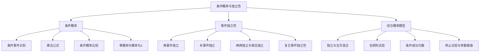
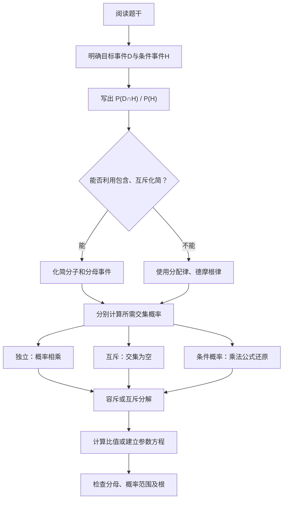

## 一、本节知识体系与考查重点

条件概率与独立性是整个概率论的核心基础。后续的全概率公式、贝叶斯公式、随机变量的独立性、二维随机变量、协方差以及数理统计，都建立在本节知识之上。

本节最重要的两个问题是：

**条件概率：已经获得某些信息之后，事件发生的概率会怎样变化？**

**独立性：一个事件是否发生，会不会改变另一个事件发生的概率？**

几乎所有复杂题目，都可以回到这两个问题。

本节核心题型与复习优先级如下。

| 核心题型       | 复习优先级 | 代表题目           |
| ---------- | ----- | -------------- |
| 条件概率基本计算   | ★★★★★ | 1989数一         |
| 复合条件事件化简   | ★★★★★ | 2012、2018数一    |
| 独立性的等价判定   | ★★★★★ | 1998数一         |
| 条件概率大小比较   | ★★★★★ | 2017、2021数一    |
| 补事件与差事件独立  | ★★★★★ | 2014数一         |
| 两两独立与相互独立  | ★★★★★ | 1999数一         |
| 独立、互斥混合运算  | ★★★★★ | 2018、2022数一    |
| 条件成功次数     | ★★★★★ | 2024、2025数一    |
| 零概率与几乎必然包含 | ★★★★☆ | 2016数三、张宇1000题 |
| 复合事件独立性证明  | ★★★★☆ | 2017数三         |
| 条件概率参数极值   | ★★★★☆ | 李永乐六套卷         |
| 停止试验与条件计数  | ★★★★☆ | 李林880、汤家凤八套卷   |

## 二、条件概率的基础概念与核心公式

### 2.1 条件概率的本质：缩小样本空间

设 $A,B$ 为两个随机事件，且 $P(B)>0$。

在事件 $B$ 已经发生的条件下，事件 $A$ 发生的概率定义为

$$
\boxed{P(A\mid B)=\frac{P(AB)}{P(B)}}
$$

全文使用 $AB$ 表示 $A\cap B$，使用 $\bar A$ 表示 $A$ 的对立事件。

理解这个公式最重要的是：

- 分母 $P(B)$：已经确定发生的条件事件。
- 分子 $P(AB)$：在条件事件内部，同时满足目标要求的部分。
- 整个比值：目标事件在新样本空间中所占的概率比例。

例如，在100名学生中，60人通过数学考试，50人通过英语考试，40人两科均通过。

随机选择一名学生，其数学通过的概率为

$$
P(A)=\frac{60}{100}=0.6.
$$

但如果已经知道这名学生通过英语考试，那么考虑范围便缩小至50名英语通过的学生。

因此：

$$
P(A\mid B)=\frac{40}{50}=0.8.
$$

注意区分：

$$
P(A)=0.6,\qquad P(AB)=0.4,
$$

$$
P(A\mid B)=0.8,\qquad P(B\mid A)=\frac23.
$$

这四个量分别代表不同含义，不能混淆。

### 2.2 条件概率的基本性质

固定条件事件 $H$，其中 $P(H)>0$，则 $P(\cdot\mid H)$ 本身就是一个概率测度。因此，普通概率的基本性质在同一条件下依然成立。

| 性质   | 公式                                                       |
| ---- | -------------------------------------------------------- |
| 非负性  | $0\leq P(A\mid H)\leq1$                              |
| 规范性  | $P(\Omega\mid H)=1$                                  |
| 对立事件 | $P(\bar A\mid H)=1-P(A\mid H)$                       |
| 加法公式 | $P(A\cup B\mid H)=P(A\mid H)+P(B\mid H)-P(AB\mid H)$ |
| 单调性  | $A\subseteq B\Rightarrow P(A\mid H)\leq P(B\mid H)$  |
| 差事件  | $P(A-B\mid H)=P(A\mid H)-P(AB\mid H)$                |

其中，特别重要的是

$$
\boxed{P(A\mid B)+P(\bar A\mid B)=1}
$$

注意，只有竖线右侧的条件相同，才能直接使用互补公式。

一般而言：

$$
P(A\mid B)+P(A\mid\bar B)\ne1.
$$

$$
P(A\mid B)+P(\bar A\mid\bar B)\ne1.
$$

后面会看到，第二个式子如果恰好等于1，在适当条件下反而可以推出独立性。

### 2.3 条件概率的三个快速化简模型

**模型一：目标事件包含于条件事件**

若 $A\subseteq B$，则 $AB=A$，因此

$$
\boxed{P(A\mid B)=\frac{P(A)}{P(B)}}
$$

特别地：

$$
P(A\mid A\cup B) =\frac{P(A)}{P(A\cup B)}.
$$

这是本节历年真题中极其重要的结构。

**模型二：条件事件包含于目标事件**

若 $B\subseteq A$，则 $AB=B$，因此

$$
\boxed{P(A\mid B)=1}.
$$

**模型三：目标事件与条件事件互斥**

若 $AB=\varnothing$，则

$$
\boxed{P(A\mid B)=0}.
$$

以上三个结论都要求相应条件概率的分母大于零。

### 2.4 乘法公式

将条件概率定义变形：

$$
\boxed{P(AB)=P(B)P(A\mid B)}
$$

也可以写成

$$
\boxed{P(AB)=P(A)P(B\mid A)}
$$

相应条件事件必须具有正概率。

三个事件的乘法公式为

$$
\boxed{ P(ABC)=P(A)P(B\mid A)P(C\mid AB) }
$$

其中要求 $P(A)>0$、$P(AB)>0$。

推广到 $n$ 个事件：

$$
\begin{aligned} P(A_1\cdots A_n) ={}&P(A_1)P(A_2\mid A_1)\\ &\cdots P(A_n\mid A_1\cdots A_{n-1}). \end{aligned}
$$

要求各条件事件的概率大于零。

**乘法公式与独立性乘法公式的区别**

对于一般事件，正确公式是

$$
P(AB)=P(A)P(B\mid A).
$$

只有当 $A,B$ 独立时，才可以直接写成

$$
P(AB)=P(A)P(B).
$$

例如，袋中有3个白球、2个黑球，不放回地取两个球，两次均取到白球的概率为

$$
\frac35\cdot\frac24=\frac3{10}.
$$

而在每次抽取后放回、充分混合并独立抽取的模型下：

$$
P(AB)=\frac35\cdot\frac35=\frac9{25}.
$$

因此，**可以使用条件概率乘法公式，不意味着事件本身独立。**

## 三、解决抽象概率题的万能工具：四原子概率表

这是本节最值得掌握的一种方法。尤其适用于条件概率、独立性、概率不等式、反例构造以及参数范围问题。

设

$$
a=P(A),\qquad b=P(B),\qquad c=P(AB).
$$

两个事件将整个样本空间划分成四个互不相容的部分：

|              | $B$   | $\bar B$  | 合计        |
| ------------ | --------- | ------------- | --------- |
| $A$      | $c$   | $a-c$     | $a$   |
| $\bar A$ | $b-c$ | $1-a-b+c$ | $1-a$ |
| 合计           | $b$   | $1-b$     | $1$   |

由此可以立即得到：

$$
P(A-B)=a-c,
$$

$$
P(B-A)=b-c,
$$

$$
P(A\cup B)=a+b-c,
$$

$$
P(\bar A\bar B)=1-a-b+c.
$$

相应的四个重要条件概率是

$$
P(A\mid B)=\frac cb, \qquad P(A\mid\bar B)=\frac{a-c}{1-b},
$$

$$
P(B\mid A)=\frac ca, \qquad P(B\mid\bar A)=\frac{b-c}{1-a}.
$$

各式均在相应分母非零时成立。

### 3.1 交集概率的取值范围

由于四个原子事件的概率都必须非负：

$$
c\geq0,
$$

$$
a-c\geq0,\qquad b-c\geq0,
$$

$$
1-a-b+c\geq0.
$$

因此

$$
\boxed{ \max\{0,a+b-1\}\leq c\leq\min\{a,b\} }
$$

即

$$
\boxed{ \begin{aligned} \max\{0,P(A)+P(B)-1\} &\leq P(AB)\\ &\leq\min\{P(A),P(B)\}. \end{aligned} }
$$

这个结论不仅是概率的基本性质，还可以用于：

- 判断给定的概率条件是否可能成立；
- 求条件概率的最大值和最小值；
- 排除参数方程的非法根；
- 构造独立性反例；
- 证明概率不等式。

### 3.2 条件概率的取值范围

当 $b>0$ 时，由上述交集范围可知

$$
\boxed{ \max\left\{0,\frac{a+b-1}{b}\right\} \leq P(A\mid B) \leq\min\left\{1,\frac ab\right\}. }
$$

例如，若

$$
P(A)=0.8,\qquad P(B)=0.5,
$$

则

$$
0.3\leq P(AB)\leq0.5,
$$

从而

$$
0.6\leq P(A\mid B)\leq1.
$$

这类问题不能仅凭条件概率属于 $[0,1]$ 来判断，还必须考虑边缘概率给出的约束。

**对于不涉及具体生活模型的抽象事件题，优先考虑设** $a,b,c$ **或直接画出四原子概率表。**

## 四、事件独立性的基础知识

### 4.1 两个事件独立的定义

若

$$
\boxed{P(AB)=P(A)P(B)}
$$

则称事件 $A,B$ 相互独立。

这是最根本的定义，也是没有其他条件限制的通用判定公式。

当 $P(B)>0$ 时，等价于

$$
P(A\mid B)=P(A).
$$

当 $P(A)>0$ 时，等价于

$$
P(B\mid A)=P(B).
$$

独立性的直观意义就是：知道另一个事件发生，并不会改变当前事件发生的概率。

特别注意，独立性定义不要求 $P(A)$、$P(B)$ 大于零，但是使用条件概率作为判据时必须检查分母。

### 4.2 独立性的六个等价判据

当

$$
0<P(A)<1,\qquad 0<P(B)<1
$$

时，下列条件相互等价：

| 判定角度   | 等价条件                                   |
| ------ | -------------------------------------- |
| 定义式    | $P(AB)=P(A)P(B)$                   |
| 正向条件   | $P(A\mid B)=P(A)$                  |
| 反向条件   | $P(B\mid A)=P(B)$                  |
| 正反条件比较 | $P(A\mid B)=P(A\mid\bar B)$        |
| 对称条件比较 | $P(B\mid A)=P(B\mid\bar A)$        |
| 互补形式   | $P(A\mid B)+P(\bar A\mid\bar B)=1$ |

考试中经常不会直接给出独立性，而是将独立性隐藏在后面几个条件里。

这些判据应理解其来历，而不仅是背诵。

### 4.3 补事件的独立性

如果 $A,B$ 独立，那么下列三对事件也独立：

$$
A,\bar B; \qquad \bar A,B; \qquad \bar A,\bar B.
$$

证明第一种情况：

$$
\begin{aligned} P(A\bar B) &=P(A)-P(AB)\\ &=P(A)-P(A)P(B)\\ &=P(A)[1-P(B)]\\ &=P(A)P(\bar B). \end{aligned}
$$

其他情况同理。

因此

$$
\boxed{ \begin{aligned} P(AB)&=ab,\\ P(A\bar B)&=a(1-b),\\ P(\bar AB)&=(1-a)b,\\ P(\bar A\bar B)&=(1-a)(1-b). \end{aligned} }
$$

独立事件的并集概率为

$$
\boxed{ P(A\cup B)=1-(1-a)(1-b) }
$$

恰好一个发生的概率为

$$
\boxed{ P(A\bar B\cup\bar AB) =a+b-2ab. }
$$

### 4.4 独立、互斥、对立、包含的区别

这是概率论中最容易混淆的四组概念。

| 关系   | 核心条件                                  | 直观意义                     |
| ---- | ------------------------------------- | ------------------------ |
| 相互独立 | $P(AB)=P(A)P(B)$                  | 互不改变发生概率                 |
| 互不相容 | $AB=\varnothing$                  | 不能同时发生                   |
| 互为对立 | $AB=\varnothing,\ A\cup B=\Omega$ | 必有且只有一个发生                |
| 包含关系 | $A\subseteq B$                    | $A$ 发生必导致 $B$ 发生 |

对于概率均大于零的两个事件：

**互斥一定不独立，独立一定不互斥。**

因为互斥意味着

$$
P(AB)=0,
$$

而独立意味着

$$
P(AB)=P(A)P(B)>0.
$$

两者不能同时成立。

但如果其中一个事件的概率为零，则互斥与独立可以同时成立。

进一步有三个重要推论。

第一，概率为0或1的事件与任意事件独立。

第二，一个事件与自身独立的充要条件是

$$
P(A)\in\{0,1\}.
$$

因为

$$
P(AA)=P(A)=P^2(A).
$$

第三，如果 $A\subseteq B$，且 $A,B$ 独立，那么

$$
P(A)=0 \quad\text{或}\quad P(B)=1.
$$

证明：

$$
P(AB)=P(A)=P(A)P(B),
$$

所以

$$
P(A)[1-P(B)]=0.
$$

这些特殊结论经常用于抽象选择题。

## 五、题型一：条件概率与复合事件的基本计算

### 母题1：1989年数学一真题——从条件概率还原交集

已知

$$
P(A)=0.5,\qquad P(B)=0.6,
$$

$$
P(B\mid A)=0.8.
$$

求 $P(A\cup B)$。

**识别方法：** 已知两个边缘概率以及一个条件概率，求并集。

并集公式需要交集，因此先利用乘法公式。

$$
P(AB)=P(A)P(B\mid A) =0.5\times0.8=0.4.
$$

然后使用容斥公式：

$$
\begin{aligned} P(A\cup B) &=P(A)+P(B)-P(AB)\\ &=0.5+0.6-0.4\\ &=\boxed{0.7}. \end{aligned}
$$

这类题目的通用公式是

$$
\boxed{ P(A\cup B)=P(A)+P(B)-P(A)P(B\mid A). }
$$

### 母题2：1989年数学一真题——已知至少一个发生

甲、乙独立地对目标射击一次，命中率分别为 $0.6$ 和 $0.5$。已知目标被命中，求甲命中的概率。

设 $A$ 为甲命中，$B$ 为乙命中。

题目中的“已知目标被命中”意味着条件事件是

$$
H=A\cup B.
$$

所求概率为

$$
P(A\mid A\cup B).
$$

由于 $A\subseteq A\cup B$，所以

$$
P(A\mid A\cup B) =\frac{P(A)}{P(A\cup B)}.
$$

由独立性：

$$
P(A\cup B)=1-0.4\times0.5=0.8.
$$

因此

$$
\boxed{P(A\mid A\cup B)=\frac{0.6}{0.8}=\frac34}.
$$

**母题变式：相似语言对应不同事件**

仍使用本题的数据。

| 问题             | 数学表达式                                   | 答案            |
| -------------- | --------------------------------------- | ------------- |
| 已知目标被命中，甲命中    | $P(A\mid A\cup B)$                  | $\frac34$ |
| 已知目标被命中，仅甲命中   | $P(A\bar B\mid A\cup B)$            | $\frac38$ |
| 已知目标被命中，两人均命中  | $P(AB\mid A\cup B)$                 | $\frac38$ |
| 已知目标被命中，恰好一人命中 | $P(A\bar B\cup\bar AB\mid A\cup B)$ | $\frac58$ |
| 已知乙命中，甲命中      | $P(A\mid B)$                        | $\frac35$ |

同样的数据，仅仅改变题目的一个关键词，就会形成完全不同的条件概率。

### 母题3：张宇1000题——复合条件事件的化简

题目给出

$$
P(A\bar B)=\frac12,\qquad P(A)=\frac7{10},
$$

$$
P(B\mid A\cup\bar B)=\frac14.
$$

求 $P(B)$。

<Steps>

<Step>

### 第一步：先化简事件，而不是盲目计算 [!toc]

$$
\begin{aligned} B\cap(A\cup\bar B) &=AB\cup B\bar B\\ &=AB. \end{aligned}
$$

所以

$$
P(B\mid A\cup\bar B) =\frac{P(AB)}{P(A\cup\bar B)}.
$$

</Step>

<Step>

### 第二步：求已知交集 [!toc]

$$
P(AB)=P(A)-P(A\bar B) =\frac7{10}-\frac12=\frac15.
$$

于是

$$
\frac{1/5}{P(A\cup\bar B)}=\frac14,
$$

得到

$$
P(A\cup\bar B)=\frac45.
$$

</Step>

<Step>

### 第三步：利用对立事件反求 [!toc]

由德摩根律：

$$
\overline{A\cup\bar B}=\bar AB.
$$

因此

$$
P(\bar AB)=1-\frac45=\frac15.
$$

最终

$$
P(B)=P(AB)+P(\bar AB) =\boxed{\frac25}.
$$

</Step>

</Steps>

**本题的核心模板**

$$
\boxed{ P(B\mid A\cup\bar B) =\frac{P(AB)}{1-P(\bar AB)} }
$$

在分母为正时成立。

同样地，还可以得到

$$
P(A\mid\bar A\cup B) =\frac{P(AB)}{1-P(A\bar B)}.
$$

这些公式不必死记，熟练运用分配律和德摩根律即可。

### 补充模拟题：李林2027六套卷第1套第8题

已知

$$
P(A)=0.4,\qquad P(A\cup B)=0.7,
$$

$$
P(\bar B\mid\bar A)+P(B\mid A)=1.
$$

求 $P(\bar A\cup\bar B)$。

首先：

$$
P(\bar AB)=P(A\cup B)-P(A)=0.3.
$$

于是

$$
P(\bar B\mid\bar A) =\frac{0.6-0.3}{0.6}=\frac12.
$$

得到

$$
P(B\mid A)=\frac12.
$$

所以

$$
P(AB)=0.4\times\frac12=0.2.
$$

再利用德摩根律：

$$
P(\bar A\cup\bar B)=1-P(AB)=\boxed{0.8}.
$$

实际上，这道题的条件还隐藏了 $A,B$ 独立，因为

$$
P(B\mid A)=P(B\mid\bar A).
$$

这就引出了下一类真题。

## 六、题型二：独立性的等价判定

### 母题4：1998年数学一真题

设

$$
0<P(A)<1,\qquad P(B)>0,
$$

且

$$
P(B\mid A)=P(B\mid\bar A).
$$

判断 $A,B$ 是否独立。

<Tabs items={["方法一：全概率公式", "方法二：定义式直接变形"]} defaultIndex={0}>

<Tab value="方法一：全概率公式">

记

$$
P(B\mid A)=P(B\mid\bar A)=q.
$$

由于 $A,\bar A$ 构成整个样本空间的一个划分，

$$
\begin{aligned} P(B) &=P(B\mid A)P(A)\\ &\quad+P(B\mid\bar A)P(\bar A)\\ &=q[P(A)+P(\bar A)]\\ &=q. \end{aligned}
$$

于是

$$
P(B\mid A)=P(B),
$$

所以 $A,B$ 相互独立。

</Tab>

<Tab value="方法二：定义式直接变形">

设

$$
a=P(A),\quad b=P(B),\quad c=P(AB).
$$

由已知条件：

$$
\frac ca=\frac{b-c}{1-a}.
$$

交叉相乘得到

$$
c(1-a)=a(b-c),
$$

整理得

$$
c=ab.
$$

即

$$
P(AB)=P(A)P(B).
$$

所以 $A,B$ 相互独立。

</Tab>

</Tabs>

**为什么这个结论成立？**

如果无论 $A$ 发生还是不发生，$B$ 的发生概率都相同，那么是否获得关于 $A$ 的信息，自然不会改变 $B$ 的发生概率。

这正是独立性的含义。

### 变式：1994年数学三真题、张宇1000题

设 $A,B$ 的概率均严格介于0和1之间，且

$$
P(A\mid B)+P(\bar A\mid\bar B)=1.
$$

判断 $A,B$ 是否独立。

只需要利用同条件下的互补关系：

$$
P(\bar A\mid\bar B)=1-P(A\mid\bar B).
$$

于是原式化为

$$
P(A\mid B)=P(A\mid\bar B).
$$

所以 $A,B$ 相互独立。

类似地，

$$
P(B\mid A)+P(\bar B\mid\bar A)=1
$$

也等价于 $A,B$ 独立。

**进一步的实用结论**

若 $0<P(B)<1$，则

$$
\boxed{ \begin{aligned} A,B\text{ 独立} &\iff P(A\mid B)=P(A)\\ &\iff P(A\mid\bar B)=P(A)\\ &\iff P(A\mid B)=P(A\mid\bar B). \end{aligned} }
$$

但是

$$
P(A\mid B)=P(B\mid A)
$$

一般不能推出 $A,B$ 独立。

例如，取 $A=B$，且 $P(A)=1/2$，则

$$
P(A\mid B)=P(B\mid A)=1,
$$

然而

$$
P(AB)=\frac12\ne\frac14=P(A)P(B).
$$

两事件并不独立。

### 母题5：2014年数学一真题——补事件与差事件

设 $A,B$ 相互独立，且

$$
P(B)=0.5,\qquad P(A-B)=0.3.
$$

求 $P(B-A)$。

首先翻译差事件：

$$
A-B=A\bar B,\qquad B-A=\bar AB.
$$

由独立性可知 $A,\bar B$ 也独立，因此

$$
P(A-B)=P(A)[1-P(B)].
$$

代入：

$$
0.3=0.5P(A),
$$

得到

$$
P(A)=0.6.
$$

同理，

$$
\begin{aligned} P(B-A) &=P(B)[1-P(A)]\\ &=0.5\times0.4\\ &=\boxed{0.2}. \end{aligned}
$$

**方法总结**

遇到独立事件的差集问题，优先使用

$$
\boxed{P(A-B)=P(A)[1-P(B)]}
$$

而对于一般事件，只能使用

$$
\boxed{P(A-B)=P(A)-P(AB)}.
$$

不要误写成 $P(A)-P(B)$，除非已知 $B\subseteq A$，或者两者的差异在概率意义下为零。

## 七、题型三：条件概率大小比较与充要条件

这一类题目是本节最重要的抽象选择题类型之一。

它的难点不在于计算量，而在于如何将多个看似不同的条件概率不等式统一起来。

### 7.1 核心工具：概率差值 $\Delta$

设

$$
a=P(A),\qquad b=P(B),\qquad c=P(AB).
$$

定义

$$
\boxed{\Delta=c-ab=P(AB)-P(A)P(B)}.
$$

这个量可以理解为实际同时发生的概率与独立情况下同时发生的概率之间的差。

当 $\Delta=0$ 时，$A,B$ 独立。

当 $\Delta>0$ 时，两个事件具有正关联。

当 $\Delta<0$ 时，两个事件具有负关联。

下面所有条件概率大小比较，都可以转化为判断 $\Delta$ 的符号。

当 $a,b\in(0,1)$ 时：

$$
\begin{aligned} P(A\mid B)-P(A) &=\frac cb-a\\ &=\frac{c-ab}{b}\\ &=\frac{\Delta}{b}. \end{aligned}
$$

类似地，

$$
\boxed{ P(A\mid\bar B)-P(A) =-\frac{\Delta}{1-b} }
$$

以及

$$
\boxed{ P(A\mid B)-P(A\mid\bar B) =\frac{\Delta}{b(1-b)}. }
$$

交换 $A,B$ 的地位可得

$$
\boxed{ P(B\mid A)-P(B\mid\bar A) =\frac{\Delta}{a(1-a)}. }
$$

因此，只需要判断一个量 $\Delta$，就可以解决整个题型。

### 7.2 三种大小关系的统一结论

| 情形             | 条件概率的大小关系                              |
| -------------- | -------------------------------------- |
| $\Delta>0$ | $P(A\mid\bar B)<P(A)<P(A\mid B)$ |
| $\Delta=0$ | $P(A\mid\bar B)=P(A)=P(A\mid B)$   |
| $\Delta<0$ | $P(A\mid B)<P(A)<P(A\mid\bar B)$ |

交换 $A,B$，结论仍然成立。

### 母题6：2017年数学一真题——条件概率不等式的充要条件

设

$$
0<P(A)<1,\qquad0<P(B)<1.
$$

问

$$
P(A\mid B)>P(A\mid\bar B)
$$

的充分必要条件是什么？

**标准解法**

设

$$
P(A)=a,\quad P(B)=b,\quad P(AB)=c.
$$

则

$$
\begin{aligned} P(A\mid B)>P(A\mid\bar B) &\iff\frac cb>\frac{a-c}{1-b}\\ &\iff c(1-b)>b(a-c)\\ &\iff c>ab. \end{aligned}
$$

另一方面，

$$
\begin{aligned} P(B\mid A)>P(B\mid\bar A) &\iff\frac ca>\frac{b-c}{1-a}\\ &\iff c(1-a)>a(b-c)\\ &\iff c>ab. \end{aligned}
$$

因此

$$
\boxed{ \begin{aligned} P(A\mid B)>P(A\mid\bar B) \iff P(B\mid A)>P(B\mid\bar A). \end{aligned} }
$$

**需要真正掌握的内容**

不是简单记住这道题的结论，而是记住下面整组等价关系：

$$
\boxed{ \begin{aligned} P(AB)>P(A)P(B) &\iff P(A\mid B)>P(A)\\ &\iff P(B\mid A)>P(B)\\ &\iff P(A\mid B)>P(A\mid\bar B)\\ &\iff P(B\mid A)>P(B\mid\bar A). \end{aligned} }
$$

在相同的适用条件下，把上述所有大于号同时换成小于号或者等于号，仍然成立。

### 7.3 取补之后，不等号如何变化？

计算四种事件组合的概率差值：

$$
P(AB)-P(A)P(B)=\Delta,
$$

$$
P(A\bar B)-P(A)P(\bar B)=-\Delta,
$$

$$
P(\bar AB)-P(\bar A)P(B)=-\Delta,
$$

$$
P(\bar A\bar B)-P(\bar A)P(\bar B)=\Delta.
$$

归纳起来就是：

**取一次补，关联方向反转；取两次补，关联方向保持不变。**

例如，如果

$$
P(AB)>P(A)P(B),
$$

那么

$$
P(A\bar B)<P(A)P(\bar B),
$$

而

$$
P(\bar A\bar B)>P(\bar A)P(\bar B).
$$

这一结论对于后面学习指示变量的协方差也很重要，因为

$$
\operatorname{Cov}(\mathbf1_A,\mathbf1_B) =P(AB)-P(A)P(B).
$$

本节的 $\Delta$，实际上就是这两个事件指示变量的协方差。

### 母题7：2021年数学一真题——条件概率命题判断

设 $A,B$ 为随机事件，且 $0<P(B)<1$，判断以下四个命题中哪一个错误。

A. 若 $P(A\mid B)=P(A)$，则 $P(A\mid\bar B)=P(A)$。

B. 若 $P(A\mid B)>P(A)$，则 $P(\bar A\mid\bar B)>P(\bar A)$。

C. 若 $P(A\mid B)>P(A\mid\bar B)$，则 $P(A\mid B)>P(A)$。

D. 若

$$
P(A\mid A\cup B)>P(\bar A\mid A\cup B),
$$

则 $P(A)>P(B)$。

**前三个选项：使用加权平均思想**

令

$$
x=P(A\mid B),\qquad y=P(A\mid\bar B),
$$

$$
b=P(B).
$$

由全概率公式：

$$
\boxed{P(A)=bx+(1-b)y}.
$$

由于 $0<b<1$，所以 $P(A)$ 是 $x,y$ 的严格加权平均。

如果 $x>y$，一定有

$$
y<P(A)<x.
$$

因此：

A正确。如果其中一个条件概率等于平均值，则另一个也等于平均值。

B正确。如果 $x>P(A)$，则 $y<P(A)$，于是

$$
1-y>1-P(A).
$$

C正确。较大的条件概率必然大于加权平均值。

**第四个选项：化简事件并构造反例**

记

$$
H=A\cup B.
$$

则

$$
P(A\mid H)=\frac{P(A)}{P(H)},
$$

而

$$
\begin{aligned} P(\bar A\mid H) &=\frac{P(\bar A(A\cup B))}{P(H)}\\ &=\frac{P(\bar AB)}{P(H)}. \end{aligned}
$$

因此题设只能推出

$$
P(A)>P(\bar AB),
$$

却不能推出

$$
P(A)>P(B).
$$

因为 $P(B)$ 还包括 $P(AB)$。

构造四原子概率表：

|              | $B$ | $\bar B$ | 合计   |
| ------------ | ------- | ------------ | ---- |
| $A$      | 0.30    | 0.15         | 0.45 |
| $\bar A$ | 0.20    | 0.35         | 0.55 |
| 合计           | 0.50    | 0.50         | 1    |

显然

$$
P(A)=0.45<0.50=P(B),
$$

但是

$$
P(A\mid H)=\frac{0.45}{0.65} > \frac{0.20}{0.65} =P(\bar A\mid H).
$$

所以D错误。

**补事件符号与命题真假**

张宇1000题强化部分中，存在与此题相似的题目，但第四个选项写成了

$$
P(A\mid A\cup B)>P(B\mid A\cup B)
$$

推出

$$
P(A)>P(B).
$$

这个修改后的命题实际上是正确的，因为两边分母相同，分子分别为 $P(A)$ 与 $P(B)$。

因此，该版本按现有题干不存在错误选项。

另有一道强化题将

$$
P(\bar A\bar B)
$$

写成了

$$
P(\overline{AB}).
$$

二者分别表示“两个都不发生”和“两个不同时发生”，是完全不同的事件。该题原样也不能得到所要求的正确充要条件。

这些问题值得注意：**考研概率选择题中，一个补事件符号就可能改变整个命题的真假。**

## 八、题型四：条件概率为0、1与零概率例外

这一部分容易出现在概念辨析题中，也关系到后续连续型随机变量的学习。

### 8.1 零概率事件不一定是不可能事件

一定成立的是

$$
A=\varnothing\Rightarrow P(A)=0.
$$

反过来不一定成立：

$$
P(A)=0\not\Rightarrow A=\varnothing.
$$

例如，随机变量 $X$ 在 $[0,1]$ 上均匀分布，则

$$
P\left(X=\frac12\right)=0,
$$

但事件

$$
\left\{X=\frac12\right\}
$$

并不是空事件。

同样：

$$
P(A)=1\not\Rightarrow A=\Omega.
$$

只有在有限样本空间且每个基本事件均具有正概率等附加条件下，才能反推出相应的集合关系。

### 母题8：2016年数学三真题——条件概率为1

设

$$
0<P(A)<1,\qquad0<P(B)<1,
$$

且

$$
P(A\mid B)=1.
$$

判断哪些结论必然成立。

由定义：

$$
\frac{P(AB)}{P(B)}=1,
$$

得到

$$
P(AB)=P(B).
$$

因此

$$
P(\bar AB)=P(B)-P(AB)=0.
$$

又因为

$$
P(\bar A\bar B)=P(\bar A)-P(\bar AB) =P(\bar A),
$$

所以

$$
\boxed{P(\bar B\mid\bar A)=1}.
$$

这可以理解为概率意义下的逆否关系：

- $B$ 发生时，$A$ 几乎必然发生；
- $A$ 不发生时，$B$ 也几乎必然不发生。

但不能直接推出严格的集合包含关系 $B\subseteq A$。

同时也不能推出

$$
P(B\mid A)=1.
$$

因为逆命题与逆否命题并不是一回事。

**通用结论**

只要对应条件概率有定义，就有

$$
\boxed{ P(A\mid B)=1 \iff P(\bar B\mid\bar A)=1 }
$$

以及

$$
\boxed{ P(A\mid B)=0 \iff P(B\mid A)=0. }
$$

第二组结论来自两者具有同一个交概率分子。

### 母题9：1996年数学三真题——条件概率的可加性

设 $0<P(B)<1$，且

$$
P(A_1\cup A_2\mid B) =P(A_1\mid B)+P(A_2\mid B).
$$

可以推出什么？

由条件概率的容斥公式：

$$
\begin{aligned} P(A_1\cup A_2\mid B) ={}&P(A_1\mid B)+P(A_2\mid B)\\ &-P(A_1A_2\mid B). \end{aligned}
$$

与题设比较：

$$
P(A_1A_2\mid B)=0.
$$

于是

$$
P(A_1A_2B)=0.
$$

进一步得到

$$
\begin{aligned} P(A_1B\cup A_2B) &=P(A_1B)+P(A_2B)-P(A_1A_2B)\\ &=P(A_1B)+P(A_2B). \end{aligned}
$$

但不能推出

$$
P(A_1A_2)=0,
$$

也不能推出

$$
P(A_1A_2\mid\bar B)=0.
$$

因为题目只限制了两个事件在 $B$ 内部的交叠情况。

张宇1000题基础部分第6题、李正元第一章第2道选择题，均考查这一思想。

### 补充母题：李林880——互斥事件相等

已知 $0<P(B)<1$，且

$$
AB=\bar A\bar B.
$$

求

$$
P(\bar A\mid B)+P(A\mid\bar B).
$$

注意：题目给出的是两个事件本身相等，而不是概率相等。

因为

$$
(AB)(\bar A\bar B)=\varnothing,
$$

两个互不相容的事件如果相等，那么只能都等于空集。

故

$$
AB=\varnothing,\qquad\bar A\bar B=\varnothing.
$$

于是

$$
A\cup B=\Omega,
$$

所以 $A,B$ 互为对立事件。

从而

$$
P(\bar A\mid B)=1, \qquad P(A\mid\bar B)=1.
$$

答案为

$$
\boxed{2}.
$$

若题目改成

$$
P(AB)=P(\bar A\bar B),
$$

则只能推出

$$
P(A)+P(B)=1,
$$

并不能推出 $A,B$ 互为对立事件。

## 九、题型五：三个事件的两两独立与相互独立

### 9.1 两两独立的定义

三个事件 $A,B,C$ 两两独立，意味着

$$
\boxed{ \begin{aligned} P(AB)&=P(A)P(B),\\ P(AC)&=P(A)P(C),\\ P(BC)&=P(B)P(C). \end{aligned} }
$$

共有三个条件。

### 9.2 相互独立的定义

三个事件 $A,B,C$ 相互独立，除了上述三个条件以外，还必须满足

$$
\boxed{P(ABC)=P(A)P(B)P(C)}.
$$

因此：

$$
\boxed{\text{相互独立}\Rightarrow\text{两两独立}}
$$

反过来不一定成立。

而且，仅有

$$
P(ABC)=P(A)P(B)P(C)
$$

也不能推出两两独立或者相互独立。

对于 $n$ 个事件，相互独立要求任取其中两个、三个，直至全部 $n$ 个事件，它们交集的概率均等于各自概率的乘积。

需要满足的乘法等式数量为

$$
\sum_{k=2}^{n}\binom nk=2^n-n-1.
$$

例如四个事件相互独立，需要验证11个乘法等式。

### 母题10：李林2027六套卷第3套第8题

设随机点 $(X,Y)$ 在单位正方形上均匀分布。

定义

$$
A=\left\{X\leq\frac12\right\},
$$

$$
B=\left\{Y\leq\frac12\right\},
$$

$$
C=\left\{ \left(X-\frac12\right) \left(Y-\frac12\right)<0 \right\}.
$$

判断 $A,B,C$ 的独立性。

正方形被两条中线分成四个面积相等的小正方形。每个小区域的概率均为 $1/4$，边界的概率为零。

| 区域 | $A$ | $B$ | $C$ | 概率        |
| -- | ------- | ------- | ------- | --------- |
| 左上 | 是       | 否       | 是       | $1/4$ |
| 右上 | 否       | 否       | 否       | $1/4$ |
| 左下 | 是       | 是       | 否       | $1/4$ |
| 右下 | 否       | 是       | 是       | $1/4$ |

由此得到

$$
P(A)=P(B)=P(C)=\frac12.
$$

并且

$$
P(AB)=P(AC)=P(BC)=\frac14.
$$

所以三个事件两两独立。

但是没有具有正概率的区域同时满足三个条件，因此

$$
P(ABC)=0,
$$

而

$$
P(A)P(B)P(C)=\frac18.
$$

所以

$$
\boxed{A,B,C\text{ 两两独立，但不相互独立}}.
$$

**这个模型为什么如此重要？**

它给出了一个非常经典的反例构造方式：前两个事件相互独立，第三个事件由前两个事件的发生状态共同决定。

2003年数学三真题中的公平硬币模型，本质上就是同一个模型。

独立抛掷公平硬币两次，令

$$
A=\{\text{第一次为正面}\},
$$

$$
B=\{\text{第二次为正面}\},
$$

$$
C=\{\text{两次结果不同}\}.
$$

则同样有

$$
P(A)=P(B)=P(C)=\frac12,
$$

$$
P(AB)=P(AC)=P(BC)=\frac14,
$$

但是

$$
P(ABC)=0\ne\frac18.
$$

这里必须是公平硬币。若硬币正面概率不是 $1/2$，这个构造一般不再满足两两独立。

### 母题11：1999年数学一真题——两两独立与三事件容斥

设 $A,B,C$ 两两独立，且

$$
ABC=\varnothing,
$$

$$
P(A)=P(B)=P(C)<\frac12,
$$

$$
P(A\cup B\cup C)=\frac9{16}.
$$

求 $P(A)$。

设

$$
P(A)=P(B)=P(C)=p.
$$

由于两两独立，

$$
P(AB)=P(AC)=P(BC)=p^2.
$$

但三重交集不能写成 $p^3$，而应当根据已知条件：

$$
P(ABC)=0.
$$

使用三事件容斥公式：

$$
\begin{aligned} P(A\cup B\cup C) &=3p-3p^2+0\\ &=\frac9{16}. \end{aligned}
$$

整理得

$$
p^2-p+\frac3{16}=0,
$$

即

$$
\left(p-\frac14\right) \left(p-\frac34\right)=0.
$$

由 $p<1/2$，舍去 $3/4$，所以

$$
\boxed{p=\frac14}.
$$

**深度拓展：三事件原子概率表**

设 $A,B,C$ 两两独立，且

$$
P(A)=P(B)=P(C)=p, \qquad P(ABC)=t.
$$

可以将整个样本空间划分成8个原子事件。

| 原子事件                     | 概率                |
| ------------------------ | ----------------- |
| $ABC$                | $t$           |
| $AB\bar C$           | $p^2-t$       |
| $A\bar BC$           | $p^2-t$       |
| $\bar ABC$           | $p^2-t$       |
| $A\bar B\bar C$      | $p-2p^2+t$    |
| $\bar AB\bar C$      | $p-2p^2+t$    |
| $\bar A\bar BC$      | $p-2p^2+t$    |
| $\bar A\bar B\bar C$ | $1-3p+3p^2-t$ |

相互独立恰好对应

$$
t=p^3.
$$

若只知道两两独立，那么 $t$ 仍是一个未知量，但受到所有原子概率非负的限制：

$$
\boxed{ \max\{0,2p^2-p\} \leq t \leq\min\{p^2,1-3p+3p^2\}. }
$$

例如 $p=1/2$ 时：

$$
0\leq t\leq\frac14.
$$

因此，当三个概率均为 $1/2$ 的事件两两独立时，

$$
\boxed{0\leq P(ABC)\leq\frac14}.
$$

相互独立只是其中

$$
P(ABC)=\frac18
$$

的特殊情况。

这类三事件原子概率模型非常适合处理未来可能出现的参数范围、概率最值及独立性综合题。

## 十、题型六：复合事件之间的独立性

### 10.1 相互独立时，独立性如何传递给复合事件？

若 $A,B,C$ 相互独立，则下列事件对一定独立：

$$
AB,\ C;
$$

$$
A\cup B,\ C;
$$

$$
A-B,\ \bar C;
$$

$$
\overline{A\cup B},\ C.
$$

它们有一个共同特点：

复合事件是由 $A,B$ 经过集合运算得到的，而另一个事件是 $C$ 或其补事件。

但如果两个复合事件共同使用某个基本事件，例如

$$
AC,\ BC,
$$

那么一般不独立。

### 母题12：2017年数学三真题——并事件独立性的充要条件

已知 $A,C$ 独立，$B,C$ 独立，求 $A\cup B$ 与 $C$ 独立的充分必要条件。

注意：题目没有告诉我们 $A,B,C$ 相互独立。

从独立性定义出发：

$$
P((A\cup B)C)=P(A\cup B)P(C).
$$

左边：

$$
\begin{aligned} P((A\cup B)C) &=P(AC\cup BC)\\ &=P(AC)+P(BC)-P(ABC). \end{aligned}
$$

右边：

$$
[P(A)+P(B)-P(AB)]P(C).
$$

利用题设：

$$
P(AC)=P(A)P(C),
$$

$$
P(BC)=P(B)P(C).
$$

代入后消去相同项：

$$
P(ABC)=P(AB)P(C).
$$

这正是 $AB,C$ 独立的定义。

因此

$$
\boxed{ A\cup B\text{ 与 }C\text{ 独立} \iff AB\text{ 与 }C\text{ 独立} }
$$

前提是 $A,C$ 与 $B,C$ 分别独立。

**进一步推论**

在上述前提下，下列三个条件也相互等价：

$$
A\cup B\text{ 与 }C\text{ 独立},
$$

$$
AB\text{ 与 }C\text{ 独立},
$$

$$
A-B\text{ 与 }C\text{ 独立}.
$$

证明仍然使用独立性定义与容斥公式。

### 母题13：李永乐2027六套卷第4套第8题

判断下列两个命题的真假。

① 若 $A,B,C$ 两两独立，则 $A$ 与 $B\cup C$ 独立。

② 若 $A,B,C$ 相互独立，且三个事件的概率均严格介于0和1之间，则 $AC$ 与 $BC$ 独立。

**命题①**

使用前面两次抛掷公平硬币的反例，取

$$
A=\{HH,HT\},
$$

$$
B=\{HH,TH\},
$$

$$
C=\{HT,TH\}.
$$

三个事件两两独立。

但是

$$
P(A(B\cup C))=\frac12,
$$

而

$$
P(A)P(B\cup C) =\frac12\cdot\frac34=\frac38.
$$

因此命题①错误。

**命题②**

设

$$
P(A)=a,\quad P(B)=b,\quad P(C)=c.
$$

由于相互独立：

$$
P((AC)(BC))=P(ABC)=abc.
$$

但是

$$
P(AC)P(BC)=(ac)(bc)=abc^2.
$$

当 $a,b>0$，且 $0<c<1$ 时，

$$
abc\ne abc^2.
$$

所以命题②错误。

两个命题均错误。

实际上，在这组条件下，$AC$ 与 $BC$ 具有正关联，因为

$$
P(ABC)-P(AC)P(BC) =abc(1-c)>0.
$$

这种正关联来自两个复合事件都要求 $C$ 发生。

### 10.2 独立性不具有传递性

张宇1000题强化部分第18题考查了两个常见错误结论。

第一个错误：

$$
A,B\text{ 独立},\ B,C\text{ 独立}
$$

就认为 $A,C$ 独立。

反例：取 $C=A$，其中 $P(A)=1/2$，再取 $B$ 与 $A$ 独立。

显然 $A,B$ 独立，$B,C$ 独立，但是 $A,C$ 不独立。

如果题目要求三个事件互不相同，也可以取 $C=\bar A$。

第二个错误：若 $A,B$ 独立，且

$$
C\subseteq A,\qquad D\subseteq B,
$$

就认为 $C,D$ 独立。

仍然不成立。

例如在四个等可能样本点中取

$$
A=\{1,2\},\qquad B=\{1,3\},
$$

显然 $A,B$ 独立。

但令

$$
C=D=\{1\},
$$

则 $C\subseteq A,\ D\subseteq B$，而

$$
P(CD)=\frac14\ne\frac1{16}=P(C)P(D).
$$

**李正元练习题：独立与互斥混合辨析**

独立抛掷公平硬币三次，令 $X$ 为正面出现次数，并定义

$$
A=\{1\leq X\leq2\},
$$

$$
B=\{X\leq1\}, \qquad C=\{X\geq2\}.
$$

根据二项分布：

$$
P(A)=\frac34,\qquad P(B)=P(C)=\frac12.
$$

同时

$$
P(AB)=P(X=1)=\frac38,
$$

$$
P(AC)=P(X=2)=\frac38.
$$

所以 $A,B$ 独立，$A,C$ 独立。

但是

$$
BC=\varnothing,
$$

从而 $B,C$ 不独立。

又因为

$$
B\cup C=\Omega,
$$

而必然事件与任意事件独立，所以 $B\cup C$ 与 $A$ 独立。

这道题很好地综合了独立性、互斥、对立以及概率为1的特殊事件。

## 十一、题型七：独立、互斥与条件概率的综合运算

这一类题目在近年的真题中十分重要。

基本特点是：

题目同时给出多组事件关系，其中有些独立，有些互斥，有些具有包含关系，要求计算复合事件的条件概率。

### 11.1 标准解题流程

### 母题14：2012年数学一真题——互斥条件下的分子化简

设 $A,C$ 互不相容，

$$
P(AB)=\frac12,\qquad P(C)=\frac13.
$$

求

$$
P(AB\mid\bar C).
$$

因为 $A,C$ 互斥，所以

$$
A\subseteq\bar C.
$$

进一步有

$$
AB\subseteq A\subseteq\bar C.
$$

因此

$$
AB\bar C=AB.
$$

直接得到

$$
P(AB\mid\bar C) =\frac{P(AB)}{P(\bar C)} =\frac{1/2}{1-1/3} =\boxed{\frac34}.
$$

这道题最关键的步骤不是计算，而是意识到分子中的 $\bar C$ 可以被消去。

### 母题15：2018年数学一真题——独立与互斥混合求参数

设 $A,B$ 独立，$A,C$ 独立，$BC=\varnothing$，且

$$
P(A)=P(B)=\frac12,
$$

$$
P(AC\mid AB\cup C)=\frac14.
$$

求 $P(C)$。

<Steps>

<Step>

### 第一步：化简条件概率 [!toc]

因为

$$
AC\subseteq C\subseteq AB\cup C,
$$

所以

$$
P(AC\mid AB\cup C) =\frac{P(AC)}{P(AB\cup C)}.
$$

</Step>

<Step>

### 第二步：分别处理独立与互斥 [!toc]

设

$$
P(C)=x.
$$

由 $A,C$ 独立：

$$
P(AC)=\frac x2.
$$

由 $A,B$ 独立：

$$
P(AB)=\frac14.
$$

由 $BC=\varnothing$：

$$
ABC=\varnothing.
$$

所以

$$
P(AB\cup C)=P(AB)+P(C)=\frac14+x.
$$

</Step>

<Step>

### 第三步：建立方程 [!toc]

$$
\frac{x/2}{1/4+x}=\frac14.
$$

整理得到

$$
2x=\frac14+x.
$$

因此

$$
\boxed{P(C)=\frac14}.
$$

结果满足 $BC$ 互斥所要求的

$$
P(B)+P(C)\leq1.
$$

</Step>

</Steps>

**母题推广**

假设 $A,B$ 独立，$A,C$ 独立，$B,C$ 互斥，并且

$$
P(A)=a,\quad P(B)=b,\quad P(C)=c.
$$

则只要分母为正，

$$
\boxed{ P(AC\mid AB\cup C) =\frac{ac}{ab+c}. }
$$

如果题目给出该条件概率为 $q$，就得到

$$
ac=q(ab+c).
$$

当 $a\ne q$ 时：

$$
\boxed{c=\frac{qab}{a-q}}.
$$

随后还要检查 $c\in[0,1]$ 以及 $b+c\leq1$。

### 母题16：2022年数学一真题——三事件并集的条件概率

设 $A,B$ 互斥，$A,C$ 互斥，$B,C$ 独立，并且

$$
P(A)=P(B)=P(C)=\frac13.
$$

求

$$
P(B\cup C\mid A\cup B\cup C).
$$

因为目标事件包含于条件事件中：

$$
P(B\cup C\mid A\cup B\cup C) =\frac{P(B\cup C)}{P(A\cup B\cup C)}.
$$

由 $B,C$ 独立：

$$
P(BC)=\frac19.
$$

故

$$
P(B\cup C)=\frac13+\frac13-\frac19=\frac59.
$$

由于 $A$ 与 $B,C$ 均互斥，

$$
A(B\cup C)=\varnothing.
$$

因此

$$
P(A\cup B\cup C)=\frac13+\frac59=\frac89.
$$

所求为

$$
\boxed{\frac{5/9}{8/9}=\frac58}.
$$

**解题策略**

遇到三个事件的并集，不一定每次都要完整使用三事件容斥公式。

当题目具有明显的局部互斥结构时，可以先将两个事件合并成一个复合事件，再利用二事件加法公式。

### 母题17：李林880综合解答题

设 $A,B$ 相互独立，$A,C$ 互不相容，且

$$
P(A)=0.4,\quad P(B)=0.3,\quad P(C)=0.4,
$$

$$
P(B\mid C)=0.2.
$$

求：

$$
\text{(I)}\ P(A\cup B);
$$

$$
\text{(II)}\ P(C\mid A\cup B);
$$

$$
\text{(III)}\ P(AB\mid\bar C).
$$

首先将所有已知条件翻译成基本交集概率：

$$
P(AB)=0.4\times0.3=0.12,
$$

$$
P(AC)=0,
$$

$$
P(BC)=P(B\mid C)P(C)=0.08.
$$

由于 $AC=\varnothing$，故

$$
P(ABC)=0.
$$

**第一问：**

$$
P(A\cup B)=0.4+0.3-0.12 =\boxed{0.58}.
$$

**第二问：**

$$
C(A\cup B)=AC\cup BC=BC.
$$

所以

$$
P(C\mid A\cup B) =\frac{0.08}{0.58} =\boxed{\frac4{29}}.
$$

**第三问：**

因为 $AB\subseteq A\subseteq\bar C$，所以

$$
P(AB\mid\bar C) =\frac{0.12}{1-0.4} =\boxed{0.2}.
$$

这道题具有很好的母题价值：通过同一组信息，可以构造出多种条件概率问题。

### 补充模拟题：李永乐2027六套卷第1套第8题

已知 $A,B$ 独立，

$$
P(A)=\frac12,\qquad P(B)=\frac13,
$$

并且 $AC\subseteq B$，以及

$$
P(C)=\frac13,\quad P(A\mid C)=\frac14,\quad P(B\mid C)=\frac12.
$$

求

$$
P(A(B-C)\mid B\cup C).
$$

由题设：

$$
P(AB)=\frac16,\qquad P(AC)=\frac1{12},\qquad P(BC)=\frac16.
$$

本题最关键的特殊条件是

$$
AC\subseteq B.
$$

这意味着

$$
ABC=AC.
$$

因此

$$
\begin{aligned} P(A(B-C)) &=P(AB\bar C)\\ &=P(AB)-P(ABC)\\ &=\frac16-\frac1{12} =\frac1{12}. \end{aligned}
$$

而

$$
P(B\cup C)=\frac13+\frac13-\frac16=\frac12.
$$

由于 $A(B-C)\subseteq B\cup C$，所以

$$
\boxed{ P(A(B-C)\mid B\cup C) =\frac{1/12}{1/2}=\frac16. }
$$

本题比一般的独立、互斥综合题更灵活，因为它通过包含关系确定了三重交集。

## 十二、题型八：至少一个、恰好一个、全部发生

2024年、2025年数学一真题都考查了条件事件为“至少成功一次”或“至少一个事件发生”的模型。

应当重点掌握这组题型。

### 12.1 两个事件的发生次数

对于任意两个事件 $A,B$，有

$$
P(\text{至少一个发生}) =P(A)+P(B)-P(AB),
$$

$$
P(\text{恰好一个发生}) =P(A)+P(B)-2P(AB),
$$

$$
P(\text{全部发生})=P(AB),
$$

$$
P(\text{均不发生}) =1-P(A)-P(B)+P(AB).
$$

其中最容易混淆的是：

$$
\boxed{ \text{恰好一个发生} = \text{至少一个发生} - \text{两个都发生}. }
$$

如果 $A,B$ 独立，就进一步有

$$
P(\text{恰好一个发生}) =a(1-b)+(1-a)b.
$$

### 母题18：2025年数学一真题

设 $A,B$ 相互独立，且

$$
P(A)=2P(B),
$$

$$
P(A\cup B)=\frac58.
$$

求在至少有一个事件发生的条件下，恰好有一个事件发生的概率。

<Steps>

<Step>

### 第一步：确定未知参数 [!toc]

令

$$
P(B)=p,\qquad P(A)=2p.
$$

显然

$$
0\leq p\leq\frac12.
$$

由独立性：

$$
P(AB)=2p^2.
$$

于是

$$
2p+p-2p^2=\frac58.
$$

整理得

$$
16p^2-24p+5=0,
$$

解得

$$
p=\frac14\quad\text{或}\quad p=\frac54.
$$

根据概率范围，舍去 $5/4$。

所以

$$
P(B)=\frac14,\qquad P(A)=\frac12,
$$

$$
P(AB)=\frac18.
$$

</Step>

<Step>

### 第二步：利用条件事件的内部划分 [!toc]

设

$$
U=A\cup B.
$$

在至少一个发生的情况下，只有两种互斥情况：恰好一个发生或两个都发生。

因此

$$
\begin{aligned} P(\text{恰好一个}\mid U) &=1-P(AB\mid U)\\ &=1-\frac{P(AB)}{P(U)}\\ &=1-\frac{1/8}{5/8}\\ &=\boxed{\frac45}. \end{aligned}
$$

</Step>

</Steps>

**最重要的通用公式**

对于任意两个事件，只要 $P(A\cup B)>0$，恒有

$$
\boxed{ P(\text{恰好一个}\mid A\cup B) =1-\frac{P(AB)}{P(A\cup B)}. }
$$

如果两个事件独立，代入 $P(AB)=ab$，就得到

$$
\boxed{ P(\text{恰好一个}\mid A\cup B) =\frac{a+b-2ab}{a+b-ab}. }
$$

### 12.2 三个事件的发生次数

设

$$
S_1=P(A)+P(B)+P(C),
$$

$$
S_2=P(AB)+P(AC)+P(BC),
$$

$$
S_3=P(ABC).
$$

则有以下重要公式：

| 发生次数   | 概率                  |
| ------ | ------------------- |
| 至少一个   | $S_1-S_2+S_3$   |
| 恰好一个   | $S_1-2S_2+3S_3$ |
| 恰好两个   | $S_2-3S_3$      |
| 至少两个   | $S_2-2S_3$      |
| 恰好三个   | $S_3$           |
| 一个也不发生 | $1-S_1+S_2-S_3$ |

这些公式对任意三个事件都成立，不需要独立性。

**为什么恰好一个是 $S_1-2S_2+3S_3$？**

设 $N$ 为三个事件实际发生的个数。

对于每一种发生次数，观察表达式中的重复计数。

| 实际发生个数 $N$ | 一重交集计数 | 二重交集计数 | 三重交集计数 | 最终权重 |
| -------------- | ------ | ------ | ------ | ---- |
| 0              | 0      | 0      | 0      | 0    |
| 1              | 1      | 0      | 0      | 1    |
| 2              | 2      | 1      | 0      | 0    |
| 3              | 3      | 3      | 1      | 0    |

最终权重为

$$
N-2\binom N2+3\binom N3.
$$

它恰好在 $N=1$ 时等于1，其余情况下均等于0。

这就是发生次数公式背后的计数原理。

### 母题19：2025年数学三真题——三个事件恰好发生一个

这道题虽然来自数学三，但非常适合作为2025年数学一真题的进阶变式。

设 $A,B$ 独立，$B,C$ 独立，$A,C$ 互斥，并且

$$
P(A)=P(C)=\frac14,\qquad P(B)=\frac12.
$$

求至少发生一个的条件下，恰好发生一个的概率。

由独立性与互斥条件，

$$
P(AB)=P(BC)=\frac18,
$$

$$
P(AC)=P(ABC)=0.
$$

因此

$$
S_1=1,\qquad S_2=\frac14,\qquad S_3=0.
$$

至少发生一个的概率为

$$
P(N\geq1)=1-\frac14=\frac34.
$$

恰好发生一个的概率为

$$
P(N=1)=1-2\cdot\frac14=\frac12.
$$

所以

$$
\boxed{ P(N=1\mid N\geq1) =\frac{1/2}{3/4}=\frac23. }
$$

这道题表明：当事件之间不完全独立时，仍然可以通过一重、二重、三重交集概率计算发生次数，不必强行使用二项分布。

## 十三、题型九：独立重复试验中的条件概率

### 13.1 伯努利试验的基础公式

进行 $n$ 次独立重复试验，每次成功概率均为 $p$，失败概率为 $1-p$。

记 $X$ 为成功次数，则

$$
X\sim B(n,p).
$$

其概率分布为

$$
\boxed{ P(X=k)=\binom nk p^k(1-p)^{n-k} }
$$

其中 $k=0,1,\ldots,n$。

特别地：

$$
P(X=0)=(1-p)^n,
$$

$$
P(X\geq1)=1-(1-p)^n,
$$

$$
P(X=n)=p^n.
$$

适用条件是：

试验次数固定；每次只有成功和失败两种结果；各次试验相互独立；成功概率保持不变。

如果成功概率不相同，或者试验之间存在依赖关系，就不能直接使用二项分布公式。

### 母题20：2024年数学一真题

某随机试验每次成功概率为 $p$。进行三次独立重复试验，已知至少成功一次的条件下，全部成功的概率为 $4/13$，求 $p$。

设三次试验的成功次数为 $X$，则

$$
X\sim B(3,p).
$$

题目对应

$$
P(X=3\mid X\geq1)=\frac4{13}.
$$

由于

$$
\{X=3\}\subseteq\{X\geq1\},
$$

所以

$$
\frac{P(X=3)}{P(X\geq1)} =\frac4{13}.
$$

即

$$
\frac{p^3}{1-(1-p)^3}=\frac4{13}.
$$

条件概率有定义，要求 $p>0$。

分母展开：

$$
1-(1-p)^3=3p-3p^2+p^3.
$$

因此

$$
\frac{p^2}{3-3p+p^2}=\frac4{13}.
$$

整理：

$$
13p^2=4(3-3p+p^2),
$$

$$
3p^2+4p-4=0,
$$

$$
(3p-2)(p+2)=0.
$$

解得

$$
p=\frac23\quad\text{或}\quad p=-2.
$$

根据概率的取值范围：

$$
\boxed{p=\frac23}.
$$

**通用模型：给定至少成功一次**

对于 $X\sim B(n,p)$，当 $p>0$ 时，

$$
\boxed{ P(X=k\mid X\geq1) = \frac{\binom nk p^k(1-p)^{n-k}} {1-(1-p)^n} }
$$

其中 $k=1,\ldots,n$。

特别地：

$$
\boxed{ P(X=n\mid X\geq1) =\frac{p^n}{1-(1-p)^n} }
$$

以及

$$
\boxed{ P(X=1\mid X\geq1) =\frac{np(1-p)^{n-1}} {1-(1-p)^n}. }
$$

如果条件是至少成功 $m$ 次，则

$$
P(X=k\mid X\geq m) = \frac{\binom nkp^k(1-p)^{n-k}} {\displaystyle\sum_{j=m}^n \binom njp^j(1-p)^{n-j}},
$$

其中 $k\geq m$，且分母大于零。

### 13.2 给定成功次数以后，指定顺序等可能

这是条件概率与古典概型结合的一类重要创新模型。

**母题21：张宇1000题基础部分第4题**

质点从原点出发，每次只能向上或向右走一个单位。设每步独立，向上概率为 $p$，向右概率为 $1-p$，其中 $0<p<1$。

已知质点经过5步后到达 $(3,2)$，求走法恰好为“右、上、右、上、右”的概率。

到达 $(3,2)$，意味着向右3次、向上2次。

指定顺序的无条件概率为

$$
p^2(1-p)^3.
$$

到达终点的概率为

$$
\binom52p^2(1-p)^3.
$$

因此条件概率为

$$
\frac{p^2(1-p)^3} {\binom52p^2(1-p)^3} =\boxed{\frac1{10}}.
$$

注意，答案与 $p$ 无关。

这里依据的是各步独立且每步向上概率固定的模型。原练习题没有明确写出各步独立，但其解析隐含使用了这个条件。

**通用结论**

在 $n$ 次独立同分布伯努利试验中，已知恰好成功 $k$ 次，则任何一种具体的成功、失败排列的条件概率均为

$$
\boxed{\frac1{\binom nk}}
$$

前提是“恰好成功 $k$ 次”的概率大于零。

进一步：

已知 $n$ 次试验成功 $k$ 次，求第一次试验成功的概率。

满足第一次成功的排列数为

$$
\binom{n-1}{k-1}.
$$

所以

$$
\boxed{ P(A_1\mid X=k) =\frac{\binom{n-1}{k-1}}{\binom nk} =\frac kn. }
$$

这说明在已知总成功次数之后，各位置仍然具有对称性。

**高阶变式：条件下的独立性发生改变**

虽然原来的每次试验相互独立，但在已知总成功次数以后，各次试验一般不再独立。

例如，两次独立抛掷公平硬币，已知恰好出现一次正面。

此时

$$
P(A_1\mid X=1)=P(A_2\mid X=1)=\frac12.
$$

但是

$$
P(A_1A_2\mid X=1)=0.
$$

并不等于

$$
P(A_1\mid X=1)P(A_2\mid X=1)=\frac14.
$$

因此，**原先独立的事件，在加入新的条件后可能变得不独立。**

若题目考查给定 $H$ 后的条件独立性，应当使用

$$
\boxed{ P(AB\mid H)=P(A\mid H)P(B\mid H) }
$$

进行判断，而不能直接沿用原来的独立性。

## 十四、题型十：第 $n$ 次试验恰好第 $r$ 次成功

这类题目与二项分布非常相似，但需要额外注意最后一次试验的结果。

### 14.1 核心公式

在独立重复试验中，每次成功概率为 $p$，记 $T_r$ 为第 $r$ 次成功出现时的试验次数。

则事件

$$
\{T_r=n\}
$$

必须同时满足：

前 $n-1$ 次恰好成功 $r-1$ 次，并且第 $n$ 次成功。

所以

$$
\begin{aligned} P(T_r=n) &=\binom{n-1}{r-1} p^{r-1}(1-p)^{n-r}p\\ &=\boxed{ \binom{n-1}{r-1}p^r(1-p)^{n-r} }. \end{aligned}
$$

其中 $n\geq r$，且通常取 $0<p<1$。

### 母题22：李林880练习题

某人独立重复射击，每次命中概率为 $p$，求第6次射击恰好第2次命中的概率。

正确分析为：

前5次恰好命中1次，第6次必须命中。

所以

$$
\begin{aligned} P(T_2=6) &=\binom51p(1-p)^4\cdot p\\ &=\boxed{5p^2(1-p)^4}. \end{aligned}
$$

而下面的式子

$$
\binom62p^2(1-p)^4
$$

表示6次试验恰好成功2次，不要求第6次成功，因此不是本题答案。

### 母题23：汤家凤2027八套卷第1套第8题

采用累计命中4次即停止的规则：

某学生独立射击，每次命中概率为 $1/2$，累计命中4次即停止，最多射击5次。已知考核通过，求恰好射击5次的概率。

设 $T_4$ 为第4次命中所需射击次数。

通过考核意味着

$$
T_4\leq5.
$$

恰好射击5次后通过意味着

$$
T_4=5.
$$

因此

$$
P(T_4=5\mid T_4\leq5) =\frac{P(T_4=5)}{P(T_4\leq5)}.
$$

四次通过的概率为

$$
P(T_4=4)=\left(\frac12\right)^4=\frac1{16}.
$$

五次通过的概率为

$$
P(T_4=5) =\binom43\left(\frac12\right)^5 =\frac18.
$$

故

$$
\boxed{ P(T_4=5\mid T_4\leq5) =\frac{1/8}{1/16+1/8} =\frac23. }
$$

该结果以累计命中4次即停止为前提。

**题目语言与公式的对应关系**

| 题目描述                       | 概率公式                                 |
| -------------------------- | ------------------------------------ |
| $n$ 次中恰好成功 $r$ 次   | $\binom nrp^r(1-p)^{n-r}$        |
| 第 $n$ 次恰好第 $r$ 次成功 | $\binom{n-1}{r-1}p^r(1-p)^{n-r}$ |
| 第 $n$ 次首次成功            | $(1-p)^{n-1}p$                   |
| 前 $n$ 次至少成功一次          | $1-(1-p)^n$                      |
| 第 $n$ 次前从未成功           | $(1-p)^{n-1}$                    |

记忆原则：

**题目如果指定了最后一次的结果，就必须固定最后一次，不能将它一起参与自由组合计数。**

## 十五、题型十一：条件概率与参数范围、最值问题

这一部分是真题基本方法向模拟题、创新题的重要延伸。

核心思想是将概率问题转化为具有约束条件的一元函数最值问题。

### 母题24：李永乐2027六套卷第6套第8题

已知

$$
P(A)=\frac25,\qquad P(B)=\frac9{10}.
$$

当

$$
P(A\mid B)P(A\mid\bar B)
$$

取得最大值时，判断 $A,B$ 应当满足什么关系。

<Steps>

<Step>

### 第一步：确定唯一未知量及其范围 [!toc]

令

$$
x=P(AB).
$$

根据交集概率的取值范围，

$$
\max\left\{0,\frac25+\frac9{10}-1\right\} \leq x \leq\min\left\{\frac25,\frac9{10}\right\}.
$$

即

$$
\boxed{\frac3{10}\leq x\leq\frac25}.
$$

</Step>

<Step>

### 第二步：将条件概率写成 $x$ 的函数 [!toc]

$$
P(A\mid B)=\frac{x}{9/10},
$$

$$
P(A\mid\bar B) =\frac{2/5-x}{1/10}.
$$

于是目标函数为

$$
f(x)=\frac{100}{9}x\left(\frac25-x\right).
$$

配方得到

$$
f(x)=\frac49-\frac{100}{9} \left(x-\frac15\right)^2.
$$

该抛物线的对称轴为 $x=1/5$，但对称轴不在允许的取值区间内。

</Step>

<Step>

### 第三步：求约束区间上的最大值 [!toc]

函数在

$$
\left[\frac3{10},\frac25\right]
$$

上单调递减，因此最大值在左端点取得：

$$
x=\frac3{10}.
$$

最大值为

$$
f\left(\frac3{10}\right)=\frac13.
$$

此时

$$
\begin{aligned} P(A\cup B) &=P(A)+P(B)-P(AB)\\ &=\frac25+\frac9{10}-\frac3{10}\\ &=\boxed{1}. \end{aligned}
$$

因此，最大值取得时必有 $P(A\cup B)=1$。

</Step>

</Steps>

<Callout type="warn" title="本题的致命陷阱">

直接对

$$
x\left(\frac25-x\right)
$$

使用基本不等式，会得到 $x=1/5$。

但是

$$
P(\bar A\bar B) =1-\frac25-\frac9{10}+\frac15 =-\frac1{10},
$$

出现了负概率。

说明这个所谓的最优点根本无法实现。

**概率极值题，必须先确定可行域，再求函数最值。**

</Callout>

### 15.1 通用极值模型

设

$$
P(A)=a,\quad P(B)=b,
$$

其中 $0<b<1$。

令

$$
x=P(AB).
$$

那么

$$
L=\max\{0,a+b-1\}, \qquad R=\min\{a,b\},
$$

并且

$$
L\leq x\leq R.
$$

目标函数

$$
P(A\mid B)P(A\mid\bar B)
$$

可化为

$$
f(x)=\frac{x(a-x)}{b(1-b)}.
$$

对称轴为

$$
x=\frac a2.
$$

因此最大值的取得位置可以统一表示为

$$
\boxed{ x^*= \begin{cases} L,&a/2<L,\\ a/2,&L\leq a/2\leq R,\\ R,&a/2>R. \end{cases} }
$$

最小值则必在可行区间的某个端点取得。

这是一个将交集概率范围、高等数学函数最值与条件概率综合起来的通用模型。

### 15.2 独立是否意味着条件概率乘积最大？

不一定。

独立时

$$
x=ab.
$$

而无约束最大值点为

$$
x=\frac a2.
$$

在 $0<a<1,\ 0<b<1$ 的非退化情况下，独立时的交集概率位于可行区间内部。因此，只有 $b=1/2$ 时，独立点才恰好是此目标函数的最大值点。

例如：

$$
P(A)=0.4,\qquad P(B)=0.5.
$$

则

$$
0\leq x\leq0.4,
$$

目标函数为

$$
f(x)=4x(0.4-x).
$$

最大值在 $x=0.2$ 时取得，而此时

$$
x=P(A)P(B).
$$

所以在该变式中，最大值取得时确实有 $A,B$ 独立。

两道题看似相同，却因为约束区间和边缘概率不同而得到不同结论。

## 十六、综合拓展：如何与后续章节结合

本节不是一个孤立的章节。真正的综合题往往把条件概率和独立性隐藏在随机变量、分布函数或者实际概率模型中。

### 16.1 与最大值、最小值随机变量结合

**汤家凤2027八套卷第5套第8题**

设随机变量 $X,Y$ 满足

$$
P(X\geq0)=\frac23,
$$

$$
P(Y\geq0)=\frac35,
$$

$$
P(Y\geq0\mid X<0)=\frac12.
$$

求

$$
P(\min\{X,Y\}<0).
$$

令

$$
A=\{X\geq0\},\qquad B=\{Y\geq0\}.
$$

则

$$
P(\bar A)=\frac13.
$$

由条件概率乘法公式：

$$
P(\bar AB)=\frac13\cdot\frac12=\frac16.
$$

于是

$$
P(AB)=P(B)-P(\bar AB) =\frac35-\frac16=\frac{13}{30}.
$$

又因为

$$
\{\min\{X,Y\}<0\} =\overline{AB},
$$

所以

$$
\boxed{ P(\min\{X,Y\}<0) =1-\frac{13}{30} =\frac{17}{30}. }
$$

这道题不需要知道 $X,Y$ 具体服从什么分布，也不需要假设它们独立。

**最大值、最小值事件翻译表**

| 随机变量事件                                  | 对应的基本事件           |
| --------------------------------------- | ----------------- |
| $\max\{X,Y\}\leq t$               | 两个变量均不大于 $t$  |
| $\max\{X,Y\}>t$                   | 至少一个变量大于 $t$  |
| $\min\{X,Y\}>t$                   | 两个变量均大于 $t$   |
| $\min\{X,Y\}\leq t$               | 至少一个变量不大于 $t$ |
| $\min\{X,Y\}\leq t<\max\{X,Y\}$ | 恰好一个变量大于 $t$  |

最重要的两个公式是

$$
P(\max\{X,Y\}\leq t) =P(X\leq t,Y\leq t),
$$

$$
P(\min\{X,Y\}>t) =P(X>t,Y>t).
$$

只有在 $X,Y$ 相互独立时，才可以进一步把交概率写成边缘概率的乘积。

这是以后求随机变量函数分布的重要基础。

### 16.2 与条件独立、全概率公式结合

**张宇1000题强化部分第19题**

有两批数量相同的零件，第一批全部合格，第二批有25%不合格。

随机选取一个零件，经检验是合格品，将其放回，然后从原来所在批次中再取一个零件。求第二个零件不合格的概率。

这道题最重要的陷阱是：虽然第一次抽取后放回了，但两次抽取来自同一个随机选定的批次。

设

$$
H_1=\{\text{选中第一批}\},
$$

$$
H_2=\{\text{选中第二批}\},
$$

$A$ 为第一次抽到合格品，$B$ 为第二次抽到不合格品。

那么

$$
P(H_1)=P(H_2)=\frac12.
$$

第一次抽到合格品的概率为

$$
P(A)=\frac12\cdot1+\frac12\cdot\frac34 =\frac78.
$$

因此

$$
P(H_2\mid A) =\frac{P(H_2)P(A\mid H_2)}{P(A)} =\frac{\frac12\cdot\frac34}{\frac78} =\frac37.
$$

由于已放回，在选定第二批的条件下，第二次抽取不合格品的概率仍然是 $1/4$。

因此

$$
\boxed{ P(B\mid A)=\frac37\cdot\frac14=\frac3{28}. }
$$

如果错误地认为两次抽取无条件独立，就会得到

$$
P(B)=\frac12\cdot\frac14=\frac18,
$$

这是错误答案。

关键在于：

**给定批次以后，两次抽取可以独立；没有给定批次时，两次抽取可能因为共享同一个随机批次而产生依赖。**

这是本节与下一节《全概率公式》的重要衔接点。

## 十七、面对陌生题、综合题和创新题的统一解题体系

到这里，本节涉及的主要模型已经全部覆盖。

考场上不要尝试先回忆某一道具体例题，而应当先识别题目结构，再选择合适的基本工具。

| 题目出现的特征        | 第一反应           | 核心方法                        |
| -------------- | -------------- | --------------------------- |
| 已知某事件发生        | 缩小样本空间         | 条件概率定义                      |
| 已知条件概率，求同时发生概率 | 还原交事件          | 乘法公式                        |
| 两个方向的条件概率      | 具有相同分子         | 设交集概率                       |
| 竖线右侧是并、交、差事件   | 先化简集合          | 分配律、德摩根律                    |
| 条件概率等于0或1      | 某个原子概率为0       | 检查概率与集合的区别                  |
| 条件概率相等，判断独立    | 寻找独立性等价形式      | 全概率、定义式                     |
| 条件概率大小比较       | 统一成同一个差值       | $\Delta=P(AB)-P(A)P(B)$ |
| 两个事件的抽象不等式     | 分解为四个区域        | 四原子概率表                      |
| 三个事件两两独立       | 不能直接计算三重交集     | 三事件容斥                       |
| 两个复合事件是否独立     | 比较实际交集与概率乘积    | 独立性定义                       |
| 独立与互斥混合        | 分别处理每对事件       | 交集、容斥、包含关系                  |
| 至少一个、恰好一个      | 将问题转化为发生次数     | 次数公式                        |
| 多次独立重复试验       | 定义成功次数 $X$ | 二项分布                        |
| 指定最后一次成功       | 固定最后一次         | 停止次数模型                      |
| 条件概率最大值、最小值    | 先设交概率          | 可行区间与函数最值                   |
| 最大值、最小值随机变量    | 翻译为交、并事件       | 集合运算                        |
| 隐藏的共同随机环境      | 区分条件独立与无条件独立   | 全概率、贝叶斯公式                   |

### 最通用的六步解题法

1. **翻译事件。** 将题目中的“至少”“恰好”“已经”“才”“全部”“不同时”等关键词写成数学事件。
2. **明确分子和分母。** 所有条件概率都先回归 $P(DH)/P(H)$。
3. **化简事件集合。** 检查包含、互斥、对立、分配律和德摩根律。
4. **处理已知关系。** 独立用概率乘积，互斥用交集为空，条件概率用乘法公式。
5. **选择计算模型。** 两事件优先考虑四原子表，三事件优先考虑交集信息及容斥公式，重复试验考虑二项分布或停止次数。
6. **检查结果。** 核对概率范围、条件事件的正概率要求、参数可行域以及是否存在增根。

## 十八、本节最容易出现的20个陷阱

| 序号 | 常见错误                                        | 正确理解                                        |
| -- | ------------------------------------------- | ------------------------------------------- |
| 1  | $P(A\mid B)=P(AB)$                      | 条件概率还需要除以 $P(B)$                        |
| 2  | 认为条件概率可交换                                   | $P(A\mid B)$ 一般不等于 $P(B\mid A)$     |
| 3  | 未检查条件事件概率                                   | 必须满足 $P(B)>0$                           |
| 4  | 不同条件下的概率直接互补                                | 互补公式必须保持条件相同                                |
| 5  | 将独立理解成互斥                                    | 独立是概率乘积关系，互斥是集合关系                           |
| 6  | 任何两个事件交概率都能相乘                               | 只有独立时才能直接相乘                                 |
| 7  | 不知道补事件仍然独立                                  | 对两个独立事件取补不破坏独立性                             |
| 8  | 认为独立性具有传递性                                  | $A,B$ 独立且 $B,C$ 独立不能推出 $A,C$ 独立 |
| 9  | 两两独立推出相互独立                                  | 还需验证高阶交集                                    |
| 10 | 仅验证三重交集就判断相互独立                              | 还需要验证三个二重交集                                 |
| 11 | 任意复合事件都保持独立                                 | 共同使用的基本事件可能引入依赖                             |
| 12 | $P(A)=0$ 推出 $A=\varnothing$         | 零概率事件可能非空                                   |
| 13 | $P(A)=1$ 推出 $A=\Omega$              | 概率为1不一定意味着集合等于全集                            |
| 14 | 把 $A-B$ 理解成数值相减                         | 差事件为 $A\bar B$                          |
| 15 | 混淆 $\overline{AB}$ 与 $\bar A\bar B$ | 前者为至少一个不发生，后者为两个均不发生                        |
| 16 | 混淆至少一个与恰好一个                                 | 恰好一个必须排除同时发生                                |
| 17 | 有放回就必然无条件独立                                 | 共同的随机环境仍可能引入依赖                              |
| 18 | 第 $n$ 次第 $r$ 次成功使用 $\binom nr$  | 应固定最后一次，使用 $\binom{n-1}{r-1}$           |
| 19 | 求概率最值不检查可行域                                 | 交集概率受边缘概率约束                                 |
| 20 | 原先独立就认为条件下也独立                               | 条件化可能改变独立性                                  |

## 十九、原创综合训练：检验是否真正掌握

下面8道题是根据本节真题及模拟题的考查结构设计的原创变式，不冒充历年真题。

建议先独立作答，再查看后面的答案与解析。

**第1题：双向条件概率与复合事件**

已知

$$
P(A\mid B)=\frac23,\qquad P(B\mid A)=\frac12,
$$

$$
P(A\cup B)=\frac34.
$$

求

$$
P(A\bar B\mid A\cup B).
$$

**第2题：条件概率的大小关系**

设 $0<P(A)<1$，$0<P(B)<1$，且

$$
P(A\mid B)<P(A\mid\bar B).
$$

判断以下四个命题：

① $P(B\mid A)<P(B)$。

② $P(\bar A\mid\bar B)>P(\bar A)$。

③ $P(A\bar B)>P(A)P(\bar B)$。

④ $P(\bar A\bar B)<P(\bar A)P(\bar B)$。

**第3题：两两独立与三重交集范围**

设 $A,B,C$ 两两独立，且

$$
P(A)=P(B)=P(C)=\frac13.
$$

求 $P(A\cup B\cup C)$ 的最大值与最小值。

**第4题：独立与互斥综合**

设 $A,B$ 独立，$A,C$ 独立，$BC=\varnothing$，且

$$
P(A)=\frac12,\quad P(B)=\frac13,\quad P(C)=\frac14.
$$

求

$$
P(A(B\cup C)\mid A\cup B\cup C).
$$

**第5题：条件成功次数**

进行4次独立重复试验，每次成功概率为 $1/2$。

已知至少成功2次，求恰好成功3次的概率。

**第6题：已知成功次数下的指定位置**

进行6次独立重复试验，每次成功概率为 $p\in(0,1)$。

已知恰好成功3次，求第一次和第六次都成功的概率。

**第7题：条件概率最值**

已知

$$
P(A)=\frac35,\qquad P(B)=\frac45.
$$

求

$$
P(A\mid B)P(A\mid\bar B)
$$

的最大值。

**第8题：停止试验综合**

某试验每次成功概率为 $1/2$，各次试验相互独立。

累计成功3次时停止，最多试验5次。已知最终成功3次，求恰好进行5次试验的概率。

<Accordions>

<Accordion title="参考答案与关键思路">

**第1题**

设

$$
P(AB)=x.
$$

由双向条件概率：

$$
P(B)=\frac32x,\qquad P(A)=2x.
$$

故

$$
2x+\frac32x-x=\frac34.
$$

得到

$$
x=\frac3{10}.
$$

于是

$$
P(A\bar B)=2x-x=\frac3{10}.
$$

所以

$$
\boxed{ P(A\bar B\mid A\cup B) =\frac{3/10}{3/4}=\frac25. }
$$

**第2题**

根据已知条件：

$$
\Delta=P(AB)-P(A)P(B)<0.
$$

所以

$$
P(B\mid A)<P(B),
$$

$$
P(\bar A\mid\bar B)<P(\bar A),
$$

$$
P(A\bar B)>P(A)P(\bar B),
$$

$$
P(\bar A\bar B)<P(\bar A)P(\bar B).
$$

故

$$
\boxed{\text{①③④正确，②错误}}.
$$

**第3题**

设

$$
t=P(ABC).
$$

由两两独立：

$$
P(AB)=P(AC)=P(BC)=\frac19.
$$

因此

$$
P(A\cup B\cup C) =1-\frac13+t=\frac23+t.
$$

由三事件原子概率非负的条件，可以确定

$$
0\leq t\leq\frac19.
$$

两个端点均可通过前文三事件原子概率表构造实现。

因此

$$
\boxed{\text{最小值}=\frac23},
$$

$$
\boxed{\text{最大值}=\frac79}.
$$

**第4题**

由于 $B,C$ 互斥：

$$
P(BC)=P(ABC)=0.
$$

又有

$$
P(AB)=\frac16,\qquad P(AC)=\frac18.
$$

目标事件的概率为

$$
P(A(B\cup C))=\frac16+\frac18=\frac7{24}.
$$

条件事件概率为

$$
\begin{aligned} P(A\cup B\cup C) &=\frac12+\frac13+\frac14-\frac16-\frac18\\ &=\frac{19}{24}. \end{aligned}
$$

因此

$$
\boxed{\frac7{19}}.
$$

**第5题**

设

$$
X\sim B\left(4,\frac12\right).
$$

所求为

$$
\begin{aligned} P(X=3\mid X\geq2) &=\frac{\binom43}{\binom42+\binom43+\binom44}\\ &=\frac4{6+4+1}\\ &=\boxed{\frac4{11}}. \end{aligned}
$$

**第6题**

已知6次中恰好成功3次，共有

$$
\binom63=20
$$

种等可能的成功位置排列。

如果第一次、第六次均成功，则剩下4个位置中还需要成功1次。

因此

$$
\boxed{ \frac{\binom41}{\binom63}=\frac15. }
$$

不能直接使用

$$
\frac36\cdot\frac36=\frac14,
$$

因为加入总成功次数条件以后，各次试验不再独立。

**第7题**

令

$$
x=P(AB).
$$

交集范围为

$$
\frac25\leq x\leq\frac35.
$$

目标函数

$$
f(x)=\frac{25}{4}x\left(\frac35-x\right).
$$

对称轴为 $x=3/10$，位于可行区间左侧，因此最大值在 $x=2/5$ 时取得。

$$
f\left(\frac25\right) =\frac{25}{4}\cdot\frac25\cdot\frac15 =\boxed{\frac12}.
$$

**第8题**

设 $T_3$ 为第3次成功出现的试验次数。

则

$$
P(T_3=3)=\frac18,
$$

$$
P(T_3=4)=\binom32\frac1{16}=\frac3{16},
$$

$$
P(T_3=5)=\binom42\frac1{32}=\frac3{16}.
$$

因此

$$
\begin{aligned} P(T_3=5\mid T_3\leq5) &=\frac{3/16}{1/8+3/16+3/16}\\ &=\boxed{\frac38}. \end{aligned}
$$

</Accordion>

</Accordions>

## 二十、分阶段练习与掌握标准

考虑到你的目标不是简单刷题，而是真正掌握一类题型，建议按照知识结构而不是书本顺序进行训练。

**第一轮：优先完成真题母题**

| 顺序 | 核心题目文档题号 | 真题          | 训练目标        |
| -- | -------- | ----------- | ----------- |
| 1  | 第1、2题    | 1989数一      | 条件概率与分母识别   |
| 2  | 第7题      | 1998数一      | 独立性等价条件     |
| 3  | 第8题      | 2014数一      | 补事件与差事件     |
| 4  | 第9题      | 2017数一      | 条件概率大小比较    |
| 5  | 第10题     | 2021数一      | 加权平均与反例     |
| 6  | 第14题     | 1999数一      | 两两独立        |
| 7  | 第18、19题  | 2012、2018数一 | 独立互斥综合      |
| 8  | 第23题     | 2022数一      | 三事件条件概率     |
| 9  | 第24题     | 2024数一      | 条件成功次数      |
| 10 | 第25题     | 2025数一      | 恰好一个发生      |
| 11 | 第11、12题  | 1996、2016数三 | 零概率特殊情况     |
| 12 | 第17、26题  | 2017、2025数三 | 复合独立性与三事件次数 |

**第二轮：强化方法的迁移**

| 练习资料         | 建议重点训练                      |
| ------------ | --------------------------- |
| 张宇1000题      | 基础部分第4—9、11、12、14道题         |
| 张宇1000题强化部分  | 不放回条件计数、独立性反例、两批零件模型        |
| 李林880基础部分    | 独立性判断、双向条件概率、复合条件事件、综合解答题   |
| 李林880强化部分    | 停止次数、抽签与不放回模型、重复抽取          |
| 李正元          | 第一章第2、6、10、11道选择题，以及独立事件参数题 |
| 李林六套卷第1套第8题  | 条件概率与隐含独立性                  |
| 李林六套卷第3套第8题  | 几何概型与两两独立                   |
| 李永乐六套卷第1套第8题 | 包含关系与三重交集                   |
| 李永乐六套卷第4套第8题 | 复合事件独立性判断                   |
| 李永乐六套卷第6套第8题 | 条件概率极值                      |
| 汤家凤八套卷第1套第8题 | 条件停止次数                      |
| 汤家凤八套卷第5套第8题 | 最大值、最小值事件                   |

**第三轮：闭卷掌握情况自查**

- 能准确识别条件事件，并独立写出正确的分子、分母。
- 能够从两个边缘概率和交概率构造四原子概率表。
- 能独立推导交概率的取值范围。
- 能证明独立性的各种等价条件。
- 能使用 $\Delta$ 判断不同条件概率的大小。
- 能理解并构造零概率事件不为空集的反例。
- 能区分独立、互斥、对立以及包含关系。
- 能证明补事件保持独立性。
- 能构造两两独立但不相互独立的三个事件。
- 能证明复合事件独立性的充要条件。
- 能够使用三事件原子概率表解决概率范围题。
- 能熟练计算至少一个、恰好一个、恰好两个发生的概率。
- 能完成2024、2025年数学一真题的所有主要变式。
- 能区分固定次数试验与指定最后一次成功的模型。
- 能独立解决有概率约束的最值问题。
- 能识别条件独立与无条件独立的区别。

如果这些任务都可以闭卷完成，并且能够解释每一步为什么成立，就已经基本掌握了本节的核心知识与方法。

## 二十一、考前核心公式速记

以下公式中的条件概率均要求相应条件事件具有正概率；涉及独立性的公式须满足所注明的独立条件。

**第一组：条件概率**

$$
\boxed{P(A\mid B)=\frac{P(AB)}{P(B)}}
$$

$$
\boxed{P(AB)=P(B)P(A\mid B)}
$$

$$
\boxed{P(A\mid B)+P(\bar A\mid B)=1}
$$

$$
\boxed{ P(A)=P(B)P(A\mid B) +P(\bar B)P(A\mid\bar B) }
$$

**第二组：独立性**

$$
\boxed{P(AB)=P(A)P(B)}
$$

$$
\boxed{ P(A\bar B)=P(A)[1-P(B)] }
$$

$$
\boxed{ P(A\cup B)=1-[1-P(A)][1-P(B)] }
$$

$$
\boxed{ P(A\mid B)=P(A\mid\bar B) \iff A,B\text{ 独立} }
$$

最后一个等价关系要求 $0<P(B)<1$。

**第三组：条件概率比较**

设

$$
\Delta=P(AB)-P(A)P(B).
$$

则

$$
\boxed{ P(A\mid B)-P(A)=\frac{\Delta}{P(B)} }
$$

$$
\boxed{ P(A\mid B)-P(A\mid\bar B) =\frac{\Delta}{P(B)P(\bar B)} }
$$

$$
\boxed{ P(B\mid A)-P(B\mid\bar A) =\frac{\Delta}{P(A)P(\bar A)} }
$$

**第四组：交集范围与容斥**

$$
\boxed{ \begin{aligned} \max\{0,P(A)+P(B)-1\} &\leq P(AB)\\ &\leq\min\{P(A),P(B)\}. \end{aligned} }
$$

$$
\boxed{ \begin{aligned} P(A\cup B\cup C) ={}&P(A)+P(B)+P(C)\\ &-P(AB)-P(AC)-P(BC)\\ &+P(ABC). \end{aligned} }
$$

**第五组：发生次数**

$$
\boxed{P(N=1)=S_1-2S_2+3S_3}
$$

$$
\boxed{P(N=2)=S_2-3S_3}
$$

$$
\boxed{P(N\geq1)=S_1-S_2+S_3}
$$

这里 $N$ 为三个事件发生的次数，$S_i$ 为对应 $i$ 重交集概率之和。

**第六组：独立重复试验**

$$
\boxed{ P(X=k)=\binom nkp^k(1-p)^{n-k} }
$$

$$
\boxed{ P(X=k\mid X\geq1) =\frac{\binom nkp^k(1-p)^{n-k}} {1-(1-p)^n} }
$$

其中 $k\geq1$。

$$
\boxed{ P(T_r=n)=\binom{n-1}{r-1}p^r(1-p)^{n-r} }
$$

## 二十二、本节最终总结

如果将这一节浓缩成最重要的五种数学思想，就是：

| 核心思想          | 解决的问题        |
| ------------- | ------------ |
| 缩小样本空间        | 条件概率         |
| 信息是否改变概率      | 独立性的本质       |
| 原子事件分解        | 抽象事件计算、证明、反例 |
| 交概率与边缘概率的乘积比较 | 独立性及条件概率不等式  |
| 发生次数与条件筛选     | 独立重复试验及综合应用  |

建议重点练习以下六道数学一真题：

**1999年、2017年、2018年、2021年、2024年、2025年。**

这六道题分别覆盖多事件独立性、条件概率比较、复合事件运算、命题真假判断、条件伯努利试验以及发生次数综合，具有很强的方法迁移价值。

本节最重要的不是记住几十条公式，而是理解三个基本等式：

$$
\boxed{P(A\mid B)=\frac{P(AB)}{P(B)}}
$$

$$
\boxed{P(AB)=P(A)P(B)\quad(A,B\text{ 独立})}
$$

$$
\boxed{P(A\cup B)=P(A)+P(B)-P(AB)}
$$

再配合集合运算、四原子概率表和三事件容斥公式，就能够处理本节绝大部分常规题目及综合变式。

对于陌生题目，尤其需要坚持一个原则：

**先确定事件关系，再确定概率关系；先完成数学建模，再进行公式计算。**

这样，即使未来的考研数学一题目更换了背景、事件数量、条件形式或者增加了未知参数，也可以将其还原为已经掌握的基本模型。
