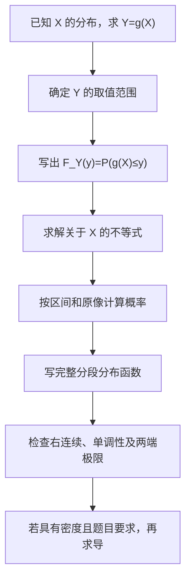

本节是概率论从**随机事件与概率**过渡到**随机变量及其分布**的关键，也是后续学习多维随机变量、数字特征、抽样分布、参数估计的重要基础。

本节不是简单地学习如何计算分布函数，而是要建立一种贯穿整个概率论的思维方式：

**将随机变量的问题转化为随机事件的问题，再利用概率的性质解决。**

## 一、本节知识体系与考查重点

本节可归纳为八大核心题型。

| 核心题型            | 重要程度  | 代表性题源                 |
| --------------- | ----- | --------------------- |
| 分布函数合法性判断与参数确定  | ★★★★★ | 1989、1998年真题，李林880    |
| 左极限、跳跃点与区间概率    | ★★★★★ | 2010年数学一              |
| 分布律、密度与分布函数相互转换 | ★★★★★ | 1990年数学一，1987、1991年真题 |
| 离散与连续混合型分布      | ★★★★★ | 1997、2002年真题，李正元      |
| 随机变量函数的分布       | ★★★★★ | 李林880、李正元             |
| 分布函数的运算与极值分布    | ★★★★★ | 2002年数学一              |
| 复合分布函数与线性变换     | ★★★★★ | 2026年数学一，张宇8套卷        |
| 条件混合、联合分布与分布比较  | ★★★★★ | 2020年数学一，张宇1000题      |

其中有三个层次：

- **基础层：** 分布函数的定义、性质、点概率与区间概率。
- **强化层：** 分布函数的构造、变换、混合、极值及比较。
- **综合层：** 分布函数与独立性、条件概率、数字特征、多维随机变量结合。

尤其要掌握混合型分布和分布函数变换。这两类题能够把概率论的多个章节串联起来，是应对综合题与创新题的重要突破口。

## 二、基础知识：从本质上理解分布函数

### 2.1 随机变量究竟是什么？

随机变量 $X$ 本质上是一个函数，它把随机试验的每一种结果映射为一个实数。

例如，独立抛掷两次均匀硬币，记 $X$ 为出现正面的次数。

| 试验结果 | 随机变量 $X$ | 概率  |
| ---- | ------------ | --- |
| 反反   | 0            | 1/4 |
| 正反   | 1            | 1/4 |
| 反正   | 1            | 1/4 |
| 正正   | 2            | 1/4 |

因此：

$$
P(X=0)=\frac14,\quad P(X=1)=\frac12,\quad P(X=2)=\frac14.
$$

注意，不同的随机试验结果可以对应同一个随机变量取值。这也是以后求随机变量函数的分布时，需要合并概率的根本原因。

### 2.2 分布函数的定义

设 $X$ 是随机变量，则称

$$
\boxed{F_X(x)=P(X\leq x)}
$$

为 $X$ 的分布函数，简称 CDF。

**直观理解**

想象数轴上有总量为1的概率质量，一条竖直的扫描线从左向右移动。

$F(x)$ 就是扫描线到达 $x$ 时，已经扫过的全部概率质量，包括恰好位于 $x$ 处的概率。

- 扫描线向右移动，累计概率只能增加，不能减少。
- 如果某个位置集中着正的概率质量，分布函数就会突然向上跳跃。
- 如果某个区间没有概率质量，分布函数就在该区间保持不变。
- 如果概率连续分布在一个区间中，分布函数就会在该区间连续增长。

由此可以理解，分布函数实际上包含了随机变量的全部分布信息。

### 2.3 分布函数的四大基本性质

**性质一：有界性**

$$
\boxed{0\leq F(x)\leq1}
$$

因为分布函数本身就是一个概率。

**性质二：单调不减性**

若 $x_1<x_2$，则

$$
\boxed{F(x_1)\leq F(x_2)}
$$

证明：

$$
\{X\leq x_1\}\subseteq\{X\leq x_2\}.
$$

所以

$$
P(X\leq x_1)\leq P(X\leq x_2).
$$

进一步有：

$$
F(x_2)-F(x_1) =P(x_1<X\leq x_2)\geq0.
$$

**注意：单调不减不等于严格单调递增。**

分布函数允许出现水平线段，离散型随机变量的分布函数往往就含有大量水平线段。

**性质三：右连续性**

对任意 $x_0$，都有

$$
\boxed{F(x_0+0)=F(x_0)}
$$

即

$$
\lim_{x\to x_0^+}F(x)=F(x_0).
$$

为什么是右连续，而不是左连续？

因为定义使用的是

$$
F(x)=P(X\leq x),
$$

而不是 $P(X<x)$。

例如，若 $P(X=0)=1$，则

$$
F(x)= \begin{cases} 0,&x<0,\\ 1,&x\geq0. \end{cases}
$$

于是：

$$
F(0-0)=0,\qquad F(0)=1,\qquad F(0+0)=1.
$$

因此，$F(x)$ 在零点右连续，但不左连续。

**性质四：两端极限**

$$
\boxed{ \lim_{x\to-\infty}F(x)=0,\qquad \lim_{x\to+\infty}F(x)=1 }
$$

分别对应尚未累计任何概率和已经累计全部概率。

**分布函数的充要条件**

一个定义在实数轴上的函数 $F(x)$ 是某个随机变量的分布函数，当且仅当：

$$
\boxed{ \begin{cases} F(x)\text{ 单调不减},\\ F(x)\text{ 右连续},\\ F(-\infty)=0,\\ F(+\infty)=1. \end{cases} }
$$

其中 $0\leq F(x)\leq1$ 可以由单调性和两端极限推出。

这是本节所有分布函数合法性判断题的理论基础。

### 2.4 左极限与右极限：本节最重要的细节

定义

$$
F(a-)=\lim_{x\to a^-}F(x).
$$

则

$$
\boxed{F(a-)=P(X<a)}
$$

而

$$
\boxed{F(a)=P(X\leq a)}
$$

两者之间的区别就是：

$$
\boxed{F(a)-F(a-)=P(X=a)}
$$

这条公式称为分布函数的跳跃公式。

可以将三个量理解为：

| 符号               | 含义                   |
| ---------------- | -------------------- |
| $F(a-)$      | 到达 $a$ 之前已经累计的概率 |
| $F(a)$       | 到达 $a$ 时已经累计的概率  |
| $F(a)-F(a-)$ | 恰好集中在 $a$ 处的概率   |

**分布函数的函数值是累计概率，而不是单点概率。**

这是考研数学中经常设置的陷阱。

### 2.5 由分布函数计算任意区间概率

下面的公式对任意随机变量都成立。

| 随机事件                | 对应概率              |
| ------------------- | ----------------- |
| $X\leq a$       | $F(a)$        |
| $X<a$          | $F(a-)$       |
| $X>a$           | $1-F(a)$      |
| $X\geq a$       | $1-F(a-)$     |
| $X=a$           | $F(a)-F(a-)$  |
| $a<X\leq b$    | $F(b)-F(a)$   |
| $a\leq X\leq b$ | $F(b)-F(a-)$  |
| $a<X<b$       | $F(b-)-F(a)$  |
| $a\leq X<b$    | $F(b-)-F(a-)$ |

其中区间公式均假设 $a<b$。

**不必死记四种区间公式**

掌握下面的统一原则即可：

**右端点决定累计到哪里，左端点决定减去哪些概率。**

例如：

$$
P(a\leq X<b) =P(X<b)-P(X<a)
$$

所以

$$
P(a\leq X<b)=F(b-)-F(a-).
$$

考场上如果忘记公式，从事件差重新推导即可。

**连续型随机变量的简化**

若 $X$ 为连续型随机变量，则

$$
P(X=a)=0.
$$

因此

$$
F(a-)=F(a).
$$

所有区间开闭形式均具有相同概率：

$$
\begin{aligned} P(a<X<b) &=P(a\leq X<b)\\ &=P(a<X\leq b)\\ &=P(a\leq X\leq b)\\ &=F(b)-F(a). \end{aligned}
$$

但是，**只有能够确认端点不存在点概率时，才能忽略等号。**

### 2.6 分布律、概率密度与分布函数的关系

| 比较项目       | 离散型    | 连续型  | 离散—连续混合型 |
| ---------- | ------ | ---- | -------- |
| 概率的描述方式    | 分布律    | 概率密度 | 点概率与连续部分 |
| 分布函数       | 累计求和   | 累计积分 | 求和与积分结合  |
| 单点概率       | 可以大于0  | 等于0  | 部分点大于0   |
| 分布函数是否连续   | 通常存在跳跃 | 连续   | 存在跳跃     |
| 是否一定具有分布函数 | 是      | 是    | 是        |

对于离散型随机变量：

$$
\boxed{ F(x)=\sum_{x_k\leq x}P(X=x_k) }
$$

对于具有概率密度的随机变量：

$$
\boxed{ F(x)=\int_{-\infty}^x f(t)\,\mathrm dt }
$$

在密度连续的点：

$$
\boxed{f(x)=F'(x)}
$$

更一般地，绝对连续分布满足 $F'=f$ 几乎处处。

对于由离散部分和密度部分组成的混合型分布：

$$
\boxed{ F(x)=\sum_{x_k\leq x}p_k+ \int_{-\infty}^x f_c(t)\,\mathrm dt }
$$

其中

$$
\sum_k p_k+\int_{-\infty}^{+\infty}f_c(t)\,\mathrm dt=1.
$$

这里的 $f_c(x)$ 只是连续部分的密度，其积分不一定等于1。

## 三、题型一：分布函数合法性与待定参数

这是最基础、最容易通过系统方法拿分的题型。

### 3.1 标准解题流程

遇到“下列哪个函数是分布函数”“求参数使函数成为分布函数”，依次检查：

**两端极限 → 分段连接点右连续 → 单调性 → 参数范围。**

选择题通常先检查两端极限，因为计算量最小，能够快速排除大量错误选项。

### 3.2 母题1：1989年数学三真题（核心第1题）

设随机变量 $X$ 的分布函数为

$$
F(x)= \begin{cases} 0,&x<0,\\ A\sin x,&0\leq x\leq\frac{\pi}{2},\\ 1,&x>\frac{\pi}{2}. \end{cases}
$$

求 $A$ 及

$$
P\left(|X|<\frac{\pi}{6}\right).
$$

<Steps>

<Step>

### 第一步：识别分段连接点 [!toc]

分界点有两个：

$$
x=0,\qquad x=\frac{\pi}{2}.
$$

其中零点的右连续性自动满足。

在 $x=\frac{\pi}{2}$ 处：

$$
F\left(\frac{\pi}{2}\right)=A.
$$

而

$$
F\left(\frac{\pi}{2}+0\right)=1.
$$

由右连续性：

$$
A=1.
$$

此时单调性也成立。

</Step>

<Step>

### 第二步：将绝对值事件转化为区间 [!toc]

$$
|X|<\frac{\pi}{6} \iff -\frac{\pi}{6}<X<\frac{\pi}{6}.
$$

由于相关端点连续，

$$
\begin{aligned} P\left(|X|<\frac{\pi}{6}\right) &=F\left(\frac{\pi}{6}\right) -F\left(-\frac{\pi}{6}\right)\\ &=\sin\frac{\pi}{6}-0\\ &=\frac12. \end{aligned}
$$

因此：

$$
\boxed{A=1,\qquad P=\frac12}
$$

</Step>

</Steps>

**关键变式：改变等号的位置**

假设把题目改为

$$
F(x)= \begin{cases} 0,&x<0,\\ A\sin x,&0\leq x<\frac{\pi}{2},\\ 1,&x\geq\frac{\pi}{2}. \end{cases}
$$

现在能否仍然推出 $A=1$？

不能。

新的函数在 $x=\frac{\pi}{2}$ 处已经满足右连续，因为该点函数值和右极限均为1。

单调性只要求：

$$
\boxed{0\leq A\leq1}
$$

并且

$$
P\left(X=\frac{\pi}{2}\right)=1-A.
$$

只有题目额外规定 $X$ 为连续型随机变量时，才能推出 $A=1$。

**这一变式必须真正理解：分布函数连接点只要求右连续，不一定要求左右两段相等。**

### 3.3 母题2：李林880基础选择题——分布函数合法性

以下哪个函数可以作为分布函数？

A.

$$
F(x)=\frac1{1+x^2}
$$

B.

$$
F(x)=\frac1\pi\arctan x+\frac12
$$

C.

$$
F(x)= \begin{cases} \frac12(1-e^{-x}),&x>0,\\ 0,&x\leq0. \end{cases}
$$

D.

$$
F(x)=\int_{-\infty}^x f(t)\,\mathrm dt
$$

且

$$
\int_{-\infty}^{+\infty}f(t)\,\mathrm dt=1.
$$

**快速解法**

A 不满足右端极限为1。

C 的右端极限为 $1/2$，也不满足要求。

D 虽然满足归一化条件，但没有保证

$$
f(t)\geq0.
$$

因此不一定单调不减。

对于 B：

$$
F'(x)=\frac1{\pi(1+x^2)}>0.
$$

同时

$$
F(-\infty)=0,\qquad F(+\infty)=1.
$$

函数连续，因此满足所有条件。

$$
\boxed{\text{选 B}}
$$

这里的 B 实际上是标准柯西分布的分布函数。

柯西分布本身不需要作为本节重点记忆，但它说明了：一个合法的分布函数，不一定来自考研常见的几个标准分布。

### 3.4 母题3：李林880——连续型分布函数的参数拼接

设连续型随机变量 $X$ 的分布函数为

$$
F(x)= \begin{cases} 0,&x\leq-a,\\ k_1+k_2\arcsin\frac xa,&-a<x\leq a,\\ 1,&x>a, \end{cases}
$$

其中 $a>0$。

求常数 $k_1,k_2$、概率密度和

$$
P\left(|X|<\frac a2\right).
$$

<Steps>

<Step>

### 第一步：利用连续性 [!toc]

因为题目明确说明 $X$ 为连续型随机变量，所以 $F(x)$ 处处连续。

在两个连接点：

$$
\begin{cases} k_1-\frac{\pi}{2}k_2=0,\\ k_1+\frac{\pi}{2}k_2=1. \end{cases}
$$

解得：

$$
\boxed{k_1=\frac12,\qquad k_2=\frac1\pi}
$$

</Step>

<Step>

### 第二步：求概率密度 [!toc]

在 $(-a,a)$ 内：

$$
f(x)=F'(x) =\frac1{\pi\sqrt{a^2-x^2}}.
$$

所以

$$
\boxed{ f(x)= \begin{cases} \dfrac1{\pi\sqrt{a^2-x^2}},&|x|<a,\\ 0,&|x|\geq a. \end{cases} }
$$

</Step>

<Step>

### 第三步：求区间概率 [!toc]

$$
\begin{aligned} P\left(|X|<\frac a2\right) &=F\left(\frac a2\right) -F\left(-\frac a2\right)\\ &=\frac1\pi \left(\frac{\pi}{6}+\frac{\pi}{6}\right)\\ &=\boxed{\frac13}. \end{aligned}
$$

</Step>

</Steps>

<Callout type="warn" title="易错点：密度可以大于1，甚至无界">

本题密度在 $x\to\pm a$ 时趋于无穷大，但依然是合法密度。

概率密度只需要满足非负性与归一化条件：

$$
f(x)\geq0,\qquad \int_{-\infty}^{+\infty}f(x)\,\mathrm dx=1.
$$

**概率密度不等于概率，不受小于等于1的限制。**

</Callout>

## 四、题型二：跳跃点、点概率与混合型分布

### 4.1 母题4：2010年数学一真题（核心第6题）

这是本节必须掌握的核心真题。

设随机变量 $X$ 的分布函数为

$$
F(x)= \begin{cases} 0,&x<0,\\ \frac12,&0\leq x<1,\\ 1-e^{-x},&x\geq1. \end{cases}
$$

求 $P(X=1)$。

**标准解法**

直接利用跳跃公式：

$$
P(X=1)=F(1)-F(1-).
$$

由于

$$
F(1)=1-e^{-1},
$$

且

$$
F(1-)=\frac12,
$$

所以

$$
\boxed{P(X=1)=\frac12-e^{-1}}
$$

**深入分析：这个随机变量究竟如何分布？**

在 $x=0$ 处：

$$
P(X=0)=\frac12-0=\frac12.
$$

在 $x=1$ 处：

$$
P(X=1)=\frac12-e^{-1}.
$$

在 $x>1$ 的部分：

$$
f_c(x)=e^{-x}.
$$

连续部分的总概率为

$$
\int_1^{+\infty}e^{-x}\,\mathrm dx=e^{-1}.
$$

总概率恰好为

$$
\frac12+\left(\frac12-e^{-1}\right)+e^{-1}=1.
$$

因此，该随机变量既不是纯离散型，也不是纯连续型，而是混合型。

**同一母题的综合变式**

利用上述分布函数计算四种区间概率：

| 事件                 | 计算结果                 |
| ------------------ | -------------------- |
| $0<X<1$       | $0$              |
| $0\leq X<1$    | $\frac12$        |
| $0<X\leq1$    | $\frac12-e^{-1}$ |
| $0\leq X\leq1$ | $1-e^{-1}$       |

再计算

$$
P(X\geq1)=1-F(1-)=\frac12,
$$

以及

$$
P(X>1)=1-F(1)=e^{-1}.
$$

这两个结果不同，正是因为 $X=1$ 处存在点概率。

**跨章节提升：计算数学期望**

对于这一混合型分布：

$$
\begin{aligned} E(X) &=0\cdot\frac12 +1\cdot\left(\frac12-e^{-1}\right) +\int_1^{+\infty}xe^{-x}\,\mathrm dx\\ &=\frac12-e^{-1}+2e^{-1}\\ &=\boxed{\frac12+e^{-1}}. \end{aligned}
$$

不能只对 $F(x)$ 求导后计算积分，那样会遗漏离散部分的期望贡献。

### 4.2 重要理论题：没有点概率的充要条件

来源：李林880，核心第4题。

对任意实数 $x$，都有

$$
P(X=x)=0
$$

的充分必要条件是什么？

由

$$
P(X=x)=F(x)-F(x-)
$$

可知：

$$
P(X=x)=0 \iff F(x)=F(x-).
$$

再结合分布函数天然右连续，因此

$$
\boxed{ P(X=x)=0\text{ 对所有 }x\text{ 成立} \iff F(x)\text{ 处处连续} }
$$

<Callout type="warn" title="必须区分的三个概念">

$$
\text{概率密度连续} \Longrightarrow \text{存在概率密度} \Longrightarrow \text{分布函数连续}
$$

反方向一般不成立。

例如均匀分布的概率密度可以在端点处不连续，但其分布函数是连续的。

从严格的概率论角度，还存在分布函数连续、却不存在普通概率密度的分布，例如康托分布。

这一高级例子不要求掌握计算，只需要记住：

**分布函数连续，与存在概率密度，不是完全等价的概念。**

</Callout>

## 五、题型三：离散分布律与分布函数相互转换

### 5.1 母题5：1987年数学三真题（核心第8题）

设 $X$ 的分布律为

| $X$ | 1   | 2   | 3   |
| ------- | --- | --- | --- |
| $P$ | 0.2 | 0.3 | 0.5 |

求 $F(x)$。

根据定义：

$$
F(x)=\sum_{x_k\leq x}p_k.
$$

将可能取值从小到大排列，并逐项累加：

$$
\boxed{ F(x)= \begin{cases} 0,&x<1,\\ 0.2,&1\leq x<2,\\ 0.5,&2\leq x<3,\\ 1,&x\geq3. \end{cases} }
$$

**通用公式**

若离散型随机变量只有有限个可能取值：

$$
x_1<x_2<\cdots<x_n,
$$

对应概率为 $p_1,p_2,\ldots,p_n$，则

$$
F(x)= \begin{cases} 0,&x<x_1,\\ p_1,&x_1\leq x<x_2,\\ p_1+p_2,&x_2\leq x<x_3,\\ \vdots&\\ 1,&x\geq x_n. \end{cases}
$$

记忆技巧：**阶梯函数的分段区间通常左闭右开。**

反过来，已知离散型分布函数，只需要找到各个跳跃点，再计算跳跃高度即可。1991年数学三真题（核心第9题）考查的正是这一逆向过程。

### 5.2 母题6：李正元练习题——绝对值变换

已知

$$
F_X(x)= \begin{cases} 0,&x<-1,\\ 0.4,&-1\leq x<0,\\ 0.7,&0\leq x<1,\\ 1,&x\geq1. \end{cases}
$$

求 $Y=|X|$ 的分布函数。

<Steps>

<Step>

### 第一步：还原分布律 [!toc]

| $X$ | -1  | 0   | 1   |
| ------- | --- | --- | --- |
| $P$ | 0.4 | 0.3 | 0.3 |

</Step>

<Step>

### 第二步：完成随机变量映射 [!toc]

$$
-1\mapsto1,\qquad 0\mapsto0,\qquad 1\mapsto1.
$$

因此

$$
P(Y=0)=0.3,
$$

$$
P(Y=1)=0.4+0.3=0.7.
$$

</Step>

<Step>

### 第三步：重新累计 [!toc]

$$
\boxed{ F_Y(y)= \begin{cases} 0,&y<0,\\ 0.3,&0\leq y<1,\\ 1,&y\geq1. \end{cases} }
$$

</Step>

</Steps>

**一般化：离散型随机变量的函数**

若

$$
Y=g(X),
$$

则

$$
\boxed{ P(Y=y)=\sum_{x:g(x)=y}P(X=x) }
$$

适用于绝对值、平方、取整、取余以及各种分段函数。

核心思想是：不同的原取值如果映射为同一个新取值，必须合并其概率。

### 5.3 强化变式：张宇1000题——连续变量取整

设 $X$ 服从参数为1的指数分布：

$$
X\sim\operatorname{Exp}(1).
$$

令

$$
Y=\lfloor X+1\rfloor,
$$

其中 $\lfloor\cdot\rfloor$ 为向下取整函数，求 $Y$ 的分布。

虽然 $X$ 是连续型随机变量，但 $Y$ 只能取正整数。

对 $k=1,2,\ldots$：

$$
\begin{aligned} P(Y=k) &=P(k\leq X+1<k+1)\\ &=P(k-1\leq X<k)\\ &=e^{-(k-1)}-e^{-k}\\ &=(1-e^{-1})(e^{-1})^{k-1}. \end{aligned}
$$

因此

$$
\boxed{Y\sim G(1-e^{-1})}
$$

这里的几何分布以 $1,2,3,\ldots$ 为可能取值。

其分布函数还可以写为

$$
F_Y(y)= \begin{cases} 0,&y<1,\\ 1-e^{-\lfloor y\rfloor},&y\geq1. \end{cases}
$$

这道题告诉我们：**连续型随机变量经过函数变换以后，完全可能成为离散型随机变量。**

## 六、题型四：由概率密度构造分布函数

### 6.1 通用解题步骤

已知概率密度 $f(x)$，求分布函数时，使用

$$
F(x)=\int_{-\infty}^x f(t)\,\mathrm dt.
$$

实际考试中关键在于确定积分区域，而不是机械地进行不定积分。

若密度为分段函数，则分布函数通常也需要分段讨论。进入下一段时，之前已经累计的概率不能丢失。

### 6.2 母题7：1990年数学一真题（核心第13题）

设

$$
f(x)=\frac12e^{-|x|}, \qquad x\in\mathbb R.
$$

求 $F(x)$。

<Tabs items={["方法一：分段积分", "方法二：利用对称性与补事件"]} defaultIndex={0}>

<Tab value="方法一：分段积分">

由于

$$
|x|= \begin{cases} -x,&x<0,\\ x,&x\geq0, \end{cases}
$$

所以需要以零点为界。

当 $x<0$ 时：

$$
\begin{aligned} F(x) &=\int_{-\infty}^x\frac12e^t\,\mathrm dt\\ &=\frac12e^x. \end{aligned}
$$

当 $x\geq0$ 时：

$$
\begin{aligned} F(x) &=\int_{-\infty}^0\frac12e^t\,\mathrm dt +\int_0^x\frac12e^{-t}\,\mathrm dt\\ &=\frac12+\frac12(1-e^{-x})\\ &=1-\frac12e^{-x}. \end{aligned}
$$

于是：

$$
\boxed{ F(x)= \begin{cases} \frac12e^x,&x<0,\\ 1-\frac12e^{-x},&x\geq0. \end{cases} }
$$

</Tab>

<Tab value="方法二：利用对称性与补事件">

当 $x\geq0$ 时，计算右尾概率更简单：

$$
P(X>x)=\int_x^{+\infty}\frac12e^{-t}\,\mathrm dt =\frac12e^{-x}.
$$

所以

$$
F(x)=1-\frac12e^{-x}.
$$

当 $x<0$ 时，再利用对称性：

$$
F(x)=1-F(-x)=\frac12e^x.
$$

</Tab>

</Tabs>

**核心技巧**

求分布函数并不是只能从负无穷开始积分。

还可以利用

$$
\boxed{F(x)=1-\int_x^{+\infty}f(t)\,\mathrm dt}
$$

哪一侧积分容易，就选择哪一侧。

### 6.3 对称分布的重要性质

若 $X$ 关于 $a$ 对称，则

$$
X-a\overset d=-(X-a).
$$

其中 $\overset d=$ 表示同分布。

对于一般对称分布：

$$
\boxed{F(a+x)+F((a-x)-)=1}
$$

如果 $F$ 连续，则可简化为

$$
\boxed{F(a+x)+F(a-x)=1}
$$

特别地：

$$
\boxed{F(a)=\frac12}
$$

后一个结论要求分布在 $a$ 处不存在点概率。

**李林880基础题**

已知概率密度满足

$$
f(1-x)=f(1+x),
$$

且

$$
\int_1^2f(x)\,\mathrm dx=0.4,
$$

求 $F(0)$。

因为密度关于 $x=1$ 对称，

$$
F(1)=\frac12.
$$

又由对称性：

$$
\int_0^1f(x)\,\mathrm dx =\int_1^2f(x)\,\mathrm dx=0.4.
$$

所以

$$
F(0)=F(1)-0.4=\boxed{0.1}.
$$

这一类题不必知道密度的具体表达式。

### 6.4 与高等数学结合：分布函数的积分性质

李正元本章有一道值得特别注意的积分题：

设 $F(x)$ 是连续型随机变量的分布函数，$a>0$，求

$$
\int_{-a}^{a}[F(x+a)-F(x)]\,\mathrm dx.
$$

**由现有条件无法唯一确定该积分值。**

例如：

若 $X\sim U(0,a)$，积分值为 $a$；若 $X\sim U(3a,4a)$，积分值为0。

如果将积分区间改为整个实数轴，就能够得到一个很有价值的通用公式：

$$
\boxed{ \int_{-\infty}^{+\infty} [F(x+a)-F(x)]\,\mathrm dx=a }
$$

证明：

$$
\begin{aligned} I &=\int_{-\infty}^{+\infty} \int_x^{x+a}f(t)\,\mathrm dt\,\mathrm dx\\ &=\int_{-\infty}^{+\infty} f(t)\int_{t-a}^{t}\mathrm dx\,\mathrm dt\\ &=a\int_{-\infty}^{+\infty}f(t)\,\mathrm dt\\ &=a. \end{aligned}
$$

这类题把分布函数、概率密度和二重积分交换积分次序结合在一起，具有很好的综合训练价值。

## 七、题型五：分布函数的运算与极值随机变量

这是本节最重要的强化考点之一。它经常以概念选择题出现，也可以进一步与独立性、系统可靠性、次序统计量结合。

### 7.1 母题8：2002年数学一真题（核心第5题）

设 $X_1,X_2$ 是任意两个相互独立的连续型随机变量，概率密度分别为 $f_1(x),f_2(x)$，分布函数分别为 $F_1(x),F_2(x)$。

判断下列哪个函数一定合法：

A. $f_1(x)+f_2(x)$ 为概率密度。

B. $f_1(x)f_2(x)$ 为概率密度。

C. $F_1(x)+F_2(x)$ 为分布函数。

D. $F_1(x)F_2(x)$ 为分布函数。

**分析选项 A**

$$
\int_{-\infty}^{+\infty} [f_1(x)+f_2(x)]\,\mathrm dx=2.
$$

不满足密度归一化条件。

**分析选项 B**

密度的乘积虽然非负，但其积分不一定为1。

例如

$$
X_1\sim U(0,1),\qquad X_2\sim U(2,3).
$$

两个概率密度的非零区间互不相交，因此

$$
f_1(x)f_2(x)=0.
$$

显然不是概率密度。

**分析选项 C**

$$
\lim_{x\to+\infty}[F_1(x)+F_2(x)]=2.
$$

不满足分布函数的右端极限条件。

**分析选项 D：构造随机变量**

令

$$
Y=\max(X_1,X_2).
$$

则

$$
\{Y\leq x\} =\{X_1\leq x\}\cap\{X_2\leq x\}.
$$

由相互独立性：

$$
\begin{aligned} F_Y(x) &=P(X_1\leq x,X_2\leq x)\\ &=F_1(x)F_2(x). \end{aligned}
$$

因此，乘积一定是某个随机变量的分布函数。

$$
\boxed{\text{选 D}}
$$

**更深层的理解**

事实上，任意两个合法分布函数的乘积仍然是合法分布函数，即使原来的两个随机变量不独立。

因为乘积仍然满足非负、单调不减、右连续以及两端极限条件。

但如果希望这个乘积等于**题目中给定的两个随机变量的最大值的分布函数**，独立性是常用的充分条件，不能在没有依据的情况下直接使用乘法公式。

### 7.2 最大值与最小值分布的统一公式

设 $X_1,\ldots,X_n$ 相互独立。

**最大值**

令

$$
M=\max(X_1,\ldots,X_n).
$$

因为最大值不超过 $x$，意味着每个变量都不超过 $x$。

所以

$$
\boxed{F_M(x)=\prod_{i=1}^nF_i(x)}
$$

若进一步同分布，则

$$
\boxed{F_M(x)=[F(x)]^n}
$$

**最小值**

令

$$
L=\min(X_1,\ldots,X_n).
$$

最小值直接处理不方便，因此先求补事件：

$$
\{L>x\}=\bigcap_{i=1}^n\{X_i>x\}.
$$

由独立性：

$$
P(L>x)=\prod_{i=1}^n[1-F_i(x)].
$$

故

$$
\boxed{ F_L(x)=1-\prod_{i=1}^n[1-F_i(x)] }
$$

若独立同分布，则

$$
\boxed{F_L(x)=1-[1-F(x)]^n}
$$

**连续型情形的密度**

对于独立同分布的连续型随机变量：

$$
\boxed{ f_M(x)=n[F(x)]^{n-1}f(x) }
$$

$$
\boxed{ f_L(x)=n[1-F(x)]^{n-1}f(x) }
$$

这些公式可以通过对分布函数求导得到。

### 7.3 母题变式：指数分布与系统可靠性

设 $X_1,X_2,X_3$ 独立，均服从参数为 $\lambda$ 的指数分布，求

$$
Y=\min(X_1,X_2,X_3)
$$

的分布。

当 $y\geq0$ 时：

$$
P(X_i>y)=e^{-\lambda y}.
$$

于是

$$
\begin{aligned} P(Y>y) &=P(X_1>y,X_2>y,X_3>y)\\ &=e^{-3\lambda y}. \end{aligned}
$$

从而

$$
F_Y(y)= \begin{cases} 0,&y<0,\\ 1-e^{-3\lambda y},&y\geq0. \end{cases}
$$

因此

$$
\boxed{Y\sim\operatorname{Exp}(3\lambda)}
$$

推广：若相互独立的 $X_i\sim\operatorname{Exp}(\lambda_i)$，则

$$
\boxed{ \min_{1\leq i\leq n}X_i \sim\operatorname{Exp}\left(\sum_{i=1}^n\lambda_i\right) }
$$

这与前一章的串联系统可靠性具有直接联系。

### 7.4 进一步创新：第 $k$ 小的随机变量

设 $X_1,\ldots,X_n$ 独立同分布，分布函数为 $F(x)$。将其从小到大排列为

$$
X_{(1)}\leq X_{(2)}\leq\cdots\leq X_{(n)}.
$$

那么

$$
X_{(k)}\leq x
$$

等价于至少有 $k$ 个原随机变量不超过 $x$。

因此，根据二项分布：

$$
\boxed{ F_{X_{(k)}}(x) =\sum_{j=k}^n \binom nj[F(x)]^j[1-F(x)]^{n-j} }
$$

例如三个独立同分布随机变量的中位数 $M=X_{(2)}$，有

$$
\begin{aligned} F_M(x) &=3F(x)^2[1-F(x)]+F(x)^3\\ &=\boxed{3F(x)^2-2F(x)^3}. \end{aligned}
$$

这就是从最大值、最小值母题推广得到的新题。关键不是背诵公式，而是能够将次序关系转化为二项计数事件。

### 7.5 分布函数的凸组合

来源：1998年数学三真题、李林880、李正元练习题。

若 $F_1,\ldots,F_n$ 均为分布函数，且

$$
p_i\geq0,\qquad \sum_{i=1}^np_i=1,
$$

则

$$
\boxed{ F(x)=\sum_{i=1}^np_iF_i(x) }
$$

一定是分布函数。

这种构造称为混合分布。

1998年真题给出

$$
F(x)=aF_1(x)-bF_2(x).
$$

首先由右端极限得到必要条件：

$$
a-b=1.
$$

若要求对任意 $F_1,F_2$ 都成立，还必须有

$$
a\geq0,\qquad -b\geq0.
$$

所以

$$
\boxed{0\leq a\leq1,\qquad b=a-1}
$$

原题正确选项为

$$
a=\frac35,\qquad b=-\frac25.
$$

需要注意：若题目给定的是某一对具体函数，非负权重未必是必要条件。例如 $F_1=F_2$ 时，只要 $a-b=1$ 即可。必须看清题目是否要求对任意分布函数均成立。

**常见运算结论**

下表中的 $F,F_1,F_2$ 均为合法分布函数。

| 新函数                    | 是否一定为分布函数 |
| ---------------------- | --------- |
| $F_1+F_2$          | 否         |
| $\frac12(F_1+F_2)$ | 是         |
| $F_1F_2$           | 是         |
| $F^n,\ n$ 为正整数     | 是         |
| $1-F$              | 否，是右尾概率函数 |
| $1-(1-F)^n$        | 是         |
| $\max(F_1,F_2)$    | 是         |
| $\min(F_1,F_2)$    | 是         |
| $F_1-F_2$          | 否         |

对于所有不熟悉的函数运算，始终可以退回分布函数的充要条件逐一判断。

## 八、题型六：随机变量函数的分布——分布函数法

本节最重要的综合解题方法就是分布函数法。它不仅适用于连续型，也适用于离散型和混合型随机变量。

### 8.1 万能解题框架

已知 $X$ 的分布，求

$$
Y=g(X)
$$

的分布。

定义：

$$
\boxed{F_Y(y)=P(g(X)\leq y)}
$$

先确定 $Y$ 的可能取值范围，再把 $g(X)\leq y$ 转化成关于 $X$ 的不等式，最后根据原分布计算对应概率。

如果新分布是绝对连续的，并且题目要求密度，再进行求导。

### 8.2 常见单调变换

若 $g$ 在 $X$ 的取值范围内严格递增，且 $y$ 在其值域内，则

$$
\boxed{F_Y(y)=F_X(g^{-1}(y))}
$$

若 $g$ 严格递减，则

$$
\begin{aligned} F_Y(y) &=P(X\geq g^{-1}(y))\\ &=1-F_X(g^{-1}(y)-). \end{aligned}
$$

若 $X$ 为连续型，可简化为

$$
\boxed{F_Y(y)=1-F_X(g^{-1}(y))}
$$

注意严格递减的情形需要改变不等号方向。

### 8.3 绝对值与平方变换

令 $Y=|X|$。

当 $y<0$ 时：

$$
F_Y(y)=0.
$$

当 $y\geq0$ 时：

$$
\begin{aligned} F_Y(y) &=P(|X|\leq y)\\ &=P(-y\leq X\leq y)\\ &=F_X(y)-F_X((-y)-). \end{aligned}
$$

对于连续型随机变量：

$$
\boxed{ F_Y(y)= \begin{cases} 0,&y<0,\\ F_X(y)-F_X(-y),&y\geq0. \end{cases} }
$$

进一步得到密度：

$$
f_Y(y)=f_X(y)+f_X(-y),\qquad y>0.
$$

若 $Y=X^2$，则

$$
\boxed{ F_Y(y)= \begin{cases} 0,&y<0,\\ F_X(\sqrt y)-F_X((-\sqrt y)-),&y\geq0. \end{cases} }
$$

若 $X$ 具有密度，则对 $y>0$ 有

$$
\boxed{ f_Y(y)= \frac{f_X(\sqrt y)+f_X(-\sqrt y)}{2\sqrt y} }
$$

这里容易漏掉负根所对应的概率贡献。

### 8.4 母题9：李林880——非单调函数中的最大值

设

$$
X\sim\operatorname{Exp}(\lambda), \qquad \lambda>0,
$$

记

$$
Y=\max\left(X,\frac1X\right).
$$

求 $Y$ 的分布函数。

<Steps>

<Step>

### 第一步：确定值域 [!toc]

由于 $X>0$ 几乎必然，

$$
\max\left(X,\frac1X\right)\geq1.
$$

所以

$$
F_Y(y)=0,\qquad y<1.
$$

</Step>

<Step>

### 第二步：解关于 $X$ 的不等式 [!toc]

当 $y\geq1$ 时，

$$
\max\left(X,\frac1X\right)\leq y
$$

等价于

$$
\begin{cases} X\leq y,\\ \frac1X\leq y. \end{cases}
$$

即

$$
\frac1y\leq X\leq y.
$$

</Step>

<Step>

### 第三步：计算概率 [!toc]

$$
\begin{aligned} F_Y(y) &=P\left(\frac1y\leq X\leq y\right)\\ &=\int_{1/y}^y\lambda e^{-\lambda x}\,\mathrm dx\\ &=e^{-\lambda/y}-e^{-\lambda y}. \end{aligned}
$$

最终：

$$
\boxed{ F_Y(y)= \begin{cases} 0,&y<1,\\ e^{-\lambda/y}-e^{-\lambda y},&y\geq1. \end{cases} }
$$

若还要求密度，则对 $y>1$ 求导：

$$
\boxed{ f_Y(y)=\frac{\lambda}{y^2}e^{-\lambda/y} +\lambda e^{-\lambda y} }
$$

其余区间密度取0即可。

</Step>

</Steps>

<Callout type="warn" title="本题的关键陷阱">

虽然形式上是最大值，但是 $X$ 和 $1/X$ 并不独立。

因此不能使用

$$
F_X(y)F_{1/X}(y)
$$

来计算最大值的分布函数。

**多个独立随机变量取极值，与同一个随机变量经过多种变换后取极值，是两类不同的问题。**

</Callout>

## 九、题型七：截断、压缩与混合型分布的构造

这部分在真题、张宇、李林和李正元资料中反复出现，值得重点训练。

### 9.1 母题10：2002年数学三真题（核心第12题）

设备正常工作的时间 $X$ 服从指数分布，平均寿命为5小时。

设备发生故障时立即关机，如果一直没有发生故障，则工作2小时后定时关机。

求实际工作时间 $Y$ 的分布函数。

<Steps>

<Step>

### 第一步：建立数学模型 [!toc]

实际工作时间由故障时间与定时关机时间中的较小者决定。

所以

$$
\boxed{Y=\min(X,2)}
$$

由

$$
E(X)=5
$$

得到

$$
\lambda=\frac15.
$$

</Step>

<Step>

### 第二步：按阈值分段 [!toc]

当 $y<0$ 时，$F_Y(y)=0$。

当 $0\leq y<2$ 时：

$$
\{\min(X,2)\leq y\}=\{X\leq y\}.
$$

所以

$$
F_Y(y)=1-e^{-y/5}.
$$

当 $y\geq2$ 时，所有实际工作时间均不超过2小时，因此

$$
F_Y(y)=1.
$$

最终：

$$
\boxed{ F_Y(y)= \begin{cases} 0,&y<0,\\ 1-e^{-y/5},&0\leq y<2,\\ 1,&y\geq2. \end{cases} }
$$

</Step>

<Step>

### 第三步：识别点概率 [!toc]

恰好工作2小时，意味着原故障时间至少为2小时。

$$
\boxed{P(Y=2)=P(X\geq2)=e^{-2/5}}
$$

这部分概率全部集中在 $Y=2$ 处。

</Step>

</Steps>

**为什么不是普通连续型随机变量？**

因为整个区间 $[2,+\infty)$ 都被映射成同一个点2。

只要一个具有正概率的集合被压缩成一个点，新随机变量就会在该点产生正概率质量。

### 9.2 上限截断与下限截断通式

**上限截断**

令

$$
Y=\min(X,c).
$$

则

$$
\boxed{ F_Y(y)= \begin{cases} F_X(y),&y<c,\\ 1,&y\geq c. \end{cases} }
$$

并且

$$
\boxed{P(Y=c)=1-F_X(c-)}
$$

**下限截断**

令

$$
Y=\max(X,c).
$$

则

$$
\boxed{ F_Y(y)= \begin{cases} 0,&y<c,\\ F_X(y),&y\geq c. \end{cases} }
$$

并且

$$
\boxed{P(Y=c)=F_X(c)}
$$

**双侧截断**

令

$$
Y=\min(\max(X,a),b),\qquad a<b.
$$

这相当于把小于 $a$ 的部分压缩到 $a$，把大于 $b$ 的部分压缩到 $b$，中间部分保持不变。

于是

$$
\boxed{ F_Y(y)= \begin{cases} 0,&y<a,\\ F_X(y),&a\leq y<b,\\ 1,&y\geq b. \end{cases} }
$$

端点概率分别为

$$
\boxed{P(Y=a)=F_X(a)}
$$

$$
\boxed{P(Y=b)=1-F_X(b-)}
$$

### 9.3 母题11：1997年数学三真题（核心第11题）

这道真题也出现在张宇1000题强化部分。

已知

$$
|X|\leq1,
$$

并且

$$
P(X=-1)=\frac18,\qquad P(X=1)=\frac14.
$$

在 $-1<X<1$ 的条件下，随机变量在该区间内均匀分布。

求 $F_X(x)$。

<Steps>

<Step>

### 第一步：明确三种概率来源 [!toc]

左端点概率：

$$
p_L=\frac18.
$$

右端点概率：

$$
p_R=\frac14.
$$

内部连续部分的总概率：

$$
p_C=1-\frac18-\frac14=\frac58.
$$

</Step>

<Step>

### 第二步：利用条件均匀分布 [!toc]

当 $-1\leq x<1$ 时：

$$
P(X\leq x\mid -1<X<1)=\frac{x+1}{2}.
$$

因此根据全概率公式：

$$
\begin{aligned} F_X(x) &=P(X=-1)\\ &\quad+P(-1<X<1) P(X\leq x\mid -1<X<1)\\ &=\frac18+\frac58\cdot\frac{x+1}{2}\\ &=\frac{5x+7}{16}. \end{aligned}
$$

</Step>

<Step>

### 第三步：写完整分段函数 [!toc]

$$
\boxed{ F_X(x)= \begin{cases} 0,&x<-1,\\ \dfrac{5x+7}{16},&-1\leq x<1,\\ 1,&x\geq1. \end{cases} }
$$

</Step>

</Steps>

**通用母题公式**

若

$$
P(X=a)=p,\qquad P(X=b)=q,
$$

且在 $a<X<b$ 的条件下服从均匀分布，则

$$
\boxed{ F_X(x)= \begin{cases} 0,&x<a,\\ p+(1-p-q)\dfrac{x-a}{b-a}, &a\leq x<b,\\ 1,&x\geq b. \end{cases} }
$$

适用条件：

$$
a<b,\qquad p,q\geq0,\qquad p+q<1.
$$

如果 $p+q=1$，则退化成两点离散分布，内部条件均匀分布不再有定义。

李正元关于随机点落在区间内外并按坐标计分的练习题，正是这一母题的现实情境变式。

### 9.4 深入区分：压缩截断与条件截断

以下两种说法看起来相似，本质完全不同。

第一种：

$$
Y=\min(X,c).
$$

超过 $c$ 的概率集中到 $c$ 处，因此通常会产生点概率。

第二种：在 $X\leq c$ 的条件下研究 $X$ 的分布。

此时

$$
F_Y(y)=P(X\leq y\mid X\leq c).
$$

若 $F_X(c)>0$，则

$$
\boxed{ F_Y(y)= \begin{cases} \dfrac{F_X(y)}{F_X(c)},&y<c,\\ 1,&y\geq c. \end{cases} }
$$

前者是**改变随机变量取值**，后者是**缩小样本空间并重新分配概率**。

如果原变量是连续型，条件截断通常仍然是连续型，而压缩截断则可能变成混合型。

## 十、题型八：复合分布函数与线性标准化

这一知识点在2026年数学一真题和张宇8套卷中均有考查。

### 10.1 母题12：2026年数学一第9题

设连续型随机变量 $X$ 的分布函数为 $F(x)$，随机变量 $Y$ 的分布函数为

$$
F_Y(y)=F(ay+b).
$$

已知

$$
E(X)=\mu,\qquad D(X)=\sigma^2,\qquad \sigma>0,
$$

且

$$
E(Y)=0,\qquad D(Y)=1.
$$

求 $a,b$。

<Steps>

<Step>

### 第一步：判断参数符号 [!toc]

因为 $F(ay+b)$ 本身必须是合法分布函数。

如果 $a<0$，则随着 $y$ 增加，$ay+b$ 减少，且两端极限颠倒。

如果 $a=0$，则函数为常数，也不可能成为合法分布函数。

因此

$$
a>0.
$$

</Step>

<Step>

### 第二步：从分布函数恢复随机变量 [!toc]

$$
\begin{aligned} F_Y(y) &=F(ay+b)\\ &=P(X\leq ay+b)\\ &=P\left(\frac{X-b}{a}\leq y\right). \end{aligned}
$$

所以

$$
\boxed{Y\overset d=\frac{X-b}{a}}
$$

注意不是 $Y=aX+b$。

</Step>

<Step>

### 第三步：利用数学期望与方差 [!toc]

$$
E(Y)=\frac{\mu-b}{a}=0.
$$

所以

$$
b=\mu.
$$

又

$$
D(Y)=\frac{\sigma^2}{a^2}=1.
$$

由 $a>0$，可得

$$
a=\sigma.
$$

故

$$
\boxed{a=\sigma,\qquad b=\mu}
$$

</Step>

</Steps>

**本题真正考查的是什么？**

表面上考查数学期望与方差，实际上考查从分布函数反推出随机变量的能力。

掌握这一核心对应关系：

$$
\boxed{ F_Y(y)=F_X(ay+b) \iff Y\overset d=\frac{X-b}{a}, \quad a>0 }
$$

反过来，如果

$$
Y=aX+b,\qquad a>0,
$$

那么

$$
\boxed{ F_Y(y)=F_X\left(\frac{y-b}{a}\right) }
$$

这两条公式方向相反，极易混淆。

### 10.2 模拟母题：张宇8套卷第5套第9题

设 $X$ 的分布函数为 $F(x)$，且

$$
E(X)=\mu,\qquad D(X)=\sigma^2.
$$

已知随机变量 $Y$ 的分布函数为

$$
G(y)=F\left(\frac{y-\mu}{\sigma}\right).
$$

求 $E(Y)$ 与 $D(Y)$。

**解法**

由分布函数定义：

$$
\begin{aligned} G(y) &=P\left(X\leq\frac{y-\mu}{\sigma}\right)\\ &=P(\sigma X+\mu\leq y). \end{aligned}
$$

所以

$$
Y\overset d=\sigma X+\mu.
$$

于是

$$
\begin{aligned} E(Y)&=\sigma\mu+\mu\\ &=\mu(\sigma+1), \end{aligned}
$$

并且

$$
D(Y)=\sigma^2D(X)=\sigma^4.
$$

故

$$
\boxed{ E(Y)=\mu(\sigma+1),\qquad D(Y)=\sigma^4 }
$$

**真题与模拟题对照**

| 题目给出的分布函数                                 | 对应的随机变量                     |
| ----------------------------------------- | --------------------------- |
| $F(\sigma y+\mu)$                     | $\dfrac{X-\mu}{\sigma}$ |
| $F\left(\dfrac{y-\mu}{\sigma}\right)$ | $\sigma X+\mu$          |
| $F(y-2)$                              | $X+2$                   |
| $F(2y+3)$                             | $\dfrac{X-3}{2}$        |
| $F\left(\dfrac{y+1}{4}\right)$        | $4X-1$                  |

最稳妥的办法永远是写出概率定义、解不等式，而不是凭记忆判断平移和缩放的方向。

### 10.3 负系数变换的陷阱

若

$$
Y=aX+b,\qquad a<0,
$$

则

$$
\begin{aligned} F_Y(y) &=P(aX+b\leq y)\\ &=P\left(X\geq\frac{y-b}{a}\right)\\ &=1-F_X\left(\left(\frac{y-b}{a}\right)-\right). \end{aligned}
$$

如果 $X$ 为连续型随机变量，则

$$
\boxed{ F_Y(y)=1-F_X\left(\frac{y-b}{a}\right) }
$$

特别地，对于 $Y=-X$：

$$
\boxed{F_Y(y)=1-F_X((-y)-)}
$$

连续型情形则为

$$
F_Y(y)=1-F_X(-y).
$$

### 10.4 正态分布的标准形式

若

$$
X\sim N(\mu,\sigma^2),
$$

则

$$
\boxed{ F_X(x)=\Phi\left(\frac{x-\mu}{\sigma}\right) }
$$

其中 $\Phi$ 为标准正态分布的分布函数。

看到

$$
F(x)=\Phi(ax+b),\qquad a>0,
$$

可以通过

$$
ax+b=\frac{x-\mu}{\sigma}
$$

得到

$$
\boxed{\mu=-\frac ba,\qquad \sigma^2=\frac1{a^2}}
$$

例如

$$
F(x)=\Phi(3x-6),
$$

对应

$$
X\sim N\left(2,\frac19\right).
$$

## 十一、强化专题：概率积分变换

概率积分变换是本节最有迁移价值的知识之一，在2003年真题以及三套练习题资料中都有对应考查。

### 11.1 核心定理

设随机变量 $X$ 的分布函数为 $F(x)$，且 $F$ 连续，则

$$
\boxed{F(X)\sim U(0,1)}
$$

这意味着：一个随机变量无论原来服从什么连续分布，只要将它代入自己的分布函数，就能得到均匀分布。

**直观理解**

分布函数 $F(x)$ 将原本不同位置的概率质量转换成从0到1的累计概率。

任取 $0<u<1$，使累计概率达到 $u$ 的位置，其左边的概率正好就是 $u$。

因此 $F(X)$ 落在 $[0,u]$ 的概率正好为 $u$，这就是均匀分布。

若 $F$ 严格递增，可以直接证明：

$$
\begin{aligned} P(F(X)\leq u) &=P(X\leq F^{-1}(u))\\ &=F(F^{-1}(u))\\ &=u. \end{aligned}
$$

如果 $F$ 仅连续但不严格递增，定理仍成立，可以通过广义分位数处理平坦区间。

### 11.2 母题13：2003年数学三真题（核心第16题）

设随机变量 $X$ 的概率密度为

$$
f(x)= \begin{cases} \dfrac1{3x^{2/3}},&1\leq x\leq8,\\ 0,&\text{其他}. \end{cases}
$$

$F(x)$ 是 $X$ 的分布函数。求

$$
Y=F(X)
$$

的分布函数。

<Tabs items={["方法一：直接计算", "方法二：直接利用概率积分变换"]} defaultIndex={0}>

<Tab value="方法一：直接计算">

首先

$$
F(x)= \begin{cases} 0,&x<1,\\ \sqrt[3]x-1,&1\leq x\leq8,\\ 1,&x>8. \end{cases}
$$

所以

$$
Y=\sqrt[3]X-1.
$$

当 $0\leq y<1$ 时：

$$
\begin{aligned} F_Y(y) &=P(\sqrt[3]X-1\leq y)\\ &=P(X\leq(1+y)^3)\\ &=F((1+y)^3)\\ &=y. \end{aligned}
$$

因此

$$
\boxed{ F_Y(y)= \begin{cases} 0,&y<0,\\ y,&0\leq y<1,\\ 1,&y\geq1. \end{cases} }
$$

</Tab>

<Tab value="方法二：直接利用概率积分变换">

因为 $X$ 为连续型随机变量，其分布函数连续。

所以直接得到

$$
\boxed{Y=F(X)\sim U(0,1)}
$$

选择题、填空题中可以快速使用定理；解答题中建议补充分布函数法的推导。

</Tab>

</Tabs>

### 11.3 张宇1000题强化变式：由任意连续分布构造指数分布

设 $X$ 的概率密度为

$$
f(x)= \begin{cases} \frac x2,&0<x<2,\\ 0,&\text{其他}. \end{cases}
$$

其分布函数为 $F_X(x)$。令

$$
Y=-\ln[1-F_X(X)].
$$

求

$$
P\left(Y>\frac12\right).
$$

首先，由概率积分变换：

$$
U=F_X(X)\sim U(0,1).
$$

所以

$$
1-U\sim U(0,1).
$$

对 $y\geq0$：

$$
\begin{aligned} P(Y\leq y) &=P(-\ln(1-U)\leq y)\\ &=P(U\leq1-e^{-y})\\ &=1-e^{-y}. \end{aligned}
$$

因此

$$
Y\sim\operatorname{Exp}(1).
$$

最终

$$
\boxed{ P\left(Y>\frac12\right)=e^{-1/2} }
$$

推广：

$$
\boxed{ -\frac1\lambda\ln[1-F_X(X)] \sim\operatorname{Exp}(\lambda) }
$$

只要 $F_X$ 连续且 $\lambda>0$，上述结论便成立。

### 11.4 概率积分变换的反例

张宇1000题、李林880、李正元练习题都收录了下面这一重要题型。

设

$$
X\sim\operatorname{Exp}(\lambda),
$$

$G(x)$ 是 $U(0,1)$ 的分布函数，令

$$
Y=G(X).
$$

问 $Y$ 是否服从均匀分布？

答案是不一定，此题中明确不服从。

因为

$$
G(x)= \begin{cases} 0,&x\leq0,\\ x,&0<x<1,\\ 1,&x\geq1. \end{cases}
$$

而 $X>0$ 几乎必然，所以

$$
Y=\min(X,1).
$$

从而

$$
\boxed{ F_Y(y)= \begin{cases} 0,&y<0,\\ 1-e^{-\lambda y},&0\leq y<1,\\ 1,&y\geq1. \end{cases} }
$$

特别地，

$$
P(Y=1)=e^{-\lambda}>0.
$$

因此 $Y$ 是混合型随机变量，而不是均匀分布。

**两类题的根本区别**

| 变换形式                                 | 结论                |
| ------------------------------------ | ----------------- |
| $F_X(X)$，且 $F_X$ 连续          | 一定服从 $U(0,1)$ |
| $F_Z(X)$，其中 $F_Z$ 是其他分布的分布函数 | 不一定均匀             |
| $F_X(X)$，但 $F_X$ 有跳跃         | 不服从连续均匀分布         |

概率积分变换要求代入的是**随机变量自身的连续分布函数**。

## 十二、综合题型：条件分布、全概率公式与联合分布

本部分从分布函数的角度研究多维随机变量综合问题。

### 12.1 母题14：张宇1000题——条件混合分布

设

$$
P(X=1)=a,\qquad P(X=2)=1-a.
$$

给定 $X=i$ 时，

$$
Y\mid X=i\sim U(0,i).
$$

已知当 $0\leq y<1$ 时，

$$
F_Y(y)=\frac23y.
$$

求 $a$。

<Steps>

<Step>

### 第一步：识别全概率公式的使用条件 [!toc]

题目给出的不是 $Y$ 的直接分布，而是不同条件下 $Y$ 的分布。

因此必须按照 $X=1,2$ 分类：

$$
\begin{aligned} F_Y(y) &=P(Y\leq y\mid X=1)P(X=1)\\ &\quad+P(Y\leq y\mid X=2)P(X=2). \end{aligned}
$$

</Step>

<Step>

### 第二步：代入条件分布函数 [!toc]

在 $0\leq y<1$ 上，

$$
P(Y\leq y\mid X=1)=y,
$$

$$
P(Y\leq y\mid X=2)=\frac y2.
$$

所以

$$
F_Y(y)=ay+(1-a)\frac y2.
$$

即

$$
\frac{1+a}{2}y=\frac23y.
$$

比较系数：

$$
\frac{1+a}{2}=\frac23.
$$

得到

$$
\boxed{a=\frac13}
$$

</Step>

<Step>

### 第三步：推广到完整分布 [!toc]

当 $1\leq y<2$ 时，第一种条件分布已经累计完毕，所以

$$
P(Y\leq y\mid X=1)=1.
$$

因此

$$
F_Y(y)=\frac13+\frac23\cdot\frac y2.
$$

完整分布函数为

$$
\boxed{ F_Y(y)= \begin{cases} 0,&y<0,\\ \frac23y,&0\leq y<1,\\ \frac{1+y}{3},&1\leq y<2,\\ 1,&y\geq2. \end{cases} }
$$

</Step>

</Steps>

**通用公式**

若 $X$ 为离散型随机变量，则

$$
\boxed{ F_Y(y)=\sum_i P(X=x_i)F_{Y\mid X=x_i}(y) }
$$

这是第一章全概率公式在随机变量分布问题中的直接推广。

### 12.2 母题15：2020年数学一真题（核心第20题）

这是本节非常重要的一道综合大题，涉及分布函数、独立性、条件分类与联合分布。

设 $X_1,X_2,X_3$ 相互独立，其中

$$
X_1,X_2\sim N(0,1),
$$

并且

$$
P(X_3=0)=P(X_3=1)=\frac12.
$$

令

$$
Y=X_3X_1+(1-X_3)X_2.
$$

求：

（1）二维随机变量 $(X_1,Y)$ 的联合分布函数；

（2）证明 $Y$ 服从标准正态分布。

<Steps>

<Step>

### 第一步：识别开关变量 [!toc]

观察 $Y$ 的表达式：

$$
Y= \begin{cases} X_2,&X_3=0,\\ X_1,&X_3=1. \end{cases}
$$

$X_3$ 实际上是一个随机开关，决定 $Y$ 取 $X_1$ 还是 $X_2$。

这是整道题的突破口。

</Step>

<Step>

### 第二步：写出联合分布函数定义 [!toc]

$$
F_{X_1,Y}(x,y) =P(X_1\leq x,Y\leq y).
$$

对开关的两个状态分类。

当 $X_3=0$ 时：

$$
\begin{aligned} &P(X_1\leq x,Y\leq y,X_3=0)\\ &=P(X_1\leq x,X_2\leq y,X_3=0)\\ &=\frac12\Phi(x)\Phi(y). \end{aligned}
$$

当 $X_3=1$ 时：

$$
\begin{aligned} &P(X_1\leq x,Y\leq y,X_3=1)\\ &=P(X_1\leq x,X_1\leq y,X_3=1)\\ &=\frac12P(X_1\leq\min(x,y))\\ &=\frac12\Phi(\min(x,y)). \end{aligned}
$$

两部分相加：

$$
\boxed{ F_{X_1,Y}(x,y) =\frac12\Phi(x)\Phi(y) +\frac12\Phi(\min(x,y)) }
$$

</Step>

<Step>

### 第三步：求边缘分布函数 [!toc]

令 $x\to+\infty$：

$$
\begin{aligned} F_Y(y) &=\lim_{x\to+\infty}F_{X_1,Y}(x,y)\\ &=\frac12\Phi(y)+\frac12\Phi(y)\\ &=\Phi(y). \end{aligned}
$$

因此

$$
\boxed{Y\sim N(0,1)}
$$

</Step>

<Step>

### 第四步：理解这道题的深层陷阱 [!toc]

虽然

$$
X_1\sim N(0,1),\qquad Y\sim N(0,1),
$$

但不能推出 $X_1,Y$ 相互独立。

例如取 $x=y=0$：

$$
F_{X_1,Y}(0,0) =\frac12\cdot\frac14+\frac12\cdot\frac12 =\frac38.
$$

而

$$
F_{X_1}(0)F_Y(0)=\frac14.
$$

两者不等，因此不独立。

另外，

$$
P(X_1=Y)=\frac12.
$$

这意味着联合分布在直线 $y=x$ 上具有正概率质量，不能由普通的二维概率密度完整描述。

**两个边缘分布都是正态分布，不意味着其联合分布一定是二维正态分布。**

</Step>

</Steps>

**跨章节变式：求相关系数**

$$
\begin{aligned} E(X_1Y) &=E[X_3X_1^2+(1-X_3)X_1X_2]\\ &=\frac12E(X_1^2) +\frac12E(X_1)E(X_2)\\ &=\frac12. \end{aligned}
$$

由于 $X_1,Y$ 的均值均为0，方差均为1，因此

$$
\boxed{ \operatorname{Cov}(X_1,Y)=\frac12 }
$$

$$
\boxed{\rho_{X_1,Y}=\frac12}
$$

这就是将同一道分布函数真题进一步扩展成数字特征综合题。

### 12.3 模拟母题：汤家凤八套卷第7套第8题

设随机变量 $X$ 的分布函数为

$$
F(x)=0.4\Phi(2x-1) +0.6\Phi\left(\frac{x-1}{2}\right).
$$

求 $E(X)$。

首先识别两个正态分布成分：

$$
\Phi(2x-1) =\Phi\left(\frac{x-\frac12}{\frac12}\right).
$$

对应

$$
X_1\sim N\left(\frac12,\frac14\right).
$$

第二个成分

$$
\Phi\left(\frac{x-1}{2}\right)
$$

对应

$$
X_2\sim N(1,4).
$$

因此 $X$ 是由这两种正态分布组成的混合分布，权重分别为0.4和0.6。

所以

$$
\begin{aligned} E(X) &=0.4E(X_1)+0.6E(X_2)\\ &=0.4\cdot\frac12+0.6\cdot1\\ &=\boxed{0.8}. \end{aligned}
$$

**创新变式：继续求方差**

不能直接对两个成分的方差加权，因为它们的均值不同。

应利用

$$
D(X)=E(X^2)-[E(X)]^2.
$$

于是

$$
\begin{aligned} E(X^2) &=0.4\left(\frac14+\frac14\right)\\ &\quad+0.6(4+1)\\ &=3.2. \end{aligned}
$$

故

$$
\boxed{D(X)=3.2-0.8^2=2.56}
$$

一般地，若

$$
F_X(x)=\sum_i p_iF_i(x),
$$

各分布的均值和方差分别为 $\mu_i,\sigma_i^2$，则在相应矩存在时：

$$
\boxed{E(X)=\sum_i p_i\mu_i}
$$

$$
\boxed{ D(X)= \sum_i p_i(\sigma_i^2+\mu_i^2) -\left(\sum_i p_i\mu_i\right)^2 }
$$

还要特别注意：多个正态分布的混合不一定是正态分布。不要与独立正态随机变量的线性组合混淆。

### 12.4 二维联合分布函数的积分法

来源：1995年数学三真题（核心第14题）。

设 $X,Y$ 的联合概率密度为

$$
f(x,y)= \begin{cases} 4xy,&0\leq x\leq1,\ 0\leq y\leq1,\\ 0,&\text{其他}. \end{cases}
$$

求联合分布函数。

定义：

$$
F(x,y)=P(X\leq x,Y\leq y).
$$

对于二维连续型随机变量：

$$
\boxed{ F(x,y)=\int_{-\infty}^x \int_{-\infty}^y f(s,t)\,\mathrm dt\,\mathrm ds }
$$

本题只需要考虑左下矩形与单位正方形的交集。

当 $0\leq x,y\leq1$ 时：

$$
F(x,y)=\int_0^x\int_0^y4st\,\mathrm dt\,\mathrm ds =x^2y^2.
$$

结合密度的支撑区域：

$$
\boxed{ F(x,y)= \begin{cases} 0,&x<0\text{ 或 }y<0,\\ x^2y^2,&0\leq x,y\leq1,\\ y^2,&x>1,\ 0\leq y\leq1,\\ x^2,&0\leq x\leq1,\ y>1,\\ 1,&x>1,\ y>1. \end{cases} }
$$

还可以利用

$$
F_X(x)=F(x,+\infty),
$$

$$
F_Y(y)=F(+\infty,y)
$$

得到边缘分布函数。

本题主要训练的不是二重积分本身，而是对积分区域、分布函数定义以及取值范围的正确理解。

## 十三、强化理论：分布比较、同分布与条件概率

### 13.1 分布函数的大小关系

来源：张宇1000题强化部分、核心第19题。

设

$$
X\sim P(n),\qquad Y\sim P(m),
$$

且 $n>m>0$。

比较 $F_X(z)$ 和 $F_Y(z)$。

<Tabs items={["方法一：构造同分布随机变量", "方法二：对分布参数求导"]} defaultIndex={0}>

<Tab value="方法一：构造同分布随机变量">

设

$$
Y_0\sim P(m),\qquad Z\sim P(n-m),
$$

且二者独立。

令

$$
X_0=Y_0+Z.
$$

根据泊松分布的可加性：

$$
X_0\sim P(n).
$$

因为

$$
Z\geq0,
$$

所以

$$
X_0\geq Y_0.
$$

从而

$$
\{X_0\leq z\}\subseteq\{Y_0\leq z\}.
$$

因此

$$
\boxed{F_X(z)\leq F_Y(z)}
$$

</Tab>

<Tab value="方法二：对分布参数求导">

当 $z\geq0$ 时，令 $k=\lfloor z\rfloor$。

定义

$$
G_k(\lambda)=e^{-\lambda} \sum_{j=0}^k\frac{\lambda^j}{j!}.
$$

求导并消去相邻项：

$$
G_k'(\lambda) =-e^{-\lambda}\frac{\lambda^k}{k!}<0.
$$

所以泊松分布的参数越大，其分布函数越小。

</Tab>

</Tabs>

**深层结论**

分布函数越小，意味着随机变量从整体分布上越偏向较大的取值。

但

$$
F_X(z)\leq F_Y(z)
$$

并不能推出

$$
P(X\geq Y)=1.
$$

因为边缘分布函数只描述各自的分布，不包含原来两个变量的联合关系。

### 13.2 同分布不等于相等

$$
X\overset d=Y \iff F_X(x)=F_Y(x)\quad\text{对所有 }x.
$$

同分布意味着两个随机变量拥有相同的分布规律，但不代表它们在同一个样本点上取值相同。

例如 $X\sim N(0,1)$，令 $Y=-X$，则

$$
X\overset d=Y,
$$

但是

$$
P(X=Y)=P(X=0)=0.
$$

**张宇1000题：分段镜像变换**

设

$$
X\sim N(0,1),
$$

定义

$$
Y= \begin{cases} X,&|X|\leq1,\\ -X,&|X|>1. \end{cases}
$$

判断 $Y$ 与谁同分布。

因为标准正态分布关于零点对称，且镜像区域

$$
\{x:|x|>1\}
$$

本身也关于零点对称。

变换只是交换左右两侧对称的概率质量，中间部分保持不变。

因此

$$
\boxed{Y\overset d=X}
$$

**变式与反例**

若改为

$$
Y= \begin{cases} X,&X\leq1,\\ -X,&X>1, \end{cases}
$$

则一般不再保持原来的正态分布。

因为此时只翻转了正尾部，没有同时翻转负尾部，破坏了对称结构。

### 13.3 分布函数与生存函数

定义生存函数：

$$
\boxed{S(t)=P(X>t)=1-F(t)}
$$

它在寿命、可靠性和条件概率问题中非常有用。

当 $s,t>0$，且 $S(s)>0$ 时：

$$
\begin{aligned} P(X>s+t\mid X>s) &=\frac{P(X>s+t)}{P(X>s)}\\ &=\boxed{\frac{S(s+t)}{S(s)}}. \end{aligned}
$$

**张宇1000题基础解答题**

设元件寿命 $T$ 的分布函数为

$$
F(t)= \begin{cases} 0,&t<0,\\ 1-e^{-(t/\theta)^m},&t\geq0, \end{cases}
$$

其中 $\theta,m>0$。

则

$$
S(t)=e^{-(t/\theta)^m}.
$$

所以

$$
\boxed{ P(T>s+t\mid T>s) =\exp\left( -\frac{(s+t)^m-s^m}{\theta^m} \right) }
$$

当 $m=1$ 时，

$$
P(T>s+t\mid T>s)=e^{-t/\theta}=P(T>t).
$$

这正是指数分布的无记忆性。

这道题将第一章的条件概率和本节的分布函数直接联系起来，是很好的综合题母题。

## 十四、本节考场题型识别与方法选择

看到一道新题时，先根据题目的信息结构判断属于哪一类问题。

| 题干特征                   | 第一反应           | 核心方法             |
| ---------------------- | -------------- | ---------------- |
| 判断是否为分布函数              | 检查两端极限         | 分布函数充要条件         |
| 分段函数含未知参数              | 找连接点           | 右连续、单调性          |
| 明确说明连续型                | 检查所有连接点        | 左右连续             |
| 求 $P(X=a)$         | 找跳跃            | $F(a)-F(a-)$ |
| 求区间概率                  | 检查端点等号         | 累计概率作差           |
| 已知分布律求 CDF             | 排序             | 概率累加             |
| 已知密度求 CDF              | 找支撑区间          | 分段积分             |
| 已知连续型 CDF 求密度          | 找分段区间          | 求导               |
| $Y=g(X)$           | 确定值域           | 分布函数法            |
| 最大值或最小值                | 判断是否独立         | 交事件或补事件          |
| 设备定时停机、金额封顶            | 识别压缩映射         | 截断分布             |
| 给定某个条件后均匀              | 区分条件与整体分布      | 全概率公式            |
| $F_Y(y)=F_X(ay+b)$ | 判断 $a$ 的符号 | 恢复随机变量           |
| $Y=F_X(X)$         | 判断 CDF 是否连续    | 概率积分变换           |
| 混合正态分布                 | 识别各分布成分        | 加权期望、二阶矩         |
| 比较两个 CDF               | 比较累计概率         | 单调性、构造法          |
| 已经正常运行一段时间             | 写条件事件          | 生存函数之比           |
| 联合分布中有开关变量             | 按状态分类          | 全概率公式            |

## 十五、本节最容易犯的错误

### 15.1 概念性错误

| 错误认识                     | 正确理解                  |
| ------------------------ | --------------------- |
| 分布函数一定连续                 | 分布函数一定右连续             |
| 分布函数一定严格递增               | 单调不减即可                |
| $F(a)=P(X=a)$        | $F(a)=P(X\leq a)$ |
| $P(X=a)=0$ 说明该值不可能出现 | 零概率不等于不可能事件           |
| 连续分布函数一定存在密度             | 不一定                   |
| 概率密度必须小于等于1              | 密度可以大于1               |
| 密度必须是连续函数                | 密度允许不连续               |
| 两个变量同分布就相等               | 同分布只描述分布规律            |
| 边缘分布都是正态就联合正态            | 不一定                   |

### 15.2 计算性错误

尤其注意以下三个最容易造成整道题出错的细节。

**第一，分段连接点盲目令左右相等。**

只有确定分布函数连续时才可如此。若题目只说“分布函数”，则通常允许向上跳跃。

**第二，连续型随机变量经过函数变换后直接求导。**

若变换存在常值区间，新随机变量可能产生点概率，求导只能得到连续部分。

**第三，最大值分布函数一律相乘。**

必须先判断参与比较的随机变量是否独立。例如 $X$ 与 $1/X$ 显然不能直接按独立变量处理。

## 十六、综合自测：面向数学一的原创变式训练

以下为八道原创变式，建议独立完成，再查看解析。

**自测1：含参数的混合分布函数**

设

$$
F(x)= \begin{cases} 0,&x<0,\\ ax+b,&0\leq x<1,\\ 1,&x\geq1. \end{cases}
$$

求 $F(x)$ 成为分布函数的参数条件，并求 $P(X=0)$、$P(X=1)$。

<Accordions>

<Accordion title="参考解答">

由区间内单调性得到

$$
a\geq0.
$$

由零点不能向下跳跃得到

$$
b\geq0.
$$

由1处不能向下跳跃得到

$$
a+b\leq1.
$$

因此充要条件是

$$
\boxed{a\geq0,\quad b\geq0,\quad a+b\leq1}
$$

并且

$$
\boxed{P(X=0)=b}
$$

$$
\boxed{P(X=1)=1-a-b}
$$

如果再要求 $X$ 为连续型，则必须有

$$
b=0,\qquad a=1.
$$

</Accordion>

</Accordions>

**自测2：正态分布的双侧截断**

设

$$
X\sim N(0,1),
$$

令

$$
Y= \begin{cases} -1,&X<-1,\\ X,&-1\leq X\leq1,\\ 1,&X>1. \end{cases}
$$

求 $F_Y(y)$ 和两个端点的概率。

<Accordions>

<Accordion title="参考解答">

$$
\boxed{ F_Y(y)= \begin{cases} 0,&y<-1,\\ \Phi(y),&-1\leq y<1,\\ 1,&y\geq1. \end{cases} }
$$

并且

$$
P(Y=-1)=\Phi(-1),
$$

$$
P(Y=1)=1-\Phi(1)=\Phi(-1).
$$

因为分布关于零点对称，所以

$$
\boxed{E(Y)=0}
$$

但 $Y$ 并不是正态分布，也不是连续型随机变量。

</Accordion>

</Accordions>

**自测3：平方与绝对值的综合变换**

设

$$
X\sim U(-2,2),
$$

令

$$
Y=\min(X^2,1).
$$

求 $Y$ 的分布函数和 $P(Y=1)$。

<Accordions>

<Accordion title="参考解答">

当 $0\leq y<1$ 时：

$$
\{\min(X^2,1)\leq y\} =\{-\sqrt y\leq X\leq\sqrt y\}.
$$

所以

$$
F_Y(y)=\frac{2\sqrt y}{4} =\frac{\sqrt y}{2}.
$$

因此

$$
\boxed{ F_Y(y)= \begin{cases} 0,&y<0,\\ \frac{\sqrt y}{2},&0\leq y<1,\\ 1,&y\geq1. \end{cases} }
$$

端点概率为

$$
\boxed{P(Y=1)=1-\frac12=\frac12}
$$

这道题同时考查非单调变换、截断和混合型分布。

</Accordion>

</Accordions>

**自测4：独立随机变量的中位数**

设 $X_1,X_2,X_3$ 独立同分布，均服从 $U(0,1)$，令 $Y$ 为三者的中位数，求 $F_Y(y)$ 和 $f_Y(y)$。

<Accordions>

<Accordion title="参考解答">

中位数不超过 $y$，意味着至少有两个变量不超过 $y$。

当 $0\leq y\leq1$ 时：

$$
F_Y(y)=3y^2(1-y)+y^3.
$$

所以

$$
\boxed{ F_Y(y)= \begin{cases} 0,&y<0,\\ 3y^2-2y^3,&0\leq y\leq1,\\ 1,&y>1. \end{cases} }
$$

求导得

$$
\boxed{ f_Y(y)= \begin{cases} 6y(1-y),&0<y<1,\\ 0,&\text{其他}. \end{cases} }
$$

</Accordion>

</Accordions>

**自测5：复合分布函数与数字特征**

已知

$$
E(X)=2,\qquad D(X)=3,
$$

随机变量 $Y$ 的分布函数为

$$
F_Y(y)=F_X(2y-4).
$$

求 $E(Y),D(Y)$。

<Accordions>

<Accordion title="参考解答">

$$
F_X(2y-4) =P\left(\frac{X+4}{2}\leq y\right).
$$

所以

$$
Y\overset d=\frac{X+4}{2}.
$$

因此

$$
\boxed{E(Y)=3,\qquad D(Y)=\frac34}
$$

</Accordion>

</Accordions>

**自测6：含负系数的离散变换**

设

$$
P(X=-1)=0.2,\qquad P(X=0)=0.3,\qquad P(X=2)=0.5.
$$

令 $Y=1-X$，求其分布函数。

<Accordions>

<Accordion title="参考解答">

原来的三个取值映射为

$$
-1\mapsto2,\qquad 0\mapsto1,\qquad 2\mapsto-1.
$$

重新排序得到

| $Y$ | -1  | 1   | 2   |
| ------- | --- | --- | --- |
| $P$ | 0.5 | 0.3 | 0.2 |

因此

$$
\boxed{ F_Y(y)= \begin{cases} 0,&y<-1,\\ 0.5,&-1\leq y<1,\\ 0.8,&1\leq y<2,\\ 1,&y\geq2. \end{cases} }
$$

也可使用

$$
F_Y(y)=1-F_X((1-y)-).
$$

</Accordion>

</Accordions>

**自测7：概率积分变换与截断**

设 $X$ 的分布函数 $F_X(x)$ 连续，令

$$
Y=\min\left(-\ln[1-F_X(X)],2\right).
$$

求 $F_Y(y)$ 及 $P(Y=2)$。

<Accordions>

<Accordion title="参考解答">

先利用概率积分变换得到

$$
U=F_X(X)\sim U(0,1).
$$

再令

$$
T=-\ln(1-U),
$$

则

$$
T\sim\operatorname{Exp}(1).
$$

原问题转化为

$$
Y=\min(T,2).
$$

因此

$$
\boxed{ F_Y(y)= \begin{cases} 0,&y<0,\\ 1-e^{-y},&0\leq y<2,\\ 1,&y\geq2. \end{cases} }
$$

且

$$
\boxed{P(Y=2)=e^{-2}}
$$

这道题展示了概率积分变换、指数分布和截断分布之间的综合联系。

</Accordion>

</Accordions>

**自测8：2020年数学一真题的参数化推广**

设 $X_1,X_2$ 为独立同分布的连续型随机变量，具有分布函数 $F(x)$、期望 $\mu$ 和正方差 $\sigma^2$。

设 $B\sim B(1,p)$，且独立于 $(X_1,X_2)$。

令

$$
Y=BX_1+(1-B)X_2.
$$

求联合分布函数、边缘分布函数以及相关系数。

<Accordions>

<Accordion title="参考解答">

按 $B=0,1$ 分类：

$$
\boxed{ F_{X_1,Y}(x,y) =(1-p)F(x)F(y) +pF(\min(x,y)) }
$$

令 $x\to+\infty$：

$$
\boxed{F_Y(y)=F(y)}
$$

即

$$
Y\overset d=X_1\overset d=X_2.
$$

再计算

$$
\begin{aligned} E(X_1Y) &=pE(X_1^2)+(1-p)E(X_1X_2)\\ &=p(\sigma^2+\mu^2)+(1-p)\mu^2\\ &=p\sigma^2+\mu^2. \end{aligned}
$$

所以

$$
\operatorname{Cov}(X_1,Y)=p\sigma^2.
$$

因此

$$
\boxed{\rho_{X_1,Y}=p}
$$

原真题就是 $p=1/2$、$F=\Phi$ 的特例。

如果能独立完成这道推广题，就说明你已经不再局限于原来某一道真题的计算过程，而是掌握了开关变量混合分布的整个题型。

</Accordion>

</Accordions>

## 十七、考前核心公式速查表

| 知识点       | 核心公式                                                        |
| --------- | ----------------------------------------------------------- |
| 分布函数定义    | $F(x)=P(X\leq x)$                                       |
| 左极限       | $F(x-)=P(X<x)$                                         |
| 点概率       | $P(X=x)=F(x)-F(x-)$                                     |
| 区间概率      | $P(a<X\leq b)=F(b)-F(a)$                               |
| 闭区间概率     | $P(a\leq X\leq b)=F(b)-F(a-)$                           |
| 离散型 CDF   | $F(x)=\sum_{x_k\leq x}p_k$                             |
| 连续型 CDF   | $F(x)=\int_{-\infty}^xf(t)\,\mathrm dt$               |
| 密度        | $f(x)=F'(x)$，在适用点成立                                     |
| 右尾概率      | $S(x)=1-F(x)$                                           |
| 一般函数变换    | $F_Y(y)=P(g(X)\leq y)$                                  |
| 独立变量最大值   | $F_M(x)=\prod_iF_i(x)$                                  |
| 独立变量最小值   | $F_L(x)=1-\prod_i(1-F_i(x))$                            |
| 正系数线性变换   | $F_{aX+b}(y)=F_X((y-b)/a)$                             |
| 复合 CDF 反推 | $F_Y(y)=F_X(ay+b)\Rightarrow Y\overset d=(X-b)/a,\ a>0$ |
| 上限截断的点概率  | $P(\min(X,c)=c)=1-F_X(c-)$                              |
| 下限截断的点概率  | $P(\max(X,c)=c)=F_X(c)$                                 |
| 概率积分变换    | $F_X(X)\sim U(0,1)$，要求 $F_X$ 连续                     |
| 混合分布      | $F(x)=\sum_ip_iF_i(x)$                                  |
| 正态分布标准化   | $F_X(x)=\Phi((x-\mu)/\sigma)$                           |
| 条件寿命概率    | $P(X>s+t\mid X>s)=S(s+t)/S(s)$                          |
| 同分布       | $X\overset d=Y\iff F_X=F_Y$                             |

## 十八、分阶段练习

按知识之间的依赖关系分阶段训练。

**第一阶段：打牢基础**

| 核心题号 | 题源           | 必须掌握        |
| ---- | ------------ | ----------- |
| 1    | 1989年真题      | 右连续与参数      |
| 3、4  | 李林880        | 合法性与连续性     |
| 6    | 2010年数学一     | 跳跃公式        |
| 7    | 李林880        | 连续拼接与密度     |
| 8、9  | 1987、1991年真题 | 分布律与 CDF 互换 |
| 13   | 1990年数学一     | 分段积分        |

**第二阶段：强化题型**

| 核心题号 | 题源       | 必须掌握   |
| ---- | -------- | ------ |
| 2    | 1998年真题  | 凸组合    |
| 5    | 2002年数学一 | 极值分布   |
| 10   | 李正元      | 离散函数变换 |
| 11   | 1997年真题  | 条件混合   |
| 12   | 2002年真题  | 截断与点概率 |
| 15   | 李林880    | 非单调函数  |
| 16   | 2003年真题  | 概率积分变换 |
| 17   | 张宇1000题  | 对称变换   |

**第三阶段：综合提升**

| 核心题号 | 题源           | 必须掌握        |
| ---- | ------------ | ----------- |
| 14   | 1995年真题      | 联合 CDF      |
| 18   | 张宇1000题      | 条件分布混合      |
| 19   | 张宇1000题      | 分布函数比较      |
| 20   | 2020年数学一     | 联合分布与开关模型   |
| 21   | 2026年数学一     | 复合 CDF 与标准化 |
| 模拟题1 | 张宇8套卷第5套第9题  | 反推线性变换      |
| 模拟题2 | 汤家凤八套卷第7套第8题 | 混合分布数字特征    |

特别建议二刷2010年、2002年、2020年和2026年数学一真题。这四道题分别代表了本节的四个高价值方向：

跳跃与混合分布、分布函数构造、条件混合与联合分布、分布函数逆向识别。

练习题方面，张宇1000题的概率积分变换、取整变换、泊松分布比较，李林880的非单调变换、连续性判断、反正弦分布，以及李正元的截断、混合分布与积分综合题，适合在完成真题后进行针对性训练。

## 十九、本节最终应形成的解题思维

分布函数这一节看起来公式繁多，但实际上所有知识都可以从五个基本思想出发。

**思想一：累计概率。**

$$
F(x)=P(X\leq x)
$$

由此推出单调性、右连续性、区间概率与点概率。

**思想二：概率质量。**

$$
P(X=x)=F(x)-F(x-)
$$

由此理解离散型分布、混合型分布和截断变换。

**思想三：事件转换。**

$$
F_{g(X)}(y)=P(g(X)\leq y)
$$

由此解决各种线性、非线性、绝对值、平方、取整、极值和分段变换。

**思想四：条件分类。**

$$
P(Y\leq y)=\sum_iP(B_i)P(Y\leq y\mid B_i)
$$

由此解决条件分布、混合分布、随机开关以及综合联合分布题。

**思想五：分布等价。**

$$
F_X(x)=F_Y(x)\iff X\overset d=Y
$$

由此反推随机变量的表达式，进一步计算数学期望、方差及其他数字特征。

只要牢固掌握这五种思想，就能够将本节看似独立的几十种题目统一起来。

### 掌握程度自检

- 能够独立证明分布函数的基本性质。
- 不依赖背诵就能推导四种区间概率公式。
- 能够正确处理分段函数连接点的等号。
- 能够识别并构造离散—连续混合型分布。
- 能够在分布律、概率密度和分布函数之间转换。
- 能够使用分布函数法解决非单调函数变换。
- 能够区分独立变量取极值与同一变量的函数取极值。
- 能够从 $F(ay+b)$ 反推出对应的随机变量。
- 能够正确使用概率积分变换并识别反例。
- 能够解决条件混合、随机开关与联合分布综合题。
- 能够独立完成本节八道原创综合变式。

**本节最核心的目标，不是记住每一种随机变量变换后的分布公式，而是无论遇到什么新形式，都能够主动写出** $P(Y\leq y)$**，把未知的随机变量分布还原为已知的概率事件。** 这一能力将贯穿后续整个考研数学一概率论与数理统计部分。
