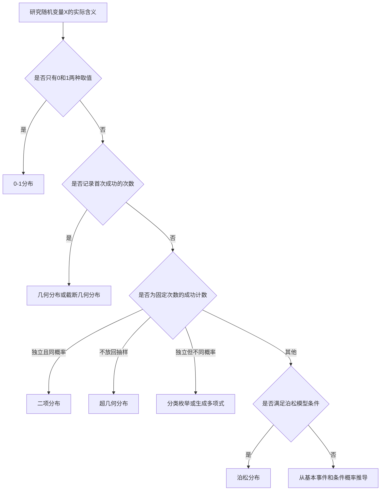
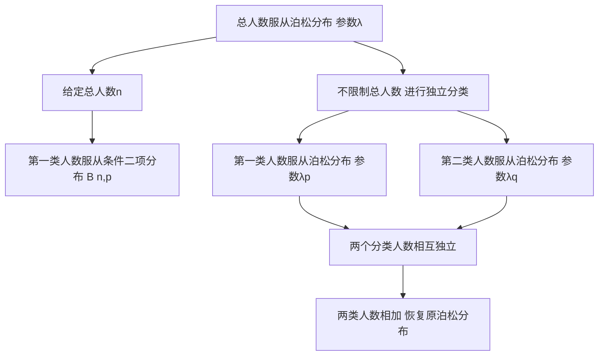

## 第一部分：建立完整的知识体系

### 一、本节究竟在考什么？

离散型随机变量的本质，是把一个复杂的随机试验转化为若干个可能的数值，并研究这些数值出现的概率。

整个章节可以归结为以下八类核心问题。

| 核心题型       | 必须掌握的方法        | 复习优先级 |
| ---------- | -------------- | ----- |
| 概率分布律及待定参数 | 非负性、归一性、级数求和   | ★★★★★ |
| 独立重复试验与计数  | 二项分布、指示变量      | ★★★★★ |
| 首次成功与停止试验  | 几何分布、截断模型      | ★★★★★ |
| 泊松分布       | 参数反求、可加性、近似    | ★★★★★ |
| 无限离散分布     | 尾概率、无记忆性、奇偶性   | ★★★★★ |
| 二维离散分布     | 联合、边缘、条件分布     | ★★★★★ |
| 随机次数与分层抽样  | 全概率、条件二项、泊松分流  | ★★★★★ |
| 指示变量与数字特征  | 期望、方差、协方差、相关系数 | ★★★★★ |

这不是八套彼此独立的公式。它们都建立在三个最根本的思想之上：

**思想一：把随机变量取值翻译为随机事件。**

**思想二：把复杂事件拆分为若干互斥的基本情形。**

**思想三：先确定概率分布，再研究概率、期望、方差及其他性质。**

遇到从未见过的新题时，这三个思想比背诵某种特殊分布的公式更重要。

### 二、离散型随机变量的基本概念

**2.1 什么是离散型随机变量？**

如果随机变量 $X$ 的全部可能取值是有限个或者可列无限个：

$$
x_1,x_2,\ldots,x_n,\ldots
$$

则称 $X$ 为离散型随机变量。

例如，投篮命中次数、抽到的次品数、首次成功所需的试验次数、某段时间到达的顾客人数，都可以用离散型随机变量描述。

注意，离散型随机变量的取值不一定是整数。例如：

$$
X\in\left\{1,\frac12,\frac13,\ldots\right\}
$$

仍然可以是离散型随机变量。

**2.2 概率分布律**

记

$$
P(X=x_k)=p_k
$$

则称上述关系为 $X$ 的概率分布律，也叫概率质量函数、分布列。

合法的离散型概率分布律必须满足：

$$
\boxed{p_k\geq 0}
$$

以及

$$
\boxed{\sum_kp_k=1}
$$

这两个条件既是必要条件，也是充分条件。

因此，凡是题目给出一个含有未知参数的概率分布律，第一反应应当是检查：

- 每一项是否非负；
- 所有概率相加是否等于1；
- 如果存在无限项，级数是否收敛；
- 解出的参数是否满足上述全部条件。

**2.3 分布律与分布函数之间的关系**

分布函数定义为

$$
F_X(x)=P(X\leq x)
$$

对于离散型随机变量：

$$
\boxed{F_X(x)=\sum_{x_k\leq x}p_k}
$$

反过来，可以通过分布函数的跳跃量恢复分布律：

$$
\boxed{P(X=a)=F_X(a)-F_X(a^-)}
$$

其中

$$
F_X(a^-)=\lim_{x\to a^-}F_X(x)
$$

考研中常见的离散型分布函数呈阶梯状，每一个跳跃点对应一个具有正概率的取值，跳跃高度就是该点的概率。

**基础母题：李林880·第十七章**

已知随机变量 $X$ 的分布律为：

| $X$ | $-1$ | $1$ | $2$ |
| ------- | -------- | ------- | ------- |
| $P$ | 0.2      | 0.3     | 0.5     |

求分布函数以及相应的区间概率。

按照取值从小到大累加：

$$
F_X(x)= \begin{cases} 0,&x<-1,\\ 0.2,&-1\leq x<1,\\ 0.5,&1\leq x<2,\\ 1,&x\geq2. \end{cases}
$$

于是：

$$
P\left(X>\frac12\right)=0.3+0.5=0.8
$$

$$
P(-1\leq X\leq2)=1
$$

这类基础题一定要真正理解端点，因为离散型随机变量在单点上可以具有正概率。

| 所求概率                   | 对应公式                |
| ---------------------- | ------------------- |
| $P(a<X\leq b)$    | $F(b)-F(a)$     |
| $P(a\leq X\leq b)$ | $F(b)-F(a^-)$   |
| $P(a<X<b)$       | $F(b^-)-F(a)$   |
| $P(a\leq X<b)$    | $F(b^-)-F(a^-)$ |
| $P(X=a)$           | $F(a)-F(a^-)$   |
| $P(X>a)$           | $1-F(a)$        |
| $P(X\geq a)$       | $1-F(a^-)$      |

**最容易出现的错误：** 将连续型随机变量中可以忽略端点的习惯，直接搬到离散型随机变量中。

### 三、五种核心离散分布

先建立模型识别框架，后面再结合真题逐个深入。

约定 $q=1-p$，$D(X)$ 表示方差。

| 分布    | 典型模型       | 可能取值               | 期望                 | 方差                                            |
| ----- | ---------- | ------------------ | ------------------ | --------------------------------------------- |
| 0-1分布 | 单次试验是否成功   | 0，1                | $p$            | $pq$                                      |
| 二项分布  | 固定次数内成功几次  | $0,\ldots,n$   | $np$           | $npq$                                     |
| 几何分布  | 首次成功需要几次   | $1,2,\ldots$   | $\frac1p$      | $\frac q{p^2}$                            |
| 泊松分布  | 单位区间内事件次数  | $0,1,2,\ldots$ | $\lambda$      | $\lambda$                                 |
| 超几何分布 | 不放回抽样中的成功数 | 有限非负整数             | $\frac{nM}{N}$ | $\frac{nM}{N}(1-\frac MN)\frac{N-n}{N-1}$ |

**如何选择分布？**

特别注意：**题目问次数，不代表一定服从二项分布；题目问人数，也不代表一定服从泊松分布。** 必须依据随机试验的实际结构判断。

## 第二部分：一维离散型随机变量核心题型

### 四、题型一：概率分布律的合法性与参数反求

**4.1 必须掌握的级数公式**

无限离散型分布经常与高等数学中的无穷级数结合考查。以下公式不仅用于求待定参数，还用于计算尾概率、数学期望和方差。

当 $|r|<1$ 时，

$$
\sum_{k=0}^{\infty}r^k=\frac1{1-r}
$$

$$
\sum_{k=1}^{\infty}r^k=\frac r{1-r}
$$

$$
\sum_{k=m}^{\infty}r^k=\frac{r^m}{1-r}
$$

对幂级数逐项求导，可得到：

$$
\boxed{\sum_{k=1}^{\infty}kr^k =\frac r{(1-r)^2}}
$$

$$
\boxed{\sum_{k=1}^{\infty}k^2r^k =\frac{r(1+r)}{(1-r)^3}}
$$

指数函数展开式：

$$
\boxed{\sum_{k=0}^{\infty}\frac{x^k}{k!}=e^x}
$$

这些公式是几何分布和泊松分布相关计算的数学基础。

**4.2 母题：李正元练习题·核心题目第7题**

设离散型随机变量 $X$ 的概率分布为

$$
P(X=k)=cp^k,\quad k=1,2,\ldots
$$

其中 $c>0$，求 $p$。

**第一步：检查非负性及收敛条件。**

由 $c>0$ 以及概率的合法性可知：

$$
0<p<1
$$

**第二步：使用归一化条件。**

$$
\sum_{k=1}^{\infty}cp^k=1
$$

所以

$$
\frac{cp}{1-p}=1
$$

解得

$$
\boxed{p=\frac1{c+1}}
$$

**第三步：识别隐藏的标准分布。**

由

$$
c=\frac{1-p}{p}
$$

可将原分布律改写为

$$
P(X=k)=(1-p)p^{k-1}
$$

这实际上是成功概率为 $1-p$ 的几何分布。

于是，不必重新计算级数便可得到：

$$
EX=\frac1{1-p}
$$

$$
DX=\frac p{(1-p)^2}
$$

**这一题真正需要掌握的是：归一化不仅能够确定参数，还能够帮助识别随机变量所属的标准分布。**

**4.3 变式：李林880·第十七章综合填空题**

设

$$
P(X=k)=\frac{a}{k!}e^{-2}, \quad k=0,1,2,\ldots
$$

求 $a$。

由归一性：

$$
ae^{-2}\sum_{k=0}^{\infty}\frac1{k!}=1
$$

即

$$
ae^{-2}e=1
$$

因此

$$
\boxed{a=e}
$$

代回：

$$
P(X=k)=\frac{e^{-1}}{k!}
$$

实际上有

$$
X\sim\operatorname{Pois}(1)
$$

注意这里的泊松参数是1，而不是原式指数部分出现的2。

### 五、题型二：0-1分布与二项分布

**5.1 0-1分布的本质——事件的数字化**

对于随机事件 $A$，定义

$$
I_A= \begin{cases} 1,&A\text{发生},\\ 0,&A\text{不发生}. \end{cases}
$$

若 $P(A)=p$，则

$$
I_A\sim B(1,p)
$$

其分布律为

$$
P(I_A=k)=p^k(1-p)^{1-k}, \quad k=0,1
$$

这种随机变量称为指示变量。

由于

$$
I_A^2=I_A
$$

甚至对任意正整数 $m$，都有

$$
I_A^m=I_A
$$

所以

$$
EI_A=p
$$

$$
DI_A=p-p^2=p(1-p)
$$

指示变量最重要的应用，是将复杂的计数问题转化为若干个0-1随机变量之和：

$$
\boxed{X=I_1+I_2+\cdots+I_n}
$$

不论这些指示变量是否独立，均有

$$
\boxed{EX=\sum_{i=1}^nP(I_i=1)}
$$

后面计算空盒子数量、次品数量、命中数量、成功人数时，这一技巧非常重要。

**5.2 二项分布的成立条件**

如果一个随机试验满足：

1. 试验次数固定为 $n$；
2. 每次只关心成功或失败；
3. 各次试验相互独立；
4. 各次成功概率均为 $p$；

则成功次数 $X$ 服从二项分布：

$$
X\sim B(n,p)
$$

其分布律为

$$
\boxed{P(X=k)=\binom nkp^kq^{n-k}}
$$

其中

$$
k=0,1,\ldots,n,\qquad q=1-p
$$

为什么要乘组合数？

因为恰好成功 $k$ 次，并没有指定哪 $k$ 次成功。共有 $\binom nk$ 种成功位置的选择，每一种具体排列的概率都是 $p^kq^{n-k}$。

与几何分布相比，这是最根本的区别：二项分布不关心成功出现的具体顺序，首次成功模型则关心。

**5.3 二项分布的重要推论**

$$
EX=np
$$

$$
DX=npq
$$

$$
E(X^2)=npq+n^2p^2
$$

阶乘矩：

$$
\boxed{E[X(X-1)]=n(n-1)p^2}
$$

若

$$
X\sim B(n,p)
$$

则失败次数满足

$$
\boxed{n-X\sim B(n,1-p)}
$$

若

$$
X\sim B(n,p),\qquad Y\sim B(m,p)
$$

且 $X,Y$ 独立，则

$$
\boxed{X+Y\sim B(n+m,p)}
$$

必须注意：**独立且成功概率相同，才能直接使用二项分布的可加性。**

**5.4 常见尾概率速算**

| 事件     | 概率                        |
| ------ | ------------------------- |
| 全部成功   | $p^n$                 |
| 全部失败   | $q^n$                 |
| 至少成功一次 | $1-q^n$               |
| 至多成功一次 | $q^n+npq^{n-1}$       |
| 至少成功两次 | $1-q^n-npq^{n-1}$     |
| 恰好成功两次 | $\binom n2p^2q^{n-2}$ |

尤其看到“至少一次”“至少两次”，优先考虑补事件，通常比正面求和更简单。

**5.5 真题母题：1995年数学三·核心题目第2题**

这是一道非常适合数学一学习的全概率与二项分布综合题。

某厂家生产的仪器，直接合格的概率为0.7，需要调试的概率为0.3。调试后合格的概率为0.8，不合格的概率为0.2。各台仪器的生产过程独立。

生产 $n$ 台仪器，求全部合格、恰有两台不合格、至少两台不合格的概率。

**第一步：先解决单台仪器的概率。**

仪器最终合格有两条互斥路径：

$$
P(\text{合格})=0.7+0.3\times0.8=0.94
$$

因此

$$
P(\text{不合格})=0.3\times0.2=0.06
$$

**第二步：建立二项分布模型。**

令 $X$ 表示不合格仪器数量，则

$$
X\sim B(n,0.06)
$$

**第三步：统一回答所有问题。**

全部合格：

$$
\boxed{P(X=0)=0.94^n}
$$

恰有两台不合格：

$$
\boxed{P(X=2)=\binom n2 0.06^2\,0.94^{n-2}}
$$

至少两台不合格：

$$
\begin{aligned} P(X\geq2) &=1-P(X=0)-P(X=1)\\ &=\boxed{1-0.94^n-0.06n\cdot0.94^{n-1}} \end{aligned}
$$

**5.6 解题方法提炼：先局部，后整体**

这道题可以推广到很多考研新题。

题目可能先给出复杂的产品生产过程、设备工作过程、连续型随机变量的区间概率，或者多个事件的组合关系，再让你计算独立重复试验的成功次数。

标准处理顺序始终是：

$$
\boxed{ \text{确定单次成功率} \longrightarrow \text{检查独立性} \longrightarrow \text{建立计数分布} }
$$

例如，如果 $X_1,\ldots,X_n$ 独立同分布，公共分布函数为 $F(x)$，令

$$
N=\sum_{i=1}^nI_{\{X_i\leq a\}}
$$

那么

$$
\boxed{N\sim B(n,F(a))}
$$

如果成功事件改为 $a<X_i\leq b$，则

$$
N\sim B(n,F(b)-F(a))
$$

这正是连续型随机变量、分布函数、次序统计量与二项分布的交叉考法。

### 六、题型三：二项分布的最可能取值——众数问题

**6.1 什么是众数？**

众数是概率最大的取值：

$$
k_0\in\arg\max_kP(X=k)
$$

它与数学期望不同。

数学期望可以是非整数，而二项分布的众数一定是其可能取值中的整数。

**6.2 相邻概率比法**

设

$$
X\sim B(n,p),\qquad 0<p<1
$$

记

$$
a_k=P(X=k)
$$

研究相邻两项之比：

$$
\begin{aligned} \frac{a_{k+1}}{a_k} &=\frac{\binom n{k+1}p^{k+1}q^{n-k-1}} {\binom nkp^kq^{n-k}}\\ &=\boxed{\frac{n-k}{k+1}\frac pq} \end{aligned}
$$

于是：

$$
a_{k+1}>a_k \iff k+1<(n+1)p
$$

$$
a_{k+1}=a_k \iff k+1=(n+1)p
$$

由此得到二项分布众数公式：

当 $(n+1)p$ 不是整数时，

$$
\boxed{k_0=\lfloor(n+1)p\rfloor}
$$

当 $(n+1)p=m$ 是整数时，有两个众数：

$$
\boxed{k_0=m-1,\ m}
$$

**6.3 母题：张宇1000题·核心题目第5题**

将100个球独立、等可能地投入40个盒子，问指定某个盒子中最可能出现多少个球。

对任意一个球而言，它进入指定盒子的概率是

$$
p=\frac1{40}
$$

令 $X$ 为指定盒子的球数，则

$$
X\sim B\left(100,\frac1{40}\right)
$$

因为

$$
(n+1)p=\frac{101}{40}=2.525
$$

所以众数为

$$
\boxed{2}
$$

而期望为

$$
EX=\frac{100}{40}=2.5
$$

两者并不相同。

**6.4 创新变式：两个众数**

若

$$
X\sim B(9,0.3)
$$

则

$$
(n+1)p=10\times0.3=3
$$

所以

$$
\boxed{2,\ 3}
$$

都是众数。

这里不能简单地把数学期望 $EX=2.7$ 四舍五入为3。

**本题型的通用思想：当要求离散数列中概率最大的项时，优先使用相邻项比值，而不是使用连续函数求导。** 这一思想同样适用于泊松分布以及题目自定义的离散分布。

### 七、题型四：独立但不同成功概率的计数

**7.1 为什么不能直接使用二项分布？**

设三个设备发生故障的概率分别为

$$
p_1,\ p_2,\ p_3
$$

即使三个设备相互独立，也不能把故障设备数写为

$$
B\left(3,\frac{p_1+p_2+p_3}{3}\right)
$$

因为二项分布要求每次成功概率相同。

这种独立但不同参数的伯努利变量之和，通常称为泊松二项分布。考研中掌握计算方法即可，不必记忆这个名称。

**7.2 母题：李正元·核心题目第4题**

三个部件需要调整的概率分别是0.1、0.2、0.3，各部件相互独立。求需要调整的部件数 $X$ 的分布函数。

令

$$
X=I_1+I_2+I_3
$$

其中

$$
I_1\sim B(1,0.1)
$$

$$
I_2\sim B(1,0.2)
$$

$$
I_3\sim B(1,0.3)
$$

**方法一：按照成功位置枚举。**

没有部件需要调整：

$$
P(X=0)=0.9\times0.8\times0.7=0.504
$$

恰好一个部件需要调整：

$$
\begin{aligned} P(X=1) ={}&0.1\times0.8\times0.7\\ &+0.9\times0.2\times0.7\\ &+0.9\times0.8\times0.3\\ ={}&0.398 \end{aligned}
$$

恰好两个部件需要调整：

$$
\begin{aligned} P(X=2) ={}&0.1\times0.2\times0.7\\ &+0.1\times0.8\times0.3\\ &+0.9\times0.2\times0.3\\ ={}&0.092 \end{aligned}
$$

三个部件都需要调整：

$$
P(X=3)=0.1\times0.2\times0.3=0.006
$$

因此分布律为：

| $X$ | 0     | 1     | 2     | 3     |
| ------- | ----- | ----- | ----- | ----- |
| $P$ | 0.504 | 0.398 | 0.092 | 0.006 |

再累加得到：

$$
\boxed{ F_X(x)= \begin{cases} 0,&x<0,\\ 0.504,&0\leq x<1,\\ 0.902,&1\leq x<2,\\ 0.994,&2\leq x<3,\\ 1,&x\geq3. \end{cases}}
$$

**7.3 方法二：概率生成多项式（拓展技巧）**

构造

$$
G(t)=(0.9+0.1t)(0.8+0.2t)(0.7+0.3t)
$$

展开得到

$$
G(t)=0.504+0.398t+0.092t^2+0.006t^3
$$

其中 $t^k$ 的系数就是 $P(X=k)$。

一般地，对于相互独立的指示变量，

$$
X=\sum_{i=1}^n I_i
$$

可以构造

$$
\boxed{G_X(t)=\prod_{i=1}^n(1-p_i+p_it)}
$$

这一方法将所有成功、失败的组合情形自动组织起来。

不过，若题目只问期望和方差，则无须求整个分布律。

直接使用：

$$
EX=\sum_{i=1}^np_i
$$

独立时，

$$
DX=\sum_{i=1}^np_i(1-p_i)
$$

本题有

$$
\boxed{EX=0.6}
$$

$$
\boxed{DX=0.46}
$$

如果不独立，期望仍然可以直接相加，但方差通常不能直接相加。

### 八、题型五：几何分布与首次成功模型

**8.1 几何分布的建立**

在独立重复的伯努利试验中，每次成功概率为 $p$，失败概率为 $q=1-p$。

令 $T$ 表示首次成功所需的试验次数。

那么

$$
\{T=k\} = \{\text{前 }k-1\text{ 次失败，第 }k\text{ 次成功}\}
$$

故

$$
\boxed{P(T=k)=q^{k-1}p}
$$

其中 $k=1,2,\ldots$。

注意这里没有组合数，因为成功只能出现在最后一次。

当 $0<p<1$ 时，

$$
ET=\frac1p
$$

$$
DT=\frac q{p^2}
$$

**8.2 最重要的尾概率公式**

$$
\boxed{P(T>n)=q^n}
$$

因为 $T>n$ 意味着前 $n$ 次全部失败。

进一步有

$$
P(T\geq n)=q^{n-1},\quad n\geq1
$$

$$
P(T\leq n)=1-q^n
$$

$$
P(T<n)=1-q^{n-1}
$$

几何分布是考研中最需要注意大于号和大于等于号区别的分布之一。

**8.3 两种几何模型的区别**

| 随机变量        | 含义        | 取值               | 分布律            |
| ----------- | --------- | ---------------- | -------------- |
| $T$     | 首次成功所需次数  | $1,2,\ldots$ | $pq^{k-1}$ |
| $W=T-1$ | 首次成功前失败次数 | $0,1,\ldots$ | $pq^k$     |

如果题目记录的是失败次数，而不是总试验次数，整个随机变量就会向左平移1。

**8.4 重要性质：无记忆性**

对于非负整数 $m,n$：

$$
\begin{aligned} P(T>m+n\mid T>m) &=\frac{P(T>m+n)}{P(T>m)}\\ &=\frac{q^{m+n}}{q^m}\\ &=q^n \end{aligned}
$$

所以

$$
\boxed{P(T>m+n\mid T>m)=P(T>n)}
$$

直观上，已经连续失败了 $m$ 次，不会改变以后每次独立试验成功的概率。

这就是无记忆性。

**但是，只有满足相应结构的单一几何分布才具有该性质，不能看到几何级数形式就机械套用。** 这一点恰好是2026年数学一真题的关键。

**8.5 李林880·核心题目第9题：奇偶性**

设首次成功的概率为 $p=\frac34$，求首次成功发生在偶数次试验的概率。

由于

$$
P(T=k)=\frac34\left(\frac14\right)^{k-1}
$$

所以

$$
\begin{aligned} P(T\text{为偶数}) &=\sum_{n=1}^{\infty}P(T=2n)\\ &=\sum_{n=1}^{\infty}\frac34 \left(\frac14\right)^{2n-1}\\ &=\frac{3/16}{1-1/16}\\ &=\boxed{\frac15} \end{aligned}
$$

一般情况下：

$$
\boxed{P(T\text{为偶数})=\frac q{1+q}}
$$

$$
\boxed{P(T\text{为奇数})=\frac1{1+q}}
$$

**8.6 模拟题推广：张宇8套卷第7套第16题**

设

$$
P(X=k)=\frac1{a^k},\quad k=1,2,\ldots
$$

求 $X$ 能被3整除的概率。

归一化得到：

$$
\frac1{a-1}=1
$$

故 $a=2$。

因此

$$
\begin{aligned} P(3\mid X) &=\sum_{j=1}^{\infty}\frac1{2^{3j}}\\ &=\frac{1/8}{1-1/8}\\ &=\boxed{\frac17} \end{aligned}
$$

这里的 $3\mid X$ 表示3整除 $X$。

更一般地，如果 $T$ 服从参数为 $p$ 的几何分布，则

$$
\boxed{P(d\mid T)= \frac{pq^{d-1}}{1-q^d}}
$$

因此，奇数、偶数、被3整除、被5整除等题目，本质上都是抽取等比级数中特定下标的项进行求和。

### 九、题型六：有限次数下的截断几何分布

这是本节非常重要、也非常容易出错的题型。

**9.1 真题母题：1991年数学三·核心题目第1题**

汽车需要通过三个路口，各路口红绿灯相互独立，红灯、绿灯出现的概率均为 $\frac12$。

令 $X$ 为首次遇到红灯前已通过的路口数，求 $X$ 的概率分布。

随机变量只能取

$$
X=0,1,2,3
$$

逐项翻译：

| $X$ | 所对应的事件   | 概率            |
| ------- | -------- | ------------- |
| 0       | 第一个路口是红灯 | $\frac12$ |
| 1       | 绿、红      | $\frac14$ |
| 2       | 绿、绿、红    | $\frac18$ |
| 3       | 绿、绿、绿    | $\frac18$ |

因此

$$
\boxed{ P(X=k)= \begin{cases} \frac12,&k=0,\\ \frac14,&k=1,\\ \frac18,&k=2,3,\\ 0,&\text{其他}. \end{cases}}
$$

关键在最后一项：

$$
P(X=3)=\left(\frac12\right)^3
$$

而不是

$$
\left(\frac12\right)^4
$$

因为不存在题目所规定的第四个路口。

**9.2 母题：李正元·核心题目第3题**

某参试者每次跳高成功的概率是0.6，第一次成功即停止，最多试跳6次。假定各次试跳独立，求实际试跳次数 $X$ 的概率分布。

先令 $T$ 表示不限制次数时首次成功的试跳次数。

则

$$
T\sim G(0.6)
$$

实际试跳次数为

$$
\boxed{X=\min(T,6)}
$$

当 $k=1,\ldots,5$ 时，

$$
P(X=k)=0.6(0.4)^{k-1}
$$

当 $X=6$ 时，前5次失败就足够了，第6次无论成功与否都已经进行了6次试跳。

所以

$$
P(X=6)=P(T\geq6)=0.4^5
$$

最终结果为

$$
\boxed{ P(X=k)= \begin{cases} 0.6(0.4)^{k-1},&k=1,\ldots,5,\\ 0.4^5,&k=6,\\ 0,&\text{其他}. \end{cases}}
$$

**9.3 通用模型与重要推论**

若 $T\sim G(p)$，实际试验次数最多为 $N$，令

$$
X=\min(T,N)
$$

则

$$
\boxed{ P(X=k)= \begin{cases} pq^{k-1},&1\leq k<N,\\ q^{N-1},&k=N,\\ 0,&\text{其他}. \end{cases}}
$$

这是把 $T\geq N$ 的全部概率质量集中到了 $N$ 这个取值上。

需要特别区分以下三个问题：

| 所求事件               | 概率             |
| ------------------ | -------------- |
| 实际进行了 $N$ 次试验  | $q^{N-1}$  |
| 恰好在第 $N$ 次首次成功 | $q^{N-1}p$ |
| $N$ 次试验全部失败    | $q^N$      |

三者不是同一个事件。

**9.4 高阶技巧：使用尾和公式计算期望**

对于非负整数型随机变量，只要期望有限，

$$
\boxed{EX=\sum_{k=1}^{\infty}P(X\geq k)}
$$

因为对每个非负整数 $x$，

$$
x=\sum_{k=1}^{\infty}I_{\{x\geq k\}}
$$

于是，对于截断几何分布：

$$
\begin{aligned} EX &=\sum_{k=1}^NP(X\geq k)\\ &=\sum_{k=1}^Nq^{k-1}\\ &=\boxed{\frac{1-q^N}{p}} \end{aligned}
$$

如果题目只求平均试验次数，使用这个公式通常比直接求 $\sum kP(X=k)$ 更快。

**9.5 推广：第 $r$ 次成功时停止**

如果 $T_r$ 表示第 $r$ 次成功所需的总试验次数，那么

$$
\boxed{ P(T_r=k)=\binom{k-1}{r-1}p^rq^{k-r} }
$$

其中 $k=r,r+1,\ldots$。

原因是前 $k-1$ 次试验中恰好出现 $r-1$ 次成功，第 $k$ 次必须成功。

这称为负二项分布，虽然不必作为独立的考纲分布死记，但这种事件翻译方法值得掌握。

如果最多试验 $N$ 次，其中 $N\geq r$，实际次数 $X=\min(T_r,N)$，则最后一项为

$$
P(X=N)=P(T_r\geq N)
$$

即前 $N-1$ 次试验成功次数不足 $r$。

令 $Y\sim B(N-1,p)$，则

$$
\boxed{P(X=N)=P(Y\leq r-1)}
$$

这是几何模型、停止模型和二项计数之间的综合变式。

### 十、重点真题：2026年数学一——混合几何分布与条件尾概率

**对应核心题目第11题。这是本节最值得反复研究的近年真题之一。**

设随机变量 $X$ 的概率分布为

$$
P(X=k)=\frac1{2^{k+1}}+\frac1{3^k}, \quad k=1,2,\ldots
$$

对于任意正整数 $m,n$，比较

$$
P(X>m+n\mid X>m)
$$

与

$$
P(X>n)
$$

的大小。

**10.1 第一反应：不要直接套用无记忆性**

单一几何分布有无记忆性。

但是题目中的概率分布是两个几何型概率项之和，因此需要重新计算。

<Steps>

<Step>

### 10.2 第一步：计算尾概率 [!toc]

令

$$
S(t)=P(X>t)
$$

则

$$
\begin{aligned} S(t) &=\sum_{k=t+1}^{\infty} \left(\frac1{2^{k+1}}+\frac1{3^k}\right)\\ &=\frac12\left(\frac12\right)^t +\frac12\left(\frac13\right)^t \end{aligned}
$$

即

$$
\boxed{S(t)=\frac12(2^{-t}+3^{-t})}
$$

同时，

$$
S(0)=1
$$

验证了分布律的归一性。

</Step>

<Step>

### 10.3 第二步：使用条件概率公式 [!toc]

由于

$$
\{X>m+n\}\subseteq\{X>m\}
$$

所以

$$
P(X>m+n\mid X>m) =\frac{S(m+n)}{S(m)}
$$

题目就变成比较：

$$
\frac{S(m+n)}{S(m)}
$$

和

$$
S(n)
$$

的大小。

也就是说，只要比较

$$
S(m+n)
$$

和

$$
S(m)S(n)
$$

即可。

</Step>

<Step>

### 10.4 第三步：作差并因式分解 [!toc]

$$
\begin{aligned} &S(m+n)-S(m)S(n)\\ ={}&\frac12(2^{-m-n}+3^{-m-n})\\ &-\frac14(2^{-m}+3^{-m})(2^{-n}+3^{-n})\\ ={}&\frac14(2^{-m}-3^{-m}) (2^{-n}-3^{-n}) \end{aligned}
$$

由于 $m,n>0$，

$$
2^{-m}>3^{-m}
$$

$$
2^{-n}>3^{-n}
$$

所以

$$
S(m+n)-S(m)S(n)>0
$$

因此

$$
\boxed{ P(X>m+n\mid X>m)>P(X>n) }
$$

答案为D。

</Step>

</Steps>

**10.5 为什么会出现这样的结果？**

这里存在两个不同的潜在几何分布：

$$
X\sim \begin{cases} G(1/2),&\text{以概率 }1/2\text{选择},\\ G(2/3),&\text{以概率 }1/2\text{选择}. \end{cases}
$$

第一类的成功率更低，等待时间通常更长。

当已经等待了很长时间仍未成功时，随机变量更可能来自第一类，也就是等待时间较长的那类。

因此，已经等待很久以后，再继续等待 $n$ 次的条件概率反而更大。

**10.6 真题一般化**

设一个混合几何分布的尾概率为

$$
S(t)=\alpha a^t+(1-\alpha)b^t
$$

其中

$$
0<\alpha<1,\qquad 0<b<a<1
$$

则

$$
\boxed{ S(m+n)-S(m)S(n) =\alpha(1-\alpha)(a^m-b^m)(a^n-b^n) }
$$

对任意正整数 $m,n$，右侧均大于0。

所以这类非退化的两成分混合几何分布，都满足

$$
\boxed{P(X>m+n\mid X>m)>P(X>n)}
$$

未来考试即使更换系数、底数或者引入新的参数，也可以使用相同方法解决。

**10.7 配套模拟题：张宇8套卷第1套第22题**

分类模拟题中有一道与2026年真题结构高度一致的综合题：

$$
P(X=k)=\frac1{2^{k+1}}+\frac a{3^k}
$$

要求确定 $a$、计算期望与方差，并比较两个条件期望。

归一化：

$$
\frac12+\frac a2=1
$$

得到

$$
a=1
$$

使用几何分布混合的观点：

$$
EX=\frac12\times2+\frac12\times\frac32 =\boxed{\frac74}
$$

又有

$$
E(X^2) =\frac12\times6+\frac12\times3 =\frac92
$$

故

$$
\boxed{DX=\frac92-\left(\frac74\right)^2 =\frac{23}{16}}
$$

条件期望为

$$
E(X\mid X>1)=\frac{14}{5}
$$

$$
E(X\mid X>2)=\frac{50}{13}
$$

因此

$$
E(X\mid X>1)<E(X\mid X>2)
$$

还有一种不必具体计算的判断方法：

在 $X>1$ 的条件下，$X$ 要么等于2，要么大于2。因此

$$
E(X\mid X>1)
$$

是2与

$$
E(X\mid X>2)
$$

的加权平均值，而后者至少为3，所以前者严格更小。

这就是从具体题目提炼出的通用条件期望思想：**提高截断下界，会使保留下来的随机变量条件均值不减。**

## 第三部分：泊松分布及其综合应用

### 十一、泊松分布的基本知识

**11.1 定义与直观理解**

如果随机变量 $X$ 的概率分布为

$$
\boxed{ P(X=k)=\frac{\lambda^k}{k!}e^{-\lambda}, \quad k=0,1,2,\ldots }
$$

其中 $\lambda>0$，则称 $X$ 服从参数为 $\lambda$ 的泊松分布，记为

$$
X\sim\operatorname{Pois}(\lambda)
$$

有些考研教材记为 $X\sim P(\lambda)$，含义相同。

泊松分布常用于描述一定时间或空间范围内随机事件出现的次数，例如顾客到达人数、设备故障次数、交通事故次数、单位面积中的缺陷数量等。

参数 $\lambda$ 可以理解为该范围内事件发生的平均次数。

**11.2 必须熟记的数字特征**

$$
\boxed{EX=DX=\lambda}
$$

$$
\boxed{E(X^2)=\lambda^2+\lambda}
$$

$$
\boxed{E[X(X-1)]=\lambda^2}
$$

更一般地，泊松分布的阶乘矩满足

$$
E[X(X-1)\cdots(X-r+1)]=\lambda^r
$$

这一性质在处理高阶矩、组合数期望时很有价值。例如：

$$
E\binom X2=\frac{\lambda^2}{2}
$$

**11.3 常用概率**

| 事件           | 概率                                                |
| ------------ | ------------------------------------------------- |
| $X=0$    | $e^{-\lambda}$                                |
| $X=1$    | $\lambda e^{-\lambda}$                        |
| $X=2$    | $\frac{\lambda^2}{2}e^{-\lambda}$             |
| $X\geq1$ | $1-e^{-\lambda}$                              |
| $X\leq1$ | $(1+\lambda)e^{-\lambda}$                     |
| $X\geq2$ | $1-(1+\lambda)e^{-\lambda}$                   |
| $X\leq2$ | $(1+\lambda+\frac{\lambda^2}{2})e^{-\lambda}$ |

泊松分布有无限多个可能取值，所以计算右侧尾概率时，尤其适合使用补事件。

### 十二、题型七：泊松分布的参数反求与众数

**12.1 母题：李林880·核心题目第8题**

设 $X$ 服从泊松分布，且

$$
P(X=1)=P(X=2)
$$

求 $P(X>1)$。

设 $X\sim\operatorname{Pois}(\lambda)$。

则

$$
\lambda e^{-\lambda} =\frac{\lambda^2}{2}e^{-\lambda}
$$

由于 $\lambda>0$，约去公共因子，得到

$$
\lambda=2
$$

因此

$$
\begin{aligned} P(X>1) &=1-P(X=0)-P(X=1)\\ &=1-e^{-2}-2e^{-2}\\ &=\boxed{1-3e^{-2}} \end{aligned}
$$

**12.2 通用技巧：相邻概率比**

设 $p_k=P(X=k)$，则

$$
\boxed{\frac{p_{k+1}}{p_k}=\frac{\lambda}{k+1}}
$$

因此：

$$
p_{k+1}=p_k\iff\lambda=k+1
$$

$$
p_{k+1}>p_k\iff\lambda>k+1
$$

这可以直接用于求众数。

当 $\lambda$ 不是整数时，唯一众数为

$$
\boxed{\lfloor\lambda\rfloor}
$$

当 $\lambda=m$ 为正整数时，两个众数为

$$
\boxed{m-1,\ m}
$$

**12.3 推广：不相邻概率比**

若 $j>i$，则

$$
\frac{P(X=j)}{P(X=i)} =\frac{i!}{j!}\lambda^{j-i}
$$

例如已知

$$
P(X=2)=P(X=4)
$$

则

$$
\frac{\lambda^2}{2!} =\frac{\lambda^4}{4!}
$$

解得

$$
\boxed{\lambda=2\sqrt3}
$$

遇到泊松分布中不同取值概率之间的关系时，先消去共同的指数因子，通常就可以将问题转化为简单的代数方程。

### 十三、题型八：泊松分布的奇偶性与级数拆分

**母题：张宇1000题·核心题目第10题**

设 $X\sim\operatorname{Pois}(\lambda)$，比较 $X$ 取整数、偶数、奇数的概率。

令

$$
p_{\mathrm e}=P(X\text{为偶数})
$$

$$
p_{\mathrm o}=P(X\text{为奇数})
$$

显然

$$
p_{\mathrm e}+p_{\mathrm o}=1
$$

另一方面，由指数级数展开：

$$
e^{-\lambda} =\sum_{k=0}^{\infty}\frac{(-\lambda)^k}{k!}
$$

于是

$$
\begin{aligned} p_{\mathrm e}-p_{\mathrm o} &=e^{-\lambda}\sum_{k=0}^{\infty} \frac{(-\lambda)^k}{k!}\\ &=e^{-2\lambda} \end{aligned}
$$

联立两式，得到

$$
\boxed{ P(X\text{为偶数})=\frac{1+e^{-2\lambda}}2 }
$$

$$
\boxed{ P(X\text{为奇数})=\frac{1-e^{-2\lambda}}2 }
$$

因为 $\lambda>0$，所以

$$
1>P(X\text{为偶数})>P(X\text{为奇数})
$$

**解题思想：用奇偶性构造两条方程**

这类问题的本质不是直接计算两个复杂的无穷级数，而是利用

$$
p_{\mathrm e}+p_{\mathrm o}=1
$$

与

$$
p_{\mathrm e}-p_{\mathrm o}=E[(-1)^X]
$$

构造方程组。

例如对于二项分布 $X\sim B(n,p)$，由二项式定理，

$$
E[(-1)^X]=(1-2p)^n
$$

因此

$$
\boxed{ P(X\text{为偶数}) =\frac{1+(1-2p)^n}{2} }
$$

这说明几何分布、二项分布、泊松分布的奇偶性题目，虽然公式不同，但都可以使用同一种思想：**利用对应的级数结构，将奇数项与偶数项分离。**

### 十四、题型九：二项分布的泊松近似

**14.1 泊松定理**

设

$$
X_n\sim B(n,p_n)
$$

当

$$
n\to\infty,\qquad np_n\to\lambda>0
$$

时，对于固定的非负整数 $k$，

$$
\boxed{ \lim_{n\to\infty}P(X_n=k) =\frac{\lambda^k}{k!}e^{-\lambda} }
$$

其直观含义是：

试验次数很多、每次事件发生的概率很小，而总的平均发生次数保持适当的有限水平，此时成功次数可以近似使用泊松分布描述。

**14.2 理论推导**

为方便理解，令

$$
p_n=\frac{\lambda}{n}
$$

则

$$
\begin{aligned} P(X_n=k) &=\binom nk\left(\frac{\lambda}{n}\right)^k \left(1-\frac{\lambda}{n}\right)^{n-k}\\ &=\frac{\lambda^k}{k!} \prod_{j=0}^{k-1}\left(1-\frac jn\right) \left(1-\frac{\lambda}{n}\right)^n \left(1-\frac{\lambda}{n}\right)^{-k} \end{aligned}
$$

当 $n\to\infty$ 时，

$$
\prod_{j=0}^{k-1}\left(1-\frac jn\right)\to1
$$

$$
\left(1-\frac{\lambda}{n}\right)^n\to e^{-\lambda}
$$

因此

$$
P(X_n=k)\to\frac{\lambda^k}{k!}e^{-\lambda}
$$

这就是高数中的重要极限与概率论之间的直接联系。

**14.3 重点真题：2025年数学一·核心题目第6题**

设

$$
X_1,\ldots,X_{20}
$$

是来自总体 $B(1,0.1)$ 的简单随机样本，令

$$
T=\sum_{i=1}^{20}X_i
$$

使用泊松分布近似二项分布，求

$$
P(T\leq1)
$$

**第一步：识别简单随机样本意味着独立同分布。**

$$
T\sim B(20,0.1)
$$

**第二步：确定泊松参数。**

$$
\lambda=np=20\times0.1=2
$$

**第三步：计算近似概率。**

$$
\begin{aligned} P(T\leq1) &\approx P(Z=0)+P(Z=1)\\ &=e^{-2}+2e^{-2}\\ &=\boxed{\frac3{e^2}} \end{aligned}
$$

其中 $Z\sim\operatorname{Pois}(2)$。

本题答案为C。

<Callout type="warn" title="14.4 必须区分精确概率与近似概率">

本题的精确概率实际上是

$$
P(T\leq1) =(0.9)^{20}+20(0.1)(0.9)^{19}
$$

而

$$
3e^{-2}
$$

仅仅是泊松近似值。

不能写成

$$
B(20,0.1)=\operatorname{Pois}(2)
$$

这是两个不同的分布。

</Callout>

**14.5 配套模拟题：汤家凤八套卷第7套第10题**

设

$$
T=\sum_{i=1}^{100}X_i
$$

其中 $X_i$ 是来自 $B(1,0.04)$ 的简单随机样本，利用泊松近似求 $P(T\leq2)$。

直接得到

$$
T\sim B(100,0.04)
$$

$$
\lambda=100\times0.04=4
$$

因此

$$
\begin{aligned} P(T\leq2) &\approx e^{-4} \left(1+4+\frac{4^2}{2!}\right)\\ &=\boxed{13e^{-4}} \end{aligned}
$$

**14.6 泊松近似与正态近似的区别**

| 比较项  | 泊松近似                | 正态近似                          |
| ---- | ------------------- | ----------------------------- |
| 适用对象 | 二项分布                | 二项分布等                         |
| 常见条件 | $n$ 大，$p$ 小 | $np,n(1-p)$ 均足够大          |
| 近似参数 | $\lambda=np$    | $\mu=np,\sigma^2=np(1-p)$ |
| 特点   | 保持离散计数形式            | 使用连续型分布近似                     |

实际考试优先遵从题目明确指定的近似方法。不能仅凭 $n$ 较大，就不加判断地选用泊松近似。

### 十五、题型十：泊松分布的可加性

**15.1 核心结论**

如果

$$
X\sim\operatorname{Pois}(\lambda_1)
$$

$$
Y\sim\operatorname{Pois}(\lambda_2)
$$

并且 $X,Y$ 相互独立，则

$$
\boxed{ X+Y\sim\operatorname{Pois}(\lambda_1+\lambda_2) }
$$

泊松分布的可加性不要求两个变量参数相同，这一点与二项分布不同。

**15.2 为什么成立？**

对任意非负整数 $n$，

$$
\begin{aligned} P(X+Y=n) &=\sum_{k=0}^nP(X=k,Y=n-k)\\ &=\sum_{k=0}^n \frac{e^{-\lambda_1}\lambda_1^k}{k!} \frac{e^{-\lambda_2}\lambda_2^{n-k}}{(n-k)!}\\ &=\frac{e^{-(\lambda_1+\lambda_2)}}{n!} \sum_{k=0}^n\binom nk\lambda_1^k\lambda_2^{n-k}\\ &=\frac{e^{-(\lambda_1+\lambda_2)} (\lambda_1+\lambda_2)^n}{n!} \end{aligned}
$$

利用二项式定理，直接得到参数相加后的泊松分布。

**15.3 模拟题母题：李林六套卷第4套第10题**

设 $X,Y$ 为独立的泊松随机变量，已知

$$
P(X+Y>0)=1-e^{-1}
$$

求

$$
E[(X+Y)^2]
$$

令

$$
Z=X+Y\sim\operatorname{Pois}(\lambda)
$$

因为

$$
P(Z>0)=1-e^{-\lambda}=1-e^{-1}
$$

所以

$$
\lambda=1
$$

于是

$$
E(Z^2)=DZ+(EZ)^2
$$

得到

$$
\boxed{E[(X+Y)^2]=1+1^2=2}
$$

**15.4 逆向变式：李永乐六套卷第2套第9题**

设 $X,Y$ 相互独立，均为泊松随机变量，并满足

$$
E[(X+Y)^2]-2E(X+Y)=0
$$

求 $P(X+Y\geq2)$。

令

$$
Z=X+Y\sim\operatorname{Pois}(\lambda)
$$

则

$$
\lambda+\lambda^2-2\lambda=0
$$

即

$$
\lambda(\lambda-1)=0
$$

由于 $\lambda>0$，得到 $\lambda=1$。

所以

$$
\boxed{P(Z\geq2)=1-2e^{-1}}
$$

这两道模拟题是一对很好的正向、逆向母题：

$$
\text{概率条件}\longrightarrow \text{参数}\longrightarrow \text{数字特征}
$$

或者

$$
\text{数字特征}\longrightarrow \text{参数}\longrightarrow \text{概率}
$$

**15.5 张宇1000题拓展：泊松分布的随机大小关系**

设

$$
X\sim\operatorname{Pois}(n)
$$

$$
Y\sim\operatorname{Pois}(m),\qquad n>m
$$

比较两者的分布函数。

可另外构造独立的

$$
Y'\sim\operatorname{Pois}(m)
$$

$$
Z\sim\operatorname{Pois}(n-m)
$$

于是

$$
Y'+Z\sim\operatorname{Pois}(n)
$$

而由于 $Z\geq0$，

$$
\{Y'+Z\leq x\}\subseteq\{Y'\leq x\}
$$

因此

$$
\boxed{F_X(x)\leq F_Y(x)}
$$

注意，这并不意味着原来的 $X,Y$ 一定满足

$$
P(X\geq Y)=1
$$

**分布函数之间的大小关系与两个具体随机变量几乎处处的大小关系，是不同层次的概念。**

### 十六、题型十一：泊松分布的条件分布

这是从一维分布过渡到二维联合分布的重要桥梁。

**模拟题母题：李林六套卷第5套第8题**

设

$$
X\sim\operatorname{Pois}(\lambda_1)
$$

$$
Y\sim\operatorname{Pois}(\lambda_2)
$$

且相互独立，已知 $X+Y=n$，求 $X$ 的条件分布。

条件概率为

$$
P(X=k\mid X+Y=n) =\frac{P(X=k,Y=n-k)}{P(X+Y=n)}
$$

由于独立性，

$$
\begin{aligned} &P(X=k\mid X+Y=n)\\ ={}& \frac{ e^{-\lambda_1}\lambda_1^k/k! \cdot e^{-\lambda_2}\lambda_2^{n-k}/(n-k)! }{ e^{-(\lambda_1+\lambda_2)} (\lambda_1+\lambda_2)^n/n! }\\ ={}&\binom nk \left(\frac{\lambda_1}{\lambda_1+\lambda_2}\right)^k \left(\frac{\lambda_2}{\lambda_1+\lambda_2}\right)^{n-k} \end{aligned}
$$

所以

$$
\boxed{ X\mid(X+Y=n)\sim B\left(n,\frac{\lambda_1}{\lambda_1+\lambda_2}\right) }
$$

这是一个非常重要的结论。

直观上，两类独立泊松事件在总发生次数已知以后，每个事件属于第一类的比例就由

$$
\frac{\lambda_1}{\lambda_1+\lambda_2}
$$

决定，因此条件计数服从二项分布。

进一步，

$$
E(X\mid X+Y=n) =\frac{n\lambda_1}{\lambda_1+\lambda_2}
$$

$$
D(X\mid X+Y=n) =\frac{n\lambda_1\lambda_2} {(\lambda_1+\lambda_2)^2}
$$

## 第四部分：二维离散型随机变量及其分布

### 十七、联合分布律、边缘分布律与条件分布律

**17.1 三种分布之间的基本关系**

设随机变量 $X,Y$ 的联合分布律为

$$
p_{ij}=P(X=x_i,Y=y_j)
$$

合法的联合分布必须满足

$$
p_{ij}\geq0
$$

$$
\sum_i\sum_jp_{ij}=1
$$

边缘分布为

$$
\boxed{ P(X=x_i)=\sum_jp_{ij} }
$$

$$
\boxed{ P(Y=y_j)=\sum_ip_{ij} }
$$

条件分布为

$$
\boxed{ P(X=x_i\mid Y=y_j) =\frac{p_{ij}}{P(Y=y_j)} }
$$

前提是 $P(Y=y_j)>0$。

**17.2 独立性的充要条件**

随机变量 $X,Y$ 独立，当且仅当所有可能的取值都满足

$$
\boxed{ P(X=x_i,Y=y_j) =P(X=x_i)P(Y=y_j) }
$$

证明独立性，需要验证全部格子或者给出一般性推导。

证明不独立，只需要找到一个不满足上述等式的格子。

### 十八、题型十二：联合分布表补全

**真题母题：1999年数学一·核心题目第15题**

设 $X,Y$ 相互独立，已知联合概率分布表中的部分数值。

| $X\backslash Y$ | $y_1$     | $y_2$     | $y_3$ | 边缘 |
| ------------------- | ------------- | ------------- | --------- | -- |
| $x_1$           | ?             | $\frac18$ | ?         | ?  |
| $x_2$           | $\frac18$ | ?             | ?         | ?  |
| 边缘                  | $\frac16$ | ?             | ?         | 1  |

不要给每个空格分别设置未知数。既然独立，应当优先求边缘概率。

设

$$
P(X=x_i)=p_i,\quad P(Y=y_j)=q_j
$$

由独立性，

$$
p_2q_1=\frac18
$$

已知 $q_1=\frac16$，所以

$$
p_2=\frac{1/8}{1/6}=\frac34
$$

进而

$$
p_1=1-\frac34=\frac14
$$

再根据

$$
p_1q_2=\frac18
$$

得到

$$
q_2=\frac12
$$

于是

$$
q_3=1-\frac16-\frac12=\frac13
$$

所有边缘概率已经确定，因此联合分布可以直接通过乘积补全。

| $X\backslash Y$ | $y_1$        | $y_2$     | $y_3$        | 边缘            |
| ------------------- | ---------------- | ------------- | ---------------- | ------------- |
| $x_1$           | $\frac1{24}$ | $\frac18$ | $\frac1{12}$ | $\frac14$ |
| $x_2$           | $\frac18$    | $\frac38$ | $\frac14$    | $\frac34$ |
| 边缘                  | $\frac16$    | $\frac12$ | $\frac13$    | 1             |

**标准解题顺序**

$$
\boxed{ \text{已知联合格} \longrightarrow \text{反求边缘} \longrightarrow \text{补全边缘} \longrightarrow \text{求全部联合格} }
$$

如果未给出独立性，仅知道两个边缘分布，通常无法唯一确定联合分布。

### 十九、题型十三：随机事件独立与随机变量独立的区别

**真题母题：2005年数学一、数学三·核心题目第18题**

设二维随机变量 $(X,Y)$ 的联合分布律为

| $X\backslash Y$ | 0       | 1       |
| ------------------- | ------- | ------- |
| 0                   | 0.4     | $a$ |
| 1                   | $b$ | 0.1     |

已知事件

$$
A=\{X=0\}
$$

与

$$
B=\{X+Y=1\}
$$

相互独立，求 $a,b$。

第一步，归一化：

$$
0.4+a+b+0.1=1
$$

所以

$$
a+b=0.5
$$

第二步，确定事件对应的格子。

$$
P(A)=0.4+a
$$

$$
P(B)=a+b=0.5
$$

同时

$$
A\cap B=\{X=0,Y=1\}
$$

所以

$$
P(AB)=a
$$

第三步，使用事件独立的定义：

$$
P(AB)=P(A)P(B)
$$

即

$$
a=(0.4+a)\times0.5
$$

解得

$$
\boxed{a=0.4,\quad b=0.1}
$$

这道题最容易出现的错误，是把题目给出的两个事件独立误认为 $X,Y$ 独立，从而直接套用

$$
0.4\times0.1=ab
$$

本题最终所得的 $X,Y$ 恰好也独立，但这不是题目初始给出的条件，不能作为未经证明的前提。

**进一步认识：概率为零的格子**

核心题目第16题，1999年数学三，给出 $X_1,X_2$ 相同的边缘分布：

$$
P(X_i=-1)=\frac14,\quad P(X_i=0)=\frac12,\quad P(X_i=1)=\frac14
$$

并且

$$
P(X_1X_2=0)=1
$$

求 $P(X_1=X_2)$。

令

$$
A=\{X_1=0\},\quad B=\{X_2=0\}
$$

由于

$$
P(A\cup B)=1
$$

而

$$
P(A)=P(B)=\frac12
$$

所以

$$
P(AB)=P(A)+P(B)-P(A\cup B)=0
$$

两者相等时，要么同时为0，要么同时为非零值。

后者又被 $X_1X_2=0$ 几乎必然发生的条件排除。

因此

$$
\boxed{P(X_1=X_2)=0}
$$

这一题说明，在联合分布不完整时，应善于利用不可能事件和概率为1的事件，确定联合分布中的零概率位置。

### 二十、题型十四：独立同分布随机变量的相等概率与大小比较

**20.1 核心母题：1990年数学三与张宇1000题**

设 $X,Y$ 独立同分布，并且

$$
P(X=x_k)=P(Y=x_k)=p_k
$$

那么

$$
\{X=Y\} =\bigcup_k\{X=x_k,Y=x_k\}
$$

由于这些情形互斥且 $X,Y$ 独立，

$$
\boxed{P(X=Y)=\sum_kp_k^2}
$$

独立同分布具有交换对称性：

$$
P(X>Y)=P(Y>X)
$$

因此

$$
\boxed{P(X>Y)=\frac{1-\sum_kp_k^2}{2}}
$$

而

$$
\boxed{P(X\geq Y)=\frac{1+\sum_kp_k^2}{2}}
$$

这些结论非常常用。

**20.2 张宇1000题·核心题目第14题**

设 $X,Y$ 独立同分布，且

$$
P(X=k)=\frac1{a^k},\quad k=1,2,\ldots
$$

求 $P(X>Y)$。

归一化得 $a=2$。

于是

$$
\begin{aligned} P(X=Y) &=\sum_{k=1}^{\infty}P(X=k)^2\\ &=\sum_{k=1}^{\infty}\frac1{4^k}\\ &=\frac13 \end{aligned}
$$

利用交换对称性：

$$
P(X>Y)=\frac{1-1/3}{2}
$$

所以

$$
\boxed{P(X>Y)=\frac13}
$$

**20.3 李林880变式：两个几何分布相等**

设 $X,Y$ 独立且均服从 $G(p)$。

那么

$$
\begin{aligned} P(X=Y) &=\sum_{k=1}^{\infty}p^2q^{2(k-1)}\\ &=\frac{p^2}{1-q^2}\\ &=\boxed{\frac p{2-p}} \end{aligned}
$$

从而

$$
\boxed{P(X>Y)=\frac{1-p}{2-p}}
$$

如果成功率不相同，分别为 $p_1,p_2$，则不再具有交换对称性，但相等概率仍可以直接求：

$$
\boxed{ P(X=Y)=\frac{p_1p_2} {1-(1-p_1)(1-p_2)} }
$$

**20.4 同分布、独立、相等的本质区别**

| 概念             | 含义                |
| -------------- | ----------------- |
| 同分布            | 两个变量具有相同的分布律或分布函数 |
| 相互独立           | 联合概率能够分解为边缘概率的乘积  |
| $X=Y$ 几乎处处 | 两者取值相等的概率为1       |

同分布不意味着独立，也不意味着两者取值相等。

仅有同分布甚至不能保证 $P(X>Y)=P(X<Y)$。独立同分布是保证交换对称性的一个充分条件。

### 二十一、题型十五：离散型随机变量函数的分布

**21.1 基本原理**

若

$$
Z=g(X,Y)
$$

那么

$$
\boxed{ P(Z=z)=\sum_{g(x_i,y_j)=z}p_{ij} }
$$

不论函数多么复杂，本质都是找到所有能够产生 $z$ 的联合取值，并将这些格子的概率相加。

**21.2 真题母题：2013年数学三·核心题目第19题**

设 $X,Y$ 独立，分布律分别为：

| $X$ | 0             | 1             | 2             | 3             |
| ------- | ------------- | ------------- | ------------- | ------------- |
| $P$ | $\frac12$ | $\frac14$ | $\frac18$ | $\frac18$ |

| $Y$ | $-1$      | 0             | 1             |
| ------- | ------------- | ------------- | ------------- |
| $P$ | $\frac13$ | $\frac13$ | $\frac13$ |

求 $P(X+Y=2)$。

满足条件的组合只有：

$$
(X,Y)=(1,1),(2,0),(3,-1)
$$

故

$$
\begin{aligned} P(X+Y=2) &=\frac14\cdot\frac13+ \frac18\cdot\frac13+ \frac18\cdot\frac13\\ &=\boxed{\frac16} \end{aligned}
$$

推广得到离散卷积公式：

$$
\boxed{ P(X+Y=k)=\sum_iP(X=i)P(Y=k-i) }
$$

前提是 $X,Y$ 独立。没有独立性时，应使用联合概率：

$$
P(X+Y=k)=\sum_iP(X=i,Y=k-i)
$$

**21.3 最大值与最小值的分布**

若 $X,Y$ 独立，则

$$
\boxed{ F_{\max(X,Y)}(z)=F_X(z)F_Y(z) }
$$

因为

$$
\{\max(X,Y)\leq z\} =\{X\leq z,Y\leq z\}
$$

同理，

$$
\boxed{ F_{\min(X,Y)}(z) =1-[1-F_X(z)][1-F_Y(z)] }
$$

注意，对于离散型随机变量，这两个公式仍成立。

如果求整数型最大值的分布律，则

$$
P(\max(X,Y)=k) =F_{\max}(k)-F_{\max}(k-1)
$$

**21.4 李林880·第十八章综合填空题**

已知

$$
X\sim B\left(4,\frac12\right)
$$

$$
Y\sim\operatorname{Pois}(1)
$$

两者独立，求

$$
P(1<\max(X,Y)\leq3)
$$

令 $M=\max(X,Y)$。

则

$$
P(1<M\leq3) =F_X(3)F_Y(3)-F_X(1)F_Y(1)
$$

其中

$$
F_X(3)=\frac{15}{16}
$$

$$
F_X(1)=\frac5{16}
$$

$$
F_Y(3)=e^{-1} \left(1+1+\frac12+\frac16\right) =\frac8{3e}
$$

$$
F_Y(1)=\frac2e
$$

代入得到

$$
\begin{aligned} P(1<M\leq3) &=\frac{15}{16}\frac8{3e} -\frac5{16}\frac2e\\ &=\boxed{\frac{15}{8e}} \end{aligned}
$$

这一题将二项分布、泊松分布、独立性、最大值分布四个考点连接在一起，具有很好的综合训练价值。

## 第五部分：条件概率、随机次数与分层抽样

### 二十二、题型十六：由条件分布反求边缘分布

如果随机试验分成两个层次，第一层确定 $X$，第二层的分布依赖于 $X$，则应优先使用全概率公式。

$$
\boxed{ P(Y=y)=\sum_xP(X=x)P(Y=y\mid X=x) }
$$

联合分布的构造公式为

$$
\boxed{ P(X=x,Y=y) =P(X=x)P(Y=y\mid X=x) }
$$

**真题母题：2005年数学一、数学三·核心题目第17题**

从1、2、3、4中任取一个数，记为 $X$，再从1到 $X$ 中任取一个数，记为 $Y$。求 $P(Y=2)$。

由于

$$
P(X=k)=\frac14,\quad k=1,2,3,4
$$

且

$$
P(Y=2\mid X=k)= \begin{cases} 0,&k=1,\\ \frac1k,&k=2,3,4, \end{cases}
$$

所以

$$
\begin{aligned} P(Y=2) &=\frac14\left(0+\frac12+\frac13+\frac14\right)\\ &=\boxed{\frac{13}{48}} \end{aligned}
$$

**推广**

如果第一层从 $1,\ldots,N$ 中等可能选出 $X$，第二层从 $1,\ldots,X$ 中等可能选出 $Y$，则

$$
\boxed{ P(X=i,Y=j)=\frac1{Ni}, \quad1\leq j\leq i\leq N }
$$

因此

$$
\boxed{ P(Y=j)=\frac1N\sum_{i=j}^N\frac1i }
$$

并且

$$
E(Y\mid X)=\frac{X+1}{2}
$$

所以

$$
EY=\frac{EX+1}{2} =\boxed{\frac{N+3}{4}}
$$

这说明条件概率不仅能够求分布，还能自然地连接到期望的计算。

### 二十三、题型十七：泊松分流——2001年数学一重点大题

**对应核心题目第20题。这是全节综合程度最高、最值得掌握的经典母题之一。**

某班车起点站上客人数

$$
X\sim\operatorname{Pois}(\lambda)
$$

每位乘客在中途下车的概率为 $p$，且各乘客是否下车相互独立。

令 $Y$ 表示中途下车人数。

**23.1 第一问：给定发车人数时的条件分布**

当 $X=n$ 时，共有 $n$ 位乘客，每位乘客独立地以概率 $p$ 下车。

因此

$$
\boxed{Y\mid(X=n)\sim B(n,p)}
$$

所以

$$
\boxed{ P(Y=m\mid X=n)=\binom nmp^m(1-p)^{n-m} }
$$

其中 $m=0,\ldots,n$。

**23.2 第二问：求联合分布**

$$
P(X=n,Y=m) =P(X=n)P(Y=m\mid X=n)
$$

代入得到

$$
\begin{aligned} P(X=n,Y=m) &=\frac{\lambda^ne^{-\lambda}}{n!} \binom nmp^m(1-p)^{n-m}\\ &=\boxed{ \frac{e^{-\lambda}\lambda^np^m(1-p)^{n-m}} {m!(n-m)!} } \end{aligned}
$$

定义域为

$$
n=0,1,2,\ldots,\qquad 0\leq m\leq n
$$

其他情形概率为0。

写出联合分布时，不能省略 $m\leq n$ 这一限制，因为下车人数不可能超过总人数。

**23.3 拓展一：求 $Y$ 的边缘分布**

对所有可能的 $X$ 求和：

$$
\begin{aligned} P(Y=m) &=\sum_{n=m}^{\infty}P(X=n,Y=m)\\ &=\sum_{n=m}^{\infty} \frac{e^{-\lambda}\lambda^np^m(1-p)^{n-m}} {m!(n-m)!} \end{aligned}
$$

令

$$
r=n-m
$$

则

$$
\begin{aligned} P(Y=m) &=\frac{e^{-\lambda}(\lambda p)^m}{m!} \sum_{r=0}^{\infty} \frac{[\lambda(1-p)]^r}{r!}\\ &=\frac{e^{-\lambda}(\lambda p)^m}{m!} e^{\lambda(1-p)}\\ &=\frac{e^{-\lambda p}(\lambda p)^m}{m!} \end{aligned}
$$

所以

$$
\boxed{Y\sim\operatorname{Pois}(\lambda p)}
$$

这就是泊松分布的稀疏化性质。

**23.4 拓展二：下车人数与不下车人数是否独立？**

令

$$
Z=X-Y
$$

表示不下车人数。

根据联合分布：

$$
\begin{aligned} &P(Y=m,Z=r)\\ ={}&P(X=m+r,Y=m)\\ ={}&\frac{e^{-\lambda}(\lambda p)^m [\lambda(1-p)]^r}{m!r!}\\ ={}& \left[ \frac{e^{-\lambda p}(\lambda p)^m}{m!} \right] \left[ \frac{e^{-\lambda(1-p)} [\lambda(1-p)]^r}{r!} \right] \end{aligned}
$$

可以分解成两个泊松分布律的乘积。

因此

$$
\boxed{Y\sim\operatorname{Pois}(\lambda p)}
$$

$$
\boxed{Z\sim\operatorname{Pois}(\lambda(1-p))}
$$

并且

$$
\boxed{Y,Z\text{相互独立}}
$$

**23.5 三个泊松模型之间的联系**

**23.6 拓展三：计算相关系数**

虽然 $Y,Z$ 独立，但是总人数 $X$ 与下车人数 $Y$ 并不独立。

由于

$$
X=Y+Z
$$

所以

$$
\begin{aligned} \operatorname{Cov}(X,Y) &=\operatorname{Cov}(Y+Z,Y)\\ &=DY+\operatorname{Cov}(Z,Y)\\ &=\lambda p \end{aligned}
$$

于是

$$
\rho_{XY} =\frac{\lambda p}{\sqrt{\lambda\cdot\lambda p}}
$$

即

$$
\boxed{\rho_{XY}=\sqrt p}
$$

这是一种非常自然的真题改编方向。

**23.7 张宇1000题强化变式**

两台机器独立工作时间均服从参数为1的指数分布，取较早发生故障的时间

$$
T=\min(T_1,T_2)
$$

若 $T>1$ 则收益大于0。

又设机器组数

$$
N\sim\operatorname{Pois}(2e^2)
$$

给定 $N=n$ 时，收益大于0的组数 $M$ 服从相应的二项分布。

首先计算单组收益大于0的概率：

$$
P(T>1)=P(T_1>1,T_2>1)=e^{-2}
$$

再进行泊松分流：

$$
M\sim\operatorname{Pois}(2e^2\cdot e^{-2})
$$

因此

$$
\boxed{M\sim\operatorname{Pois}(2)}
$$

这道题说明，泊松分流中的参数 $p$ 不一定直接给出，还可能来自连续型随机变量的计算。

### 二十四、题型十八：随机个数的随机变量求和

**24.1 高质量模拟题：张宇8套卷第6套第22题**

设商场某日顾客总数

$$
N\sim\operatorname{Pois}(\lambda)
$$

每位顾客的消费次数

$$
X_j\sim B(n,p)
$$

假定各顾客消费次数相互独立，且与 $N$ 独立。每次消费额为1元。

令全天营业额

$$
S=\sum_{j=1}^NX_j
$$

求条件分布与数学期望。

当 $N=m$ 时，

$$
S=X_1+\cdots+X_m
$$

由二项分布可加性，

$$
\boxed{S\mid(N=m)\sim B(mn,p)}
$$

因此

$$
\boxed{E(S\mid N)=nNp}
$$

利用全期望公式：

$$
\begin{aligned} ES &=E[E(S\mid N)]\\ &=E(nNp)\\ &=np\lambda \end{aligned}
$$

故

$$
\boxed{ES=np\lambda}
$$

进一步，利用全方差公式，

$$
\boxed{ DS=E[D(S\mid N)]+D[E(S\mid N)] }
$$

可得

$$
\begin{aligned} DS &=E[nNpq]+D(nNp)\\ &=npq\lambda+n^2p^2\lambda \end{aligned}
$$

即

$$
\boxed{DS=\lambda(npq+n^2p^2)}
$$

**24.2 一般随机和公式（综合拓展）**

如果 $X_1,X_2,\ldots$ 独立同分布，与非负整数型随机变量 $N$ 独立，且

$$
EX_i=\mu,\quad DX_i=\sigma^2
$$

令

$$
S=\sum_{i=1}^NX_i
$$

约定 $N=0$ 时 $S=0$。

在相应期望、方差存在的条件下：

$$
\boxed{ES=EN\cdot\mu}
$$

$$
\boxed{DS=EN\cdot\sigma^2+DN\cdot\mu^2}
$$

第一个公式衡量的是随机数量乘以平均单体贡献；第二个公式不仅包含单体本身的随机波动，还包含总数量的随机波动。

**特别重要：** 前面的张宇模拟题中，若 $n>1$ 且 $0<p<1$，其无条件营业额 $S$ 一般不再服从普通泊松分布。它是复合泊松随机和。

不能因为顾客总数服从泊松分布，就认为所有随机求和结果仍然服从泊松分布。

原模拟题的题干没有充分明确各个 $X_j$ 之间的独立性，但解析采用了相互独立的假设。这里已将这一必要前提补充完整；如果只有各个 $X_j$ 与 $N$ 独立，而 $X_j$ 之间可以相关，那么条件二项分布的结论不一定成立。

## 第六部分：抽样与占位模型

### 二十五、题型十九：超几何分布——不放回抽样

**25.1 超几何分布的基本模型**

总体共有 $N$ 个产品，其中 $M$ 个是次品。

从中不放回地随机抽取 $n$ 个产品，令 $X$ 为抽到的次品数。

则

$$
\boxed{ P(X=k)= \frac{\binom Mk\binom{N-M}{n-k}} {\binom Nn} }
$$

这就是超几何分布。

注意取值范围：

$$
\boxed{ \max\{0,n-(N-M)\}\leq k\leq\min\{n,M\} }
$$

其数学期望为

$$
\boxed{EX=n\frac MN}
$$

当 $N>1$ 时，方差为

$$
\boxed{ DX=n\frac MN \left(1-\frac MN\right) \frac{N-n}{N-1} }
$$

**25.2 二项分布与超几何分布的本质区别**

| 比较项    | 二项分布                      | 超几何分布                                             |
| ------ | ------------------------- | ------------------------------------------------- |
| 典型抽样方式 | 有放回                       | 不放回                                               |
| 各次成功概率 | 相同且试验独立                   | 边缘概率相同，但试验一般相关                                    |
| 分布律    | $\binom nkp^kq^{n-k}$ | $\frac{\binom Mk\binom{N-M}{n-k}}{\binom Nn}$ |
| 期望     | $np$                  | $n\frac MN$                                   |
| 方差     | $npq$                 | $npq\frac{N-n}{N-1}$                          |

两种分布可能具有相同的期望，却具有不同的方差。

不放回抽样时，如果已经抽到一个次品，剩余产品中的次品比例通常会下降，因此各次抽样具有负相关的特点。

**25.3 为什么超几何分布的期望仍然是 $np$？**

令

$$
I_i= \begin{cases} 1,&\text{第 }i\text{ 次抽到次品},\\ 0,&\text{其他}. \end{cases}
$$

则

$$
X=\sum_{i=1}^nI_i
$$

每次抽样的无条件次品概率均为

$$
P(I_i=1)=\frac MN
$$

尽管这些指示变量不独立，但利用期望的线性性，

$$
EX=\sum_{i=1}^nEI_i =n\frac MN
$$

这再次说明：

**计算计数变量的期望，不一定需要计算其完整分布，更不需要独立性。**

**25.4 综合模拟题：汤家凤八套卷第5套第9题**

甲袋有2红2白，乙袋有1红3白。

先从甲袋一次性随机取2个球放入乙袋，再从乙袋取2个球。求最终从乙袋取出的红球数 $X$ 的期望。

设 $R$ 为从甲袋转移到乙袋的红球数。

由于是不放回抽样，

$$
ER=2\times\frac24=1
$$

转移后，乙袋共有6个球，其中红球数为 $1+R$。

因此给定 $R$ 时，

$$
E(X\mid R)=2\cdot\frac{1+R}{6}
$$

利用全期望公式：

$$
\begin{aligned} EX &=E[E(X\mid R)]\\ &=E\left(\frac{1+R}{3}\right)\\ &=\frac{1+ER}{3}\\ &=\boxed{\frac23} \end{aligned}
$$

本题不需要完整地求出两层超几何分布。

如果求的是期望，优先寻找条件期望，而不是盲目枚举所有概率。

### 二十六、题型二十：多项分布与多元超几何分布

这是二维离散分布中非常常见的建模方式。

**26.1 真题母题：2009年数学一、数学三·核心题目第22题**

袋中有1个红球、2个黑球、3个白球，有放回地抽取两次，每次一个球。

分别用 $X,Y,Z$ 表示抽取的红球、黑球、白球数量。

求

$$
P(X=1\mid Z=0)
$$

以及二维随机变量 $(X,Y)$ 的联合分布。

单次抽取三种颜色的概率分别为

$$
p_1=\frac16,\quad p_2=\frac13,\quad p_3=\frac12
$$

并且

$$
X+Y+Z=2
$$

**第一问：条件概率。**

$$
P(Z=0)=\left(\frac16+\frac13\right)^2 =\frac14
$$

在没有白球且恰有一个红球时，另一个球一定是黑球。

因此

$$
P(X=1,Z=0)=2\cdot\frac16\cdot\frac13 =\frac19
$$

所以

$$
\boxed{P(X=1\mid Z=0)=\frac49}
$$

另一种解法是在给定没有白球的条件下，重新归一化红球和黑球的概率：

$$
P(\text{红}\mid\text{非白}) =\frac{1/6}{1/2}=\frac13
$$

因此

$$
X\mid(Z=0)\sim B\left(2,\frac13\right)
$$

**第二问：联合分布。**

对非负整数 $x,y$，当 $x+y\leq2$ 时，

$$
\boxed{ P(X=x,Y=y)= \frac{2!}{x!y!(2-x-y)!} \left(\frac16\right)^x \left(\frac13\right)^y \left(\frac12\right)^{2-x-y} }
$$

联合分布表为：

| $X\backslash Y$ | 0                | 1             | 2             |
| ------------------- | ---------------- | ------------- | ------------- |
| 0                   | $\frac14$    | $\frac13$ | $\frac19$ |
| 1                   | $\frac16$    | $\frac19$ | 0             |
| 2                   | $\frac1{36}$ | 0             | 0             |

**26.2 一般多项分布模型**

若每次独立试验有 $r$ 种互斥结果，发生概率分别为

$$
p_1,p_2,\ldots,p_r
$$

其中

$$
\sum_{i=1}^rp_i=1
$$

进行 $n$ 次独立试验，令 $X_i$ 为第 $i$ 类结果发生的次数，则

$$
\boxed{ P(X_1=k_1,\ldots,X_r=k_r) =\frac{n!}{k_1!\cdots k_r!} \prod_{i=1}^rp_i^{k_i} }
$$

其中

$$
k_1+\cdots+k_r=n
$$

多项分布是二项分布在多种互斥结果下的自然推广。

<Callout type="warn" title="26.3 一个非常重要的陷阱">

虽然

$$
X\sim B(n,p_1),\quad Y\sim B(n,p_2)
$$

但是由于两类结果争夺有限的 $n$ 个位置，通常有

$$
X,Y\text{不独立}
$$

然而，计数之和仍然可能服从二项分布：

$$
\boxed{X+Y\sim B(n,p_1+p_2)}
$$

这里依据的是单次试验中两类事件的互斥性，而不是独立随机变量的可加性。

张宇1000题中有一道相应的选择题：三种互斥结果等可能出现，独立试验两次，令 $X,Y$ 分别为其中两种结果的出现次数，则

$$
\boxed{X+Y\sim B\left(2,\frac23\right)}
$$

而不是 $B(4,\frac13)$。

</Callout>

**26.4 对照真题：2010年数学三·核心题目第23题**

箱中有1红、2白、3黑，共6个球。不放回地抽取2个球。

令 $X,Y$ 分别为抽到的红球和白球个数。

此时的联合分布为

$$
\boxed{ P(X=x,Y=y) =\frac{\binom1x\binom2y\binom3{2-x-y}}{\binom62} }
$$

对所有合法取值计算得到：

| $X\backslash Y$ | 0             | 1                | 2                | 边缘            |
| ------------------- | ------------- | ---------------- | ---------------- | ------------- |
| 0                   | $\frac15$ | $\frac25$    | $\frac1{15}$ | $\frac23$ |
| 1                   | $\frac15$ | $\frac2{15}$ | 0                | $\frac13$ |

注意2009年与2010年这两道题的对照：

前者有放回，使用多项分布；后者不放回，使用多元超几何分布。

这是一组非常适合放在一起复习的真题母题。

### 二十七、题型二十一：投球入盒与空盒子数量

**母题：李正元·核心题目第21题**

将三封信独立、等可能地投入四个有编号的邮筒中，求空邮筒个数 $X$ 的分布律。

**27.1 确定样本空间**

每封信有4种选择，三封信共有

$$
4^3=64
$$

种等可能投入方式。

由于只有三封信，空邮筒数量只能是

$$
X=1,2,3
$$

**27.2 按非空邮筒数量分类**

当 $X=1$ 时，三封信分别进入三个不同的邮筒：

$$
P(X=1)=\frac{4\cdot3\cdot2}{64} =\frac38
$$

当 $X=3$ 时，三封信全部进入同一个邮筒：

$$
P(X=3)=\frac4{64} =\frac1{16}
$$

剩余情形全部对应 $X=2$，所以

$$
P(X=2)=1-\frac38-\frac1{16} =\frac9{16}
$$

因此

| $X$ | 1             | 2                | 3                |
| ------- | ------------- | ---------------- | ---------------- |
| $P$ | $\frac38$ | $\frac9{16}$ | $\frac1{16}$ |

**27.3 推广：直接计算空盒子数量的期望**

将 $n$ 个球独立、等可能地投入 $m$ 个盒子。

令 $X$ 为空盒子数量。

定义

$$
I_j=I_{\{\text{第 }j\text{ 个盒子为空}\}}
$$

则

$$
X=\sum_{j=1}^mI_j
$$

指定盒子为空，意味着所有球均未进入它，因此

$$
P(I_j=1)=\left(1-\frac1m\right)^n
$$

所以

$$
\boxed{ EX=m\left(1-\frac1m\right)^n }
$$

如果问非空盒子的期望数量，则

$$
\boxed{ E(m-X)=m\left[1-\left(1-\frac1m\right)^n\right] }
$$

<Callout type="warn" title="27.4 最容易出错的地方">

虽然每一个盒子是否为空都可以看作一个0-1变量，但是各盒子的空置状态通常不独立。

因此不能直接写

$$
X\sim B\left(m,\left(1-\frac1m\right)^n\right)
$$

一般应采用组合计数、容斥原理或者指示变量求期望。

若进一步求方差，记

$$
a=\left(1-\frac1m\right)^n
$$

$$
b=\left(1-\frac2m\right)^n
$$

对于 $m\geq2$，有

$$
\boxed{ DX=ma(1-a)+m(m-1)(b-a^2) }
$$

这里 $b$ 是指定两个盒子同时为空的概率。这一推导是指示变量、联合概率与方差公式的综合应用。

</Callout>

## 第七部分：离散型随机变量与数字特征的综合考查

### 二十八、题型二十二：二元指示变量的联合分布与相关系数

**28.1 统一母模型**

设

$$
X=I_A,\qquad Y=I_B
$$

并记

$$
P(A)=p,\quad P(B)=q,\quad P(AB)=r
$$

那么整个联合分布只需要这三个参数就能确定。

| $X\backslash Y$ | 0             | 1         |
| ------------------- | ------------- | --------- |
| 0                   | $1-p-q+r$ | $q-r$ |
| 1                   | $p-r$     | $r$   |

同时，

$$
EX=p,\qquad EY=q
$$

$$
DX=p(1-p),\qquad DY=q(1-q)
$$

因为 $XY=I_{AB}$，所以

$$
E(XY)=r
$$

于是

$$
\boxed{\operatorname{Cov}(X,Y)=r-pq}
$$

当 $0<p,q<1$ 时，

$$
\boxed{ \rho_{XY}= \frac{r-pq}{\sqrt{p(1-p)q(1-q)}} }
$$

**28.2 真题母题：2004年数学一·核心题目第25题**

已知

$$
P(A)=\frac14
$$

$$
P(B\mid A)=\frac13
$$

$$
P(A\mid B)=\frac12
$$

令 $X,Y$ 分别为事件 $A,B$ 的指示变量，求联合分布与相关系数。

先求

$$
P(AB)=P(A)P(B\mid A) =\frac1{12}
$$

再根据

$$
P(A\mid B)=\frac{P(AB)}{P(B)}
$$

得到

$$
P(B)=\frac16
$$

因此

$$
p=\frac14,\quad q=\frac16,\quad r=\frac1{12}
$$

直接代入母模型：

| $X\backslash Y$ | 0             | 1                |
| ------------------- | ------------- | ---------------- |
| 0                   | $\frac23$ | $\frac1{12}$ |
| 1                   | $\frac16$ | $\frac1{12}$ |

协方差为

$$
\operatorname{Cov}(X,Y) =\frac1{12}-\frac14\cdot\frac16 =\frac1{24}
$$

方差分别为

$$
DX=\frac3{16}
$$

$$
DY=\frac5{36}
$$

所以

$$
\boxed{ \rho_{XY} =\frac{1/24}{\sqrt{\frac3{16}\cdot\frac5{36}}} =\frac1{\sqrt{15}} }
$$

**28.3 反向真题：2014年数学三·核心题目第27题**

设

$$
X,Y\sim B\left(1,\frac23\right)
$$

并且

$$
\rho_{XY}=\frac12
$$

求联合分布及 $P(X+Y\leq1)$。

这里与2004年真题正好反过来，已知相关系数，需要反求联合概率。

设

$$
r=P(X=1,Y=1)
$$

由于

$$
EX=EY=\frac23
$$

$$
DX=DY=\frac29
$$

所以

$$
\frac12 =\frac{r-4/9}{2/9}
$$

解得

$$
r=\frac59
$$

联合分布为：

| $X\backslash Y$ | 0             | 1             |
| ------------------- | ------------- | ------------- |
| 0                   | $\frac29$ | $\frac19$ |
| 1                   | $\frac19$ | $\frac59$ |

由于只有两者同时为1时，和才会大于1，

$$
\boxed{P(X+Y\leq1)=1-\frac59=\frac49}
$$

**28.4 推广：联合概率的可行性范围**

因为四个联合概率都必须非负，所以

$$
\boxed{ \max(0,p+q-1)\leq r\leq\min(p,q) }
$$

于是已知边缘分布及相关系数时，可以先计算

$$
\boxed{ r=pq+\rho\sqrt{p(1-p)q(1-q)} }
$$

再检查 $r$ 是否满足上述范围。

如果不满足，说明给定的边缘分布和相关系数无法同时成立。

这是未来考试可以进一步创新的方向，例如求两个0-1变量相关系数的最大值、最小值或参数范围。

**28.5 特殊性质：两个0-1变量不相关等价于独立**

一般的随机变量满足：

$$
\text{独立}\Longrightarrow\text{不相关}
$$

但逆命题不成立。

对于两个0-1指示变量，却有

$$
\operatorname{Cov}(X,Y)=0 \iff r=pq
$$

而 $r=pq$ 恰好意味着所有四个联合格子都等于对应边缘概率的乘积。

因此在二元伯努利模型中，

$$
\boxed{X,Y\text{不相关}\iff X,Y\text{独立}}
$$

这里的不相关以协方差为零定义。如果某个变量是常量，相关系数可能没有定义，但协方差仍然有定义。

### 二十九、题型二十三：不相关不等于独立

**真题母题：2012年数学一、数学三·核心题目第26题**

二维随机变量 $(X,Y)$ 的联合分布为：

| $X\backslash Y$ | 0                | 1             | 2                |
| ------------------- | ---------------- | ------------- | ---------------- |
| 0                   | $\frac14$    | 0             | $\frac14$    |
| 1                   | 0                | $\frac13$ | 0                |
| 2                   | $\frac1{12}$ | 0             | $\frac1{12}$ |

求

$$
P(X=2Y)
$$

及

$$
\operatorname{Cov}(X-Y,Y)
$$

**29.1 第一问：在联合分布表中寻找满足条件的格子**

事件 $X=2Y$ 对应

$$
(X,Y)=(0,0),(2,1)
$$

因此

$$
P(X=2Y)=\frac14+0
$$

得到

$$
\boxed{P(X=2Y)=\frac14}
$$

**29.2 第二问：使用协方差的双线性性质**

$$
\operatorname{Cov}(X-Y,Y) =\operatorname{Cov}(X,Y)-DY
$$

先求边缘分布：

| $X$ | 0             | 1             | 2             |
| ------- | ------------- | ------------- | ------------- |
| $P$ | $\frac12$ | $\frac13$ | $\frac16$ |

| $Y$ | 0             | 1             | 2             |
| ------- | ------------- | ------------- | ------------- |
| $P$ | $\frac13$ | $\frac13$ | $\frac13$ |

于是

$$
EX=\frac23,\qquad EY=1
$$

计算乘积期望时，只考虑 $XY\neq0$ 且联合概率非零的格子：

$$
E(XY)=1\cdot\frac13+4\cdot\frac1{12} =\frac23
$$

因此

$$
\operatorname{Cov}(X,Y) =\frac23-\frac23\cdot1=0
$$

又有

$$
DY=\frac13+\frac43-1=\frac23
$$

所以

$$
\boxed{\operatorname{Cov}(X-Y,Y)=-\frac23}
$$

**29.3 判断是否独立**

虽然协方差为0，但是

$$
P(X=0,Y=1)=0
$$

而

$$
P(X=0)P(Y=1)=\frac12\cdot\frac13 =\frac16
$$

二者不相等。

故

$$
\boxed{X,Y\text{不相关，但不独立}}
$$

这是一个非常典型的反例，应当能够独立构造并解释。

### 三十、题型二十四：连续型变量映射为离散型变量

这类题目表面上包含连续型随机变量、均匀分布、积分或几何区域，但最终研究的却是离散型随机变量的联合分布。

**30.1 真题母题：2002年数学三·核心题目第24题**

设

$$
U\sim U(-2,2)
$$

令

$$
X= \begin{cases} -1,&U\leq-1,\\ 1,&U>-1 \end{cases}
$$

$$
Y= \begin{cases} -1,&U\leq1,\\ 1,&U>1 \end{cases}
$$

求联合分布及 $D(X+Y)$。

由于两个随机变量都由同一个 $U$ 构造，不能假设独立。

按分界点 $-1,1$ 划分原始取值范围。

| $U$ 的范围   | $(X,Y)$   | 概率            |
| ------------- | ------------- | ------------- |
| $[-2,-1]$ | $(-1,-1)$ | $\frac14$ |
| $(-1,1]$  | $(1,-1)$  | $\frac12$ |
| $(1,2]$   | $(1,1)$   | $\frac14$ |

因此联合分布表为

| $X\backslash Y$ | $-1$      | 1             |
| ------------------- | ------------- | ------------- |
| $-1$            | $\frac14$ | 0             |
| 1                   | $\frac12$ | $\frac14$ |

令 $S=X+Y$，则

$$
P(S=-2)=\frac14
$$

$$
P(S=0)=\frac12
$$

$$
P(S=2)=\frac14
$$

所以

$$
ES=0
$$

$$
E(S^2)=4\cdot\frac14+4\cdot\frac14=2
$$

得到

$$
\boxed{D(X+Y)=2}
$$

**30.2 高质量真题：2020年数学三·核心题目第28题**

二维随机变量 $(X,Y)$ 在单位上半圆区域

$$
D=\{(x,y):0<y<\sqrt{1-x^2}\}
$$

上服从均匀分布。

定义

$$
Z_1=I_{\{X-Y>0\}}
$$

$$
Z_2=I_{\{X+Y>0\}}
$$

求联合分布与相关系数。

使用极坐标：

$$
X=r\cos\theta,\quad Y=r\sin\theta
$$

其中

$$
0<r<1,\qquad 0<\theta<\pi
$$

两个事件分别为

$$
Z_1=1\iff0<\theta<\frac\pi4
$$

$$
Z_2=1\iff0<\theta<\frac{3\pi}4
$$

因此，整个上半圆按两条直线分成三个扇形。

| 极角范围                           | $(Z_1,Z_2)$ | 概率            |
| ------------------------------ | --------------- | ------------- |
| $(0,\frac\pi4)$            | $(1,1)$     | $\frac14$ |
| $(\frac\pi4,\frac{3\pi}4)$ | $(0,1)$     | $\frac12$ |
| $(\frac{3\pi}4,\pi)$       | $(0,0)$     | $\frac14$ |

其联合分布为

| $Z_1\backslash Z_2$ | 0             | 1             |
| ----------------------- | ------------- | ------------- |
| 0                       | $\frac14$ | $\frac12$ |
| 1                       | 0             | $\frac14$ |

由指示变量公式，

$$
p=\frac14,\quad q=\frac34,\quad r=\frac14
$$

所以

$$
\operatorname{Cov}(Z_1,Z_2) =\frac14-\frac14\cdot\frac34 =\frac1{16}
$$

而

$$
DZ_1=DZ_2=\frac3{16}
$$

因此

$$
\boxed{\rho_{Z_1Z_2}=\frac13}
$$

**30.3 通用思路**

面对连续随机变量映射为离散变量的问题，应使用如下流程：

$$
\boxed{ \text{离散取值} \longrightarrow \text{对应连续区域} \longrightarrow \text{计算区域概率} \longrightarrow \text{构造联合分布} }
$$

如果原随机点在区域 $D$ 上服从均匀分布，那么

$$
P((X,Y)\in D_1) =\frac{\operatorname{Area}(D_1)} {\operatorname{Area}(D)}
$$

如果不是均匀分布，则应计算

$$
P((X,Y)\in D_1) =\iint_{D_1}f(x,y)\,dx\,dy
$$

李林880第十八章与张宇1000题多维随机变量部分，都包含类似的矩形、半圆、菱形区域与指示变量相结合的题目，建议将它们视为同一个题型集中训练。

### 三十一、题型二十五：条件分布与相关系数综合

**高质量模拟题：李永乐六套卷第3套第22题**

已知 $X$ 的分布律为

| $X$ | 0             | 1             | 2             |
| ------- | ------------- | ------------- | ------------- |
| $P$ | $\frac14$ | $\frac12$ | $\frac14$ |

当 $X=k$ 时，

$$
Y\mid(X=k)\sim B\left(2,\frac k2\right)
$$

求 $Y$ 的分布律及相关系数。

**31.1 先求各条件分布**

当 $X=0$ 时，$Y=0$ 几乎必然成立。

当 $X=1$ 时，

$$
Y\mid(X=1)\sim B\left(2,\frac12\right)
$$

当 $X=2$ 时，$Y=2$ 几乎必然成立。

于是联合分布为：

| $X\backslash Y$ | 0             | 1             | 2             |
| ------------------- | ------------- | ------------- | ------------- |
| 0                   | $\frac14$ | 0             | 0             |
| 1                   | $\frac18$ | $\frac14$ | $\frac18$ |
| 2                   | 0             | 0             | $\frac14$ |

累加各列得到

$$
\boxed{ P(Y=0)=\frac38,\quad P(Y=1)=\frac14,\quad P(Y=2)=\frac38 }
$$

**31.2 快速计算相关系数**

由边缘分布可以得到

$$
EX=EY=1
$$

$$
DX=\frac12,\quad DY=\frac34
$$

关键在于

$$
E(Y\mid X)=2\cdot\frac X2=X
$$

因此

$$
E(XY)=E[XE(Y\mid X)]=E(X^2)
$$

从而

$$
\begin{aligned} \operatorname{Cov}(X,Y) &=E(X^2)-(EX)^2\\ &=DX\\ &=\frac12 \end{aligned}
$$

所以

$$
\boxed{ \rho_{XY} =\frac{1/2}{\sqrt{\frac12\cdot\frac34}} =\frac{\sqrt6}{3} }
$$

**31.3 通用推广**

当题目给出

$$
E(Y\mid X)=aX+b
$$

且相应二阶矩存在时，

$$
\begin{aligned} \operatorname{Cov}(X,Y) &=\operatorname{Cov}(X,E(Y\mid X))\\ &=\operatorname{Cov}(X,aX+b)\\ &=aDX \end{aligned}
$$

因此

$$
\boxed{\operatorname{Cov}(X,Y)=aDX}
$$

这一方法能够显著简化复杂的二维联合分布计算。条件期望及全方差公式在这里作为提高技巧介绍；考场上即使忘记它们，也可以退回联合分布表完成计算。

## 第八部分：面向考研创新题的统一解题方法

### 三十二、如何识别一道陌生题目？

遇到新的离散型随机变量题，不要立即尝试套公式。按照下表寻找题目的结构。

| 题目给出的特征                        | 优先考虑        |
| ------------------------------ | ----------- |
| 概率中含有未知参数                      | 非负性、归一化     |
| 概率含 $a^k$                  | 等比级数、几何分布   |
| 概率含 $\frac{\lambda^k}{k!}$ | 指数级数、泊松分布   |
| 固定次数内成功次数                      | 二项分布        |
| 多次试验成功概率不同                     | 指示变量、分类枚举   |
| 首次成功、直到成功                      | 几何分布        |
| 最多试验若干次                        | 截断几何分布      |
| 最可能出现的次数                       | 相邻概率比       |
| 奇数、偶数、整除                       | 特定下标级数求和    |
| 大量低概率事件                        | 泊松近似        |
| 独立泊松变量之和                       | 泊松可加性       |
| 已知泊松变量之和                       | 条件二项分布      |
| 总人数随机、再独立分类                    | 泊松分流        |
| 每个个体还有随机贡献                     | 随机和、条件分布    |
| 不放回抽样                          | 超几何分布       |
| 多种互斥结果的计数                      | 多项分布        |
| 两个变量取值相同                       | 对角线联合概率求和   |
| 联合分布表有未知参数                     | 归一性、边缘、独立条件 |
| 最大值、最小值                        | 分布函数法       |
| 0-1变量与相关系数                     | 二元指示变量公式    |
| 连续变量转化成少数取值                    | 原像事件、区域概率   |

### 三十三、综合大题的六步解题法

**第一步：确定随机变量实际含义。** 区分计数变量、等待变量、停止变量、指标变量以及随机和。

**第二步：确定取值范围。** 明确最小值、最大值、是否允许0、是否存在特殊末项，以及联合取值之间的约束关系。

**第三步：判断概率模型。** 检查独立性、同分布、试验次数是否固定、是否有放回、是否存在条件层次。

**第四步：将取值翻译为事件。** 例如：

$$
\{T=k\} =\{\text{前 }k-1\text{ 次失败，第 }k\text{ 次成功}\}
$$

这是建模的核心步骤。

**第五步：选择最简计算路径。** 只求期望时尝试指示变量或条件期望；求右尾概率时尝试补集；求众数时尝试相邻项之比；求相等概率时尝试对角线求和。

**第六步：检验答案。** 检查概率是否非负、总和是否为1、参数是否合法、是否符合取值范围、独立性的使用是否有依据。

## 第九部分：本节必须熟记的公式

### 三十四、五大分布的概率律

| 分布    | 概率分布律                                                    |
| ----- | -------------------------------------------------------- |
| 伯努利分布 | $P(X=k)=p^kq^{1-k}$                                  |
| 二项分布  | $P(X=k)=\binom nkp^kq^{n-k}$                         |
| 几何分布  | $P(X=k)=pq^{k-1}$                                    |
| 泊松分布  | $P(X=k)=e^{-\lambda}\frac{\lambda^k}{k!}$            |
| 超几何分布 | $P(X=k)=\frac{\binom Mk\binom{N-M}{n-k}}{\binom Nn}$ |

### 三十五、核心性质速查

| 知识点        | 公式                                               |
| ---------- | ------------------------------------------------ |
| 概率归一性      | $\sum_kp_k=1$                                |
| 跳跃量        | $P(X=a)=F(a)-F(a^-)$                         |
| 几何尾概率      | $P(T>n)=q^n$                                 |
| 几何无记忆性     | $P(T>m+n\mid T>m)=q^n$                       |
| 截断几何末项     | $P(\min(T,N)=N)=q^{N-1}$                     |
| 截断几何期望     | $E\min(T,N)=\frac{1-q^N}{p}$                 |
| 二项相邻概率比    | $\frac{n-k}{k+1}\frac pq$                    |
| 泊松相邻概率比    | $\frac{\lambda}{k+1}$                        |
| 泊松二阶矩      | $\lambda+\lambda^2$                          |
| 二项的泊松近似    | $\lambda=np$                                 |
| 泊松可加性      | $\lambda=\lambda_1+\lambda_2$                |
| 泊松分流       | $\operatorname{Pois}(\lambda p)$             |
| 泊松条件二项     | $B(n,\frac{\lambda_1}{\lambda_1+\lambda_2})$ |
| 独立同分布相等概率  | $\sum_kp_k^2$                                |
| 交换对称性      | $P(X>Y)=\frac{1-P(X=Y)}2$                    |
| 联合概率       | $P(X=x)P(Y=y\mid X=x)$                       |
| 全概率公式      | $\sum_xP(X=x)P(Y=y\mid X=x)$                 |
| 指示变量期望     | $EI_A=P(A)$                                  |
| 指示变量协方差    | $P(AB)-P(A)P(B)$                             |
| 非负整数变量尾和公式 | $EX=\sum_{k=1}^{\infty}P(X\geq k)$          |

## 第十部分：最容易丢分的陷阱

### 三十六、重点辨析

| 常见错误                        | 正确理解             |
| --------------------------- | ---------------- |
| 离散型变量一定取整数                  | 只要求取值有限或可列       |
| 单个概率为0就说明不可能发生              | 概率为0与严格不可能并不完全等价 |
| 独立计数一定是二项分布                 | 还要求固定次数、同成功率     |
| 不放回抽样套二项分布                  | 应使用超几何模型         |
| 首次成功模型乘组合数                  | 成功位置已经确定，无须组合数   |
| 截断模型末项继续乘 $p$           | 末项应合并所有未提前停止的情形  |
| 最可能取值等于期望                   | 应通过众数公式或相邻比判断    |
| 所有几何型混合分布都有无记忆性             | 2026年数学一已经考查其反例  |
| 泊松分布的参数等于单次成功率              | 近似参数是 $np$   |
| 泊松近似当作精确等式                  | 两个分布本质不同         |
| 只要服从泊松分布就可相加                | 直接使用可加性要求独立      |
| 同分布必定独立                     | 二者是不同性质          |
| 同分布意味着大小比较概率为 $\frac12$ | 必须考虑交换对称性及相等概率   |
| 两个事件独立意味着随机变量独立             | 必须区分独立的对象        |
| 期望相加要求独立                    | 期望具有线性性，不要求独立    |
| 方差总能直接相加                    | 需要协方差为0          |
| 不相关必定独立                     | 一般情况下不成立         |
| 边缘分布唯一决定联合分布                | 一般还需要独立性等信息      |
| 泊松总人数的任意随机和仍服从泊松分布          | 一般随机和属于复合分布      |
| 固定总数下不同类别计数独立               | 总数约束通常使它们相关      |

## 第十一部分：原创综合训练与能力检验

以下为8道原创变式，建议独立完成。

**训练1：混合几何分布**

设

$$
P(X=k)=\frac a{2^k}+\frac1{3^k}, \quad k=1,2,\ldots
$$

求 $a$、$EX$，并判断

$$
P(X>5\mid X>3)
$$

与 $P(X>2)$ 的大小关系。

<Accordions>

<Accordion title="参考解答">

$$
a=\frac12,\quad EX=\frac74
$$

$$
P(X>5\mid X>3)>P(X>2)
$$

考点：归一化、几何混合、条件尾概率。

</Accordion>

</Accordions>

**训练2：截断停止模型**

每次射击独立命中的概率为0.4，首次命中即停止，最多射击5次。令 $X$ 为实际射击次数。

求 $P(X=5)$、$EX$ 和射击结束时至少命中一次的概率。

<Accordions>

<Accordion title="参考解答">

$$
P(X=5)=0.6^4
$$

$$
EX=\frac{1-0.6^5}{0.4}
$$

$$
P(\text{至少命中一次})=1-0.6^5
$$

考点：最后一次试验的不同事件含义、尾和公式。

</Accordion>

</Accordions>

**训练3：泊松可加性与条件二项分布**

设

$$
X\sim\operatorname{Pois}(2)
$$

$$
Y\sim\operatorname{Pois}(3)
$$

两者相互独立，求

$$
P(X+Y\leq1)
$$

以及

$$
P(X=2\mid X+Y=4)
$$

<Accordions>

<Accordion title="参考解答">

$$
P(X+Y\leq1)=6e^{-5}
$$

$$
P(X=2\mid X+Y=4) =\binom42\left(\frac25\right)^2 \left(\frac35\right)^2 =\frac{216}{625}
$$

考点：泊松参数相加、条件二项分布。

</Accordion>

</Accordions>

**训练4：二元指示变量反求**

设

$$
X\sim B\left(1,\frac12\right)
$$

$$
Y\sim B\left(1,\frac13\right)
$$

且

$$
\operatorname{Cov}(X,Y)=\frac1{12}
$$

求联合分布与 $P(X+Y=1)$。

<Accordions>

<Accordion title="参考解答">

首先

$$
r=P(X=1,Y=1)=\frac16+\frac1{12} =\frac14
$$

联合分布：

| $X\backslash Y$ | 0                | 1                |
| ------------------- | ---------------- | ---------------- |
| 0                   | $\frac5{12}$ | $\frac1{12}$ |
| 1                   | $\frac14$    | $\frac14$    |

所以

$$
P(X+Y=1)=\frac13
$$

考点：协方差反求联合概率。

</Accordion>

</Accordions>

**训练5：泊松分流**

某商场每天顾客总人数

$$
N\sim\operatorname{Pois}(10)
$$

每位顾客独立地以0.3的概率购买商品，令 $X$ 为购买人数，$Y$ 为未购买人数。

求 $X,Y$ 的分布、相关系数，以及 $N,X$ 的相关系数。

<Accordions>

<Accordion title="参考解答">

$$
X\sim\operatorname{Pois}(3)
$$

$$
Y\sim\operatorname{Pois}(7)
$$

且

$$
\rho_{XY}=0
$$

$$
\rho_{NX}=\sqrt{0.3}
$$

考点：泊松分流与相关关系。

</Accordion>

</Accordions>

**训练6：随机次数的随机和**

设

$$
N\sim\operatorname{Pois}(3)
$$

$$
X_i\sim B(2,0.5)
$$

各 $X_i$ 相互独立，且与 $N$ 独立。令

$$
S=\sum_{i=1}^NX_i
$$

求 $ES,DS$，并判断 $S$ 是否服从普通泊松分布。

<Accordions>

<Accordion title="参考解答">

$$
EX_i=1,\quad DX_i=\frac12
$$

$$
ES=3
$$

$$
DS=3\times\frac12+3\times1^2 =\frac92
$$

由于

$$
ES\neq DS
$$

所以 $S$ 不服从普通泊松分布。

考点：随机和、全方差、泊松分布判别。

</Accordion>

</Accordions>

**训练7：连续变量的离散化**

设

$$
U\sim U(0,1)
$$

定义

$$
X=I_{\{U<1/3\}}
$$

$$
Y=I_{\{U<2/3\}}
$$

求 $(X,Y)$ 的联合分布与相关系数。

<Accordions>

<Accordion title="参考解答">

| $X\backslash Y$ | 0             | 1             |
| ------------------- | ------------- | ------------- |
| 0                   | $\frac13$ | $\frac13$ |
| 1                   | 0             | $\frac13$ |

由

$$
p=\frac13,\quad q=\frac23,\quad r=\frac13
$$

得到

$$
\boxed{\rho_{XY}=\frac12}
$$

考点：连续区间划分、指示变量、包含关系。

</Accordion>

</Accordions>

**训练8：抽球与分层条件期望**

甲袋有3红2白，乙袋有2红3白。先从甲袋中不放回抽取2球放入乙袋，再从乙袋不放回抽取3球。

令 $X$ 为最终抽出的红球数，求 $EX$。

<Accordions>

<Accordion title="参考解答">

设 $R$ 为转移红球数量，则

$$
ER=2\times\frac35=\frac65
$$

所以

$$
E(X\mid R)=3\frac{2+R}{7}
$$

利用全期望：

$$
EX=\frac37\left(2+\frac65\right)
$$

故

$$
\boxed{EX=\frac{48}{35}}
$$

考点：超几何分布、条件期望、两阶段抽样。

</Accordion>

</Accordions>

## 第十二部分：分阶段练习

### 三十七、核心28题的推荐复习顺序

优先练习近年数学一真题与经典综合真题。

| 阶段   | 核心题目编号               | 主要训练内容             |
| ---- | -------------------- | ------------------ |
| 第一阶段 | 6、11                 | 2025年、2026年数学一新近考法 |
| 第二阶段 | 1、2、3、4、5            | 二项、停止、不同参数计数、众数    |
| 第三阶段 | 7、8、9、10             | 归一化、几何、泊松、奇偶级数     |
| 第四阶段 | 12、13、14、15、16、18、19 | 联合分布、独立性、比较、离散卷积   |
| 第五阶段 | 17、20、21、22、23       | 条件分布、泊松分流、占位、抽样    |
| 第六阶段 | 24、25、26、27、28       | 指示变量、相关系数、综合题      |

**最值得反复做的八道数学一真题**

| 真题       | 核心题号 | 必须掌握的能力         |
| -------- | ---- | --------------- |
| 2026年数学一 | 11   | 混合分布、尾概率及无记忆性辨析 |
| 2025年数学一 | 6    | 二项分布的泊松近似       |
| 2001年数学一 | 20   | 条件二项分布与泊松分流     |
| 2004年数学一 | 25   | 指示变量与联合分布       |
| 2009年数学一 | 22   | 多项分布与条件概率       |
| 2012年数学一 | 26   | 联合分布与协方差        |
| 2005年数学一 | 18   | 事件独立性的应用        |
| 1999年数学一 | 15   | 独立条件下的联合表补全     |

**模拟题配套训练**

| 模拟题出处         | 推荐理由              |
| ------------- | ----------------- |
| 张宇8套卷第1套第22题  | 混合几何分布、期望、方差与条件期望 |
| 张宇8套卷第6套第22题  | 随机次数、随机和、条件二项分布   |
| 张宇8套卷第7套第16题  | 归一化与特殊下标求和        |
| 李林6套卷第4套第10题  | 泊松可加性与二阶矩         |
| 李林6套卷第5套第8题   | 独立泊松变量的条件分布       |
| 李永乐6套卷第2套第9题  | 根据数字特征反求泊松参数      |
| 李永乐6套卷第3套第22题 | 条件分布与相关系数         |
| 汤家凤8套卷第5套第9题  | 两阶段不放回抽样          |
| 汤家凤8套卷第7套第10题 | 二项分布的泊松近似         |

张宇1000题适合训练模型识别、特殊分布性质与灵活变形；李林880适合训练标准计算、分布间的综合关系；李正元相关练习题适合夯实从实际随机试验建立概率分布的能力。

### 三十八、学完本节的掌握标准

你可以使用以下清单进行自我检查。

- 能够根据实际题意独立建立随机变量的分布律。
- 能够熟练进行分布律归一化及待定参数计算。
- 能够区分二项分布、几何分布、泊松分布和超几何分布。
- 能够判断不同参数的独立计数是否服从二项分布。
- 能够正确处理有限次数停止模型的最后一个概率。
- 能够使用相邻概率比求二项分布、泊松分布的众数。
- 能够推导几何分布和泊松分布的奇偶概率。
- 能够独立推导2026年数学一混合几何分布真题的不等式。
- 能够使用泊松近似计算小计数概率。
- 能够推导泊松分布的可加性、条件分布和分流性质。
- 能够熟练计算联合分布、边缘分布、条件分布。
- 能够判断独立性，并区分事件独立和变量独立。
- 能够计算相等概率、大小比较概率、最大值和最小值分布。
- 能够处理有放回、不放回、多类别、两阶段抽样问题。
- 能够使用指示变量快速计算计数问题的期望与方差。
- 能够根据相关系数反推两个0-1变量的联合分布。
- 能够将连续型随机变量映射成离散型随机变量并求联合分布。
- 能够处理随机次数和条件分布相结合的综合题。

## 总结：真正掌握离散型随机变量的三个层次

**第一层：记住分布。** 掌握常见离散型分布的概率公式、期望、方差及基本适用条件。

**第二层：识别模型。** 能够从实际题目的计数、等待、停止、抽样、随机分类中识别其概率结构，尤其能够区分看似相近但本质不同的模型。

**第三层：独立推导。** 当题目不再直接对应某个标准分布时，仍然能够通过条件概率、独立性、互斥事件、全概率、指示变量、级数求和与联合分布，重新建立完整的概率模型。

2026年数学一的混合几何分布、2001年数学一的泊松分流、2004年数学一的指示变量，分别代表了分布性质创新、分层概率建模和联合分布综合三个重要方向。

本节最核心的思想始终是：

$$
\boxed{ \text{随机变量取值} \longrightarrow \text{对应随机事件} \longrightarrow \text{计算事件概率} \longrightarrow \text{建立概率分布} }
$$

只要真正掌握这条主线，即使未来考研数学一出现新的离散分布、新的停止规则、新的随机抽样机制，也不必依赖见过原题才能求解。

概率生成函数、负二项分布、随机和及全方差公式作为能力拓展。
