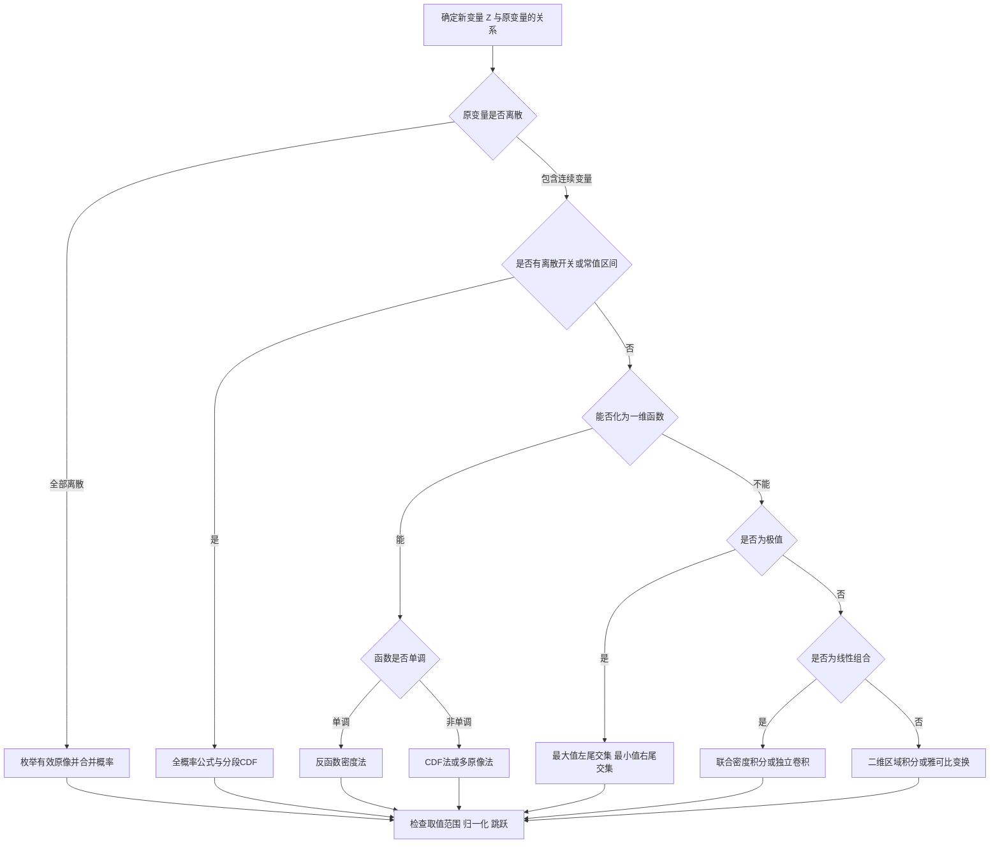

本节是概率论中非常重要的一节。它将前面学过的分布函数、离散型随机变量、连续型随机变量、事件独立性、条件概率，与后续的数字特征、二维随机变量、数理统计连接在一起。

**本节真正的核心不是背诵密度变换公式，而是研究随机变量经过函数映射之后，概率如何重新分布。**

一旦理解这一点，无论题目给出平方、绝对值、取整、分段函数、最大值、最小值、乘积、比值，还是一个从未见过的复杂函数，都有统一的思考方法。

## 一、本节知识体系与题型全景

本节可以划分为十类核心题型。

| 题型          | 典型形式                      | 首选方法       | 复习优先级 |
| ----------- | ------------------------- | ---------- | ----- |
| 一维单调函数变换    | $aX+b,e^X,\ln X,1/X$  | 反函数法       | 高     |
| 一维非单调函数变换   | $X^2,\|X\|,X\ln X$    | 分布函数法、多原像法 | 极高    |
| 分段与截断变换     | $\min(X,c),g(X)$      | 事件拆分、分布函数法 | 极高    |
| 概率积分变换      | $F_X(X)$              | 均匀分布转换     | 高     |
| 离散随机变量变换    | $XY,X+Y,[X]$          | 枚举、概率合并    | 高     |
| 极值与次序统计量    | $\max(X,Y),\min(X,Y)$ | 事件交并转换     | 极高    |
| 离散与连续变量混合   | $X+Y,XY$              | 全概率公式      | 极高    |
| 连续变量的线性组合   | $X+Y,2X-Y$            | 卷积、联合密度积分  | 极高    |
| 乘积、比值、非线性变换 | $XY,X/Y,X^2+Y^2$      | 区域积分、变量替换  | 高     |
| 综合与创新题      | 分布变换结合相关性、参数估计            | 综合建模       | 极高    |

这些题型虽然表面不同，但本质上都可以归结为同一个公式：

$$
\boxed{F_Y(y)=P\{Y\leq y\}=P\{g(X)\leq y\}}
$$

二维情形则为

$$
\boxed{F_Z(z)=P\{g(X,Y)\leq z\}}
$$

理解这两个公式，比机械记忆几十种特殊结论更重要。

## 二、基础原理：随机变量函数的分布究竟是什么？

### 2.1 概率不变，概率的落点发生变化

设随机变量 $X$ 的分布已知，令

$$
Y=g(X).
$$

可以将 $g$ 理解为一个加工装置：输入随机变量 $X$，输出随机变量 $Y$。

假设

| $X$ | $-2$ | $-1$ | $0$ | $1$ | $2$ |
| ------- | -------- | -------- | ------- | ------- | ------- |
| 概率      | 0.1      | 0.2      | 0.3     | 0.3     | 0.1     |

令 $Y=X^2$，那么 $-2$ 和 $2$ 都被映射到 $4$，$-1$ 和 $1$ 都被映射到 $1$。

因此：

| $Y$ | $0$ | $1$ | $4$ |
| ------- | ------- | ------- | ------- |
| 概率      | 0.3     | 0.5     | 0.2     |

注意，映射过程没有创造或消灭概率，只是把不同位置上的概率重新聚集起来。

连续型随机变量的函数变换也是同样的道理，只不过区间上的概率需要通过积分计算。

### 2.2 原像：本节最重要的思维工具

所谓原像，就是哪些 $X$ 的取值会产生指定的 $Y$ 的取值或事件。

例如：

$$
Y=X^2.
$$

当要求 $P(Y\leq4)$ 时，真正的问题是：

$$
\{Y\leq4\}=\{-2\leq X\leq2\}.
$$

当要求 $Y$ 在 $4$ 附近的密度时，需要同时考虑 $X=2$ 和 $X=-2$ 附近的概率贡献。

因此，遇到任何函数变换题，都首先问自己：

**哪些原变量的取值，会被映射到目标事件中？**

### 2.3 分布函数法：适用范围最广的通法

如果 $X$ 为连续型随机变量，密度为 $f_X(x)$，那么

$$
\boxed{ F_Y(y)=\int_{\{x:g(x)\leq y\}}f_X(x)\,dx }
$$

如果 $(X,Y)$ 为二维连续型随机变量，联合密度为 $f_{X,Y}(x,y)$，则

$$
\boxed{ F_Z(z)= \iint_{\{(x,y):g(x,y)\leq z\}} f_{X,Y}(x,y)\,dx\,dy }
$$

实际计算时，还需要将积分区域与原密度的非零区域取交集。

若变换后的分布是连续型且具有概率密度，则进一步求导：

$$
f_Z(z)=F_Z'(z).
$$

但如果变换后产生了正概率的孤立取值，不能仅仅求导就宣称得到了完整分布。

### 2.4 标准解题六步法

1. 确定原随机变量的有效取值范围。
2. 根据函数关系，确定新变量的取值范围。
3. 写出分布函数定义，转换为原变量的不等式。
4. 判断是否需要按照临界点、函数分支或积分区域分段。
5. 计算概率，得到完整的分布函数或密度。
6. 检查非负性、归一化、端点、跳跃以及分段是否完整。

后面所有复杂题型都可以用这六步组织。

## 三、题型一：一维单调函数的分布

### 3.1 单调递增与单调递减的区别

设 $X$ 的分布函数为 $F_X(x)$，概率密度为 $f_X(x)$，且

$$
Y=g(X),\qquad x=h(y)=g^{-1}(y).
$$

在有效取值范围内，若 $g$ 严格单调，则有如下结论。

| 性质        | 严格单调递增               | 严格单调递减                |
| --------- | -------------------- | --------------------- |
| 事件转换      | $X\le h(y)$      | $X\ge h(y)$       |
| 连续型变量的CDF | $F_X(h(y))$      | $1-F_X(h(y))$     |
| 密度        | $f_X(h(y))h'(y)$ | $-f_X(h(y))h'(y)$ |

统一写成反函数密度公式：

$$
\boxed{f_Y(y)=f_X(h(y))|h'(y)|}
$$

也可以写成

$$
\boxed{ f_Y(y)=\frac{f_X(x)}{|g'(x)|} \bigg|_{x=h(y)} }
$$

后一个公式用于导数非零的有效原像。

**为什么要乘反函数的导数？**

因为概率密度与单位区间内的概率有关。

变换前后的微小区间承载相同的概率：

$$
f_Y(y)|dy|=f_X(x)|dx|.
$$

因此

$$
f_Y(y)=f_X(x)\left|\frac{dx}{dy}\right|.
$$

如果函数把一个区间拉长，密度就会降低；如果把区间压缩，密度就会升高。

### 3.2 常见单调变换公式

下表中的密度公式均应结合原变量的支持范围使用。

| 变换                      | 反函数             | 新变量的密度                                |
| ----------------------- | --------------- | ------------------------------------- |
| $Y=aX+b,\ a\ne0$    | $x=(y-b)/a$ | $\frac1{\|a\|}f_X(\frac{y-b}{a})$ |
| $Y=e^X$             | $x=\ln y$   | $\frac1y f_X(\ln y)$              |
| $Y=\ln X$           | $x=e^y$     | $e^yf_X(e^y)$                     |
| $Y=1/X,\ X>0$       | $x=1/y$     | $\frac1{y^2}f_X(1/y)$             |
| $Y=\sqrt X,\ X\ge0$ | $x=y^2$     | $2yf_X(y^2)$                      |
| $Y=X^2,\ X\ge0$     | $x=\sqrt y$ | $\frac{f_X(\sqrt y)}{2\sqrt y}$   |

不建议孤立背诵。掌握反函数公式后，这些结论都能现场推出。

### 3.3 母题1：1988年数学一真题（核心第1题）

**题目：** 设随机变量 $X$ 的概率密度为

$$
f_X(x)=\frac1{\pi(1+x^2)},\qquad x\in\mathbb R.
$$

求

$$
Y=1-\sqrt[3]{X}
$$

的概率密度。

<Tabs items={["方法一：反函数密度法", "方法二：分布函数法"]} defaultIndex={0}>

<Tab value="方法一：反函数密度法">

第一步，判断单调性。

$g(x)=1-\sqrt[3]x$ 在整个实数轴上严格递减，且 $Y$ 可以取遍实数。

第二步，求反函数。

$$
x=(1-y)^3.
$$

第三步，计算雅可比因子。

$$
\left|\frac{dx}{dy}\right| =|-3(1-y)^2| =3(1-y)^2.
$$

第四步，代入原密度。

$$
\begin{aligned} f_Y(y) &=f_X((1-y)^3)\cdot3(1-y)^2\\ &=\boxed{\frac{3(1-y)^2} {\pi[1+(1-y)^6]}}. \end{aligned}
$$

其中 $y\in\mathbb R$。

</Tab>

<Tab value="方法二：分布函数法">

$$
\begin{aligned} F_Y(y) &=P(1-\sqrt[3]X\le y)\\ &=P(X\ge(1-y)^3)\\ &=1-F_X((1-y)^3). \end{aligned}
$$

求导得到

$$
f_Y(y)=3(1-y)^2f_X((1-y)^3).
$$

与第一种方法完全相同。

</Tab>

</Tabs>

**母题的迁移价值**

这类题的关键并不在于是否认识柯西分布。只要知道原密度，就能完成变换。

即使题目将原密度换成正态分布、均匀分布或者未知函数 $f(x)$，解题框架也完全不变。

### 3.4 配套练习：李林880、张宇1000题

**李林880第十七章：**

设

$$
f_X(x)= \begin{cases} 3x^2,&0<x<1,\\ 0,&\text{其他}. \end{cases}
$$

求 $Y=1/X$ 的分布。

由原变量范围得到 $Y>1$。

$$
F_Y(y)=P\left(X\ge\frac1y\right).
$$

所以

$$
F_Y(y)= \begin{cases} 0,&y\le1,\\ 1-\dfrac1{y^3},&y>1. \end{cases}
$$

进一步得到

$$
\boxed{ f_Y(y)= \begin{cases} \dfrac3{y^4},&y>1,\\ 0,&\text{其他}. \end{cases}}
$$

**张宇1000题（核心第2题）：**

若 $X$ 服从标准柯西分布，令 $Y=\arctan X$，则

$$
x=\tan y,\qquad \frac{dx}{dy}=\sec^2y.
$$

从而

$$
f_Y(y) =\frac{\sec^2y}{\pi(1+\tan^2y)} =\frac1\pi.
$$

因此

$$
\boxed{Y\sim U\left(-\frac\pi2,\frac\pi2\right)}
$$

这说明看起来复杂的概率密度，经过适当变换，可能转化为非常简单的分布。

## 四、题型二：非单调函数、多原像与隐式反函数

这是本节最容易出错的题型之一。

### 4.1 多原像变换公式

若 $Y=g(X)$，对某个 $y$，方程

$$
g(x)=y
$$

存在多个有效原像

$$
x_1(y),x_2(y),\ldots,x_k(y),
$$

在各分支满足常规可微、可逆条件时，则

$$
\boxed{ f_Y(y)=\sum_{i=1}^{k} \frac{f_X(x_i(y))}{|g'(x_i(y))|} }
$$

或者写成

$$
f_Y(y)=\sum_{i=1}^{k} f_X(x_i(y)) \left|\frac{dx_i}{dy}\right|.
$$

关键有两个字：**有效**。

不是方程求出几个根就一定使用几个根，还必须判断这些根是否位于原随机变量的有效取值范围内。

### 4.2 平方变换的通用结论

设 $X$ 为连续型随机变量，令

$$
Y=X^2.
$$

对于 $y\ge0$，

$$
\begin{aligned} F_Y(y) &=P(X^2\le y)\\ &=P(-\sqrt y\le X\le\sqrt y)\\ &=F_X(\sqrt y)-F_X(-\sqrt y). \end{aligned}
$$

因此

$$
\boxed{ f_Y(y)= \frac{f_X(\sqrt y)+f_X(-\sqrt y)} {2\sqrt y},\quad y>0 }
$$

对于 $y<0$，密度为零。

特别地，若 $f_X(x)$ 为偶函数，则

$$
\boxed{ f_Y(y)=\frac{f_X(\sqrt y)}{\sqrt y}, \quad y>0 }
$$

这里的对称性是必要条件之一，不能随意使用。

### 4.3 绝对值变换

令 $Y=|X|$，则

$$
F_Y(y)= \begin{cases} 0,&y<0,\\ F_X(y)-F_X(-y),&y\ge0. \end{cases}
$$

对连续型 $X$，

$$
\boxed{f_Y(y)=f_X(y)+f_X(-y),\quad y>0}
$$

若原密度对称，则

$$
\boxed{f_Y(y)=2f_X(y),\quad y>0}
$$

这也是半正态分布的来源。

### 4.4 母题2：2006年数学一、三真题（核心第3题）

设

$$
f_X(x)= \begin{cases} \dfrac12,&-1<x<0,\\ \dfrac14,&0\le x<2,\\ 0,&\text{其他}. \end{cases}
$$

令 $Y=X^2$，求：

（1）$f_Y(y)$；

（2）$\operatorname{Cov}(X,Y)$；

（3）$F_{X,Y}(-1/2,4)$。

**第一问：平方变换与有效原像**

原变量取值范围为

$$
-1<X<2.
$$

所以新变量满足

$$
0\le Y<4.
$$

当 $0<y<1$ 时，两个原像

$$
x=\sqrt y,\quad x=-\sqrt y
$$

均在原变量的有效范围内。

当 $1<y<4$ 时，负原像已经小于 $-1$，只有正原像有效。

| $y$ 的范围  | 正原像 | 负原像 | 有效原像数量 |
| ------------ | --- | --- | ------ |
| $0<y<1$ | 有效  | 有效  | 2      |
| $1<y<4$ | 有效  | 无效  | 1      |
| $y>4$    | 无效  | 无效  | 0      |

因此，在第一个区间，

$$
\begin{aligned} f_Y(y) &=\frac{\frac14+\frac12}{2\sqrt y}\\ &=\frac3{8\sqrt y}. \end{aligned}
$$

在第二个区间，

$$
f_Y(y)=\frac{\frac14}{2\sqrt y} =\frac1{8\sqrt y}.
$$

最终答案为

$$
\boxed{ f_Y(y)= \begin{cases} \dfrac3{8\sqrt y},&0<y<1,\\[2mm] \dfrac1{8\sqrt y},&1\le y<4,\\ 0,&\text{其他}. \end{cases}}
$$

**第二问：协方差**

由于 $Y=X^2$，

$$
\operatorname{Cov}(X,Y) =E(X^3)-E(X)E(X^2).
$$

这里根本不需要求出 $(X,Y)$ 的联合密度。

由原变量密度直接计算：

$$
E(X)=\frac12\int_{-1}^0x\,dx +\frac14\int_0^2x\,dx =\frac14.
$$

同理，

$$
E(X^2)=\frac56,\qquad E(X^3)=\frac78.
$$

所以

$$
\boxed{ \operatorname{Cov}(X,Y) =\frac78-\frac14\cdot\frac56 =\frac23 }
$$

**第三问：联合分布函数**

$$
\begin{aligned} F_{X,Y}\left(-\frac12,4\right) &=P\left(X\le-\frac12,Y\le4\right)\\ &=P\left(X\le-\frac12,X^2\le4\right). \end{aligned}
$$

由于 $X^2\le4$ 几乎必然成立，因此

$$
F_{X,Y}\left(-\frac12,4\right) =\int_{-1}^{-1/2}\frac12\,dx.
$$

即

$$
\boxed{F_{X,Y}(-1/2,4)=\frac14}
$$

**本题的深层考点**

这道题实际上同时考查了三个层次：

第一，求新变量的分布时，要按照有效原像个数分段。

第二，求新变量的数字特征时，可以直接使用原变量的密度。

第三，求联合分布时，必须回到两个事件的交集，而不是擅自把边缘分布相乘。

尤其注意，虽然 $X$ 和 $Y$ 分别都有一维概率密度，但由于 $Y=X^2$，二维随机点只能落在抛物线上，故 $(X,Y)$ 不具有通常意义下的二维概率密度。

这是一个很有价值的概念辨析考点。

### 4.5 母题3：张宇1000题（核心第5题）——反函数无法显式求出

设

$$
X\sim U(0,1),\qquad Y=X\ln X.
$$

求 $Y$ 的概率密度。

这是一道非常适合训练创新题思维的题目。

<Steps>

<Step>

### 第一步：分析函数图像的性质 [!toc]

令

$$
g(x)=x\ln x,\qquad 0<x<1.
$$

则

$$
g'(x)=1+\ln x.
$$

令 $g'(x)=0$，得到

$$
x=e^{-1}.
$$

| 原变量范围            | 导数符号 | 单调性 |
| ---------------- | ---- | --- |
| $(0,e^{-1})$ | 负    | 递减  |
| $(e^{-1},1)$ | 正    | 递增  |

函数的最小值为

$$
g(e^{-1})=-\frac1e.
$$

而

$$
\lim_{x\to0^+}x\ln x=0, \qquad \lim_{x\to1^-}x\ln x=0.
$$

所以 $Y$ 的取值范围为

$$
-\frac1e\le Y<0.
$$

</Step>

<Step>

### 第二步：引入隐式反函数 [!toc]

对于

$$
-\frac1e<y<0,
$$

方程

$$
x\ln x=y
$$

存在两个根，分别记为

$$
x_1(y)\in(0,e^{-1}),
$$

$$
x_2(y)\in(e^{-1},1).
$$

虽然不能用初等函数显式解出这两个根，但完全不影响求密度。

</Step>

<Step>

### 第三步：求分布函数和密度 [!toc]

由函数先减后增的性质，

$$
\{X\ln X\le y\} =\{x_1(y)\le X\le x_2(y)\}.
$$

由于 $X\sim U(0,1)$，

$$
F_Y(y)=x_2(y)-x_1(y).
$$

对隐函数方程求导：

$$
(1+\ln x_i(y))x_i'(y)=1.
$$

因此

$$
x_i'(y)=\frac1{1+\ln x_i(y)}.
$$

所以

$$
\boxed{ f_Y(y)= \frac1{|1+\ln x_1(y)|} +\frac1{|1+\ln x_2(y)|} }
$$

其中 $-1/e<y<0$，其他位置密度为零。

**创新题启示：反函数没有初等表达式，不代表题目无法求解。完全可以通过隐函数求导保留答案。**

</Step>

</Steps>

### 4.6 李林880母题（核心第4题）：同一个随机变量的最大值

设

$$
X\sim E(\lambda),\qquad Y=\max\left(X,\frac1X\right).
$$

求 $Y$ 的分布函数。

首先，由于 $X>0$，

$$
\max\left(X,\frac1X\right)\ge1.
$$

对于 $y\ge1$，

$$
\begin{aligned} F_Y(y) &=P\left(X\le y,\frac1X\le y\right)\\ &=P\left(\frac1y\le X\le y\right). \end{aligned}
$$

因此

$$
\boxed{ F_Y(y)= \begin{cases} 0,&y<1,\\ e^{-\lambda/y}-e^{-\lambda y},&y\ge1. \end{cases}}
$$

若继续求密度：

$$
f_Y(y)= \frac{\lambda}{y^2}e^{-\lambda/y} +\lambda e^{-\lambda y}, \qquad y>1.
$$

易错点是把 $X$ 和 $1/X$ 当成独立随机变量，错误地将两个事件概率相乘。

## 五、题型三：截断、取整、分段变换与混合型分布

### 5.1 连续型随机变量的函数不一定连续型

这是本节必须掌握的一个结论。

例如

$$
X\sim E(\lambda),\qquad Y=\min(X,2).
$$

虽然 $X$ 是连续型随机变量，但

$$
P(Y=2)=P(X\ge2)=e^{-2\lambda}>0.
$$

因此 $Y$ 已经不是连续型随机变量。

从概率映射的角度看，区间 $[2,+\infty)$ 上的全部概率都被压缩到了一个点 $Y=2$。

### 5.2 分布函数的跳跃公式

对于任何随机变量，

$$
\boxed{P(Y=a)=F_Y(a)-F_Y(a^-)}
$$

其中

$$
F_Y(a^-)=\lim_{y\to a^-}F_Y(y).
$$

| 分布函数的局部表现 | 概率意义       |
| --------- | ---------- |
| 水平线段      | 对应区间没有概率质量 |
| 连续上升      | 概率在区间内连续累积 |
| 向上跳跃      | 某一点具有正概率   |
| 某点导数很大    | 不一定存在点概率   |

尤其要区分密度函数的间断与分布函数的间断。密度不连续，完全不意味着随机变量不是连续型。

### 5.3 母题4：2013年数学一真题（核心第8题）

设

$$
f_X(x)= \begin{cases} \dfrac{x^2}{9},&0<x<3,\\ 0,&\text{其他}. \end{cases}
$$

令

$$
Y= \begin{cases} 2,&X\le1,\\ X,&1<X<2,\\ 1,&X\ge2. \end{cases}
$$

求：

（1）$Y$ 的分布函数；

（2）$P(X\le Y)$。

<Steps>

<Step>

### 第一步：判断分布类型 [!toc]

该映射包含三种不同的行为。

| 原变量范围        | 变换后结果     | 概率质量 |
| ------------ | --------- | ---- |
| $X\le1$  | $Y=2$ | 点概率  |
| $1<X<2$ | $Y=X$ | 连续部分 |
| $X\ge2$  | $Y=1$ | 点概率  |

计算两个点概率：

$$
P(Y=1)=\int_2^3\frac{x^2}{9}\,dx =\frac{19}{27}.
$$

$$
P(Y=2)=\int_0^1\frac{x^2}{9}\,dx =\frac1{27}.
$$

连续部分总概率为

$$
P(1<Y<2)=\frac7{27}.
$$

三部分相加等于 $1$。

</Step>

<Step>

### 第二步：写出完整的分布函数 [!toc]

当 $y<1$ 时，

$$
F_Y(y)=0.
$$

当 $1\le y<2$ 时，

$$
\{Y\le y\} =\{X\ge2\}\cup\{1<X\le y\}.
$$

所以

$$
\begin{aligned} F_Y(y) &=\frac{19}{27} +\int_1^y\frac{x^2}{9}\,dx\\ &=\frac{y^3+18}{27}. \end{aligned}
$$

当 $y\ge2$ 时，所有概率都已累积。

故

$$
\boxed{ F_Y(y)= \begin{cases} 0,&y<1,\\[1mm] \dfrac{y^3+18}{27},&1\le y<2,\\[2mm] 1,&y\ge2. \end{cases}}
$$

检查两个跳点：

$$
F_Y(1)-F_Y(1^-)=\frac{19}{27},
$$

$$
F_Y(2)-F_Y(2^-)=\frac1{27}.
$$

与前面计算完全一致。

</Step>

<Step>

### 第三步：求 $P(X\le Y)$ [!toc]

这一步必须按照原变量的分段讨论。

当 $X\le1$ 时，$Y=2$，所以 $X\le Y$ 成立。

当 $1<X<2$ 时，$Y=X$，所以成立。

当 $X\ge2$ 时，$Y=1$，所以不成立。

因此

$$
\begin{aligned} P(X\le Y) &=P(X<2)\\ &=\int_0^2\frac{x^2}{9}\,dx\\ &=\boxed{\frac8{27}}. \end{aligned}
$$

</Step>

</Steps>

**本题最重要的结论**

**当分段函数包含常值区间时，优先使用分布函数法，而不是反函数密度法。**

如果直接对本题的 $F_Y(y)$ 求导，只能得到连续部分 $y^2/9$，积分为 $7/27$，会丢掉其余点概率。

### 5.4 张宇、李正元母题：指数分布的截断

核心第9题、李正元第二章以及李林880均收录了这一模型。

设 $X\sim E(\lambda)$，而 $G(x)$ 为 $U(0,1)$ 的分布函数，令

$$
Y=G(X).
$$

注意

$$
G(x)= \begin{cases} 0,&x\le0,\\ x,&0<x<1,\\ 1,&x\ge1. \end{cases}
$$

所以

$$
Y=\min(X,1)
$$

几乎处处成立。

于是

$$
\boxed{ F_Y(y)= \begin{cases} 0,&y\le0,\\ 1-e^{-\lambda y},&0<y<1,\\ 1,&y\ge1. \end{cases}}
$$

其中

$$
P(Y=1)=e^{-\lambda}.
$$

这个题与下一部分的概率积分变换形成鲜明对比：并不是将任意分布函数代入随机变量，就能够得到均匀分布。

### 5.5 张宇8套卷第5套第22题：双端点混合分布

设备每次最多工作2小时，启动失败的概率为 $p$。成功启动后的寿命服从均值为10的指数分布。求实际工作时间 $Y$ 的分布函数。

建模时应把启动失败单独列为一个分支：

$$
Y= \begin{cases} 0,&\text{启动失败},\\ \min(X,2),&\text{启动成功}. \end{cases}
$$

成功启动后，

$$
X\sim E(0.1).
$$

所以对于 $0\le y<2$，

$$
\begin{aligned} F_Y(y) &=p+(1-p)P(X\le y\mid\text{启动成功})\\ &=p+(1-p)(1-e^{-0.1y}). \end{aligned}
$$

最终

$$
\boxed{ F_Y(y)= \begin{cases} 0,&y<0,\\ 1-(1-p)e^{-0.1y},&0\le y<2,\\ 1,&y\ge2. \end{cases}}
$$

两个可能的原子概率分别为

$$
P(Y=0)=p,
$$

$$
P(Y=2)=(1-p)e^{-0.2}.
$$

这个模型非常容易与保险赔付、机器寿命、最高赔付金额、最大等待时间等实际背景结合，值得重点掌握。

### 5.6 取整变换：连续变量变为离散变量

张宇1000题，核心第11题：

设

$$
X\sim E(1),\qquad Y=\lfloor X+1\rfloor.
$$

求 $Y$ 的分布。

对于 $k=1,2,\ldots$，

$$
\begin{aligned} P(Y=k) &=P(k\le X+1<k+1)\\ &=P(k-1\le X<k)\\ &=e^{-(k-1)}-e^{-k}\\ &=(1-e^{-1})(e^{-1})^{k-1}. \end{aligned}
$$

因此 $Y$ 服从从1开始取值的几何分布，成功概率为

$$
\boxed{p=1-e^{-1}}.
$$

一般而言，

$$
X\sim E(\lambda),\qquad Y=\left\lfloor\frac X a\right\rfloor+1,\quad a>0,
$$

则

$$
\boxed{ P(Y=k)=(1-e^{-\lambda a}) e^{-\lambda a(k-1)} }
$$

这种连续时间到离散时间的转换与指数分布、几何分布的无记忆性存在紧密联系。

## 六、题型四：概率积分变换与分布保持变换

### 6.1 本节最重要的理论结论之一

若随机变量 $X$ 的分布函数 $F_X(x)$ 连续，则

$$
\boxed{F_X(X)\sim U(0,1)}
$$

称为**概率积分变换**。

这里有两个关键条件：$F_X$ 必须是 $X$ 自身的分布函数，并且该分布函数连续。

**证明**

先考虑 $F_X$ 在有效范围内严格递增的情况。

令

$$
U=F_X(X).
$$

对于 $0<u<1$，

$$
\begin{aligned} F_U(u) &=P(F_X(X)\le u)\\ &=P(X\le F_X^{-1}(u))\\ &=F_X(F_X^{-1}(u))\\ &=u. \end{aligned}
$$

于是

$$
F_U(u)= \begin{cases} 0,&u\le0,\\ u,&0<u<1,\\ 1,&u\ge1. \end{cases}
$$

所以 $U\sim U(0,1)$。

对于连续但非严格递增的分布函数，使用广义反函数也能得到相同结论，不必要求严格递增。

**逆向结论**

若 $U\sim U(0,1)$，则在通常的反函数条件下，

$$
\boxed{X=F^{-1}(U)}
$$

具有分布函数 $F$。使用广义反函数时，该结论可以推广到一般分布函数。

### 6.2 指数分布与均匀分布的双向转换

这是李林六套卷第4套第9题的核心考点。

$$
\boxed{ U\sim U(0,1) \Longrightarrow -\frac1\lambda\ln U\sim E(\lambda) }
$$

反过来，

$$
\boxed{ X\sim E(\lambda) \Longrightarrow e^{-\lambda X}\sim U(0,1) }
$$

以及

$$
1-e^{-\lambda X}\sim U(0,1).
$$

**推导**

若 $Y=-c\ln U$，其中 $c>0$，则对 $y\ge0$，

$$
\begin{aligned} P(Y\le y) &=P(-c\ln U\le y)\\ &=P(U\ge e^{-y/c})\\ &=1-e^{-y/c}. \end{aligned}
$$

因此

$$
\boxed{-c\ln U\sim E(1/c)}
$$

这里最容易错的是指数分布的率参数取倒数。

### 6.3 李正元练习题（核心第10题）

设

$$
f_X(x)= \begin{cases} x,&0\le x<1,\\ 2-x,&1\le x<2,\\ 0,&\text{其他}. \end{cases}
$$

求 $F_X(x)$，以及 $Y=F_X(X)$ 的分布。

第一问按照密度分段积分：

$$
F_X(x)= \begin{cases} 0,&x<0,\\ \dfrac{x^2}{2},&0\le x<1,\\ 2x-\dfrac{x^2}{2}-1,&1\le x<2,\\ 1,&x\ge2. \end{cases}
$$

第二问如果已经掌握概率积分变换，则不需要分别求两个反函数。

直接得到

$$
\boxed{Y\sim U(0,1)}
$$

**进一步综合：李林880第十八章**

在上题基础上，再给出独立的随机变量

$$
W\sim E(2),
$$

求

$$
Z=F_X(X)+W
$$

的密度。

由于

$$
F_X(X)\sim U(0,1)
$$

且与 $W$ 独立，题目立即化为均匀分布与指数分布求和。

设 $U=F_X(X)$，则

$$
f_Z(z)=\int_0^{\min(1,z)} 2e^{-2(z-u)}\,du,\qquad z>0.
$$

最终

$$
\boxed{ f_Z(z)= \begin{cases} 1-e^{-2z},&0<z<1,\\ (e^2-1)e^{-2z},&z\ge1,\\ 0,&z\le0. \end{cases}}
$$

这就是典型的知识点串联题：先通过概率积分变换降低难度，再进行卷积。

### 6.4 对称分布下的保分布变换

张宇1000题核心第12题、李林六套卷第4套第22题均涉及如下模型：

设

$$
X\sim N(0,1),
$$

令

$$
Y= \begin{cases} X,&|X|\le1,\\ -X,&|X|>1. \end{cases}
$$

求 $Y$ 的分布。

因为标准正态密度满足

$$
\varphi(-x)=\varphi(x),
$$

而题目只是交换了左右对称的尾部，保留了中间部分，所以

$$
\boxed{Y\sim N(0,1)}.
$$

但这不代表 $X=Y$，更不代表 $X,Y$ 独立。

李林模拟题还要求计算

$$
\operatorname{Cov}(X-Y,XY).
$$

观察到 $Y$ 是 $X$ 的奇函数，因此 $X-Y$ 是奇函数，$XY$ 是偶函数。

在对称分布下，可积奇函数的期望为零，因此

$$
E(X-Y)=0,
$$

$$
E[(X-Y)XY]=0.
$$

最终

$$
\boxed{\operatorname{Cov}(X-Y,XY)=0}
$$

这是考研中非常值得掌握的技巧：**利用函数的奇偶性消掉复杂积分。**

## 七、题型五：离散随机变量函数的分布

### 7.1 基本公式

若 $X$ 为离散型随机变量，且

$$
P(X=x_i)=p_i,
$$

令 $Y=g(X)$，则

$$
\boxed{ P(Y=y)=\sum_{i:g(x_i)=y}p_i }
$$

二维离散情形：

$$
\boxed{ P(Z=z)=\sum_{(i,j):g(x_i,y_j)=z} P(X=x_i,Y=y_j) }
$$

若 $X,Y$ 独立，则联合概率可以分解：

$$
P(X=x_i,Y=y_j)=p_iq_j.
$$

不独立时必须使用真正的联合分布律。

### 7.2 母题5：2011年数学一、三真题（核心第22题）

设

| $X$ | 0         | 1         |
| ------- | --------- | --------- |
| 概率      | $1/3$ | $2/3$ |

| $Y$ | $-1$  | 0         | 1         |
| ------- | --------- | --------- | --------- |
| 概率      | $1/3$ | $1/3$ | $1/3$ |

且

$$
P(X^2=Y^2)=1.
$$

求联合分布律、$Z=XY$ 的分布律及相关系数。

<Steps>

<Step>

### 第一步：利用确定性约束排除不可能的格子 [!toc]

$X=0$ 时，只能有 $Y=0$。

$X=1$ 时，只能有 $Y=-1$ 或 $Y=1$。

所以联合分布为

| $X\backslash Y$ | $-1$  | 0         | 1         |
| ------------------- | --------- | --------- | --------- |
| 0                   | 0         | $1/3$ | 0         |
| 1                   | $1/3$ | 0         | $1/3$ |

</Step>

<Step>

### 第二步：求乘积的分布 [!toc]

逐格计算 $XY$，再合并相同结果。

| $Z=XY$ | $-1$  | 0         | 1         |
| ---------- | --------- | --------- | --------- |
| 概率         | $1/3$ | $1/3$ | $1/3$ |

</Step>

<Step>

### 第三步：计算相关系数 [!toc]

$$
E(X)=\frac23,\qquad E(Y)=0.
$$

$$
E(XY)=0.
$$

故

$$
\operatorname{Cov}(X,Y)=0.
$$

由于二者方差均非零，

$$
\boxed{\rho_{XY}=0}
$$

但显然 $X,Y$ 不独立，例如

$$
P(X=0,Y=0)=\frac13
$$

而

$$
P(X=0)P(Y=0)=\frac19.
$$

本题是“不相关不代表独立”的典型真题。

</Step>

</Steps>

### 7.3 2018年数学一、三真题（核心第23题）

设 $X,Y$ 独立，

$$
P(X=1)=P(X=-1)=\frac12,
$$

$$
Y\sim P(\lambda),\qquad Z=XY.
$$

求 $Z$ 的分布律及 $\operatorname{Cov}(X,Z)$。

**分布律**

$Y$ 只能取非负整数，$X$ 相当于一个随机符号。

当 $k\ge1$ 时，

$$
P(Z=k)=\frac12e^{-\lambda}\frac{\lambda^k}{k!},
$$

$$
P(Z=-k)=\frac12e^{-\lambda}\frac{\lambda^k}{k!}.
$$

但 $Z=0$ 的情况必须单独处理：

$$
P(Z=0)=P(Y=0)=e^{-\lambda}.
$$

因此

$$
\boxed{ P(Z=k)= \begin{cases} e^{-\lambda},&k=0,\\[1mm] \dfrac{e^{-\lambda}\lambda^{|k|}}{2|k|!}, &k\in\mathbb Z,\ k\ne0. \end{cases}}
$$

**协方差**

$$
E(X)=0,\qquad X^2=1.
$$

所以

$$
\begin{aligned} \operatorname{Cov}(X,Z) &=E(X^2Y)-E(X)E(XY)\\ &=E(Y)\\ &=\boxed{\lambda}. \end{aligned}
$$

这道题再次说明，数字特征往往不需要先求出新变量的分布。

## 八、题型六：最大值、最小值与次序统计量

### 8.1 最大值的通用公式

令

$$
M=\max(X_1,\ldots,X_n).
$$

则

$$
\{M\le x\} =\bigcap_{i=1}^n\{X_i\le x\}.
$$

若各变量相互独立，则

$$
\boxed{ F_M(x)=\prod_{i=1}^n F_i(x) }
$$

若还同分布，则

$$
\boxed{F_M(x)=F(x)^n}
$$

对连续型总体求导得到

$$
\boxed{f_M(x)=nF(x)^{n-1}f(x)}
$$

### 8.2 最小值的通用公式

令

$$
L=\min(X_1,\ldots,X_n).
$$

则

$$
\{L>x\} =\bigcap_{i=1}^n\{X_i>x\}.
$$

独立时，

$$
\boxed{ F_L(x)=1-\prod_{i=1}^n[1-F_i(x)] }
$$

独立同分布时，

$$
\boxed{F_L(x)=1-[1-F(x)]^n}
$$

对应密度为

$$
\boxed{f_L(x)=n[1-F(x)]^{n-1}f(x)}
$$

记忆技巧：**最大值取左尾交集，最小值取右尾交集。**

### 8.3 最大值与最小值的代数恒等式

对任意实数 $x,y$，

$$
\boxed{\max(x,y)+\min(x,y)=x+y}
$$

$$
\boxed{\max(x,y)-\min(x,y)=|x-y|}
$$

进一步，

$$
\max(x,y)=\frac{x+y+|x-y|}{2},
$$

$$
\min(x,y)=\frac{x+y-|x-y|}{2}.
$$

这些公式用于求期望时尤其有效，而且不需要独立性。

### 8.4 母题6：1996年数学一真题（核心第16题）

设 $\xi,\eta$ 独立同分布，且分别以 $1/3$ 的概率取 $1,2,3$。

令

$$
X=\max(\xi,\eta),\qquad Y=\min(\xi,\eta).
$$

求 $(X,Y)$ 的联合分布及 $E(X)$。

当 $i=j$ 时，只有一种原像：

$$
P(X=i,Y=i)=P(\xi=i,\eta=i)=\frac19.
$$

当 $i>j$ 时，有两种原像：

$$
(\xi,\eta)=(i,j)\quad\text{或}\quad(j,i).
$$

所以

$$
P(X=i,Y=j)=\frac29.
$$

得到联合分布表：

| $X\backslash Y$ | 1         | 2         | 3         |
| ------------------- | --------- | --------- | --------- |
| 1                   | $1/9$ | 0         | 0         |
| 2                   | $2/9$ | $1/9$ | 0         |
| 3                   | $2/9$ | $2/9$ | $1/9$ |

边缘分布为

$$
P(X=1)=\frac19,
$$

$$
P(X=2)=\frac39,
$$

$$
P(X=3)=\frac59.
$$

从而

$$
\boxed{E(X)=\frac{22}{9}}
$$

注意，对角线只有一个原像，不能乘2。

### 8.5 母题7：2024年数学一、三真题（核心第20题）

设

$$
X,Y\overset{\mathrm{iid}}{\sim}E(\lambda),
$$

求

$$
Z=|X-Y|
$$

服从什么分布。

这是非常重要的一道指数分布创新题。

对于 $z\ge0$，

$$
\{|X-Y|>z\} =\{X>Y+z\}\cup\{Y>X+z\}.
$$

由于同分布及独立性，两部分概率相等，因此

$$
P(Z>z)=2P(X>Y+z).
$$

对 $Y$ 条件化：

$$
\begin{aligned} P(X>Y+z) &=\int_0^\infty P(X>y+z)f_Y(y)\,dy\\ &=\int_0^\infty e^{-\lambda(y+z)} \lambda e^{-\lambda y}\,dy\\ &=\lambda e^{-\lambda z} \int_0^\infty e^{-2\lambda y}\,dy\\ &=\frac12e^{-\lambda z}. \end{aligned}
$$

因此

$$
P(Z>z)=e^{-\lambda z}.
$$

得到

$$
\boxed{|X-Y|\sim E(\lambda)}
$$

也就是说，两个独立同率指数随机变量的绝对差，仍然服从原来的指数分布。

**深度理解：为什么指数分布有这一性质？**

当两台独立的机器同时运行，第一台损坏之后，另一台机器的剩余寿命仍然服从相同参数的指数分布。

这正是无记忆性的体现。

**推广：指数分布的四个重要结论**

当 $X,Y$ 独立且均服从 $E(\lambda)$ 时：

| 随机变量            | 分布或密度                                                 |
| --------------- | ----------------------------------------------------- |
| $\min(X,Y)$ | $E(2\lambda)$                                     |
| $\|X-Y\|$   | $E(\lambda)$                                      |
| $X+Y$       | $\lambda^2ze^{-\lambda z},\ z>0$                  |
| $\max(X,Y)$ | $2\lambda e^{-\lambda z}(1-e^{-\lambda z}),\ z>0$ |

进一步，$\min(X,Y)$ 与 $|X-Y|$ 相互独立。

因此最大值可以看成两个独立指数变量之和：

$$
\max(X,Y) \overset d=E(2\lambda)+E(\lambda),
$$

右侧表示相应参数的两个独立指数随机变量的和。

### 8.6 张宇8套卷第5套第16题：多台机器寿命

三台机器独立工作，寿命均服从 $E(\lambda)$。直到最后一台机器损坏的时间为 $M$，已知

$$
E(M)=\frac{11}{3}.
$$

求 $\lambda$。

由指数分布无记忆性，三台机器依次损坏的等待时间期望分别为

$$
\frac1{3\lambda},\quad \frac1{2\lambda},\quad \frac1\lambda.
$$

所以

$$
E(M)=\frac1{3\lambda} +\frac1{2\lambda} +\frac1\lambda =\frac{11}{6\lambda}.
$$

令其等于 $11/3$，得到

$$
\boxed{\lambda=\frac12}.
$$

一般地，$n$ 个独立同率指数随机变量的最大值满足

$$
\boxed{ E(M_n)=\frac1\lambda \sum_{k=1}^n\frac1k }
$$

而最小值的期望为

$$
E(L_n)=\frac1{n\lambda}.
$$

### 8.7 李林六套卷第5套第22题：最大最小值的联合分布

设

$$
X_1,X_2\overset{\mathrm{iid}}{\sim}N(0,1).
$$

令

$$
M=\max(X_1,X_2),\qquad L=\min(X_1,X_2).
$$

求极差 $R=M-L$ 的分布及 $(M,L)$ 的联合分布函数。

**第一问：极差分布**

利用恒等式

$$
R=|X_1-X_2|.
$$

而

$$
X_1-X_2\sim N(0,2).
$$

所以绝对值变换给出

$$
\boxed{ f_R(r)= \begin{cases} \dfrac1{\sqrt\pi}e^{-r^2/4},&r>0,\\ 0,&r\le0. \end{cases}}
$$

期望为

$$
E(R)=\frac1{\sqrt\pi} \int_0^\infty re^{-r^2/4}\,dr =\boxed{\frac2{\sqrt\pi}}.
$$

**第二问：联合分布函数**

$$
F_{M,L}(m,l)=P(M\le m,L\le l).
$$

当 $l\ge m$ 时，只要 $M\le m$，就必然有 $L\le l$。

因此

$$
F_{M,L}(m,l)=\Phi(m)^2.
$$

当 $l<m$ 时，需要从两个样本都不超过 $m$ 的事件中，减去两个样本都大于 $l$ 的情况。

$$
\begin{aligned} F_{M,L}(m,l) &=\Phi(m)^2-[\Phi(m)-\Phi(l)]^2. \end{aligned}
$$

因此

$$
\boxed{ F_{M,L}(m,l)= \begin{cases} \Phi(m)^2,&l\ge m,\\ 2\Phi(m)\Phi(l)-\Phi(l)^2,&l<m. \end{cases}}
$$

这是独立同分布样本最大最小值联合分布的通用解题方法，只需将 $\Phi$ 换成相应总体的分布函数即可。

### 8.8 次大值与第 $k$ 个次序统计量

设

$$
X_{(1)}\le X_{(2)}\le\cdots\le X_{(n)}
$$

是独立同分布样本的排序结果。

对于第 $k$ 小的随机变量，

$$
\{X_{(k)}\le x\}
$$

等价于至少有 $k$ 个样本不超过 $x$。

因此

$$
\boxed{ F_{X_{(k)}}(x)= \sum_{j=k}^n \binom nj F(x)^j[1-F(x)]^{n-j} }
$$

若总体具有概率密度，求导还可得

$$
\boxed{ f_{X_{(k)}}(x)= \frac{n!}{(k-1)!(n-k)!} F(x)^{k-1}[1-F(x)]^{n-k}f(x) }
$$

后一个公式可以作为拓展记忆，考场上最根本的仍然是二项计数思想。

例如李永乐六套卷第5套第16题：三个样本的分布函数在 $(0,1)$ 内为 $F(x)=x^2$，求次大值大于 $1/2$ 的概率。

单个样本超过 $1/2$ 的概率为

$$
p=1-\left(\frac12\right)^2=\frac34.
$$

次大值超过 $1/2$，意味着至少两个样本超过 $1/2$。

$$
\begin{aligned} P &=\binom32\left(\frac34\right)^2\frac14 +\left(\frac34\right)^3\\ &=\boxed{\frac{27}{32}}. \end{aligned}
$$

## 九、题型七：离散变量与连续变量混合

这是历年真题中反复出现的重点题型。

### 9.1 全概率公式是唯一需要记住的总框架

设离散变量 $X$ 的取值为 $x_i$，对应概率为 $p_i$，令

$$
Z=g(X,Y).
$$

则无论 $X,Y$ 是否独立，都有

$$
\boxed{ F_Z(z)=\sum_i p_i P(g(x_i,Y)\le z\mid X=x_i) }
$$

若 $X,Y$ 独立，可以去掉条件。

特别地，对于独立的离散变量 $X$ 和连续变量 $Y$，若

$$
Z=X+Y,
$$

则

$$
\boxed{F_Z(z)=\sum_i p_iF_Y(z-x_i)}
$$

$$
\boxed{f_Z(z)=\sum_i p_if_Y(z-x_i)}
$$

直观上，就是将 $Y$ 的密度按照不同的 $x_i$ 平移，再乘相应权重，最后叠加。

### 9.2 母题8：2008年数学一、三真题（核心第25题）

设 $X,Y$ 独立，其中

$$
P(X=-1)=P(X=0)=P(X=1)=\frac13,
$$

且

$$
Y\sim U(0,1).
$$

令 $Z=X+Y$，求 $Z$ 的概率密度。

按照 $X$ 的取值讨论：

| $X$  | $Z$ 的条件分布 | 条件取值范围       | 权重        |
| -------- | ------------- | ------------ | --------- |
| $-1$ | $Y-1$     | $(-1,0)$ | $1/3$ |
| 0        | $Y$       | $(0,1)$  | $1/3$ |
| 1        | $Y+1$     | $(1,2)$  | $1/3$ |

因此

$$
f_Z(z) =\frac13[f_Y(z+1)+f_Y(z)+f_Y(z-1)].
$$

三个区间恰好拼接成 $(-1,2)$，且密度高度都为 $1/3$。

所以

$$
\boxed{Z\sim U(-1,2)}
$$

此外，原题中的条件概率

$$
P(Z\le1/2\mid X=0) =P(Y\le1/2)=\frac12.
$$

**推广：三个密度的可能关系**

若将不同分支的密度视为若干平移后的图形，则可能出现三种情况：

| 情形        | 处理方法      |
| --------- | --------- |
| 各区间恰好拼接   | 分段写出各自密度  |
| 各区间存在重叠   | 重叠部分的密度相加 |
| 各区间之间存在空档 | 空档内的密度为零  |

### 9.3 2017年数学一、三真题（核心第27题）

设 $X,Y$ 独立，

$$
P(X=0)=P(X=2)=\frac12,
$$

$$
f_Y(y)= \begin{cases} 2y,&0<y<1,\\ 0,&\text{其他}. \end{cases}
$$

求 $P(Y\le E(Y))$ 和 $Z=X+Y$ 的密度。

首先

$$
E(Y)=\int_0^1 2y^2\,dy=\frac23.
$$

故

$$
P(Y\le E(Y)) =\int_0^{2/3}2y\,dy =\boxed{\frac49}.
$$

再利用平移加权公式：

$$
f_Z(z)=\frac12f_Y(z)+\frac12f_Y(z-2).
$$

得到

$$
\boxed{ f_Z(z)= \begin{cases} z,&0<z<1,\\ z-2,&2<z<3,\\ 0,&\text{其他}. \end{cases}}
$$

注意，虽然 $Z$ 的最小值和最大值分别对应0和3，但 $Z$ 在 $(1,2)$ 内不可能取值。

### 9.4 母题9：2019年数学一、三真题（核心第28题）

设 $X,Y$ 独立，

$$
X\sim E(1),
$$

$$
P(Y=-1)=p,\qquad P(Y=1)=1-p.
$$

令

$$
Z=XY.
$$

求 $Z$ 的密度，判断 $X,Z$ 何时不相关，以及是否独立。

**第一问：随机符号变换**

当 $Y=-1$ 时，

$$
Z=-X
$$

取负值。

当 $Y=1$ 时，

$$
Z=X
$$

取正值。

所以

$$
\boxed{ f_Z(z)= \begin{cases} pe^z,&z<0,\\ (1-p)e^{-z},&z>0. \end{cases}}
$$

**第二问：不相关条件**

$$
\begin{aligned} \operatorname{Cov}(X,Z) &=E(X^2Y)-E(X)E(XY)\\ &=E(Y)[E(X^2)-E(X)^2]\\ &=E(Y)D(X). \end{aligned}
$$

因为

$$
E(Y)=1-2p,\qquad D(X)=1,
$$

所以

$$
\operatorname{Cov}(X,Z)=1-2p.
$$

因此

$$
\boxed{p=\frac12}
$$

时二者不相关。

**第三问：独立性**

注意

$$
|Z|=X.
$$

二者存在确定的绝对值关系。

更严格地，对任意 $a>0$，

$$
\{X\le a\}=\{|Z|\le a\}.
$$

如果 $X,Z$ 独立，则这两个事件也独立，从而

$$
P(X\le a)=P(X\le a)^2.
$$

但指数变量在任何有限正数 $a$ 处均满足

$$
0<P(X\le a)<1,
$$

因此矛盾。

故

$$
\boxed{X,Z\text{ 不独立}}
$$

**李林六套卷第2套第22题的拓展**

这道模拟题把参数改为

$$
X\sim E(\lambda),
$$

$$
P(Y=-1)=\frac13,\quad P(Y=1)=\frac23.
$$

利用相同框架可直接得到

$$
f_Z(z)= \begin{cases} \dfrac{\lambda}{3}e^{\lambda z},&z<0,\\[1mm] \dfrac{2\lambda}{3}e^{-\lambda z},&z>0. \end{cases}
$$

$$
\operatorname{Cov}(X,Z)=\frac1{3\lambda^2}.
$$

又因为

$$
E(Z)=E(X)E(Y)=\frac1{3\lambda},
$$

所以题目要求的一阶矩估计量为

$$
\widehat\lambda=\frac1{3\overline Z}.
$$

这是该题的常规矩估计形式，但严格说来，需要 $\overline Z>0$ 才能得到合法的正参数估计。若样本均值非正，则这一矩方程没有有限正解；原题的常规解法需要注意这一参数约束。

### 9.5 2009年数学一、三真题（核心第13题）

设 $X,Y$ 独立，

$$
X\sim N(0,1),
$$

$$
P(Y=0)=P(Y=1)=\frac12.
$$

令 $Z=XY$。

当 $Y=0$ 时，所有的 $X$ 都被映射到0。

当 $Y=1$ 时，$Z=X$。

故

$$
\boxed{ F_Z(z)= \begin{cases} \dfrac12\Phi(z),&z<0,\\ \dfrac12+\dfrac12\Phi(z),&z\ge0. \end{cases}}
$$

于是

$$
F_Z(0^-)=\frac14,\qquad F_Z(0)=\frac34.
$$

分布函数只有一个间断点，位于0，跳跃量为

$$
\boxed{\frac12}.
$$

一般地，若独立离散开关变量有正概率取0，乘积就可能在0处形成原子。这也是随机变量混合分布的重要来源。

### 9.6 不独立时如何混合？2014年与2016年真题

2014年数学一、三真题（核心第26题）：

$$
P(X=1)=P(X=2)=\frac12,
$$

给定 $X=i$ 时，

$$
Y\mid X=i\sim U(0,i).
$$

那么

$$
F_Y(y)=\frac12F_{Y\mid X=1}(y) +\frac12F_{Y\mid X=2}(y).
$$

故

$$
\boxed{ F_Y(y)= \begin{cases} 0,&y<0,\\ \dfrac34y,&0\le y<1,\\ \dfrac12+\dfrac14y,&1\le y<2,\\ 1,&y\ge2. \end{cases}}
$$

期望直接使用全期望公式：

$$
\begin{aligned} E(Y) &=\frac12E(Y\mid X=1) +\frac12E(Y\mid X=2)\\ &=\frac12\cdot\frac12+\frac12\cdot1\\ &=\boxed{\frac34}. \end{aligned}
$$

本题表明，全概率公式并不要求独立性，只有去掉条件分布时才需要相应的独立条件。

## 十、题型八：两个连续变量的和、差及线性组合

### 10.1 卷积公式的推导

设

$$
Z=X+Y.
$$

如果已知二维联合密度 $f_{X,Y}(x,y)$，则

$$
\begin{aligned} F_Z(z) &=P(X+Y\le z)\\ &=\int_{-\infty}^{+\infty} \int_{-\infty}^{z-x} f_{X,Y}(x,y)\,dy\,dx. \end{aligned}
$$

在常规条件下对 $z$ 求导，得到

$$
\boxed{ f_Z(z)=\int_{-\infty}^{+\infty} f_{X,Y}(x,z-x)\,dx }
$$

若 $X,Y$ 相互独立，则

$$
f_{X,Y}(x,y)=f_X(x)f_Y(y).
$$

从而得到通常所说的卷积公式：

$$
\boxed{ f_Z(z)=\int_{-\infty}^{+\infty} f_X(x)f_Y(z-x)\,dx }
$$

**区别：联合密度积分公式不要求独立，而两个边缘密度的卷积公式要求独立。**

### 10.2 和与差、线性组合的统一公式

| 新变量                   | 密度公式                                                                                        |
| --------------------- | ------------------------------------------------------------------------------------------- |
| $Z=X+Y$           | $\displaystyle\int_{\mathbb R}f_{X,Y}(x,z-x)\,dx$                                    |
| $Z=X-Y$           | $\displaystyle\int_{\mathbb R}f_{X,Y}(x,x-z)\,dx$                                    |
| $Z=aX+bY,\ b\ne0$ | $\displaystyle\frac1{\|b\|}\int_{\mathbb R}f_{X,Y}\left(x,\frac{z-ax}{b}\right)\,dx$ |

虽然公式写成整个实数轴上的积分，实际计算时，应利用密度非零条件缩小积分区间。

这才是绝大多数卷积题的真正难点。

### 10.3 母题10：1987年数学一真题（核心第30题）

设 $X,Y$ 独立，

$$
X\sim U(0,1),\qquad Y\sim E(1).
$$

求

$$
Z=2X+Y
$$

的概率密度。

<Steps>

<Step>

### 第一步：化为两个变量之和 [!toc]

令

$$
U=2X\sim U(0,2).
$$

于是

$$
f_U(u)= \begin{cases} \dfrac12,&0<u<2,\\ 0,&\text{其他}. \end{cases}
$$

而 $U,Y$ 仍然独立。

</Step>

<Step>

### 第二步：写卷积公式 [!toc]

$$
f_Z(z)=\int_{-\infty}^{+\infty} f_U(u)f_Y(z-u)\,du.
$$

被积函数非零要求

$$
0<u<2,\qquad z-u>0.
$$

联立得到

$$
0<u<\min(2,z).
$$

因此必须按照 $z=2$ 进行分段。

</Step>

<Step>

### 第三步：分段积分 [!toc]

当 $z\le0$ 时，

$$
f_Z(z)=0.
$$

当 $0<z<2$ 时，

$$
\begin{aligned} f_Z(z) &=\frac12\int_0^z e^{-(z-u)}\,du\\ &=\frac12(1-e^{-z}). \end{aligned}
$$

当 $z\ge2$ 时，

$$
\begin{aligned} f_Z(z) &=\frac12\int_0^2e^{-(z-u)}\,du\\ &=\frac12(e^2-1)e^{-z}. \end{aligned}
$$

最终

$$
\boxed{ f_Z(z)= \begin{cases} 0,&z\le0,\\ \dfrac12(1-e^{-z}),&0<z<2,\\[1mm] \dfrac12(e^2-1)e^{-z},&z\ge2. \end{cases}}
$$

</Step>

</Steps>

**卷积分段的通用识别技巧**

若

$$
X\in(a,b),\qquad Y\in(c,d),
$$

对于 $Z=X+Y$，应联立

$$
a<x<b,\qquad c<z-x<d.
$$

整理得到

$$
\boxed{ \max(a,z-d)<x<\min(b,z-c) }
$$

这个公式比记忆各种不同分布的卷积结果更加实用。

当最大值或者最小值表达式中的控制项发生切换时，就是积分区间的分段点。

### 10.4 母题11：2007年数学一真题（核心第34题）

设二维随机变量 $(X,Y)$ 的联合密度为

$$
f(x,y)= \begin{cases} 2-x-y,&0<x<1,\ 0<y<1,\\ 0,&\text{其他}. \end{cases}
$$

求 $P(X>2Y)$ 和 $Z=X+Y$ 的密度。

**第一问：二维事件区域**

由原密度区域和事件 $x>2y$ 联立，

$$
0<y<\frac12,\qquad 2y<x<1.
$$

所以

$$
\begin{aligned} P(X>2Y) &=\int_0^{1/2}\int_{2y}^1 (2-x-y)\,dx\,dy\\ &=\int_0^{1/2} (1-2y)\left(\frac32-2y\right)\,dy\\ &=\boxed{\frac7{24}}. \end{aligned}
$$

**第二问：使用联合密度求和公式**

这里没有给出独立性，而且 $2-x-y$ 并不能分解为相应边缘密度的乘积，所以不能直接做边缘密度卷积。

使用

$$
f_Z(z)=\int_{\mathbb R}f(x,z-x)\,dx.
$$

将 $y=z-x$ 代入原密度：

$$
f(x,z-x)=2-z.
$$

联立支持域：

$$
0<x<1,\qquad0<z-x<1.
$$

得到

$$
\max(0,z-1)<x<\min(1,z).
$$

因此当 $0<z<1$ 时，

$$
f_Z(z)=\int_0^z(2-z)\,dx =z(2-z).
$$

当 $1\le z<2$ 时，

$$
f_Z(z)=\int_{z-1}^1(2-z)\,dx =(2-z)^2.
$$

最终

$$
\boxed{ f_Z(z)= \begin{cases} 2z-z^2,&0<z<1,\\ (2-z)^2,&1\le z<2,\\ 0,&\text{其他}. \end{cases}}
$$

检查归一化：

$$
\int_0^1(2z-z^2)\,dz+ \int_1^2(2-z)^2\,dz =\frac23+\frac13=1.
$$

这道题是二维变量函数分布中最重要的母题之一，必须能够独立完成。

### 10.5 2005年数学一、三真题（核心第33题）：非矩形支持域

设

$$
f(x,y)= \begin{cases} 1,&0<x<1,\ 0<y<2x,\\ 0,&\text{其他}. \end{cases}
$$

求

$$
Z=2X-Y
$$

的概率密度。

由

$$
y=2x-z
$$

代入原支持域：

$$
0<x<1,\qquad0<2x-z<2x.
$$

化简得

$$
0<z<2,\qquad \frac z2<x<1.
$$

由于反变换的雅可比绝对值为1，

$$
\begin{aligned} f_Z(z) &=\int_{z/2}^1 1\,dx\\ &=1-\frac z2. \end{aligned}
$$

所以

$$
\boxed{ f_Z(z)= \begin{cases} 1-\dfrac z2,&0<z<2,\\ 0,&\text{其他}. \end{cases}}
$$

原题另外要求边缘密度和条件概率，其结果为

$$
f_X(x)=2x,\quad0<x<1,
$$

$$
f_Y(y)=1-\frac y2,\quad0<y<2,
$$

以及

$$
P(Y\le1/2\mid X\le1/2)=\frac34.
$$

这说明对于非矩形区域，求边缘密度、求新变量密度、求事件概率，本质上都是寻找正确的积分区域。

### 10.6 1991年数学一真题（核心第31题）：指数变量求和

设

$$
f_{X,Y}(x,y)=2e^{-(x+2y)},\qquad x,y>0.
$$

求 $Z=X+2Y$ 的分布函数。

先识别

$$
X\sim E(1),\qquad Y\sim E(2),
$$

且二者相互独立。

注意比例变换：

$$
X\sim E(\lambda),\quad c>0 \Longrightarrow cX\sim E(\lambda/c).
$$

因此

$$
2Y\sim E(1).
$$

于是 $Z$ 为两个独立同率指数变量之和。

$$
f_Z(z)=\int_0^z e^{-x}e^{-(z-x)}\,dx =ze^{-z}.
$$

所以

$$
\boxed{ F_Z(z)= \begin{cases} 0,&z\le0,\\ 1-(1+z)e^{-z},&z>0. \end{cases}}
$$

**推广：指数分布的可加性**

若

$$
X_i\overset{\mathrm{iid}}{\sim}E(\lambda),
$$

则

$$
S_n=\sum_{i=1}^nX_i
$$

具有密度

$$
\boxed{ f_{S_n}(s)= \frac{\lambda^n}{(n-1)!} s^{n-1}e^{-\lambda s},\qquad s>0 }
$$

这就是整数形状参数的伽马分布，也称Erlang分布。

如果两个独立指数变量的率参数不同，则卷积结果为

$$
\boxed{ f_{X+Y}(z)= \frac{\lambda_1\lambda_2}{\lambda_2-\lambda_1} \left(e^{-\lambda_1z}-e^{-\lambda_2z}\right) }
$$

其中 $z>0,\lambda_1\ne\lambda_2$。

张宇8套卷中的网络结点延迟题、快递驿站等待时间题，以及李林880第十八章的指数变量求和题，都可以用这些结论解决。

### 10.7 1992年数学一真题（核心第32题）：正态与均匀卷积

设

$$
X\sim N(\mu,\sigma^2),\qquad Y\sim U(-\pi,\pi),
$$

且相互独立，求 $Z=X+Y$ 的密度。

由卷积公式，

$$
f_Z(z)=\frac1{2\pi} \int_{-\pi}^{\pi}f_X(z-y)\,dy.
$$

作换元 $t=z-y$，得到

$$
f_Z(z)=\frac1{2\pi} \int_{z-\pi}^{z+\pi}f_X(t)\,dt.
$$

直接使用分布函数：

$$
f_Z(z)= \frac{F_X(z+\pi)-F_X(z-\pi)}{2\pi}.
$$

所以

$$
\boxed{ f_Z(z)=\frac1{2\pi} \left[ \Phi\left(\frac{z+\pi-\mu}{\sigma}\right) -\Phi\left(\frac{z-\pi-\mu}{\sigma}\right) \right] }
$$

这个结论可以推广：

若 $Y\sim U(a,b)$，且与连续型随机变量 $X$ 独立，则

$$
\boxed{ f_{X+Y}(z)= \frac{F_X(z-a)-F_X(z-b)}{b-a} }
$$

属于非常实用的卷积快捷公式。

## 十一、题型九：乘积、比值与二维变量变换

### 11.1 为什么需要引入辅助变量？

设

$$
Z=XY.
$$

原本有两个随机变量，变换后却只有一个随机变量，无法直接进行一一反函数变换。

因此保留其中一个变量，例如令

$$
U=X,\qquad Z=XY.
$$

得到二维变换

$$
(x,y)\longrightarrow(u,z).
$$

求出新联合密度后，再对辅助变量 $U$ 积分，就能得到 $Z$ 的边缘密度。

### 11.2 二维雅可比变换公式

若

$$
U=g_1(X,Y),\qquad V=g_2(X,Y),
$$

存在满足常规可微条件的一一反变换

$$
x=h_1(u,v),\qquad y=h_2(u,v),
$$

则

$$
\boxed{ f_{U,V}(u,v)= f_{X,Y}(h_1(u,v),h_2(u,v)) \left| \frac{\partial(x,y)}{\partial(u,v)} \right| }
$$

其中

$$
\frac{\partial(x,y)}{\partial(u,v)} = \begin{vmatrix} \dfrac{\partial x}{\partial u}& \dfrac{\partial x}{\partial v}\\[2mm] \dfrac{\partial y}{\partial u}& \dfrac{\partial y}{\partial v} \end{vmatrix}.
$$

必须使用反变换的雅可比绝对值，并同步转换支持域。

雅可比法属于非常高效的拓展计算工具。复习数学一时，仍应确保自己能够用大纲常规要求的分布函数法解决同类问题，不宜只会套一般变换公式。

### 11.3 乘积与比值的通用公式

对于二维连续型随机变量：

若 $Z=XY$，则

$$
\boxed{ f_Z(z)= \int_{-\infty}^{+\infty} \frac1{|x|} f_{X,Y}\left(x,\frac z x\right)\,dx }
$$

积分中忽略零测度点 $x=0$。

若 $Z=X/Y$，则

$$
\boxed{ f_Z(z)= \int_{-\infty}^{+\infty} |y|f_{X,Y}(zy,y)\,dy }
$$

若 $X,Y$ 独立，再将联合密度替换为两个边缘密度的乘积。

乘积公式与比值公式的因子恰好不同：前者为 $1/|x|$，后者为 $|y|$。不要混淆。

### 11.4 母题12：张宇1000题、李林880共同母题（核心第36题）

设 $(X,Y)$ 在矩形区域

$$
D=\{(x,y):0<x<2,\ 0<y<1\}
$$

上服从均匀分布。

求 $Z=XY$ 的密度。

<Tabs items={["方法一：变量变换法", "方法二：分布函数法"]} defaultIndex={0}>

<Tab value="方法一：变量变换法">

矩形面积为2，因此

$$
f_{X,Y}(x,y)=\frac12.
$$

设

$$
u=x,\qquad z=xy.
$$

则

$$
x=u,\qquad y=\frac z u.
$$

雅可比绝对值为

$$
\left| \frac{\partial(x,y)}{\partial(u,z)} \right| =\frac1u.
$$

原区域约束变成

$$
0<u<2,\qquad0<\frac z u<1.
$$

于是

$$
0<z<2,\qquad z<u<2.
$$

从而

$$
\begin{aligned} f_Z(z) &=\frac12\int_z^2\frac1u\,du\\ &=\frac12\ln\frac2z. \end{aligned}
$$

因此

$$
\boxed{ f_Z(z)= \begin{cases} \dfrac12\ln\dfrac2z,&0<z<2,\\ 0,&\text{其他}. \end{cases}}
$$

</Tab>

<Tab value="方法二：分布函数法">

当 $0<z<2$ 时，

$$
F_Z(z)=P(XY\le z).
$$

对于 $0<x<z$，双曲线 $y=z/x$ 位于矩形上边界以上，因此整个竖向截线均满足条件。

对于 $z<x<2$，则要求

$$
0<y\le\frac z x.
$$

所以

$$
\begin{aligned} F_Z(z) &=\frac12\int_0^z1\,dx +\frac12\int_z^2\frac z x\,dx\\ &=\frac z2+\frac z2\ln\frac2z. \end{aligned}
$$

求导得到

$$
f_Z(z)=\frac12\ln\frac2z.
$$

</Tab>

</Tabs>

**推广：李正元第三章相关练习**

若

$$
X,Y\overset{\mathrm{iid}}{\sim}U(0,1),
$$

则

$$
\boxed{ f_{XY}(z)=-\ln z,\qquad0<z<1 }
$$

对应分布函数为

$$
F_{XY}(z)=z-z\ln z,\qquad0<z<1.
$$

更一般地，$n$ 个独立的 $U(0,1)$ 随机变量的乘积 $Z$，满足

$$
-\ln Z=-\sum_{i=1}^n\ln X_i.
$$

而每个 $-\ln X_i\sim E(1)$。

因此

$$
\boxed{ f_Z(z)=\frac{(-\ln z)^{n-1}}{(n-1)!}, \quad0<z<1 }
$$

这是概率积分变换、指数求和与乘积变换的综合应用。

### 11.5 母题13：张宇1000题（核心第37题）——两个正态变量的比值

设

$$
X,Y\overset{\mathrm{iid}}{\sim}N(0,1).
$$

求 $Z=X/Y$ 的概率密度。

联合密度为

$$
f(x,y)=\frac1{2\pi}e^{-(x^2+y^2)/2}.
$$

令

$$
z=\frac xy,\qquad v=y,
$$

则

$$
x=zv,\qquad y=v.
$$

雅可比绝对值为 $|v|$。

所以

$$
\begin{aligned} f_Z(z) &=\frac1{2\pi}\int_{-\infty}^{+\infty} |v|e^{-(1+z^2)v^2/2}\,dv\\ &=\frac1\pi\int_0^\infty ve^{-(1+z^2)v^2/2}\,dv\\ &=\boxed{\frac1{\pi(1+z^2)}}. \end{aligned}
$$

因此两个独立标准正态变量的比值服从标准柯西分布。

**本题的重要推论**

即使 $X,Y$ 都有有限期望和方差，它们的比值也未必有有限期望。

标准柯西分布虽然关于0对称，但

$$
\int_0^\infty\frac{z}{\pi(1+z^2)}\,dz
$$

发散，因此不能用对称性写出 $E(Z)=0$。

这也是2023年数学三核心第7题所涉及的重尾与期望存在性思想。

### 11.6 张宇8套卷第2套第10题：指数变量的比例

设

$$
X,Y\overset{\mathrm{iid}}{\sim}E(\lambda).
$$

求

$$
U=\frac X{X+Y}
$$

的分布。

这道题可以用非常简洁的分布函数法。

对于 $0<u<1$，

$$
\begin{aligned} P(U\le u) &=P\left(\frac X{X+Y}\le u\right)\\ &=P\left(X\le\frac u{1-u}Y\right). \end{aligned}
$$

利用独立性和条件化，

$$
\begin{aligned} F_U(u) &=\int_0^\infty \left(1-e^{-\lambda uy/(1-u)}\right) \lambda e^{-\lambda y}\,dy\\ &=1-(1-u)\\ &=u. \end{aligned}
$$

因此

$$
\boxed{\frac X{X+Y}\sim U(0,1)}
$$

同理，

$$
\boxed{\frac Y{X+Y}\sim U(0,1)}
$$

**更深层的结论**

令

$$
U=\frac X{X+Y},\qquad V=X+Y.
$$

则反变换为

$$
X=UV,\qquad Y=(1-U)V.
$$

雅可比绝对值为 $v$，故

$$
f_{U,V}(u,v)=\lambda^2ve^{-\lambda v},
$$

其中 $0<u<1,v>0$。

可分解为

$$
f_{U,V}(u,v) =1\cdot\lambda^2ve^{-\lambda v}.
$$

因此 $U,V$ 相互独立。

也就是说，两个独立同率指数变量的和与其中一个所占的比例相互独立。这是一个值得用于综合题拓展的性质。

## 十二、题型十：二维几何变换、圆域与综合创新题

### 12.1 母题14：2021年数学一、三真题（核心第6题）

在长度为2的区间上随机取一点，把区间分成两段。短段长度为 $X$，长段长度为 $Y$，求：

（1）$X$ 的密度；

（2）$Z=Y/X$ 的密度；

（3）$E(X/Y)$。

这道题的重要性在于：表面存在两个变量，实际上只有一个独立的随机来源。

设随机切点

$$
T\sim U(0,2).
$$

则

$$
X=\min(T,2-T),\qquad Y=2-X.
$$

**第一问**

对于 $0<x<1$，

$$
\{X\le x\}=\{T\le x\}\cup\{T\ge2-x\}.
$$

所以

$$
F_X(x)=\frac x2+\frac x2=x.
$$

即

$$
\boxed{X\sim U(0,1)}.
$$

**第二问**

$$
Z=\frac{2-X}{X}=\frac2X-1.
$$

因 $0<X<1$，故 $Z>1$。

反函数为

$$
x=\frac2{z+1}.
$$

所以

$$
\boxed{ f_Z(z)= \begin{cases} \dfrac2{(z+1)^2},&z>1,\\ 0,&\text{其他}. \end{cases}}
$$

**第三问**

直接利用 $X$ 的分布：

$$
\begin{aligned} E\left(\frac XY\right) &=E\left(\frac X{2-X}\right)\\ &=\int_0^1\frac x{2-x}\,dx\\ &=\int_0^1\left(\frac2{2-x}-1\right)\,dx\\ &=\boxed{2\ln2-1}. \end{aligned}
$$

**母题的建模价值**

遇到折断铁丝、随机切点、长度比例、面积、体积等问题，应先研究变量之间是否存在确定关系。

如果存在

$$
X+Y=c,
$$

便可以将二维问题化成一维问题，而不是直接套二维卷积或比值密度公式。

### 12.2 母题15：2023年数学一真题（核心第35题）

设二维随机变量 $(X,Y)$ 的概率密度为

$$
f(x,y)= \begin{cases} \dfrac2\pi(x^2+y^2),&x^2+y^2<1,\\ 0,&\text{其他}. \end{cases}
$$

求：

（1）$X,Y$ 的协方差；

（2）是否独立；

（3）$Z=X^2+Y^2$ 的密度。

**第一问：利用对称性求协方差**

密度及支持域关于两个坐标轴均对称。

因此

$$
E(X)=E(Y)=0.
$$

由于被积函数

$$
xyf(x,y)
$$

关于任意一个坐标均为奇函数，所以

$$
E(XY)=0.
$$

故

$$
\boxed{\operatorname{Cov}(X,Y)=0}
$$

**第二问：独立性**

观察支持域：

$$
x^2+y^2<1.
$$

虽然 $X,Y$ 的边缘取值范围均为 $(-1,1)$，但它们不能任意组合。

例如

$$
P(X>0.8,Y>0.8)=0,
$$

因为

$$
0.8^2+0.8^2>1.
$$

而

$$
P(X>0.8)>0,\qquad P(Y>0.8)>0.
$$

所以二者不独立。

$$
\boxed{X,Y\text{ 不独立}}
$$

**第三问：平方和的分布**

由原取值范围，

$$
0\le Z<1.
$$

对于 $0<z<1$，

$$
F_Z(z)=P(X^2+Y^2\le z).
$$

这对应半径为 $\sqrt z$ 的圆盘。

采用极坐标：

$$
x=r\cos\theta,\qquad y=r\sin\theta,
$$

$$
dx\,dy=r\,dr\,d\theta.
$$

于是

$$
\begin{aligned} F_Z(z) &=\int_0^{2\pi}\int_0^{\sqrt z} \frac2\pi r^2\cdot r\,dr\,d\theta\\ &=4\int_0^{\sqrt z}r^3\,dr\\ &=z^2. \end{aligned}
$$

得到

$$
\boxed{ F_Z(z)= \begin{cases} 0,&z\le0,\\ z^2,&0<z<1,\\ 1,&z\ge1. \end{cases}}
$$

所以

$$
\boxed{ f_Z(z)= \begin{cases} 2z,&0<z<1,\\ 0,&\text{其他}. \end{cases}}
$$

**本题的三大考点**

这是一道综合性很强的母题，因为它同时涉及密度和积分区域的对称性、通过联合概率判断独立性，以及将平方和转化为极坐标中的径向变量。

### 12.3 圆对称密度的通用公式

若二维随机变量的密度具有形式

$$
f_{X,Y}(x,y)=h(x^2+y^2),
$$

且支持域为整个平面或以原点为中心的圆盘。

令

$$
Z=X^2+Y^2.
$$

则在有效范围内，

$$
\begin{aligned} F_Z(z) &=2\pi\int_0^{\sqrt z}h(r^2)r\,dr\\ &=\pi\int_0^zh(t)\,dt. \end{aligned}
$$

因此

$$
\boxed{f_Z(z)=\pi h(z)}
$$

注意，必须符合完整的圆对称区域条件。

若改求半径

$$
R=\sqrt{X^2+Y^2},
$$

则

$$
\boxed{f_R(r)=2\pi r h(r^2)}
$$

**独立正态随机变量的平方和**

若

$$
X,Y\overset{\mathrm{iid}}{\sim}N(0,\sigma^2),
$$

则

$$
h(t)=\frac1{2\pi\sigma^2} e^{-t/(2\sigma^2)}.
$$

所以

$$
\boxed{ X^2+Y^2\sim E\left(\frac1{2\sigma^2}\right) }
$$

以及

$$
\boxed{ P\left(\sqrt{X^2+Y^2}>r\right) =e^{-r^2/(2\sigma^2)} }
$$

李林六套卷第3套第16题、李永乐六套卷第6套第16题均可直接利用这一结论。

此外，

$$
\frac{X^2+Y^2}{\sigma^2}\sim\chi^2(2),
$$

这又与后续数理统计中的卡方分布建立了联系。

### 12.4 张宇1000题（核心第38题）：通过线性变换得到独立变量

设 $(X,Y)$ 在菱形区域

$$
|x|+|y|\le1
$$

上均匀分布。

令

$$
U=X+Y,\qquad V=X-Y.
$$

求 $U,V$ 的分布及相关性。

原区域面积为2，因此原密度为 $1/2$。

反变换为

$$
x=\frac{u+v}{2},\qquad y=\frac{u-v}{2}.
$$

雅可比绝对值为

$$
\left| \begin{vmatrix} \frac12&\frac12\\ \frac12&-\frac12 \end{vmatrix} \right|=\frac12.
$$

利用恒等式

$$
|x|+|y|=\max(|x+y|,|x-y|),
$$

可将原菱形区域转换为

$$
|u|\le1,\qquad |v|\le1.
$$

故

$$
f_{U,V}(u,v)=\frac14, \qquad |u|<1,\ |v|<1.
$$

求边缘密度得到

$$
f_U(u)=\frac12,\qquad f_V(v)=\frac12.
$$

因此

$$
\boxed{U,V\text{ 独立且均服从 }U(-1,1)}
$$

从而

$$
\boxed{\operatorname{Cov}(U,V)=\rho_{UV}=0}
$$

值得注意的是，原来的 $X,Y$ 不独立，但经过线性变换之后 $U,V$ 却独立了。

原因是联合密度和支持域经过变换后恰好能够分解，而不是所有线性变换都能产生独立变量。

## 十三、综合创新题的核心突破方法

学到这里，需要从具体题型进一步上升到如何识别陌生题目。

### 13.1 创新模型一：2016年数学一、三真题（核心第14题）

设 $(X,Y)$ 在区域

$$
D=\{(x,y):0<x<1,\ x^2<y<\sqrt x\}
$$

上均匀分布。

令

$$
U= \begin{cases} 1,&X\le Y,\\ 0,&X>Y. \end{cases}
$$

求联合密度、判断 $U,X$ 是否独立，并求 $Z=U+X$ 的分布函数。

<Steps>

<Step>

### 第一步：由几何区域确定联合密度 [!toc]

区域面积为

$$
S=\int_0^1(\sqrt x-x^2)\,dx =\frac13.
$$

所以区域内联合密度为3。

</Step>

<Step>

### 第二步：理解新变量的几何意义 [!toc]

曲线 $y=x^2$ 和 $y=\sqrt x$ 之间的区域被直线 $y=x$ 分成两部分。

当 $U=0$ 时，

$$
x^2<y<x.
$$

当 $U=1$ 时，

$$
x\le y<\sqrt x.
$$

给定 $X=x$，有

$$
\begin{aligned} P(U=1\mid X=x) &=\frac{\sqrt x-x}{\sqrt x-x^2}\\ &=\frac1{1+\sqrt x+x}. \end{aligned}
$$

该条件概率随 $x$ 变化，因此

$$
\boxed{U,X\text{ 不独立}}
$$

</Step>

<Step>

### 第三步：确定新变量的两种取值机制 [!toc]

| $U$ | $Z$   | 取值范围        |
| ------- | --------- | ----------- |
| 0       | $X$   | $(0,1)$ |
| 1       | $1+X$ | $(1,2)$ |

对于 $0\le z<1$，只有 $U=0$ 分支产生贡献。

$$
\begin{aligned} F_Z(z) &=P(U=0,X\le z)\\ &=3\int_0^z\int_{x^2}^xdy\,dx\\ &=\frac32z^2-z^3. \end{aligned}
$$

对于 $1\le z<2$，

$$
\begin{aligned} F_Z(z) &=P(U=0)+P(U=1,X\le z-1)\\ &=\frac12+ 3\int_0^{z-1}(\sqrt x-x)\,dx\\ &=\frac12+2(z-1)^{3/2} -\frac32(z-1)^2. \end{aligned}
$$

因此

$$
\boxed{ F_Z(z)= \begin{cases} 0,&z<0,\\ \dfrac32z^2-z^3,&0\le z<1,\\ \dfrac12+2(z-1)^{3/2} -\dfrac32(z-1)^2,&1\le z<2,\\ 1,&z\ge2. \end{cases}}
$$

**这道题建议作为本节的重点综合母题反复训练。** 它同时涉及几何概率、联合密度、条件概率、独立性、离散连续混合以及分段函数。

</Step>

</Steps>

### 13.2 创新模型二：李林880第十八章

设

$$
X\sim U(0,1),
$$

$Y$ 与 $X$ 独立，且 $Y$ 的分布函数为 $F_Y(y)$。

定义

$$
Z= \begin{cases} Y,&X\le1/2,\\ X,&X>1/2. \end{cases}
$$

求 $Z$ 的分布函数。

不要被未知的 $F_Y$ 吓住，也不需要求出它的具体表达式。

直接按照两个分支拆分：

$$
\begin{aligned} F_Z(z) &=P(X\le1/2,Y\le z)\\ &\quad+P(1/2<X\le z). \end{aligned}
$$

由独立性，

$$
P(X\le1/2,Y\le z)=\frac12F_Y(z).
$$

另一项根据 $z$ 的范围讨论。

最终得到

$$
\boxed{ F_Z(z)=\frac12F_Y(z)+ \begin{cases} 0,&z\le1/2,\\ z-\dfrac12,&1/2<z<1,\\ \dfrac12,&z\ge1. \end{cases}}
$$

这里保留未知函数就是正确的求解方式。

### 13.3 创新模型三：汤家凤八套卷第6套第22题

设

$$
X\sim U(1,4),
$$

条件密度为

$$
f_{Y\mid X}(y\mid x) =\frac{3y^2}{x^3}, \qquad0<y<x.
$$

求 $Z=X-Y$ 的分布函数。

直接进行二维积分当然可以，但本题有更好的结构。

观察

$$
f_{Y\mid X}(y\mid x) =\frac1x\cdot3\left(\frac yx\right)^2.
$$

令

$$
V=\frac YX.
$$

给定 $X=x$ 后，

$$
f_{V\mid X}(v\mid x) =3v^2,\qquad0<v<1.
$$

右侧完全不依赖 $x$，所以 $V$ 与 $X$ 独立。

于是

$$
Z=X(1-V).
$$

复杂的条件分布变换被化为了两个独立变量的乘积。

如果采用条件化直接求解，则

$$
P(Z\le z\mid X=x) = \begin{cases} 0,&z<0,\\ 1-(1-z/x)^3,&0\le z<x,\\ 1,&z\ge x. \end{cases}
$$

所以，当 $0<z<1$ 时，

$$
F_Z(z)=\frac13 \int_1^4\left[1-\left(1-\frac z x\right)^3\right]dx.
$$

当 $1\le z<4$ 时，

$$
F_Z(z)=1-\frac13 \int_z^4\left(1-\frac z x\right)^3dx.
$$

计算得

$$
\boxed{ F_Z(z)= \begin{cases} 0,&z<0,\\ z\ln4-\dfrac{3z^2}4+\dfrac{5z^3}{32}, &0\le z<1,\\ -\dfrac13-\dfrac z2+z\ln\dfrac4z +\dfrac{z^2}4-\dfrac{z^3}{96}, &1\le z<4,\\ 1,&z\ge4. \end{cases}}
$$

本题最重要的并不是复杂的积分结果，而是通过比例变量 $Y/X$ 消除条件分布中的 $x$，以及利用条件化自动确定分段点。

## 十四、本节与数字特征的综合：什么时候根本不必求分布？

考研综合题经常在给出函数变换之后，继续要求期望、方差和协方差。

如果只要求数字特征，则通常不应先求新变量的分布。

### 14.1 随机变量函数的数学期望

对于连续型 $X$，

$$
\boxed{E[g(X)]=\int_{\mathbb R}g(x)f_X(x)\,dx}
$$

对于离散型 $X$，

$$
\boxed{E[g(X)]=\sum_i g(x_i)p_i}
$$

二维连续型情形：

$$
\boxed{ E[g(X,Y)]=\iint_{\mathbb R^2} g(x,y)f_{X,Y}(x,y)\,dx\,dy }
$$

均应注意相应期望存在的条件。

### 14.2 高效求解公式

| 题目所求                                          | 优先转换为                             |
| --------------------------------------------- | --------------------------------- |
| $E(X^2)$                                  | $D(X)+[E(X)]^2$               |
| $D(g(X))$                                 | $E[g(X)^2]-[E(g(X))]^2$       |
| $\operatorname{Cov}(X,X^2)$               | $E(X^3)-E(X)E(X^2)$           |
| $\operatorname{Cov}(X,XY)$，且 $X,Y$ 独立 | $D(X)E(Y)$                    |
| $E(\max(X,Y))$                            | $\frac12[E(X)+E(Y)+E\|X-Y\|]$ |
| $E(\min(X,Y))$                            | $\frac12[E(X)+E(Y)-E\|X-Y\|]$ |

### 14.3 李林六套卷第1套第22题

设

$$
X,Y\overset{\mathrm{iid}}{\sim}N(0,\sigma^2),
$$

令

$$
U=\max(|X|,|Y|).
$$

求密度及期望。

对于 $u\ge0$，

$$
\begin{aligned} F_U(u) &=P(|X|\le u,|Y|\le u)\\ &=\left[2\Phi\left(\frac u\sigma\right)-1\right]^2. \end{aligned}
$$

因此

$$
\boxed{ f_U(u)=\frac4\sigma \left[2\Phi\left(\frac u\sigma\right)-1\right] \varphi\left(\frac u\sigma\right),\quad u>0 }
$$

而求期望时，不建议直接对上述密度做复杂积分。

利用恒等式

$$
\max(|x|,|y|) =\frac{|x+y|+|x-y|}{2}.
$$

因为

$$
X+Y,\ X-Y\sim N(0,2\sigma^2),
$$

又有正态绝对值期望公式

$$
W\sim N(0,\tau^2) \Longrightarrow E|W|=\tau\sqrt{\frac2\pi},
$$

所以

$$
E(U)=\frac12 \left(\frac{2\sigma}{\sqrt\pi} +\frac{2\sigma}{\sqrt\pi}\right).
$$

得到

$$
\boxed{E(U)=\frac{2\sigma}{\sqrt\pi}}
$$

这种通过代数恒等式简化数字特征的技巧，非常适合提高综合题的解题速度。

## 十五、考研数学一高频陷阱与判断题

以下结论建议全部掌握，尤其适用于选择题。

| 命题                                     | 正误 | 原因            |
| -------------------------------------- | -- | ------------- |
| 连续型 $X$ 的任意函数都是连续型随机变量             | 错  | 常值映射、取整可产生点概率 |
| 连续函数作用于连续型随机变量后，结果一定连续型                | 错  | 连续函数也可能包含常值区间 |
| 连续型 $X$ 的 $F_X(X)$ 服从均匀分布      | 对  | 概率积分变换        |
| 任意分布函数 $G(X)$ 都服从均匀分布              | 错  | 必须满足相应分布匹配条件  |
| $Y=X^2$ 时，只需要考虑正平方根                | 错  | 一般存在两个原像      |
| 密度函数的值可以大于1                            | 对  | 密度不是概率        |
| 密度在某点趋于无穷大，该点一定有正概率                    | 错  | 可能仍是可积奇点      |
| $X,Y$ 同分布意味着 $X=Y$             | 错  | 同分布只表示概率分布相同  |
| $X,Y$ 同分布意味着独立                     | 错  | 同分布与独立是不同概念   |
| $X,Y$ 独立，则各自的可测函数也独立               | 对  | 独立性的保持性质      |
| 两个不独立变量的函数必然不独立                        | 错  | 某些变换可以消除依赖    |
| 不相关一定独立                                | 错  | 一般情况下不能反推     |
| 两个正态变量不相关就一定独立                         | 错  | 需有联合正态等相应条件   |
| $X,Y$ 独立才可以使用联合密度求和公式              | 错  | 联合密度公式本身不要求独立 |
| $X,Y$ 独立时可使用边缘密度卷积公式               | 对  | 联合密度能够分解      |
| 对任意实数变量都有最大值加最小值等于原变量之和                | 对  | 代数恒等式         |
| 同率独立指数变量的绝对差仍服从同率指数分布                  | 对  | 指数分布的特殊性质     |
| 若 $X,Y$ 均有密度，则 $(X,Y)$ 一定有二维密度 | 错  | 例如 $Y=X$  |
| 求 $E[g(X)]$ 必须先知道 $g(X)$ 的分布   | 错  | 可以直接使用原变量分布   |
| 关于0对称的随机变量期望一定为0                       | 错  | 必须先保证期望存在     |

## 十六、考场解题决策表

当你遇到一道从未见过的题目时，可以按照以下流程选择方法。

最重要的识别顺序是：

**先识别随机来源，再识别事件结构，最后选择计算公式。**

如果颠倒顺序，一看到乘积就套乘积公式，一看到最大值就将两个分布函数相乘，很容易因为题目中的依赖关系而失分。

## 十七、本节核心公式速查表

复习到考前，可以将本节压缩为下列公式体系。

| 知识点        | 核心公式                                                                        |
| ---------- | --------------------------------------------------------------------------- |
| 分布函数法      | $F_Y(y)=P(g(X)\le y)$                                                   |
| 单调变换       | $f_Y(y)=f_X(h(y))\|h'(y)\|$                                             |
| 多原像变换      | $\displaystyle f_Y(y)=\sum_i\frac{f_X(x_i)}{\|g'(x_i)\|}$               |
| 平方变换       | $\displaystyle f_{X^2}(y)=\frac{f_X(\sqrt y)+f_X(-\sqrt y)}{2\sqrt y}$ |
| 绝对值变换      | $f_{\|X\|}(y)=f_X(y)+f_X(-y)$                                          |
| 点概率        | $P(X=a)=F_X(a)-F_X(a^-)$                                                |
| 概率积分变换     | $F_X(X)\sim U(0,1)$                                                     |
| 独立变量最大值    | $\displaystyle F_M(x)=\prod_iF_i(x)$                                    |
| 独立变量最小值    | $\displaystyle F_L(x)=1-\prod_i[1-F_i(x)]$                              |
| 独立离散连续变量之和 | $\displaystyle f_Z(z)=\sum_i p_if_Y(z-x_i)$                             |
| 连续变量之和     | $\displaystyle f_Z(z)=\int_{\mathbb R}f(x,z-x)\,dx$                   |
| 连续变量之差     | $\displaystyle f_Z(z)=\int_{\mathbb R}f(x,x-z)\,dx$                   |
| 乘积密度       | $\displaystyle\int_{\mathbb R}\frac1{\|x\|}f(x,z/x)\,dx$              |
| 比值密度       | $\displaystyle\int_{\mathbb R}\|y\|f(zy,y)\,dy$                       |
| 圆对称平方半径    | $f_Z(z)=\pi h(z)$                                                       |
| 函数期望       | $\displaystyle E[g(X)]=\int_{\mathbb R}g(x)f_X(x)\,dx$                |

所有密度公式都应结合有效取值范围、单调性、独立性以及是否存在点概率等条件使用。

## 十八、分阶段练习

按题型和难度分层训练。

**第一轮：必做真题**

| 核心编号 | 题源        | 训练目标      |
| ---- | --------- | --------- |
| 1    | 1988年数一   | 单调反函数     |
| 3    | 2006年数一、三 | 双原像与有效范围  |
| 6    | 2021年数一、三 | 几何建模、变量降维 |
| 8    | 2013年数一   | 混合型分布     |
| 13   | 2009年数一、三 | 分布函数跳跃    |
| 14   | 2016年数一、三 | 分段几何综合    |
| 16   | 1996年数一   | 最大最小联合分布  |
| 20   | 2024年数一、三 | 指数变量绝对差   |
| 22   | 2011年数一、三 | 离散联合分布    |
| 23   | 2018年数一、三 | 随机符号变换    |
| 25   | 2008年数一、三 | 离散连续求和    |
| 26   | 2014年数一、三 | 条件分布混合    |
| 27   | 2017年数一、三 | 分段混合密度    |
| 28   | 2019年数一、三 | 随机符号、相关性  |
| 30   | 1987年数一   | 独立卷积分段    |
| 31   | 1991年数一   | 指数分布求和    |
| 32   | 1992年数一   | 正态均匀卷积    |
| 33   | 2005年数一、三 | 三角区域线性变换  |
| 34   | 2007年数一   | 非独立变量求和   |
| 35   | 2023年数一   | 极坐标、独立性   |

**第二轮：高质量练习题**

| 资料            | 推荐题目          | 训练目标        |
| ------------- | ------------- | ----------- |
| 张宇1000题       | 核心第5题         | 隐式反函数、多原像   |
| 李林880         | 核心第4题         | 最大值与倒数变换    |
| 张宇1000题       | 核心第9、11题      | 截断、取整       |
| 李正元           | 核心第10题        | 概率积分变换      |
| 张宇1000题       | 核心第12、15题     | 保分布与混合分布    |
| 李正元           | 核心第29题        | 随机符号与独立性    |
| 张宇1000题、李林880 | 核心第36题        | 乘积分布        |
| 张宇1000题       | 核心第37、38题     | 比值与二维变换     |
| 李林880第十八章     | 相关综合练习 | 变换结合卷积、随机分支 |
| 李正元第三章        | 相关综合练习 | 均匀变量乘积与绝对差  |

**第三轮：模拟题综合强化**

| 试卷        | 题号 | 推荐理由           |
| --------- | -- | -------------- |
| 张宇8套卷第2套  | 10 | 指数变量比例、概率积分变换  |
| 张宇8套卷第5套  | 16 | 多台机器寿命         |
| 张宇8套卷第5套  | 22 | 启动故障与截断混合分布    |
| 李林六套卷第1套  | 22 | 绝对极值与期望        |
| 李林六套卷第2套  | 22 | 随机符号结合矩估计      |
| 李林六套卷第4套  | 9  | 均匀、指数双向转换      |
| 李林六套卷第4套  | 22 | 正态对称性与协方差      |
| 李林六套卷第5套  | 22 | 极差与联合分布        |
| 汤家凤八套卷第3套 | 22 | 非对称分段变换        |
| 汤家凤八套卷第6套 | 22 | 条件密度、相关系数、差的分布 |
| 李永乐六套卷第4套 | 22 | 圆域、符号变量与协方差    |
| 李永乐六套卷第5套 | 22 | 最小值结合矩估计       |
| 李永乐六套卷第6套 | 22 | 二维区域、离散变换与相关性  |

## 十九、原创迁移训练：检验是否真正掌握本节

以下为原创变式，建议先独立完成，再核对答案。

**训练1：有效原像与平方变换**

设 $X\sim U(-2,1)$，求 $Y=X^2$ 的概率密度。

<Accordions>

<Accordion title="参考解答">

$$
f_Y(y)= \begin{cases} \dfrac1{3\sqrt y},&0<y<1,\\ \dfrac1{6\sqrt y},&1\le y<4,\\ 0,&\text{其他}. \end{cases}
$$

考查：非对称支持域下有效原像数量的变化。

</Accordion>

</Accordions>

**训练2：双端截断**

设 $X\sim N(0,1)$，令

$$
Y=\max(-1,\min(X,1)).
$$

求 $Y$ 的分布函数及全部原子概率。

<Accordions>

<Accordion title="参考解答">

$$
F_Y(y)= \begin{cases} 0,&y<-1,\\ \Phi(y),&-1\le y<1,\\ 1,&y\ge1. \end{cases}
$$

且

$$
P(Y=-1)=\Phi(-1),
$$

$$
P(Y=1)=1-\Phi(1).
$$

考查：两个截断端点都具有正概率。

</Accordion>

</Accordions>

**训练3：概率积分变换与极值**

设 $X_1,\ldots,X_n$ 独立同分布，具有连续分布函数 $F(x)$，令

$$
M=\max(X_1,\ldots,X_n),
$$

求 $U=F(M)^n$ 的分布。

<Accordions>

<Accordion title="参考解答">

$$
\boxed{U\sim U(0,1)}
$$

因为 $F_M(x)=F(x)^n$，于是 $U=F_M(M)$。

考查：识别复杂表达式实际上是新变量自身的分布函数。

</Accordion>

</Accordions>

**训练4：指数分布与比例变换**

设 $X,Y$ 独立同分布于 $E(\lambda)$，求

$$
Z=\frac XY
$$

的分布。

<Accordions>

<Accordion title="参考解答">

对于 $z>0$，

$$
F_Z(z)=\frac z{1+z},
$$

$$
\boxed{f_Z(z)=\frac1{(1+z)^2}}.
$$

对于 $z\le0$，分布函数为零，密度可取零。

考查：比值公式、尾概率、参数消除。

</Accordion>

</Accordions>

**训练5：非独立变量求和**

设

$$
f(x,y)= \begin{cases} 2,&0<y<x<1,\\ 0,&\text{其他}. \end{cases}
$$

求 $Z=X+Y$ 的密度。

<Accordions>

<Accordion title="参考解答">

$$
\boxed{ f_Z(z)= \begin{cases} z,&0<z<1,\\ 2-z,&1\le z<2,\\ 0,&\text{其他}. \end{cases}}
$$

求解时联立

$$
0<z-x<x<1.
$$

考查：非独立随机变量的线性组合。

</Accordion>

</Accordions>

**训练6：均匀分布与径向变量**

设 $(X,Y)$ 在单位圆盘内均匀分布，令

$$
Z=X^2+Y^2.
$$

求 $Z$ 的分布及 $E(\sqrt Z)$。

<Accordions>

<Accordion title="参考解答">

$$
\boxed{Z\sim U(0,1)}
$$

$$
E(\sqrt Z)=\int_0^1\sqrt z\,dz =\boxed{\frac23}.
$$

考查：几何面积、极坐标、函数期望。

</Accordion>

</Accordions>

**训练7：随机符号与独立性**

设 $X\sim N(0,1)$，$Y$ 与 $X$ 独立，且

$$
P(Y=-1)=p,\qquad P(Y=1)=1-p.
$$

令 $Z=XY$，判断 $Z$ 的分布以及 $Z,Y$ 是否独立。

<Accordions>

<Accordion title="参考解答">

$$
\boxed{Z\sim N(0,1)}
$$

且 $Z,Y$ 相互独立，对任意 $0<p<1$ 都成立。

因为给定 $Y=1$ 或 $Y=-1$，$Z$ 的条件分布始终为 $N(0,1)$。

考查：对称分布的随机翻转，以及函数含有某个变量并不必然与之相关。

</Accordion>

</Accordions>

## 二十、本节最终掌握标准

真正掌握本节，不是能背出平方变换、最大最小值和卷积公式，而是面对新题时能够自然完成以下判断：

| 能力    | 达标标准                  |
| ----- | --------------------- |
| 分布识别  | 能判断新变量是离散型、连续型还是混合型   |
| 原像分析  | 能找出全部有效原像及分段点         |
| 事件转换  | 能把复杂函数事件还原为原变量事件      |
| 几何建模  | 能根据二维支持域独立写出积分范围      |
| 独立性判断 | 不会错误地将相关事件概率相乘        |
| 计算简化  | 能主动利用对称性、条件化、代数恒等式    |
| 理论迁移  | 能组合概率积分变换、卷积、极值等多个知识点 |
| 综合应用  | 能进一步计算期望、方差、协方差及参数估计  |
| 结果检验  | 能检查归一化、分段点、点概率和参数范围   |

最后，将本节全部知识归纳为四个核心思想：

**第一，事件等价转换。**

$$
P(g(X)\le y)=P(X\in g^{-1}((-\infty,y])).
$$

**第二，多条原像的概率贡献必须全部计入。**

这统一解释了平方变换、绝对值变换、离散变量枚举与混合分布。

**第三，二维问题的核心是区域及概率质量。**

无论是求和、乘积、比值还是平方和，都必须先研究支持域，再计算积分。

**第四，求分布不是目的，能够灵活利用原分布解决问题才是目的。**

如果只求期望或协方差，就直接从原变量入手；如果存在确定性关系，就先降维；如果存在对称性，就先消掉奇函数积分；如果存在离散开关，就先条件化。

本节尤其建议反复独立重做 **2006年、2013年、2016年、2019年、2021年、2023年、2024年真题**，再搭配李林六套卷第5套第22题和张宇1000题中的乘积、隐式反函数、二维线性变换题。

这几组母题基本覆盖了本节最有迁移价值的解题结构。把它们的原理和适用条件真正吃透，比单纯增加几十道同类题的刷题量更有效。
