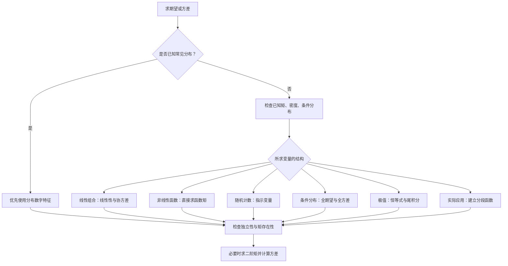

## 一、本节的知识体系与复习重点

本节包括三个主要方向：

- 非线性函数期望、特殊矩与对称性。
- 指标变量、条件期望、停止试验与收益优化。
- 几何区域、混合分布和二阶矩的综合运算。

从考研数学一的解题角度，可进一步划分为以下能力。

| 知识模块       | 核心解题方法      | 掌握优先级 |
| ---------- | ----------- | ----- |
| 数学期望与方差的定义 | 求和、积分、二阶矩   | ★★★★★ |
| 随机变量函数的期望  | 直接使用原变量分布   | ★★★★★ |
| 期望与方差的性质   | 线性性、展开、配方   | ★★★★★ |
| 特殊分布的数字特征  | 正态矩、指数矩、泊松矩 | ★★★★★ |
| 绝对值与极值的期望  | 对称性、恒等式、尾积分 | ★★★★★ |
| 随机计数问题     | 指示变量法       | ★★★★★ |
| 条件期望与混合分布  | 分层计算、全期望公式  | ★★★★★ |
| 实际应用与停止试验  | 随机建模、分段函数   | ★★★★★ |
| 期望最优化      | 平方损失、求导、配方  | ★★★★☆ |
| 期望与方差的存在性  | 反常积分、级数收敛   | ★★★★☆ |
| 数理统计综合     | 样本均值、样本方差   | ★★★★☆ |

本节最重要的学习目标不是记住更多分布公式，而是形成一种思维方式：

**当题目只要求期望、方差等数字特征时，首先考虑绕开完整分布，直接利用已有分布、变量之间的关系和数学期望的运算性质。**

这也是许多综合题能够从十分钟的复杂计算缩短为两三分钟的关键。

## 二、基础知识：建立期望与方差的底层逻辑

### 2.1 数学期望的本质

数学期望是随机变量按照其概率大小进行加权后的平均值，反映随机变量取值的平均水平。

例如，某随机变量的分布律为：

| $X$ | 0   | 10  | 20  |
| ------- | --- | --- | --- |
| $P$ | 0.2 | 0.5 | 0.3 |

则

$$
EX=0\times0.2+10\times0.5+20\times0.3=11.
$$

注意，$11$ 甚至不是随机变量 $X$ 的可能取值。

所以数学期望是理论上的加权平均值，而不是最可能出现的值。

**（1）离散型随机变量**

若

$$
P(X=x_k)=p_k,
$$

则

$$
\boxed{EX=\sum_kx_kp_k}
$$

有限期望存在的条件为

$$
\sum_k|x_k|p_k<\infty.
$$

**（2）连续型随机变量**

若 $X$ 的概率密度为 $f(x)$，则

$$
\boxed{EX=\int_{-\infty}^{+\infty}xf(x)\,\mathrm dx}
$$

有限期望存在的条件为

$$
\int_{-\infty}^{+\infty}|x|f(x)\,\mathrm dx<\infty.
$$

### 2.2 随机变量函数的数学期望

这是本节最重要的公式之一。

若 $Y=g(X)$，则在相应期望存在时：

离散型：

$$
\boxed{E[g(X)]=\sum_kg(x_k)p_k}
$$

连续型：

$$
\boxed{E[g(X)]=\int_{-\infty}^{+\infty}g(x)f_X(x)\,\mathrm dx}
$$

若已知二维随机变量的联合分布，则

$$
\boxed{E[g(X,Y)]=\sum_i\sum_jg(x_i,y_j)p_{ij}}
$$

或者

$$
\boxed{ E[g(X,Y)] =\iint_{\mathbb R^2}g(x,y)f(x,y)\,\mathrm dx\mathrm dy }
$$

**最重要的推论：求随机变量函数的期望，并不需要先求这个函数的分布。**

例如，已知 $X\sim U(0,1)$，求 $E(X^2)$。

直接计算：

$$
E(X^2)=\int_0^1x^2\,\mathrm dx=\frac13.
$$

没有必要先求 $Y=X^2$ 的分布函数和概率密度。

这种思路适用于：

$$
E|X|,\quad E(e^X),\quad E(\ln X),
$$

$$
E\left(\frac1X\right),\quad E(\sin X),
$$

$$
E[\max(X,Y)],\quad E[g(X,Y)].
$$

### 2.3 方差的本质

数学期望描述中心位置，方差描述随机变量在中心位置附近的离散程度。

设 $\mu=EX$，则

$$
\boxed{DX=E[(X-\mu)^2]}
$$

为什么使用平方而不是直接计算偏差的期望？

因为

$$
E(X-\mu)=EX-\mu=0.
$$

正偏差和负偏差会相互抵消，无法刻画波动大小。平方则可以避免抵消，同时让较大的偏差产生更大的影响。

方差最重要的计算公式为

$$
\boxed{DX=E(X^2)-(EX)^2}
$$

推导：

$$
\begin{aligned} DX &=E[(X-\mu)^2]\\ &=E(X^2)-2\mu EX+\mu^2\\ &=E(X^2)-\mu^2. \end{aligned}
$$

所以计算方差通常采用以下步骤：

$$
\text{计算一阶矩、二阶矩}
$$

$$
\Downarrow
$$

$$
\text{二阶矩减去一阶矩的平方}
$$

对于函数方差，同样有

$$
\boxed{ D[g(X)]=E[g^2(X)]-\{E[g(X)]\}^2 }
$$

这里的 $g^2(X)$ 指的是 $[g(X)]^2$。

例如：

$$
D(X^2)=E(X^4)-[E(X^2)]^2.
$$

$$
D(|X|)=E(X^2)-(E|X|)^2.
$$

$$
D(e^X)=E(e^{2X})-[E(e^X)]^2.
$$

### 2.4 原点矩与中心矩

| 名称    | 定义                | 常见用途    |
| ----- | ----------------- | ------- |
| 一阶原点矩 | $EX$          | 数学期望    |
| 二阶原点矩 | $E(X^2)$      | 计算方差    |
| 一阶中心矩 | $E(X-EX)=0$   | 中心化     |
| 二阶中心矩 | $E[(X-EX)^2]$ | 方差      |
| 三阶中心矩 | $E[(X-EX)^3]$ | 对称性、偏斜  |
| 四阶原点矩 | $E(X^4)$      | 平方变量的方差 |

看到平方变量的方差，就应当想到四阶矩；看到关于均值的奇数次幂，就应当检查分布是否具有对称性。

## 三、期望与方差的重要性质

### 3.1 数学期望的线性性

$$
\boxed{E(aX+b)=aEX+b}
$$

$$
\boxed{E(aX+bY+c)=aEX+bEY+c}
$$

进一步，

$$
\boxed{ E\left(\sum_{i=1}^na_iX_i\right) =\sum_{i=1}^na_iEX_i }
$$

这里最重要的适用条件是：各项具有有限期望，**不要求随机变量相互独立。**

例如，即使 $Y=X$，仍然有

$$
E(X+Y)=EX+EY.
$$

### 3.2 乘积的期望

若 $X,Y$ 相互独立且期望有限，则

$$
\boxed{E(XY)=EX\cdot EY}
$$

进一步，若 $g(X),h(Y)$ 的期望有限，则

$$
\boxed{E[g(X)h(Y)]=E[g(X)]E[h(Y)]}
$$

但是：

$$
E(XY)=EX\cdot EY
$$

并不能反推出 $X,Y$ 独立。

当二阶矩有限时，该等式只能说明二者不相关。

### 3.3 方差的线性变换

$$
\boxed{D(C)=0}
$$

$$
\boxed{D(X+b)=DX}
$$

$$
\boxed{D(aX+b)=a^2DX}
$$

直观上，整体平移不会改变分布的离散程度，而将变量放大 $a$ 倍，其平方偏差放大 $a^2$ 倍。

特别注意：

$$
D(-X)=DX.
$$

### 3.4 两个随机变量的线性组合方差

一般公式：

$$
\boxed{ D(aX+bY+c) =a^2DX+b^2DY+2ab\operatorname{Cov}(X,Y) }
$$

其中

$$
\operatorname{Cov}(X,Y)=E(XY)-EX\cdot EY.
$$

若 $X,Y$ 独立或不相关，则

$$
\boxed{D(aX+bY+c)=a^2DX+b^2DY}
$$

特别是

$$
D(X+Y)=DX+DY,
$$

$$
D(X-Y)=DX+DY.
$$

**独立变量相减，方差依然相加。**

本节会涉及协方差的基本运算，但有关相关性、相关系数和独立性判定的完整理论，属于第三章第二节。

### 3.5 期望、方差的常见结论辨析

| 结论                     | 是否成立              |
| ---------------------- | ----------------- |
| $E(X+Y)=EX+EY$     | 期望有限时成立           |
| $E(XY)=EX\cdot EY$ | 需要相应条件            |
| $E(X^2)=(EX)^2$    | 一般不成立             |
| $E[g(X)]=g(EX)$    | 一般不成立             |
| $D(X+Y)=DX+DY$     | 需要不相关             |
| $D(aX)=aDX$        | 错误，应为 $a^2DX$ |
| $D(X^2)=(DX)^2$    | 错误                |
| $D(\|X\|)=DX$      | 一般不成立             |
| $E(X^2)\geq(EX)^2$ | 二阶矩有限时成立          |

此外，

$$
DX\geq0
$$

且

$$
\boxed{DX=0\iff P(X=EX)=1}
$$

方差为零意味着随机变量几乎必然等于某个常数。

## 四、必须熟练掌握的常见分布数字特征

### 4.1 常用公式总表

| 分布                                     | 数学期望                | 方差                                         |
| -------------------------------------- | ------------------- | ------------------------------------------ |
| 0-1分布 $B(1,p)$                     | $p$             | $p(1-p)$                               |
| 二项分布 $B(n,p)$                      | $np$            | $np(1-p)$                              |
| 泊松分布 $P(\lambda)$                  | $\lambda$       | $\lambda$                              |
| 几何分布 $G(p)$                        | $\frac1p$       | $\frac{1-p}{p^2}$                      |
| 均匀分布 $U(a,b)$                      | $\frac{a+b}{2}$ | $\frac{(b-a)^2}{12}$                   |
| 指数分布 $\operatorname{Exp}(\lambda)$ | $\frac1\lambda$ | $\frac1{\lambda^2}$                    |
| 正态分布 $N(\mu,\sigma^2)$             | $\mu$           | $\sigma^2$                             |
| 卡方分布 $\chi^2(n)$                   | $n$             | $2n$                                   |
| 超几何分布 $H(N,M,n)$                   | $n\frac MN$     | $n\frac MN(1-\frac MN)\frac{N-n}{N-1}$ |

上述几何分布采用从 $1$ 开始计数的定义，指数分布的 $\lambda$ 为率参数。超几何分布中 $N$ 为总体数量，$M$ 为其中目标对象数量，$n$ 为无放回抽取数量，方差公式取 $N>1$。

### 4.2 均匀分布的高阶矩

若 $X\sim U(0,1)$，则对 $r>-1$，

$$
\boxed{E(X^r)=\frac1{r+1}}
$$

因此

$$
EX=\frac12,\qquad E(X^2)=\frac13,
$$

$$
E(X^3)=\frac14,\qquad E(X^4)=\frac15.
$$

所以

$$
D(X^2)=\frac15-\frac19=\frac4{45}.
$$

若 $X\sim U(a,b)$，对于非负整数 $n$，

$$
E(X^n) =\frac{b^{n+1}-a^{n+1}}{(n+1)(b-a)}.
$$

### 4.3 指数分布的高阶矩

若 $X\sim\operatorname{Exp}(\lambda)$，则

$$
f(x)=\lambda e^{-\lambda x},\qquad x>0.
$$

通过分部积分可得

$$
\boxed{E(X^n)=\frac{n!}{\lambda^n}}
$$

其中 $n$ 为非负整数。

尤其是

$$
E(X^2)=\frac2{\lambda^2},
$$

$$
E(X^3)=\frac6{\lambda^3},
$$

$$
E(X^4)=\frac{24}{\lambda^4}.
$$

还应掌握以下积分形式：

$$
\boxed{ \int_0^\infty x^ne^{-ax}\,\mathrm dx =\frac{n!}{a^{n+1}},\quad a>0 }
$$

它实际上是指数分布数字特征和高等数学反常积分之间的联系。

### 4.4 泊松分布的阶乘矩

若 $X\sim P(\lambda)$，则

$$
\boxed{E[X(X-1)]=\lambda^2}
$$

证明：

$$
\begin{aligned} E[X(X-1)] &=\sum_{k=2}^\infty k(k-1) \frac{\lambda^ke^{-\lambda}}{k!}\\ &=\lambda^2e^{-\lambda} \sum_{k=2}^\infty\frac{\lambda^{k-2}}{(k-2)!}\\ &=\lambda^2. \end{aligned}
$$

所以

$$
\boxed{E(X^2)=\lambda^2+\lambda}
$$

一般地，

$$
E[X(X-1)\cdots(X-r+1)]=\lambda^r.
$$

遇到泊松分布的高阶矩，可以先将普通幂拆成下降阶乘。

例如

$$
X^3=X(X-1)(X-2)+3X(X-1)+X,
$$

故

$$
E(X^3)=\lambda^3+3\lambda^2+\lambda.
$$

### 4.5 正态分布的特殊矩

设 $Z\sim N(0,1)$。

以下公式需要重点掌握：

$$
EZ=0,\qquad E(Z^2)=1,
$$

$$
E(Z^3)=0,\qquad E(Z^4)=3.
$$

并且

$$
\boxed{E|Z|=\sqrt{\frac2\pi}}
$$

$$
\boxed{D(|Z|)=1-\frac2\pi}
$$

$$
\boxed{D(Z^2)=2}
$$

更一般地，标准正态分布的奇数阶原点矩为零，偶数阶矩满足

$$
E(Z^{2n})=(2n-1)!!.
$$

例如

$$
E(Z^6)=15,\qquad E(Z^8)=105.
$$

对一般正态变量

$$
X\sim N(\mu,\sigma^2),
$$

可以先表示为

$$
X=\mu+\sigma Z.
$$

然后展开并利用标准正态矩，得到

$$
E(X^2)=\mu^2+\sigma^2,
$$

$$
E(X^3)=\mu^3+3\mu\sigma^2,
$$

$$
\boxed{ E(X^4)=\mu^4+6\mu^2\sigma^2+3\sigma^4 }
$$

从而

$$
\boxed{ D(X^2)=2\sigma^4+4\mu^2\sigma^2 }
$$

这类公式在正态总体抽样、卡方分布、平方变量的方差等题目中非常有用。

## 五、题型一：直接计算随机变量函数的期望

**重要程度：★★★★★**

对应核心题库第1—6题、第10题，以及张宇1000题的几何分布、泊松分布、指数函数期望等练习。

### 母题1：1992年数学一真题（核心第5题）

设

$$
X\sim\operatorname{Exp}(1),
$$

求

$$
E(X+e^{-2X}).
$$

<Steps>

<Step>

### 第一步：利用期望的线性性 [!toc]

$$
E(X+e^{-2X})=EX+E(e^{-2X}).
$$

已知 $EX=1$。

</Step>

<Step>

### 第二步：使用函数期望公式 [!toc]

$$
\begin{aligned} E(e^{-2X}) &=\int_0^\infty e^{-2x}e^{-x}\,\mathrm dx\\ &=\int_0^\infty e^{-3x}\,\mathrm dx\\ &=\frac13. \end{aligned}
$$

因此

$$
\boxed{E(X+e^{-2X})=\frac43}
$$

</Step>

</Steps>

**推广：指数分布的指数函数期望**

若 $X\sim\operatorname{Exp}(\lambda)$，则

$$
\begin{aligned} E(e^{-tX}) &=\int_0^\infty e^{-tx}\lambda e^{-\lambda x}\,\mathrm dx\\ &=\frac{\lambda}{\lambda+t}. \end{aligned}
$$

所以

$$
\boxed{E(e^{-tX})=\frac{\lambda}{\lambda+t}}
$$

条件为 $\lambda+t>0$。

这可以直接解决李林880第十九章基础选择第1题：

$$
X\sim\operatorname{Exp}(2),\qquad Y=2X+e^{-2X}.
$$

于是

$$
EY=2\cdot\frac12+\frac2{2+2} =\boxed{\frac32}.
$$

表面上是不同的题目，本质上完全属于同一种母题。

### 母题2：张宇1000题·泊松分布的倒数期望（核心第4题）

设 $X\sim P(1)$，求

$$
E\left(\frac1{X+1}\right).
$$

直接按定义计算：

$$
\begin{aligned} E\left(\frac1{X+1}\right) &=\sum_{k=0}^\infty\frac1{k+1}\frac{e^{-1}}{k!}\\ &=e^{-1}\sum_{k=0}^\infty\frac1{(k+1)!}\\ &=e^{-1}(e-1). \end{aligned}
$$

所以

$$
\boxed{E\left(\frac1{X+1}\right)=1-\frac1e}
$$

**解题关键**

看到泊松分布和 $k+1$ 同时出现，要联想到

$$
(k+1)k!=(k+1)!.
$$

对于一般的 $X\sim P(\lambda)$，

$$
\boxed{ E\left(\frac1{X+1}\right) =\frac{1-e^{-\lambda}}{\lambda} }
$$

**更高级的通用方法：利用积分表示倒数**

$$
\frac1{k+1}=\int_0^1t^k\,\mathrm dt.
$$

所以

$$
E\left(\frac1{X+1}\right) =\int_0^1E(t^X)\,\mathrm dt.
$$

对泊松分布，

$$
E(t^X)=e^{\lambda(t-1)}.
$$

从而

$$
E\left(\frac1{X+1}\right) =\int_0^1e^{\lambda(t-1)}\,\mathrm dt =\frac{1-e^{-\lambda}}{\lambda}.
$$

这里各项非负，交换求和与积分是合法的。

该方法还可以推广到 $E[1/(X+a)]$，其中 $a>0$。

### 母题3：张宇1000题·几何分布的倒数期望（核心第3题）

设 $X$ 服从参数为 $p$ 的几何分布，求

$$
E\left(\frac1X\right).
$$

记 $q=1-p$，则

$$
P(X=k)=pq^{k-1},\qquad k=1,2,\ldots
$$

因此

$$
\begin{aligned} E\left(\frac1X\right) &=\sum_{k=1}^\infty\frac{pq^{k-1}}k\\ &=\frac pq\sum_{k=1}^\infty\frac{q^k}{k}. \end{aligned}
$$

利用高等数学的幂级数展开式：

$$
-\ln(1-x)=\sum_{k=1}^\infty\frac{x^k}{k}, \qquad |x|<1.
$$

于是

$$
\boxed{ E\left(\frac1X\right) =-\frac{p\ln p}{1-p} }
$$

**离散型函数期望的识别规律**

| 分布及函数特征   | 优先考虑      |
| --------- | --------- |
| 泊松分布、阶乘   | 指数级数、下标平移 |
| 几何分布、倒数   | 对数级数      |
| 几何分布、余数   | 等比级数分组    |
| 二项分布、指数函数 | 二项式定理     |
| 有限离散分布    | 直接加权求和    |

例如张宇1000题基础第1题给出

$$
X\sim B\left(2,\frac12\right).
$$

要求 $E(e^{2X})$。

利用二项式定理可以得到一般公式

$$
\boxed{ E(t^X)=(1-p+pt)^n }
$$

因此

$$
E(e^{2X}) =\boxed{\left(\frac{1+e^2}{2}\right)^2}.
$$

## 六、题型二：期望与方差的存在性

**重要程度：★★★★☆**

这是比较容易被忽视的考点，也是命题人设计创新选择题的重要切入点。

### 母题4：李正元练习题（核心第2题）

设 $X\sim U(0,1)$，分别求下列变量的期望和方差：

$$
Y_1=e^X,\qquad Y_2=-2\ln X,
$$

$$
Y_3=\frac1X,\qquad Y_4=X^2.
$$

其中最值得研究的是 $Y_2,Y_3$。

**（1）对数型变量**

$$
EY_2=-2\int_0^1\ln x\,\mathrm dx=2.
$$

又因为

$$
E(Y_2^2)=4\int_0^1(\ln x)^2\,\mathrm dx=8,
$$

所以

$$
DY_2=8-4=\boxed4.
$$

也可以采用分布识别法：

$$
-\ln X\sim\operatorname{Exp}(1),
$$

因而

$$
E(-2\ln X)=2,\qquad D(-2\ln X)=4.
$$

**（2）倒数型变量**

$$
EY_3=\int_0^1\frac1x\,\mathrm dx=+\infty.
$$

因此 $Y_3$ 不具有有限数学期望，也不存在通常意义下的有限方差。

虽然 $X$ 的取值始终处于 $(0,1)$，但 $1/X$ 可以任意大。

原变量有界，不代表其所有函数都有有限期望。

四个小问的结果为：

| 变量            | 数学期望          | 方差                       |
| ------------- | ------------- | ------------------------ |
| $e^X$     | $e-1$     | $\frac{(e-1)(3-e)}2$ |
| $-2\ln X$ | $2$       | $4$                  |
| $1/X$     | $+\infty$ | 不存在有限方差                  |
| $X^2$     | $\frac13$ | $\frac4{45}$         |

### 重要推广：负阶矩的存在条件

若 $X\sim U(0,1)$，令

$$
Y=X^{-\alpha},\qquad \alpha>0.
$$

则

$$
EY=\int_0^1x^{-\alpha}\,\mathrm dx.
$$

所以

$$
EY<\infty\iff \alpha<1.
$$

又有

$$
E(Y^2)=\int_0^1x^{-2\alpha}\,\mathrm dx,
$$

故

$$
E(Y^2)<\infty\iff \alpha<\frac12.
$$

由此得到三种情况：

| 参数范围                      | 期望      | 方差         |
| ------------------------- | ------- | ---------- |
| $0<\alpha<\frac12$    | 有限      | 有限         |
| $\frac12\leq\alpha<1$ | 有限      | 无穷大        |
| $\alpha\geq1$         | 不存在有限期望 | 不存在通常意义的方差 |

例如

$$
Y=\frac1{\sqrt X},
$$

其数学期望为 $2$，但二阶矩发散。

### 母题5：1987年数学三真题（核心第1题，适用于数学一）

设

$$
f_Y(y)= \begin{cases} \dfrac{y}{a^2}e^{-y^2/(2a^2)},&y>0,\\ 0,&y\leq0, \end{cases}
$$

其中 $a>0$，求 $E(1/Y)$。

利用函数期望：

$$
\begin{aligned} E\left(\frac1Y\right) &=\frac1{a^2}\int_0^\infty e^{-y^2/(2a^2)}\,\mathrm dy\\ &=\frac1a\int_0^\infty e^{-t^2/2}\,\mathrm dt\\ &=\boxed{\frac1a\sqrt{\frac\pi2}}. \end{aligned}
$$

但如果进一步求

$$
E\left(\frac1{Y^2}\right),
$$

则积分在零点附近表现为

$$
\frac1{a^2y},
$$

从而发散。

**一阶矩有限不能推出二阶矩有限；二阶矩有限却能够推出一阶绝对矩有限。**

另外，不能仅凭密度具有对称性就认定期望为零。例如标准柯西分布

$$
f(x)=\frac1{\pi(1+x^2)}
$$

虽然关于零对称，但是不存在有限数学期望。对称性结论必须建立在相应矩存在的基础上。

## 七、题型三：对称性、绝对值期望与正态特殊矩

**重要程度：★★★★★**

这一类题是核心题库中尤其值得集中训练的部分，包含1996年数学一、1998年数学一、2023年数学一及大量模拟题。

### 7.1 利用分布的对称性简化期望

若 $X$ 关于 $a$ 对称，即

$$
f(a+x)=f(a-x),
$$

且相应矩存在，则

$$
\boxed{EX=a}
$$

$$
\boxed{E[(X-a)^{2k+1}]=0}
$$

因为 $X-a$ 关于零对称，而奇函数在对称分布下的积分相互抵消。

特别地，若 $X$ 关于零对称，则对可积奇函数 $g(x)$，

$$
E[g(X)]=0.
$$

对偶函数 $g(x)$，若 $X$ 为连续型随机变量，则

$$
E[g(X)]=2\int_0^\infty g(x)f(x)\,\mathrm dx.
$$

### 母题6：2024年数学三真题（核心第9题）

已知

$$
f(x)= \begin{cases} 6x(1-x),&0<x<1,\\ 0,&\text{其他}, \end{cases}
$$

求

$$
E[(X-EX)^3].
$$

观察到

$$
f(1-x)=f(x),
$$

所以概率密度关于 $x=\frac12$ 对称。

从而

$$
EX=\frac12.
$$

又因为 $(x-\frac12)^3$ 关于 $x=\frac12$ 反对称，所以

$$
\boxed{E[(X-EX)^3]=0}
$$

这道题没有任何必要计算三个原点矩再展开。

**识别技巧：奇数阶中心矩＋对称分布，优先想到零。**

### 母题7：1996年、1998年数学一真题（核心第7、28题）

设 $X,Y$ 相互独立，且均服从

$$
N\left(0,\frac12\right).
$$

求

$$
E|X-Y|,\qquad D(|X-Y|).
$$

这两道真题实际上考查的是同一个母题。

<Steps>

<Step>

### 第一步：先合并正态变量 [!toc]

令

$$
Z=X-Y.
$$

由于 $X,Y$ 独立且均服从正态分布，

$$
EZ=0,
$$

$$
DZ=DX+DY=1.
$$

因此

$$
Z\sim N(0,1).
$$

</Step>

<Step>

### 第二步：利用对称性计算绝对值期望 [!toc]

$$
\begin{aligned} E|Z| &=\frac2{\sqrt{2\pi}} \int_0^\infty ze^{-z^2/2}\,\mathrm dz\\ &=\frac2{\sqrt{2\pi}}\\ &=\sqrt{\frac2\pi}. \end{aligned}
$$

因此

$$
\boxed{E|X-Y|=\sqrt{\frac2\pi}}
$$

</Step>

<Step>

### 第三步：利用二阶矩计算方差 [!toc]

由于

$$
|Z|^2=Z^2,
$$

所以

$$
\begin{aligned} D(|Z|) &=E(Z^2)-(E|Z|)^2\\ &=1-\frac2\pi. \end{aligned}
$$

即

$$
\boxed{D(|X-Y|)=1-\frac2\pi}
$$

</Step>

</Steps>

**提炼成通用公式**

若 $Z\sim N(0,\sigma^2)$，则

$$
\boxed{E|Z|=\sigma\sqrt{\frac2\pi}}
$$

$$
\boxed{D(|Z|)=\sigma^2\left(1-\frac2\pi\right)}
$$

这两个公式的使用前提是 **正态变量的均值为零**。

### 模拟题变式：张宇8套卷第2套第16题

已知

$$
(X,Y)\sim N\left( 0,0;\frac1{25},\frac1{25};0 \right),
$$

求

$$
D(|3X-4Y|).
$$

由于二维正态分布的相关系数为零，故 $X,Y$ 独立。

设 $Z=3X-4Y$，则

$$
DZ=9\cdot\frac1{25}+16\cdot\frac1{25}=1.
$$

所以

$$
Z\sim N(0,1).
$$

立即得到

$$
\boxed{D(|3X-4Y|)=1-\frac2\pi}
$$

这说明模拟题只是把真题中的 $X-Y$ 换成了更复杂的线性组合，核心方法没有改变。

### 进阶变式：非零均值正态变量的绝对值

若

$$
Z\sim N(\mu,\sigma^2),
$$

而 $\mu\neq0$，就不能直接套用半正态公式。

此时需要在零点处分段，或者使用推广公式：

$$
\boxed{ E|Z| =2\sigma\varphi\left(\frac{\mu}{\sigma}\right) +\mu\left[2\Phi\left(\frac{\mu}{\sigma}\right)-1\right] }
$$

其中 $\varphi,\Phi$ 分别为标准正态密度和分布函数。

考研数学一不必将这个较复杂的公式作为第一优先级背诵，但应知道怎样通过分段积分处理非零均值的情形。

### 7.2 绝对中心偏差的通用方法

对于任意具有有限期望的随机变量 $X$，记

$$
\mu=EX.
$$

定义正部和负部：

$$
(X-\mu)_+=\max(X-\mu,0),
$$

$$
(\mu-X)_+=\max(\mu-X,0).
$$

由于

$$
X-\mu=(X-\mu)_+-(\mu-X)_+
$$

且

$$
E(X-\mu)=0,
$$

所以

$$
E(X-\mu)_+=E(\mu-X)_+.
$$

于是得到非常有价值的公式：

$$
\boxed{ E|X-\mu|=2E[(\mu-X)_+] }
$$

或者

$$
\boxed{ E|X-\mu|=2E[(X-\mu)_+] }
$$

这个结论**不要求分布对称**。

只要中心取数学期望，正偏差与负偏差的期望就相等。

### 母题8：2023年数学一、数学三真题（核心第8题）

设

$$
X\sim P(1),
$$

求

$$
E|X-EX|.
$$

由于

$$
EX=1,
$$

所以要求

$$
E|X-1|.
$$

如果按定义直接求和，将得到一个无穷级数。

利用上述结论：

$$
E|X-1|=2E[(1-X)_+].
$$

注意泊松变量只能取 $0,1,2,\ldots$。

当 $X=0$ 时，$(1-X)_+=1$；其他时候均为零。

所以

$$
E[(1-X)_+]=P(X=0)=e^{-1}.
$$

故

$$
\boxed{E|X-EX|=\frac2e}
$$

这是真正值得掌握的技巧：**将无限项求和转化为有限项求和。**

### 高质量模拟变式：汤家凤八套卷第4套第16题

设

$$
X\sim P(2),
$$

求

$$
D(|X-2|).
$$

首先，

$$
E(|X-2|^2)=E[(X-2)^2]=DX=2.
$$

然后，

$$
\begin{aligned} E|X-2| &=2E[(2-X)_+]\\ &=2[2P(X=0)+P(X=1)]\\ &=2(2e^{-2}+2e^{-2})\\ &=8e^{-2}. \end{aligned}
$$

因此

$$
\boxed{D(|X-2|)=2-\frac{64}{e^4}}
$$

**更一般的结论**

由于

$$
E|X-\mu|^2=DX,
$$

所以

$$
\boxed{ D(|X-EX|)=DX-[E|X-EX|]^2 }
$$

而对于任意常数 $c$，

$$
\boxed{ D(|X-c|) =DX+(EX-c)^2-[E|X-c|]^2 }
$$

这组恒等式能够直接处理中心绝对偏差的各种创新题。

## 八、题型四：二阶矩、平方损失与期望最优化

**重要程度：★★★★★**

2026年数学一真题以及张宇、李林模拟卷均涉及类似方法。

### 8.1 平方偏差的分解公式

对任意具有有限方差的随机变量 $X$ 和常数 $a$，有

$$
\boxed{ E[(X-a)^2]=DX+(EX-a)^2 }
$$

证明：

$$
\begin{aligned} E[(X-a)^2] &=E[(X-EX+EX-a)^2]\\ &=DX+2(EX-a)E(X-EX)\\ &\quad +(EX-a)^2\\ &=DX+(EX-a)^2. \end{aligned}
$$

因此

$$
\boxed{\min_aE[(X-a)^2]=DX}
$$

且在

$$
\boxed{a=EX}
$$

时取得最小值。

这个结论揭示了数学期望的另一个本质：**数学期望是使平均平方误差最小的常数。**

### 母题9：2026年数学一真题（核心第11题）

已知

$$
X\sim N(1,2),
$$

令

$$
f(t)=E[(X+t)^2].
$$

求 $f(t)$ 的最小值点和最小值。

直接利用公式：

$$
f(t)=DX+(EX+t)^2 =2+(1+t)^2.
$$

所以

$$
\boxed{t=-1,\qquad f_{\min}=2}
$$

注意题目是 $X+t$，不是 $X-t$，所以最小值点为 $-EX$。

而且本题中的正态分布其实不是必要条件，只要知道 $EX=1,DX=2$，就足够求解。

### 模拟题：张宇8套卷第4套第9题

已知 $X\sim N(1,1)$，令

$$
f(t)=E[(X+t)^2], \qquad t\in[-2,0].
$$

求最大值与最小值。

有

$$
f(t)=1+(t+1)^2.
$$

故

$$
f_{\min}=f(-1)=1,
$$

$$
f_{\max}=f(-2)=f(0)=2.
$$

与真题相比，模拟题增加了参数的取值范围和最大值要求。

若顶点不在给定区间内，则应选择距离顶点最近的端点取得最小值。

### 8.2 更复杂的平方期望最优化

**模拟母题：李林六套卷第5套第16题。**

已知

$$
(X,Y)\sim N(0,0;4,16;-0.5),
$$

求

$$
E[(aX+3Y)^2]
$$

的最小值。

由于

$$
EX=EY=0,
$$

所以

$$
E(aX+3Y)=0.
$$

于是

$$
E[(aX+3Y)^2]=D(aX+3Y).
$$

计算协方差：

$$
\operatorname{Cov}(X,Y) =-\frac12\sqrt{4\times16}=-4.
$$

因此

$$
\begin{aligned} E[(aX+3Y)^2] &=4a^2+9\times16+6a(-4)\\ &=4a^2-24a+144\\ &=4(a-3)^2+108. \end{aligned}
$$

所以

$$
\boxed{a=3,\qquad E_{\min}=108}
$$

### 8.3 综合创新题的推广

设 $DX>0$，求使

$$
E[(Y-aX-b)^2]
$$

最小的常数 $a,b$。

首先固定 $a$，由平方偏差分解公式可知，

$$
b=EY-aEX.
$$

此时原式转化为

$$
D(Y-aX).
$$

展开：

$$
D(Y-aX) =DY+a^2DX-2a\operatorname{Cov}(X,Y).
$$

配方得到

$$
\boxed{ a^*=\frac{\operatorname{Cov}(X,Y)}{DX} }
$$

$$
\boxed{ b^*=EY-a^*EX }
$$

最小值为

$$
\boxed{ DY-\frac{\operatorname{Cov}^2(X,Y)}{DX} }
$$

当 $DY>0$ 时，还可以写为

$$
DY(1-\rho_{XY}^2).
$$

这就是最优线性预测的基本思想，也体现了期望方差与二次函数、线性代数二次型之间的联系。

## 九、题型五：指示变量法——随机计数问题的核心武器

**重要程度：★★★★★**

对于随机计数类题目，指示变量法往往比直接求分布更加高效。

### 9.1 指示变量的定义与性质

对任意事件 $A$，定义

$$
I_A= \begin{cases} 1,&A\text{发生},\\ 0,&A\text{不发生}. \end{cases}
$$

则

$$
\boxed{E(I_A)=P(A)}
$$

$$
\boxed{D(I_A)=P(A)[1-P(A)]}
$$

并且

$$
I_A^2=I_A,
$$

$$
I_AI_B=I_{A\cap B}.
$$

如果 $N$ 表示若干事件发生的总次数，则

$$
N=\sum_{i=1}^nI_{A_i}.
$$

所以

$$
\boxed{EN=\sum_{i=1}^nP(A_i)}
$$

不要求这些事件独立。

对于方差，则有

$$
\begin{aligned} DN={}&\sum_{i=1}^np_i(1-p_i)\\ &+2\sum_{i<j}[P(A_i\cap A_j)-p_ip_j]. \end{aligned}
$$

这里 $p_i=P(A_i)$。

### 母题10：2003年数学一真题（核心第14题）

甲箱有3件合格品、3件次品，乙箱有3件合格品。

从甲箱任取3件放入乙箱。

求乙箱中次品件数 $X$ 的数学期望，以及此后从乙箱任取一件产品为次品的概率。

**第一问：指示变量法**

设

$$
I_i= \begin{cases} 1,&\text{第 }i\text{ 件取出的产品是次品},\\ 0,&\text{其他}. \end{cases}
$$

则

$$
X=I_1+I_2+I_3.
$$

虽然无放回抽取使三个指示变量不独立，但由对称性，

$$
P(I_i=1)=\frac36=\frac12.
$$

因此

$$
EX=EI_1+EI_2+EI_3=\boxed{\frac32}.
$$

没有必要计算超几何分布的全部概率。

**第二问：全概率公式**

设 $A$ 表示从乙箱取到次品。

在 $X=k$ 的条件下，乙箱共有6件产品，其中 $k$ 件次品。

所以

$$
P(A\mid X=k)=\frac k6.
$$

由全概率公式：

$$
\begin{aligned} P(A) &=\sum_{k=0}^3P(A\mid X=k)P(X=k)\\ &=\frac16\sum_{k=0}^3kP(X=k)\\ &=\frac16EX\\ &=\boxed{\frac14}. \end{aligned}
$$

这道真题将随机计数、数学期望、条件概率和全概率公式很好地结合起来。

### 9.2 为什么超几何分布与二项分布的期望形式相同？

总体有 $N$ 个对象，其中 $M$ 个是目标对象，不放回抽取 $n$ 个。

设 $X$ 为抽出的目标对象数，则

$$
EX=n\frac MN.
$$

无放回抽取与有放回抽取的区别主要体现在变量间的依赖关系和方差上，而不是这里的期望。

但超几何分布的方差为

$$
DX=n\frac MN\left(1-\frac MN\right) \frac{N-n}{N-1}.
$$

它比对应二项分布多了一个有限总体修正因子：

$$
\frac{N-n}{N-1}.
$$

例如李林880综合填空题：15000件产品中有1000件次品，随机抽取150件，则次品数的期望为

$$
EX=150\times\frac{1000}{15000}=\boxed{10}.
$$

### 母题11：李正元练习题·错排问题（核心第22题）

将 $n$ 封信随机装入 $n$ 个对应信封中，每个信封装一封信，记 $Y$ 为恰好装对的信的数量。

求 $EY,DY$。

这个问题直接求 $Y$ 的分布非常困难，但指示变量法十分简单。

<Steps>

<Step>

### 第一步：定义指示变量 [!toc]

$$
I_i= \begin{cases} 1,&\text{第 }i\text{ 封信装对},\\ 0,&\text{其他}. \end{cases}
$$

则

$$
Y=\sum_{i=1}^nI_i.
$$

由于所有排列等可能，

$$
P(I_i=1)=\frac1n.
$$

因此

$$
EY=n\cdot\frac1n=\boxed1.
$$

</Step>

<Step>

### 第二步：直接计算二阶矩 [!toc]

对于 $i\neq j$，当 $n\geq2$ 时，

$$
P(I_i=1,I_j=1) =\frac{(n-2)!}{n!} =\frac1{n(n-1)}.
$$

利用

$$
Y^2=\sum_{i=1}^nI_i^2 +2\sum_{i<j}I_iI_j,
$$

以及 $I_i^2=I_i$，可得

$$
\begin{aligned} E(Y^2) &=n\cdot\frac1n +2\binom n2\frac1{n(n-1)}\\ &=2. \end{aligned}
$$

所以

$$
DY=2-1^2=\boxed1.
$$

当 $n=1$ 时，$Y=1$ 恒成立，此时 $DY=0$。

</Step>

</Steps>

**这道题真正需要掌握的技巧**

计算随机计数的期望，只需要知道单个事件发生的概率；计算方差，只需要再知道两个事件同时发生的概率。

不一定需要完整的联合分布，更不一定需要计数变量自身的完整分布。

### 变式：张宇1000题强化部分第1题

将2个红球和1个白球随机放入3个盒子，允许一个盒子装多个球。求没有红球的盒子数 $X$ 的期望。

定义

$$
I_i=\mathbf1_{\{\text{第 }i\text{ 个盒子无红球}\}}.
$$

由于每个红球独立地等概率进入各盒子，

$$
P(I_i=1)=\left(\frac23\right)^2=\frac49.
$$

因此

$$
EX=3\cdot\frac49=\boxed{\frac43}.
$$

推广至 $m$ 个球、$n$ 个盒子，在各球独立等概率投放的条件下：

$$
\boxed{ E(\text{空盒数})=n\left(1-\frac1n\right)^m }
$$

这类题目看起来是排列组合问题，真正的高效解法却是数学期望。

### 9.3 非同分布随机计数及加权计数

**模拟母题：李永乐六套卷第6套第10题。**

进行独立随机试验，第 $i$ 次试验成功概率为

$$
p_i=\frac1{i+1}.
$$

令 $I_i$ 为第 $i$ 次成功的指示变量，并设

$$
S_n=\sum_{i=1}^niI_i.
$$

求

$$
\lim_{n\to\infty}\frac{D(S_n)}{n^2}.
$$

由于各次试验相互独立，

$$
D(I_i)=\frac{i}{(i+1)^2}.
$$

所以

$$
D(S_n)=\sum_{i=1}^n\frac{i^3}{(i+1)^2}.
$$

注意

$$
\frac{i^3}{(i+1)^2} =i-2+\frac{3i+2}{(i+1)^2}.
$$

因此

$$
D(S_n)=\frac{n(n+1)}2-2n+O(\ln n).
$$

两边除以 $n^2$，得到

$$
\boxed{ \lim_{n\to\infty}\frac{D(S_n)}{n^2}=\frac12 }
$$

这道题将指示变量、方差的线性组合性质与高数的数列极限相结合，是很好的综合题训练素材。

## 十、题型六：条件期望、全期望公式与混合分布

**重要程度：★★★★★**

### 10.1 全期望公式

设事件 $A_1,A_2,\ldots,A_n$ 构成完备事件组，则

$$
\boxed{ EX=\sum_{i=1}^nE(X\mid A_i)P(A_i) }
$$

更一般地，

$$
\boxed{EY=E[E(Y\mid X)]}
$$

称为全期望公式。

其直观含义是：先在每种条件下分别求平均，再根据各种条件发生的概率求总体平均。

如果给定 $X=x$ 时，$Y$ 的条件期望已知为 $m(x)$，那么

$$
EY=E[m(X)].
$$

进一步，

$$
\boxed{ E[g(X)Y]=E[g(X)E(Y\mid X)] }
$$

以上公式均在相关期望存在等适用条件下成立。

### 母题12：李林880练习题（核心第15题）

从数字 $1,2,3,4,5$ 中等可能任取一数 $X$，然后从 $1,2,\ldots,X$ 中等可能任取一数 $Y$。

求 $EY$。

给定 $X=k$ 时，

$$
Y\mid X=k
$$

在 $1,\ldots,k$ 中等可能取值。

所以

$$
E(Y\mid X=k)=\frac{k+1}{2}.
$$

因此

$$
E(Y\mid X)=\frac{X+1}{2}.
$$

由全期望公式，

$$
EY=\frac{EX+1}{2}.
$$

而 $EX=3$，故

$$
\boxed{EY=2}.
$$

完全不需要求 $Y$ 的边缘分布。

### 模拟题变式：汤家凤八套卷第6套第9题

已知

$$
X\sim U(0,1),
$$

给定 $X=x$ 时，

$$
Y\mid X=x\sim\operatorname{Exp}(x).
$$

求

$$
E(X^3Y).
$$

由于

$$
E(Y\mid X=x)=\frac1x,
$$

所以

$$
\begin{aligned} E(X^3Y) &=E[E(X^3Y\mid X)]\\ &=E[X^3E(Y\mid X)]\\ &=E\left(X^3\cdot\frac1X\right)\\ &=E(X^2)\\ &=\boxed{\frac13}. \end{aligned}
$$

这道题如果先求联合密度再进行二重积分，虽然也能计算，但明显不如条件期望方法直接。

还有一个值得注意的地方：

$$
EY=E\left(\frac1X\right)=+\infty,
$$

但是 $E(X^3Y)$ 却是有限的。即使 $Y$ 没有有限期望，其某些组合函数仍可能具有有限期望。

### 10.2 混合分布的期望

若随机变量的密度为

$$
f(x)=p_1f_1(x)+\cdots+p_nf_n(x),
$$

其中

$$
p_i\geq0,\qquad \sum_{i=1}^np_i=1,
$$

那么 $X$ 可以理解为先随机选择一个分布，再从该分布取值。

假设各分量期望为 $\mu_i$，则

$$
\boxed{EX=\sum_{i=1}^np_i\mu_i}.
$$

对分布函数的凸组合，同样成立。

### 母题13：2009年数学一真题（核心第26题）

设 $X$ 的分布函数为

$$
F(x)=0.3\Phi(x)+0.7\Phi\left(\frac{x-1}{2}\right).
$$

求 $EX$。

识别出：

$$
\Phi(x)\longleftrightarrow N(0,1),
$$

$$
\Phi\left(\frac{x-1}{2}\right) \longleftrightarrow N(1,4).
$$

所以 $X$ 是上述两个正态分布的混合变量。

直接得到

$$
EX=0.3\times0+0.7\times1 =\boxed{0.7}.
$$

不必对分布函数求导，也不必计算任何正态积分。

但这里的混合分布一般不再是正态分布。

### 10.3 全方差公式

条件期望可以进一步推广至方差：

$$
\boxed{ DY=E[D(Y\mid X)]+D[E(Y\mid X)] }
$$

可以理解为

$$
\text{总体方差} =\text{组内方差的平均} +\text{组间均值的方差}.
$$

这是一个非常有价值的扩展公式。即使不直接记忆，也可以通过二阶矩公式推导。

### 母题14：2014年数学一真题（核心第32题）

设 $X_1,X_2$ 独立，期望和方差分别为

$$
EX_i=\mu_i,\qquad DX_i=\sigma_i^2.
$$

$Y_1$ 的密度为

$$
f_{Y_1}(y)=\frac12[f_1(y)+f_2(y)],
$$

而

$$
Y_2=\frac{X_1+X_2}{2}.
$$

比较两者的期望与方差。

这是本节非常重要的一道概念综合真题。

**第一问：比较期望**

对于混合变量 $Y_1$，

$$
EY_1=\frac{\mu_1+\mu_2}{2}.
$$

对于平均变量 $Y_2$，

$$
EY_2=\frac{\mu_1+\mu_2}{2}.
$$

因此

$$
\boxed{EY_1=EY_2}.
$$

**第二问：混合变量的方差**

先求二阶矩：

$$
E(Y_1^2) =\frac12(\sigma_1^2+\mu_1^2) +\frac12(\sigma_2^2+\mu_2^2).
$$

于是

$$
\boxed{ DY_1=\frac{\sigma_1^2+\sigma_2^2}{2} +\frac{(\mu_1-\mu_2)^2}{4} }
$$

**第三问：平均变量的方差**

由于 $X_1,X_2$ 独立，

$$
\boxed{ DY_2=\frac{\sigma_1^2+\sigma_2^2}{4} }
$$

所以

$$
DY_1-DY_2= \frac{\sigma_1^2+\sigma_2^2+(\mu_1-\mu_2)^2}{4}.
$$

原题中的变量具有概率密度和有限方差，故该差值为正。

最终，

$$
\boxed{EY_1=EY_2,\qquad DY_1>DY_2}.
$$

**必须区分混合分布与随机变量的线性组合。**

混合分布是随机选择其中一个分布；算术平均则是同时取两个随机变量的值进行平均。它们的均值可能相同，但波动程度通常不同。

## 十一、题型七：最值、绝对差与尾积分公式

**重要程度：★★★★★**

这一部分是随机变量函数的分布与数字特征的交叉考点，也是综合题的重要来源。

### 11.1 最大值与最小值的基本恒等式

对任意两个实数 $X,Y$，有

$$
\boxed{ \max(X,Y)+\min(X,Y)=X+Y }
$$

$$
\boxed{ \max(X,Y)-\min(X,Y)=|X-Y| }
$$

$$
\boxed{ \max(X,Y)\min(X,Y)=XY }
$$

由此得到

$$
\boxed{ \max(X,Y)=\frac{X+Y+|X-Y|}{2} }
$$

$$
\boxed{ \min(X,Y)=\frac{X+Y-|X-Y|}{2} }
$$

这些都是代数恒等式，不要求 $X,Y$ 独立，也不要求同分布。

当相关期望存在时，可以直接对等式两边取期望。

### 母题15：2011年数学一真题（核心第30题）

已知 $X,Y$ 独立且期望存在，令

$$
U=\max(X,Y),\qquad V=\min(X,Y).
$$

求 $E(UV)$。

直接利用恒等式：

$$
UV=XY.
$$

所以

$$
E(UV)=E(XY)=\boxed{EX\cdot EY}.
$$

这道题的难点不是计算，而是识别结构。

如果先分别求 $U,V$ 的分布，再试图计算乘积期望，会把一道非常简单的题复杂化。

注意：这里利用的是 $X,Y$ 独立，**而不是** $U,V$ **独立**。

### 母题16：李正元练习题·正态变量的极小值（核心第39题）

设 $X,Y$ 独立同分布，均服从 $N(\mu,\sigma^2)$。

求

$$
E[\min(X,Y)].
$$

利用极值恒等式：

$$
E[\min(X,Y)] =\frac{EX+EY-E|X-Y|}{2}.
$$

又因为

$$
X-Y\sim N(0,2\sigma^2),
$$

所以

$$
E|X-Y| =\sqrt2\sigma\sqrt{\frac2\pi} =\frac{2\sigma}{\sqrt\pi}.
$$

因此

$$
\boxed{ E[\min(X,Y)]=\mu-\frac{\sigma}{\sqrt\pi} }
$$

类似地，

$$
\boxed{ E[\max(X,Y)]=\mu+\frac{\sigma}{\sqrt\pi} }
$$

这道题将1996年数学一真题的正态绝对差期望进行了进一步推广。

### 11.2 尾积分公式

对于任意非负随机变量 $Z$，有

$$
\boxed{ EZ=\int_0^\infty P(Z>t)\,\mathrm dt }
$$

进一步，

$$
\boxed{ E(Z^r)=r\int_0^\infty t^{r-1}P(Z>t)\,\mathrm dt,\quad r>0 }
$$

对于连续型随机变量，可以通过分部积分推导。更一般地，可以从

$$
Z=\int_0^\infty \mathbf1_{\{Z>t\}}\,\mathrm dt
$$

得到该公式。

对于非负整数值随机变量，

$$
\boxed{ EZ=\sum_{k=1}^\infty P(Z\geq k) }
$$

尾积分方法适用于连续、离散和混合型非负随机变量，尤其适合尾概率容易求出的题目。

### 母题17：李正元练习题（核心第23题）

二维随机变量 $(X,Y)$ 在矩形区域

$$
D=\{(x,y):0\leq x\leq1,\ 0\leq y\leq2\}
$$

上服从均匀分布。

令

$$
Z=\min(X,Y).
$$

求 $EZ,DZ$。

<Steps>

<Step>

### 第一步：识别分布与独立性 [!toc]

由于区域是矩形，联合均匀密度可以分解，因此

$$
X\sim U(0,1),\qquad Y\sim U(0,2),
$$

且 $X,Y$ 相互独立。

</Step>

<Step>

### 第二步：求尾概率 [!toc]

$Z$ 的取值范围是 $[0,1]$。

对 $0\leq z\leq1$，

$$
\begin{aligned} P(Z>z) &=P(X>z,Y>z)\\ &=P(X>z)P(Y>z)\\ &=(1-z)\left(1-\frac z2\right). \end{aligned}
$$

</Step>

<Step>

### 第三步：直接利用尾积分求两个矩 [!toc]

$$
\begin{aligned} EZ &=\int_0^1(1-z)\left(1-\frac z2\right)\,\mathrm dz\\ &=\frac5{12}. \end{aligned}
$$

又有

$$
\begin{aligned} E(Z^2) &=2\int_0^1z(1-z)\left(1-\frac z2\right)\,\mathrm dz\\ &=\frac14. \end{aligned}
$$

因此

$$
\boxed{ EZ=\frac5{12},\qquad DZ=\frac{11}{144} }
$$

完全没有必要对分布函数求导。

</Step>

</Steps>

### 11.3 多个独立均匀变量的最值

设 $X_1,\ldots,X_n$ 独立同分布，且

$$
X_i\sim U(0,1).
$$

记

$$
M=\max_iX_i,\qquad m=\min_iX_i.
$$

则

$$
P(M\leq x)=x^n,\qquad 0\leq x\leq1,
$$

$$
P(m>x)=(1-x)^n,\qquad 0\leq x\leq1.
$$

因此

$$
EM=\int_0^1(1-x^n)\,\mathrm dx =\boxed{\frac n{n+1}},
$$

$$
Em=\int_0^1(1-x)^n\,\mathrm dx =\boxed{\frac1{n+1}}.
$$

所以样本极差的期望为

$$
\boxed{ E(M-m)=\frac{n-1}{n+1} }
$$

这正对应李林880综合解答题中求随机取出的 $n$ 个数的最大距离的题目。

对于 $U(a,b)$，只需进行线性变换：

$$
\boxed{ E(M-m)=(b-a)\frac{n-1}{n+1} }
$$

### 母题18：李林880练习题·指数变量的复合极值（核心第21题）

设 $X_1,X_2,X_3$ 相互独立，均服从参数为 $\lambda$ 的指数分布。

令

$$
Y=\min(X_1,X_2),\qquad T=\max(Y,X_3).
$$

求 $Y$ 的概率密度和 $ET$。

<Steps>

<Step>

### 第一步：最小值的分布 [!toc]

$$
P(Y>y)=e^{-\lambda y}e^{-\lambda y} =e^{-2\lambda y},\qquad y\geq0.
$$

所以

$$
Y\sim\operatorname{Exp}(2\lambda),
$$

即

$$
f_Y(y)= \begin{cases} 2\lambda e^{-2\lambda y},&y>0,\\ 0,&y\leq0. \end{cases}
$$

</Step>

<Step>

### 第二步：避免直接求最大值密度 [!toc]

利用恒等式

$$
T=Y+X_3-\min(Y,X_3).
$$

由于 $Y$ 与 $X_3$ 独立，

$$
\min(Y,X_3)\sim\operatorname{Exp}(3\lambda).
$$

因此

$$
\begin{aligned} ET &=\frac1{2\lambda}+\frac1\lambda-\frac1{3\lambda}\\ &=\boxed{\frac7{6\lambda}}. \end{aligned}
$$

</Step>

</Steps>

**必须掌握的指数分布极值结论**

若

$$
X_i\sim\operatorname{Exp}(\lambda_i)
$$

且各变量独立，则

$$
\boxed{ \min_iX_i\sim\operatorname{Exp} \left(\sum_{i=1}^n\lambda_i\right) }
$$

而最大值一般不再服从指数分布。

对于独立同分布的指数变量，还有

$$
E\left(\max_{1\leq i\leq n}X_i\right) =\frac1\lambda\sum_{k=1}^n\frac1k.
$$

这些公式在系统寿命、等待时间和顺序统计量问题中都具有很高的迁移价值。

## 十二、题型八：等待时间、停止试验与实际概率模型

**重要程度：★★★★★**

此类题目的共同特征是题目给出一个随机过程或实际情境，需要先确定随机变量的含义，再选择适当的数字特征计算方法。

### 12.1 几何分布与负二项分布

设独立重复进行伯努利试验，每次成功概率为 $p$。

令 $G$ 表示首次成功所需的试验次数，则

$$
P(G=k)=(1-p)^{k-1}p,\qquad k=1,2,\ldots
$$

且

$$
EG=\frac1p.
$$

若 $T_r$ 表示第 $r$ 次成功时的试验总次数，则

$$
\boxed{ P(T_r=n)=\binom{n-1}{r-1}p^r(1-p)^{n-r} }
$$

其中 $n\geq r$。

并且

$$
\boxed{ET_r=\frac rp}
$$

$$
\boxed{DT_r=\frac{r(1-p)}{p^2}}
$$

因为可以将等待过程分解为 $r$ 段独立的几何等待时间。

### 母题19：2015年数学一、数学三真题（核心第16题）

设 $X$ 的概率密度为

$$
f(x)= \begin{cases} 2^{-x}\ln2,&x>0,\\ 0,&x\leq0. \end{cases}
$$

独立重复观测 $X$，直到第二次出现大于3的观测值为止。

记 $Y$ 为观测次数，求 $Y$ 的概率分布和数学期望。

<Steps>

<Step>

### 第一步：确定一次成功的概率 [!toc]

将出现 $X>3$ 定义为成功。

$$
\begin{aligned} p=P(X>3) &=\int_3^\infty2^{-x}\ln2\,\mathrm dx\\ &=\frac18. \end{aligned}
$$

</Step>

<Step>

### 第二步：分析停止条件 [!toc]

若 $Y=n$，则必须同时满足：

前 $n-1$ 次观测中恰好成功一次，第 $n$ 次观测成功。

所以

$$
\begin{aligned} P(Y=n) &=\binom{n-1}{1} \left(\frac18\right)^2 \left(\frac78\right)^{n-2}\\ &=\boxed{ (n-1)\left(\frac18\right)^2 \left(\frac78\right)^{n-2} }. \end{aligned}
$$

其中 $n=2,3,\ldots$。

</Step>

<Step>

### 第三步：分解等待时间 [!toc]

设 $G_1$ 为第一次成功所需次数，$G_2$ 为第一次成功后再次成功所需次数。

则

$$
Y=G_1+G_2.
$$

因此

$$
EY=EG_1+EG_2 =8+8=\boxed{16}.
$$

若进一步求方差，

$$
DY=2\cdot\frac{7/8}{(1/8)^2} =\boxed{112}.
$$

</Step>

</Steps>

<Callout type="warn" title="容易出现的陷阱">

二项分布的核心是固定试验次数，成功次数随机；负二项分布的核心是固定成功次数，试验总次数随机。

不能将两种问题混淆。

</Callout>

### 母题20：张宇1000题·两种结果都出现（核心第17题）

每次独立试验成功概率为 $p$。直到成功和失败两种结果都出现为止，记试验次数为 $T$。

已知 $ET=3$，求 $p$。

按第一次试验的结果分类。

如果第一次成功，接下来等待第一次失败，所需额外试验次数的期望为

$$
\frac1{1-p}.
$$

如果第一次失败，接下来等待第一次成功，所需额外试验次数的期望为

$$
\frac1p.
$$

因此

$$
ET=1+\frac{p}{1-p}+\frac{1-p}{p}.
$$

令其等于3：

$$
\frac{p}{1-p}+\frac{1-p}{p}=2.
$$

由基本不等式，等号成立当且仅当

$$
\frac p{1-p}=\frac{1-p}{p}.
$$

所以

$$
\boxed{p=\frac12}.
$$

这种题目的核心方法是按第一次结果分类，再使用全期望公式。

### 12.2 分段等待时间

**母题：1997年数学三真题（核心第13题）。**

某电梯每小时分别在第5、25、55分钟发车，游客到达时刻在一小时内均匀分布，求平均等待时间。

连续两个发车时刻之间的间隔依次为

$$
20,\quad30,\quad10.
$$

若到达时刻落在长度为 $l$ 的发车间隔内，则条件平均等待时间为 $l/2$，而落入该间隔的概率为 $l/60$。

所以

$$
\begin{aligned} ET &=\frac{20}{60}\cdot10+ \frac{30}{60}\cdot15+ \frac{10}{60}\cdot5\\ &=\boxed{\frac{35}{3}}. \end{aligned}
$$

单位为分钟。

推广至一个周期内间隔长度为 $l_1,\ldots,l_n$，且到达时刻在整个周期内均匀分布，则

$$
\boxed{ ET=\frac{\sum_{i=1}^nl_i^2}{2\sum_{i=1}^nl_i} }
$$

注意不能将各时间间隔简单地等权平均，因为游客更容易落在较长的间隔中。

## 十三、题型九：分段函数、收益与保险赔付期望

**重要程度：★★★★★**

建议重点研究本题型，因为它非常适合包装成新的实际应用背景，而背后的数学方法相对稳定。

### 13.1 正部函数

定义

$$
x_+=\max(x,0).
$$

则

$$
x_+=\frac{x+|x|}{2}.
$$

对于任意随机变量 $X$，

$$
(X-c)_+= \begin{cases} 0,&X\leq c,\\ X-c,&X>c. \end{cases}
$$

它能够统一表示超出阈值的部分，例如保险超额赔付、库存短缺、超时费用和超过标准的损耗。

根据尾积分公式，

$$
\boxed{ E[(X-c)_+]=\int_c^\infty P(X>t)\,\mathrm dt }
$$

这个公式值得作为本节重点方法掌握。

### 母题21：2025年数学一、数学三真题（核心第20题）

投保人的损失额为 $X$，保险赔付额为

$$
Y= \begin{cases} 0,&X\leq100,\\ X-100,&X>100. \end{cases}
$$

已知损失额 $X$ 的密度为

$$
f(x)= \begin{cases} \dfrac{20000}{(100+x)^3},&x>0,\\ 0,&x\leq0. \end{cases}
$$

第一问求 $P(Y>0)$ 和 $EY$。

第二问：一年内损失事件次数 $N\sim P(8)$，且给定 $N=n$ 时，实际理赔次数 $M\sim B(n,p)$，求 $M$ 的分布。

**第一问：求发生赔付的概率**

因为

$$
Y>0\iff X>100,
$$

所以先求尾概率：

$$
\begin{aligned} P(X>t) &=\int_t^\infty\frac{20000}{(100+x)^3}\,\mathrm dx\\ &=\frac{10000}{(100+t)^2}. \end{aligned}
$$

因此

$$
\boxed{P(Y>0)=\frac14}.
$$

<Steps>

<Step>

### 第二步：求平均赔付额 [!toc]

由于

$$
Y=(X-100)_+,
$$

所以

$$
\begin{aligned} EY &=\int_{100}^\infty P(X>t)\,\mathrm dt\\ &=\int_{100}^\infty\frac{10000}{(100+t)^2}\,\mathrm dt\\ &=\boxed{50}. \end{aligned}
$$

当然，也可以使用函数期望直接计算：

$$
EY=\int_{100}^\infty(x-100)f(x)\,\mathrm dx.
$$

两种方法本质一致。

尾积分更简洁，是因为上一小问已经计算了尾概率。

</Step>

<Step>

### 第三步：实际理赔次数的分布 [!toc]

对 $k=0,1,2,\ldots$，利用全概率公式：

$$
P(M=k)=\sum_{n=k}^\infty P(M=k\mid N=n)P(N=n).
$$

代入二项分布与泊松分布：

$$
\begin{aligned} P(M=k) &=\sum_{n=k}^\infty\binom nk \left(\frac14\right)^k \left(\frac34\right)^{n-k} \frac{8^ne^{-8}}{n!}\\ &=\frac{2^ke^{-8}}{k!} \sum_{j=0}^\infty\frac{6^j}{j!}\\ &=\frac{2^ke^{-2}}{k!}. \end{aligned}
$$

所以

$$
\boxed{M\sim P(2)}.
$$

</Step>

</Steps>

**真题模型的推广：泊松稀疏化**

若

$$
N\sim P(\lambda),
$$

且在给定 $N=n$ 时，

$$
M\mid N=n\sim B(n,p),
$$

则

$$
\boxed{M\sim P(\lambda p)}.
$$

如果新题只要求期望、方差，不要求完整分布，可以进一步缩短计算。

由全期望公式，

$$
EM=E(Np)=\lambda p.
$$

由全方差公式，

$$
\begin{aligned} DM &=E[Np(1-p)]+D(Np)\\ &=\lambda p(1-p)+\lambda p^2\\ &=\lambda p. \end{aligned}
$$

这是随机次数的二项计数与泊松分布相结合的典型母题。

**进一步创新：赔付额的二阶矩是否存在？**

原题密度在 $x\to+\infty$ 时具有

$$
f(x)\sim\frac{20000}{x^3}.
$$

因此

$$
(x-100)^2f(x)\sim\frac{20000}{x}.
$$

相应反常积分发散，即

$$
E(Y^2)=+\infty.
$$

所以虽然 $EY=50$ 有限，但 $Y$ 的方差无穷大。

这就将2025年真题与前面讲解的矩存在性考点联系起来了。

### 母题22：1998年数学三真题·库存利润（核心第19题）

商店每周进货量 $X$ 与需求量 $Y$ 独立同分布，均服从

$$
U(10,20).
$$

库存商品每售出一单位可获利1000元，需求超过进货量的部分可以从其他商店调剂，每单位利润为500元。

求每周利润 $T$ 的期望。

<Steps>

<Step>

### 第一步：建立分段利润函数 [!toc]

$$
T= \begin{cases} 1000Y,&Y\leq X,\\ 1000X+500(Y-X),&Y>X. \end{cases}
$$

将其统一为

$$
T=1000Y-500(Y-X)_+.
$$

因此

$$
ET=1000EY-500E[(Y-X)_+].
$$

</Step>

<Step>

### 第二步：利用独立同分布产生的对称性 [!toc]

由于 $X,Y$ 独立同分布，$Y-X$ 关于零对称。

所以

$$
E[(Y-X)_+]=\frac12E|Y-X|.
$$

两个独立均匀变量 $U(a,b)$ 的绝对差期望为

$$
E|Y-X|=\frac{b-a}{3}.
$$

本题得到

$$
E[(Y-X)_+]=\frac53.
$$

所以

$$
ET=1000\times15-500\times\frac53 =\boxed{\frac{42500}{3}}.
$$

这类题目的关键在于写出正确的利润函数，而不是一开始就盲目建立二重积分。

**不能直接把进货量、需求量都替换成它们的均值。** 即使二者期望相同，也仍然存在缺货情况。

</Step>

</Steps>

### 13.2 期望收益最优化

**母题：1994年数学三真题（核心第18题）。**

某零件内径 $X\sim N(\mu,1)$，利润规定为

$$
T= \begin{cases} -1,&X<10,\\ 20,&10\leq X\leq12,\\ -5,&X>12. \end{cases}
$$

求使平均利润最大的 $\mu$。

首先将利润期望写成参数函数：

$$
\begin{aligned} L(\mu)=ET ={}&20-21\Phi(10-\mu)\\ &-25[1-\Phi(12-\mu)]. \end{aligned}
$$

对 $\mu$ 求导：

$$
L'(\mu)=21\varphi(10-\mu)-25\varphi(12-\mu).
$$

令 $L'(\mu)=0$，得到

$$
21e^{-(10-\mu)^2/2} =25e^{-(12-\mu)^2/2}.
$$

两边取对数，化简：

$$
22-2\mu=\ln\frac{25}{21}.
$$

所以

$$
\boxed{ \mu^*=11-\frac12\ln\frac{25}{21} }
$$

再利用导数在该点左侧为正、右侧为负，确定它是唯一最大值点。

这里右侧超标的损失更严重，所以最优均值应当略小于合格区间的中点11，结论符合直观。

这类题的统一思路是：

$$
\text{建立收益函数} \longrightarrow \text{计算期望} \longrightarrow \text{转化为参数函数} \longrightarrow \text{高数求最值}.
$$

对于张宇1000题中的车辆运营期望利润最优化等应用题，也应沿着这条路线处理。

## 十四、题型十：二维随机变量的数字特征与几何区域

**重要程度：★★★★★**

### 14.1 二维函数期望的基本方法

已知联合概率密度 $f(x,y)$，求 $E[g(X,Y)]$，直接使用

$$
\boxed{ E[g(X,Y)]=\iint_Dg(x,y)f(x,y)\,\mathrm dx\mathrm dy }
$$

其中 $D$ 是联合密度的非零区域。

需要特别区分以下情况：

| 求解目标               | 优先方法         |
| ------------------ | ------------ |
| $EX,DX$        | 边缘密度或直接二重积分  |
| $E(aX+bY)$     | 期望的线性性       |
| $E(XY)$        | 独立性、协方差或二重积分 |
| $E(X^2Y^2)$    | 独立性或直接二重积分   |
| $E[\max(X,Y)]$ | 极值恒等式、尾积分    |
| $E[g(X,Y)]$    | 直接二重积分或条件期望  |
| $D[g(X,Y)]$    | 分别求一阶矩和二阶矩   |

### 母题23：1990年数学一真题（核心第25题）

二维随机变量 $(X,Y)$ 在区域

$$
D:\quad0<x<1,\quad |y|<x
$$

内服从均匀分布。

求 $X$ 的边缘概率密度以及

$$
D(2X+1).
$$

<Steps>

<Step>

### 第一步：求联合密度 [!toc]

区域面积为

$$
S_D=\int_0^1 2x\,\mathrm dx=1.
$$

所以联合概率密度在区域内为1。

</Step>

<Step>

### 第二步：求边缘密度 [!toc]

固定 $x$，此时

$$
-x<y<x.
$$

因此

$$
f_X(x)=\int_{-x}^x1\,\mathrm dy=2x.
$$

即

$$
f_X(x)= \begin{cases} 2x,&0<x<1,\\ 0,&\text{其他}. \end{cases}
$$

**重要规律：二维区域上的均匀分布，其边缘分布不一定是均匀分布。**

对于联合均匀分布，边缘密度与对应截线的长度成正比。

</Step>

<Step>

### 第三步：求一阶矩与二阶矩 [!toc]

$$
EX=\int_0^1x\cdot2x\,\mathrm dx=\frac23.
$$

$$
E(X^2)=\int_0^1x^2\cdot2x\,\mathrm dx=\frac12.
$$

故

$$
DX=\frac12-\frac49=\frac1{18}.
$$

最后

$$
D(2X+1)=4DX=\boxed{\frac29}.
$$

</Step>

</Steps>

### 14.2 综合练习：李正元第四章计算题

设联合概率密度为

$$
f(x,y)= \begin{cases} 8xy,&0<y<x<1,\\ 0,&\text{其他}. \end{cases}
$$

求 $EX,EY,DX,DY$。

这道题可以提炼为一个统一的混合矩公式：

$$
E(X^mY^n) =\int_0^1\int_0^x8x^{m+1}y^{n+1}\,\mathrm dy\mathrm dx.
$$

计算得

$$
\boxed{ E(X^mY^n)=\frac8{(n+2)(m+n+4)} }
$$

其中 $m,n$ 为非负整数。

代入不同的参数：

$$
EX=\frac45,\qquad EY=\frac8{15},
$$

$$
E(X^2)=\frac23,\qquad E(Y^2)=\frac13,
$$

$$
E(XY)=\frac49.
$$

于是

$$
DX=\frac23-\frac{16}{25} =\boxed{\frac2{75}},
$$

$$
DY=\frac13-\frac{64}{225} =\boxed{\frac{11}{225}}.
$$

进一步可以计算

$$
\operatorname{Cov}(X,Y) =\frac49-\frac45\cdot\frac8{15} =\frac4{225}.
$$

因此

$$
\boxed{D(5X-3Y)=\frac{43}{75}}.
$$

这种含多个小问的计算题，与其每次重新建立积分，不如先推导统一的混合矩公式，再代入不同参数。

## 十五、题型十一：已知数字特征，计算复杂函数的期望与方差

**重要程度：★★★★★**

这类题目经常不提供任何具体分布，只提供期望、方差、独立性或不相关性。

解题的核心是代数展开，而不是求分布。

### 母题24：2015年数学一真题（核心第33题）

已知 $X,Y$ 不相关，且

$$
EX=2,\qquad EY=1,\qquad DX=3.
$$

求

$$
E[X(X+Y-2)].
$$

首先展开：

$$
E[X(X+Y-2)] =E(X^2)+E(XY)-2EX.
$$

由二阶矩公式，

$$
E(X^2)=DX+(EX)^2=7.
$$

由于 $X,Y$ 不相关，

$$
E(XY)=EX\cdot EY=2.
$$

所以

$$
\boxed{E[X(X+Y-2)]=7+2-4=5}.
$$

遇到这类题目，要立即联想到两个基本替换公式：

$$
\boxed{E(X^2)=DX+(EX)^2}
$$

$$
\boxed{E(XY)=\operatorname{Cov}(X,Y)+EX\cdot EY}
$$

### 母题25：2022年数学一真题（核心第37题）

设

$$
X\sim U(0,3),\qquad Y\sim P(2),
$$

且

$$
\operatorname{Cov}(X,Y)=-1.
$$

求

$$
D(2X-Y+1).
$$

首先计算

$$
DX=\frac{3^2}{12}=\frac34,\qquad DY=2.
$$

于是

$$
\begin{aligned} D(2X-Y+1) &=4DX+DY-4\operatorname{Cov}(X,Y)\\ &=3+2+4\\ &=\boxed9. \end{aligned}
$$

最容易出错的是协方差项的系数和符号：

$$
2\times2\times(-1)\times(-1)=4.
$$

一定不要因为 $X,Y$ 分别服从不同分布，就认为二者独立。

### 母题26：2016年数学三真题（核心第35题）

设

$$
X\sim N(1,2),\qquad Y\sim N(1,4),
$$

且 $X,Y$ 独立。

求 $D(XY)$。

利用独立性，

$$
E(XY)=EX\cdot EY=1.
$$

又因为 $X^2,Y^2$ 独立，

$$
E(X^2Y^2)=E(X^2)E(Y^2).
$$

其中

$$
E(X^2)=2+1^2=3,
$$

$$
E(Y^2)=4+1^2=5.
$$

因此

$$
D(XY)=3\times5-1^2=\boxed{14}.
$$

**独立乘积方差的通用公式**

$$
\boxed{ D(XY)=DX\cdot DY+(EX)^2DY+(EY)^2DX }
$$

特别地，若 $EX=EY=0$，才有

$$
D(XY)=DX\cdot DY.
$$

这一点也是李林880综合填空题中的常见考法。

需要强调：仅仅不相关，一般不足以推出

$$
E(X^2Y^2)=E(X^2)E(Y^2).
$$

计算高阶混合矩时，独立性与不相关性的区别非常重要。

## 十六、题型十二：正态指数矩、平方变换与特殊函数期望

**重要程度：★★★★☆**

### 母题27：2013年数学三真题（核心第6题）

已知

$$
X\sim N(0,1),
$$

求

$$
E(Xe^{2X}).
$$

直接使用函数期望：

$$
E(Xe^{2X}) =\frac1{\sqrt{2\pi}} \int_{-\infty}^{+\infty}xe^{2x-x^2/2}\,\mathrm dx.
$$

注意指数部分可以配方：

$$
2x-\frac{x^2}{2} =2-\frac{(x-2)^2}{2}.
$$

因此

$$
E(Xe^{2X}) =\frac{e^2}{\sqrt{2\pi}} \int_{-\infty}^{+\infty}xe^{-(x-2)^2/2}\,\mathrm dx.
$$

积分部分实际上是 $N(2,1)$ 的一阶矩。

所以

$$
\boxed{E(Xe^{2X})=2e^2}.
$$

### 16.1 正态变量指数矩的通式

若

$$
X\sim N(\mu,\sigma^2),
$$

通过配方可得

$$
\boxed{ E(e^{tX})=e^{\mu t+\frac12\sigma^2t^2} }
$$

进一步，

$$
\boxed{ E(Xe^{tX}) =(\mu+\sigma^2t)e^{\mu t+\frac12\sigma^2t^2} }
$$

对于考研数学一，不必专门依赖矩母函数理论，可以通过配方和识别正态密度直接得到结果。

例如，对于 $Y=e^X$，

$$
EY=e^{\mu+\sigma^2/2},
$$

$$
E(Y^2)=e^{2\mu+2\sigma^2},
$$

所以

$$
\boxed{ DY=e^{2\mu+\sigma^2}(e^{\sigma^2}-1) }
$$

### 16.2 正态平方变量

**模拟母题：李林六套卷第6套第8题。**

已知

$$
f(x,y)=\frac1{2\pi}e^{-(x^2+y^2)/2},
$$

求

$$
D(X^2+Y^2).
$$

观察联合密度可以分解，所以 $X,Y$ 独立，且均为标准正态变量。

方法一：直接识别卡方分布。

$$
X^2+Y^2\sim\chi^2(2).
$$

故

$$
\boxed{D(X^2+Y^2)=4}.
$$

方法二：四阶矩。

$$
D(X^2)=E(X^4)-[E(X^2)]^2=3-1=2.
$$

类似地，

$$
D(Y^2)=2.
$$

又因为 $X^2,Y^2$ 独立，所以总方差为4。

考试中如果能够识别卡方分布，就优先识别；如果不能，也可以使用基础数字特征公式完成求解。

## 十七、题型十三：分布函数作为随机变量的函数

**重要程度：★★★★☆**

这是近年模拟题中非常有价值的一类创新模型。

### 17.1 概率积分变换

若 $X$ 具有连续分布函数 $F(x)$，则

$$
\boxed{F(X)\sim U(0,1)}
$$

从而

$$
E[F(X)]=\frac12,
$$

$$
D[F(X)]=\frac1{12},
$$

$$
\boxed{E[F^n(X)]=\frac1{n+1}}
$$

其中 $n$ 为非负整数。

当 $F$ 严格递增时，可以非常直观地证明这一结论：

$$
\begin{aligned} P(F(X)\leq u) &=P(X\leq F^{-1}(u))\\ &=F(F^{-1}(u))\\ &=u. \end{aligned}
$$

对于一般连续分布函数，也可以利用广义逆推广。

### 模拟母题：张宇8套卷第8套第16题

设 $X\sim\operatorname{Exp}(1)$，其分布函数为 $F(x)$。

求

$$
E[F^2(X)+X^2].
$$

由概率积分变换，

$$
E[F^2(X)]=\frac13.
$$

而

$$
E(X^2)=DX+(EX)^2=2.
$$

所以

$$
\boxed{E[F^2(X)+X^2]=\frac73}.
$$

需要注意：$X$ 与 $F(X)$ 一般并不独立，但是计算和的期望不需要独立性。

### 17.2 张宇1000题综合创新母题（核心第40题）

设 $X,Y$ 为独立同分布的连续型随机变量，分布函数 $F$ 严格递增，且

$$
E|X-Y|=1.
$$

求

$$
\operatorname{Cov}(X,F(X)).
$$

这道题表面上缺少 $X$ 的具体分布，但实际上只需要条件期望和极值恒等式。

由于

$$
E[X\mathbf1_{\{Y\leq X\}}\mid X] =XF(X),
$$

因此

$$
E[XF(X)]=E[X\mathbf1_{\{Y\leq X\}}].
$$

利用 $X,Y$ 的交换对称性及连续性，

$$
E[\max(X,Y)]=2E[XF(X)].
$$

又因为

$$
E[\max(X,Y)]=EX+\frac12E|X-Y|,
$$

所以

$$
E[XF(X)]=\frac12EX+\frac14E|X-Y|.
$$

而

$$
EF(X)=\frac12.
$$

于是

$$
\begin{aligned} \operatorname{Cov}(X,F(X)) &=E[XF(X)]-EX\cdot EF(X)\\ &=\frac14E|X-Y|\\ &=\boxed{\frac14}. \end{aligned}
$$

这里实际上推导出了一个一般结论：

$$
\boxed{ \operatorname{Cov}(X,F(X)) =\frac14E|X-Y| }
$$

在 $X,Y$ 独立同分布、分布连续且具有有限一阶绝对矩时成立。

这道题非常值得在熟练掌握基础后独立重做，因为它综合了本节多个看似不相关的知识点。

## 十八、题型十四：样本均值、样本方差与数字特征的综合

**重要程度：★★★★☆**

虽然样本均值和样本方差主要属于数理统计，但本节的期望、方差运算是后续统计推断的基础。

### 18.1 样本均值的期望与方差

设 $X_1,\ldots,X_n$ 独立同分布，且

$$
EX_i=\mu,\qquad DX_i=\sigma^2.
$$

样本均值为

$$
\bar X=\frac1n\sum_{i=1}^nX_i.
$$

由期望的线性性，

$$
\boxed{E\bar X=\mu}.
$$

由独立性，

$$
\boxed{D\bar X=\frac{\sigma^2}{n}}.
$$

这个结论适用于具有有限方差的任意总体，不要求正态分布。

但若还要得到

$$
\bar X\sim N\left(\mu,\frac{\sigma^2}{n}\right),
$$

则通常需要原总体为正态分布。

### 母题28：2015年数学三真题（核心第34题）

总体

$$
X\sim B(m,\theta),
$$

取简单随机样本 $X_1,\ldots,X_n$，求

$$
E\left[\sum_{i=1}^n(X_i-\bar X)^2\right].
$$

首先使用平方和恒等式：

$$
\boxed{ \sum_{i=1}^n(X_i-\bar X)^2 =\sum_{i=1}^nX_i^2-n\bar X^2 }
$$

设

$$
EX=\mu,\qquad DX=\sigma^2.
$$

则

$$
E\left(\sum_{i=1}^nX_i^2\right) =n(\sigma^2+\mu^2),
$$

$$
nE(\bar X^2)=n\left(\frac{\sigma^2}{n}+\mu^2\right) =\sigma^2+n\mu^2.
$$

两式相减：

$$
E\left[\sum_{i=1}^n(X_i-\bar X)^2\right] =(n-1)\sigma^2.
$$

由于二项分布的方差为

$$
\sigma^2=m\theta(1-\theta),
$$

所以

$$
\boxed{ E\left[\sum_{i=1}^n(X_i-\bar X)^2\right] =(n-1)m\theta(1-\theta) }
$$

**重要推论**

对于无偏样本方差

$$
S^2=\frac1{n-1}\sum_{i=1}^n(X_i-\bar X)^2,
$$

有

$$
\boxed{ES^2=\sigma^2}.
$$

如果分母改为 $n$，则

$$
E\left[\frac1n\sum_{i=1}^n(X_i-\bar X)^2\right] =\frac{n-1}{n}\sigma^2.
$$

这就是样本方差通常选择 $n-1$ 作为分母的重要原因。

### 母题29：2021年数学一、数学三真题（核心第36题）

设 $(X_i,Y_i)$ 为来自二维正态总体的简单随机样本，其中

$$
EX_i=\mu_1,\quad EY_i=\mu_2,
$$

$$
DX_i=\sigma_1^2,\quad DY_i=\sigma_2^2,
$$

相关系数为 $\rho$。

令

$$
\hat\theta=\bar X-\bar Y.
$$

求其期望、方差。

最简单的方法是将配对样本重新组织为

$$
Z_i=X_i-Y_i.
$$

则

$$
\hat\theta=\frac1n\sum_{i=1}^nZ_i.
$$

因此

$$
\boxed{E\hat\theta=\mu_1-\mu_2}
$$

而

$$
DZ_i=\sigma_1^2+\sigma_2^2-2\rho\sigma_1\sigma_2.
$$

故

$$
\boxed{ D\hat\theta= \frac{\sigma_1^2+\sigma_2^2-2\rho\sigma_1\sigma_2}{n} }
$$

这里应区分不同样本对之间相互独立，以及同一对样本内部可能相关。

### 18.2 高质量模拟综合题：样本方差混合矩

汤家凤八套卷第2套第9题给出总体密度

$$
f(x)=ke^{2x-x^2},
$$

要求计算

$$
E(X_1S^2).
$$

先将密度指数配方：

$$
2x-x^2=1-(x-1)^2.
$$

识别出

$$
X\sim N\left(1,\frac12\right).
$$

由于样本具有交换对称性，而 $S^2$ 不随样本排列改变，

$$
E(X_1S^2)=E(X_2S^2)=\cdots=E(X_nS^2).
$$

所以

$$
\begin{aligned} E(X_1S^2) &=\frac1n\sum_{i=1}^nE(X_iS^2)\\ &=E(\bar XS^2). \end{aligned}
$$

对于正态总体，样本均值与样本方差相互独立。

于是

$$
E(X_1S^2)=E\bar X\cdot ES^2 =1\times\frac12 =\boxed{\frac12}.
$$

这是非常巧妙的一道模拟题：利用交换对称性将一个不方便处理的随机变量 $X_1$，替换成了具有特殊独立性性质的样本均值 $\bar X$。

## 十九、本节统一解题决策体系

前面虽然讲解了多种题型，但在考场上，你不应当逐个搜索自己记忆中的母题，而应该根据题目的已知信息和所求目标迅速选择方法。

## 19.1 题目关键词与方法的对应关系

| 看到题目中的特征            | 第一反应                            |
| ------------------- | ------------------------------- |
| 求 $E[g(X)]$     | 用原变量分布直接计算                      |
| 求 $D[g(X)]$     | 求 $Eg(X)$ 与 $E[g^2(X)]$ |
| 给出 $EX,DX$      | 补出 $E(X^2)$                 |
| 出现 $E[(X-a)^2]$ | 方差与平方偏差分解                       |
| 出现 $E\|X-EX\|$  | 正负偏差期望相等                        |
| 零均值正态变量的绝对值         | 半正态矩公式                          |
| 出现两个随机变量的极值         | 检查三个极值恒等式                       |
| 求非负变量的期望            | 考虑尾积分                           |
| 统计事件发生次数            | 定义0-1指示变量                       |
| 随机排列、错排、空盒          | 指示变量与组合概率                       |
| 已知条件分布              | 全期望公式                           |
| 概率密度的加权和            | 混合分布                            |
| 独立试验直到成功            | 几何分布或负二项分布                      |
| 超额、超出阈值、缺货          | 正部函数                            |
| 出现 $F(X)$       | 概率积分变换                          |
| 正态密度乘指数函数           | 指数配方                            |
| 出现倒数、对数             | 检查矩存在性                          |
| 出现样本离差平方和           | 平方和恒等式                          |
| 期望中含待定参数            | 化成普通函数求最值                       |

## 19.2 考场标准解题步骤

对于绝大多数本节计算题，可以依照以下五步进行：

1. **识别目标变量。** 判断是原变量、线性组合、非线性函数、计数变量，还是分段函数。
2. **提取已有信息。** 包括分布、参数、独立性、不相关性、对称性、条件分布。
3. **选择最短的求解路径。** 优先考虑直接求矩、恒等式和已知分布，不要机械地求新变量的分布。
4. **检查公式的适用条件。** 尤其是矩存在性、独立性、参数含义及积分区域。
5. **检验结果。** 方差不能为负，概率必须在0与1之间，期望应当符合取值范围和直观意义。

## 二十、本节最容易出现的18个错误

| 易错点                               | 正确理解               |
| --------------------------------- | ------------------ |
| 1. 把期望当作最可能取值                     | 期望是概率加权平均          |
| 2. 认为期望必须属于变量取值集合                 | 离散变量的期望也可能不是可能取值   |
| 3. 将 $E[g(X)]$ 写成 $g(EX)$ | 一般仅对仿射函数等特殊情况成立    |
| 4. 求函数期望必先求函数分布                   | 通常直接利用原变量分布即可      |
| 5. 混淆 $E(X^2)$ 与 $(EX)^2$ | 二者之差为方差            |
| 6. 忽略方差的平方系数                      | $D(aX)=a^2DX$  |
| 7. 相减时将方差相减                       | 独立变量相减时方差仍相加       |
| 8. 无条件使用方差可加性                     | 需要不相关或独立           |
| 9. 无条件分离乘积期望                      | 必须检查相应条件           |
| 10. 认为不相关就独立                      | 一般错误               |
| 11. 认为正态变量第二个参数是标准差               | 第二个参数通常为方差         |
| 12. 对非零均值正态变量套半正态公式               | 必须先检查均值            |
| 13. 认为 $D(\|X\|)=DX$          | 一般不成立              |
| 14. 忽略反常积分发散                      | 先检查一阶矩、二阶矩         |
| 15. 将混合分布理解为变量相加                  | 混合是随机选择分布          |
| 16. 无放回抽样按独立变量求方差                 | 指示变量通常不独立          |
| 17. 将二维均匀分布的边缘认作均匀分布              | 必须根据区域计算           |
| 18. 混淆样本方差分母 $n$ 与 $n-1$  | 无偏样本方差使用 $n-1$ |

## 二十一、分阶段练习

按照母题集中训练，再通过跨题型混合练习检验掌握程度。

**第一轮：核心真题**

| 核心题号 | 来源         | 必须掌握的能力    |
| ---- | ---------- | ---------- |
| 第5题  | 1992年数学一   | 指数函数期望     |
| 第7题  | 1996年数学一   | 正态绝对值期望    |
| 第8题  | 2023年数学一、三 | 绝对中心偏差     |
| 第11题 | 2026年数学一   | 平方损失最优化    |
| 第14题 | 2003年数学一   | 指示变量、全概率   |
| 第16题 | 2015年数学一、三 | 停止试验模型     |
| 第20题 | 2025年数学一、三 | 保险赔付、泊松稀疏化 |
| 第25题 | 1990年数学一   | 边缘密度与方差    |
| 第26题 | 2009年数学一   | 混合分布期望     |
| 第28题 | 1998年数学一   | 半正态方差      |
| 第30题 | 2011年数学一   | 极值恒等式      |
| 第32题 | 2014年数学一   | 混合分布与平均变量  |
| 第33题 | 2015年数学一   | 混合二阶矩      |
| 第36题 | 2021年数学一、三 | 配对样本方差     |
| 第37题 | 2022年数学一   | 线性组合方差     |

这是数学一真题训练的优先集合。

**第二轮：高价值补充练习**

| 来源         | 建议训练题目              | 目的      |
| ---------- | ------------------- | ------- |
| 核心第1、2题    | 倒数期望、均匀变量变换         | 矩存在性    |
| 核心第3、4题    | 张宇几何分布、泊松分布         | 无穷级数求和  |
| 核心第17题     | 张宇等待两种结果出现          | 全期望     |
| 核心第21题     | 李林指数复合极值            | 极值恒等式   |
| 核心第22题     | 李正元随机排列             | 非独立计数   |
| 核心第23题     | 李正元矩形区域极小值          | 尾积分     |
| 核心第39题     | 李正元正态最小值            | 真题方法迁移  |
| 核心第40题     | 张宇概率积分变换            | 高难度综合   |
| 李林880综合解答题 | 均匀样本极差              | 顺序统计量   |
| 李正元第四章     | 联合密度 $8xy$ 的计算题 | 混合矩统一计算 |

**第三轮：模拟题提升**

| 模拟卷来源     | 题号   | 强化内容       |
| --------- | ---- | ---------- |
| 张宇8套卷第4套  | 第9题  | 平方期望最值     |
| 张宇8套卷第2套  | 第16题 | 半正态方差      |
| 张宇8套卷第8套  | 第16题 | 概率积分变换     |
| 李林六套卷第2套  | 第10题 | 无放回抽样绝对差   |
| 李林六套卷第5套  | 第16题 | 含协方差的平方最优化 |
| 李林六套卷第6套  | 第8题  | 正态平方与卡方分布  |
| 汤家凤八套卷第4套 | 第16题 | 泊松绝对偏差方差   |
| 汤家凤八套卷第6套 | 第9题  | 条件期望       |
| 汤家凤八套卷第2套 | 第9题  | 样本交换对称性    |
| 李永乐六套卷第6套 | 第10题 | 加权计数与极限    |

## 二十二、原创综合变式训练

以下为原创变式，建议独立完成，再查看答案。

**练习1：非线性期望与方差**

设

$$
X\sim U(0,1),\qquad Y=X^3.
$$

求 $EY,DY$。

<Accordions>

<Accordion title="参考解答">

$$
EY=\frac14,
$$

$$
DY=\frac17-\frac1{16} =\boxed{\frac9{112}}.
$$

考查函数期望与高阶矩。

</Accordion>

</Accordions>

**练习2：期望最优化**

已知 $EX=3,DX=2$，求

$$
E[(2X-a)^2]
$$

的最小值及相应的 $a$。

<Accordions>

<Accordion title="参考解答">

$$
E[(2X-a)^2]=8+(6-a)^2.
$$

所以

$$
\boxed{a=6,\qquad E_{\min}=8}.
$$

</Accordion>

</Accordions>

**练习3：绝对中心偏差**

设

$$
X\sim B\left(4,\frac12\right).
$$

求

$$
E|X-EX|,\qquad D(|X-EX|).
$$

<Accordions>

<Accordion title="参考解答">

$$
EX=2,\qquad DX=1.
$$

$$
\begin{aligned} E|X-2| &=2[2P(X=0)+P(X=1)]\\ &=\frac34. \end{aligned}
$$

因此

$$
\boxed{ E|X-EX|=\frac34,\qquad D(|X-EX|)=\frac7{16} }
$$

这是2023年数学一真题从泊松分布到二项分布的迁移。

</Accordion>

</Accordions>

**练习4：条件期望与全方差**

设

$$
X\sim U(0,1),
$$

给定 $X=x$ 时，

$$
Y\sim U(0,x).
$$

求 $EY,DY$。

<Accordions>

<Accordion title="参考解答">

$$
E(Y\mid X)=\frac X2,\qquad D(Y\mid X)=\frac{X^2}{12}.
$$

所以

$$
EY=\frac12EX=\frac14.
$$

$$
\begin{aligned} DY &=E\left(\frac{X^2}{12}\right) +D\left(\frac X2\right)\\ &=\frac1{36}+\frac1{48}\\ &=\boxed{\frac7{144}}. \end{aligned}
$$

</Accordion>

</Accordions>

**练习5：随机计数**

将5个球独立等概率放入4个盒子，每个盒子容量无限。

求空盒数量的数学期望。

<Accordions>

<Accordion title="参考解答">

定义每个盒子为空的指示变量，则

$$
\boxed{ EX=4\left(\frac34\right)^5=\frac{243}{256} }
$$

</Accordion>

</Accordions>

**练习6：保险赔付创新题**

设

$$
X\sim\operatorname{Exp}(\lambda),
$$

令

$$
Y=(X-a)_+,\qquad a>0.
$$

求 $EY,DY$。

<Accordions>

<Accordion title="参考解答">

利用尾积分，

$$
EY=\int_0^\infty P(Y>y)\,\mathrm dy =\frac{e^{-\lambda a}}{\lambda}.
$$

又有

$$
E(Y^2) =2\int_0^\infty ye^{-\lambda(a+y)}\,\mathrm dy =\frac{2e^{-\lambda a}}{\lambda^2}.
$$

所以

$$
\boxed{ DY=\frac{2e^{-\lambda a}-e^{-2\lambda a}}{\lambda^2} }
$$

这是2025年保险赔付模型与指数分布特殊矩的结合。

</Accordion>

</Accordions>

**练习7：正态平方变量**

设

$$
X\sim N(2,3).
$$

求 $D(X^2)$。

<Accordions>

<Accordion title="参考解答">

$$
E(X^2)=4+3=7.
$$

$$
E(X^4)=16+6\times4\times3+3\times9=115.
$$

因此

$$
\boxed{D(X^2)=115-49=66}.
$$

</Accordion>

</Accordions>

**练习8：极值与绝对差**

设 $X,Y$ 独立同分布，均服从 $U(0,2)$。

求

$$
E[\max(X,Y)],\qquad E|X-Y|.
$$

<Accordions>

<Accordion title="参考解答">

$$
E[\max(X,Y)]=2\cdot\frac23=\frac43.
$$

又因为

$$
E[\min(X,Y)]=\frac23,
$$

所以

$$
\boxed{ E|X-Y|=\frac23 }
$$

</Accordion>

</Accordions>

**练习9：矩存在性**

设

$$
X\sim U(0,1),\qquad Y=X^{-2/3}.
$$

判断 $EY,DY$ 是否有限。

<Accordions>

<Accordion title="参考解答">

$$
EY=\int_0^1x^{-2/3}\,\mathrm dx=3.
$$

但是

$$
E(Y^2)=\int_0^1x^{-4/3}\,\mathrm dx=+\infty.
$$

所以

$$
\boxed{EY=3,\qquad DY=+\infty}.
$$

</Accordion>

</Accordions>

**练习10：随机次数与混合分布**

设

$$
N\sim P(10),
$$

给定 $N=n$ 时，

$$
M\sim B(n,0.3).
$$

求 $EM,DM,E(M^2)$。

<Accordions>

<Accordion title="参考解答">

利用泊松稀疏化，

$$
M\sim P(3).
$$

所以

$$
\boxed{EM=3,\qquad DM=3,\qquad E(M^2)=12}.
$$

</Accordion>

</Accordions>

## 二十三、考前核心公式速记

如果已经理解前面的推导，考前最需要熟练调用的是以下公式，而不是重新记忆每一道题的具体计算过程。

**第一组：基础矩运算**

$$
E[g(X)]=\int g(x)f_X(x)\,\mathrm dx
$$

$$
DX=E(X^2)-(EX)^2
$$

$$
E(aX+bY)=aEX+bEY
$$

$$
D(aX+b)=a^2DX
$$

$$
D(aX+bY)=a^2DX+b^2DY+2ab\operatorname{Cov}(X,Y)
$$

**第二组：特殊恒等式**

$$
E[(X-a)^2]=DX+(EX-a)^2
$$

$$
E|X-EX|=2E[(EX-X)_+]
$$

$$
\max(X,Y)=\frac{X+Y+|X-Y|}{2}
$$

$$
\min(X,Y)=\frac{X+Y-|X-Y|}{2}
$$

$$
\max(X,Y)\min(X,Y)=XY
$$

**第三组：模型方法**

$$
E(I_A)=P(A)
$$

$$
EY=E[E(Y\mid X)]
$$

$$
DY=E[D(Y\mid X)]+D[E(Y\mid X)]
$$

$$
EZ=\int_0^\infty P(Z>t)\,\mathrm dt,\quad Z\geq0
$$

$$
E[(X-a)_+]=\int_a^\infty P(X>t)\,\mathrm dt
$$

**第四组：特殊分布与统计量**

$$
E|Z|=\sqrt{\frac2\pi},\quad Z\sim N(0,1)
$$

$$
E(Z^4)=3,\quad Z\sim N(0,1)
$$

$$
E(X^n)=\frac{n!}{\lambda^n}, \quad X\sim\operatorname{Exp}(\lambda)
$$

$$
F(X)\sim U(0,1) \quad (F\text{ 连续})
$$

$$
E\bar X=\mu,\qquad D\bar X=\frac{\sigma^2}{n}
$$

$$
E\left[\sum_{i=1}^n(X_i-\bar X)^2\right] =(n-1)\sigma^2
$$

## 二十四、本节的最终掌握标准

学完这一节之后，应当达到以下几个层次。

| 层次 | 掌握标准                    |
| -- | ----------------------- |
| 基础 | 能够直接计算常见分布的期望、方差        |
| 熟练 | 不求新分布，直接计算函数的期望和方差      |
| 强化 | 熟练运用对称性、指示变量、条件期望       |
| 综合 | 能处理极值、等待时间、保险收益、随机计数    |
| 创新 | 能够重新构造随机变量、建立恒等式、识别隐藏模型 |

我认为本节最值得反复研究的五道真题是：

**2023年数学一（绝对中心偏差）、2003年数学一（随机计数与全概率）、2015年数学一（停止试验）、2014年数学一（混合分布）、2025年数学一（保险赔付与泊松稀疏化）。**

它们分别代表了本节几种最重要、最容易迁移到未来新题中的思想。

真正的掌握不是记住 $2/e$、$16$ 或其他答案，而是遇到新的题目时能够自然地想到：

- 非线性函数的期望可以直接求矩。
- 随机计数可以拆解成指示变量。
- 复杂随机模型可以先条件化。
- 极值可以利用恒等式或尾积分。
- 方差问题可以归结为一阶矩和二阶矩。
- 实际应用题可以转化为分段函数及参数最优化。

**本节的核心思想可以浓缩成一句话：当完整分布难以求出时，优先寻找直接计算数字特征的途径。**
