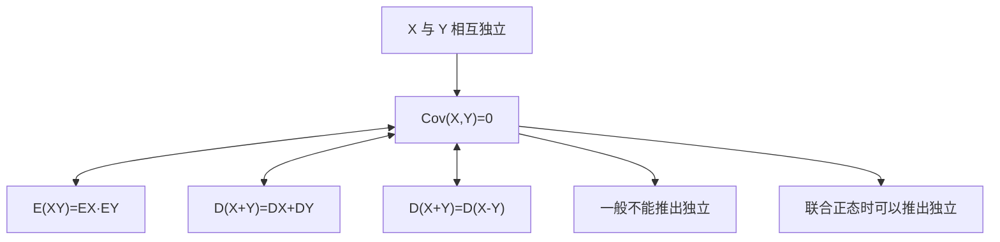
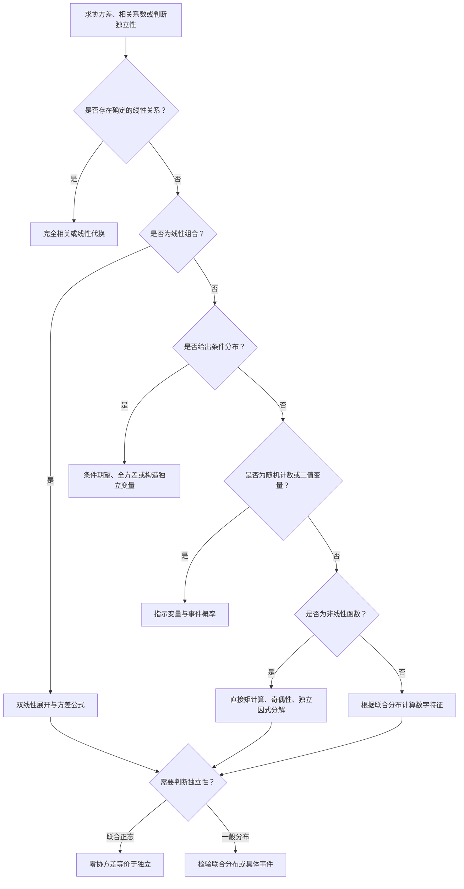

本节不仅是随机变量数字特征的核心内容，也是多维随机变量及其分布、二维正态分布、数理统计、参数估计等知识之间的重要桥梁。

真正学好这一节，不能仅仅停留在记住协方差、相关系数的定义公式，而是要能够**从随机变量之间的关系出发，识别数字特征的结构，选择计算量最小的解题方法。**

## 学习框架

本节主要包括五类考点：

| 核心考点      | 学习优先级 | 主要能力          |
| --------- | ----- | ------------- |
| 线性组合与相关系数 | ★★★★★ | 熟练进行协方差运算     |
| 不相关、独立与反例 | ★★★★★ | 理解概念、判断逻辑关系   |
| 联合正态与条件分布 | ★★★★★ | 求参数、构造独立变量    |
| 二值事件、区域概率 | ★★★★☆ | 将概率模型转化为数字特征  |
| 样本均值、交叠计数 | ★★★★★ | 处理多个随机变量的综合运算 |

模拟题还涉及最优线性预测、等相关随机变量、随机和、高阶矩以及条件密度等进阶问题。

## 一、基础知识体系：从直观理解到核心公式

### 1. 为什么需要协方差？

期望与方差描述的是单个随机变量：

- $EX$：随机变量的平均水平。
- $DX$：随机变量围绕平均水平波动的程度。
- $\operatorname{Cov}(X,Y)$：两个随机变量共同波动的情况。
- $\rho_{XY}$：经过标准化后的线性相关程度。

设两个随机变量的中心化形式为

$$
X_0=X-EX,\qquad Y_0=Y-EY.
$$

考虑乘积

$$
(X-EX)(Y-EY).
$$

如果两个变量经常同时高于均值，或者同时低于均值，那么这个乘积往往为正；如果一个高于均值而另一个低于均值，那么乘积往往为负。

因此，定义协方差为

$$
\boxed{ \operatorname{Cov}(X,Y) =E[(X-EX)(Y-EY)] }
$$

| 协方差 | 直观含义               |
| --- | ------------------ |
| 大于0 | 总体上倾向于同向波动         |
| 小于0 | 总体上倾向于反向波动         |
| 等于0 | 没有线性相关性，但可能存在非线性依赖 |

注意，协方差为正，并不意味着每一次 $X$ 增大时 $Y$ 都增大。

### 2. 协方差的计算公式

展开定义式：

$$
\begin{aligned} \operatorname{Cov}(X,Y) &=E[(X-EX)(Y-EY)]\\ &=E(XY)-EX\cdot EY. \end{aligned}
$$

得到最基本的计算公式：

$$
\boxed{ \operatorname{Cov}(X,Y)=E(XY)-EX\cdot EY }
$$

这是直接计算协方差时最重要的公式。

特别地，

$$
\operatorname{Cov}(X,X) =E(X^2)-(EX)^2=DX.
$$

即

$$
\boxed{\operatorname{Cov}(X,X)=DX}
$$

可以把方差理解为随机变量与自身的协方差。

本节常规讨论默认有关随机变量具有有限二阶矩；若涉及相关系数，还要求两个随机变量的方差均严格大于零。

### 3. 协方差的六个基本性质

| 性质      | 公式                                                                              |
| ------- | ------------------------------------------------------------------------------- |
| 对称性     | $\operatorname{Cov}(X,Y)=\operatorname{Cov}(Y,X)$                           |
| 与自身的协方差 | $\operatorname{Cov}(X,X)=DX$                                                |
| 与常数的协方差 | $\operatorname{Cov}(X,C)=0$                                                 |
| 数乘性质    | $\operatorname{Cov}(aX,bY)=ab\operatorname{Cov}(X,Y)$                       |
| 平移不变性   | $\operatorname{Cov}(X+a,Y+b)=\operatorname{Cov}(X,Y)$                       |
| 可加性     | $\operatorname{Cov}(X+Y,Z)=\operatorname{Cov}(X,Z)+\operatorname{Cov}(Y,Z)$ |

其中最重要的是**双线性性质**。

$$
\boxed{ \begin{aligned} &\operatorname{Cov}(aX+bY,cX+dY)\\ &=acDX+bdDY\\ &\quad +(ad+bc)\operatorname{Cov}(X,Y). \end{aligned} }
$$

这个公式必须达到能够随时展开的程度。

实际上，协方差的展开过程非常类似于代数中的多项式乘法：

$$
(aX+bY)(cX+dY).
$$

只需要将其中的 $X^2$、$Y^2$、$XY$ 分别对应为

$$
DX,\quad DY,\quad \operatorname{Cov}(X,Y).
$$

但要注意，协方差具有双线性性质，并不具有对一般非线性函数的乘法性质。

例如，一般不能写成

$$
\operatorname{Cov}(XY,Z) =\operatorname{Cov}(X,Z)\operatorname{Cov}(Y,Z).
$$

### 4. 方差与协方差的关系

这是本节出题最频繁的公式之一。

$$
\boxed{ D(X+Y)=DX+DY+2\operatorname{Cov}(X,Y) }
$$

$$
\boxed{ D(X-Y)=DX+DY-2\operatorname{Cov}(X,Y) }
$$

推广到任意线性组合：

$$
\boxed{ D(aX+bY)=a^2DX+b^2DY+2ab\operatorname{Cov}(X,Y) }
$$

反过来，也可以利用方差求协方差。

$$
\boxed{ \operatorname{Cov}(X,Y) =\frac{D(X+Y)-DX-DY}{2} }
$$

或者

$$
\boxed{ \operatorname{Cov}(X,Y) =\frac{D(X+Y)-D(X-Y)}4 }
$$

因此，当题目给出和的方差、差的方差时，应立即联想到协方差。

对于多个随机变量，有

$$
\boxed{ D\left(\sum_{i=1}^n a_iX_i\right) =\sum_{i=1}^n a_i^2DX_i +2\sum_{i<j}a_ia_j\operatorname{Cov}(X_i,X_j) }
$$

这是样本数字特征、随机计数、多个变量线性组合等问题的统一基础。

### 5. 相关系数的定义

协方差存在一个局限：它受到随机变量量纲和取值尺度的影响。

因此需要用标准差进行标准化。

$$
\boxed{ \rho_{XY} =\frac{\operatorname{Cov}(X,Y)} {\sqrt{DX}\sqrt{DY}} }
$$

或者写成

$$
\boxed{ \rho_{XY} =\frac{E(XY)-EX\cdot EY} {\sqrt{[E(X^2)-(EX)^2][E(Y^2)-(EY)^2]}} }
$$

记

$$
\sigma_X=\sqrt{DX},\qquad \sigma_Y=\sqrt{DY},
$$

则

$$
\boxed{ \operatorname{Cov}(X,Y)=\rho_{XY}\sigma_X\sigma_Y }
$$

考研中，这两个公式必须能够双向使用。

### 6. 如何理解相关系数的大小？

相关系数满足

$$
\boxed{-1\leq\rho_{XY}\leq1}
$$

其含义如下：

| 相关系数        | 含义       |
| ----------- | -------- |
| $1$     | 完全正线性相关  |
| 接近 $1$  | 较强的正线性相关 |
| $0$     | 不相关      |
| 接近 $-1$ | 较强的负线性相关 |
| $-1$    | 完全负线性相关  |

相关系数衡量的是**线性关系的强弱，而不是一般依赖关系的强弱**。

例如：

$$
X\sim N(0,1),\qquad Y=X^2.
$$

虽然 $Y$ 完全由 $X$ 决定，但

$$
\operatorname{Cov}(X,Y) =E(X^3)-EX\cdot E(X^2)=0.
$$

所以二者不相关，却具有确定的函数依赖关系。

这是本节最重要的概念区别之一。

### 7. 相关系数在线性变换下的变化

当 $a,b\ne0$ 时，

$$
\boxed{ \rho_{aX+c,bY+d} =\frac{ab}{|ab|}\rho_{XY} }
$$

也就是

$$
\rho_{aX+c,bY+d} = \begin{cases} \rho_{XY},&ab>0,\\ -\rho_{XY},&ab<0. \end{cases}
$$

由此可知：

- 平移不影响相关系数。
- 正比例缩放不影响相关系数。
- 只对一个变量乘负数，相关系数变号。
- 对两个变量同时乘负数，相关系数不变。

**李正元练习题中的典型基础题：**

已知 $\rho_{XY}=0.9$，令 $Z=2X-1$，则

$$
\boxed{\rho_{YZ}=0.9}
$$

不需要求任何期望、方差或分布。

## 二、本节最重要的逻辑关系：独立、不相关与线性关系

### 1. 独立与不相关的关系

若 $X,Y$ 相互独立，则

$$
E(XY)=EX\cdot EY.
$$

从而

$$
\operatorname{Cov}(X,Y)=0.
$$

在二阶矩存在的条件下：

$$
\boxed{ X,Y\text{ 独立}\Longrightarrow X,Y\text{ 不相关} }
$$

但是反过来一般不成立。

因此，一旦题目要求判断独立性，必须先区分：

- 是否具有联合正态条件；
- 是否为两个二值随机变量；
- 是否能够通过联合分布或者具体事件证明独立。

仅仅计算出协方差为零，通常是不够的。

### 2. 判断题常见等价关系

在有限二阶矩条件下，下列命题等价：

$$
\boxed{ \begin{aligned} &X,Y\text{ 不相关}\\ \Longleftrightarrow\;&\operatorname{Cov}(X,Y)=0\\ \Longleftrightarrow\;&E(XY)=EX\cdot EY\\ \Longleftrightarrow\;&D(X+Y)=DX+DY\\ \Longleftrightarrow\;&D(X-Y)=DX+DY\\ \Longleftrightarrow\;&D(X+Y)=D(X-Y). \end{aligned} }
$$

若方差均为正，还等价于

$$
\rho_{XY}=0.
$$

但是下面这个等式不是不相关的等价条件：

$$
D(XY)=DX\cdot DY.
$$

事实上，即使 $X,Y$ 相互独立，也有

$$
\boxed{ D(XY)=DXDY+DX(EY)^2+DY(EX)^2 }
$$

只有在独立且满足相应均值条件时，例如 $EX=EY=0$，才能简化为 $DXDY$。

张宇1000题与李正元练习题都设置了这种概念辨析题，值得反复练习。

### 3. 联合正态分布的特殊性

如果

$$
(X,Y)\sim N(\mu_1,\mu_2;\sigma_1^2,\sigma_2^2;\rho),
$$

那么

$$
\boxed{ X,Y\text{ 独立} \Longleftrightarrow \operatorname{Cov}(X,Y)=0 \Longleftrightarrow \rho_{XY}=0 }
$$

注意条件是**联合服从二维正态分布**。

仅仅知道

$$
X\sim N(\mu_1,\sigma_1^2),\qquad Y\sim N(\mu_2,\sigma_2^2)
$$

不能推出 $(X,Y)$ 服从二维正态分布。

这是考研判断题、选择题非常容易设置的陷阱。

### 4. 相关系数绝对值等于1意味着什么？

这是另一个必须掌握的定理。

在 $DX,DY$ 均为有限正数时：

$$
\boxed{ |\rho_{XY}|=1 \Longleftrightarrow P(Y=aX+b)=1,\quad a\ne0 }
$$

而且

$$
\boxed{ a=\rho_{XY}\frac{\sigma_Y}{\sigma_X} }
$$

$$
\boxed{b=EY-aEX}
$$

所以，完全相关情况下，可以直接写出

$$
\boxed{ Y=EY+\rho_{XY}\frac{\sigma_Y}{\sigma_X}(X-EX) \quad\text{几乎必然} }
$$

这里的条件不要求正态分布。

**定理为什么成立？**

令标准化变量

$$
U=\frac{X-EX}{\sigma_X},\qquad V=\frac{Y-EY}{\sigma_Y}.
$$

则

$$
EU=EV=0,\quad DU=DV=1,\quad E(UV)=\rho.
$$

由

$$
E[(U-V)^2]=2-2\rho\geq0
$$

以及

$$
E[(U+V)^2]=2+2\rho\geq0
$$

可得

$$
-1\leq\rho\leq1.
$$

若 $\rho=1$，则

$$
E[(U-V)^2]=0.
$$

非负随机变量期望为零意味着它以概率1等于零，因此

$$
P(U=V)=1.
$$

同理，$\rho=-1$ 时，

$$
P(U=-V)=1.
$$

这就解释了完全相关为什么必然对应一条直线。

## 三、核心题型一：线性组合的协方差与相关系数

**重要程度：★★★★★**

这是本节最基础、覆盖范围最广的题型。

### 母题1：2000年数学一真题

设 $(X,Y)$ 服从二维正态分布，令

$$
U=X+Y,\qquad V=X-Y.
$$

求 $U,V$ 不相关的充要条件。

**解题思路**

题目出现“和与差”“不相关”，优先使用协方差双线性性质。

$$
\begin{aligned} \operatorname{Cov}(U,V) &=\operatorname{Cov}(X+Y,X-Y)\\ &=DX-\operatorname{Cov}(X,Y)\\ &\quad+\operatorname{Cov}(Y,X)-DY\\ &=DX-DY. \end{aligned}
$$

因此

$$
\boxed{U,V\text{ 不相关}\Longleftrightarrow DX=DY}
$$

也就是

$$
E(X^2)-(EX)^2=E(Y^2)-(EY)^2.
$$

**母题结论**

必须直接记住：

$$
\boxed{\operatorname{Cov}(X+Y,X-Y)=DX-DY}
$$

更一般地，

$$
\boxed{ \operatorname{Cov}(aX+bY,aX-bY)=a^2DX-b^2DY }
$$

交叉协方差自动抵消，所以求这两个线性组合的协方差时，完全不需要知道原变量的相关系数。

不过，若继续求两个线性组合的相关系数，则一般还需要计算各自的方差。

### 母题2：2026年数学一、数学三真题

设

$$
X\sim P(1),\qquad Y\sim P(3),
$$

且 $X$ 与 $Y-X$ 相互独立，求 $E(XY)$。

<Tabs items={["方法一：协方差法", "方法二：拆成独立变量"]} defaultIndex={0}>

<Tab value="方法一：协方差法">

题目没有说 $X,Y$ 独立，而是说 $X$ 与 $Y-X$ 独立。

因此

$$
\operatorname{Cov}(X,Y-X)=0.
$$

利用线性性质：

$$
\operatorname{Cov}(X,Y)-DX=0.
$$

泊松分布的期望和方差都等于参数，所以

$$
\operatorname{Cov}(X,Y)=DX=1.
$$

从而

$$
\begin{aligned} E(XY) &=\operatorname{Cov}(X,Y)+EX\cdot EY\\ &=1+1\times3\\ &=\boxed4. \end{aligned}
$$

</Tab>

<Tab value="方法二：拆成独立变量">

令

$$
Z=Y-X,
$$

则

$$
Y=X+Z,
$$

并且 $X,Z$ 独立。

由期望的线性性，

$$
EZ=EY-EX=2.
$$

所以

$$
\begin{aligned} E(XY)&=E[X(X+Z)]\\ &=E(X^2)+E(XZ)\\ &=DX+(EX)^2+EX\cdot EZ\\ &=1+1+2=4. \end{aligned}
$$

</Tab>

</Tabs>

**迁移结论**

如果 $X$ 与 $Y-aX$ 独立或不相关，那么

$$
\boxed{\operatorname{Cov}(X,Y)=aDX}
$$

这是利用新变量之间的关系，反求原变量数字特征的重要方法。

### 母题3：李林六套卷第1套第16题

设 $X,Y$ 独立同分布于 $N(\mu,\sigma^2)$，令

$$
U=aX+bY,\qquad V=aX-bY.
$$

求 $\rho_{UV}$。

由独立性，

$$
\operatorname{Cov}(X,Y)=0.
$$

于是

$$
\operatorname{Cov}(U,V) =(a^2-b^2)\sigma^2.
$$

同时

$$
DU=DV=(a^2+b^2)\sigma^2.
$$

所以

$$
\boxed{ \rho_{UV}=\frac{a^2-b^2}{a^2+b^2} }
$$

**进一步推广**

即使 $X,Y$ 不独立，只要二者方差均为 $\sigma^2$，相关系数为 $\rho$，仍有

$$
\operatorname{Cov}(U,V)=(a^2-b^2)\sigma^2,
$$

但此时

$$
DU=(a^2+b^2+2ab\rho)\sigma^2,
$$

$$
DV=(a^2+b^2-2ab\rho)\sigma^2.
$$

因此在 $DU,DV>0$ 时，

$$
\boxed{ \rho_{UV} =\frac{a^2-b^2} {\sqrt{(a^2+b^2)^2-4a^2b^2\rho^2}} }
$$

这说明不能在缺少独立条件时，直接使用独立情形下的简化公式。

### 本题型的标准解题流程

第一步，整理原随机变量的方差与协方差。

第二步，利用双线性性质计算新变量的协方差。

第三步，计算新变量各自的方差。

第四步，代入相关系数公式。

第五步，检查结果是否属于 $[-1,1]$。

多数线性组合题不需要求新变量的分布，更不需要进行卷积积分。

## 四、核心题型二：完全相关与隐藏的确定性关系

**重要程度：★★★★★**

### 母题4：2008年数学一、数学三真题

设

$$
X\sim N(0,1),\qquad Y\sim N(1,4),
$$

且

$$
\rho_{XY}=1.
$$

求 $X,Y$ 之间的线性关系。

由于 $\rho=1$，直接使用完全相关公式。

$$
\frac{Y-EY}{\sigma_Y} =\frac{X-EX}{\sigma_X}.
$$

代入

$$
EX=0,\quad EY=1,\quad \sigma_X=1,\quad\sigma_Y=2,
$$

得到

$$
\frac{Y-1}{2}=X.
$$

所以

$$
\boxed{P(Y=2X+1)=1}
$$

这道题的关键不是正态分布，而是相关系数恰好等于1。

### 母题5：张宇8套卷第6套第10题

设 $X,Y,Z$ 满足

$$
DX=DZ,\qquad DY=4DX,
$$

$$
\rho_{XY}=-1,\qquad \rho_{XZ}=\frac12.
$$

求 $X$ 与 $Y+Z$ 的相关系数。

<Steps>

<Step>

### 第一步：利用完全负相关 [!toc]

由于 $\rho_{XY}=-1$，而

$$
\frac{\sigma_Y}{\sigma_X}=2,
$$

所以存在常数 $b$，使得

$$
Y=-2X+b
$$

几乎必然成立。

记

$$
DX=DZ=s^2.
$$

则

$$
\operatorname{Cov}(X,Z)=\frac12s^2.
$$

利用 $Y=-2X+b$，

$$
\operatorname{Cov}(Y,Z) =-2\operatorname{Cov}(X,Z)=-s^2.
$$

这一步解决了题目没有直接给出 $Y,Z$ 协方差的问题。

</Step>

<Step>

### 第二步：计算目标协方差 [!toc]

$$
\begin{aligned} \operatorname{Cov}(X,Y+Z) &=\operatorname{Cov}(X,Y)+\operatorname{Cov}(X,Z)\\ &=-2s^2+\frac12s^2\\ &=-\frac32s^2. \end{aligned}
$$

</Step>

<Step>

### 第三步：计算方差 [!toc]

$$
\begin{aligned} D(Y+Z) &=DY+DZ+2\operatorname{Cov}(Y,Z)\\ &=4s^2+s^2-2s^2\\ &=3s^2. \end{aligned}
$$

于是

$$
\boxed{ \rho_{X,Y+Z}=-\frac{\sqrt3}{2} }
$$

</Step>

</Steps>

**重要迁移**

若

$$
\rho_{XY}=1,
$$

那么对于任意具有有限正方差的 $Z$，

$$
\rho_{YZ}=\rho_{XZ}.
$$

若

$$
\rho_{XY}=-1,
$$

则

$$
\rho_{YZ}=-\rho_{XZ}.
$$

看到完全相关，应当把两个变量减少成一个变量来处理。

### 隐藏完全相关的常见题目

李正元、李林练习题中都有以下类型：

| 随机变量之间的关系                       | 相关系数           |
| ------------------------------- | -------------- |
| $X+Y=n$，成功次数与失败次数           | $-1$       |
| $U=\arcsin X,\ V=\arccos X$ | $-1$       |
| $Y=3X-2$                    | $1$        |
| $P(aX+Y=0)=1,\ a\ne0$       | $-a/\|a\|$ |

第一眼应该寻找确定的线性关系，而不是计算积分。

## 五、核心题型三：独立与不相关的判断及反例

**重要程度：★★★★★**

这类题目不仅考计算，更考逻辑严谨性。

### 母题6：1993年数学一真题

设随机变量 $X$ 的概率密度为

$$
f_X(x)=\frac12e^{-|x|},\qquad x\in\mathbb R.
$$

求 $EX,DX$，并判断 $X$ 与 $|X|$ 的相关性及独立性。

<Steps>

<Step>

### 第一步：利用对称性计算期望 [!toc]

因为 $f_X(x)$ 是偶函数，

$$
EX=\int_{-\infty}^{+\infty}xf_X(x)\,dx=0.
$$

二阶矩为

$$
E(X^2)=\int_0^{+\infty}x^2e^{-x}\,dx=2.
$$

所以

$$
\boxed{DX=2}
$$

</Step>

<Step>

### 第二步：判断相关性 [!toc]

$$
\operatorname{Cov}(X,|X|) =E(X|X|)-EX\cdot E|X|.
$$

由于 $x|x|$ 是奇函数，而密度为偶函数，

$$
E(X|X|)=0.
$$

所以

$$
\boxed{\operatorname{Cov}(X,|X|)=0}
$$

二者不相关。

</Step>

<Step>

### 第三步：判断独立性 [!toc]

取事件

$$
A=\{|X|\leq1\},\qquad B=\{X>1\}.
$$

显然

$$
A\cap B=\varnothing.
$$

因此

$$
P(A\cap B)=0.
$$

但是 $P(A)>0,P(B)>0$，所以

$$
P(A\cap B)\ne P(A)P(B).
$$

故 $X$ 与 $|X|$ 不独立。

最终结论：

$$
\boxed{X\text{ 与 }|X|\text{ 不相关，但不独立}}
$$

</Step>

</Steps>

**母题推广：奇偶性模型**

如果 $X$ 关于0对称，$g(x)$ 是偶函数，而且所需矩存在，则

$$
\boxed{\operatorname{Cov}(X,g(X))=0}
$$

例如

$$
\operatorname{Cov}(X,X^2)=0,
$$

$$
\operatorname{Cov}(X,|X|)=0,
$$

$$
\operatorname{Cov}(X,\cos X)=0.
$$

如果 $X$ 关于 $m$ 对称，可以先令

$$
T=X-m.
$$

再利用中心化变量的奇偶性。

### 母题7：李林880综合题——独立变量的线性组合未必独立

设

$$
X_1\sim B(1,p),\qquad X_2\sim B(2,p),
$$

且二者独立，其中 $0<p<1$。令

$$
Z_1=2X_1+X_2,\qquad Z_2=X_1-X_2.
$$

判断 $Z_1,Z_2$ 是否相关，是否独立。

<Steps>

<Step>

### 第一步：计算协方差 [!toc]

$$
DX_1=p(1-p),\qquad DX_2=2p(1-p).
$$

因此

$$
\begin{aligned} \operatorname{Cov}(Z_1,Z_2) &=2DX_1-DX_2\\ &=2p(1-p)-2p(1-p)\\ &=0. \end{aligned}
$$

所以二者不相关。

</Step>

<Step>

### 第二步：构造不可能同时发生的事件 [!toc]

若

$$
Z_1=0,
$$

由于 $X_1,X_2$ 都是非负整数，必然有

$$
X_1=X_2=0,
$$

从而

$$
Z_2=0.
$$

另一方面，

$$
Z_2=1
$$

在 $X_1=1,X_2=0$ 时发生，具有正概率。

于是

$$
P(Z_1=0,Z_2=1)=0,
$$

但

$$
P(Z_1=0)P(Z_2=1)>0.
$$

故不独立。

$$
\boxed{Z_1,Z_2\text{ 不相关但不独立}}
$$

</Step>

</Steps>

<Callout type="idea" title="考场技巧">

证明不独立，通常不需要写出完整联合分布。

只要找到一对事件满足：

$$
P(A)>0,\quad P(B)>0,\quad P(AB)=0,
$$

就足以否定独立性。

</Callout>

### 母题8：张宇1000题、李正元练习题——圆域与椭圆域均匀分布

设 $(X,Y)$ 在单位圆盘

$$
x^2+y^2\leq1
$$

上均匀分布。

其联合密度为

$$
f(x,y)= \begin{cases} 1/\pi,&x^2+y^2\leq1,\\ 0,&\text{其他}. \end{cases}
$$

利用圆域关于两条坐标轴的对称性，有

$$
EX=EY=0,\qquad E(XY)=0.
$$

因此

$$
\boxed{\rho_{XY}=0}
$$

但二者不独立。

例如取事件

$$
A=\{|X|>0.8\},\qquad B=\{|Y|>0.8\}.
$$

两个事件各自具有正概率，但是如果同时发生，则

$$
X^2+Y^2>0.64+0.64>1,
$$

与支持域矛盾。

故

$$
P(AB)=0\ne P(A)P(B).
$$

**迁移规律**

对于关于某一坐标轴对称的联合密度，在满足矩存在条件时，通常可以利用对称性迅速证明协方差为零。

但圆域、椭圆域、三角形区域等非直积支持域，往往意味着变量之间存在约束，不能仅根据密度表达式的代数形式判断独立性。

## 六、核心题型四：二维正态分布与独立线性组合的构造

**重要程度：★★★★★**

这是考研数学一非常重要的综合考点，可以与概率计算、随机变量函数分布、数理统计相结合。

### 1. 二维正态分布的基本信息提取

如果

$$
(X,Y)\sim N(\mu_1,\mu_2;\sigma_1^2,\sigma_2^2;\rho),
$$

那么应当立即提取以下五个数字特征：

$$
\begin{aligned} EX&=\mu_1,& EY&=\mu_2,\\ DX&=\sigma_1^2,& DY&=\sigma_2^2,\\ \operatorname{Cov}(X,Y)&=\rho\sigma_1\sigma_2. \end{aligned}
$$

对于

$$
Z=aX+bY+c,
$$

有

$$
EZ=a\mu_1+b\mu_2+c,
$$

$$
DZ=a^2\sigma_1^2+b^2\sigma_2^2+2ab\rho\sigma_1\sigma_2.
$$

而且 $Z$ 仍为正态随机变量（方差为零时退化为常数）。

更重要的是，由联合正态变量得到的多个线性组合，仍然联合正态。

### 母题9：1994年数学一真题

这道题也出现在的李林六套卷第6套第10题，具有很高的复习价值。

设 $(X,Y)$ 服从二维正态分布，

$$
X\sim N(1,9),\qquad Y\sim N(0,16),
$$

$$
\rho_{XY}=-\frac12.
$$

令

$$
Z=\frac X3+\frac Y2.
$$

求 $EZ,DZ,\rho_{XZ}$，并判断 $X,Z$ 是否独立。

<Steps>

<Step>

### 第一步：求原变量协方差 [!toc]

$$
\operatorname{Cov}(X,Y) =-\frac12\times3\times4=-6.
$$

</Step>

<Step>

### 第二步：求新变量数字特征 [!toc]

$$
EZ=\frac13.
$$

$$
\begin{aligned} DZ &=\frac19DX+\frac14DY +2\cdot\frac13\cdot\frac12\operatorname{Cov}(X,Y)\\ &=1+4-2\\ &=3. \end{aligned}
$$

故

$$
Z\sim N\left(\frac13,3\right).
$$

</Step>

<Step>

### 第三步：求相关系数 [!toc]

$$
\begin{aligned} \operatorname{Cov}(X,Z) &=\frac13DX+\frac12\operatorname{Cov}(X,Y)\\ &=3-3\\ &=0. \end{aligned}
$$

所以

$$
\boxed{\rho_{XZ}=0}
$$

</Step>

<Step>

### 第四步：判断独立性 [!toc]

因为 $(X,Y)$ 联合正态，所以 $(X,Z)$ 也联合正态。

联合正态随机变量不相关即独立。

因此

$$
\boxed{X,Z\text{ 相互独立}}
$$

如果题目没有联合正态条件，前面三个数字特征的计算仍然成立，但最后一步不能直接使用。

</Step>

</Steps>

### 2. 构造与给定正态变量独立的新变量

这是1994年数学一、2020年数学三以及多道模拟题所共同体现的母题结构。

设希望从 $X,Y$ 中构造一个与 $X$ 不相关的新变量：

$$
Z=Y-aX.
$$

那么

$$
\operatorname{Cov}(X,Z) =\operatorname{Cov}(X,Y)-aDX.
$$

令其等于零，得到

$$
\boxed{ a=\frac{\operatorname{Cov}(X,Y)}{DX} }
$$

由此得到

$$
\boxed{ Z=Y-\frac{\operatorname{Cov}(X,Y)}{DX}X }
$$

它满足

$$
\operatorname{Cov}(X,Z)=0.
$$

若 $X,Y$ 联合正态，则 $X,Z$ 独立。

进一步计算：

$$
\begin{aligned} DZ &=DY-\frac{\operatorname{Cov}^2(X,Y)}{DX}\\ &=DY(1-\rho^2). \end{aligned}
$$

因此

$$
\boxed{ D\left(Y-\frac{\operatorname{Cov}(X,Y)}{DX}X\right) =DY(1-\rho^2) }
$$

若还要求 $Z$ 服从标准正态分布，只需要再进行标准化。

令

$$
T= \frac{ Y-\mu_Y-\rho\frac{\sigma_Y}{\sigma_X}(X-\mu_X) }{ \sigma_Y\sqrt{1-\rho^2} }.
$$

当 $|\rho|<1$ 且 $(X,Y)$ 联合正态时，

$$
\boxed{ T\sim N(0,1),\qquad T\text{ 与 }X\text{ 独立} }
$$

这是一个非常有价值的进阶结论。

它还能够帮助理解二维正态分布的条件分布公式：

$$
\boxed{ Y\mid X=x \sim N\left( \mu_Y+\rho\frac{\sigma_Y}{\sigma_X}(x-\mu_X), \,\sigma_Y^2(1-\rho^2) \right) }
$$

### 母题10：汤家凤八套卷第4套第9题

设

$$
(X,Y)\sim N\left(1,1;1,4;\frac12\right),
$$

且

$$
P(aX+bY>3)=\frac12,
$$

已知 $2X-Y$ 与 $aX+bY$ 独立，求 $a,b$。

这道题体现了未来综合题可能采用的命题方式：**将概率条件与独立性条件联立求参数。**

<Steps>

<Step>

### 第一步：把概率条件转换为均值条件 [!toc]

由于 $aX+bY$ 是非退化正态变量，利用正态分布关于均值的对称性，

$$
P(aX+bY>3)=\frac12
$$

说明

$$
E(aX+bY)=3.
$$

所以

$$
a+b=3.
$$

</Step>

<Step>

### 第二步：把独立条件转换为协方差条件 [!toc]

由联合正态性，

$$
\operatorname{Cov}(2X-Y,aX+bY)=0.
$$

原变量满足

$$
DX=1,\quad DY=4,\quad \operatorname{Cov}(X,Y)=1.
$$

于是

$$
\begin{aligned} 0&=2aDX-bDY+(2b-a)\operatorname{Cov}(X,Y)\\ &=2a-4b+2b-a\\ &=a-2b. \end{aligned}
$$

</Step>

<Step>

### 第三步：联立求解 [!toc]

$$
\begin{cases} a+b=3,\\ a-2b=0. \end{cases}
$$

所以

$$
\boxed{a=2,\quad b=1}
$$

</Step>

</Steps>

**综合题识别方法**

凡是遇到正态变量的概率、方差、独立性等多个条件，可以分别转换为关于参数的方程。

| 题目条件               | 转换思路                                          |
| ------------------ | --------------------------------------------- |
| $P(Z>c)=1/2$   | 非退化正态变量满足 $EZ=c$                          |
| $Z\sim N(0,1)$ | $EZ=0,\ DZ=1$                             |
| $U,V$ 独立且联合正态  | $\operatorname{Cov}(U,V)=0$               |
| $\rho_{UV}=r$ | $\operatorname{Cov}(U,V)=r\sqrt{DU\,DV}$ |

本质上就是把概率问题转换为数字特征方程组。

## 七、核心题型五：条件分布、条件期望与协方差

**重要程度：★★★★★，强化阶段重点**

2022年数学一和2024年数学一的题目都体现了这一考点。

传统方法需要求联合密度、边缘密度，再计算二重积分；但利用条件期望，往往可以把一道较繁琐的题目变成几行计算。

### 1. 全期望公式

设

$$
m(X)=E(Y\mid X).
$$

那么

$$
\boxed{EY=E[E(Y\mid X)]}
$$

直观而言：

先固定 $X$，计算此时 $Y$ 的平均值；然后再对不同的 $X$ 取平均。

对于任意满足可积条件的函数 $g(X)$，有

$$
\boxed{ E[g(X)Y]=E[g(X)E(Y\mid X)] }
$$

取 $g(X)=X$，得到

$$
\boxed{E(XY)=E[XE(Y\mid X)]}
$$

因此

$$
\boxed{ \operatorname{Cov}(X,Y) =\operatorname{Cov}(X,E(Y\mid X)) }
$$

这是条件分布型协方差题最值得掌握的公式。

### 2. 条件均值为一次函数的特殊情况

如果

$$
E(Y\mid X)=aX+b,
$$

那么直接有

$$
\begin{aligned} \operatorname{Cov}(X,Y) &=\operatorname{Cov}(X,aX+b)\\ &=aDX. \end{aligned}
$$

即

$$
\boxed{ E(Y\mid X)=aX+b \Longrightarrow \operatorname{Cov}(X,Y)=aDX }
$$

无需知道 $Y$ 的边缘密度。

### 3. 全方差公式

记条件方差为

$$
D(Y\mid X).
$$

则

$$
\boxed{ DY=E[D(Y\mid X)]+D[E(Y\mid X)] }
$$

其中：

- 第一项描述固定 $X$ 时，$Y$ 自身的随机波动。
- 第二项描述条件均值随着 $X$ 改变而产生的波动。

如果已知

$$
E(Y\mid X)=aX+b,\qquad D(Y\mid X)=c,
$$

其中 $c$ 为常数，则

$$
\boxed{ DY=c+a^2DX }
$$

因此，在方差为正的条件下，

$$
\boxed{ \rho_{XY} =\frac{a\sqrt{DX}}{\sqrt{c+a^2DX}} }
$$

全期望、全方差公式可以作为考研常规积分法的强化计算工具。若不熟悉条件期望的形式化定义，只需先掌握由条件密度计算条件矩的含义，同时保留联合密度积分法作为备用方案。

### 母题11：2022年数学一真题

设

$$
X\sim N(0,1),
$$

在给定 $X=x$ 的条件下，

$$
Y\mid X=x\sim N(x,1).
$$

求 $\rho_{XY}$。

<Tabs items={["方法一：条件期望与全方差公式", "方法二：构造独立增量"]} defaultIndex={0}>

<Tab value="方法一：条件期望与全方差公式">

由条件正态分布可知

$$
E(Y\mid X)=X,\qquad D(Y\mid X)=1.
$$

因此

$$
\operatorname{Cov}(X,Y)=DX=1.
$$

同时

$$
DY=E(1)+D(X)=2.
$$

故

$$
\boxed{ \rho_{XY}=\frac1{\sqrt2} }
$$

</Tab>

<Tab value="方法二：构造独立增量">

令

$$
Z=Y-X.
$$

由于给定 $X=x$ 时，

$$
Z\mid X=x\sim N(0,1),
$$

而且这个条件分布不随 $x$ 改变，所以 $Z$ 与 $X$ 独立。

于是

$$
Y=X+Z,\qquad X,Z\text{ 独立}.
$$

从而

$$
DY=DX+DZ=2,
$$

$$
\operatorname{Cov}(X,Y)=DX=1.
$$

仍得

$$
\rho_{XY}=\frac1{\sqrt2}.
$$

</Tab>

</Tabs>

**母题迁移**

如果

$$
Y\mid X=x\sim N(ax+b,c),
$$

其中 $c>0$，那么可以令

$$
Z=Y-aX-b.
$$

此时

$$
Z\sim N(0,c)
$$

且与 $X$ 独立。

因此很多条件正态题都可以转化为

$$
Y=aX+b+Z
$$

这种独立噪声模型。

注意，这里的独立性来自完整的条件分布不随 $x$ 改变，而不是仅仅来自条件均值或条件方差为常数。

### 母题12：2024年数学一真题

设 $X$ 的概率密度为

$$
f_X(x)= \begin{cases} 2(1-x),&0<x<1,\\ 0,&\text{其他}. \end{cases}
$$

在给定 $X=x$ 的条件下，

$$
Y\sim U(x,1).
$$

求 $\operatorname{Cov}(X,Y)$。

<Tabs items={["方法一：条件期望法", "方法二：传统联合密度法"]} defaultIndex={0}>

<Tab value="方法一：条件期望法">

由均匀分布的期望公式，

$$
E(Y\mid X=x)=\frac{x+1}{2}.
$$

因此

$$
E(Y\mid X)=\frac{X+1}{2}.
$$

立即得到

$$
\operatorname{Cov}(X,Y)=\frac12DX.
$$

下面只需求 $X$ 的方差。

$$
EX=2\int_0^1x(1-x)\,dx=\frac13,
$$

$$
E(X^2)=2\int_0^1x^2(1-x)\,dx=\frac16.
$$

所以

$$
DX=\frac16-\frac19=\frac1{18}.
$$

最终

$$
\boxed{\operatorname{Cov}(X,Y)=\frac1{36}}
$$

</Tab>

<Tab value="方法二：传统联合密度法">

条件密度为

$$
f_{Y\mid X}(y\mid x)= \begin{cases} \dfrac1{1-x},&x<y<1,\\ 0,&\text{其他}. \end{cases}
$$

因此联合密度为

$$
f_{X,Y}(x,y)= \begin{cases} 2,&0<x<y<1,\\ 0,&\text{其他}. \end{cases}
$$

在三角形区域内，

$$
EX=\frac13,\qquad EY=\frac23,
$$

$$
E(XY) =\int_0^1\int_x^1 2xy\,dy\,dx =\frac14.
$$

故

$$
\operatorname{Cov}(X,Y) =\frac14-\frac13\cdot\frac23 =\boxed{\frac1{36}}.
$$

两种方法结果一致，但第一种方法明显减少了计算量。

</Tab>

</Tabs>

### 母题13：李林六套卷第3套第9题与张宇1000题强化题

李林模拟题设

$$
X\sim U(0,2),
$$

在给定 $X=x$ 时，

$$
Y\mid X=x\sim U(0,x).
$$

求协方差。

由于

$$
E(Y\mid X)=\frac X2,
$$

所以

$$
\operatorname{Cov}(X,Y) =\frac12DX =\frac12\cdot\frac{4}{12} =\boxed{\frac16}.
$$

进一步，如果题目要求相关系数怎么办？

注意到

$$
D(Y\mid X)=\frac{X^2}{12}.
$$

又有

$$
E(X^2)=\frac43,\qquad DX=\frac13.
$$

因此

$$
\begin{aligned} DY &=E\left(\frac{X^2}{12}\right) +D\left(\frac X2\right)\\ &=\frac19+\frac1{12}\\ &=\frac7{36}. \end{aligned}
$$

故

$$
\boxed{ \rho_{XY} =\frac{1/6}{\sqrt{(1/3)(7/36)}} =\sqrt{\frac37} }
$$

这一计算也适用于张宇1000题中 $X\sim U(0,1)$、条件下 $Y\sim U(0,X)$ 的强化题，相关系数不变。

### 条件均匀分布的通用公式

如果

$$
Y\mid X=x\sim U(g(x),h(x)),
$$

则

$$
\boxed{ E(Y\mid X)=\frac{g(X)+h(X)}2 }
$$

$$
\boxed{ D(Y\mid X)=\frac{[h(X)-g(X)]^2}{12} }
$$

只要确定了这两个表达式，绝大多数相关数字特征问题都可以利用全期望、全方差处理。

### 4. 强化技巧：构造比例变量

汤家凤八套卷第1套第9题具有很好的创新题训练价值。

设

$$
X\sim E(2),
$$

且条件密度为

$$
f_{Y\mid X}(y\mid x)= \begin{cases} \dfrac{3y^2}{x^3},&0<y<x,\\ 0,&\text{其他}. \end{cases}
$$

令

$$
U=X+Y,\qquad V=X-Y,
$$

求相关系数。

### 识别突破口

密度可改写为

$$
f_{Y\mid X}(y\mid x) =\frac1x\cdot3\left(\frac yx\right)^2.
$$

因此考虑

$$
W=\frac YX.
$$

对固定的 $X=x$，作变量变换 $y=xw$，得到

$$
f_{W\mid X}(w\mid x)=3w^2,\qquad 0<w<1.
$$

这个密度与 $x$ 无关，因此 $W$ 与 $X$ 独立。

于是

$$
Y=XW,
$$

$$
U=X(1+W),\qquad V=X(1-W).
$$

由

$$
EW=\frac34,\qquad E(W^2)=\frac35,
$$

以及

$$
EX=\frac12,\qquad E(X^2)=\frac12,
$$

可以直接求出

$$
EU=\frac78,\qquad EV=\frac18,
$$

$$
DU=\frac{251}{320},\qquad DV=\frac{11}{320},
$$

$$
\operatorname{Cov}(U,V)=\frac{29}{320}.
$$

所以

$$
\boxed{ \rho_{UV}=\frac{29}{\sqrt{2761}} }
$$

**创新题的迁移价值**

遇到

$$
f_{Y\mid X}(y\mid x)=\frac1xg\left(\frac yx\right), \qquad x>0,
$$

且比例变量的支持域固定时，可以考虑

$$
W=\frac YX.
$$

遇到

$$
f_{Y\mid X}(y\mid x)=g(y-a(x)),
$$

可以考虑

$$
Z=Y-a(X).
$$

二者的本质都是：通过构造新变量，消除条件分布对 $X$ 的依赖，从而获得独立性。

## 八、核心题型六：指示变量、随机计数与事件概率

**重要程度：★★★★★**

这是概率论第一章与第三章数字特征结合最紧密的题型之一。

### 1. 指示变量是随机计数问题的统一工具

对任意事件 $A$，定义

$$
I_A= \begin{cases} 1,&A\text{ 发生},\\ 0,&A\text{ 不发生}. \end{cases}
$$

则

$$
I_A\sim B(1,P(A)).
$$

因此

$$
EI_A=P(A),
$$

$$
DI_A=P(A)[1-P(A)].
$$

对于两个事件 $A,B$，

$$
I_AI_B=I_{AB}.
$$

所以

$$
\boxed{ \operatorname{Cov}(I_A,I_B) =P(AB)-P(A)P(B) }
$$

当两事件的概率均在 $(0,1)$ 内时，

$$
\boxed{ \rho_{I_A,I_B} =\frac{P(AB)-P(A)P(B)} {\sqrt{P(A)(1-P(A))P(B)(1-P(B))}} }
$$

这意味着求两个0-1型变量的相关系数，只需要三个概率：

$$
P(A),\quad P(B),\quad P(AB).
$$

还有一个特别重要的结论：

**对于两个0-1型随机变量，不相关与独立等价。**

原因是，只要知道两个边缘成功概率及同时成功的概率，就能完全确定它们的联合分布。

### 母题14：2016年数学一真题

这道题同时收录于张宇1000题和李林880题中，是非常典型的随机计数母题。

随机试验有三个两两不相容的结果

$$
A_1,A_2,A_3,
$$

每个结果发生的概率均为 $1/3$。

独立重复试验2次，设 $X,Y$ 分别表示 $A_1,A_2$ 出现的次数。求相关系数。

<Steps>

<Step>

### 第一步：按试验次数拆分 [!toc]

设

$$
I_i=I_{\{\text{第}i\text{次出现}A_1\}},
$$

$$
J_i=I_{\{\text{第}i\text{次出现}A_2\}}.
$$

那么

$$
X=I_1+I_2,\qquad Y=J_1+J_2.
$$

</Step>

<Step>

### 第二步：识别两类协方差 [!toc]

不同次试验相互独立，因此

$$
\operatorname{Cov}(I_1,J_2) =\operatorname{Cov}(I_2,J_1)=0.
$$

同一次试验中 $A_1,A_2$ 互斥，

$$
I_iJ_i=0.
$$

所以

$$
\operatorname{Cov}(I_i,J_i) =0-\frac13\cdot\frac13=-\frac19.
$$

因此

$$
\operatorname{Cov}(X,Y)=-\frac29.
$$

</Step>

<Step>

### 第三步：计算方差 [!toc]

由于

$$
X,Y\sim B\left(2,\frac13\right),
$$

所以

$$
DX=DY=\frac49.
$$

最终

$$
\boxed{\rho_{XY}=-\frac12}
$$

</Step>

</Steps>

### 通用母题结论：多项分布中的互斥计数

如果独立重复试验 $n$ 次，每次事件 $A,B$ 互斥，且

$$
P(A)=p,\qquad P(B)=q,
$$

令 $X,Y$ 分别表示两个事件的出现次数，则

$$
\boxed{ \operatorname{Cov}(X,Y)=-npq }
$$

$$
\boxed{ \rho_{XY} =-\sqrt{\frac{pq}{(1-p)(1-q)}} }
$$

只要两计数的方差为正，这个公式就成立。

一个重要现象是：相关系数与重复次数 $n$ 无关。

张宇8套卷第7套第9题将真题中的两个概率改为

$$
p=\frac16,\qquad q=\frac13.
$$

直接代入便得

$$
\boxed{ \rho_{XY}=-\frac{\sqrt{10}}{10} }
$$

不需要重新列联合分布。

### 母题15：2021年数学一真题

甲、乙两个盒子中各有2个红球和2个白球。

从甲盒任取一球放入乙盒，再从乙盒取一球。

令 $X,Y$ 分别表示两次取到的红球个数，求相关系数。

<Steps>

<Step>

### 第一步：识别二值变量 [!toc]

由于

$$
X,Y\in\{0,1\},
$$

只需求

$$
P(X=1),\quad P(Y=1),\quad P(X=1,Y=1).
$$

显然

$$
P(X=1)=\frac12.
$$

</Step>

<Step>

### 第二步：使用条件概率 [!toc]

如果从甲盒取出红球，则乙盒有3红2白，因此

$$
P(Y=1\mid X=1)=\frac35.
$$

如果从甲盒取出白球，则乙盒有2红3白，因此

$$
P(Y=1\mid X=0)=\frac25.
$$

由全概率公式，

$$
P(Y=1) =\frac12\cdot\frac35+\frac12\cdot\frac25 =\frac12.
$$

而

$$
P(X=1,Y=1) =\frac12\cdot\frac35 =\frac3{10}.
$$

</Step>

<Step>

### 第三步：计算协方差及相关系数 [!toc]

$$
\operatorname{Cov}(X,Y) =\frac3{10}-\frac14=\frac1{20}.
$$

又

$$
DX=DY=\frac14.
$$

所以

$$
\boxed{\rho_{XY}=\frac15}
$$

</Step>

</Steps>

**题型迁移**

设两个0-1随机变量满足

$$
P(Y=1\mid X=1)=a,
$$

$$
P(Y=1\mid X=0)=b,
$$

且

$$
P(X=1)=p.
$$

则

$$
E(Y\mid X)=b+(a-b)X.
$$

从而

$$
\boxed{ \operatorname{Cov}(X,Y) =(a-b)p(1-p) }
$$

因此：

- $a>b$：正相关。
- $a=b$：不相关且独立。
- $a<b$：负相关。

这个公式适用于摸球、产品检测、连续两阶段试验、条件成功率等大量题目。

### 2. 事件交叠计数的统一公式

互斥计数只是特殊情形。

如果独立重复试验 $n$ 次，事件 $A,B$ 可以同时发生，记

$$
p=P(A),\qquad q=P(B),\qquad r=P(AB).
$$

令 $X,Y$ 分别为两个事件发生的次数，那么

$$
\boxed{ \operatorname{Cov}(X,Y)=n(r-pq) }
$$

$$
\boxed{ \rho_{XY} =\frac{r-pq}{\sqrt{p(1-p)q(1-q)}} }
$$

其中方差均应为正。

李永乐六套卷第4套第9题就是这一母题的交叠事件版本。

它将总体取值分类为不同类别，再构造两个有交集的类别计数。只要算出各自概率和交集概率，就能直接求解。

不论互斥、包含、交叠还是独立事件，都可以纳入同一个指示变量模型。

### 3. 张宇1000题强化练习：反求二值联合分布

设

$$
X\sim B\left(1,\frac14\right),\qquad Y\sim B\left(1,\frac16\right),
$$

且

$$
\operatorname{Cov}(X,Y)=\frac1{24}.
$$

求联合分布、相关系数及 $P(XY=0)$。

由于

$$
P(X=1,Y=1)=E(XY),
$$

因此

$$
P(X=1,Y=1) =\frac1{24}+\frac14\cdot\frac16 =\frac1{12}.
$$

再利用边缘概率补齐联合分布表：

| $X\backslash Y$ | $0$   | $1$    | 边缘概率      |
| ------------------- | --------- | ---------- | --------- |
| $0$             | $2/3$ | $1/12$ | $3/4$ |
| $1$             | $1/6$ | $1/12$ | $1/4$ |
| 边缘概率                | $5/6$ | $1/6$  | $1$   |

方差分别为

$$
DX=\frac3{16},\qquad DY=\frac5{36}.
$$

所以

$$
\boxed{ \rho_{XY} =\frac{1/24}{\sqrt{(3/16)(5/36)}} =\frac1{\sqrt{15}} }
$$

而

$$
P(XY=0)=1-P(X=1,Y=1),
$$

故

$$
\boxed{P(XY=0)=\frac{11}{12}}
$$

这道题说明，协方差有时不仅是计算目标，还可以作为反求联合分布的已知条件。

## 九、核心题型七：样本均值、交叠样本与中心化样本

**重要程度：★★★★★**

这类题目非常重要，因为它是概率论与数理统计的连接点。后续学习样本方差、抽样分布、估计量的无偏性时，会反复使用本节结论。

### 1. 独立随机变量线性组合的统一公式

设 $X_1,\ldots,X_n$ 两两不相关，定义

$$
U=\sum_{i=1}^n a_iX_i,\qquad V=\sum_{i=1}^n b_iX_i.
$$

根据协方差的双线性性质，

$$
\operatorname{Cov}(U,V) =\sum_{i=1}^n\sum_{j=1}^n a_ib_j\operatorname{Cov}(X_i,X_j).
$$

由于不同下标的协方差为零，只有 $i=j$ 的项保留下来。

所以

$$
\boxed{ \operatorname{Cov}(U,V) =\sum_{i=1}^n a_ib_iDX_i }
$$

若各变量的方差均为 $\sigma^2$，则

$$
\boxed{ \operatorname{Cov}(U,V) =\sigma^2\sum_{i=1}^n a_ib_i }
$$

进一步有

$$
DU=\sigma^2\sum_{i=1}^n a_i^2,
$$

$$
DV=\sigma^2\sum_{i=1}^n b_i^2.
$$

因此

$$
\boxed{ \rho_{UV} =\frac{\sum_{i=1}^n a_ib_i} {\sqrt{\sum_{i=1}^n a_i^2} \sqrt{\sum_{i=1}^n b_i^2}} }
$$

这里默认 $\sigma^2>0$，两个系数向量均非零。

这个公式实际上就是两个系数向量的夹角余弦。

它将大量概率论计算问题转化成了线性代数中的内积计算问题。

### 母题16：2004年数学一真题

设 $X_1,\ldots,X_n$ 独立同分布，且

$$
DX_i=\sigma^2>0,\qquad n>1.
$$

令

$$
\overline X=\frac1n\sum_{i=1}^nX_i.
$$

求

$$
\operatorname{Cov}(X_1,\overline X).
$$

**解答**

$$
\begin{aligned} \operatorname{Cov}(X_1,\overline X) &=\frac1n\operatorname{Cov} \left(X_1,\sum_{i=1}^nX_i\right)\\ &=\frac1n\sum_{i=1}^n\operatorname{Cov}(X_1,X_i). \end{aligned}
$$

由于各个样本相互独立，只有 $i=1$ 的项不为零。

因此

$$
\boxed{ \operatorname{Cov}(X_1,\overline X)=\frac{\sigma^2}{n} }
$$

进一步，

$$
D(\overline X)=\frac{\sigma^2}{n}.
$$

故

$$
\boxed{ \rho_{X_1,\overline X}=\frac1{\sqrt n} }
$$

这一结果必须真正理解：

虽然 $X_1,X_2,\ldots,X_n$ 相互独立，但是 $X_1$ 与由它们构成的样本均值并不独立，因为样本均值中包含 $X_1$。

**真题变式**

求 $D(X_1+\overline X)$ 与 $D(X_1-\overline X)$。

$$
\begin{aligned} D(X_1+\overline X) &=\sigma^2+\frac{\sigma^2}{n} +2\frac{\sigma^2}{n}\\ &=\boxed{\frac{n+3}{n}\sigma^2}. \end{aligned}
$$

同理，

$$
\boxed{ D(X_1-\overline X)=\frac{n-1}{n}\sigma^2 }
$$

的李永乐六套卷第5套第9题就是在这一母题基础上加入了指数分布总体。

### 母题17：李正元练习题——交叠样本和

设 $X_1,\ldots,X_{12}$ 是来自同一总体的简单随机样本，总体方差为 $\sigma^2>0$。

令

$$
Y_1=X_1+\cdots+X_8,
$$

$$
Y_2=X_5+\cdots+X_{12}.
$$

求 $\rho_{Y_1Y_2}$。

观察样本下标：

| 变量        | 独有部分                     | 公共部分                 |
| --------- | ------------------------ | -------------------- |
| $Y_1$ | $X_1,\ldots,X_4$     | $X_5,\ldots,X_8$ |
| $Y_2$ | $X_9,\ldots,X_{12}$ | $X_5,\ldots,X_8$ |

两组共有4个随机变量。

根据独立样本线性组合的公式，

$$
\operatorname{Cov}(Y_1,Y_2)=4\sigma^2.
$$

而

$$
DY_1=DY_2=8\sigma^2.
$$

所以

$$
\boxed{\rho_{Y_1Y_2}=\frac12}
$$

**通用公式：公共样本个数法**

如果两个样本和分别包含 $m,n$ 个独立同分布随机变量，每个样本和内部没有重复下标，其中有 $k$ 个公共变量，那么

$$
\boxed{ \operatorname{Cov}(U,V)=k\sigma^2 }
$$

$$
\boxed{ \rho_{UV}=\frac{k}{\sqrt{mn}} }
$$

汤家凤八套卷第4套第22题给出了这一母题的一般化形式。

如果两个长度为 $n$ 的样本和错开 $m$ 个位置，且 $m<n$，则公共变量有 $n-m$ 个。

因此

$$
\boxed{ \rho=\frac{n-m}{n} }
$$

不需要逐项展开，只需数公共样本的个数。

### 2. 样本离均差的数字特征

令

$$
Y_i=X_i-\overline X.
$$

这是样本方差中的基本组成部分。

注意

$$
\sum_{i=1}^nY_i=0.
$$

所以这些 $Y_i$ 并不相互独立。

由前面的结论，

$$
EY_i=0,
$$

$$
\boxed{ DY_i=\frac{n-1}{n}\sigma^2 }
$$

对于 $i\ne j$，

$$
\begin{aligned} \operatorname{Cov}(Y_i,Y_j) &=\operatorname{Cov}(X_i-\overline X,X_j-\overline X)\\ &=\operatorname{Cov}(X_i,X_j) -\operatorname{Cov}(X_i,\overline X)\\ &\quad-\operatorname{Cov}(X_j,\overline X) +D(\overline X)\\ &=0-\frac{\sigma^2}{n}-\frac{\sigma^2}{n} +\frac{\sigma^2}{n}. \end{aligned}
$$

所以

$$
\boxed{ \operatorname{Cov}(Y_i,Y_j)=-\frac{\sigma^2}{n}, \quad i\ne j }
$$

进一步，

$$
\boxed{ \rho_{Y_iY_j}=-\frac1{n-1} }
$$

而样本均值与任一离均差满足

$$
\begin{aligned} \operatorname{Cov}(\overline X,Y_i) &=\operatorname{Cov}(\overline X,X_i) -D(\overline X)\\ &=0. \end{aligned}
$$

因此

$$
\boxed{ \operatorname{Cov}(\overline X,X_i-\overline X)=0 }
$$

如果总体还服从正态分布，则样本均值与整个离均差向量独立，进而与样本方差独立。

这正是数理统计中的一个重要定理。

### 母题18：汤家凤八套卷第5套第10题

设总体

$$
X\sim N(1,4),
$$

$X_1,X_2,X_3,X_4$ 为简单随机样本，令

$$
Y_i=X_i-\overline X.
$$

求

$$
\operatorname{Cov}(2Y_1-Y_2,Y_3+Y_4).
$$

由离均差公式，

$$
\operatorname{Cov}(Y_i,Y_j) =-\frac44=-1,\qquad i\ne j.
$$

因此

$$
\begin{aligned} &\operatorname{Cov}(2Y_1-Y_2,Y_3+Y_4)\\ &=2\operatorname{Cov}(Y_1,Y_3) +2\operatorname{Cov}(Y_1,Y_4)\\ &\quad-\operatorname{Cov}(Y_2,Y_3) -\operatorname{Cov}(Y_2,Y_4)\\ &=-2-2+1+1\\ &=\boxed{-2}. \end{aligned}
$$

这道题的关键是能够熟练区分原始样本 $X_i$ 与中心化样本 $Y_i$。

原始样本相互独立，中心化之后通常不再独立。

### 3. 进阶题型：等相关随机变量的求和

张宇8套卷第3套第8题是很好的多变量综合训练题。

设

$$
EX_i=0,\qquad DX_i=1, \quad i=1,\ldots,2n,
$$

任意两个不同随机变量的相关系数均为 $\rho$。

令

$$
U=\sum_{i=1}^nX_i,\qquad V=\sum_{i=n+1}^{2n}X_i.
$$

求 $\rho_{UV}$。

<Steps>

<Step>

### 第一步：计算两个和的协方差 [!toc]

由于不同变量的协方差均为 $\rho$，所以

$$
\begin{aligned} \operatorname{Cov}(U,V) &=\sum_{i=1}^n\sum_{j=n+1}^{2n} \operatorname{Cov}(X_i,X_j)\\ &=n^2\rho. \end{aligned}
$$

</Step>

<Step>

### 第二步：计算每组的方差 [!toc]

$$
\begin{aligned} DU &=\sum_{i=1}^nDX_i+ 2\sum_{i<j}\operatorname{Cov}(X_i,X_j)\\ &=n+2\binom n2\rho\\ &=n+n(n-1)\rho. \end{aligned}
$$

同理 $DV=DU$。

因此在两个和的方差非零时，

$$
\boxed{ \rho_{UV}=\frac{n\rho}{1+(n-1)\rho} }
$$

</Step>

</Steps>

### 进一步：等相关参数的取值范围

对于 $m\geq2$ 个方差为1、两两相关系数均为 $\rho$ 的随机变量，

$$
D(X_1+\cdots+X_m) =m+m(m-1)\rho\geq0.
$$

所以

$$
\boxed{ -\frac1{m-1}\leq\rho\leq1 }
$$

这说明多个随机变量之间的相关系数并不是可以任意设置的。

例如三个随机变量不可能两两相关系数都等于 $-1$，因为这会导致某个线性组合的方差为负。

这是潜在创新题中值得注意的约束条件。

## 十、核心题型八：非线性函数、乘积与直接矩计算

**重要程度：★★★★☆**

前面的技巧主要适用于线性组合。本题型则涉及

$$
X^2,\quad XY,\quad |X|,\quad \sin X,\quad \max(X,Y),\quad \min(X,Y)
$$

等非线性表达式。

处理这类问题的原则是：

$$
\boxed{ \operatorname{Cov}(g(X,Y),h(X,Y)) =E(gh)-Eg\cdot Eh }
$$

不要试图将一般非线性函数机械地拆出协方差符号。

### 1. 离散型变量的通用计算方法

已知联合分布列

$$
P(X=x_i,Y=y_j)=p_{ij},
$$

则

$$
E[g(X,Y)] =\sum_i\sum_jg(x_i,y_j)p_{ij}.
$$

### 2. 连续型变量的通用计算方法

已知联合密度 $f(x,y)$，则

$$
E[g(X,Y)] =\iint_{\mathbb R^2}g(x,y)f(x,y)\,dx\,dy.
$$

若只涉及一个随机变量的两个函数，例如

$$
U=g(X),\qquad V=h(X),
$$

则只需要一维积分：

$$
\boxed{ \begin{aligned} \operatorname{Cov}(U,V) &=\int_{\mathbb R}g(x)h(x)f_X(x)\,dx\\ &\quad-\left[\int_{\mathbb R}g(x)f_X(x)\,dx\right] \left[\int_{\mathbb R}h(x)f_X(x)\,dx\right]. \end{aligned} }
$$

没有必要先求 $U,V$ 的联合分布。

### 母题19：2020年数学一真题

设

$$
X\sim U\left(-\frac\pi2,\frac\pi2\right), \qquad Y=\sin X.
$$

求 $\operatorname{Cov}(X,Y)$。

由于 $X$ 关于0对称，

$$
EX=0,\qquad E(\sin X)=0.
$$

所以

$$
\operatorname{Cov}(X,Y)=E(X\sin X).
$$

注意 $x\sin x$ 是偶函数，因此

$$
\begin{aligned} E(X\sin X) &=\frac1\pi\int_{-\pi/2}^{\pi/2}x\sin x\,dx\\ &=\frac2\pi\int_0^{\pi/2}x\sin x\,dx\\ &=\frac2\pi[-x\cos x+\sin x]_0^{\pi/2}\\ &=\boxed{\frac2\pi}. \end{aligned}
$$

<Callout type="warn" title="奇偶性陷阱">

两个奇函数的乘积是偶函数。

不能因为 $X$ 与 $\sin X$ 都具有奇对称性，就误认为 $E(X\sin X)=0$。

真正需要判断奇偶性的是被积函数整体。

| 关于0对称的分布                | 常见结论                                  |
| ----------------------- | ------------------------------------- |
| 奇函数 $g$             | $Eg(X)=0$                         |
| 奇函数 $g$、偶函数 $h$ | $\operatorname{Cov}(g(X),h(X))=0$ |
| 两个奇函数                   | 协方差不一定为零                              |
| 两个偶函数                   | 协方差不一定为零                              |

</Callout>

### 母题20：李正元练习题——联合密度与数字特征综合

设

$$
f(x,y)= \begin{cases} 8xy,&0<y<x<1,\\ 0,&\text{其他}. \end{cases}
$$

求 $EX,EY,DX,DY,\operatorname{Cov}(X,Y)$ 以及 $D(5X-3Y)$。

这道题不需要先求两个边缘密度，可以直接计算所有需要的矩。

注意支持域为

$$
0<x<1,\qquad 0<y<x.
$$

因此对于非负整数 $m,n$，

$$
\begin{aligned} E(X^mY^n) &=\int_0^1\int_0^x8x^{m+1}y^{n+1}\,dy\,dx\\ &=\frac8{(n+2)(m+n+4)}. \end{aligned}
$$

由这个统一公式可快速得到：

| 数字特征         | 结果         |
| ------------ | ---------- |
| $EX$     | $4/5$  |
| $EY$     | $8/15$ |
| $E(X^2)$ | $2/3$  |
| $E(Y^2)$ | $1/3$  |
| $E(XY)$  | $4/9$  |

于是

$$
DX=\frac23-\frac{16}{25}=\frac2{75},
$$

$$
DY=\frac13-\frac{64}{225}=\frac{11}{225},
$$

$$
\operatorname{Cov}(X,Y) =\frac49-\frac45\cdot\frac8{15} =\frac4{225}.
$$

最终

$$
\begin{aligned} D(5X-3Y) &=25DX+9DY-30\operatorname{Cov}(X,Y)\\ &=\boxed{\frac{43}{75}}. \end{aligned}
$$

**解题技巧**

遇到多次计算 $E(X^mY^n)$ 的题目，可以先求一般矩公式，再代入不同的指数。

这样比重复写五次二重积分更高效。

### 3. 独立随机变量乘积的协方差

设 $X,Y$ 独立，具有有限二阶矩。

可以推出

$$
\begin{aligned} \operatorname{Cov}(X,XY) &=E(X^2Y)-EX\cdot E(XY)\\ &=E(X^2)EY-(EX)^2EY\\ &=DX\cdot EY. \end{aligned}
$$

所以

$$
\boxed{ \operatorname{Cov}(X,XY)=DX\cdot EY }
$$

同理，

$$
\boxed{ \operatorname{Cov}(Y,XY)=DY\cdot EX }
$$

因此

$$
\boxed{ \operatorname{Cov}(XY,X+Y)=DX\cdot EY+DY\cdot EX }
$$

$$
\boxed{ \operatorname{Cov}(XY,X-Y)=DX\cdot EY-DY\cdot EX }
$$

这些公式的前提是原变量相互独立。

### 母题21：2026年数学三真题

这是与数学一完全共通的高质量考点。

设

$$
X\sim N(0,1),\qquad Y\sim B\left(2,\frac12\right),
$$

且 $X,Y$ 独立。

求 $XY$ 与 $X+Y$ 的相关系数。

由分布可知

$$
EX=0,\quad DX=1,
$$

$$
EY=1,\quad DY=\frac12.
$$

于是

$$
\operatorname{Cov}(XY,X+Y) =DX\cdot EY+DY\cdot EX=1.
$$

同时

$$
E(XY)=0,
$$

$$
D(XY)=E(X^2)E(Y^2) =1\cdot\left(\frac12+1\right) =\frac32.
$$

而

$$
D(X+Y)=1+\frac12=\frac32.
$$

所以

$$
\boxed{\rho_{XY,X+Y}=\frac23}
$$

李林880的综合填空题将二项分布改为 $B(4,1/4)$，将目标改为 $XY$ 与 $X-Y$ 的相关系数，仍然使用完全相同的处理方法，得到 $4/7$。

这就是母题训练的价值：改变分布参数和线性组合形式，方法仍然成立。

### 4. 正态分布高阶矩

当

$$
X\sim N(0,\sigma^2)
$$

时，

$$
EX=E(X^3)=E(X^5)=\cdots=0.
$$

必须掌握的偶数阶矩为

$$
\boxed{E(X^2)=\sigma^2}
$$

$$
\boxed{E(X^4)=3\sigma^4}
$$

进一步，

$$
E(X^6)=15\sigma^6.
$$

一般地，

$$
E(X^{2k})=(2k-1)!!\,\sigma^{2k}.
$$

考研常用的是二阶矩和四阶矩。

例如，

$$
D(X^2)=E(X^4)-[E(X^2)]^2 =2\sigma^4.
$$

汤家凤八套卷第3套第9题中，设独立的

$$
X\sim N(0,4),\qquad Y\sim N(0,1),
$$

并令

$$
U=X+Y,\qquad V=X^2Y.
$$

由于 $EU=EV=0$，所以

$$
\begin{aligned} \operatorname{Cov}(U,V) &=E(X^3Y)+E(X^2Y^2)\\ &=0+4\\ &=4. \end{aligned}
$$

又有

$$
DU=5,
$$

$$
DV=E(X^4)E(Y^2)=3\cdot4^2=48.
$$

故

$$
\boxed{ \rho_{UV}=\frac1{\sqrt{15}} }
$$

这一类型的核心不在积分，而在于独立性、矩的因式分解和正态高阶矩。

## 十一、核心题型九：协方差与方差最值、最优线性预测

**重要程度：★★★★☆，冲击高分重点**

这类题目体现了概率论与线性代数、微积分、不等式的综合。

### 母题22：2025年数学一真题

设

$$
(X,Y)\sim N(0,0;1,1;\rho),
$$

其中 $-1<\rho<1$。

若

$$
a^2+b^2=1,
$$

求 $D(aX+bY)$ 的最大值。

<Tabs items={["方法一：基本不等式", "方法二：线性代数——二次型与特征值"]} defaultIndex={0}>

<Tab value="方法一：基本不等式">

由题意，

$$
DX=DY=1,\qquad \operatorname{Cov}(X,Y)=\rho.
$$

所以

$$
\begin{aligned} D(aX+bY) &=a^2+b^2+2ab\rho\\ &=1+2ab\rho. \end{aligned}
$$

利用

$$
2|ab|\leq a^2+b^2=1,
$$

得到

$$
D(aX+bY)\leq1+|\rho|.
$$

当 $\rho>0$ 时，取

$$
a=b=\frac1{\sqrt2}
$$

可以达到最大值。

当 $\rho<0$ 时，取

$$
a=-b=\frac1{\sqrt2}
$$

可以达到最大值。

当 $\rho=0$ 时，所有满足约束的 $a,b$ 都使方差等于1。

因此

$$
\boxed{\max D(aX+bY)=1+|\rho|}
$$

类似地，

$$
\boxed{\min D(aX+bY)=1-|\rho|}
$$

</Tab>

<Tab value="方法二：线性代数——二次型与特征值">

构造协方差矩阵

$$
\Sigma= \begin{pmatrix} 1&\rho\\ \rho&1 \end{pmatrix}.
$$

则

$$
D(aX+bY) = \begin{pmatrix}a&b\end{pmatrix} \Sigma \begin{pmatrix}a\\b\end{pmatrix}.
$$

它是一个实对称矩阵对应的二次型。

矩阵 $\Sigma$ 的两个特征值为

$$
\lambda_1=1+\rho,\qquad \lambda_2=1-\rho.
$$

在约束 $a^2+b^2=1$ 下，二次型的最大值等于最大特征值，最小值等于最小特征值。

所以

$$
\max D(aX+bY)=1+|\rho|.
$$

这道真题实际上把线性代数中的实对称矩阵、正交对角化、二次型与概率论中的协方差结合起来了。

</Tab>

</Tabs>

### 1. 一般形式的方差最值

设

$$
DX=A,\qquad DY=B,\qquad \operatorname{Cov}(X,Y)=C.
$$

对于约束

$$
a^2+b^2=1,
$$

有

$$
D(aX+bY)=Aa^2+2Cab+Bb^2.
$$

对应协方差矩阵

$$
\Sigma= \begin{pmatrix} A&C\\ C&B \end{pmatrix}.
$$

两个特征值为

$$
\lambda_{\pm} =\frac{A+B\pm\sqrt{(A-B)^2+4C^2}}2.
$$

因此

$$
\boxed{ \max D(aX+bY) =\frac{A+B+\sqrt{(A-B)^2+4C^2}}2 }
$$

$$
\boxed{ \min D(aX+bY) =\frac{A+B-\sqrt{(A-B)^2+4C^2}}2 }
$$

如果未来遇到方差不相等的变式，使用矩阵特征值法往往比基本不等式更加方便。

### 母题23：张宇8套卷第1套第9题——最优线性预测

设 $X,Y$ 具有有限二阶矩且 $DX>0$，定义

$$
G(a,b)=E[(Y-a-bX)^2].
$$

求其最小值以及相应的 $a,b$。

若使用相关系数表达最终答案，还应要求 $DY>0$。

### 直观理解

我们希望用一条直线

$$
a+bX
$$

来近似预测 $Y$。

$G(a,b)$ 是预测误差的平方的期望。

因此问题就是：寻找最好的线性近似，使平均平方误差最小。

<Tabs items={["方法一：中心化与配方", "方法二：二元函数求极值"]} defaultIndex={0}>

<Tab value="方法一：中心化与配方">

根据

$$
E(Z^2)=DZ+(EZ)^2,
$$

得到

$$
\begin{aligned} G(a,b) &=D(Y-a-bX)+[E(Y-a-bX)]^2\\ &=DY+b^2DX-2b\operatorname{Cov}(X,Y)\\ &\quad+(EY-a-bEX)^2. \end{aligned}
$$

对固定的 $b$，显然应取

$$
a=EY-bEX,
$$

使最后一个平方项为零。

于是只需要最小化

$$
DY+b^2DX-2b\operatorname{Cov}(X,Y).
$$

完成平方：

$$
\begin{aligned} G &=DX\left(b-\frac{\operatorname{Cov}(X,Y)}{DX}\right)^2\\ &\quad+DY-\frac{\operatorname{Cov}^2(X,Y)}{DX}. \end{aligned}
$$

因此

$$
\boxed{ b^*=\frac{\operatorname{Cov}(X,Y)}{DX} }
$$

$$
\boxed{ a^*=EY-b^*EX }
$$

最小值为

$$
\boxed{ G_{\min} =DY-\frac{\operatorname{Cov}^2(X,Y)}{DX} }
$$

当 $DY>0$ 时，

$$
\boxed{ G_{\min}=DY(1-\rho_{XY}^2) }
$$

</Tab>

<Tab value="方法二：二元函数求极值">

展开 $G(a,b)$，对 $a,b$ 分别求偏导并令其为零，可得

$$
\begin{cases} a+bEX=EY,\\ aEX+bE(X^2)=E(XY). \end{cases}
$$

解得相同结果。

由于这是关于 $a,b$ 的正定二次函数（当 $DX>0$ 时），其驻点就是唯一的全局最小点。

</Tab>

</Tabs>

### 进一步理解相关系数

这个最小值具有非常重要的含义。

当 $|\rho|=1$ 时，

$$
G_{\min}=0,
$$

说明 $Y$ 能够被 $X$ 的线性函数完全预测。

当 $\rho=0$ 时，

$$
G_{\min}=DY,
$$

说明在均方误差意义下，使用 $X$ 进行线性预测并不比直接预测 $EY$ 更好。

所以相关系数真正衡量的是线性预测能力。

## 十二、核心题型十：分布函数、最大值与最小值的创新综合

**重要程度：★★★☆☆，强化拔高**

这部分题目主要选自张宇1000题，难度比普通协方差计算更高。重点不在于背诵额外公式，而是学习如何将数字特征与此前的随机变量函数分布知识联系起来。

### 母题24：张宇1000题——分布函数与协方差

设连续型随机变量 $X,Y$ 独立同分布，分布函数 $F(x)$ 严格单调增加，且 $EX$ 存在。

已知

$$
E|X-Y|=1,
$$

求

$$
\operatorname{Cov}(X,F(X)).
$$

<Steps>

<Step>

### 第一步：利用概率积分变换 [!toc]

由于 $F$ 连续，

$$
F(X)\sim U(0,1).
$$

因此

$$
E[F(X)]=\frac12.
$$

接下来只需求 $E[XF(X)]$。

</Step>

<Step>

### 第二步：将分布函数转换为事件概率 [!toc]

由于 $Y$ 与 $X$ 独立同分布，

$$
P(Y<X\mid X)=F(X).
$$

所以

$$
E[XF(X)] =E[XI_{\{Y<X\}}].
$$

</Step>

<Step>

### 第三步：联系最大值 [!toc]

由于 $X,Y$ 独立同分布且连续，

$$
\begin{aligned} E[\max(X,Y)] &=E[XI_{\{X>Y\}}]+E[YI_{\{Y>X\}}]\\ &=2E[XF(X)]. \end{aligned}
$$

另一方面，

$$
\max(X,Y)=\frac{X+Y+|X-Y|}{2}.
$$

因此

$$
E[\max(X,Y)] =EX+\frac12E|X-Y|.
$$

联立得到

$$
E[XF(X)] =\frac12EX+\frac14E|X-Y|.
$$

于是

$$
\begin{aligned} \operatorname{Cov}(X,F(X)) &=E[XF(X)]-\frac12EX\\ &=\frac14E|X-Y|. \end{aligned}
$$

所以本题答案为

$$
\boxed{\frac14}
$$

</Step>

</Steps>

**母题的普遍结论**

对于具有连续分布函数且有限一阶绝对矩的独立同分布随机变量 $X,Y$，

$$
\boxed{ \operatorname{Cov}(X,F(X)) =\frac14E|X-Y| }
$$

这道题最值得学习的是三个知识点的联动：

$$
\text{分布函数} \longrightarrow \text{条件事件概率} \longrightarrow \text{最大值的期望}.
$$

### 母题25：张宇1000题——指数分布最大值与最小值

设 $X,Y$ 独立同分布于参数为1的指数分布，令

$$
M=\max(X,Y),\qquad W=\min(X,Y).
$$

求 $\rho_{MW}$。

<Steps>

<Step>

### 第一步：利用最小值的分布 [!toc]

$$
P(W>w)=P(X>w,Y>w)=e^{-2w},\qquad w>0.
$$

因此

$$
W\sim E(2).
$$

故

$$
EW=\frac12,\qquad DW=\frac14.
$$

</Step>

<Step>

### 第二步：构造差值变量 [!toc]

令

$$
T=M-W=|X-Y|.
$$

对独立同参数指数变量，利用指数分布的无记忆性，或者直接计算联合密度，可以证明

$$
T\sim E(1),\qquad T,W\text{ 独立}.
$$

具体地，在 $w>0,t>0$ 上，

$$
f_{W,T}(w,t)=2e^{-2w-t} =(2e^{-2w})e^{-t}.
$$

联合密度分解成两个边缘密度的乘积，因此二者独立。

</Step>

<Step>

### 第三步：利用独立线性组合 [!toc]

由于

$$
M=W+T,
$$

所以

$$
DM=DW+DT=\frac14+1=\frac54.
$$

同时

$$
\operatorname{Cov}(M,W)=DW=\frac14.
$$

故

$$
\boxed{ \rho_{MW} =\frac{1/4}{\sqrt{(5/4)(1/4)}} =\frac1{\sqrt5} }
$$

</Step>

</Steps>

**适用条件**

如果将参数1推广为任意相同的指数分布率参数 $\lambda>0$，相关系数仍然为

$$
\frac1{\sqrt5}.
$$

但不能把最大值与最小值之差独立于最小值的结论直接推广到任意分布。

指数分布的特殊性在这里至关重要。

## 十三、进阶统一视角：协方差矩阵

这一部分适合数学一强化阶段学习。它能够帮助你把多个随机变量的数字特征与线性代数联系起来。

设随机向量

$$
\boldsymbol X= \begin{pmatrix} X_1\\X_2\\\vdots\\X_n \end{pmatrix}.
$$

定义其协方差矩阵为

$$
\Sigma= \begin{pmatrix} DX_1&\operatorname{Cov}(X_1,X_2)&\cdots\\ \operatorname{Cov}(X_2,X_1)&DX_2&\cdots\\ \vdots&\vdots&\ddots \end{pmatrix}.
$$

对于任意系数向量 $\boldsymbol a,\boldsymbol b$，有

$$
\boxed{ D(\boldsymbol a^T\boldsymbol X) =\boldsymbol a^T\Sigma\boldsymbol a }
$$

$$
\boxed{ \operatorname{Cov}(\boldsymbol a^T\boldsymbol X, \boldsymbol b^T\boldsymbol X) =\boldsymbol a^T\Sigma\boldsymbol b }
$$

若进行线性变换

$$
\boldsymbol Y=A\boldsymbol X+\boldsymbol c,
$$

则

$$
\boxed{\Sigma_Y=A\Sigma_XA^T}
$$

由于任意随机变量的方差均非负，

$$
\boldsymbol a^T\Sigma\boldsymbol a\geq0.
$$

所以协方差矩阵一定是半正定矩阵。

### 1. 利用协方差矩阵理解相关系数范围

对于两个随机变量，

$$
\Sigma= \begin{pmatrix} DX&C\\ C&DY \end{pmatrix},
$$

其中 $C=\operatorname{Cov}(X,Y)$。

半正定性意味着

$$
\det\Sigma=DX\cdot DY-C^2\geq0.
$$

因此

$$
C^2\leq DX\cdot DY.
$$

即

$$
|\rho_{XY}|\leq1.
$$

### 2. 三个随机变量的相关系数约束

假设三个随机变量的方差均非零，相关系数分别为

$$
\rho_{12}=a,\qquad \rho_{13}=b,\qquad \rho_{23}=c.
$$

则相关系数矩阵

$$
R= \begin{pmatrix} 1&a&b\\ a&1&c\\ b&c&1 \end{pmatrix}
$$

也是半正定矩阵。

由

$$
\det R\geq0
$$

得到

$$
\boxed{ 1+2abc-a^2-b^2-c^2\geq0 }
$$

进一步可整理为

$$
\boxed{ |c-ab|\leq\sqrt{(1-a^2)(1-b^2)} }
$$

也就是说，已知两个相关系数时，第三个相关系数可能存在进一步的取值限制。

例如

$$
\rho_{12}=\rho_{13}=\frac{\sqrt3}{2},
$$

则

$$
\frac12\leq\rho_{23}\leq1.
$$

这个知识点可以作为未来潜在的线性代数与概率论交叉题储备，不必在基础阶段投入过多时间。

## 十四、本节统一解题方法：拿到新题如何识别？

完成上述母题之后，真正重要的是建立稳定的考场决策流程。

### 题型识别速查表

| 题目出现的特征                     | 优先考虑的方法          |
| --------------------------- | ---------------- |
| $X+Y,X-Y$               | 和差协方差恒等式         |
| 给出和与差的方差                    | 反求协方差            |
| $\rho=\pm1$             | 写出确定的线性关系        |
| 两个线性组合独立                    | 先令协方差为零          |
| 已知二维正态分布                    | 利用联合正态与独立性       |
| 给定 $X=x$ 时 $Y$ 的分布  | 条件期望与全方差         |
| $0<Y<X$，密度含 $y/x$ | 尝试比例变量 $Y/X$ |
| 随机试验的成功次数                   | 指示变量法            |
| 两个事件的出现次数                   | 同次试验协方差          |
| 样本均值、样本和                    | 展开下标，消去独立项       |
| $X_i-\overline X$       | 离均差协方差公式         |
| 两个样本和存在重叠                   | 公共样本个数法          |
| $XY,X^2,Y^2$            | 原点矩与独立因式分解       |
| 对称分布、绝对值、三角函数               | 奇偶性              |
| 圆域、椭圆域                      | 对称性与支持域          |
| $a^2+b^2=1$，求方差最值       | 基本不等式或二次型        |
| $E[(Y-a-bX)^2]$ 最小值     | 中心化与配方           |
| 最大值、最小值                     | 恒等式、联合密度、独立差值    |

## 十五、本节最常见的错误与陷阱

| 常见错误                                     | 正确认识                   |
| ---------------------------------------- | ---------------------- |
| 不相关一定独立                                  | 一般不成立，联合正态和二值变量等特殊情形成立 |
| 两个变量分别正态，所以联合正态                          | 两个边缘正态并不能保证联合正态        |
| $D(X+Y)=DX+DY$ 恒成立                   | 需要协方差为零                |
| $D(X-Y)=DX-DY$                       | 差的方差仍然包含两个方差的和         |
| $D(aX)=aDX$                          | 应为 $a^2DX$         |
| $\rho_{XY}=\operatorname{Cov}(X,Y)$ | 需要除以两个标准差              |
| $\rho_{XY}=1$ 意味着 $X=Y$         | 只意味着存在正斜率的线性关系         |
| $Y=g(X)$ 必然有非零协方差                    | 非线性依赖可能不相关             |
| $X,Y$ 独立，所以 $X+Y,X-Y$ 独立         | 一般不成立                  |
| 样本相互独立，所以样本均值与样本独立                       | 样本均值包含原样本              |
| 重复试验独立，所以不同类别的总次数独立                      | 同次试验中的类别可能互斥           |
| 联合密度写成乘积就一定独立                            | 还必须考虑整个支持域与边缘密度        |
| $E(X^4)=[E(X^2)]^2$                  | 一般不成立                  |
| 两个随机变量方差为零时相关系数为零                        | 相关系数没有定义               |
| 条件均值为常数意味着独立                             | 只能推出相应的不相关性，不能一般性推出独立  |
| 方差最值必须求导                                 | 有时用基本不等式或矩阵特征值更快       |

特别要注意以下三个层次：

$$
\boxed{\text{独立性比不相关性更强}}
$$

$$
\boxed{\text{确定的非线性关系不等于完全相关}}
$$

$$
\boxed{\text{原变量独立不等于新变量独立}}
$$

## 十六、分阶段练习

按知识递进顺序分题型训练。

### 第一阶段：数学一核心真题

这些题目应当全部独立完成，并能够复述解题依据。

| 年份        | 核心题型                   | 必须掌握的方法    |
| --------- | ---------------------- | ---------- |
| 1993数学一   | $X$ 与 $\|X\|$  | 奇偶性、不相关非独立 |
| 1994数学一   | 二维正态线性组合               | 协方差、方差与独立性 |
| 2000数学一   | $X+Y,X-Y$          | 和差协方差恒等式   |
| 2004数学一   | 样本与样本均值                | 独立样本展开     |
| 2008数学一、三 | 完全正相关                  | 确定线性关系     |
| 2016数学一   | 互斥计数                   | 指示变量法      |
| 2020数学一   | $X$ 与 $\sin X$ | 奇偶性与矩计算    |
| 2021数学一   | 转移摸球                   | 二值联合概率     |
| 2022数学一   | 条件正态分布                 | 条件期望、全方差   |
| 2024数学一   | 条件均匀分布                 | 条件均值线性化    |
| 2025数学一   | 线性组合方差最值               | 不等式、二次型    |
| 2026数学一、三 | 独立差变量                  | 协方差反推      |

### 第二阶段：高质量模拟题

| 来源     | 题号      | 训练目标          |
| ------ | ------- | ------------- |
| 张宇8套卷  | 第1套第9题  | 最优线性预测        |
| 张宇8套卷  | 第1套第16题 | 由方差反推相关系数     |
| 张宇8套卷  | 第2套第8题  | 联合正态线性组合独立    |
| 张宇8套卷  | 第3套第8题  | 多变量等相关结构      |
| 张宇8套卷  | 第4套第16题 | 协方差方程反求参数     |
| 张宇8套卷  | 第6套第10题 | 完全相关的综合应用     |
| 张宇8套卷  | 第7套第9题  | 多项分布计数        |
| 李林六套卷  | 第1套第16题 | 和差相关系数        |
| 李林六套卷  | 第3套第9题  | 条件期望          |
| 李林六套卷  | 第4套第16题 | 绝对值与不相关       |
| 李林六套卷  | 第5套第10题 | 成功、失败次数的完全负相关 |
| 李林六套卷  | 第6套第10题 | 联合正态          |
| 汤家凤八套卷 | 第1套第9题  | 条件密度、比例变量     |
| 汤家凤八套卷 | 第3套第9题  | 非线性函数与正态高阶矩   |
| 汤家凤八套卷 | 第4套第9题  | 概率条件与独立性联立    |
| 汤家凤八套卷 | 第4套第22题 | 交叠样本和         |
| 汤家凤八套卷 | 第5套第10题 | 样本中心化         |
| 李永乐六套卷 | 第4套第9题  | 交叠事件计数        |
| 李永乐六套卷 | 第5套第10题 | 联合正态、高阶矩与独立性  |

### 第三阶段：练习题专题强化

| 练习资料         | 建议重点完成的题型                            |
| ------------ | ------------------------------------ |
| 张宇1000题基础部分  | 独立与不相关、绝对值参数、正态旋转变换、泊松变量线性组合         |
| 张宇1000题强化部分  | 二值联合分布反推、条件密度综合、分布函数协方差、指数分布最大最小值    |
| 李林880第十九章基础题 | 概念辨析、线性变换、完全相关、联合分布反推                |
| 李林880第十九章综合题 | 二项变量线性组合、非线性乘积、事件协方差最值、混合型随机变量       |
| 李林880第十九章拓展题 | 正态变量随机符号变换、二项变量不相关非独立、阈值二值变量         |
| 李正元第四章       | 反三角函数完全相关、样本离均差、联合密度矩计算、重叠样本和、圆域均匀分布 |

不需要把所有重复出现的同一母题都做一遍。已经熟练掌握方法后，优先训练条件变化较大的变式。

## 十七、原创综合训练：检验能否独立解决新题

以下12道题为原创变式，建议先独立完成，再核对答案。

### A组：基础与熟练度

**第1题**

设 $DX=4,DY=9$，且 $\rho_{XY}=-1/3$，求

$$
\rho_{X+Y,X-Y}.
$$

**第2题**

设 $EX=2,EY=-1,DX=4,DY=16$，且 $\rho_{XY}=-1$，写出 $X,Y$ 的确定线性关系。

**第3题**

设 $X\sim N(0,1)$，且

$$
Y=X^2+2X+3,
$$

求 $\rho_{XY}$，判断 $X,Y$ 是否独立。

**第4题**

设

$$
(X,Y)\sim N(1,2;4,9;1/2).
$$

令 $Z=Y-aX+b$。

求 $a,b$，使 $Z$ 与 $X$ 独立且 $EZ=0$，并求 $DZ$。

### B组：综合应用

**第5题**

设 $X\sim U(0,1)$，且给定 $X=x$ 时，

$$
Y\sim U(x,3x).
$$

求 $\operatorname{Cov}(X,Y)$ 与 $\rho_{XY}$。

**第6题**

独立重复试验 $n$ 次，其中

$$
P(A)=\frac13,\qquad P(B)=\frac12,\qquad P(AB)=\frac14.
$$

设 $X,Y$ 分别为两个事件出现的次数，求 $\rho_{XY}$。

**第7题**

设 $X_1,\ldots,X_n$ 独立同分布，总体方差为4，且 $n>1$。

求

$$
\operatorname{Cov}(X_1-\overline X,X_1+\overline X).
$$

**第8题**

设 $X_1,\ldots,X_{10}$ 为独立同分布样本，方差均为1。

令

$$
U=X_1+\cdots+X_6,
$$

$$
V=X_4+\cdots+X_{10}.
$$

求 $\rho_{UV}$。

### C组：创新与拔高

**第9题**

设 $DX=1,DY=4$，且

$$
\operatorname{Cov}(X,Y)=1.
$$

在 $a^2+b^2=1$ 的条件下，求 $D(aX+bY)$ 的最大值。

**第10题**

设 $DX=2,DY=8,\rho_{XY}=1/2$，求

$$
\min_{a,b}E[(Y-a-bX)^2].
$$

**第11题**

设 $X,Y$ 独立同分布于 $U(0,1)$，求

$$
\operatorname{Cov}(X,F_X(X))
$$

以及 $E|X-Y|$。

**第12题**

设随机变量 $X,Y,Z$ 的方差均为正，且

$$
\rho_{XY}=\rho_{XZ}=\frac45.
$$

求 $\rho_{YZ}$ 的可能取值范围。

<Accordions>

<Accordion title="训练题答案与关键突破口">

| 题号 | 答案                                           | 突破口        |
| -- | -------------------------------------------- | ---------- |
| 1  | $-5/\sqrt{153}$                          | 和差协方差恒等式   |
| 2  | $Y=-2X+3$，几乎必然                           | 完全负相关      |
| 3  | $\sqrt{6}/3$，不独立                         | 正态奇偶矩      |
| 4  | $a=3/4,\ b=-5/4,\ DZ=27/4$               | 零协方差与零均值   |
| 5  | $\operatorname{Cov}=1/6,\ \rho=\sqrt3/2$ | 条件均值及全方差   |
| 6  | $\sqrt2/4$                               | 指示变量公式     |
| 7  | $4(n-1)/n$                               | 和差协方差      |
| 8  | $3/\sqrt{42}$                            | 公共样本个数     |
| 9  | $(5+\sqrt{13})/2$                        | 协方差矩阵最大特征值 |
| 10 | $6$                                      | 最优线性预测     |
| 11 | $\operatorname{Cov}=1/12,\ E\|X-Y\|=1/3$ | 分布函数与极差    |
| 12 | $[7/25,1]$                               | 相关系数矩阵半正定性 |

如果能够完成A组，说明基础公式已经基本掌握；能够独立完成B组，说明具备解决常规考研综合题的能力；能够理解并完成C组，说明已经具备较好的跨章节迁移能力。

</Accordion>

</Accordions>

## 十八、考前必背公式总表

### 1. 协方差与相关系数

$$
\boxed{\operatorname{Cov}(X,Y)=E(XY)-EX\cdot EY}
$$

$$
\boxed{\rho_{XY}=\frac{\operatorname{Cov}(X,Y)}{\sqrt{DXDY}}}
$$

$$
\boxed{ D(aX+bY)=a^2DX+b^2DY+2ab\operatorname{Cov}(X,Y) }
$$

$$
\boxed{ \operatorname{Cov}(aX+bY,cX+dY) =acDX+bdDY+(ad+bc)\operatorname{Cov}(X,Y) }
$$

$$
\boxed{\operatorname{Cov}(X+Y,X-Y)=DX-DY}
$$

$$
\boxed{ \operatorname{Cov}(X,Y) =\frac{D(X+Y)-D(X-Y)}4 }
$$

### 2. 完全相关

$$
\boxed{ |\rho_{XY}|=1 \Longrightarrow Y=EY+\rho_{XY}\frac{\sigma_Y}{\sigma_X}(X-EX) \quad\text{几乎必然} }
$$

### 3. 条件数字特征

$$
\boxed{EY=E[E(Y\mid X)]}
$$

$$
\boxed{DY=E[D(Y\mid X)]+D[E(Y\mid X)]}
$$

$$
\boxed{ \operatorname{Cov}(X,Y)=\operatorname{Cov}(X,E(Y\mid X)) }
$$

### 4. 指示变量与计数

$$
\boxed{ \operatorname{Cov}(I_A,I_B)=P(AB)-P(A)P(B) }
$$

$$
\boxed{ \operatorname{Cov}(N_A,N_B) =n[P(AB)-P(A)P(B)] }
$$

### 5. 样本数字特征

对于独立同分布样本，总体方差为 $\sigma^2>0$，

$$
\boxed{D(\overline X)=\frac{\sigma^2}{n}}
$$

$$
\boxed{ \operatorname{Cov}(X_i,\overline X) =\frac{\sigma^2}{n} }
$$

$$
\boxed{ D(X_i-\overline X)=\frac{n-1}{n}\sigma^2 }
$$

$$
\boxed{ \operatorname{Cov}(X_i-\overline X,X_j-\overline X) =-\frac{\sigma^2}{n},\quad i\ne j }
$$

$$
\boxed{ \operatorname{Cov}(\overline X,X_i-\overline X)=0 }
$$

### 6. 最优线性组合

$$
\boxed{ \min_bD(Y-bX)=DY(1-\rho_{XY}^2) }
$$

$$
\boxed{ \min_{a,b}E[(Y-a-bX)^2] =DY(1-\rho_{XY}^2) }
$$

以上两个公式按相关系数形式使用时，要求 $DX,DY>0$。

## 十九、复习优先级与掌握标准

| 知识模块       | 重要性   | 目标           |
| ---------- | ----- | ------------ |
| 协方差双线性性质   | ★★★★★ | 必须熟练到可以直接展开  |
| 方差与协方差转换   | ★★★★★ | 双向使用公式       |
| 独立与不相关     | ★★★★★ | 不仅会判断，还会构造反例 |
| 完全相关       | ★★★★★ | 直接写出确定线性关系   |
| 二维正态分布     | ★★★★★ | 熟练构造独立线性组合   |
| 条件期望与条件方差  | ★★★★★ | 能够替代复杂积分     |
| 指示变量与随机计数  | ★★★★★ | 掌握统一建模方式     |
| 样本均值与离均差   | ★★★★★ | 为数理统计建立基础    |
| 非线性函数数字特征  | ★★★★☆ | 熟练利用矩与奇偶性    |
| 方差最值、线性预测  | ★★★★☆ | 能够综合微积分和线性代数 |
| 分布函数与极差恒等式 | ★★★☆☆ | 学习创新题的构造方法   |
| 高维协方差矩阵约束  | ★★★☆☆ | 作为跨章节拔高储备    |

## 二十、核心解题思维

**从应试角度，本节真正需要建立的是六种核心思维：**

1. **线性化思维**：利用协方差的双线性，将复杂组合拆成基本数字特征。
2. **独立性思维**：识别哪些交叉项能够消去，哪些不能。
3. **条件化思维**：将联合分布问题转化为条件矩问题。
4. **指示变量思维**：将复杂计数问题转化为简单的0-1变量。
5. **结构化思维**：识别公共样本、确定线性关系、对称性和函数依赖。
6. **矩阵化思维**：将多变量方差、相关性与最值问题转化为内积和二次型。

遇到新题时，先判断其结构并选择相应工具，避免机械地求联合分布或积分。
