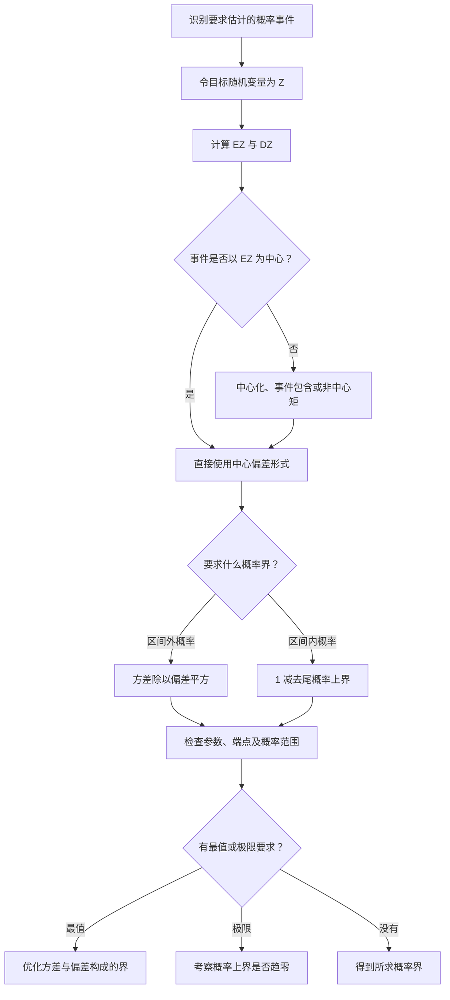

## 一、本节知识体系与考研定位

切比雪夫不等式本身非常简单，但命题人可以把它和前面学习的随机变量分布、数字特征、协方差，以及后面学习的统计量、大数定律结合起来。

真正的难点通常不在于不等式，而在于如何求出目标随机变量的期望和方差。

| 知识模块     | 核心内容             | 复习优先级 |
| -------- | ---------------- | ----- |
| 基本公式     | 中心偏差、概率上下界       | ★★★★★ |
| 独立随机变量的和 | 总和、样本均值的方差       | ★★★★★ |
| 随机变量函数   | 平方、高阶矩、函数的样本均值   | ★★★★★ |
| 协方差综合    | 相关变量的线性组合        | ★★★★★ |
| 含参最优化    | 最小化方差、最大化概率下界    | ★★★★  |
| 逆向问题     | 反求参数、样本容量、偏差范围   | ★★★★  |
| 逻辑辨析     | 上界不等于实际概率、不能随意逆推 | ★★★★  |
| 非标准事件    | 单侧尾概率、非对称区间      | ★★★★  |
| 极限证明     | 切比雪夫不等式与大数定律     | ★★★★★ |
| 理论拓展     | 不等式证明、最优性、等号条件   | ★★★   |

整节的解题主线可以概括为：

$$
\boxed{ \text{识别目标随机变量} \longrightarrow \text{求期望与方差} \longrightarrow \text{中心化} \longrightarrow \text{估计概率} }
$$

几乎所有常规题和综合题，都可以纳入这个框架。

## 二、基础知识：切比雪夫不等式究竟在说什么

### 2.1 从数学期望和方差出发

设随机变量 $X$ 的数学期望和方差分别为

$$
E(X)=\mu,\qquad D(X)=\sigma^2.
$$

数学期望描述随机变量的平均水平，方差描述随机变量围绕平均水平波动的程度。

$$
D(X)=E[(X-\mu)^2].
$$

方差越小，通常意味着随机变量越集中在期望附近。

但仅知道方差，能否定量地描述这种集中程度？

例如，已知

$$
E(X)=100,\qquad D(X)=4,
$$

虽然不知道 $X$ 服从什么分布，能否估计

$$
P(|X-100|\ge10)?
$$

答案是可以的。这正是切比雪夫不等式解决的问题。

### 2.2 切比雪夫不等式的标准形式

设随机变量 $X$ 的方差存在且有限，则对任意 $\varepsilon>0$，有

$$
\boxed{ P\{|X-E(X)|\ge\varepsilon\} \le \frac{D(X)}{\varepsilon^2} }
$$

也可以写成

$$
\boxed{ P\{|X-\mu|\ge\varepsilon\} \le \frac{\sigma^2}{\varepsilon^2} }
$$

这称为**区间外概率的上界**。

根据对立事件关系，

$$
P(|X-\mu|<\varepsilon) =1-P(|X-\mu|\ge\varepsilon),
$$

所以得到另一个极其重要的形式：

$$
\boxed{ P\{|X-\mu|<\varepsilon\} \ge 1-\frac{\sigma^2}{\varepsilon^2} }
$$

即**区间内概率的下界**。

展开绝对值：

$$
\boxed{ P\{\mu-\varepsilon<X<\mu+\varepsilon\} \ge 1-\frac{\sigma^2}{\varepsilon^2} }
$$

这三个公式实际上是同一个不等式。

### 2.3 直观理解：标准差倍数与概率集中程度

如果 $\sigma>0$，令

$$
\varepsilon=k\sigma,\qquad k>0,
$$

那么

$$
\boxed{ P(|X-\mu|\ge k\sigma)\le\frac1{k^2} }
$$

以及

$$
\boxed{ P(|X-\mu|<k\sigma)\ge1-\frac1{k^2} }
$$

| 距离期望的范围 | 区间外概率上界 | 区间内概率下界 |
| ------- | ------- | ------- |
| 1倍标准差   | 100%    | 0%      |
| 2倍标准差   | 25%     | 75%     |
| 3倍标准差   | 11.11%  | 88.89%  |
| 4倍标准差   | 6.25%   | 93.75%  |
| 5倍标准差   | 4%      | 96%     |
| 10倍标准差  | 1%      | 99%     |

这意味着，无论一个随机变量的具体分布是什么，只要方差有限，它偏离期望很多倍标准差的概率就不可能太大。

例如，偏离期望达到或超过5倍标准差的概率，最多为4%。

**与正态分布的三倍标准差原则有什么区别？**

正态分布满足

$$
P(|X-\mu|<3\sigma)\approx0.9973.
$$

而一般随机变量通过切比雪夫不等式只能保证

$$
P(|X-\mu|<3\sigma)\ge\frac89.
$$

前者依赖于正态分布的特殊结构，后者对任意有限方差的随机变量成立。

**切比雪夫不等式牺牲了估计的精确程度，换来了适用范围的广泛性。**

### 2.4 适用条件

切比雪夫不等式只要求目标随机变量具有有限方差，并且偏差阈值 $\varepsilon>0$。

| 条件                  | 是否必须       |
| ------------------- | ---------- |
| 数学期望存在              | 是，由有限二阶矩保证 |
| 方差有限                | 是          |
| $\varepsilon>0$ | 是          |
| 随机变量连续              | 否          |
| 随机变量离散              | 否          |
| 服从正态分布              | 否          |
| 分布关于期望对称            | 否          |
| 已知完整分布              | 否          |
| 涉及的多个变量相互独立         | 否          |

尤其要注意最后一项。

**独立性不是使用切比雪夫不等式的条件，而往往是计算目标随机变量方差时使用的条件。**

### 2.5 当计算结果超过概率的取值范围怎么办？

假设计算得到

$$
P(|X-\mu|\ge1)\le4,
$$

这个不等式依然成立，只不过没有提供有价值的信息。

因为概率本身满足

$$
0\le P(A)\le1,
$$

所以更完整的写法是

$$
P(|X-\mu|\ge\varepsilon) \le \min\left\{1,\frac{\sigma^2}{\varepsilon^2}\right\},
$$

$$
P(|X-\mu|<\varepsilon) \ge \max\left\{0,1-\frac{\sigma^2}{\varepsilon^2}\right\}.
$$

当 $\varepsilon>\sigma$ 时，切比雪夫不等式才能提供严格小于1的标准尾概率上界，或者严格大于0的区间概率下界。

## 三、切比雪夫不等式的本质与证明

建议理解证明，而不是只记忆结论。这样遇到陌生概率不等式时，才能自己推导。

### 3.1 从事件示性函数出发

定义事件

$$
A=\{|X-\mu|\ge\varepsilon\}.
$$

它的示性函数为

$$
I_A= \begin{cases} 1,&A\text{ 发生},\\ 0,&A\text{ 不发生}. \end{cases}
$$

当事件 $A$ 发生时，

$$
(X-\mu)^2\ge\varepsilon^2.
$$

当事件 $A$ 不发生时，

$$
(X-\mu)^2\ge0.
$$

因此无论事件是否发生，都有

$$
(X-\mu)^2\ge\varepsilon^2I_A.
$$

两边取数学期望：

$$
E[(X-\mu)^2]\ge\varepsilon^2E(I_A).
$$

利用

$$
E(I_A)=P(A),
$$

得到

$$
D(X)\ge\varepsilon^2P(A).
$$

即

$$
\boxed{ P(|X-\mu|\ge\varepsilon) \le\frac{D(X)}{\varepsilon^2} }
$$

证毕。

这段证明的核心思想是：

> 如果某个事件发生时，某个非负随机变量至少达到一个给定值，那么这个随机变量的数学期望就能限制该事件的发生概率。

### 3.2 与马尔可夫不等式的关系（拓展）

设 $Y\ge0$，且 $E(Y)$ 有限，则对任意 $a>0$，

$$
\boxed{ P(Y\ge a)\le\frac{E(Y)}a }
$$

这称为马尔可夫不等式。

取

$$
Y=(X-\mu)^2,\qquad a=\varepsilon^2,
$$

便直接得到切比雪夫不等式。

因此，遇到非标准形式，例如

$$
P(|X|\ge a),
$$

也可以考虑

$$
P(X^2\ge a^2) \le\frac{E(X^2)}{a^2}.
$$

即

$$
\boxed{ P(|X|\ge a) \le \frac{D(X)+[E(X)]^2}{a^2} }
$$

注意：这里的分子是二阶原点矩 $E(X^2)$，而不是直接写成 $D(X)$。

只有当 $E(X)=0$ 时，二者才相等。

## 四、做本节题目前必须熟练的数字特征

本节与第三章数字特征高度关联。以下公式应当做到看到题目即可调用。

### 4.1 常用数字特征公式

$$
E(aX+b)=aE(X)+b
$$

$$
D(aX+b)=a^2D(X)
$$

$$
D(X)=E(X^2)-[E(X)]^2
$$

$$
D(X^2)=E(X^4)-[E(X^2)]^2
$$

$$
\operatorname{Cov}(X,Y) =E(XY)-E(X)E(Y)
$$

$$
\operatorname{Cov}(X,Y) =\rho_{XY}\sqrt{D(X)D(Y)}
$$

$$
\boxed{ D(aX+bY) =a^2D(X)+b^2D(Y) +2ab\operatorname{Cov}(X,Y) }
$$

如果 $X,Y$ 相互独立，或者已知二者不相关，则交叉项为零。

### 4.2 常见分布的期望和方差

| 分布                                          | 数学期望                | 方差                       |
| ------------------------------------------- | ------------------- | ------------------------ |
| 0-1分布 $B(1,p)$                          | $p$             | $p(1-p)$             |
| 二项分布 $B(n,p)$                           | $np$            | $np(1-p)$            |
| 泊松分布 $P(\lambda)$                       | $\lambda$       | $\lambda$            |
| 均匀分布 $U(a,b)$                           | $\frac{a+b}{2}$ | $\frac{(b-a)^2}{12}$ |
| 指数分布 $\operatorname{Exp}(\lambda)$，速率参数 | $\frac1\lambda$ | $\frac1{\lambda^2}$  |
| 正态分布 $N(\mu,\sigma^2)$                  | $\mu$           | $\sigma^2$           |
| 卡方分布 $\chi^2(n)$                        | $n$             | $2n$                 |

标准正态分布的高阶矩也非常重要。

若 $X\sim N(0,1)$，则

$$
E(X)=0,\quad E(X^2)=1,
$$

$$
E(X^3)=0,\quad E(X^4)=3.
$$

从而

$$
D(X^2)=3-1^2=2.
$$

这恰好是2022年数学一真题的重要知识背景之一。

### 4.3 随机变量的和与平均值

若 $X_1,\ldots,X_n$ 相互独立，且

$$
E(X_i)=\mu,\qquad D(X_i)=\sigma^2,
$$

则有

$$
S_n=\sum_{i=1}^nX_i,\qquad \overline X=\frac1n\sum_{i=1}^nX_i.
$$

| 数字特征 | 总和 $S_n$        | 平均值 $\overline X$        |
| ---- | ------------------- | ---------------------------- |
| 期望   | $n\mu$          | $\mu$                    |
| 方差   | $n\sigma^2$     | $\frac{\sigma^2}{n}$     |
| 标准差  | $\sqrt n\sigma$ | $\frac{\sigma}{\sqrt n}$ |

因此，

$$
\boxed{ P(|S_n-n\mu|\ge\varepsilon) \le\frac{n\sigma^2}{\varepsilon^2} }
$$

而

$$
\boxed{ P(|\overline X-\mu|\ge\varepsilon) \le\frac{\sigma^2}{n\varepsilon^2} }
$$

这是后面各种综合题以及大数定律的核心公式。

注意区分方差中的 $n$ 与标准差中的 $\sqrt n$。这是考研选择题非常常见的干扰项。

## 五、题型一：直接利用切比雪夫不等式

### 母题1：1989年数学三真题

已知

$$
E(X)=\mu,\qquad D(X)=\sigma^2,\quad \sigma>0.
$$

由切比雪夫不等式，求

$$
P(|X-\mu|\ge3\sigma)
$$

的上界。

**标准解答**

取 $\varepsilon=3\sigma$，得到

$$
P(|X-\mu|\ge3\sigma) \le\frac{\sigma^2}{9\sigma^2} =\boxed{\frac19}.
$$

**应掌握的通用结论**

只要题目中的偏差阈值是标准差的倍数，就可以直接使用

$$
P(|X-\mu|\ge k\sigma)\le\frac1{k^2}.
$$

不需要知道具体的 $\mu$ 和 $\sigma$。

### 母题2：汤家凤八套卷第1套第16题

设

$$
X\sim\chi^2(2).
$$

由切比雪夫不等式，估计

$$
P(X>6).
$$

<Steps>

<Step>

### 第一步：求期望和方差 [!toc]

根据卡方分布的性质，

$$
EX=2,\qquad DX=4.
$$

</Step>

<Step>

### 第二步：将单侧事件转化为中心偏差事件 [!toc]

$$
\{X>6\}=\{X-2>4\}
$$

而

$$
\{X-2>4\}\subseteq\{|X-2|\ge4\}.
$$

因此

$$
P(X>6)\le P(|X-2|\ge4).
$$

</Step>

<Step>

### 第三步：应用不等式 [!toc]

$$
P(X>6)\le\frac4{4^2} =\boxed{\frac14}.
$$

</Step>

</Steps>

**深入理解**

这道题的实际概率为

$$
P(X>6)=e^{-3}\approx0.0498.
$$

而切比雪夫不等式给出的上界为 $0.25$。

二者差别很大，但并不矛盾，因为切比雪夫不等式不是在计算精确概率。

**单侧概率的通用模板**

当 $a>\mu$ 时，

$$
\boxed{ P(X\ge a)\le \frac{\sigma^2}{(a-\mu)^2} }
$$

当 $a<\mu$ 时，

$$
\boxed{ P(X\le a)\le \frac{\sigma^2}{(\mu-a)^2} }
$$

不能直接把 $a$ 代入分母，必须使用它与期望之间的距离。

## 六、题型二：随机变量函数与高阶矩

这是本节最重要的数学一真题题型。

### 母题3：2022年数学一真题（重点精讲）

设 $X_1,X_2,\ldots,X_n$ 独立同分布，且 $X_1$ 的四阶矩存在。记

$$
E(X_1^k)=\mu_k,\qquad k=1,2,3,4.
$$

对任意 $\varepsilon>0$，由切比雪夫不等式估计

$$
P\left\{ \left|\frac1n\sum_{i=1}^nX_i^2-\mu_2\right| \ge\varepsilon \right\}.
$$

**1. 审题时应该识别什么？**

看到

$$
\frac1n\sum_{i=1}^nX_i^2,
$$

不能把它直接当成普通的样本均值 $\overline X$。

它实际上是另一组随机变量的样本均值。

令

$$
Y_i=X_i^2.
$$

则题目中的随机变量为

$$
\overline Y=\frac1n\sum_{i=1}^nY_i.
$$

题目由此变成一个普通的样本均值概率估计问题。

**2. 为什么题目特别给出四阶矩？**

因为目标变量是 $X_i^2$，要求它的方差就需要计算

$$
\begin{aligned} D(X_i^2) &=E[(X_i^2)^2]-[E(X_i^2)]^2\\ &=E(X_i^4)-[E(X_i^2)]^2. \end{aligned}
$$

因此，四阶矩存在不是多余条件，而是保证新变量 $Y_i$ 方差有限的关键条件。

**3. 求新随机变量的期望和方差**

$$
EY_i=EX_i^2=\mu_2,
$$

$$
DY_i=\mu_4-\mu_2^2.
$$

由于原随机变量相互独立，对它们分别作平方变换后，仍然相互独立。

所以

$$
E(\overline Y)=\mu_2,
$$

$$
\begin{aligned} D(\overline Y) &=\frac1{n^2}\sum_{i=1}^nDY_i\\ &=\frac{\mu_4-\mu_2^2}{n}. \end{aligned}
$$

**4. 应用切比雪夫不等式**

$$
\begin{aligned} &P\left( \left|\frac1n\sum_{i=1}^nX_i^2-\mu_2\right| \ge\varepsilon \right)\\ &\le \frac{D(\overline Y)}{\varepsilon^2}\\ &=\boxed{ \frac{\mu_4-\mu_2^2}{n\varepsilon^2} }. \end{aligned}
$$

**5. 真题的主要陷阱**

| 错误表达式                                            | 错误原因                 |
| ------------------------------------------------ | -------------------- |
| $\frac{\mu_2-\mu_1^2}{n\varepsilon^2}$       | 求成了原变量 $X_i$ 的方差 |
| $\frac{\mu_4-\mu_2^2}{\sqrt n\varepsilon^2}$ | 混淆了方差和标准差            |
| $\frac{\mu_4-\mu_2^2}{n^2\varepsilon^2}$     | 忘记有 $n$ 项方差相加    |
| $\frac{\mu_4}{n\varepsilon^2}$               | 漏掉期望平方，只得到较粗的界       |
| $\frac{\mu_4-\mu_2^2}{n\varepsilon}$         | 忘记偏差阈值需要平方           |

**6. 从这道真题提炼一般母题**

设 $X_1,\ldots,X_n$ 独立同分布，对它们分别进行同样的函数变换：

$$
Y_i=g(X_i).
$$

若

$$
E[g(X_i)]=m,\qquad D[g(X_i)]=v<\infty,
$$

则

$$
\boxed{ P\left\{ \left|\frac1n\sum_{i=1}^ng(X_i)-m\right| \ge\varepsilon \right\} \le\frac{v}{n\varepsilon^2} }
$$

也就是

$$
\boxed{ \frac{E[g^2(X)]-[E(g(X))]^2} {n\varepsilon^2} }
$$

其中 $g^2(X)$ 表示 $[g(X)]^2$。

特别地，若 $g(X)=X^k$，且相应的二阶矩有限，则

$$
\boxed{ P\left\{ \left|\frac1n\sum_{i=1}^nX_i^k-\mu_k\right| \ge\varepsilon \right\} \le \frac{\mu_{2k}-\mu_k^2}{n\varepsilon^2} }
$$

未来真题完全可以把平方换成三次方、绝对值、指数函数或示性函数，而解题方法不变。

### 母题4：张宇1000题——标准正态变量平方和

设 $X_1,\ldots,X_n$ 为来自总体 $N(0,1)$ 的简单随机样本，且 $n>2$。

求

$$
P\left(0<\sum_{i=1}^nX_i^2<2n\right)
$$

的切比雪夫下界。

<Tabs items={["方法一：利用卡方分布", "方法二：直接求矩"]} defaultIndex={0}>

<Tab value="方法一：利用卡方分布">

令

$$
S=\sum_{i=1}^nX_i^2.
$$

根据卡方分布的定义，

$$
S\sim\chi^2(n).
$$

于是

$$
ES=n,\qquad DS=2n.
$$

注意

$$
0<S<2n \iff |S-n|<n.
$$

因此

$$
\begin{aligned} P(0<S<2n) &=P(|S-n|<n)\\ &\ge1-\frac{2n}{n^2}\\ &=\boxed{1-\frac2n}. \end{aligned}
$$

</Tab>

<Tab value="方法二：直接求矩">

不认识卡方分布也能做。

因为

$$
E(X_i^2)=1,\qquad E(X_i^4)=3,
$$

所以

$$
D(X_i^2)=2.
$$

根据独立性，

$$
ES=n,\qquad DS=2n.
$$

后续完全相同。

</Tab>

</Tabs>

**为什么要求 $n>2$？**

因为当 $n>2$ 时，

$$
1-\frac2n>0.
$$

这个条件不是为了保证切比雪夫不等式成立，而是为了保证计算得到有意义的正概率下界。

**变式：一般正态分布的平方和**

设 $X_i$ 独立同分布于 $N(\mu,\sigma^2)$，则

$$
E(X_i^2)=\mu^2+\sigma^2,
$$

$$
E(X_i^4)=\mu^4+6\mu^2\sigma^2+3\sigma^4.
$$

从而

$$
D(X_i^2)=4\mu^2\sigma^2+2\sigma^4.
$$

因此

$$
\boxed{ P\left( \left|\frac1n\sum_{i=1}^nX_i^2-(\mu^2+\sigma^2)\right| \ge\varepsilon \right) \le \frac{4\mu^2\sigma^2+2\sigma^4}{n\varepsilon^2} }
$$

这就是将2022年数学一真题和正态分布高阶矩结合起来的一种自然创新方向。

## 七、题型三：独立随机变量的和与区间概率

这一类题目通常把切比雪夫不等式与常见分布的期望、方差及可加性结合起来。

### 母题5：李林880题——不同参数二项分布的和

设

$$
X_i\sim B(i,0.2),\qquad i=1,2,\ldots,10,
$$

且 $X_1,\ldots,X_{10}$ 相互独立。

利用切比雪夫不等式，求

$$
P\left(6<\sum_{i=1}^{10}X_i<16\right)
$$

的下界。

<Steps>

<Step>

### 第一步：确定目标随机变量 [!toc]

令

$$
S=\sum_{i=1}^{10}X_i.
$$

</Step>

<Step>

### 第二步：计算期望和方差 [!toc]

由于

$$
E(X_i)=0.2i,
$$

$$
D(X_i)=0.2\times0.8i=0.16i,
$$

因此

$$
ES=0.2\sum_{i=1}^{10}i =0.2\times55=11,
$$

根据独立性，

$$
DS=0.16\sum_{i=1}^{10}i =0.16\times55=8.8.
$$

也可以利用二项分布的可加性直接得到

$$
S\sim B(55,0.2).
$$

</Step>

<Step>

### 第三步：识别对称区间 [!toc]

区间 $(6,16)$ 的中点为11，恰好等于 $ES$。

因此

$$
6<S<16\iff |S-11|<5.
$$

</Step>

<Step>

### 第四步：应用切比雪夫不等式 [!toc]

$$
\begin{aligned} P(6<S<16) &=P(|S-11|<5)\\ &\ge1-\frac{8.8}{25}\\ &=\boxed{0.648}. \end{aligned}
$$

</Step>

</Steps>

**母题总结**

这里的关键不在于二项分布的可加性。

即使 $X_i$ 的成功概率各不相同，无法使用二项分布可加性，只要仍然独立，就可以通过逐项计算期望和方差解决问题。

**求概率界不一定要求出随机变量的完整分布。**

### 母题6：李正元练习题——不同类型随机变量的和

设随机变量 $X,Y$ 相互独立，且

$$
X\sim B(5,0.8),\qquad Y\sim N(1,1).
$$

求

$$
P(0<X+Y<10)
$$

的切比雪夫下界。

令

$$
Z=X+Y.
$$

分别计算：

$$
EX=4,\qquad DX=0.8,
$$

$$
EY=1,\qquad DY=1.
$$

所以

$$
EZ=5,\qquad DZ=1.8.
$$

又因为

$$
0<Z<10\iff |Z-5|<5,
$$

所以

$$
\begin{aligned} P(0<Z<10) &\ge1-\frac{1.8}{25}\\ &=\boxed{\frac{116}{125}}. \end{aligned}
$$

**本题的命题价值**

二项分布与正态分布的和通常不服从我们熟悉的标准分布。

如果要求精确概率，可能需要全概率公式等方法。但如果只要求切比雪夫概率界，那么仅需期望和方差。

这体现出本节与第二章随机变量函数分布之间的区别：

| 求解目标       | 需要掌握的信息     |
| ---------- | ----------- |
| 精确计算概率     | 分布律、密度或分布函数 |
| 切比雪夫概率估计   | 期望与方差       |
| 中心极限定理近似计算 | 相应条件、期望与方差  |

## 八、题型四：相关随机变量的线性组合

这一类是切比雪夫不等式与第三章协方差、相关系数结合的核心题型。

### 母题7：2001年数学三真题

设

$$
EX=EY=2,
$$

$$
DX=1,\qquad DY=4,
$$

$$
\rho_{XY}=0.5.
$$

利用切比雪夫不等式，估计

$$
P(|X-Y|\ge6).
$$

<Steps>

<Step>

### 第一步：确定中心 [!toc]

令

$$
Z=X-Y.
$$

则

$$
EZ=EX-EY=0.
$$

这意味着题目中的绝对值已经是关于期望的中心偏差。

</Step>

<Step>

### 第二步：求协方差 [!toc]

$$
\begin{aligned} \operatorname{Cov}(X,Y) &=\rho_{XY}\sqrt{DX\cdot DY}\\ &=0.5\sqrt{1\times4}\\ &=1. \end{aligned}
$$

</Step>

<Step>

### 第三步：求目标变量的方差 [!toc]

$$
\begin{aligned} DZ &=D(X-Y)\\ &=DX+DY-2\operatorname{Cov}(X,Y)\\ &=1+4-2\\ &=3. \end{aligned}
$$

</Step>

<Step>

### 第四步：应用切比雪夫不等式 [!toc]

$$
P(|X-Y|\ge6) \le\frac3{36} =\boxed{\frac1{12}}.
$$

</Step>

</Steps>

### 配套变式：李林880题

设

$$
EX=-2,\qquad EY=2,
$$

$$
DX=1,\qquad DY=4,
$$

$$
\rho_{XY}=-\frac12.
$$

求

$$
P(|X+Y|\ge6)
$$

的切比雪夫上界。

由于

$$
E(X+Y)=0,
$$

$$
\operatorname{Cov}(X,Y)=-1,
$$

故

$$
D(X+Y)=1+4+2(-1)=3.
$$

所以

$$
P(|X+Y|\ge6)\le\boxed{\frac1{12}}.
$$

**为什么这两道题结果相同？**

| 相关关系 | 和的方差 | 差的方差 |
| ---- | ---- | ---- |
| 正相关  | 增大   | 减小   |
| 负相关  | 减小   | 增大   |
| 不相关  | 方差相加 | 方差相加 |

直观地说，正相关的两个随机变量倾向于一起增大、一起减小，所以它们的差相对稳定，而和的波动较大。

负相关则恰好相反。

### 通用母题公式

若

$$
Z=aX+bY+c,
$$

则

$$
EZ=aEX+bEY+c,
$$

$$
DZ=a^2DX+b^2DY +2ab\rho_{XY}\sqrt{DX\cdot DY}.
$$

因此

$$
\boxed{ \begin{aligned} &P(|Z-EZ|\ge\varepsilon)\\ &\le \frac{ a^2DX+b^2DY+ 2ab\rho_{XY}\sqrt{DX\cdot DY} }{\varepsilon^2}. \end{aligned} }
$$

只要看到两个随机变量的线性组合与相关系数同时出现，就应该首先想到这个公式。

## 九、题型五：含参数的概率界最优化

这是非常值得数学一考生重点训练的创新题型，它把概率论与高等数学中的最值问题结合起来。

### 母题8：李永乐六套卷第1套第16题

已知随机变量 $X,Y$ 满足

$$
EX=EY=0,
$$

$$
DX=4,\qquad DY=1,
$$

$$
\rho_{XY}=-\frac12.
$$

对任意实数 $a$，利用切比雪夫不等式得到

$$
P(|X+aY|<4)\ge k(a).
$$

求 $k(a)$ 的最大值。

**1. 如何识别题型？**

题目不是让你计算某个固定的概率界，而是让你选择参数 $a$，使切比雪夫不等式给出的下界最大。

令

$$
Z=X+aY.
$$

由于

$$
EZ=0,
$$

切比雪夫不等式给出

$$
P(|Z|<4)\ge1-\frac{DZ}{16}.
$$

所以

$$
k(a)=1-\frac{D(X+aY)}{16}.
$$

问题的本质已经变成：

$$
\boxed{ \text{最大化概率下界} \iff \text{最小化目标变量的方差} }
$$

**2. 求方差的表达式**

先求协方差：

$$
\operatorname{Cov}(X,Y) =-\frac12\sqrt{4\times1}=-1.
$$

从而

$$
\begin{aligned} D(X+aY) &=DX+a^2DY+2a\operatorname{Cov}(X,Y)\\ &=4+a^2-2a\\ &=(a-1)^2+3. \end{aligned}
$$

**3. 求最值**

当 $a=1$ 时，方差取得最小值3。

因此

$$
\begin{aligned} k_{\max} &=1-\frac3{16}\\ &=\boxed{\frac{13}{16}}. \end{aligned}
$$

### 9.1 一般化：如何快速求最优线性组合？

记

$$
DX=u,\qquad DY=v>0,
$$

$$
\operatorname{Cov}(X,Y)=c.
$$

则

$$
D(X+aY)=u+2ac+a^2v.
$$

配方得到

$$
D(X+aY) =v\left(a+\frac cv\right)^2 +u-\frac{c^2}{v}.
$$

所以最优参数为

$$
\boxed{ a^*=-\frac{\operatorname{Cov}(X,Y)}{DY} }
$$

最小方差为

$$
\boxed{ \min_aD(X+aY) =DX-\frac{\operatorname{Cov}^2(X,Y)}{DY} }
$$

利用相关系数公式，还可以写成

$$
\boxed{ \min_aD(X+aY)=DX(1-\rho_{XY}^2) }
$$

只要偏差阈值 $\varepsilon$ 固定，并且概率事件始终围绕 $E(X+aY)$ 中心化，就有

$$
\boxed{ k_{\max} =1-\frac{DX(1-\rho_{XY}^2)}{\varepsilon^2} }
$$

如果这个值为负，还可以结合概率非负性取零作为下界。

### 9.2 与最小二乘和协方差的深层联系

当 $a=a^*$ 时，

$$
\begin{aligned} \operatorname{Cov}(X+a^*Y,Y) &=\operatorname{Cov}(X,Y)+a^*DY\\ &=0. \end{aligned}
$$

也就是说，方差最小时，新的随机变量与 $Y$ 不相关。

这一性质可以成为切比雪夫不等式、相关系数、方差最优化的综合命题点。

### 9.3 创新变式：两个独立估计量的最优加权

设 $X,Y$ 相互独立，且

$$
EX=EY=\theta,
$$

$$
DX=4,\qquad DY=9.
$$

令

$$
Z=aX+(1-a)Y.
$$

求使

$$
P(|Z-\theta|<5)
$$

的切比雪夫下界最大的参数 $a$，并求相应下界。

**解答**

首先，

$$
EZ=a\theta+(1-a)\theta=\theta.
$$

由独立性，

$$
\begin{aligned} DZ &=4a^2+9(1-a)^2\\ &=13a^2-18a+9\\ &=13\left(a-\frac9{13}\right)^2+\frac{36}{13}. \end{aligned}
$$

因此

$$
a^*=\frac9{13},
$$

$$
D_{\min}(Z)=\frac{36}{13}.
$$

最大下界为

$$
\boxed{ 1-\frac{36}{325} =\frac{289}{325} }
$$

这个变式还可以和第五章参数估计中的无偏性、有效性结合起来。

**需要注意：最大化切比雪夫下界，并不意味着已经证明真实概率在该参数处取得最大值。**

## 十、题型六：密度函数、分布对称性与协方差综合

### 母题9：李永乐六套卷第5套第8题

这是本次分类模拟题中综合性较强的一道题。

设 $X$ 的概率密度为 $f(x)$，且

$$
EX=\mu,\qquad DX=\sigma^2>0.
$$

随机变量 $Y$ 的概率密度为

$$
f(2a-y).
$$

已知

$$
D(X+Y)=3\sigma^2.
$$

求

$$
P\{|2X-Y-(3\mu-2a)|\ge3\sigma\}
$$

的切比雪夫上界。

<Steps>

<Step>

### 第一步：识别密度变换 [!toc]

由于 $Y$ 的概率密度为 $f(2a-y)$，所以

$$
Y\overset{d}=2a-X.
$$

这里的符号表示同分布，而不是两个随机变量处处相等。

因此

$$
EY=2a-\mu,
$$

$$
DY=\sigma^2.
$$

</Step>

<Step>

### 第二步：由已知方差反求协方差 [!toc]

$$
D(X+Y)=DX+DY+2\operatorname{Cov}(X,Y).
$$

代入已知条件：

$$
3\sigma^2 =2\sigma^2+2\operatorname{Cov}(X,Y).
$$

所以

$$
\boxed{ \operatorname{Cov}(X,Y)=\frac{\sigma^2}{2} }
$$

</Step>

<Step>

### 第三步：计算目标随机变量的数字特征 [!toc]

令

$$
Z=2X-Y.
$$

则

$$
\begin{aligned} EZ &=2\mu-(2a-\mu)\\ &=3\mu-2a. \end{aligned}
$$

方差为

$$
\begin{aligned} DZ &=4DX+DY-4\operatorname{Cov}(X,Y)\\ &=4\sigma^2+\sigma^2-2\sigma^2\\ &=3\sigma^2. \end{aligned}
$$

</Step>

<Step>

### 第四步：代入切比雪夫不等式 [!toc]

$$
\begin{aligned} &P(|2X-Y-(3\mu-2a)|\ge3\sigma)\\ &=P(|Z-EZ|\ge3\sigma)\\ &\le\frac{3\sigma^2}{9\sigma^2}\\ &=\boxed{\frac13}. \end{aligned}
$$

</Step>

</Steps>

### 10.1 本题为什么重要？

一道题同时考查了第二章随机变量函数分布、第三章期望方差、协方差、同分布与相等的区别，以及第四章切比雪夫不等式。

最大的陷阱是把

$$
Y\overset d=2a-X
$$

错误写成

$$
Y=2a-X.
$$

如果真的有 $Y=2a-X$，那么

$$
X+Y=2a,
$$

从而

$$
D(X+Y)=0,
$$

这与题设条件直接矛盾。

**边缘分布相同，只能保证对应的数字特征相同，不能确定两个随机变量之间的联合关系。**

### 母题10：李正元练习题——偶密度与样本均值

设 $X_1,\ldots,X_n$ 独立同分布，其概率密度为偶函数，且

$$
DX_i=1.
$$

估计

$$
P\left( \left|\frac1n\sum_{i=1}^nX_i\right| <\varepsilon \right).
$$

由密度函数为偶函数，

$$
f(x)=f(-x).
$$

由于一阶矩存在，

$$
EX_i=\int_{-\infty}^{+\infty}xf(x)\,dx=0.
$$

令

$$
\overline X=\frac1n\sum_{i=1}^nX_i.
$$

则

$$
E\overline X=0,
$$

$$
D\overline X=\frac1n.
$$

所以

$$
\boxed{ P(|\overline X|<\varepsilon) \ge1-\frac1{n\varepsilon^2} }
$$

**对称性的一般结论**

若随机变量的分布关于 $a$ 对称，且期望存在，则

$$
\boxed{EX=a}
$$

特别地，密度函数是偶函数时，

$$
EX=0.
$$

如果相应的奇数阶矩存在，则关于零对称的随机变量还满足

$$
E(X^{2k+1})=0.
$$

## 十一、题型七：逆向求参数与样本容量

### 母题11：张宇8套卷第3套第16题

李林880题中也收录了相同结构的题目。

设

$$
X\sim U[-1,a].
$$

如果由切比雪夫不等式得到

$$
P(|X-1|<\varepsilon)\ge\frac23,
$$

求 $a,\varepsilon$。

**按照原题的常规命题意图解答**

因为标准切比雪夫不等式的中心为 $EX$，所以令

$$
EX=1.
$$

由均匀分布的期望公式，

$$
\frac{a-1}{2}=1.
$$

解得

$$
a=3.
$$

此时

$$
DX=\frac{(3+1)^2}{12}=\frac43.
$$

再令切比雪夫公式直接产生的下界为 $2/3$，得到

$$
1-\frac{4}{3\varepsilon^2}=\frac23.
$$

因此

$$
\varepsilon^2=4.
$$

由于 $\varepsilon>0$，

$$
\boxed{a=3,\qquad\varepsilon=2}.
$$

<Callout type="warn" title="概率界与参数的唯一性">

这道题的参考答案是 $(3,2)$，但需要明确其隐含条件：题目要求给出的概率不等式是以期望为中心、直接代入标准切比雪夫公式所得的界，且公式中的下界恰好等于 $2/3$。

如果仅仅要求

$$
P(|X-1|<\varepsilon)\ge\frac23
$$

成立，那么参数并不唯一。

例如取 $a=3,\varepsilon=3$，实际概率为1，同样满足条件。

因此，考试中应理解题目的命题意图，但在理论判断题中，不能随意把概率不等式转化为数字特征等式。

</Callout>

### 11.1 反求偏差范围

设

$$
EX=\mu,\qquad DX=\sigma^2.
$$

希望利用切比雪夫不等式保证

$$
P(|X-\mu|<\varepsilon)\ge p,
$$

其中 $0<p<1$。

只需要求

$$
1-\frac{\sigma^2}{\varepsilon^2}\ge p.
$$

解得

$$
\boxed{ \varepsilon\ge\frac{\sigma}{\sqrt{1-p}} }
$$

例如，已知 $DX=9$，希望保证随机变量落在期望附近的概率至少为96%。

那么

$$
\varepsilon\ge\frac3{\sqrt{0.04}}=15.
$$

所以可以保证

$$
P(|X-EX|<15)\ge0.96.
$$

### 11.2 反求最小样本容量

设 $X_1,\ldots,X_n$ 独立同分布，且

$$
EX_i=\mu,\qquad DX_i=\sigma^2.
$$

希望利用切比雪夫不等式保证

$$
P(|\overline X-\mu|<\varepsilon)\ge1-\alpha.
$$

由

$$
P(|\overline X-\mu|<\varepsilon) \ge1-\frac{\sigma^2}{n\varepsilon^2},
$$

令

$$
\frac{\sigma^2}{n\varepsilon^2}\le\alpha.
$$

得到

$$
\boxed{ n\ge\frac{\sigma^2}{\alpha\varepsilon^2} }
$$

所以，使该切比雪夫下界达到要求的最小正整数样本容量为

$$
\boxed{ n_{\min}= \max\left\{1, \left\lceil\frac{\sigma^2}{\alpha\varepsilon^2}\right\rceil \right\} }
$$

### 补充母题：利用频率估计概率

某种产品的合格率为 $p=0.8$。进行 $n$ 次独立检验，用合格品频率 $\widehat p$ 估计真实合格率。

希望保证

$$
P(|\widehat p-0.8|<0.02)\ge0.95.
$$

问利用切比雪夫不等式，至少需要检验多少件产品？

**解答**

令 $X_i$ 表示第 $i$ 件产品是否合格，则

$$
X_i\sim B(1,0.8),
$$

且

$$
\widehat p=\frac1n\sum_{i=1}^nX_i.
$$

于是

$$
E\widehat p=0.8,
$$

$$
D\widehat p=\frac{0.8\times0.2}{n} =\frac{0.16}{n}.
$$

所以

$$
P(|\widehat p-0.8|<0.02) \ge1-\frac{0.16}{n(0.02)^2} =1-\frac{400}{n}.
$$

要求

$$
1-\frac{400}{n}\ge0.95,
$$

解得

$$
\boxed{n\ge8000}.
$$

因此，利用切比雪夫不等式保证目标概率，需要的最小样本容量为8000。

这不意味着根据精确的二项分布计算，真实所需样本量也是8000。切比雪夫方法通常较为保守。

## 十二、题型八：非对称区间与非中心事件

常规题多使用标准的对称区间，综合题也可能采用非对称区间。

### 12.1 非对称区间的处理方法

设

$$
EX=\mu,\qquad DX=\sigma^2,
$$

要求估计

$$
P(a<X<b).
$$

如果

$$
a<\mu<b,
$$

但 $\mu$ 不等于区间中点，就不能直接取区间半宽。

正确的处理方法是构造一个包含在原区间内、以期望为中心的最大对称区间。

令

$$
\boxed{ r=\min\{\mu-a,b-\mu\} }
$$

则

$$
(\mu-r,\mu+r)\subseteq(a,b).
$$

因此

$$
\begin{aligned} P(a<X<b) &\ge P(|X-\mu|<r)\\ &\ge1-\frac{\sigma^2}{r^2}. \end{aligned}
$$

即

$$
\boxed{ P(a<X<b) \ge 1-\frac{\sigma^2} {\min\{\mu-a,b-\mu\}^2} }
$$

这是通过标准中心化切比雪夫不等式和内含对称区间得到的通用下界。

### 补充母题：非对称区间

设

$$
EX=5,\qquad DX=4.
$$

求

$$
P(1<X<8)
$$

的一个切比雪夫下界。

区间左端距离期望为

$$
5-1=4,
$$

右端距离期望为

$$
8-5=3.
$$

因此选取

$$
r=\min\{4,3\}=3.
$$

因为

$$
\{|X-5|<3\} =\{2<X<8\} \subseteq\{1<X<8\},
$$

所以

$$
\begin{aligned} P(1<X<8) &\ge P(|X-5|<3)\\ &\ge1-\frac49\\ &=\boxed{\frac59}. \end{aligned}
$$

<Callout type="warn" title="常见错误">

直接使用区间半宽

$$
\frac{8-1}{2}=3.5
$$

是不正确的，因为区间中心为4.5，而不是数学期望5。

**切比雪夫不等式中的偏差是相对于期望而言的，不是相对于任意区间中点。**

</Callout>

### 12.2 非中心绝对值事件

设题目要求估计

$$
P(|X-c|\ge\varepsilon),
$$

但是

$$
EX=\mu\ne c.
$$

此时不能直接写成

$$
P(|X-c|\ge\varepsilon) \le\frac{DX}{\varepsilon^2}.
$$

有两种常见处理方法。

<Tabs items={["方法一：利用三角不等式进行中心化", "方法二：直接利用非中心二阶矩"]} defaultIndex={0}>

<Tab value="方法一：利用三角不等式进行中心化">

因为

$$
|X-c|\le|X-\mu|+|\mu-c|,
$$

所以当

$$
|X-c|\ge\varepsilon
$$

时，必有

$$
|X-\mu|\ge\varepsilon-|\mu-c|.
$$

若

$$
\varepsilon>|\mu-c|,
$$

则

$$
\boxed{ P(|X-c|\ge\varepsilon) \le \frac{\sigma^2} {(\varepsilon-|\mu-c|)^2} }
$$

</Tab>

<Tab value="方法二：直接利用非中心二阶矩">

由马尔可夫不等式，

$$
P(|X-c|\ge\varepsilon) \le\frac{E[(X-c)^2]}{\varepsilon^2}.
$$

又因为

$$
\boxed{ E[(X-c)^2]=\sigma^2+(\mu-c)^2 }
$$

所以

$$
\boxed{ P(|X-c|\ge\varepsilon) \le \frac{\sigma^2+(\mu-c)^2}{\varepsilon^2} }
$$

第二种方法属于利用平方变量的广义概率界，不要求 $\varepsilon>|\mu-c|$，但计算出的界不一定更好。

</Tab>

</Tabs>

### 12.3 单侧概率的进一步拓展：坎泰利不等式

这一部分不属于考研数学一的常规必背公式，但可以帮助理解未来给定条件的证明题。

对于任意 $t>0$，有

$$
\boxed{ P(X-\mu\ge t) \le\frac{\sigma^2}{\sigma^2+t^2} }
$$

这称为单侧切比雪夫不等式，也称坎泰利不等式。

证明思想是对任意 $a\ge0$，利用事件包含关系：

$$
\{X-\mu\ge t\} \subseteq \{(X-\mu+a)^2\ge(t+a)^2\}.
$$

所以

$$
P(X-\mu\ge t) \le \frac{\sigma^2+a^2}{(t+a)^2}.
$$

选择

$$
a=\frac{\sigma^2}{t}
$$

使右侧达到最小，即得

$$
P(X-\mu\ge t) \le\frac{\sigma^2}{\sigma^2+t^2}.
$$

例如汤家凤模拟题中的

$$
X\sim\chi^2(2),
$$

普通切比雪夫不等式给出

$$
P(X>6)\le\frac14,
$$

而单侧形式可以给出

$$
P(X>6)\le\frac4{4+16}=\frac15.
$$

如果题目明确要求标准切比雪夫不等式给出的结果，仍应按照题目指定的方法作答。

## 十三、题型九：逻辑判断与反向推理陷阱

### 母题12：李正元练习题

已知随机变量 $X$ 的方差存在，并且

$$
P(|X-EX|\ge3)\le\frac29.
$$

判断以下结论哪一个一定成立：

A. $DX=2$

B. $P(|X-EX|<3)<\frac79$

C. $DX\ne2$

D. $P(|X-EX|<3)\ge\frac79$

**正确思路**

由对立事件关系，

$$
\begin{aligned} P(|X-EX|<3) &=1-P(|X-EX|\ge3)\\ &\ge1-\frac29\\ &=\frac79. \end{aligned}
$$

因此选择 D。

**为什么不能反推出 $DX=2$？**

切比雪夫不等式告诉我们

$$
P(|X-EX|\ge3)\le\frac{DX}{9}.
$$

题目同时告诉我们

$$
P(|X-EX|\ge3)\le\frac29.
$$

但是同一个量小于两个不同的上界，并不意味着两个上界相等，也不意味着两个上界之间有确定的大小关系。

这属于基本的逻辑错误。

### 13.1 构造反例：尾概率小，但方差很大

设随机变量 $X$ 的分布律为

| $X$ | $-M$   | $0$   | $M$    |
| ------- | ---------- | --------- | ---------- |
| 概率      | $0.05$ | $0.9$ | $0.05$ |

其中 $M\ge3$。

显然，

$$
EX=0.
$$

且

$$
P(|X-EX|\ge3)=0.1\le\frac29.
$$

但是

$$
DX=E(X^2)=0.1M^2.
$$

当 $M\to+\infty$ 时，

$$
DX\to+\infty.
$$

所以尾概率较小，并不能说明方差一定较小。

### 13.2 判断题必须区分充分条件与必要条件

由切比雪夫不等式，

$$
DX\le\alpha\varepsilon^2
$$

可以推出

$$
P(|X-EX|\ge\varepsilon)\le\alpha.
$$

但反过来通常不成立。

换句话说，

$$
\boxed{ DX\le\alpha\varepsilon^2 \Longrightarrow P(|X-EX|\ge\varepsilon)\le\alpha }
$$

它是一个充分条件，而不是充要条件。

### 13.3 严格不等号的陷阱

标准形式为

$$
P(|X-\mu|\ge\varepsilon) \le\frac{\sigma^2}{\varepsilon^2}.
$$

对应的补事件是

$$
P(|X-\mu|<\varepsilon) \ge1-\frac{\sigma^2}{\varepsilon^2}.
$$

| 原事件                           | 对立事件                          |
| ----------------------------- | ----------------------------- |
| $X\ge a$                  | $X<a$                    |
| $X>a$                     | $X\le a$                  |
| $\|X-\mu\|\ge\varepsilon$ | $\|X-\mu\|<\varepsilon$   |
| $\|X-\mu\|>\varepsilon$   | $\|X-\mu\|\le\varepsilon$ |

对于连续型随机变量，单点概率为零，因此端点是否包含通常不影响概率。

但对于离散型随机变量，端点处的概率可能不为零，必须认真区分。

## 十四、题型十：切比雪夫不等式的等号与最优性

这是一个重要的理论拓展方向，适合培养证明题与创新题能力。

### 14.1 切比雪夫不等式能够取等号吗？

可以。

设

$$
EX=\mu,\qquad DX=\sigma^2,
$$

并且

$$
\varepsilon\ge\sigma>0.
$$

构造随机变量 $X$：

| $X$ | $\mu-\varepsilon$                 | $\mu$                              | $\mu+\varepsilon$                 |
| ------- | ------------------------------------- | -------------------------------------- | ------------------------------------- |
| 概率      | $\frac{\sigma^2}{2\varepsilon^2}$ | $1-\frac{\sigma^2}{\varepsilon^2}$ | $\frac{\sigma^2}{2\varepsilon^2}$ |

根据对称性，

$$
EX=\mu.
$$

方差为

$$
\begin{aligned} DX &=\varepsilon^2\frac{\sigma^2}{2\varepsilon^2} +\varepsilon^2\frac{\sigma^2}{2\varepsilon^2}\\ &=\sigma^2. \end{aligned}
$$

而

$$
P(|X-\mu|\ge\varepsilon) =\frac{\sigma^2}{\varepsilon^2}.
$$

所以

$$
\boxed{ P(|X-\mu|\ge\varepsilon) =\frac{DX}{\varepsilon^2} }
$$

恰好取等号。

### 14.2 直观展示：为什么上界不能普遍改进？

例如取

$$
\mu=0,\qquad\sigma^2=1,\qquad\varepsilon=3.
$$

构造

| $X$ | $-3$         | $0$       | $3$          |
| ------- | ---------------- | ------------- | ---------------- |
| 概率      | $\frac1{18}$ | $\frac89$ | $\frac1{18}$ |

则

$$
EX=0,\qquad DX=1,
$$

并且

$$
P(|X|\ge3)=\frac19.
$$

这就是1989年真题上界 $1/9$ 恰好能够达到的一个具体分布。

因此，不能认为切比雪夫不等式虽然粗糙，就一定可以在完全不增加条件的情况下改进它。

它对某些分布确实非常保守，但对另外一些分布却可以恰好取等。

### 14.3 等号成立的本质

回顾证明中的

$$
(X-\mu)^2\ge\varepsilon^2I_A.
$$

若期望层面的不等式取等号，则这个非负差值必须几乎处处为零。

因此只能有

$$
(X-\mu)^2= \begin{cases} 0,&A^c,\\ \varepsilon^2,&A. \end{cases}
$$

也就是说，随机变量只能几乎处处取

$$
\mu-\varepsilon,\quad\mu,\quad\mu+\varepsilon
$$

这三个值中的某些值。

这也是为什么前面使用三点分布可以精确实现切比雪夫不等式的上界。

## 十五、题型十一：切比雪夫不等式与大数定律

这一部分虽然与第四章第二节存在交叉，但它是理解切比雪夫不等式的重要应用。

### 15.1 从切比雪夫不等式推导样本均值的依概率收敛

设 $X_1,X_2,\ldots$ 独立同分布，且

$$
EX_i=\mu,\qquad DX_i=\sigma^2<\infty.
$$

令

$$
\overline X_n=\frac1n\sum_{i=1}^nX_i.
$$

则

$$
E\overline X_n=\mu,
$$

$$
D\overline X_n=\frac{\sigma^2}{n}.
$$

由切比雪夫不等式，对于任意固定的 $\varepsilon>0$，

$$
0\le P(|\overline X_n-\mu|\ge\varepsilon) \le\frac{\sigma^2}{n\varepsilon^2}.
$$

令 $n\to\infty$，根据夹逼准则，

$$
\lim_{n\to\infty} P(|\overline X_n-\mu|\ge\varepsilon)=0.
$$

所以

$$
\boxed{ \overline X_n\xrightarrow{P}\mu }
$$

这正是有限方差条件下，大数定律的一个基本证明思路。

### 15.2 最重要的依概率收敛判别方法

设随机变量序列 $Y_n$ 满足

$$
EY_n\to a,
$$

$$
DY_n\to0.
$$

则

$$
\boxed{Y_n\xrightarrow{P}a}
$$

证明如下：

$$
\begin{aligned} E[(Y_n-a)^2] &=DY_n+(EY_n-a)^2\\ &\to0. \end{aligned}
$$

利用非负随机变量的马尔可夫不等式，

$$
P(|Y_n-a|\ge\varepsilon) \le\frac{E[(Y_n-a)^2]}{\varepsilon^2} \to0.
$$

因此得到依概率收敛。

注意，这是一个充分条件，并不是必要条件。

### 母题13：李林880题——独立但不同分布的随机变量序列

设 $X_1,X_2,\ldots$ 相互独立，且 $X_i$ 的分布律为

| $X_i$ | $-ia$          | $0$             | $ia$           |
| --------- | ------------------ | ------------------- | ------------------ |
| 概率        | $\frac1{2i^2}$ | $1-\frac1{i^2}$ | $\frac1{2i^2}$ |

证明对于任意 $\varepsilon>0$，

$$
\lim_{n\to\infty} P\left( \left|\frac1n\sum_{i=1}^nX_i\right| \ge\varepsilon \right)=0.
$$

<Steps>

<Step>

### 第一步：计算单个变量的期望 [!toc]

由对称性，

$$
EX_i=0.
$$

</Step>

<Step>

### 第二步：计算方差 [!toc]

$$
\begin{aligned} E(X_i^2) &=i^2a^2 \left(\frac1{2i^2}+\frac1{2i^2}\right)\\ &=a^2. \end{aligned}
$$

所以

$$
DX_i=a^2.
$$

虽然这些随机变量的分布随着 $i$ 的变化而变化，但它们具有相同的期望和方差。

</Step>

<Step>

### 第三步：计算平均值的数字特征 [!toc]

令

$$
Y_n=\frac1n\sum_{i=1}^nX_i.
$$

则

$$
EY_n=0,
$$

根据独立性，

$$
DY_n=\frac1{n^2}\sum_{i=1}^nDX_i =\frac{a^2}{n}.
$$

</Step>

<Step>

### 第四步：应用切比雪夫不等式取极限 [!toc]

$$
0\le P(|Y_n|\ge\varepsilon) \le\frac{a^2}{n\varepsilon^2}\to0.
$$

所以

$$
\boxed{ \frac1n\sum_{i=1}^nX_i\xrightarrow{P}0 }
$$

</Step>

</Steps>

**本题的关键**

它说明了在一定的方差条件下，即使随机变量不同分布，平均值仍然可能依概率收敛。

不能机械地认为只有独立同分布才能使用切比雪夫不等式证明收敛。

### 15.3 一般化：独立不同分布的随机变量

若 $X_i$ 相互独立，且

$$
EX_i=\mu_i,\qquad DX_i=\sigma_i^2,
$$

则

$$
Y_n=\frac1n\sum_{i=1}^n(X_i-\mu_i)
$$

满足

$$
EY_n=0,
$$

$$
DY_n=\frac1{n^2}\sum_{i=1}^n\sigma_i^2.
$$

所以

$$
\boxed{ P(|Y_n|\ge\varepsilon) \le \frac{\sum_{i=1}^n\sigma_i^2} {n^2\varepsilon^2} }
$$

只要

$$
\boxed{ \frac1{n^2}\sum_{i=1}^n\sigma_i^2\to0 }
$$

便有

$$
Y_n\xrightarrow{P}0.
$$

特别地，如果所有方差都有共同上界，即

$$
DX_i\le C,
$$

那么

$$
DY_n\le\frac Cn\to0.
$$

这就足以证明依概率收敛。

## 十六、综合创新题训练

以下为原创迁移题。

### 创新题1：高阶矩与非线性函数综合

设 $X_1,\ldots,X_n$ 独立同分布于 $N(0,1)$。

令

$$
Y_n=\frac1n\sum_{i=1}^n(X_i^2+2X_i).
$$

利用切比雪夫不等式求

$$
P(|Y_n-1|\ge0.5)
$$

的上界。

**解答**

令

$$
Z_i=X_i^2+2X_i.
$$

显然

$$
EZ_i=1.
$$

求方差时，有

$$
\begin{aligned} E(Z_i^2) &=E(X_i^4+4X_i^3+4X_i^2)\\ &=3+0+4\\ &=7. \end{aligned}
$$

所以

$$
DZ_i=7-1=6.
$$

由于 $Z_i$ 相互独立同分布，

$$
EY_n=1,\qquad DY_n=\frac6n.
$$

因此

$$
\boxed{ P(|Y_n-1|\ge0.5) \le\frac{24}{n} }
$$

实际使用时还可以结合概率不超过1，得到

$$
\min\left\{1,\frac{24}{n}\right\}.
$$

**迁移价值**

2022年数学一真题研究的是 $g(X)=X^2$，本题改为

$$
g(X)=X^2+2X.
$$

改变的只是新变量的方差计算，切比雪夫解题框架完全相同。

### 创新题2：协方差结构与样本均值

设 $X_1,\ldots,X_n$ 具有相同的数学期望 $\mu$ 和方差 $\sigma^2$，任意两个不同随机变量的相关系数均为固定常数 $\rho$，其中 $0\le\rho\le1$。

求

$$
P(|\overline X-\mu|\ge\varepsilon)
$$

的切比雪夫上界。

**解答**

因为

$$
\operatorname{Cov}(X_i,X_j) =\rho\sigma^2,\qquad i\ne j,
$$

所以

$$
\begin{aligned} D(\overline X) &=\frac1{n^2} \left[ \sum_{i=1}^nDX_i+ 2\sum_{i<j}\operatorname{Cov}(X_i,X_j) \right]\\ &=\frac1{n^2} \left[n\sigma^2+n(n-1)\rho\sigma^2\right]\\ &=\frac{\sigma^2}{n} [1+(n-1)\rho]. \end{aligned}
$$

整理为

$$
\boxed{ D(\overline X) =\sigma^2\left(\rho+\frac{1-\rho}{n}\right) }
$$

所以

$$
\boxed{ P(|\overline X-\mu|\ge\varepsilon) \le \frac{\sigma^2}{\varepsilon^2} \left(\rho+\frac{1-\rho}{n}\right) }
$$

**进一步思考**

当 $\rho=0$ 时，

$$
D(\overline X)=\frac{\sigma^2}{n}\to0.
$$

当 $\rho>0$ 时，

$$
D(\overline X)\to\rho\sigma^2>0.
$$

所以不能再通过通常的方差趋零方法证明样本均值依概率收敛于 $\mu$。

但仅根据方差不趋零，一般也不能直接断言依概率收敛不成立。

这道题揭示了为什么样本均值方差公式不能无条件写成 $\sigma^2/n$。

### 创新题3：随机事件的示性函数

设 $X_1,\ldots,X_n$ 独立同分布于 $U(0,1)$。

令

$$
Y_n=\frac1n\sum_{i=1}^nI_{\{X_i\le t\}}, \qquad 0<t<1.
$$

估计

$$
P(|Y_n-t|\ge\varepsilon).
$$

**解答**

令

$$
Z_i=I_{\{X_i\le t\}}.
$$

因为

$$
P(Z_i=1)=P(X_i\le t)=t,
$$

所以

$$
Z_i\sim B(1,t).
$$

于是

$$
EZ_i=t,\qquad DZ_i=t(1-t).
$$

故

$$
EY_n=t,\qquad DY_n=\frac{t(1-t)}n.
$$

由切比雪夫不等式，

$$
\boxed{ P(|Y_n-t|\ge\varepsilon) \le\frac{t(1-t)}{n\varepsilon^2} }
$$

又因为

$$
t(1-t)\le\frac14,
$$

所以还可以得到与参数 $t$ 无关的统一上界

$$
\boxed{ P(|Y_n-t|\ge\varepsilon) \le\frac1{4n\varepsilon^2} }
$$

这道题将分布函数、0-1分布、频率、大数定律等考点自然联系起来。

### 创新题4：与数理统计中的样本方差结合

设 $X_1,\ldots,X_n$ 为来自正态总体 $N(\mu,\sigma^2)$ 的简单随机样本，$n\ge2$。

样本方差为

$$
S^2=\frac1{n-1}\sum_{i=1}^n(X_i-\overline X)^2.
$$

利用切比雪夫不等式估计

$$
P(|S^2-\sigma^2|\ge\varepsilon).
$$

**解答**

根据正态总体的抽样分布定理，

$$
\frac{(n-1)S^2}{\sigma^2} \sim\chi^2(n-1).
$$

因此

$$
E(S^2)=\sigma^2,
$$

$$
\begin{aligned} D(S^2) &=\frac{\sigma^4}{(n-1)^2}\cdot2(n-1)\\ &=\frac{2\sigma^4}{n-1}. \end{aligned}
$$

所以

$$
\boxed{ P(|S^2-\sigma^2|\ge\varepsilon) \le\frac{2\sigma^4}{(n-1)\varepsilon^2} }
$$

进一步，

$$
S^2\xrightarrow{P}\sigma^2.
$$

即样本方差是总体方差的一个相合估计量。

这里提前使用了第五章中的抽样分布知识，但依然是同一个切比雪夫母题框架。

## 十七、切比雪夫不等式、大数定律、中心极限定理的区别

第四章的三节内容必须建立统一理解，而不能分别死记公式。

| 对比项目                  | 切比雪夫不等式   | 大数定律     | 中心极限定理   |
| --------------------- | --------- | -------- | -------- |
| 主要研究                  | 概率界       | 依概率收敛    | 分布收敛     |
| 是否要求 $n\to\infty$ | 不要求       | 要求       | 要求       |
| 典型问题                  | 偏差概率不超过多少 | 平均值趋近于什么 | 概率近似为多少  |
| 结果形式                  | 不等式       | 收敛结论     | 正态分布极限   |
| 是否给出精确概率              | 否         | 否        | 一般为近似    |
| 核心计算                  | 方差除以偏差平方  | 极限或均值    | 减期望、除标准差 |

例如，设 $X_i$ 独立同分布，且

$$
EX_i=\mu,\qquad DX_i=4.
$$

取 $n=100$。

**使用切比雪夫不等式**

$$
P(|\overline X-\mu|<1) \ge1-\frac4{100} =0.96.
$$

这是严格成立的概率下界。

**使用大数定律**

$$
\overline X_n\xrightarrow{P}\mu.
$$

即

$$
P(|\overline X_n-\mu|<1)\to1.
$$

这是关于 $n\to\infty$ 的收敛结论。

**使用中心极限定理**

当样本容量足够大、正态近似适用时，

$$
\overline X \approx N\left(\mu,\frac4{100}\right).
$$

因此

$$
\begin{aligned} P(|\overline X-\mu|<1) &\approx P(|Z|<5)\\ &=2\Phi(5)-1\\ &\approx0.9999994. \end{aligned}
$$

这是概率的近似值，不是切比雪夫意义下的保证值。如果原总体本身是正态分布，那么这里的标准化正态分布关系就是精确的。

## 十八、考场题型识别与标准解题流程

### 18.1 题目关键词与对应方法

| 看到的题目特征                                     | 应立即想到                  |
| ------------------------------------------- | ---------------------- |
| “由切比雪夫不等式”                                  | 期望、方差、偏差平方             |
| “概率不超过”                                     | 求上界                    |
| “概率不小于”                                     | 求下界                    |
| “偏离均值”                                      | 标准中心偏差                 |
| “样本均值”                                      | 方差通常缩小为原来的 $1/n$   |
| “平方的平均值”                                    | 令 $Y_i=X_i^2$，求四阶矩 |
| “相关系数”                                      | 先转化为协方差                |
| “含参数的最大下界”                                  | 固定偏差时最小化方差             |
| “至少抽取多少个”                                   | 反解样本容量                 |
| “密度函数为偶函数”                                  | 期望存在时为零                |
| “任意 $\varepsilon>0$，令 $n\to\infty$” | 切比雪夫与依概率收敛             |
| “一定成立”                                      | 检查是否错误逆推               |

### 18.2 完整解题思路

### 18.3 解题模板

考研解答题中，推荐使用以下标准结构。

设

$$
Z=g(X_1,\ldots,X_n).
$$

首先计算

$$
EZ=m,\qquad DZ=v.
$$

然后根据题目所给事件，将其改写为

$$
|Z-m|\ge r
$$

或

$$
|Z-m|<r,
$$

或者构造适当的包含关系。

由切比雪夫不等式，

$$
P(|Z-m|\ge r)\le\frac{v}{r^2},
$$

从而

$$
P(|Z-m|<r)\ge1-\frac{v}{r^2}.
$$

如果题目还涉及参数、最值、样本容量或者极限，则在最后继续处理。

## 十九、本节最容易出现的错误汇总

| 易错点                            | 正确理解                                |
| ------------------------------ | ----------------------------------- |
| 把概率上界写成实际概率                    | 只能写不等式                              |
| 忘记先求期望                         | 必须确认绝对值的中心                          |
| 把方差平方                          | 分子直接使用方差                            |
| 分母忘记平方                         | 必须为 $\varepsilon^2$             |
| 把方差当成标准差                       | 两者相差一个平方关系                          |
| 将 $D(X^2)$ 写成 $[DX]^2$ | 应求四阶矩减二阶矩平方                         |
| 将 $D(X+Y)$ 直接写为方差之和        | 需要不相关或独立                            |
| 正负协方差符号写反                      | 使用 $2ab\operatorname{Cov}(X,Y)$ |
| 将同分布理解为相等                      | 同分布不决定联合关系                          |
| 认为不相关一定独立                      | 一般不成立                               |
| 直接取非对称区间的半宽                    | 应取期望到较近端点的距离                        |
| 从概率界反推方差                       | 一般无法反推                              |
| 认为概率下界为负就不成立                   | 仍成立，但没有实质信息                         |
| 无条件使用样本均值方差公式                  | 需要相应方差及协方差条件                        |
| 把依概率收敛当成普通数列收敛                 | 应使用概率定义                             |
| 认为方差有限是所有大数定律的必要条件             | 不同大数定律的条件不同                         |

## 二十、课后自测：从基础到创新

建议先独立完成下面的题目，再检查答案。这些是根据本节知识点补充的原创训练题。

**第1题（基础公式）**

设

$$
EX=3,\qquad DX=9.
$$

利用切比雪夫不等式估计

$$
P(-3<X<9).
$$

**第2题（单侧概率）**

设

$$
X\sim P(4).
$$

利用标准切比雪夫不等式估计

$$
P(X\ge10).
$$

**第3题（协方差）**

已知

$$
EX=1,\qquad EY=2,
$$

$$
DX=4,\qquad DY=9,\qquad\rho_{XY}=\frac12.
$$

求

$$
P(|2X-Y|\ge5)
$$

的切比雪夫上界。

**第4题（非对称区间）**

设

$$
EX=10,\qquad DX=4.
$$

使用以期望为中心的最大内含对称区间，估计

$$
P(5<X<13).
$$

**第5题（高阶矩）**

设 $X_i$ 独立同分布于 $U(0,1)$。

估计

$$
P\left( \left|\frac1n\sum_{i=1}^nX_i^2-\frac13\right| \ge\varepsilon \right).
$$

**第6题（样本容量）**

设 $X_i$ 独立同分布，且

$$
EX_i=\mu,\qquad DX_i=16.
$$

利用切比雪夫不等式保证

$$
P(|\overline X-\mu|<0.5)\ge0.9.
$$

至少需要多大的样本容量？

**第7题（方差最优化）**

设

$$
EX=EY=0,\qquad DX=9,\qquad DY=4,
$$

$$
\rho_{XY}=\frac12.
$$

令

$$
Z=X+aY.
$$

求使

$$
P(|Z|<6)
$$

的切比雪夫下界最大的 $a$，以及相应的最大下界。

**第8题（大数定律证明）**

设 $X_i$ 相互独立，且

$$
EX_i=0,\qquad DX_i=\sqrt i.
$$

证明

$$
\frac1n\sum_{i=1}^nX_i\xrightarrow{P}0.
$$

**第9题（理论辨析）**

已知

$$
P(|X-EX|\ge2)\le0.1.
$$

判断是否一定有

$$
DX\le0.4.
$$

若不成立，请构造反例。

**第10题（数理统计综合）**

设 $X_1,\ldots,X_n$ 独立同分布于 $N(2,4)$，求

$$
P\left( \left|\frac1n\sum_{i=1}^n(X_i-2)^2-4\right| \ge1 \right)
$$

的切比雪夫上界。

<Accordions>

<Accordion title="自测题参考答案">

| 题号 | 答案                                         | 核心考点      |
| -- | ------------------------------------------ | --------- |
| 1  | 不小于 $\frac34$                          | 对称区间      |
| 2  | 不超过 $\frac19$                          | 单侧事件中心化   |
| 3  | 不超过 $\frac{13}{25}$                    | 线性组合与协方差  |
| 4  | 不小于 $\frac59$                          | 非对称区间     |
| 5  | 不超过 $\frac4{45n\varepsilon^2}$         | 四阶矩       |
| 6  | $n_{\min}=640$                        | 样本容量反求    |
| 7  | $a=-\frac34$，最大下界为 $\frac{13}{16}$ | 方差最优化     |
| 8  | 收敛成立                                       | 方差趋零      |
| 9  | 不一定成立                                      | 不等式逆推错误   |
| 10 | 不超过 $\frac{32}{n}$                     | 正态变量中心平方矩 |

其中所有大于1的上界还可以与1取最小值。

**第5题关键计算**

因为

$$
E(X_i^2)=\int_0^1x^2\,dx=\frac13,
$$

$$
E(X_i^4)=\int_0^1x^4\,dx=\frac15,
$$

所以

$$
D(X_i^2)=\frac15-\frac19=\frac4{45}.
$$

故所求概率上界为

$$
\frac4{45n\varepsilon^2}.
$$

**第8题关键计算**

令

$$
Y_n=\frac1n\sum_{i=1}^nX_i.
$$

则

$$
DY_n=\frac1{n^2}\sum_{i=1}^n\sqrt i.
$$

因为对于 $1\le i\le n$，

$$
\sqrt i\le\sqrt n,
$$

所以

$$
DY_n\le\frac{n\sqrt n}{n^2} =\frac1{\sqrt n}\to0.
$$

利用切比雪夫不等式，

$$
P(|Y_n|\ge\varepsilon) \le\frac1{\sqrt n\varepsilon^2}\to0.
$$

证毕。

**第9题参考反例**

令 $X$ 以0.05的概率分别取 $-10,10$，以0.9的概率取0。

此时

$$
EX=0,
$$

$$
P(|X|\ge2)=0.1,
$$

但是

$$
DX=0.1\times100=10>0.4.
$$

因此原命题不成立。

</Accordion>

</Accordions>

## 二十一、重点题目复习顺序

按知识迁移价值安排复习顺序。

| 优先级 | 来源及题目             | 重点训练内容       |
| --- | ----------------- | ------------ |
| S   | 2022年数学一真题        | 随机变量函数与高阶矩   |
| S   | 李永乐六套卷第5套第8题      | 密度变换、协方差综合   |
| S   | 李永乐六套卷第1套第16题     | 含参方差最优化      |
| A   | 张宇1000题·标准正态平方和   | 卡方分布、平方变量方差  |
| A   | 2001年数学三真题        | 相关变量线性组合     |
| A   | 李林880·二项分布求和题     | 独立不同分布随机变量之和 |
| A   | 李正元·偶密度样本均值题      | 对称性与样本均值     |
| A   | 李正元·逆推判断题         | 充分条件与必要条件    |
| A   | 李林880·独立随机变量序列证明题 | 大数定律的证明      |
| B   | 张宇8套卷第3套第16题      | 均匀分布与反求参数    |
| B   | 李正元·二项分布与正态分布之和   | 不求分布直接估计概率   |
| B   | 汤家凤八套卷第1套第16题     | 单侧卡方尾概率      |
| B   | 1989年数学三真题        | 基本切比雪夫公式     |

## 二十二、考前速记：本节核心公式

**公式1：基本概率上界**

$$
\boxed{ P(|X-EX|\ge\varepsilon) \le\frac{DX}{\varepsilon^2} }
$$

**公式2：基本概率下界**

$$
\boxed{ P(|X-EX|<\varepsilon) \ge1-\frac{DX}{\varepsilon^2} }
$$

**公式3：标准差倍数**

$$
\boxed{ P(|X-\mu|\ge k\sigma)\le\frac1{k^2} }
$$

**公式4：独立同分布样本均值**

$$
\boxed{ P(|\overline X-\mu|\ge\varepsilon) \le\frac{\sigma^2}{n\varepsilon^2} }
$$

**公式5：随机变量函数的样本均值**

$$
\boxed{ \begin{aligned} &P\left( \left|\frac1n\sum_{i=1}^ng(X_i)-E[g(X)]\right| \ge\varepsilon \right)\\ &\le\frac{D[g(X)]}{n\varepsilon^2} \end{aligned} }
$$

**公式6：高阶矩综合**

$$
\boxed{ D(X^k)=E(X^{2k})-[E(X^k)]^2 }
$$

**公式7：相关变量线性组合**

$$
\boxed{ D(aX+bY) =a^2DX+b^2DY+2ab\operatorname{Cov}(X,Y) }
$$

**公式8：方差最优化**

当 $DY>0$ 时，

$$
\boxed{ a^*=-\frac{\operatorname{Cov}(X,Y)}{DY} }
$$

$$
\boxed{ \min_aD(X+aY)=DX(1-\rho_{XY}^2) }
$$

后一式要求相关系数有定义。

**公式9：样本容量反求**

$$
\boxed{ n\ge\frac{\sigma^2}{\alpha\varepsilon^2} }
$$

**公式10：依概率收敛的充分条件**

$$
\boxed{ EY_n\to a,\quad DY_n\to0 \Longrightarrow Y_n\xrightarrow{P}a }
$$

## 二十三、怎样才算真正掌握这一节？

本节掌握标准：

- 不依赖教材，独立写出并证明切比雪夫不等式。
- 准确区分概率上界、下界、精确概率与近似概率。
- 熟练计算独立或相关随机变量线性组合的期望和方差。
- 独立完成2022年数学一真题，并能推广至任意函数 $g(X)$。
- 处理正态平方和、四阶矩及卡方分布综合题。
- 正确处理非对称区间、单侧概率及非中心绝对值事件。
- 解决含参概率界最优化与样本容量反求问题。
- 识别不等式逆推错误，并能够构造反例。
- 利用切比雪夫不等式证明简单的依概率收敛。
- 理解本节与大数定律、中心极限定理、数理统计之间的联系。

**本节最重要的不是背诵切比雪夫不等式，而是能够从复杂的概率事件中抽象出一个新的随机变量，再利用它的数字特征控制概率。**

无论未来考研数学一把原随机变量换成平方、乘积、非线性函数、样本统计量，还是相关变量的线性组合，核心始终是：

$$
\boxed{ \text{构造随机变量} +\text{计算数字特征} +\text{事件中心化} +\text{概率不等式} }
$$

掌握这四步，就建立了本节绝大多数常规题、综合题和创新题的统一解题方法。
