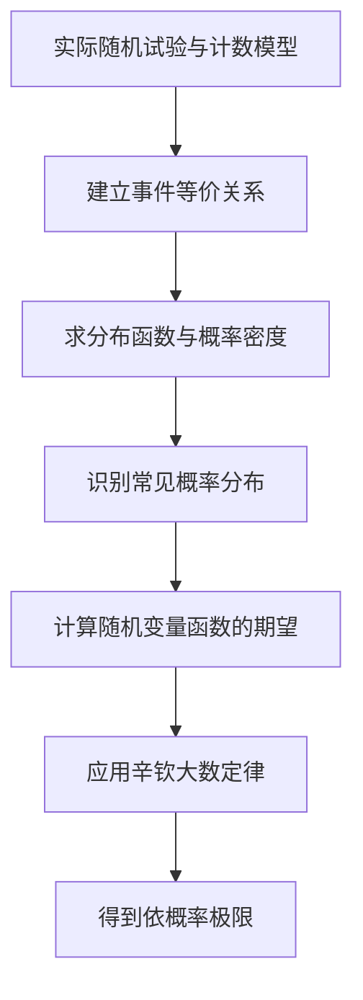
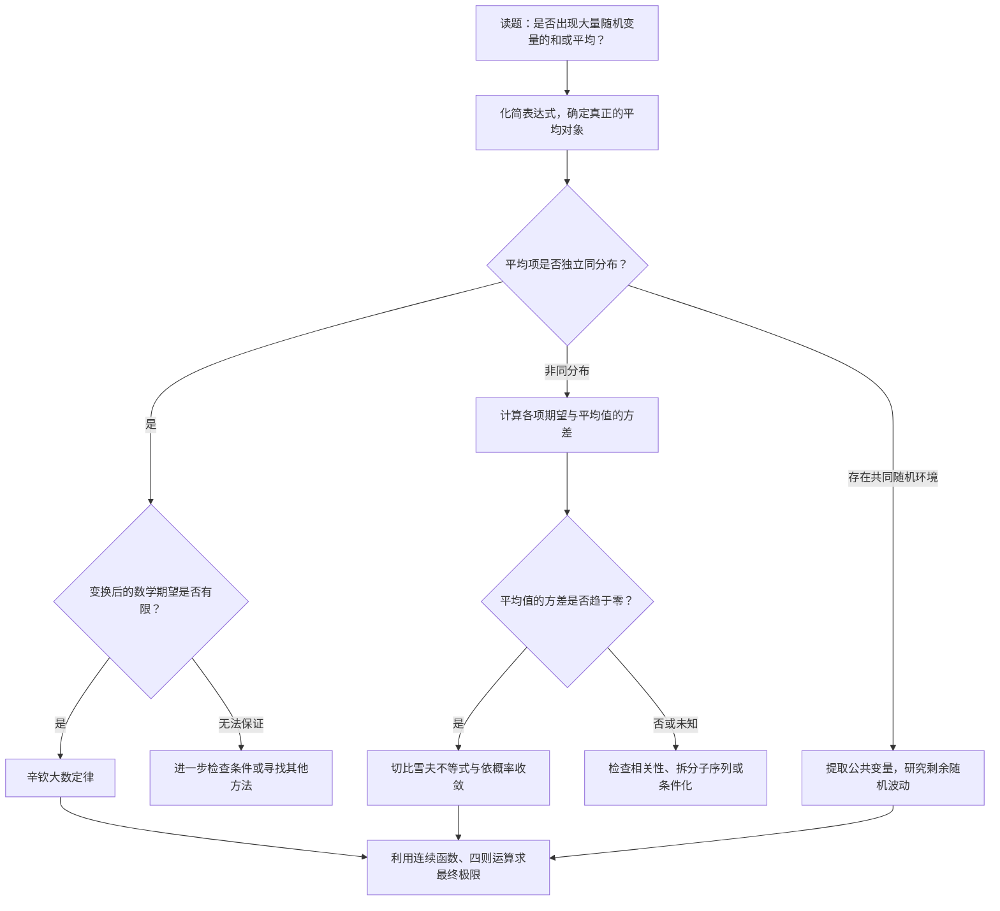

本节的核心任务是研究：当随机试验次数不断增加时，随机变量的平均值、事件发生的频率以及某些复杂的随机表达式，究竟会趋向于什么。

大数定律本身的公式并不复杂，但考研数学可以通过随机变量函数、样本矩、指标变量、非同分布随机变量、共同随机环境等形式，隐藏大数定律的使用条件。因此，学习本节的重点不是单纯记忆定理，而是学会**识别平均结构、判断适用条件、确定极限对象**。

## 一、本节知识框架

本节需要建立以下知识体系：

| 知识点            | 主要考查内容       | 重要程度  |
| -------------- | ------------ | ----- |
| 依概率收敛          | 定义、性质、概率极限   | ★★★★★ |
| 切比雪夫大数定律       | 独立非同分布、方差估计  | ★★★★★ |
| 伯努利大数定律        | 频数与频率、事件发生比例 | ★★★★  |
| 辛钦大数定律         | 独立同分布样本平均值   | ★★★★★ |
| 随机变量函数的大数定律    | 平方、绝对值、对数、积分 | ★★★★★ |
| 非线性统计量的概率极限    | 乘积、比值、样本方差   | ★★★★★ |
| 非同分布与加权平均      | 定理条件的灵活运用    | ★★★★  |
| 共同随机环境         | 条件独立与随机极限    | ★★★   |
| 大数定律与中心极限定理的区别 | 收敛对象与标准化     | ★★★★★ |

其中，前六项是考研数学一必须熟练掌握的核心内容；后几项是应对综合题、创新题的重要拓展。

## 二、基础概念：什么叫依概率收敛？

### 2.1 从普通数列极限到随机变量极限

在高等数学中，我们学习过数列极限：

$$
\lim_{n\to\infty}a_n=a.
$$

它表示当 $n$ 充分大时，$a_n$ 与 $a$ 的距离可以任意小。

但是，随机变量序列

$$
X_1,X_2,\ldots,X_n,\ldots
$$

中的每一项都具有随机性，因此我们需要用概率来描述这种接近程度。

**定义：** 如果对于任意固定的 $\varepsilon>0$，均有

$$
\boxed{ \lim_{n\to\infty} P(|X_n-X|\geq\varepsilon)=0 }
$$

则称随机变量序列 $X_n$ 依概率收敛于 $X$，记作

$$
\boxed{X_n\xrightarrow{P}X.}
$$

等价地，

$$
\boxed{ \lim_{n\to\infty} P(|X_n-X|<\varepsilon)=1. }
$$

其中，极限 $X$ 可以是常数，也可以是随机变量。

### 2.2 直观理解

假设独立地抛掷一枚均匀硬币 $n$ 次，记正面出现次数为 $S_n$，正面出现的频率为

$$
Y_n=\frac{S_n}{n}.
$$

当抛掷次数不断增加时，$Y_n$ 并不会在某一时刻永远等于 $0.5$，而是偏离 $0.5$ 较远的可能性越来越小。

例如，由切比雪夫不等式可以得到如下理论保证：

| 抛掷次数 $n$ | $P(\|Y_n-0.5\|\geq0.05)$ 的上界 |
| ------------ | -------------------------------- |
| 100          | 1                                |
| 500          | 0.2                              |
| 1000         | 0.1                              |
| 5000         | 0.02                             |
| 10000        | 0.01                             |
| 100000       | 0.001                            |

这里列出的是概率上界，不是精确概率。

因此，

$$
\frac{S_n}{n}\xrightarrow{P}\frac12.
$$

**大数定律揭示的是大量随机现象背后的统计稳定性，而不是单次随机试验的确定性。**

### 2.3 依概率收敛的重要运算性质

设

$$
X_n\xrightarrow{P}a,\qquad Y_n\xrightarrow{P}b.
$$

其中 $a,b$ 为常数，则有：

| 运算   | 概率极限                                           | 条件                    |
| ---- | ---------------------------------------------- | --------------------- |
| 加法   | $X_n+Y_n\xrightarrow{P}a+b$                | 无额外条件                 |
| 减法   | $X_n-Y_n\xrightarrow{P}a-b$                | 无额外条件                 |
| 乘法   | $X_nY_n\xrightarrow{P}ab$                  | 无额外条件                 |
| 除法   | $\dfrac{X_n}{Y_n}\xrightarrow{P}\dfrac ab$ | $b\neq0$，比值适当定义   |
| 平方   | $X_n^2\xrightarrow{P}a^2$                  | 无额外条件                 |
| 连续函数 | $g(X_n)\xrightarrow{P}g(a)$                | $g$ 在 $a$ 处连续 |

这些性质并不要求 $X_n$ 与 $Y_n$ 相互独立。

尤其重要的是连续映射性质：

$$
\boxed{ X_n\xrightarrow{P}a \Longrightarrow g(X_n)\xrightarrow{P}g(a) }
$$

只要 $g$ 在极限点连续。

例如，

$$
X_n\xrightarrow{P}2
$$

可以推出

$$
e^{X_n}\xrightarrow{P}e^2,
$$

$$
\ln X_n\xrightarrow{P}\ln2
$$

（对数表达式需有适当定义），以及

$$
\frac1{1+X_n^2}\xrightarrow{P}\frac15.
$$

这是处理乘积、比值、复合函数、样本方差等综合题的基础。

### 2.4 依概率收敛不代表期望收敛

这是一个非常重要的理论陷阱。

设随机变量 $X_n$ 的分布律为

| $X_n$ | $0$          | $n$        |
| --------- | ---------------- | -------------- |
| $P$   | $1-\dfrac1n$ | $\dfrac1n$ |

对任意固定的 $\varepsilon>0$，当 $n>\varepsilon$ 时，

$$
P(|X_n|\geq\varepsilon)=\frac1n\to0.
$$

因此

$$
X_n\xrightarrow{P}0.
$$

然而，

$$
EX_n=n\cdot\frac1n=1.
$$

于是

$$
\lim_{n\to\infty}EX_n=1\neq0.
$$

所以一般不能认为

$$
X_n\xrightarrow{P}a \Longrightarrow EX_n\to a.
$$

反过来，只有期望收敛，也不能保证依概率收敛。

## 三、三种大数定律：适用条件与内在联系

考研数学一需要重点掌握切比雪夫大数定律、伯努利大数定律和辛钦大数定律。

记

$$
S_n=\sum_{i=1}^nX_i, \qquad \overline X_n=\frac1n\sum_{i=1}^nX_i.
$$

### 3.1 切比雪夫大数定律

**定理**

设随机变量 $X_1,X_2,\ldots$ 相互独立，且存在常数 $C$，使得

$$
DX_i\leq C,\qquad i=1,2,\ldots
$$

则对于任意 $\varepsilon>0$，有

$$
\lim_{n\to\infty} P\left( \left| \frac1n\sum_{i=1}^nX_i -\frac1n\sum_{i=1}^nEX_i \right|\geq\varepsilon \right)=0.
$$

即

$$
\boxed{ \frac1n\sum_{i=1}^n(X_i-EX_i) \xrightarrow{P}0. }
$$

注意，切比雪夫大数定律**不要求同分布，也不要求各随机变量具有相同的数学期望**。

**证明：必须熟练掌握的母题**

令

$$
Y_n=\frac1n\sum_{i=1}^n(X_i-EX_i).
$$

首先，

$$
EY_n=0.
$$

其次，由独立性，

$$
\begin{aligned} DY_n &=\frac1{n^2}\sum_{i=1}^nD(X_i-EX_i)\\ &=\frac1{n^2}\sum_{i=1}^nDX_i\\ &\leq\frac{nC}{n^2}\\ &=\frac Cn. \end{aligned}
$$

由切比雪夫不等式，

$$
\begin{aligned} P(|Y_n|\geq\varepsilon) &\leq\frac{DY_n}{\varepsilon^2}\\ &\leq\frac{C}{n\varepsilon^2} \longrightarrow0. \end{aligned}
$$

从而

$$
Y_n\xrightarrow{P}0.
$$

证毕。

这段证明是本节最有价值的证明模板之一。

**更一般的结论**

事实上，并不一定要求方差一致有界。

对于相互独立、具有有限方差的随机变量，只要

$$
\boxed{ \lim_{n\to\infty} \frac1{n^2}\sum_{i=1}^nDX_i=0, }
$$

就能够推出

$$
\frac1n\sum_{i=1}^n(X_i-EX_i) \xrightarrow{P}0.
$$

这意味着：

**方差有界是充分条件，而不是必须满足的条件。真正起作用的是随机变量平均值的方差趋于零。**

如果再有

$$
\frac1n\sum_{i=1}^nEX_i\to a,
$$

则

$$
\boxed{ \frac1n\sum_{i=1}^nX_i\xrightarrow{P}a. }
$$

这里包含两个独立的任务：

1. 控制随机波动，使中心化平均值收敛于零。
2. 计算确定性的期望平均值极限。

遇到非同分布题目，优先采用这一思路。

### 3.2 伯努利大数定律

**定理**

设进行 $n$ 次独立重复试验，每次试验中事件 $A$ 发生的概率均为 $p$，记 $S_n$ 为事件 $A$ 发生的次数，则

$$
\boxed{ \frac{S_n}{n}\xrightarrow{P}p. }
$$

即对任意 $\varepsilon>0$，

$$
\lim_{n\to\infty} P\left( \left|\frac{S_n}{n}-p\right|<\varepsilon \right)=1.
$$

**为什么成立？**

定义指标变量（也称示性随机变量）：

$$
I_i= \begin{cases} 1,&\text{第 }i\text{ 次试验中 }A\text{ 发生},\\ 0,&\text{第 }i\text{ 次试验中 }A\text{ 不发生}. \end{cases}
$$

则

$$
I_i\sim B(1,p),
$$

$$
EI_i=p,\qquad DI_i=p(1-p).
$$

而

$$
S_n=\sum_{i=1}^nI_i\sim B(n,p).
$$

于是

$$
E\left(\frac{S_n}{n}\right)=p,
$$

$$
D\left(\frac{S_n}{n}\right) =\frac{p(1-p)}n.
$$

由切比雪夫不等式，

$$
\boxed{ P\left( \left|\frac{S_n}{n}-p\right|\geq\varepsilon \right) \leq\frac{p(1-p)}{n\varepsilon^2}. }
$$

当 $n\to\infty$ 时，右侧趋于零。

所以伯努利大数定律成立。

**考研中的常见识别词**

题目中出现频率、比例、合格率、发芽率、满足某个条件的样本个数、落入某区间的观测值所占比例时，应该立即想到指标变量。

其最一般的常用形式是

$$
\boxed{ \frac1n\sum_{i=1}^n \mathbf1_{\{X_i\in A\}} \xrightarrow{P}P(X\in A). }
$$

前提是 $X_1,X_2,\ldots$ 独立同分布于 $X$，且集合 $A$ 对应可定义概率的事件。

### 3.3 辛钦大数定律

这是本节最重要、最常用的定理。

**定理**

设 $X_1,X_2,\ldots$ 相互独立且同分布，并且数学期望有限：

$$
EX_i=\mu.
$$

则

$$
\boxed{ \frac1n\sum_{i=1}^nX_i \xrightarrow{P}\mu. }
$$

严格而言，有限数学期望可以用

$$
E|X_i|<\infty
$$

来保证。

**最关键的适用条件**

辛钦大数定律只需要独立、同分布、有限数学期望。

**不要求方差存在！**

这一点极容易成为概念选择题的考点。

如果题目只给出

$$
EX_i=\mu
$$

而没有给出 $DX_i$，只要能够确定随机变量独立同分布且期望有限，就可以直接使用辛钦大数定律。

例如，设 $X_i$ 独立同分布，概率密度为

$$
f(x)= \begin{cases} \dfrac2{x^3},&x\geq1,\\ 0,&x<1. \end{cases}
$$

其数学期望为

$$
EX=\int_1^\infty x\frac2{x^3}\,dx=2.
$$

但是

$$
EX^2=\int_1^\infty\frac2x\,dx=+\infty.
$$

因此 $X$ 没有有限方差。

尽管如此，辛钦大数定律仍然保证

$$
\frac1n\sum_{i=1}^nX_i\xrightarrow{P}2.
$$

这也说明了为什么不能把辛钦大数定律简单理解为切比雪夫不等式的直接应用。

### 3.4 三种定理的对比

| 对比项目 | 切比雪夫大数定律 | 伯努利大数定律      | 辛钦大数定律  |
| ---- | -------- | ------------ | ------- |
| 相互独立 | 要求       | 要求           | 要求      |
| 同分布  | 不要求      | 同参数0-1分布     | 要求      |
| 数学期望 | 存在       | $p$      | 有限      |
| 方差   | 通常要求一致有界 | $p(1-p)$ | 不要求有限   |
| 平均对象 | 一般随机变量   | 事件发生次数       | 独立同分布变量 |
| 主要用途 | 非同分布、证明题 | 频率与概率        | 各类平均值极限 |

伯努利大数定律是另外两种定理的特殊情形。

但切比雪夫大数定律与辛钦大数定律的条件各有特点，并不是简单的谁包含谁：前者允许不同分布，后者允许没有有限方差。

## 四、本节最重要的统一解题原理

### 4.1 随机变量函数的大数定律

设 $X_1,X_2,\ldots$ 独立同分布于总体 $X$。

对于同一个可测函数 $g$，令

$$
Y_i=g(X_i).
$$

由于每一个 $Y_i$ 都由对应的 $X_i$ 单独变换得到，因此 $Y_1,Y_2,\ldots$ 仍然独立同分布。

如果

$$
E|g(X)|<\infty,
$$

由辛钦大数定律得到

$$
\boxed{ \frac1n\sum_{i=1}^ng(X_i) \xrightarrow{P}Eg(X). }
$$

这是几乎所有常规大数定律计算题的统一母公式。

离散型随机变量：

$$
Eg(X)=\sum_k g(x_k)P(X=x_k).
$$

连续型随机变量：

$$
Eg(X)=\int_{-\infty}^{+\infty}g(x)f_X(x)\,dx.
$$

所以大量看似复杂的大数定律问题，最终都会转化为求随机变量函数的数学期望。

### 4.2 必须分清的两种结构

第一种结构：先变换，再平均。

$$
\boxed{ \frac1n\sum_{i=1}^ng(X_i) \xrightarrow{P}Eg(X). }
$$

第二种结构：先平均，再变换。

$$
\boxed{ g\left(\frac1n\sum_{i=1}^nX_i\right) \xrightarrow{P}g(EX). }
$$

第二种需要 $g$ 在 $EX$ 处连续。

两者一般不同：

$$
Eg(X)\neq g(EX).
$$

特别地，

$$
\frac1n\sum_{i=1}^nX_i^2 \xrightarrow{P}EX^2,
$$

而

$$
\left(\frac1n\sum_{i=1}^nX_i\right)^2 \xrightarrow{P}(EX)^2.
$$

二者之差恰好与方差联系起来：

$$
EX^2-(EX)^2=DX.
$$

这不仅是本节的高频陷阱，也直接连接后续数理统计中的样本方差、矩估计和相合性问题。

### 4.3 常见分布的数字特征

为了快速求出大数定律的极限，需要熟练掌握：

| 分布                                | $EX$             | $DX$                  | $EX^2$                |
| --------------------------------- | -------------------- | ------------------------- | ------------------------- |
| $B(1,p)$                      | $p$              | $p(1-p)$              | $p$                   |
| $B(m,p)$                      | $mp$             | $mp(1-p)$             | $mp(1-p)+m^2p^2$      |
| $P(\lambda)$                  | $\lambda$        | $\lambda$             | $\lambda+\lambda^2$   |
| $\operatorname{Exp}(\lambda)$ | $\dfrac1\lambda$ | $\dfrac1{\lambda^2}$  | $\dfrac2{\lambda^2}$  |
| $U(a,b)$                      | $\dfrac{a+b}2$   | $\dfrac{(b-a)^2}{12}$ | $\dfrac{a^2+ab+b^2}3$ |
| $N(\mu,\sigma^2)$             | $\mu$            | $\sigma^2$            | $\mu^2+\sigma^2$      |

这里指数分布的 $\lambda$ 采用率参数。

另外，对于标准正态分布，

$$
X\sim N(0,1),
$$

有

$$
EX=0,\quad EX^2=1,\quad EX^3=0,\quad EX^4=3.
$$

对于指数分布，

$$
EX^k=\frac{k!}{\lambda^k}, \qquad k=1,2,\ldots
$$

这些结论能够显著降低综合题的计算量。

## 五、题型一：随机变量函数平均值的概率极限

重要程度：★★★★★

这是本节最基础、最典型的真题题型，也是其他综合题型的出发点。

### 母题1：2022年数学三真题——平方变换与概率密度

来源：《考研核心题目》第2题。

设 $X_1,X_2,\ldots,X_n$ 独立同分布，且 $X_1$ 的概率密度为

$$
f(x)= \begin{cases} 1-|x|,&|x|<1,\\ 0,&\text{其他}. \end{cases}
$$

求

$$
\frac1n\sum_{i=1}^nX_i^2
$$

的依概率极限。

<Steps>

<Step>

### 第一步：识别大数定律的作用对象 [!toc]

题目平均的不是 $X_i$，而是 $X_i^2$。

令

$$
Y_i=X_i^2.
$$

则 $Y_i$ 独立同分布。

并且由于

$$
0\leq Y_i\leq1,
$$

其数学期望一定有限。

</Step>

<Step>

### 第二步：求平方的数学期望 [!toc]

$$
\begin{aligned} EY_i &=EX_i^2\\ &=\int_{-1}^1x^2(1-|x|)\,dx. \end{aligned}
$$

由于被积函数为偶函数，

$$
\begin{aligned} EX_i^2 &=2\int_0^1x^2(1-x)\,dx\\ &=2\int_0^1(x^2-x^3)\,dx\\ &=2\left(\frac13-\frac14\right)\\ &=\frac16. \end{aligned}
$$

</Step>

<Step>

### 第三步：应用辛钦大数定律 [!toc]

$$
\frac1n\sum_{i=1}^nX_i^2 =\frac1n\sum_{i=1}^nY_i \xrightarrow{P}EY_i.
$$

所以答案为

$$
\boxed{\frac16}.
$$

</Step>

</Steps>

**母题提炼**

本题并不是考查如何求 $X_i^2$ 的概率密度。

如果只要求 $EX_i^2$，直接使用随机变量函数的期望公式即可。

一般不需要先求 $Y_i=X_i^2$ 的分布，再计算 $EY_i$。这种思路虽然可行，但会增加计算量。

**同一母题的四种变式**

保持上述概率密度不变：

| 随机表达式                      | 依概率极限             |
| -------------------------- | ----------------- |
| $\dfrac1n\sum X_i$     | $0$           |
| $\dfrac1n\sum \|X_i\|$ | $\dfrac13$    |
| $\dfrac1n\sum X_i^2$   | $\dfrac16$    |
| $\dfrac1n\sum X_i^4$   | $\dfrac1{15}$ |

甚至可以得到一般公式：

$$
\begin{aligned} E|X|^r &=2\int_0^1x^r(1-x)\,dx\\ &=2\left(\frac1{r+1}-\frac1{r+2}\right)\\ &=\frac2{(r+1)(r+2)}, \qquad r>-1. \end{aligned}
$$

所以对于 $r>-1$，

$$
\boxed{ \frac1n\sum_{i=1}^n|X_i|^r \xrightarrow{P} \frac2{(r+1)(r+2)}. }
$$

在 $r$ 为负数时，零点可任意适当定义，因为本题 $P(X=0)=0$。

这就是从一道真题推广到一族题目。

### 母题2：2003年数学三真题——指数分布的二阶矩

来源：《考研核心题目》第1题；张宇1000题第5章基础部分第1题也收录了该题。

设总体 $X$ 服从参数为2的指数分布，$X_1,\ldots,X_n$ 为来自总体 $X$ 的简单随机样本，求

$$
Y_n=\frac1n\sum_{i=1}^nX_i^2
$$

的依概率极限。

<Tabs items={["解法一：数字特征法（推荐）", "解法二：积分法"]} defaultIndex={0}>

<Tab value="解法一：数字特征法（推荐）">

因为

$$
X\sim\operatorname{Exp}(2),
$$

所以

$$
EX=\frac12,\qquad DX=\frac14.
$$

利用

$$
EX^2=DX+(EX)^2,
$$

得到

$$
EX^2=\frac14+\frac14=\frac12.
$$

由辛钦大数定律，

$$
\boxed{ Y_n\xrightarrow{P}\frac12. }
$$

</Tab>

<Tab value="解法二：积分法">

指数分布的概率密度为

$$
f(x)=2e^{-2x},\qquad x>0.
$$

所以

$$
EX^2=2\int_0^\infty x^2e^{-2x}\,dx =\frac12.
$$

</Tab>

</Tabs>

<Callout type="warn" title="本题隐藏的陷阱">

这道题中恰好有

$$
EX=EX^2=\frac12.
$$

如果错误地把 $\dfrac1n\sum X_i^2$ 的极限写成 $EX$，仍然可能得到正确的数值，但解题原理是错误的。

将指数分布的参数改成3，就可以明显看出区别：

$$
EX=\frac13,
$$

$$
(EX)^2=\frac19,
$$

$$
EX^2=\frac29.
$$

因此正确的一般结论是

$$
\boxed{ X_i\overset{\mathrm{i.i.d.}}{\sim} \operatorname{Exp}(\lambda) \Longrightarrow \frac1n\sum_{i=1}^nX_i^2 \xrightarrow{P}\frac2{\lambda^2}. }
$$

进一步推广：

$$
\boxed{ \frac1n\sum_{i=1}^nX_i^k \xrightarrow{P}\frac{k!}{\lambda^k}. }
$$

其中 $k$ 为正整数。

这里的 $\mathrm{i.i.d.}$ 表示独立同分布。

</Callout>

### 母题3：张宇1000题——泊松计数模型与指数等待时间

来源：《考研核心题目》第3题；张宇1000题第5章强化部分第12个题目组件。

设时刻 $t\geq0$ 已进入某商场的顾客人数 $N_t$ 服从参数为 $t/2$ 的泊松分布。令 $T$ 为第一位顾客的到达时刻。

求：

（1）$T$ 的概率密度；

（2）若 $T_1,T_2,\ldots$ 独立同分布于 $T$，求

$$
\frac1n\sum_{i=1}^nT_i^2
$$

的依概率极限。

**第一问：由计数分布反推等待时间分布**

已知

$$
N_t\sim P\left(\frac t2\right).
$$

第一位顾客在时刻 $t$ 之后才到达，等价于截至时刻 $t$ 顾客人数为零。

因此，

$$
\{T>t\}=\{N_t=0\}.
$$

所以

$$
P(T>t)=P(N_t=0)=e^{-t/2}.
$$

于是

$$
F_T(t)= \begin{cases} 0,&t<0,\\ 1-e^{-t/2},&t\geq0. \end{cases}
$$

求导得到

$$
\boxed{ f_T(t)= \begin{cases} \dfrac12e^{-t/2},&t>0,\\ 0,&\text{其他}. \end{cases} }
$$

也就是说，

$$
T\sim\operatorname{Exp}\left(\frac12\right).
$$

**第二问：应用随机变量函数的大数定律**

$$
ET=2,\qquad DT=4.
$$

所以

$$
ET^2=DT+(ET)^2=8.
$$

由辛钦大数定律，

$$
\boxed{ \frac1n\sum_{i=1}^nT_i^2\xrightarrow{P}8. }
$$

**综合题的知识链条**

这类综合题体现出一个重要特点：大数定律往往出现在解答题的最后一问，而前面的问法可能涉及第一章的概率计算、第二章的分布、第三章的数字特征。

它考查的不是孤立定理，而是多个章节之间的衔接能力。

## 六、题型二：复杂随机表达式——乘积、比值、样本方差

重要程度：★★★★★

这类题目不会直接呈现为简单的算术平均值，需要主动变形。

### 母题4：张宇8套卷第4套第8题——几何平均值

来源：《数学模拟题分类1031》第四章第二节。

设 $X_1,X_2,\ldots$ 相互独立且均服从 $U(0,1)$，求

$$
Y_n=\left(\prod_{k=1}^nX_k\right)^{1/n}
$$

的依概率极限。

原题选项为

$$
e^{-1/2},\qquad e^{-1},\qquad e^{1/2},\qquad e.
$$

<Steps>

<Step>

### 第一步：识别乘积与 $n$ 次方根 [!toc]

大数定律针对的是和的平均，而本题是乘积的 $n$ 次方根。

怎样把乘积变为求和？

取对数。

$$
\ln Y_n=\frac1n\sum_{k=1}^n\ln X_k.
$$

因此

$$
Y_n= \exp\left( \frac1n\sum_{k=1}^n\ln X_k \right).
$$

</Step>

<Step>

### 第二步：计算对数的数学期望 [!toc]

由于 $X_k\sim U(0,1)$，

$$
E(\ln X_k)=\int_0^1\ln x\,dx.
$$

这是反常积分。

$$
\begin{aligned} \int_0^1\ln x\,dx &=\lim_{a\to0^+}[x\ln x-x]_a^1\\ &=-1. \end{aligned}
$$

并且

$$
E|\ln X|=1<\infty.
$$

因此满足辛钦大数定律的条件。

</Step>

<Step>

### 第三步：先求对数平均值的极限 [!toc]

$$
\frac1n\sum_{k=1}^n\ln X_k \xrightarrow{P}-1.
$$

</Step>

<Step>

### 第四步：利用指数函数的连续性 [!toc]

$$
\boxed{ Y_n\xrightarrow{P}e^{-1}. }
$$

所以选择B。

</Step>

</Steps>

**通用公式**

设 $X_1,X_2,\ldots$ 独立同分布，且 $X_i>0$ 几乎处处成立，满足 $E|\ln X|<\infty$，则

$$
\boxed{ \sqrt[n]{X_1X_2\cdots X_n} \xrightarrow{P} \exp(E\ln X). }
$$

注意，极限不是 $EX$。

在本题中，

$$
\exp(E\ln X)=e^{-1},
$$

而

$$
EX=\frac12.
$$

算术平均值与几何平均值具有不同的极限。

**原创变式：正态分布与指数函数**

设 $X_i$ 独立同分布于 $N(2,4)$，求

$$
\sqrt[n]{e^{X_1}e^{X_2}\cdots e^{X_n}}
$$

的依概率极限。

直接化简：

$$
\sqrt[n]{e^{X_1}\cdots e^{X_n}} =e^{\frac1n\sum X_i}.
$$

因为

$$
\frac1n\sum X_i\xrightarrow{P}2,
$$

所以

$$
\boxed{e^2}.
$$

这里甚至不需要计算 $Ee^X$。

### 母题5：两个样本矩的比值

以下为根据真题结构设计的原创综合母题。

设 $X_i$ 独立同分布于 $U(0,1)$，求

$$
Y_n= \frac{\sum_{i=1}^nX_i^2} {\sum_{i=1}^nX_i}
$$

的依概率极限。

<Steps>

<Step>

### 第一步：分子、分母同时除以 $n$ [!toc]

$$
Y_n= \frac{\dfrac1n\sum_{i=1}^nX_i^2} {\dfrac1n\sum_{i=1}^nX_i}.
$$

</Step>

<Step>

### 第二步：分别使用大数定律 [!toc]

$$
\frac1n\sum_{i=1}^nX_i^2 \xrightarrow{P}EX^2=\frac13,
$$

$$
\frac1n\sum_{i=1}^nX_i \xrightarrow{P}EX=\frac12.
$$

</Step>

<Step>

### 第三步：使用概率极限的除法性质 [!toc]

由于分母极限不为零，

$$
Y_n\xrightarrow{P} \frac{EX^2}{EX}.
$$

所以

$$
\boxed{Y_n\xrightarrow{P}\frac23}.
$$

</Step>

</Steps>

**一般结论**

$$
\boxed{ \frac{\sum_{i=1}^ng(X_i)} {\sum_{i=1}^nh(X_i)} \xrightarrow{P} \frac{Eg(X)}{Eh(X)} }
$$

前提是两个变换的绝对期望有限，$Eh(X)\neq0$，且比值适当定义。

特别注意：

$$
\frac{Eg(X)}{Eh(X)}
$$

与

$$
E\left(\frac{g(X)}{h(X)}\right)
$$

一般不相等。

而且，分子和分母使用同一批样本、彼此不独立，也不妨碍概率极限的除法运算。

### 母题6：样本方差与大数定律

来源：李正元第五章填空题第3个题目（题库组件编号008），并据此拓展。

随机地、有放回地从数集

$$
\{1,2,3,4,5\}
$$

中等概率抽取 $n$ 个数，记为 $X_1,\ldots,X_n$。

原题要求求出

$$
\overline X_n
$$

和

$$
\frac1n\sum_{i=1}^nX_i^2
$$

的依概率极限。

因为是独立的等概率有放回抽样，所以

$$
P(X_i=k)=\frac15,\qquad k=1,\ldots,5.
$$

于是

$$
EX=\frac{1+2+3+4+5}{5}=3,
$$

$$
EX^2=\frac{1+4+9+16+25}{5}=11.
$$

因此

$$
\boxed{\overline X_n\xrightarrow{P}3},
$$

$$
\boxed{ \frac1n\sum_{i=1}^nX_i^2\xrightarrow{P}11. }
$$

**重要拓展：求样本方差的概率极限**

定义

$$
S_n^2= \frac1{n-1} \sum_{i=1}^n(X_i-\overline X_n)^2.
$$

由于

$$
\sum_{i=1}^n(X_i-\overline X_n)^2 =\sum_{i=1}^nX_i^2-n\overline X_n^2,
$$

所以

$$
S_n^2= \frac n{n-1} \left( \frac1n\sum_{i=1}^nX_i^2-\overline X_n^2 \right).
$$

分别求极限：

$$
\frac n{n-1}\to1,
$$

$$
\frac1n\sum_{i=1}^nX_i^2\xrightarrow{P}11,
$$

$$
\overline X_n^2\xrightarrow{P}9.
$$

故

$$
\boxed{S_n^2\xrightarrow{P}2}.
$$

**推广：任意有限二阶矩总体**

若

$$
EX=\mu,\qquad DX=\sigma^2<\infty,
$$

则

$$
\boxed{ \overline X_n\xrightarrow{P}\mu, \qquad S_n^2\xrightarrow{P}\sigma^2. }
$$

如果分母使用 $n$ 而不是 $n-1$，依概率极限仍然为 $\sigma^2$。

这说明样本均值和样本方差分别是总体均值和总体方差的相合估计量。

注意，相合性与无偏性是不同概念。

样本方差的这个概率极限也不要求总体服从正态分布，更不要求四阶矩有限。

## 七、题型三：独立但非同分布的随机变量

重要程度：★★★★★

这类题是本节最重要的证明题类型。与独立同分布问题相比，它更强调适用条件和方差估计。

### 母题7：李正元——不同数学期望的中心化

来源：《考研核心题目》第4题；李正元第五章填空题（组件编号007）。

设 $X_1,X_2,\ldots$ 相互独立，且

$$
EX_i=\mu_i,\qquad DX_i=2.
$$

求

$$
Y_n=\frac1n\sum_{i=1}^n(X_i-\mu_i)
$$

的依概率极限。

**审题**

这里 $\mu_i$ 随着 $i$ 变化，所以不能直接认为原随机变量同分布。

但是，题目已经完成了中心化。

令

$$
Z_i=X_i-\mu_i,
$$

则

$$
EZ_i=0,
$$

$$
DZ_i=DX_i=2.
$$

因此

$$
EY_n=0.
$$

由独立性，

$$
DY_n=\frac1{n^2}\sum_{i=1}^n2 =\frac2n.
$$

任取 $\varepsilon>0$，由切比雪夫不等式，

$$
P(|Y_n|\geq\varepsilon) \leq\frac2{n\varepsilon^2}\to0.
$$

所以

$$
\boxed{ \frac1n\sum_{i=1}^n(X_i-\mu_i) \xrightarrow{P}0. }
$$

**深层理解**

即使

$$
\frac1n\sum_{i=1}^n\mu_i
$$

没有有限极限，中心化后的随机平均值仍然可以依概率收敛于零。

例如，若

$$
EX_i=i,\qquad DX_i=2,
$$

则

$$
\frac1n\sum_{i=1}^nX_i-\frac{n+1}{2} \xrightarrow{P}0.
$$

但原样本平均值并不会依概率收敛到某个有限常数。

### 母题8：李林880——非同分布大数定律证明

来源：《考研核心题目》第5题；李林880第二十章计算题（组件编号009）。

设 $X_1,X_2,\ldots$ 相互独立，各 $X_i$ 的分布律为

| $X_i$ | $-ia$           | $0$              | $ia$            |
| --------- | ------------------- | -------------------- | ------------------- |
| $P$   | $\dfrac1{2i^2}$ | $1-\dfrac1{i^2}$ | $\dfrac1{2i^2}$ |

其中 $a$ 为常数。证明对于任意 $\varepsilon>0$，

$$
\lim_{n\to\infty} P\left( \left|\frac1n\sum_{i=1}^nX_i\right| \geq\varepsilon \right)=0.
$$

<Steps>

<Step>

### 第一步：检查随机变量的结构 [!toc]

每个 $X_i$ 的取值范围依赖于 $i$。

在非退化情况下，随机变量不具有相同分布，因此不能直接套用辛钦大数定律。

应该采用切比雪夫大数定律。

</Step>

<Step>

### 第二步：计算数学期望 [!toc]

利用对称性：

$$
EX_i=(-ia)\frac1{2i^2} +(ia)\frac1{2i^2}=0.
$$

</Step>

<Step>

### 第三步：计算方差 [!toc]

$$
\begin{aligned} EX_i^2 &=i^2a^2\frac1{2i^2} +i^2a^2\frac1{2i^2}\\ &=a^2. \end{aligned}
$$

因此

$$
DX_i=a^2.
$$

虽然 $X_i$ 的最大可能绝对取值不断增大，但非零取值的概率不断减小，两种变化恰好使方差保持不变。

</Step>

<Step>

### 第四步：计算平均值的方差 [!toc]

令

$$
Y_n=\frac1n\sum_{i=1}^nX_i.
$$

则

$$
EY_n=0,
$$

$$
\begin{aligned} DY_n &=\frac1{n^2}\sum_{i=1}^nDX_i\\ &=\frac{na^2}{n^2}\\ &=\frac{a^2}n. \end{aligned}
$$

</Step>

<Step>

### 第五步：使用切比雪夫不等式 [!toc]

$$
0\leq P(|Y_n|\geq\varepsilon) \leq\frac{a^2}{n\varepsilon^2}\to0.
$$

所以

$$
\boxed{ \frac1n\sum_{i=1}^nX_i\xrightarrow{P}0. }
$$

证毕。

</Step>

</Steps>

**高阶变式：方差无界还能使用大数定律吗？**

将原题改为

$$
DX_i=\sqrt i, \qquad EX_i=0.
$$

因为

$$
\sum_{i=1}^n\sqrt i \leq n\sqrt n,
$$

所以

$$
D\left(\frac1n\sum_{i=1}^nX_i\right) \leq\frac{n\sqrt n}{n^2} =\frac1{\sqrt n}\to0.
$$

因此仍然有

$$
\frac1n\sum_{i=1}^nX_i\xrightarrow{P}0.
$$

更一般地，如果

$$
DX_i\leq Ci^\alpha, \qquad 0\leq\alpha<1,
$$

则

$$
\frac1{n^2}\sum_{i=1}^nDX_i \leq Cn^{\alpha-1}\to0.
$$

所以中心化的大数定律仍然成立。

当 $\alpha\geq1$ 时，这个估计不能保证收敛，但也不能仅凭这一点断定大数定律一定不成立。

**必须区分定理的充分条件不满足与定理结论不成立。**

### 母题9：张宇1000题——含下标的函数变换

来源：《考研核心题目》第6题；张宇1000题第5章基础部分第2题。

设 $X_1,X_2,\ldots$ 是来自总体 $U(-\pi,\pi)$ 的简单随机样本，令

$$
Y_k=\cos(kX_k).
$$

求

$$
\frac1n\sum_{k=1}^nY_k^2
$$

的依概率极限。

**审题的关键**

函数变换含有下标 $k$：

$$
Y_k=\cos(kX_k).
$$

因此不能仅凭 $X_k$ 独立同分布，就直接断言所有 $Y_k$ 同分布。

虽然本题利用周期性可以进一步证明 $Y_k$ 确实同分布，但没有必要走这条路线。

最稳妥的方法是利用独立性、期望和方差有界。

<Steps>

<Step>

### 第一步：计算每项的数学期望 [!toc]

$$
\begin{aligned} E(Y_k^2) &=\frac1{2\pi} \int_{-\pi}^{\pi}\cos^2(kx)\,dx. \end{aligned}
$$

利用

$$
\cos^2(kx)=\frac{1+\cos(2kx)}2,
$$

得

$$
\begin{aligned} E(Y_k^2) &=\frac1{4\pi} \int_{-\pi}^{\pi}[1+\cos(2kx)]\,dx\\ &=\frac12. \end{aligned}
$$

这里利用了 $k$ 为正整数。

</Step>

<Step>

### 第二步：估计方差 [!toc]

令

$$
Z_k=Y_k^2.
$$

由于

$$
0\leq Z_k\leq1,
$$

所以

$$
Z_k^2\leq Z_k.
$$

于是

$$
\begin{aligned} DZ_k &=EZ_k^2-(EZ_k)^2\\ &\leq\frac12-\frac14\\ &=\frac14. \end{aligned}
$$

因此方差一致有界。

</Step>

<Step>

### 第三步：应用切比雪夫大数定律 [!toc]

各 $Z_k$ 仍然相互独立，故

$$
\frac1n\sum_{k=1}^n(Z_k-EZ_k) \xrightarrow{P}0.
$$

又

$$
EZ_k=\frac12,
$$

所以

$$
\boxed{ \frac1n\sum_{k=1}^nY_k^2 \xrightarrow{P}\frac12. }
$$

</Step>

</Steps>

**通用技巧：有界随机变量不必精确求方差**

如果

$$
a\leq Z_i\leq b,
$$

则

$$
\boxed{ DZ_i\leq\frac{(b-a)^2}{4}. }
$$

证明思路是令 $c=(a+b)/2$，则

$$
\begin{aligned} DZ_i &=E(Z_i-c)^2-(EZ_i-c)^2\\ &\leq E(Z_i-c)^2\\ &\leq\frac{(b-a)^2}{4}. \end{aligned}
$$

对于三角函数、指标变量、有界分布等题目，估计方差即可，无须精确计算高阶矩。

### 母题10：李正元——分组构造新的随机变量

来源：李正元第五章选择题第3题。

设 $X_1,X_2,\ldots$ 相互独立，具有相同的数学期望 $\mu$ 和有限方差 $\sigma^2$，令

$$
Y_i=X_{2i}-X_{2i-1}.
$$

求

$$
\frac1n\sum_{i=1}^nY_i
$$

的依概率极限。

**关键：分组后是否独立？**

$$
Y_1=X_2-X_1,
$$

$$
Y_2=X_4-X_3,
$$

$$
Y_3=X_6-X_5.
$$

每组使用的原随机变量互不重叠。

因此 $Y_1,Y_2,\ldots$ 相互独立。

又

$$
EY_i=\mu-\mu=0,
$$

$$
DY_i=DX_{2i}+DX_{2i-1} =2\sigma^2.
$$

所以

$$
\boxed{ \frac1n\sum_{i=1}^n(X_{2i}-X_{2i-1}) \xrightarrow{P}0. }
$$

**进一步拓展：分组乘积**

若 $X_i$ 独立同分布，且 $E|X_i|<\infty$，令

$$
Z_i=X_{2i-1}X_{2i},
$$

则 $Z_i$ 独立同分布，并且

$$
EZ_i=EX_{2i-1}EX_{2i}=\mu^2.
$$

因此

$$
\boxed{ \frac1n\sum_{i=1}^nX_{2i-1}X_{2i} \xrightarrow{P}\mu^2. }
$$

**更难的变式：相邻项存在重叠**

如果题目改为

$$
\frac1n\sum_{i=1}^nX_iX_{i+1},
$$

那么相邻的两项

$$
X_iX_{i+1} \quad\text{与}\quad X_{i+1}X_{i+2}
$$

共享同一个随机变量，一般不独立。

此时不能直接对整个序列使用辛钦大数定律。

但可以将求和项按下标奇偶拆分：

$$
\begin{aligned} \frac1n\sum_{i=1}^nX_iX_{i+1} ={}&\frac1n\sum_{\substack{1\leq i\leq n\\i\text{ 为奇数}}} X_iX_{i+1}\\ &+\frac1n\sum_{\substack{1\leq i\leq n\\i\text{ 为偶数}}} X_iX_{i+1}. \end{aligned}
$$

两组内部的乘积项分别独立同分布。

令奇数组和偶数组的项数分别为 $m_n,l_n$，则

$$
\frac{m_n}{n}\to\frac12, \qquad \frac{l_n}{n}\to\frac12.
$$

由大数定律，两组各自的平均值均收敛于 $\mu^2$。

因此原式依概率收敛于

$$
\frac12\mu^2+\frac12\mu^2=\mu^2.
$$

即

$$
\boxed{ \frac1n\sum_{i=1}^nX_iX_{i+1} \xrightarrow{P}\mu^2. }
$$

这种**拆分为若干个独立子序列**的技巧，对于未来可能出现的创新题很有价值。

## 八、题型四：频数、频率与指标变量

重要程度：★★★★★

### 母题11：张宇1000题——经验频率的概率极限

来源：《考研核心题目》第7题；张宇1000题第5章强化部分（组件编号011）。

设总体

$$
X\sim P(1),
$$

$X_1,X_2,\ldots$ 为来自总体的简单随机样本，记 $v_n(1)$ 为前 $n$ 个观测值中不大于1的个数。

求

$$
\frac{v_n(1)}n
$$

的依概率极限。

<Steps>

<Step>

### 第一步：定义指标变量 [!toc]

令

$$
I_i= \begin{cases} 1,&X_i\leq1,\\ 0,&X_i>1. \end{cases}
$$

则

$$
v_n(1)=\sum_{i=1}^nI_i.
$$

所以

$$
\frac{v_n(1)}n =\frac1n\sum_{i=1}^nI_i.
$$

</Step>

<Step>

### 第二步：计算事件发生的概率 [!toc]

$$
\begin{aligned} EI_i &=P(X_i\leq1)\\ &=P(X_i=0)+P(X_i=1)\\ &=e^{-1}+e^{-1}\\ &=\frac2e. \end{aligned}
$$

</Step>

<Step>

### 第三步：应用大数定律 [!toc]

由于 $I_i$ 独立同分布，故

$$
\boxed{ \frac{v_n(1)}n\xrightarrow{P}\frac2e. }
$$

</Step>

</Steps>

**一般结论：经验分布函数**

定义

$$
F_n(x)=\frac1n\sum_{i=1}^n \mathbf1_{\{X_i\leq x\}}.
$$

它表示样本中不大于 $x$ 的观测值所占的比例。

对于每个固定的 $x$，由大数定律，

$$
\boxed{ F_n(x)\xrightarrow{P}F_X(x). }
$$

这就是利用样本频率估计总体分布函数的理论基础。

### 创新变式：两个事件频率的比值

设 $X_i$ 独立同分布于 $U(0,2)$，记

$$
M_n=\#\{i:0<X_i<1/2\},
$$

$$
N_n=\#\{i:0<X_i<1\}.
$$

求 $M_n/N_n$ 的依概率极限，比值在 $N_n=0$ 时可定义为0。

由于

$$
\frac{M_n}n\xrightarrow{P} P(0<X<1/2)=\frac14,
$$

$$
\frac{N_n}n\xrightarrow{P} P(0<X<1)=\frac12,
$$

因此

$$
\frac{M_n}{N_n} =\frac{M_n/n}{N_n/n} \xrightarrow{P}\frac{1/4}{1/2}.
$$

所以

$$
\boxed{\frac12}.
$$

更一般地，如果 $P(B)>0$，则事件同时发生的次数与事件 $B$ 发生次数的比值满足

$$
\boxed{ \frac{\sum_{i=1}^n\mathbf1_{A_i\cap B_i}} {\sum_{i=1}^n\mathbf1_{B_i}} \xrightarrow{P}P(A\mid B). }
$$

这里假定各次试验独立重复。

这个结果将第一章的条件概率与第四章的大数定律连接起来。

### 应用变式：利用伯努利大数定律估计样本容量

李林880第二十章的应用题中涉及如下问题：

某生产线的产品合格率为 $0.8$，希望一批产品的实际合格率落在 $76\%$ 与 $84\%$ 之间的概率不小于 $90\%$。

假定各产品是否合格相互独立。若采用切比雪夫不等式进行保证，至少需要多少件产品？

设合格品数量为 $S_n$，则

$$
S_n\sim B(n,0.8).
$$

记实际合格率为

$$
\widehat p=\frac{S_n}{n}.
$$

有

$$
E\widehat p=0.8, \qquad D\widehat p=\frac{0.16}n.
$$

由切比雪夫不等式，

$$
P(|\widehat p-0.8|<0.04) \geq1-\frac{0.16}{n(0.04)^2}.
$$

要使该下界不小于 $0.9$，只需

$$
1-\frac{0.16}{n(0.04)^2}\geq0.9.
$$

整理得

$$
n\geq1000.
$$

因此，切比雪夫不等式给出的充分样本容量为

$$
\boxed{n=1000}.
$$

需要注意，这只是切比雪夫不等式保证的样本容量，并非根据精确二项分布计算得到的实际最小样本容量。若题目要求用中心极限定理进行近似计算，则需要使用下一节的方法，结果也可能不同。

## 九、题型五：共同随机环境与随机概率极限

重要程度：★★★★（综合拓展）

这一题型来自张宇强化练习。它比常规大数定律题目更难，能够检验是否真正理解独立性与依概率收敛。

### 母题12：张宇1000题——条件独立的正态样本

来源：《考研核心题目》第8题；张宇1000题第5章强化部分（组件编号010）。

设

$$
X\sim N(0,1).
$$

在给定同一个公共随机变量 $X=x$ 的条件下，$Y_1,Y_2,\ldots$ 条件独立且均服从

$$
N(x,1).
$$

求

$$
\frac1n\sum_{i=1}^nY_i^2
$$

的依概率极限。

### 9.1 为什么不能直接求无条件期望？

因为所有 $Y_i$ 都受到同一个随机变量 $X$ 的影响。

可以将其理解为

$$
Y_i=X+Z_i,
$$

其中 $Z_i$ 独立同分布于 $N(0,1)$，并且与 $X$ 独立。

假设给定的公共环境为 $X=3$，那么所有 $Y_i$ 都围绕3波动。

如果公共环境为 $X=-2$，那么所有 $Y_i$ 都围绕 $-2$ 波动。

增加样本数量可以消除各个 $Z_i$ 的平均波动，但不能消除所有样本共享的 $X$。

<Tabs items={["9.2 解法一：展开平方并分别使用大数定律", "9.3 解法二：条件大数定律"]} defaultIndex={0}>

<Tab value="9.2 解法一：展开平方并分别使用大数定律">

这是最容易理解的做法。

$$
Y_i^2=(X+Z_i)^2 =X^2+2XZ_i+Z_i^2.
$$

因此

$$
\begin{aligned} \frac1n\sum_{i=1}^nY_i^2 &=X^2 +2X\frac1n\sum_{i=1}^nZ_i +\frac1n\sum_{i=1}^nZ_i^2. \end{aligned}
$$

由辛钦大数定律，

$$
\frac1n\sum_{i=1}^nZ_i\xrightarrow{P}0,
$$

$$
\frac1n\sum_{i=1}^nZ_i^2\xrightarrow{P}1.
$$

由依概率收敛的运算性质，

$$
2X\frac1n\sum_{i=1}^nZ_i\xrightarrow{P}0.
$$

故

$$
\boxed{ \frac1n\sum_{i=1}^nY_i^2 \xrightarrow{P}X^2+1. }
$$

注意，这里的极限仍然是随机变量。

</Tab>

<Tab value="9.3 解法二：条件大数定律">

固定 $X=x$ 后，

$$
Y_i\mid X=x\sim N(x,1).
$$

因此

$$
E(Y_i^2\mid X=x)=1+x^2.
$$

在给定 $X=x$ 的条件下应用大数定律，得到平方平均值收敛于 $1+x^2$。

进一步利用全期望公式和有界收敛，可将条件下的结论转化为无条件的依概率收敛结论：

$$
\boxed{1+X^2}.
$$

这种方法更加简洁，但严格证明需要处理从条件概率到无条件概率的过程。

</Tab>

</Tabs>

### 9.4 错误答案为什么是2？

无条件来看，

$$
Y_i=X+Z_i\sim N(0,2).
$$

所以

$$
EY_i^2=2.
$$

但这不意味着

$$
\frac1n\sum_{i=1}^nY_i^2\xrightarrow{P}2.
$$

对于 $i\neq j$，

$$
\begin{aligned} \operatorname{Cov}(Y_i,Y_j) &=\operatorname{Cov}(X+Z_i,X+Z_j)\\ &=DX\\ &=1. \end{aligned}
$$

因此 $Y_i$ 与 $Y_j$ 不独立。

**同分布不等于独立同分布，条件独立也不等于无条件独立。**

### 9.5 更一般的母模型

设

$$
Y_i=A+Z_i,
$$

其中 $A$ 为共同随机变量，$Z_i$ 独立同分布，并与 $A$ 独立，且

$$
EZ_i=\mu,\qquad DZ_i=\sigma^2<\infty.
$$

则

$$
\boxed{ \frac1n\sum_{i=1}^nY_i\xrightarrow{P}A+\mu. }
$$

同时，

$$
\boxed{ \frac1n\sum_{i=1}^nY_i^2 \xrightarrow{P}(A+\mu)^2+\sigma^2. }
$$

如果再求样本方差，

$$
\begin{aligned} S_n^2 &=\frac1{n-1}\sum_{i=1}^n(Y_i-\overline Y_n)^2\\ &=\frac1{n-1}\sum_{i=1}^n(Z_i-\overline Z_n)^2. \end{aligned}
$$

公共变量 $A$ 在中心化时被完全消除，所以

$$
\boxed{S_n^2\xrightarrow{P}\sigma^2}.
$$

这是一类很有价值的综合模型：

| 统计量     | 依概率极限                    |
| ------- | ------------------------ |
| 样本均值    | $A+\mu$              |
| 样本二阶原点矩 | $(A+\mu)^2+\sigma^2$ |
| 样本方差    | $\sigma^2$           |

公共随机环境影响位置，但在样本中心化后消失。

## 十、题型六：一般概率极限与方差收敛法

重要程度：★★★★

前面讲过，对于独立随机变量的样本均值，可以通过方差趋于零证明依概率收敛。

事实上，这种方法适用于更加一般的随机变量序列。

### 10.1 一个非常实用的充分条件

如果

$$
EY_n\to a,
$$

并且

$$
DY_n\to0,
$$

则

$$
\boxed{Y_n\xrightarrow{P}a}.
$$

证明：

$$
E(Y_n-a)^2 =DY_n+(EY_n-a)^2\to0.
$$

而

$$
P(|Y_n-a|\geq\varepsilon) \leq \frac{E(Y_n-a)^2}{\varepsilon^2}.
$$

因此右端趋于零。

这是比普通样本均值大数定律更灵活的证明工具。

特别地，即使没有独立性，只要直接计算出方差趋于零，仍然可以得到依概率收敛。

### 母题13：加权平均——原创创新题

设 $X_1,X_2,\ldots$ 相互独立同分布，且

$$
EX_i=\mu,\qquad DX_i=\sigma^2.
$$

求

$$
Y_n=\frac1{n^2}\sum_{i=1}^niX_i
$$

的依概率极限。

<Steps>

<Step>

### 第一步：求数学期望 [!toc]

$$
\begin{aligned} EY_n &=\frac1{n^2}\sum_{i=1}^niEX_i\\ &=\frac{\mu}{n^2}\frac{n(n+1)}2\\ &=\frac{\mu(n+1)}{2n}\\ &\to\frac\mu2. \end{aligned}
$$

</Step>

<Step>

### 第二步：求方差 [!toc]

$$
\begin{aligned} DY_n &=\frac{\sigma^2}{n^4}\sum_{i=1}^ni^2\\ &=\frac{\sigma^2n(n+1)(2n+1)} {6n^4}\\ &\to0. \end{aligned}
$$

</Step>

<Step>

### 第三步：得到概率极限 [!toc]

因此

$$
\boxed{ \frac1{n^2}\sum_{i=1}^niX_i \xrightarrow{P}\frac\mu2. }
$$

</Step>

</Steps>

### 10.2 加权平均的统一公式

设

$$
Y_n=\sum_{i=1}^na_{n,i}X_i,
$$

其中 $a_{n,i}$ 为确定性权重，$X_i$ 独立同分布，具有有限期望 $\mu$ 和有限方差 $\sigma^2$。

则

$$
EY_n=\mu\sum_{i=1}^na_{n,i},
$$

$$
DY_n=\sigma^2\sum_{i=1}^na_{n,i}^2.
$$

因此，只要

$$
\sum_{i=1}^na_{n,i}\to c,
$$

$$
\sum_{i=1}^na_{n,i}^2\to0,
$$

就有

$$
\boxed{ Y_n\xrightarrow{P}c\mu. }
$$

普通算术平均值对应于

$$
a_{n,i}=\frac1n.
$$

因而

$$
\sum_{i=1}^na_{n,i}=1,
$$

$$
\sum_{i=1}^na_{n,i}^2=\frac1n\to0.
$$

加权平均题的本质仍然是让随机波动逐渐消失。

### 10.3 加权平均与定积分的综合

进一步，若 $g$ 在 $[0,1]$ 上连续，考虑

$$
Y_n=\frac1n\sum_{i=1}^n g\left(\frac in\right)X_i.
$$

其期望为

$$
EY_n= \frac{\mu}{n}\sum_{i=1}^n g\left(\frac in\right).
$$

根据定积分定义，

$$
EY_n\to\mu\int_0^1g(x)\,dx.
$$

又因为连续函数在闭区间上有界，设

$$
|g(x)|\leq M,
$$

则

$$
\begin{aligned} DY_n &=\frac{\sigma^2}{n^2} \sum_{i=1}^ng^2\left(\frac in\right)\\ &\leq\frac{\sigma^2M^2}n\to0. \end{aligned}
$$

所以

$$
\boxed{ \frac1n\sum_{i=1}^n g\left(\frac in\right)X_i \xrightarrow{P} \mu\int_0^1g(x)\,dx. }
$$

这是高等数学定积分与概率论大数定律的一种自然综合形式。

## 十一、题型七：利用大数定律求概率极限

重要程度：★★★★★

### 母题14：李林880——大数定律的定义型选择题

来源：李林880第二十章基础选择题第3题。

设 $X_1,X_2,\ldots$ 独立同分布，且

$$
EX_i^2<+\infty.
$$

判断下式的极限：

$$
\lim_{n\to\infty} P\left( \left| \frac1n\sum_{i=1}^nX_i^2-EX_i^2 \right|<\varepsilon \right).
$$

令

$$
Z_i=X_i^2.
$$

则 $Z_i$ 独立同分布，且

$$
E|Z_i|=EX_i^2<\infty.
$$

由辛钦大数定律，

$$
\frac1n\sum_{i=1}^nX_i^2 \xrightarrow{P}EX_i^2.
$$

于是根据依概率收敛的定义，

$$
\boxed{ \lim_{n\to\infty} P\left( \left| \frac1n\sum_{i=1}^nX_i^2-EX_i^2 \right|<\varepsilon \right)=1. }
$$

原题选择C。

**注意：** 本题并未给出 $EX_i^4$ 存在，所以不能未经检查就对 $X_i^2$ 使用切比雪夫不等式。

辛钦大数定律不要求方差有限，因此能够直接解决此题。

### 11.1 极限点与区间的相对位置

如果

$$
Y_n\xrightarrow{P}a,
$$

则可以判断许多区间概率的极限。

| 条件            | 结论                            |
| ------------- | ----------------------------- |
| $b<a<c$ | $P(b<Y_n<c)\to1$        |
| $a<b$    | $P(Y_n\geq b)\to0$        |
| $a>b$     | $P(Y_n>b)\to1$            |
| $a<b<c$ | $P(b<Y_n<c)\to0$        |
| $b<c<a$ | $P(b<Y_n<c)\to0$        |
| $b=a$     | 仅凭大数定律不能判断 $P(Y_n>b)$ 的极限 |

### 11.2 边界问题：最容易考查的陷阱

设 $X_i$ 独立同分布于 $N(0,1)$。

根据大数定律，

$$
\overline X_n\xrightarrow{P}0.
$$

但是否能够推出

$$
P(\overline X_n>0)\to0？
$$

不能。

因为

$$
\overline X_n\sim N\left(0,\frac1n\right),
$$

所以由正态分布的对称性，

$$
P(\overline X_n>0)=\frac12.
$$

于是

$$
\boxed{ \lim_{n\to\infty}P(\overline X_n>0)=\frac12. }
$$

如果问题改为

$$
\lim_{n\to\infty}P(\overline X_n>0.01),
$$

此时阈值与极限点存在固定的正距离，就可以直接使用大数定律得到

$$
\boxed{0}.
$$

### 11.3 分布函数的极限形式

当

$$
Y_n\xrightarrow{P}a,
$$

对于 $x\neq a$，有

$$
\lim_{n\to\infty}P(Y_n\leq x) = \begin{cases} 0,&x<a,\\ 1,&x>a. \end{cases}
$$

但是在 $x=a$ 处，不能仅依据大数定律确定极限。

这是下一节中心极限定理的重要切入点。

## 十二、大数定律与中心极限定理的本质区别

这一部分必须建立清晰的认识，因为两种定理在考研题目中经常同时出现。

设 $X_i$ 独立同分布，且

$$
EX_i=\mu,\qquad DX_i=\sigma^2>0.
$$

### 12.1 大数定律研究平均值的稳定性

$$
\boxed{ \overline X_n\xrightarrow{P}\mu. }
$$

它告诉我们：随着样本容量增加，样本均值越来越接近总体均值。

此时

$$
D\overline X_n=\frac{\sigma^2}n\to0.
$$

### 12.2 中心极限定理研究放大后的随机波动

$$
\boxed{ \frac{\sum_{i=1}^nX_i-n\mu} {\sigma\sqrt n} \xrightarrow{d}N(0,1). }
$$

等价地，

$$
\boxed{ \frac{\sqrt n(\overline X_n-\mu)} {\sigma} \xrightarrow{d}N(0,1). }
$$

大数定律说明波动趋于消失，而中心极限定理将这种微小波动放大后，研究它的分布形状。

以标准正态总体为例：

$$
X_i\sim N(0,1).
$$

那么样本均值本身的分布为

$$
\overline X_n\sim N\left(0,\frac1n\right).
$$

| 样本容量 $n$ | 样本均值的标准差 |
| ------------ | -------- |
| 1            | 1        |
| 4            | 0.5      |
| 25           | 0.2      |
| 100          | 0.1      |
| 10000        | 0.01     |

样本容量越大，样本均值的概率分布越集中于0。

但是乘以 $\sqrt n$ 之后，

$$
\sqrt n\,\overline X_n\sim N(0,1),
$$

随机波动重新被放大到了稳定的尺度。

### 12.3 三种方法对比

| 题目要求          | 优先使用    |
| ------------- | ------- |
| 求有限样本概率的上界或下界 | 切比雪夫不等式 |
| 求随机平均值的依概率极限  | 大数定律    |
| 求大样本的近似概率     | 中心极限定理  |
| 求标准化随机变量的极限分布 | 中心极限定理  |
| 确定样本均值是否相合    | 大数定律    |
| 估计样本均值的随机误差分布 | 中心极限定理  |

### 12.4 同一道题的三个不同层次

设 $X_i$ 独立同分布于 $N(0,1)$。

第一问：

$$
P\left( \left|\frac1n\sum X_i\right| \geq0.1 \right)
$$

的上界是多少？

由切比雪夫不等式，

$$
P(|\overline X_n|\geq0.1) \leq\frac{100}{n}.
$$

必要时可与1取较小值。

第二问：

$$
\lim_{n\to\infty} P(|\overline X_n|<0.1)
$$

是多少？

由大数定律，

$$
\boxed{1}.
$$

第三问：

$$
\lim_{n\to\infty} P(\sqrt n|\overline X_n|<1)
$$

是多少？

由正态分布的可加性，此处甚至可以精确计算：

$$
\sqrt n\,\overline X_n\sim N(0,1).
$$

所以

$$
\boxed{2\Phi(1)-1}.
$$

同样的随机变量，问题的目标和尺度不同，选择的解题方法也不同。

## 十三、创新题的识别方法与统一决策流程

考试时可以按照下面的特征进行快速匹配。

| 题目中的表达式                                | 识别方法   | 核心处理           |
| -------------------------------------- | ------ | -------------- |
| $\dfrac1n\sum X_i$                 | 普通平均   | 求 $EX$     |
| $\dfrac1n\sum X_i^2$               | 平方后平均  | 求 $EX^2$   |
| $\dfrac1n\sum g(X_i)$              | 函数变换   | 求 $Eg(X)$  |
| $g(\overline X_n)$                 | 平均后变换  | 求 $g(EX)$  |
| $\sqrt[n]{\prod X_i}$              | 几何平均   | 对数化            |
| $\dfrac{\sum g(X_i)}{\sum h(X_i)}$ | 样本矩比值  | 分子分母除以 $n$ |
| 满足条件的样本比例                              | 经验频率   | 构造指标变量         |
| $\dfrac1n\sum(X_i-\mu_i)$          | 中心化平均  | 检查方差           |
| $\dfrac1n\sum g_i(X_i)$            | 下标变换   | 分别求期望与方差       |
| $\dfrac1n\sum iX_i$ 等              | 加权和    | 检查归一化尺度        |
| $Y_i=A+X_i$                        | 公共随机环境 | 分离公共变量         |
| $\sum(X_i-\overline X_n)^2$        | 样本中心矩  | 展开平方           |
| $X_iX_{i+1}$                      | 重叠分组   | 奇偶拆分或协方差估计     |

对于创新题，不要首先寻找与某道做过的题完全相同的形式，而应寻找上述结构。

## 十四、本节必须掌握的易错点

| 常见错误                                       | 正确理解                   |
| ------------------------------------------ | ---------------------- |
| 把 $\sum X_i/n$ 的方差写成 $\sigma^2$    | 正确结果为 $\sigma^2/n$ |
| 把 $D(\sum X_i/n)$ 写成 $\sum DX_i/n$ | 系数进入方差时必须平方            |
| 辛钦大数定律要求有限方差                               | 只要求独立同分布和有限期望          |
| 独立就能使用辛钦大数定律                               | 还要检查同分布                |
| 同分布就能使用大数定律                                | 一般还需要独立性或其他足够条件        |
| $E(X^2)=(EX)^2$                        | 两者之差为 $DX$         |
| $X_i^2$ 独立同分布必须有四阶矩                    | 独立同分布与矩是否存在无关          |
| 求平方平均值必须先求平方的分布                            | 通常直接计算二阶矩即可            |
| $g_i(X_i)$ 一定同分布                       | 不同变换可能破坏同分布性           |
| 几何平均的极限为 $EX$                          | 应为 $\exp(E\ln X)$  |
| 比值极限不检查分母                                  | 必须注意分母极限是否为零           |
| 概率极限一定是常数                                  | 可以是随机变量                |
| 条件独立就是独立                                   | 共同随机环境可能造成依赖           |
| 大数定律可以直接求所有区间概率                            | 极限点在区间边界时需额外分析         |
| 大数定律条件不满足，结论一定不成立                          | 充分条件不能当成必要条件           |
| 依概率收敛必然导致数学期望收敛                            | 一般不能推出                 |

### 最值得特别注意的一个反例

设所有 $X_i$ 都等于同一个随机变量 $X$，其中

$$
P(X=1)=P(X=-1)=\frac12.
$$

那么每个 $X_i$ 的数学期望都是0，方差都是1，且它们同分布。

但是

$$
\frac1n\sum_{i=1}^nX_i=X.
$$

对于 $\varepsilon=1/2$，

$$
P\left( \left|\frac1n\sum_{i=1}^nX_i\right| \geq\frac12 \right)=1.
$$

因此

$$
\frac1n\sum_{i=1}^nX_i \not\xrightarrow{P}0.
$$

相同的期望、方差和分布，并不能代替独立性。

## 十五、考场标准答题模板

**模板一：独立同分布的函数平均值**

适用于求

$$
\frac1n\sum_{i=1}^ng(X_i)
$$

的依概率极限。

标准写法：

令 $Y_i=g(X_i)$。由于 $X_i$ 独立同分布，因此 $Y_i$ 独立同分布。

计算得到

$$
EY_i=Eg(X)=a,
$$

并验证期望有限。

由辛钦大数定律，

$$
\boxed{ \frac1n\sum_{i=1}^ng(X_i) =\frac1n\sum_{i=1}^nY_i \xrightarrow{P}a. }
$$

**模板二：非同分布证明题**

令

$$
Y_n=\frac1n\sum_{i=1}^nX_i,
$$

并证明

$$
EY_n\to a,
$$

$$
DY_n=\frac1{n^2}\sum_{i=1}^nDX_i\to0.
$$

这里的方差求和需要独立或两两不相关等足够条件。

于是

$$
P(|Y_n-a|\geq\varepsilon) \leq \frac{DY_n+(EY_n-a)^2}{\varepsilon^2} \to0.
$$

从而

$$
\boxed{Y_n\xrightarrow{P}a}.
$$

这是我最建议熟练掌握的证明模板之一，适用范围比直接背诵定理更广。

**模板三：复杂统计量**

首先将题目写成

$$
Y_n=h(A_n,B_n,\ldots),
$$

其中 $A_n,B_n,\ldots$ 都是能够通过大数定律处理的随机平均值。

分别求出

$$
A_n\xrightarrow{P}a, \qquad B_n\xrightarrow{P}b.
$$

验证 $h$ 在极限点连续，然后得到

$$
\boxed{ Y_n\xrightarrow{P}h(a,b,\ldots). }
$$

该模板适用于比值、根式、对数、乘积、样本矩、样本方差及矩估计等大量题目。

## 十六、精选自主训练题

以下为原创训练题，重点检验不同大数定律模型的识别能力。建议先独立完成，再对照答案。

**第1题：基础函数变换**

设 $X_i$ 独立同分布于 $U(0,2)$，求

$$
\frac1n\sum_{i=1}^n(2X_i^2+X_i+1)
$$

的依概率极限。

**第2题：正态分布与高阶矩**

设 $X_i$ 独立同分布于 $N(0,1)$，求

$$
\frac{\sum_{i=1}^nX_i^4} {\sum_{i=1}^nX_i^2}
$$

的依概率极限。

**第3题：几何平均**

设 $X_i$ 独立同分布于 $U(0,2)$，求

$$
\left(\prod_{i=1}^nX_i\right)^{1/n}
$$

的依概率极限。

**第4题：经验频率**

设 $X_i$ 独立同分布于 $P(2)$，记 $K_n$ 为前 $n$ 个样本中取值至少为2的个数。求

$$
\frac{K_n}{n}
$$

的依概率极限。

**第5题：非同分布**

设 $X_i$ 相互独立，且

$$
EX_i=\frac i{i+1}, \qquad DX_i=3.
$$

求

$$
\frac1n\sum_{i=1}^nX_i
$$

的依概率极限。

**第6题：变化的方差**

设 $X_i$ 相互独立，

$$
EX_i=0,\qquad DX_i=i.
$$

是否一定有

$$
\frac1n\sum_{i=1}^nX_i\xrightarrow{P}0？
$$

**第7题：加权平均与定积分**

设 $X_i$ 独立同分布，

$$
EX_i=3,\qquad DX_i=4.
$$

求

$$
\frac1n\sum_{i=1}^n \left(\frac in\right)^2X_i
$$

的依概率极限。

**第8题：先平均与先变换**

设 $X_i$ 独立同分布于参数为2的指数分布，求

$$
\frac1n\sum_{i=1}^nX_i^2- \left(\frac1n\sum_{i=1}^nX_i\right)^2
$$

的依概率极限。

**第9题：共同随机环境**

设

$$
Y_i=2X+Z_i,
$$

其中 $X\sim N(0,1)$，$Z_i$ 独立同分布于 $N(1,2)$，并且与 $X$ 独立。

求

$$
\frac1n\sum_{i=1}^nY_i^2
$$

的依概率极限。

**第10题：概率极限与边界**

设 $X_i$ 独立同分布于 $N(2,1)$，分别求

$$
\lim_{n\to\infty}P(\overline X_n>1),
$$

$$
\lim_{n\to\infty}P(\overline X_n>2),
$$

$$
\lim_{n\to\infty}P(\overline X_n>3).
$$

<Accordions>

<Accordion title="参考答案与核心思路">

| 题号 | 答案                 | 核心思路                    |
| -- | ------------------ | ----------------------- |
| 1  | $\dfrac{14}3$  | 期望的线性性质                 |
| 2  | $3$            | 四阶矩与二阶矩之比               |
| 3  | $\dfrac2e$     | 对数化，$E\ln X=\ln2-1$ |
| 4  | $1-3e^{-2}$    | 指标变量与对立事件               |
| 5  | $1$            | 期望的平均值与方差趋零             |
| 6  | 不一定                | 需要构造反例                  |
| 7  | $1$            | 加权平均与定积分                |
| 8  | $\dfrac14$     | 方差公式                    |
| 9  | $(2X+1)^2+2$   | 提取共同随机变量                |
| 10 | $1,\dfrac12,0$ | 极限点与边界问题                |

其中第6题尤其值得掌握。

令

$$
X_i\sim N(0,i)
$$

且相互独立，则

$$
\frac1n\sum_{i=1}^nX_i \sim N\left( 0,\frac1{n^2}\sum_{i=1}^ni \right).
$$

也就是

$$
\frac1n\sum_{i=1}^nX_i \sim N\left(0,\frac{n+1}{2n}\right).
$$

其方差趋于

$$
\frac12,
$$

而不是0。

所以该随机平均值的分布不会集中到0处，不依概率收敛于0。

这是一个说明原命题不成立的有效反例。单凭方差不趋于零本身还不能断定不收敛，本题能作出否定判断，是因为我们进一步构造了具体的正态分布序列。

</Accordion>

</Accordions>

## 十七、分阶段练习

建议按以下顺序训练，而不是按照原文档编号机械地刷题。

| 优先级  | 题目来源           | 主要训练目标     |
| ---- | -------------- | ---------- |
| 第一梯队 | 2022年数学三真题     | 随机变量函数平均值  |
| 第一梯队 | 2003年数学三真题     | 二阶矩与辛钦定律   |
| 第一梯队 | 李林880非同分布证明题   | 方差估计与证明模板  |
| 第一梯队 | 张宇8套卷第4套第8题    | 几何平均与连续映射  |
| 第二梯队 | 张宇1000题泊松到达时间题 | 分布与数字特征综合  |
| 第二梯队 | 张宇1000题泊松经验频率题 | 指标变量       |
| 第二梯队 | 张宇1000题三角函数变换题 | 含下标的变换与有界性 |
| 第二梯队 | 李正元中心化及奇偶分组题   | 非同分布大数定律   |
| 第二梯队 | 李林880定义型选择题    | 定理适用条件     |
| 第三梯队 | 张宇1000题共同随机环境题 | 随机极限与条件独立  |
| 第三梯队 | 本讲加权平均、重叠分组变式  | 创新综合题      |

辛钦大数定律的适用条件：即使随机变量独立同分布，也需要数学期望有限才能直接应用该定理。不能把“同分布”单独理解成充分条件。

## 十八、本节考前速记公式表

**公式1：依概率收敛**

$$
\boxed{ X_n\xrightarrow{P}X \iff \forall\varepsilon>0,\  P(|X_n-X|\geq\varepsilon)\to0. }
$$

**公式2：辛钦大数定律**

$$
\boxed{ \frac1n\sum_{i=1}^nX_i\xrightarrow{P}EX. }
$$

条件：独立同分布、有限数学期望。

**公式3：函数变换**

$$
\boxed{ \frac1n\sum_{i=1}^ng(X_i) \xrightarrow{P}Eg(X). }
$$

条件：原样本独立同分布，变换后的绝对期望有限。

**公式4：切比雪夫大数定律**

$$
\boxed{ \frac1n\sum_{i=1}^n(X_i-EX_i) \xrightarrow{P}0. }
$$

常用条件：相互独立、方差一致有界。

**公式5：伯努利大数定律**

$$
\boxed{ \frac{S_n}n\xrightarrow{P}p. }
$$

**公式6：几何平均**

$$
\boxed{ \left(\prod_{i=1}^nX_i\right)^{1/n} \xrightarrow{P}e^{E\ln X}. }
$$

条件：独立同分布、正值几乎处处成立、对数绝对期望有限。

**公式7：样本矩比值**

$$
\boxed{ \frac{\sum g(X_i)}{\sum h(X_i)} \xrightarrow{P}\frac{Eg(X)}{Eh(X)}. }
$$

分母的期望不能为零。

**公式8：样本方差**

$$
\boxed{ \frac1{n-1}\sum_{i=1}^n (X_i-\overline X_n)^2 \xrightarrow{P}DX. }
$$

条件：独立同分布、有限二阶矩。

**公式9：一般方差收敛法**

$$
\boxed{ EY_n\to a,\quad DY_n\to0 \Longrightarrow Y_n\xrightarrow{P}a. }
$$

**公式10：中心极限定理的衔接**

$$
\boxed{ \frac{\sqrt n(\overline X_n-\mu)}{\sigma} \xrightarrow{d}N(0,1). }
$$

条件：独立同分布、有限正方差。

## 十九、本节最终总结

大数定律这一节，看起来包含多种题型，实际上可以归结为三个核心层次。

**第一层：找到真正的平均对象。**

$$
\frac1n\sum_{i=1}^ng(X_i).
$$

可能是平方、绝对值、对数、指标变量、乘积，也可能是通过变形才能显现出的随机平均。

**第二层：检查独立性、同分布性和矩条件。**

独立同分布且期望有限，优先使用辛钦大数定律；独立但非同分布，优先计算期望和方差；存在相关性，则考虑拆分、中心化、条件化或直接控制协方差。

**第三层：计算极限并恢复原表达式。**

$$
\text{随机平均} \xrightarrow{P} \text{对应期望}
$$

然后通过四则运算、连续函数、对数与指数变换，求出最终答案。

本节真正需要培养的是以下思维方式：

> **确定性的极限来自数学期望的平均，随机波动能否消失取决于大数定律的适用条件及相关结构。**

只要掌握这一点，就不必拘泥于题目是否直接写出了大数定律的标准形式。即使未来考研数学一出现新的函数变换、加权平均、样本统计量或跨章节综合问题，也能够从基本原理出发，独立建立解题过程。
