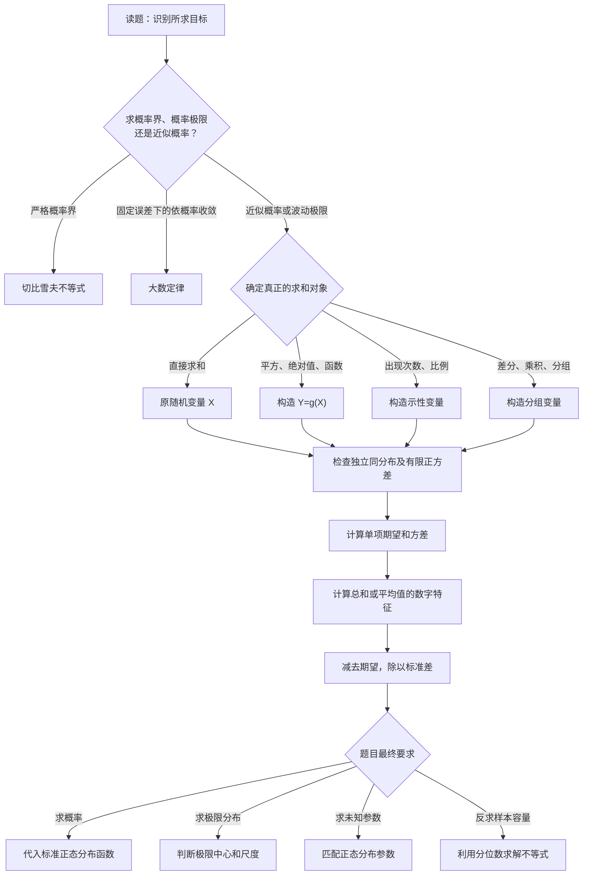

本节是大数定律与中心极限定理这一章的核心计算专题，同时也是连接随机变量的数字特征、常见概率分布、数理统计与实际概率模型的重要桥梁。

中心极限定理本身的公式并不多，但命题形式非常灵活。真正的难点往往不是使用定理，而是**识别应该对哪个随机变量使用定理，如何构造独立同分布的随机变量序列，以及如何进行正确的中心化和标准化**。

## 一、核心考点

| 核心考点           | 学习优先级 | 需要达到的程度   |
| -------------- | ----- | --------- |
| 林德伯格—列维中心极限定理  | ★★★★★ | 熟练使用      |
| 棣莫弗—拉普拉斯中心极限定理 | ★★★★★ | 熟练使用      |
| 随机变量和的标准化      | ★★★★★ | 快速准确计算    |
| 样本均值的近似分布      | ★★★★★ | 熟练推导      |
| 非标准形式的概率极限     | ★★★★★ | 熟练识别      |
| 随机变量函数的中心极限定理  | ★★★★★ | 独立构造新变量   |
| 伯努利计数模型        | ★★★★★ | 熟练建立模型    |
| 实际应用与反求样本容量    | ★★★★☆ | 掌握完整步骤    |
| 分组、差分与复合随机变量   | ★★★★☆ | 掌握综合变式    |
| 大数定律与中心极限定理的区别 | ★★★★★ | 理解本质      |
| 连续性修正          | ★★★☆☆ | 理解并区分考试约定 |
| 更一般的渐近分布问题     | ★★★☆☆ | 拓展迁移能力    |

本节的全部核心内容，可以归结为一条解题主线：

$$
\boxed{ \text{识别随机变量} \longrightarrow \text{计算期望与方差} \longrightarrow \text{中心化、标准化} \longrightarrow \text{转化为正态分布问题} }
$$

后面无论题目是求概率、求极限、求参数，还是反求样本容量，都不会脱离这条主线。

## 二、中心极限定理的直观理解与基础理论

**2.1 为什么需要中心极限定理？**

设随机变量 $X_1,X_2,\ldots,X_n$ 相互独立且同分布，并且

$$
E(X_i)=\mu,\qquad D(X_i)=\sigma^2>0.
$$

定义两个在考研中极为重要的随机变量：

- 样本和：$S_n=X_1+X_2+\cdots+X_n$。
- 样本均值：$\overline X_n=\dfrac{1}{n}\sum_{i=1}^nX_i$。

根据数字特征的性质，

$$
\begin{aligned} E(S_n)&=n\mu,\\ D(S_n)&=n\sigma^2,\\ E(\overline X_n)&=\mu,\\ D(\overline X_n)&=\frac{\sigma^2}{n}. \end{aligned}
$$

观察它们随着 $n$ 增大的变化：

| 随机变量                | 期望         | 方差                        | 标准差                           |
| ------------------- | ---------- | ------------------------- | ----------------------------- |
| $X_i$           | $\mu$  | $\sigma^2$            | $\sigma$                  |
| $S_n$           | $n\mu$ | $n\sigma^2$           | $\sqrt n\sigma$           |
| $\overline X_n$ | $\mu$  | $\dfrac{\sigma^2}{n}$ | $\dfrac{\sigma}{\sqrt n}$ |

大数定律告诉我们：

$$
\overline X_n\xrightarrow{P}\mu.
$$

但是，大数定律没有告诉我们样本均值在 $\mu$ 附近究竟按照什么规律波动。

例如：

$$
P\left\{ \mu-\frac{\sigma}{\sqrt n} <\overline X_n< \mu+\frac{\sigma}{\sqrt n} \right\}
$$

当 $n$ 趋于无穷时等于多少？

这个区间本身也在随着 $n$ 增大而缩小，因此，仅凭大数定律无法直接得到答案。

中心极限定理恰好能够解决这个问题。

**2.2 中心极限定理的本质：放大随机波动**

样本均值的标准差为

$$
\frac{\sigma}{\sqrt n}.
$$

这说明样本均值的典型波动尺度是 $1/\sqrt n$。

为了研究越来越小的波动，我们把偏差放大 $\sqrt n$ 倍：

$$
\sqrt n(\overline X_n-\mu).
$$

此时，

$$
E[\sqrt n(\overline X_n-\mu)]=0,
$$

$$
D[\sqrt n(\overline X_n-\mu)]=\sigma^2.
$$

它的波动规模不再随着样本容量增大而缩小。

进一步除以标准差 $\sigma$，便得到

$$
Z_n=\frac{\sqrt n(\overline X_n-\mu)}{\sigma}.
$$

中心极限定理说明，这个随机变量的分布逐渐接近标准正态分布。

因此，可以这样理解两个定理：

**大数定律研究平均结果趋向哪里；中心极限定理研究平均结果在极限附近如何波动。**

## 三、林德伯格—列维中心极限定理

**3.1 定理的标准表述**

设随机变量序列

$$
X_1,X_2,\ldots,X_n,\ldots
$$

相互独立且同分布，并且具有有限的数学期望与有限的非零方差：

$$
E(X_i)=\mu,\qquad D(X_i)=\sigma^2,\qquad 0<\sigma^2<+\infty.
$$

则对任意实数 $x$，都有

$$
\boxed{ \lim_{n\to\infty} P\left\{ \frac{\displaystyle\sum_{i=1}^nX_i-n\mu} {\sigma\sqrt n}\le x \right\} =\Phi(x) }
$$

其中 $\Phi(x)$ 是标准正态分布的分布函数：

$$
\Phi(x)= \frac{1}{\sqrt{2\pi}} \int_{-\infty}^x e^{-t^2/2}\,\mathrm dt.
$$

也可以写成

$$
\frac{S_n-n\mu}{\sigma\sqrt n} \xrightarrow{d}N(0,1).
$$

符号 $\xrightarrow{d}$ 表示依分布收敛。

**形式一：随机变量之和**

$$
\boxed{ \frac{\sum_{i=1}^nX_i-n\mu} {\sqrt{n\sigma^2}} \xrightarrow{d}N(0,1) }
$$

适用于总重量、总时间、总收入、总次数等问题。

**形式二：样本均值**

$$
\boxed{ \frac{\overline X_n-\mu} {\sigma/\sqrt n} \xrightarrow{d}N(0,1) }
$$

适用于平均成绩、平均重量、平均身高、平均收益等问题。

**形式三：中心化样本和**

$$
\boxed{ \frac{1}{\sqrt n} \sum_{i=1}^n(X_i-\mu) \xrightarrow{d}N(0,\sigma^2) }
$$

这种形式特别容易出现在求概率极限的选择题中。

**形式四：样本均值的放大**

$$
\boxed{ \sqrt n(\overline X_n-\mu) \xrightarrow{d}N(0,\sigma^2) }
$$

形式三与形式四实际上完全相同。

**3.3 两个最重要的正态近似结论**

当 $n$ 充分大时，可以写成

$$
\boxed{ S_n\approx N(n\mu,n\sigma^2) }
$$

以及

$$
\boxed{ \overline X_n\approx N\left(\mu,\frac{\sigma^2}{n}\right) }
$$

注意，正态分布 $N(\mu,\sigma^2)$ 的第二个参数表示方差，而不是标准差。

这是本节最常见的低级错误之一。

**3.4 定理的适用条件**

| 条件          | 是否为经典定理的条件    |
| ----------- | ------------- |
| 随机变量相互独立    | 是             |
| 随机变量同分布     | 是             |
| 数学期望有限      | 是             |
| 方差有限        | 是             |
| 方差大于零       | 是             |
| 原总体服从正态分布   | 不需要           |
| 原总体为连续型随机变量 | 不需要           |
| 原总体为离散型随机变量 | 也可以           |
| 三阶矩、四阶矩存在   | 对原变量的经典CLT不要求 |

中心极限定理最重要的特点就是：**原来的总体不必服从正态分布。**

均匀分布、指数分布、泊松分布、二项分布，甚至没有名称的复杂分布，只要满足经典定理的条件，都可以应用中心极限定理。

**3.5 定理条件辨析——李林880基础选择题第2题**

设 $X_1,X_2,\ldots$ 相互独立，问下列哪一个条件能够保证使用林德伯格—列维中心极限定理。

| 给定条件       | 能否保证        |
| ---------- | ----------- |
| 服从同一离散型分布  | 不一定，方差可能不存在 |
| 服从同一连续型分布  | 不一定，方差可能不存在 |
| 服从同一指数分布   | 可以          |
| 具有相同的期望和方差 | 不一定满足经典CLT  |

因此选C。

这一题考查的不是计算，而是适用条件。

尤其要注意：**独立且具有相同的期望和方差，不等价于独立同分布。** 独立非同分布的随机变量在满足其他条件时也可能具有正态极限，但不能直接套用这里的经典定理。

**3.6 中心极限定理与正态分布可加性的区别**

如果原总体本身就服从正态分布：

$$
X_i\sim N(\mu,\sigma^2),
$$

且样本独立，那么对于任意正整数 $n$，严格有

$$
S_n\sim N(n\mu,n\sigma^2),
$$

$$
\overline X_n\sim N\left(\mu,\frac{\sigma^2}{n}\right).
$$

此时不需要中心极限定理，因为这是正态分布的可加性。

如果原总体并非正态分布，则通常只在 $n$ 较大时具有上述近似结果。

## 四、棣莫弗—拉普拉斯中心极限定理

这是林德伯格—列维中心极限定理在二项分布中的特殊情形，也是考研数学一非常重要的实际应用模型。

**4.1 定理及其推导**

设

$$
X_n\sim B(n,p),\qquad 0<p<1,
$$

其中 $p$ 为固定常数。

可以把 $X_n$ 写成

$$
X_n=\sum_{i=1}^nI_i,
$$

其中

$$
I_i\sim B(1,p)
$$

且各个 $I_i$ 相互独立。

因为

$$
E(I_i)=p,\qquad D(I_i)=p(1-p),
$$

所以

$$
E(X_n)=np,\qquad D(X_n)=np(1-p).
$$

由中心极限定理，

$$
\boxed{ \frac{X_n-np}{\sqrt{np(1-p)}} \xrightarrow{d}N(0,1) }
$$

即

$$
\boxed{ X_n\approx N(np,np(1-p)) }
$$

因此，对于区间概率，

$$
\begin{aligned} P(a\le X_n\le b) &\approx \Phi\left(\frac{b-np}{\sqrt{np(1-p)}}\right)\\ &\quad- \Phi\left(\frac{a-np}{\sqrt{np(1-p)}}\right). \end{aligned}
$$

这里暂时采用考研题目常见的、不进行连续性修正的近似方式。

**4.2 样本频率的中心极限定理**

令

$$
\widehat p=\frac{X_n}{n},
$$

表示某事件发生的频率。

则

$$
E(\widehat p)=p, \qquad D(\widehat p)=\frac{p(1-p)}{n}.
$$

因此

$$
\boxed{ \widehat p\approx N\left(p,\frac{p(1-p)}{n}\right) }
$$

以及

$$
\boxed{ \frac{\widehat p-p} {\sqrt{p(1-p)/n}} \xrightarrow{d}N(0,1) }
$$

这两个公式可以直接解决合格率、发芽率、命中率、抽样比例和抽样误差等问题。

**4.3 二项分布什么时候适合使用正态近似？**

实践中的常用经验条件是

$$
np\ge5,\qquad n(1-p)\ge5.
$$

更保守的经验条件是两者均不小于10。

但这些只是经验判断标准，并不是中心极限定理的严格条件，也不能保证某一个具体精度。

当 $p$ 极小、$n$ 很大而 $np$ 较小时，应优先考虑泊松近似，而不是机械使用正态近似。

特别地，若 $p=p_n$ 随 $n$ 改变并满足

$$
np_n\to\lambda>0,
$$

则二项分布的极限是泊松分布，而不是通常所说的正态极限。

## 五、解题前必须熟记的数字特征

由于中心极限定理的计算主要依赖期望与方差，以下常见分布必须达到看到题目就能直接写出数字特征的程度。

| 分布                    | 数学期望                 | 方差                        |
| --------------------- | -------------------- | ------------------------- |
| $B(1,p)$          | $p$              | $p(1-p)$              |
| $B(m,p)$          | $mp$             | $mp(1-p)$             |
| $P(\lambda)$      | $\lambda$        | $\lambda$             |
| $U(a,b)$          | $\dfrac{a+b}{2}$ | $\dfrac{(b-a)^2}{12}$ |
| 指数分布 $E(\lambda)$ | $\dfrac1\lambda$ | $\dfrac1{\lambda^2}$  |
| $N(\mu,\sigma^2)$ | $\mu$            | $\sigma^2$            |
| $\chi^2(m)$       | $m$              | $2m$                  |

还必须熟练掌握：

$$
E(aX+b)=aE(X)+b,
$$

$$
D(aX+b)=a^2D(X),
$$

$$
D(X\pm Y) =D(X)+D(Y)\pm2\operatorname{Cov}(X,Y).
$$

若 $X,Y$ 相互独立，则

$$
D(X+Y)=D(X-Y)=D(X)+D(Y).
$$

注意，即使是两个随机变量相减，独立情形下的方差仍然相加。

**标准正态分布的四个概率公式**

若 $Z\sim N(0,1)$，则

$$
P(Z\le x)=\Phi(x),
$$

$$
P(Z>x)=1-\Phi(x)=\Phi(-x),
$$

$$
P(a<Z<b)=\Phi(b)-\Phi(a),
$$

$$
P(|Z|<a)=2\Phi(a)-1,\qquad a>0.
$$

常用数值如下：

| $x$ | $\Phi(x)$ |
| ------- | ------------- |
| 0       | 0.5000        |
| 0.5     | 0.6915        |
| 1       | 0.8413        |
| 1.282   | 约0.9000       |
| 1.645   | 约0.9500       |
| 1.96    | 约0.9750       |
| 2       | 0.9772        |
| 2.326   | 约0.9900       |
| 2.5     | 0.9938        |
| 3       | 0.9987        |

## 六、核心题型一：直接使用中心极限定理求概率

**重要程度：★★★★★**

这是本节最基本的题型，也是其他所有题型的计算基础。

### 母题1：2020年数学一真题

来源：考研核心题目第5题。

设 $X_1,\ldots,X_{100}$ 为来自总体 $X$ 的简单随机样本，且

$$
P(X=0)=P(X=1)=\frac12.
$$

记 $\Phi(x)$ 为标准正态分布函数，利用中心极限定理求

$$
P\left(\sum_{i=1}^{100}X_i\le55\right)
$$

的近似值。

<Steps>

<Step>

### 第一步：识别总体分布 [!toc]

由分布律直接得到

$$
X_i\sim B\left(1,\frac12\right).
$$

故

$$
E(X_i)=\frac12, \qquad D(X_i)=\frac14.
$$

</Step>

<Step>

### 第二步：识别目标随机变量 [!toc]

令

$$
S=\sum_{i=1}^{100}X_i.
$$

利用独立性，

$$
E(S)=100\times\frac12=50,
$$

$$
D(S)=100\times\frac14=25.
$$

因此标准差为5。

</Step>

<Step>

### 第三步：正态近似 [!toc]

由中心极限定理，

$$
S\approx N(50,25).
$$

所以

$$
\begin{aligned} P(S\le55) &=P\left(\frac{S-50}{5}\le1\right)\\ &\approx\Phi(1). \end{aligned}
$$

因此

$$
\boxed{\Phi(1)}
$$

原题选择B。

</Step>

</Steps>

**这道真题需要学会什么？**

不要把它只看作二项分布题。它实际上给出了所有随机变量和的概率近似题的统一模板：

$$
\boxed{ P(S_n\le a) \approx \Phi\left( \frac{a-n\mu}{\sigma\sqrt n} \right) }
$$

这里的三个关键量分别是阈值、期望和标准差。

### 母题2：汤家凤八套卷·第2套·第10题

来源：分类模拟题。

设 $X_1,\ldots,X_{100}$ 相互独立且均服从

$$
B\left(10,\frac1{10}\right).
$$

利用中心极限定理求

$$
P\left(\sum_{i=1}^{100}X_i\le130\right)
$$

的近似值。

<Tabs items={["解法一：直接计算数字特征", "解法二：利用二项分布的可加性"]} defaultIndex={0}>

<Tab value="解法一：直接计算数字特征">

由于

$$
E(X_i)=1,\qquad D(X_i)=0.9,
$$

故

$$
E(S_{100})=100, \qquad D(S_{100})=90.
$$

所以

$$
\begin{aligned} P(S_{100}\le130) &\approx \Phi\left(\frac{130-100}{\sqrt{90}}\right)\\ &=\Phi(\sqrt{10}). \end{aligned}
$$

答案为

$$
\boxed{\Phi(\sqrt{10})}
$$

</Tab>

<Tab value="解法二：利用二项分布的可加性">

因为各个 $X_i$ 独立，且成功概率相同，

$$
S_{100}\sim B(1000,0.1).
$$

直接使用棣莫弗—拉普拉斯中心极限定理，同样可以得到结果。

</Tab>

</Tabs>

**命题变化**

2020年数学一真题中的单个变量服从0-1分布，而这道模拟题中的单个变量服从二项分布。

表面上变化了，实际上仍然是求和、计算期望和方差、标准化。

**不必先求出随机变量和的精确分布，才能使用中心极限定理。**

### 母题3：张宇1000题·基础第4题

生产每件产品所需时间相互独立，且服从平均时间为10分钟的指数分布。求生产100件产品的总时间在15小时至20小时之间的概率近似值。

设生产第 $i$ 件产品所需的时间为 $X_i$。

由于

$$
X_i\sim E\left(\frac1{10}\right),
$$

故

$$
E(X_i)=10,\qquad D(X_i)=100.
$$

设总时间为

$$
S=\sum_{i=1}^{100}X_i.
$$

则

$$
E(S)=1000,\qquad D(S)=10000.
$$

因此

$$
S\approx N(1000,10000).
$$

统一时间单位：

$$
15\text{小时}=900\text{分钟},
$$

$$
20\text{小时}=1200\text{分钟}.
$$

于是

$$
\begin{aligned} P(900<S<1200) &\approx \Phi\left(\frac{1200-1000}{100}\right)\\ &\quad-\Phi\left(\frac{900-1000}{100}\right)\\ &=\Phi(2)-\Phi(-1)\\ &=\Phi(2)+\Phi(1)-1. \end{aligned}
$$

最终答案：

$$
\boxed{\Phi(1)+\Phi(2)-1}
$$

**这一类题的标准解题步骤**

1. 确定单个随机变量的期望与方差。
2. 判断题目求的是样本和还是样本均值。
3. 计算目标随机变量的期望与方差。
4. 将概率事件中的阈值标准化。
5. 利用 $\Phi(x)$ 的性质写出结果。

最大的两个陷阱是把方差当作标准差，以及把总量误认为平均量。

## 七、核心题型二：非标准化形式的概率极限

**重要程度：★★★★★**

这类题在选择题、填空题中尤其值得训练。

出题人不会直接把定理中的标准化形式给你，而是将系数、分母、中心位置进行改变，要求判断最终的极限分布。

### 7.1 通用公式

若 $X_i$ 独立同分布，且

$$
E(X_i)=\mu,\qquad D(X_i)=\sigma^2,
$$

则

$$
\frac{\sum_{i=1}^nX_i-n\mu}{\sqrt n} \xrightarrow{d}N(0,\sigma^2).
$$

更一般地，设 $a\ne0$，则

$$
\boxed{ \frac{a\sum_{i=1}^nX_i-an\mu}{\sqrt n} \xrightarrow{d}N(0,a^2\sigma^2) }
$$

因此

$$
\boxed{ \lim_{n\to\infty} P\left\{ \frac{a\sum X_i-an\mu}{\sqrt n}\le x \right\} =\Phi\left(\frac{x}{|a|\sigma}\right) }
$$

这一公式非常适合快速解决复杂系数的选择题。

### 母题4：张宇1000题·基础第3题

设 $X_1,X_2,\ldots$ 相互独立且均服从 $U[1,4]$，求

$$
\lim_{n\to\infty} P\left\{ \frac{2\sum_{i=1}^nX_i-5n}{\sqrt n} \le x \right\}.
$$

<Tabs items={["解法一：构造标准正态形式", "解法二：构造新的单项随机变量"]} defaultIndex={0}>

<Tab value="解法一：构造标准正态形式">

首先计算

$$
E(X_i)=\frac52,\qquad D(X_i)=\frac34.
$$

由中心极限定理，

$$
\frac{\sum X_i-\frac52n} {\frac{\sqrt3}{2}\sqrt n} \xrightarrow{d}N(0,1).
$$

而原式可以改写为

$$
\frac{2\sum X_i-5n}{\sqrt n} = \sqrt3\cdot \frac{\sum X_i-\frac52n} {\frac{\sqrt3}{2}\sqrt n}.
$$

所以原随机变量的极限分布为

$$
N(0,3).
$$

答案为

$$
\boxed{ \Phi\left(\frac{x}{\sqrt3}\right) }
$$

</Tab>

<Tab value="解法二：构造新的单项随机变量">

令

$$
Y_i=2X_i-5.
$$

则

$$
E(Y_i)=0,\qquad D(Y_i)=4D(X_i)=3.
$$

原题随机变量就是

$$
\frac{\sum_{i=1}^nY_i}{\sqrt n}.
$$

根据中心极限定理，其极限分布为 $N(0,3)$。

这一方法更容易推广到复杂的新题。

</Tab>

</Tabs>

### 母题5：李林六套卷·第2套·第9题

来源：分类模拟题。

设 $X_i$ 独立同分布，且

$$
X_i\sim P\left(\frac12\right).
$$

求

$$
\lim_{n\to\infty} P\left\{ \frac{2\sum_{i=1}^nX_i-n} {2\sqrt n}\le1 \right\}.
$$

因为

$$
E(X_i)=D(X_i)=\frac12,
$$

先化简原式：

$$
\frac{2\sum X_i-n}{2\sqrt n} =\frac{\sum X_i-n/2}{\sqrt n}.
$$

由中心极限定理，

$$
\frac{\sum X_i-n/2}{\sqrt n} \xrightarrow{d} N\left(0,\frac12\right).
$$

因此

$$
\boxed{ \Phi\left(\frac{1}{\sqrt{1/2}}\right) =\Phi(\sqrt2) }
$$

<Callout type="idea" title="提速技巧">

对于已经正确中心化、但分母只有 $\sqrt n$ 的表达式，直接计算它的极限方差，再用阈值除以标准差。

不必每一次都完整地重新构造标准正态变量。

</Callout>

### 7.2 更一般的含参数极限

设

$$
T_n=\frac{a\sum_{i=1}^nX_i-bn}{c\sqrt n}, \qquad a\ne0,\quad c>0.
$$

将其拆成

$$
T_n= \frac{a}{c} \frac{\sum X_i-n\mu}{\sqrt n} +\frac{a\mu-b}{c}\sqrt n.
$$

于是有三种情况：

| 参数关系          | 对任意固定 $x$，$P(T_n\le x)$ 的极限                        |
| ------------- | ---------------------------------------------------------- |
| $b=a\mu$  | $\displaystyle\Phi\left(\frac{cx}{\|a\|\sigma}\right)$ |
| $b<a\mu$ | $0$                                                    |
| $b>a\mu$  | $1$                                                    |

如果要求极限恰好等于 $\Phi(x)$，必须满足

$$
\boxed{ b=a\mu,\qquad c=|a|\sigma }
$$

这就是含参数中心极限定理题的核心思想：

**匹配中心位置，再匹配波动尺度。**

## 八、核心题型三：对随机变量的函数使用中心极限定理

**重要程度：★★★★★**

这一题型是本节最重要的综合突破点，也是很适合命制创新题的方向。

普通中心极限定理研究的是

$$
\sum_{i=1}^nX_i.
$$

但考研完全可以把题目改成

$$
\sum_{i=1}^nX_i^2,\qquad \sum_{i=1}^n|X_i|,\qquad \sum_{i=1}^ng(X_i).
$$

这时真正应该使用中心极限定理的对象并不是 $X_i$，而是

$$
Y_i=g(X_i).
$$

### 8.1 通用解题原理

如果 $X_i$ 独立同分布，则对同一个可测函数 $g$，

$$
Y_i=g(X_i)
$$

仍然独立同分布。

设

$$
m=E[g(X)],
$$

$$
v=D[g(X)] =E[g^2(X)]-\{E[g(X)]\}^2.
$$

若 $0<v<+\infty$，则

$$
\boxed{ \frac{\sum_{i=1}^ng(X_i)-nm}{\sqrt{nv}} \xrightarrow{d}N(0,1) }
$$

相应地，

$$
\boxed{ \frac1n\sum_{i=1}^ng(X_i) \approx N\left(m,\frac vn\right) }
$$

解这类题通常不需要先求出 $g(X)$ 的概率密度，只需要计算它的数学期望与方差。

### 母题6：1996年数学三真题

来源：考研核心题目第1题；李林880基础选择题第1题也采用了同一模型。

设 $X_1,\ldots,X_n$ 是来自总体 $X$ 的简单随机样本，且

$$
E(X^k)=a_k,\qquad k=1,2,3,4.
$$

证明当 $n$ 充分大时，

$$
Z_n=\frac1n\sum_{i=1}^nX_i^2
$$

近似服从正态分布，并指出其分布参数。

<Steps>

<Step>

### 第一步：确定真正的研究对象 [!toc]

令

$$
Y_i=X_i^2.
$$

由于 $X_i$ 独立同分布，所以 $Y_i$ 也独立同分布。

</Step>

<Step>

### 第二步：计算新变量的期望与方差 [!toc]

$$
E(Y_i)=E(X_i^2)=a_2.
$$

又因为

$$
E(Y_i^2)=E(X_i^4)=a_4,
$$

所以

$$
D(Y_i)=a_4-a_2^2.
$$

注意，这里的方差不是 $a_2-a_1^2$。

后者是原随机变量 $X_i$ 的方差。

</Step>

<Step>

### 第三步：使用中心极限定理 [!toc]

当 $a_4-a_2^2>0$ 时，

$$
\frac{\sum_{i=1}^nX_i^2-na_2} {\sqrt{n(a_4-a_2^2)}} \xrightarrow{d}N(0,1).
$$

因为

$$
Z_n=\frac1n\sum_{i=1}^nX_i^2,
$$

所以

$$
\frac{Z_n-a_2} {\sqrt{(a_4-a_2^2)/n}} \xrightarrow{d}N(0,1).
$$

故

$$
\boxed{ Z_n\approx N\left(a_2,\frac{a_4-a_2^2}{n}\right) }
$$

</Step>

<Step>

### 第四步：特殊边界的讨论 [!toc]

如果

$$
a_4-a_2^2=0,
$$

则

$$
D(X_i^2)=0.
$$

从而

$$
P(X_i^2=a_2)=1.
$$

此时

$$
P(Z_n=a_2)=1.
$$

它是退化随机变量，不能再除以标准差进行标准化。

</Step>

</Steps>

**这道真题的迁移价值**

对于

$$
Y_n=\frac1n\sum_{i=1}^nX_i^k,
$$

应立即想到

$$
E(X^k),\qquad D(X^k)=E(X^{2k})-[E(X^k)]^2.
$$

因此

$$
\boxed{ Y_n\approx N\left( E(X^k), \frac{E(X^{2k})-[E(X^k)]^2}{n} \right) }
$$

前提是相应矩有限且方差为正。

例如，研究 $X_i^3$ 的样本平均，就需要三阶矩和六阶矩。

### 母题7：李永乐六套卷·第3套·第10题

来源：分类模拟题，属于很有代表性的创新题。

设 $X_1,\ldots,X_{100}$ 为来自标准正态总体的简单随机样本。分别以

$$
|X_i|,\qquad |X_i|+1
$$

为内、外半径作圆环。求100个圆环面积之和 $S$ 的近似分布。

<Steps>

<Step>

### 第一步：将几何问题转化为随机变量函数问题 [!toc]

第 $i$ 个圆环的面积为

$$
\begin{aligned} Y_i &=\pi[(|X_i|+1)^2-|X_i|^2]\\ &=\pi(2|X_i|+1). \end{aligned}
$$

于是

$$
S=\sum_{i=1}^{100}Y_i.
$$

真正的研究对象为 $|X_i|$，而不是 $X_i$。

</Step>

<Step>

### 第二步：计算绝对值的数学期望 [!toc]

因为 $X_i\sim N(0,1)$，其密度为

$$
f(x)=\frac1{\sqrt{2\pi}}e^{-x^2/2}.
$$

利用对称性，

$$
\begin{aligned} E|X_i| &=\frac2{\sqrt{2\pi}} \int_0^{+\infty}xe^{-x^2/2}\,\mathrm dx\\ &=\sqrt{\frac2\pi}. \end{aligned}
$$

这是一个非常有用的结论：

$$
\boxed{ X\sim N(0,1) \quad\Longrightarrow\quad E|X|=\sqrt{\frac2\pi} }
$$

</Step>

<Step>

### 第三步：计算绝对值的方差 [!toc]

由于

$$
E(|X_i|^2)=E(X_i^2)=1,
$$

所以

$$
D(|X_i|)=1-\frac2\pi.
$$

于是

$$
E(Y_i)=\pi\left(1+2\sqrt{\frac2\pi}\right),
$$

$$
D(Y_i)=4\pi^2\left(1-\frac2\pi\right).
$$

</Step>

<Step>

### 第四步：求面积和的近似分布 [!toc]

$$
E(S)=100\pi\left(1+2\sqrt{\frac2\pi}\right),
$$

$$
D(S)=400\pi^2\left(1-\frac2\pi\right).
$$

故

$$
\boxed{ S\approx N\left( 100\pi\left(1+2\sqrt{\frac2\pi}\right), 400\pi^2\left(1-\frac2\pi\right) \right) }
$$

</Step>

</Steps>

**为什么这是一道高质量模拟题？**

因为它将高等数学的几何面积、概率论的随机变量函数、数学期望和方差、中心极限定理结合在一起。

如果未来真题将圆环换成球体体积、随机矩形面积、随机路程或者随机收益，本质上依旧是先构造 $Y_i=g(X_i)$，再计算它的数字特征。

### 母题8：张宇8套卷·第5套·第8题

来源：分类模拟题。

设 $X_i$ 独立同分布，具有连续且严格单调的分布函数 $F(x)$。求

$$
\lim_{n\to\infty} P\left\{ \frac1n\sum_{i=1}^nF(X_i)\le\frac12 \right\}.
$$

这是随机变量函数分布与中心极限定理的综合题。

<Steps>

<Step>

### 第一步：识别概率积分变换 [!toc]

令

$$
Y_i=F(X_i).
$$

当 $0<y<1$ 时，

$$
\begin{aligned} P(Y_i\le y) &=P(F(X_i)\le y)\\ &=P(X_i\le F^{-1}(y))\\ &=F(F^{-1}(y))\\ &=y. \end{aligned}
$$

因此

$$
\boxed{F(X_i)\sim U(0,1)}
$$

</Step>

<Step>

### 第二步：计算数字特征 [!toc]

$$
E(Y_i)=\frac12, \qquad D(Y_i)=\frac1{12}.
$$

</Step>

<Step>

### 第三步：标准化 [!toc]

$$
\begin{aligned} &\lim_{n\to\infty} P\left\{\frac1n\sum Y_i\le\frac12\right\}\\ &= \lim_{n\to\infty} P\left\{ \frac{\sum Y_i-n/2}{\sqrt{n/12}}\le0 \right\}\\ &=\Phi(0)=\frac12. \end{aligned}
$$

故答案为

$$
\boxed{\frac12}
$$

</Step>

</Steps>

**更深一层的理解**

其实本题对于任意正整数 $n$，概率都严格等于 $1/2$。

因为均匀分布 $U(0,1)$ 关于 $1/2$ 对称，其独立样本均值也关于 $1/2$ 对称，而且是连续型随机变量。

因此

$$
P\left(\overline Y_n\le\frac12\right)=\frac12.
$$

不过，对于一般非对称总体，这个等式在有限样本时未必成立，只能由中心极限定理得到极限为 $1/2$。

## 九、核心题型四：分组构造与反求标准化系数

**重要程度：★★★★★**

遇到下列形式时，要想到按组构造新随机变量：

$$
\sum_{i=1}^n(X_{2i}-X_{2i-1}),
$$

$$
\sum_{i=1}^nX_{2i}X_{2i-1},
$$

$$
\sum_{i=1}^n(X_{3i}+X_{3i-1}-2X_{3i-2}).
$$

关键是各组是否由互不重叠的独立变量构成。

### 母题9：李林880基础填空第4题

张宇1000题基础第6题也有同一类型的练习。

设 $X_i$ 相互独立，且均服从

$$
B\left(1,\frac12\right).
$$

若

$$
\lim_{n\to\infty} P\left\{ \frac{k\sum_{i=1}^n(X_{2i}-X_{2i-1})} {\sqrt n}\le x \right\} =\Phi(x),
$$

求常数 $k$。

<Steps>

<Step>

### 第一步：按两个样本为一组 [!toc]

令

$$
Y_i=X_{2i}-X_{2i-1}.
$$

各组使用的原随机变量互不重叠，所以 $Y_i$ 独立同分布。

</Step>

<Step>

### 第二步：计算新变量的数字特征 [!toc]

$$
E(Y_i)=\frac12-\frac12=0.
$$

由独立性，

$$
\begin{aligned} D(Y_i) &=D(X_{2i})+D(X_{2i-1})\\ &=\frac14+\frac14\\ &=\frac12. \end{aligned}
$$

</Step>

<Step>

### 第三步：匹配标准正态方差 [!toc]

由中心极限定理，

$$
\frac{\sum Y_i}{\sqrt n} \xrightarrow{d}N\left(0,\frac12\right).
$$

所以

$$
\frac{k\sum Y_i}{\sqrt n} \xrightarrow{d}N\left(0,\frac{k^2}{2}\right).
$$

根据题意，

$$
\frac{k^2}{2}=1.
$$

解得

$$
\boxed{k=\pm\sqrt2}
$$

**注意：** 仅填写正根 $\sqrt2$ 并不充分。原题若没有 $k>0$ 的限制，负根同样满足条件，因为标准正态分布关于零对称。

</Step>

</Steps>

**通用变式一：线性组合**

若 $X_i$ 独立同分布，期望为 $\mu$，方差为 $\sigma^2$，令

$$
Y_i=aX_{2i-1}+bX_{2i},
$$

则

$$
E(Y_i)=(a+b)\mu,
$$

$$
D(Y_i)=(a^2+b^2)\sigma^2.
$$

之后直接对 $Y_i$ 使用中心极限定理。

**通用变式二：随机变量乘积**

令

$$
Y_i=X_{2i-1}X_{2i}.
$$

由于两个因子独立，

$$
E(Y_i)=\mu^2.
$$

而

$$
\begin{aligned} E(Y_i^2) &=E(X_{2i-1}^2)E(X_{2i}^2)\\ &=(\sigma^2+\mu^2)^2. \end{aligned}
$$

因此

$$
\boxed{ D(Y_i)=\sigma^4+2\mu^2\sigma^2 }
$$

得到

$$
\frac{\sum Y_i-n\mu^2} {\sqrt{n(\sigma^4+2\mu^2\sigma^2)}} \xrightarrow{d}N(0,1).
$$

**通用变式三：相邻变量重叠的陷阱**

如果题目改为

$$
Y_i=X_{i+1}-X_i,
$$

那么 $Y_i$ 与 $Y_{i+1}$ 使用了共同的变量 $X_{i+1}$，通常不再独立。

此时不能直接套用前面的分组方法。

但注意，

$$
\sum_{i=1}^nY_i =\sum_{i=1}^n(X_{i+1}-X_i) =X_{n+1}-X_1.
$$

所以

$$
D\left(\frac{\sum Y_i}{\sqrt n}\right) =\frac{2\sigma^2}{n}\to0.
$$

根据切比雪夫不等式，

$$
\boxed{ \frac{\sum Y_i}{\sqrt n} \xrightarrow{P}0 }
$$

原本看似中心极限定理的题，实际上变成了切比雪夫不等式和依概率收敛的题。

这正是综合创新题中非常典型的命题方式。

## 十、核心题型五：计数问题与示性随机变量

**重要程度：★★★★★**

这一类题目的关键是识别题目统计的究竟是随机变量数值之和，还是满足特定条件的样本个数。

### 10.1 示性随机变量的统一模型

对于某个事件 $A$，定义

$$
I_i= \begin{cases} 1,&X_i\in A,\\ 0,&X_i\notin A. \end{cases}
$$

假设

$$
P(X_i\in A)=p.
$$

则

$$
I_i\sim B(1,p).
$$

若原样本相互独立，满足条件的样本个数

$$
K=\sum_{i=1}^nI_i
$$

服从

$$
\boxed{K\sim B(n,p)}
$$

从而

$$
\boxed{ \frac{K-np}{\sqrt{np(1-p)}} \xrightarrow{d}N(0,1) }
$$

题目中出现“有多少个”“出现次数”“不超过某值的个数”“落入指定区间的个数”等关键词时，要优先想到示性变量。

### 母题10：张宇1000题·强化第1题

设 $X_1,\ldots,X_n$ 为来自总体 $X$ 的简单随机样本，其中

| $X$ | 0                 | 1              | 2                 | 3              |
| ------- | ----------------- | -------------- | ----------------- | -------------- |
| 概率      | $\dfrac1{16}$ | $\dfrac38$ | $\dfrac1{16}$ | $\dfrac12$ |

记 $K$ 为样本中取值等于2的个数。若

$$
\lim_{n\to\infty} P\left\{\frac{K-a}{b}\le x\right\} =\Phi(x),
$$

求标准中心化和尺度参数 $a,b$。

<Steps>

<Step>

### 第一步：确定单次命中概率 [!toc]

$$
p=P(X_i=2)=\frac1{16}.
$$

</Step>

<Step>

### 第二步：建立二项分布 [!toc]

$$
K\sim B\left(n,\frac1{16}\right).
$$

注意，本题根本不需要计算原总体 $X$ 的数学期望和方差。

</Step>

<Step>

### 第三步：计算计数变量的数字特征 [!toc]

$$
E(K)=\frac n{16},
$$

$$
D(K)=n\cdot\frac1{16}\cdot\frac{15}{16} =\frac{15n}{256}.
$$

因此标准化参数为

$$
\boxed{ a=\frac n{16}, \qquad b=\frac{\sqrt{15n}}{16} }
$$

这也是原题的正确选项。

严格来说，在允许参数随 $n$ 变化的更一般极限问题中，具有相同渐近中心和尺度的其他参数也可能成立；原题是选择题，要求识别标准的中心化与标准化参数。

</Step>

</Steps>

### 母题11：张宇1000题·基础第5题

100个球分别独立、等可能地放入5个盒子。求指定某个盒子中不超过22个球的概率近似值。

令 $K$ 为指定盒子中的球数。

因为每个球进入指定盒子的概率为

$$
p=\frac15,
$$

故

$$
K\sim B\left(100,\frac15\right).
$$

于是

$$
E(K)=20,\qquad D(K)=16.
$$

由中心极限定理，

$$
\begin{aligned} P(K\le22) &\approx \Phi\left(\frac{22-20}{4}\right)\\ &=\Phi(0.5). \end{aligned}
$$

答案为

$$
\boxed{\Phi(0.5)}
$$

**综合变式：比较两个类别的出现次数**

假设仍然有 $n$ 个球独立等可能放入5个盒子，记第一个盒子中的球数为 $K_1$，第二个盒子中的球数为 $K_2$。

注意：$K_1$ **与** $K_2$ **并不独立。**

为了研究 $K_1-K_2$，定义

$$
Y_i= \begin{cases} 1,&\text{第 }i\text{ 个球进入第一个盒子},\\ -1,&\text{第 }i\text{ 个球进入第二个盒子},\\ 0,&\text{其他情况}. \end{cases}
$$

则

$$
K_1-K_2=\sum_{i=1}^nY_i.
$$

因为

$$
P(Y_i=1)=P(Y_i=-1)=\frac15,
$$

所以

$$
E(Y_i)=0,\qquad D(Y_i)=\frac25.
$$

由中心极限定理，

$$
\boxed{ \frac{K_1-K_2}{\sqrt{2n/5}} \xrightarrow{d}N(0,1) }
$$

这说明遇到计数之间的加减、得分之和、类别之间的差异时，不一定非要构造0-1变量，也可以构造多取值的单次贡献变量。

## 十一、核心题型六：二项分布的正态近似与连续性修正

**重要程度：★★★★☆**

### 母题12：1988年数学三真题

来源：考研核心题目第4题。

某保险公司资料表明，在索赔户中因被盗索赔的占20%。随机抽查100个索赔户，设其中被盗索赔的户数为 $X$。

求 $X$ 的分布，并利用棣莫弗—拉普拉斯定理近似计算

$$
P(14\le X\le30).
$$

<Steps>

<Step>

### 第一步：建立概率模型 [!toc]

按独立同概率抽样模型，

$$
X\sim B(100,0.2).
$$

其分布律为

$$
P(X=k)=\binom{100}{k}(0.2)^k(0.8)^{100-k},
$$

其中 $k=0,1,\ldots,100$。

</Step>

<Step>

### 第二步：计算数字特征 [!toc]

$$
E(X)=20, \qquad D(X)=16.
$$

故标准差为4。

</Step>

<Step>

### 第三步：采用考研传统的直接正态近似 [!toc]

$$
\begin{aligned} P(14\le X\le30) &\approx \Phi\left(\frac{30-20}{4}\right)\\ &\quad-\Phi\left(\frac{14-20}{4}\right)\\ &=\Phi(2.5)-\Phi(-1.5)\\ &=\Phi(2.5)+\Phi(1.5)-1\\ &\approx0.9270. \end{aligned}
$$

因此传统近似答案为

$$
\boxed{0.9270}
$$

</Step>

</Steps>

### 11.1 什么是连续性修正？

二项分布是离散型分布，而正态分布是连续型分布。

例如，整数值 $14$ 可以近似对应连续区间 $(13.5,14.5)$，整数值 $15$ 对应 $(14.5,15.5)$，以此类推。

因此，将整数区间

$$
14\le X\le30
$$

近似替换为连续区间

$$
13.5<Y<30.5
$$

通常能够改善近似精度。

本题使用连续性修正得到

$$
\begin{aligned} P(14\le X\le30) &\approx \Phi\left(\frac{30.5-20}{4}\right)\\ &\quad-\Phi\left(\frac{13.5-20}{4}\right)\\ &=\Phi(2.625)-\Phi(-1.625)\\ &\approx0.9436. \end{aligned}
$$

对本题进行精确二项概率计算，可以得到约 $0.9470$。

| 方法      | 概率     |
| ------- | ------ |
| 不作连续性修正 | 0.9270 |
| 作连续性修正  | 0.9436 |
| 精确二项概率  | 0.9470 |

由此可见，连续性修正在本题中明显提高了近似精度。

### 11.2 连续性修正公式汇总

设 $X$ 为整数值随机变量，$Y$ 为相应的连续正态近似变量，且 $a,b$ 为整数。

| 原事件               | 修正后的事件                    |
| ----------------- | ------------------------- |
| $X\le a$      | $Y\le a+0.5$          |
| $X<a$        | $Y\le a-0.5$          |
| $X\ge a$      | $Y\ge a-0.5$          |
| $X>a$         | $Y\ge a+0.5$          |
| $a\le X\le b$ | $a-0.5\le Y\le b+0.5$ |
| $a<X<b$     | $a+0.5\le Y\le b-0.5$ |
| $X=a$         | $a-0.5\le Y\le a+0.5$ |

**考研时究竟要不要修正？**

2020年数学一真题、汤家凤模拟题、张宇保险问题等均采用直接标准化的传统方式。

考试中应以题目要求和选项为准。

**不要为了提高近似精度，反而选错符合原题约定的答案。**

## 十二、核心题型七：实际应用与反求最大、最小样本容量

**重要程度：★★★★★**

这类题既要求概率模型建立能力，又要求代数不等式处理能力，是本节最值得作为解答题训练的方向。

### 母题13：2001年数学三真题——最大载重量问题

来源：考研核心题目第7题。

生产线每箱产品的平均重量为50千克，标准差为5千克。现用最大载重量为5吨的汽车承运。

利用中心极限定理估计，每辆车最多可以装多少箱，使不超载的概率大于0.977？

已知 $\Phi(2)=0.977$。

<Steps>

<Step>

### 第一步：建立总重量模型 [!toc]

设第 $i$ 箱产品的重量为 $X_i$，按题意采用独立同分布模型。

$$
E(X_i)=50,\qquad D(X_i)=25.
$$

装载 $n$ 箱时，总重量为

$$
S_n=\sum_{i=1}^nX_i.
$$

由中心极限定理，

$$
S_n\approx N(50n,25n).
$$

</Step>

<Step>

### 第二步：将实际要求转化为概率事件 [!toc]

5吨等于5000千克，因此要求

$$
P(S_n\le5000)>0.977.
$$

正态近似得到

$$
\Phi\left( \frac{5000-50n}{5\sqrt n} \right)>0.977.
$$

</Step>

<Step>

### 第三步：利用分布函数的单调性 [!toc]

由于 $\Phi(2)=0.977$，所以

$$
\frac{5000-50n}{5\sqrt n}>2.
$$

化简得

$$
1000-10n>2\sqrt n.
$$

令

$$
t=\sqrt n>0,
$$

则

$$
5t^2+t-500<0.
$$

解不等式得到

$$
t<\frac{\sqrt{10001}-1}{10}.
$$

因此 $n$ 应小于约98.02。

</Step>

<Step>

### 第四步：判断整数边界 [!toc]

当 $n=98$ 时，

$$
\frac{5000-4900}{5\sqrt{98}} =\frac{20}{\sqrt{98}}>2.
$$

而 $n=99$ 不满足要求。

所以按照中心极限定理的近似估计，

$$
\boxed{n_{\max}=98}
$$

</Step>

</Steps>

<Callout type="warn" title="易错点">

题目问最多装多少箱，因此是寻找满足条件的最大整数，而不是简单地四舍五入。

同时，这只是按照中心极限定理得到的估计值，并非仅凭所给均值和方差就能证明真实的不超载概率一定大于0.977。

</Callout>

### 母题14：李正元计算与应用题——最少购买商品问题

某种商品合格率为90%，需要保证100名职工每人得到一件合格商品。

问至少购买多少件，才能使满足要求的概率不低于97.5%？

<Steps>

<Step>

### 第一步：确定合格商品的个数 [!toc]

设购买 $n$ 件，合格商品数为 $X$，则

$$
X\sim B(n,0.9).
$$

要求

$$
P(X\ge100)\ge0.975.
$$

</Step>

<Step>

### 第二步：计算数字特征 [!toc]

$$
E(X)=0.9n,\qquad D(X)=0.09n.
$$

所以

$$
\begin{aligned} P(X\ge100) &\approx 1-\Phi\left( \frac{100-0.9n}{0.3\sqrt n} \right)\\ &= \Phi\left( \frac{0.9n-100}{0.3\sqrt n} \right). \end{aligned}
$$

</Step>

<Step>

### 第三步：反求样本容量 [!toc]

因为

$$
\Phi(1.96)\approx0.975,
$$

所以

$$
\frac{0.9n-100}{0.3\sqrt n}\ge1.96.
$$

即

$$
0.9n-100\ge0.588\sqrt n.
$$

令 $t=\sqrt n$，得到

$$
0.9t^2-0.588t-100\ge0.
$$

求得

$$
n\gtrsim118.2.
$$

所以至少购买

$$
\boxed{119\text{件}}
$$

本题还有一个值得学习的地方：原核心题目文档对临界整数进行了精确二项概率复核，我也重新核算了这两个概率：

$$
P\{B(118,0.9)\ge100\} \approx0.97458,
$$

$$
P\{B(119,0.9)\ge100\} \approx0.98554.
$$

因此，本题的119不仅是传统正态近似给出的结果，也恰好是精确二项概率意义下的最小整数。

</Step>

</Steps>

**这两道母题有什么区别？**

| 特征   | 最大载重量问题           | 最少购买商品问题          |
| ---- | ----------------- | ----------------- |
| 目标   | 总重量不超过上限          | 合格数量不少于下限         |
| 概率事件 | $P(S_n\le C)$ | $P(S_n\ge C)$ |
| 概率类型 | 左尾概率              | 右尾概率              |
| 求解目标 | 最大样本量             | 最小样本量             |
| 整数处理 | 找满足条件的最大整数        | 找满足条件的最小整数        |

### 母题15：李林880基础解答题第1题——抽样比例的精度问题

某生产线的产品合格率为0.8。要使一批产品的合格率在76%与84%之间的概率不小于90%，至少应生产多少件？

<Steps>

<Step>

### 第一步：识别题目研究的是比例 [!toc]

令 $X$ 为 $n$ 件产品中的合格品数，则

$$
X\sim B(n,0.8).
$$

样本合格率为

$$
\widehat p=\frac Xn.
$$

题目要求

$$
P(0.76<\widehat p<0.84)\ge0.9,
$$

即

$$
P(|\widehat p-0.8|<0.04)\ge0.9.
$$

</Step>

<Step>

### 第二步：样本比例的正态近似 [!toc]

由于

$$
D(\widehat p)=\frac{0.8\times0.2}{n} =\frac{0.16}{n},
$$

所以

$$
\frac{\widehat p-0.8}{0.4/\sqrt n} \approx N(0,1).
$$

从而

$$
P(|\widehat p-0.8|<0.04) \approx2\Phi(0.1\sqrt n)-1.
$$

</Step>

<Step>

### 第三步：转化成单侧概率 [!toc]

$$
2\Phi(0.1\sqrt n)-1\ge0.9.
$$

因此

$$
\Phi(0.1\sqrt n)\ge0.95.
$$

若取 $\Phi(1.65)\approx0.95$ 的方式，

$$
0.1\sqrt n\ge1.65.
$$

得到

$$
n\ge272.25.
$$

故近似结果为

$$
\boxed{273}
$$

不过，如果使用更精确的标准正态分位数 $1.6448536$，则

$$
n\ge270.554\ldots
$$

相应的正态近似整数结果为271。

这并不是解题方法不同，而是正态分位数取值精度不同。考试中应优先使用题目给定的数值，不能把上述近似容量当作精确二项模型的严格最小值。

</Step>

</Steps>

### 12.1 反求样本容量的通用公式

设要求样本平均值与总体期望的绝对误差不超过 $\varepsilon$ 的概率至少为 $1-\alpha$。

即

$$
P(|\overline X_n-\mu|\le\varepsilon) \ge1-\alpha.
$$

由中心极限定理，

$$
P(|\overline X_n-\mu|\le\varepsilon) \approx 2\Phi\left(\frac{\varepsilon\sqrt n}{\sigma}\right)-1.
$$

设

$$
z_{1-\alpha/2}=\Phi^{-1}(1-\alpha/2).
$$

则按照正态近似，

$$
\frac{\varepsilon\sqrt n}{\sigma} \ge z_{1-\alpha/2}.
$$

于是

$$
\boxed{ n\ge \frac{\sigma^2z_{1-\alpha/2}^2}{\varepsilon^2} }
$$

对于样本比例，只需要将 $\sigma^2$ 替换为 $p(1-p)$：

$$
\boxed{ n\ge \frac{p(1-p)z_{1-\alpha/2}^2}{\varepsilon^2} }
$$

一个重要推论是：如果想把抽样误差缩小为原来的一半，而保持同样的近似概率水平，则样本容量需要扩大到原来的4倍。

## 十三、核心题型八：利润、收益和风险概率

**重要程度：★★★★☆**

### 母题16：张宇1000题·基础第7题

保险公司承保10000辆汽车，每辆汽车每年保费1.2万元；汽车丢失时赔偿100万元，单辆汽车每年丢失概率为0.006。

求该公司一年利润不少于6000万元的概率近似值，不作连续性修正。

<Steps>

<Step>

### 第一步：确定最基本的随机量 [!toc]

设一年中丢失的汽车数量为 $X$。

按独立同概率模型，

$$
X\sim B(10000,0.006).
$$

</Step>

<Step>

### 第二步：建立利润函数 [!toc]

总保费为

$$
10000\times1.2=12000\text{万元}.
$$

赔偿总额为 $100X$ 万元。

所以利润为

$$
L=12000-100X.
$$

利润不少于6000万元，等价于

$$
12000-100X\ge6000,
$$

即

$$
X\le60.
$$

</Step>

<Step>

### 第三步：概率近似 [!toc]

$$
E(X)=10000\times0.006=60,
$$

$$
D(X)=10000\times0.006\times0.994 =59.64.
$$

于是

$$
\begin{aligned} P(L\ge6000) &=P(X\le60)\\ &\approx \Phi\left(\frac{60-60}{\sqrt{59.64}}\right)\\ &=\Phi(0)=\frac12. \end{aligned}
$$

最终答案为

$$
\boxed{\frac12}
$$

注意这里的 $1/2$ 是直接正态近似结果，并不表示精确二项概率等于 $1/2$。该题的精确概率约为0.5343。

</Step>

</Steps>

### 13.1 更一般的收益模型

假设每次独立试验：

成功时获得 $a$ 元，概率为 $p$；

失败时损失 $b$ 元，概率为 $1-p$。

令单次收益为 $Y_i$，其数字特征为

$$
E(Y_i)=ap-b(1-p),
$$

$$
D(Y_i)=(a+b)^2p(1-p).
$$

进行 $n$ 次试验后的总收益

$$
S_n=\sum_{i=1}^nY_i
$$

近似服从

$$
\boxed{ N\left( n[ap-b(1-p)], n(a+b)^2p(1-p) \right) }
$$

这个模型可以迁移到保险、投资收益、考试得分、生产利润等各种应用题。

## 十四、大数定律、切比雪夫不等式与中心极限定理的综合辨析

**重要程度：★★★★★**

这是第四章的综合知识体系。只有真正理解三个知识点之间的区别，才能避免面对综合题时不知道选择哪个定理。

### 14.1 三种方法的区别

| 比较内容          | 切比雪夫不等式     | 大数定律     | 中心极限定理                  |
| ------------- | ----------- | -------- | ----------------------- |
| 研究对象          | 随机变量偏离均值的概率 | 样本平均值的极限 | 标准化随机波动的分布              |
| 主要结论          | 概率上界或下界     | 依概率收敛    | 依分布收敛                   |
| 结果形式          | 不等式         | 常数极限等    | 正态分布                    |
| 是否要求大样本       | 不要求         | 渐近结论     | 渐近结论                    |
| 是否给出有限样本严格概率界 | 是           | 通常不是     | 否                       |
| 典型题目关键词       | 至少、不超过、概率界  | 依概率收敛于   | 近似概率、极限分布、$\Phi(x)$ |

它们并不是三个彼此孤立的知识点，而是从不同层次研究随机变量和及样本均值。

### 14.2 用同一个例子理解三种定理

设 $X_i$ 独立同分布，且

$$
E(X_i)=\mu,\qquad D(X_i)=\sigma^2>0.
$$

**第一层：切比雪夫不等式**

对于任意 $n$ 和固定的 $\varepsilon>0$，

$$
\boxed{ P(|\overline X_n-\mu|\ge\varepsilon) \le\frac{\sigma^2}{n\varepsilon^2} }
$$

这是一个有限样本的严格上界。

**第二层：大数定律**

令 $n\to\infty$，可得

$$
P(|\overline X_n-\mu|\ge\varepsilon)\to0.
$$

即

$$
\boxed{\overline X_n\xrightarrow{P}\mu}
$$

**第三层：中心极限定理**

将偏差放大 $\sqrt n$ 倍，

$$
\boxed{ \frac{\sqrt n(\overline X_n-\mu)}{\sigma} \xrightarrow{d}N(0,1) }
$$

此时研究的不是样本均值是否接近 $\mu$，而是它在 $\mu$ 附近的具体波动规律。

### 14.3 必须掌握的三个阈值情形

对于固定常数 $a$，考虑

$$
\lim_{n\to\infty}P(\overline X_n\le a).
$$

当 $a\ne\mu$ 时，大数定律可以解决；当 $a=\mu$ 时，需要进一步使用中心极限定理。

$$
\boxed{ \lim_{n\to\infty}P(\overline X_n\le a) = \begin{cases} 0,&a<\mu,\\ \dfrac12,&a=\mu,\\ 1,&a>\mu. \end{cases} }
$$

其中中间情况需要满足中心极限定理的非退化条件。

这是一个非常重要的结论。

许多考生认为既然 $\overline X_n$ 依概率收敛到 $\mu$，那么

$$
P(\overline X_n\le\mu)\to1.
$$

这是错误的。

依概率收敛到某个常数，并不意味着最终一定从该常数的下方接近。

### 14.4 固定区间与缩小区间

考虑以下三个概率：

$$
A_n=P(|\overline X_n-\mu|<1),
$$

$$
B_n=P\left( |\overline X_n-\mu|<\frac{\sigma}{\sqrt n} \right),
$$

$$
C_n=P\left( |\overline X_n-\mu|<\frac{\sigma}{n} \right).
$$

它们的极限分别为

$$
\boxed{A_n\to1}
$$

$$
\boxed{B_n\to2\Phi(1)-1\approx0.6827}
$$

$$
\boxed{C_n\to0}
$$

为什么？

因为样本均值的自然波动尺度为 $1/\sqrt n$。

- 区间缩小得比自然波动慢，概率趋于1。
- 区间与自然波动保持同一数量级，概率趋于某个非平凡的常数。
- 区间缩小得比自然波动快，概率趋于0。

### 14.5 重要的阶数判断母题

这是我为综合训练补充的母题，可以统一处理大量含 $n^\alpha$ 的极限问题。

设 $X_i$ 独立同分布，期望为 $\mu$，方差为 $\sigma^2>0$。求

$$
\lim_{n\to\infty} P\left\{ |\overline X_n-\mu| \le\frac{c}{n^\alpha} \right\}, \qquad c>0.
$$

令

$$
Z_n=\frac{\sqrt n(\overline X_n-\mu)}{\sigma}.
$$

则

$$
Z_n\xrightarrow{d}N(0,1).
$$

原概率可以化为

$$
P\left\{ |Z_n|\le\frac c\sigma n^{1/2-\alpha} \right\}.
$$

于是只需要比较 $\alpha$ 与 $1/2$。

| 条件                    | 标准化区间的半宽度         | 极限                      |
| --------------------- | ----------------- | ----------------------- |
| $\alpha<\dfrac12$ | 趋于无穷              | $1$                 |
| $\alpha=\dfrac12$ | 趋于 $c/\sigma$ | $2\Phi(c/\sigma)-1$ |
| $\alpha>\dfrac12$ | 趋于0               | $0$                 |

最终得到

$$
\boxed{ \lim_{n\to\infty} P\left\{ |\overline X_n-\mu| \le\frac c{n^\alpha} \right\} = \begin{cases} 1,&\alpha<\frac12,\\[2mm] 2\Phi(c/\sigma)-1,&\alpha=\frac12,\\[2mm] 0,&\alpha>\frac12. \end{cases} }
$$

这个公式不需要死记。

只要记住样本均值的波动尺度为 $1/\sqrt n$，就可以独立推导。

## 十五、核心题型九：中心极限定理与数理统计的综合

**重要程度：★★★★☆**

以下属于对本节的拓展训练。部分方法在教材中称为 Slutsky 定理和 Delta 方法，不必额外背诵复杂定理，但可以通过大数定律、中心极限定理与简单代数变形解决相应问题。

### 15.1 卡方分布的正态近似

设

$$
X_1,\ldots,X_n
$$

为来自标准正态总体的简单随机样本。

令

$$
Y_n=\sum_{i=1}^nX_i^2.
$$

根据数理统计中的结论，

$$
Y_n\sim\chi^2(n).
$$

由于

$$
E(X_i^2)=1,\qquad E(X_i^4)=3,
$$

所以

$$
D(X_i^2)=3-1=2.
$$

由中心极限定理，

$$
\boxed{ \frac{\sum_{i=1}^nX_i^2-n}{\sqrt{2n}} \xrightarrow{d}N(0,1) }
$$

从而，当自由度 $n$ 较大时，

$$
\boxed{ \chi^2(n)\approx N(n,2n) }
$$

这正是1996年数学三真题的一个重要变式。

### 15.2 未知总体方差时的标准化

设 $X_i$ 独立同分布，且

$$
E(X_i)=\mu,\qquad D(X_i)=\sigma^2>0.
$$

令样本方差为

$$
S_n^2=\frac1{n-1} \sum_{i=1}^n(X_i-\overline X_n)^2.
$$

由大数定律，

$$
\overline X_n\xrightarrow{P}\mu,
$$

$$
\frac1n\sum_{i=1}^nX_i^2 \xrightarrow{P}E(X^2).
$$

根据

$$
S_n^2= \frac n{n-1} \left( \frac1n\sum_{i=1}^nX_i^2-\overline X_n^2 \right),
$$

得到

$$
S_n^2\xrightarrow{P}\sigma^2.
$$

所以

$$
S_n\xrightarrow{P}\sigma.
$$

再由中心极限定理，

$$
\frac{\sqrt n(\overline X_n-\mu)}{\sigma} \xrightarrow{d}N(0,1).
$$

而

$$
\frac{\sqrt n(\overline X_n-\mu)}{S_n} = \frac{\sqrt n(\overline X_n-\mu)}{\sigma} \cdot\frac{\sigma}{S_n}.
$$

由于

$$
\frac{\sigma}{S_n}\xrightarrow{P}1,
$$

利用 Slutsky 定理可以得到

$$
\boxed{ \frac{\sqrt n(\overline X_n-\mu)}{S_n} \xrightarrow{d}N(0,1) }
$$

对于样本方差为零的有限样本情形，可以单独定义该统计量；其发生概率随 $n$ 增大趋于零，不影响上述极限。

如果原总体为正态总体，那么相应统计量对于有限样本还具有精确的 $t(n-1)$ 分布。这也说明了为什么自由度趋于无穷时，$t$ 分布会趋近标准正态分布。

### 15.3 样本均值的函数与单项函数平均的区别

注意下面两个统计量：

$$
A_n=\frac1n\sum_{i=1}^ng(X_i),
$$

$$
B_n=g\left(\frac1n\sum_{i=1}^nX_i\right).
$$

它们一般不相等，使用的方法也不同。

前者直接令 $Y_i=g(X_i)$，即可应用中心极限定理。

后者应先研究 $\overline X_n$，然后通过函数的局部近似或代数变形处理。

**综合创新母题**

设 $X_i$ 独立同分布，且

$$
E(X_i)=2,\qquad D(X_i)=1.
$$

求

$$
\lim_{n\to\infty} P\left\{ \sqrt n(\overline X_n^2-4)\le x \right\}.
$$

首先进行因式分解：

$$
\sqrt n(\overline X_n^2-4) = \sqrt n(\overline X_n-2)(\overline X_n+2).
$$

由大数定律，

$$
\overline X_n+2\xrightarrow{P}4.
$$

由中心极限定理，

$$
\sqrt n(\overline X_n-2) \xrightarrow{d}N(0,1).
$$

因此

$$
\sqrt n(\overline X_n^2-4) \xrightarrow{d}N(0,16).
$$

故

$$
\boxed{ \lim_{n\to\infty} P\left\{ \sqrt n(\overline X_n^2-4)\le x \right\} =\Phi\left(\frac x4\right) }
$$

**更进一步：一阶变化消失时怎么办？**

如果原题改为

$$
E(X_i)=0,\qquad D(X_i)=1,
$$

求

$$
n\overline X_n^2
$$

的极限分布。

由于

$$
\sqrt n\overline X_n \xrightarrow{d}N(0,1),
$$

所以

$$
n\overline X_n^2 =(\sqrt n\overline X_n)^2 \xrightarrow{d}\chi^2(1).
$$

答案变成了

$$
\boxed{\chi^2(1)}
$$

而不是正态分布。

这说明并不是任何含有大量随机变量的统计量都具有正态极限。关键要看中心化后的主要波动项及其尺度。

## 十六、本节常见陷阱与错误总结

| 常见错误                             | 正确处理                      |
| -------------------------------- | ------------------------- |
| 将标准化分母写成 $n\sigma$           | 应为 $\sqrt n\sigma$    |
| 将标准化分母写成 $n\sigma^2$         | 分母是标准差，不是方差               |
| 样本均值的方差写成 $n\sigma^2$        | 应为 $\sigma^2/n$       |
| 将所有极限都写成 $\Phi(x)$           | 先检查中心及尺度是否正确              |
| 只知道独立且同分布就直接应用CLT                | 还需要有限的非零方差                |
| 认为中心极限定理要求正态总体                   | 不需要                       |
| 认为样本量大时分布一定精确正态                  | 只是渐近近似                    |
| 对 $X_i^2$ 求和仍计算 $D(X_i)$ | 应计算 $D(X_i^2)$        |
| 认为原变量独立就保证任意组合独立                 | 检查组合是否重叠                  |
| 将独立随机变量之差的方差相减                   | 两个方差仍然相加                  |
| 将指定类别的出现次数当作原变量和                 | 使用示性随机变量                  |
| 将样本比例与成功次数混淆                     | 注意 $\widehat p=X/n$   |
| 忽略右尾概率中的 $1-\Phi(x)$         | 利用补事件或正态对称性               |
| 双侧90%概率直接使用 $\Phi^{-1}(0.9)$ | 应使用 $\Phi^{-1}(0.95)$ |
| 反求容量时简单四舍五入                      | 根据最多、至少及严格不等式取整数          |
| 中心位置等于均值就认为概率严格是1/2              | 通常只是近似或极限值                |
| 对均值处的概率直接使用大数定律                  | 一般需要中心极限定理                |
| 把负的标准化系数自动排除                     | 检查题目是否限定系数为正              |
| 不区分连续性修正与直接近似                    | 根据题目要求和选项决定               |

## 十七、考研数学一考场解题决策体系

遇到中心极限定理相关题目，可以依照下面的顺序识别题型。

其中最重要的一步就是**确定真正的求和对象**。

如果这一点判断错误，后面即使计算完全正确，也无法得到正确答案。

## 十八、补充综合练习：检验是否真正掌握

以下为原创迁移训练题。

建议先独立完成，再查看对应的解题提示。

### 练习1：非标准正态极限

设 $X_i$ 独立同分布，且均服从 $P(2)$，求

$$
\lim_{n\to\infty} P\left\{ \frac{3\sum_{i=1}^nX_i-6n}{2\sqrt n} \le x \right\}.
$$

<Accordions>

<Accordion title="参考解析">

令 $Y_i=(3X_i-6)/2$，则

$$
E(Y_i)=0,\qquad D(Y_i)=\frac92.
$$

故答案为

$$
\boxed{\Phi\left(\frac{\sqrt2x}{3}\right)}
$$

对应母题：张宇均匀分布标准化题、李林泊松分布极限题。

</Accordion>

</Accordions>

### 练习2：随机变量函数的正态近似

设 $X_i$ 独立同分布于 $U(0,1)$，求

$$
\frac1n\sum_{i=1}^nX_i^2
$$

的近似分布。

<Accordions>

<Accordion title="参考解析">

$$
E(X_i^2)=\int_0^1x^2\,\mathrm dx=\frac13,
$$

$$
E(X_i^4)=\int_0^1x^4\,\mathrm dx=\frac15.
$$

因此

$$
D(X_i^2)=\frac15-\frac19=\frac4{45}.
$$

答案为

$$
\boxed{ N\left(\frac13,\frac4{45n}\right) }
$$

对应母题：1996年数学三真题。

</Accordion>

</Accordions>

### 练习3：计数与连续分布的综合

设 $X_i$ 独立同分布于参数为2的指数分布，记 $K_n$ 为前 $n$ 个样本中大于1的样本个数。求

$$
\frac{K_n-ne^{-2}}{\sqrt n}
$$

的极限分布。

<Accordions>

<Accordion title="参考解析">

$$
p=P(X_i>1)=e^{-2}.
$$

所以

$$
K_n\sim B(n,e^{-2}).
$$

答案为

$$
\boxed{ N\left(0,e^{-2}(1-e^{-2})\right) }
$$

对应母题：张宇1000题中的类别计数题。

</Accordion>

</Accordions>

### 练习4：分组乘积

设 $X_i$ 独立同分布于 $N(0,1)$，求

$$
\lim_{n\to\infty} P\left\{ \frac1{\sqrt n} \sum_{i=1}^nX_{2i-1}X_{2i}\le x \right\}.
$$

<Accordions>

<Accordion title="参考解析">

令 $Y_i=X_{2i-1}X_{2i}$，则

$$
E(Y_i)=0,
$$

$$
D(Y_i)=E(X_{2i-1}^2)E(X_{2i}^2)=1.
$$

所以答案为

$$
\boxed{\Phi(x)}
$$

对应母题：李林880伯努利差分题。

</Accordion>

</Accordions>

### 练习5：分母阶数判断

设 $X_i$ 独立同分布，期望为0，方差为4，求

$$
\lim_{n\to\infty} P\left\{ \left|\sum_{i=1}^nX_i\right| \le n^{1/3} \right\}.
$$

<Accordions>

<Accordion title="参考解析">

标准化后的概率为

$$
P\left\{ \left|\frac{\sum X_i}{2\sqrt n}\right| \le\frac1{2n^{1/6}} \right\}.
$$

由于右侧阈值趋于0，故答案为

$$
\boxed{0}
$$

对应母题：波动尺度与大数定律综合题。

</Accordion>

</Accordions>

### 练习6：反求样本容量

某总体的数学期望为 $\mu$，标准差为6。若希望样本均值与 $\mu$ 的绝对偏差小于1的概率不低于95%，利用中心极限定理估计最少样本量。

取 $\Phi(1.96)\approx0.975$。

<Accordions>

<Accordion title="参考解析">

$$
P(|\overline X_n-\mu|<1) \approx2\Phi\left(\frac{\sqrt n}{6}\right)-1.
$$

要求

$$
\frac{\sqrt n}{6}\ge1.96.
$$

即

$$
n\ge36(1.96)^2=138.2976.
$$

所以近似结果为

$$
\boxed{139}
$$

对应母题：李林880抽样比例误差题、李正元平均身高题。

</Accordion>

</Accordions>

### 练习7：大数定律与中心极限定理的选择

设 $X_i$ 独立同分布于 $B(1,0.3)$，求

$$
\lim_{n\to\infty}P(\overline X_n\le0.3)
$$

及

$$
\lim_{n\to\infty}P(\overline X_n\le0.31).
$$

<Accordions>

<Accordion title="参考解析">

第一个阈值恰好等于总体期望，需要中心极限定理。

第二个阈值大于总体期望，可以使用大数定律。

答案依次为

$$
\boxed{\frac12,\quad1}
$$

对应母题：张宇8套卷概率积分变换题。

</Accordion>

</Accordions>

### 练习8：综合非线性极限

设 $X_i$ 独立同分布于 $U(-1,1)$，求

$$
3n\overline X_n^2
$$

的极限分布。

<Accordions>

<Accordion title="参考解析">

$$
E(X_i)=0,\qquad D(X_i)=\frac13.
$$

所以

$$
\sqrt{3n}\overline X_n \xrightarrow{d}N(0,1).
$$

平方后得到

$$
\boxed{ 3n\overline X_n^2 \xrightarrow{d}\chi^2(1) }
$$

对应母题：中心极限定理与数理统计综合拓展。

</Accordion>

</Accordions>

## 十九、分阶段练习

按知识难度与迁移价值进行训练。

| 训练层级 | 资料及题目         | 主要训练目标     |
| ---- | ------------- | ---------- |
| 第一层  | 2020年数学一真题    | 基本标准化      |
| 第一层  | 李正元选择题第4题     | 泊松变量标准化    |
| 第一层  | 张宇1000题基础第3题  | 非标准正态极限    |
| 第一层  | 张宇1000题基础第4题  | 总时间的区间概率   |
| 第一层  | 李林六套卷第2套第9题   | 非标准化系数     |
| 第一层  | 汤家凤八套卷第2套第10题 | 二项分布和      |
| 第二层  | 1996年数学三真题    | 函数变换与四阶矩   |
| 第二层  | 李林880基础填空第4题  | 分组、差分与参数   |
| 第二层  | 张宇1000题强化第1题  | 示性变量与计数    |
| 第二层  | 1988年数学三真题    | 二项正态近似     |
| 第二层  | 张宇1000题基础第7题  | 利润模型       |
| 第三层  | 2001年数学三真题    | 最大容量       |
| 第三层  | 李正元计算与应用题最后一题 | 最小容量       |
| 第三层  | 李林880基础解答题第1题 | 抽样比例精度     |
| 第四层  | 李永乐六套卷第3套第10题 | 几何与随机变量函数  |
| 第四层  | 张宇8套卷第5套第8题   | 分布函数变换与CLT |

**其中尤其值得反复研究的六道母题**是2020年数学一真题、1996年数学三真题、2001年数学三真题、张宇的均匀分布极限题、李林的差分标准化题，以及李永乐的随机圆环面积题。

这六道题分别覆盖了标准化、函数变换、实际建模、非标准极限、分组构造与综合创新。

## 二十、本节考前核心公式速记

**公式1：随机变量和**

$$
\boxed{ \sum_{i=1}^nX_i\approx N(n\mu,n\sigma^2) }
$$

**公式2：样本均值**

$$
\boxed{ \overline X_n\approx N\left(\mu,\frac{\sigma^2}{n}\right) }
$$

**公式3：经典中心极限定理**

$$
\boxed{ \frac{\sum X_i-n\mu}{\sigma\sqrt n} = \frac{\overline X_n-\mu}{\sigma/\sqrt n} \xrightarrow{d}N(0,1) }
$$

**公式4：二项分布正态近似**

$$
\boxed{ B(n,p)\approx N(np,np(1-p)) }
$$

**公式5：样本比例**

$$
\boxed{ \widehat p\approx N\left(p,\frac{p(1-p)}n\right) }
$$

**公式6：函数变换**

$$
\boxed{ \frac1n\sum g(X_i) \approx N\left( E[g(X)], \frac{D[g(X)]}{n} \right) }
$$

**公式7：双侧误差概率**

$$
\boxed{ P(|\overline X_n-\mu|<\varepsilon) \approx 2\Phi\left(\frac{\varepsilon\sqrt n}{\sigma}\right)-1 }
$$

**公式8：反求样本容量**

$$
\boxed{ n\ge \frac{\sigma^2z_{1-\alpha/2}^2}{\varepsilon^2} }
$$

**公式9：非标准正态极限**

若

$$
Y_n\xrightarrow{d}N(a,b^2),\qquad b>0,
$$

则

$$
\boxed{ \lim_{n\to\infty}P(Y_n\le x) =\Phi\left(\frac{x-a}{b}\right) }
$$

## 二十一、本节最终掌握标准

掌握标准：

- 能够准确说出两个中心极限定理的适用条件。
- 能够区分随机变量和、样本均值、样本比例。
- 能够快速计算常见分布及其函数的数字特征。
- 能够处理非标准化形式的概率极限。
- 能够根据标准正态极限反求未知系数。
- 能够构造示性随机变量处理计数问题。
- 能够对平方、绝对值、乘积等函数使用中心极限定理。
- 能够判断分组变量是否仍然独立。
- 能够建立总时间、总重量、利润、合格数量等实际模型。
- 能够反求最大容量、最小容量和抽样精度。
- 能够区分连续性修正和传统正态近似。
- 能够区分大数定律、切比雪夫不等式与中心极限定理。
- 能够判断不同 $n$ 的幂次所对应的随机波动尺度。
- 能够处理中心极限定理与数理统计的简单综合题。

本节真正值得记住的不是九条孤立的公式，而是下面这个统一思想：

$$
\boxed{ \text{中心化}=\text{减去期望} }
$$

$$
\boxed{ \text{标准化}=\text{除以标准差} }
$$

在此之前，先确定真正的随机变量；在此之后，再利用正态分布的性质解决问题。

只要能够把陌生的题目还原成独立随机变量的单次贡献之和，并正确识别它的期望、方差及波动尺度，就能解决本节绝大多数常规题、综合题和创新题。
