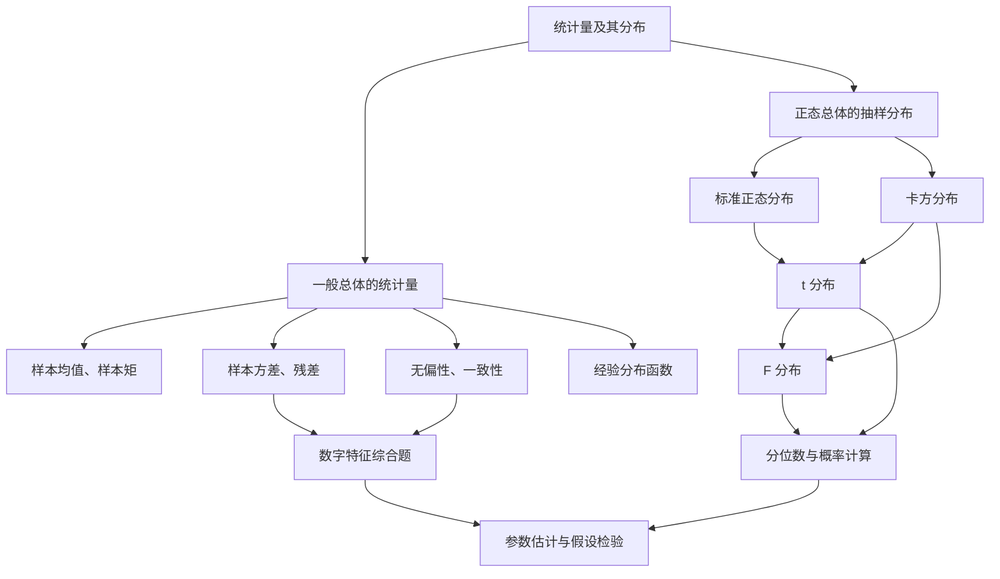
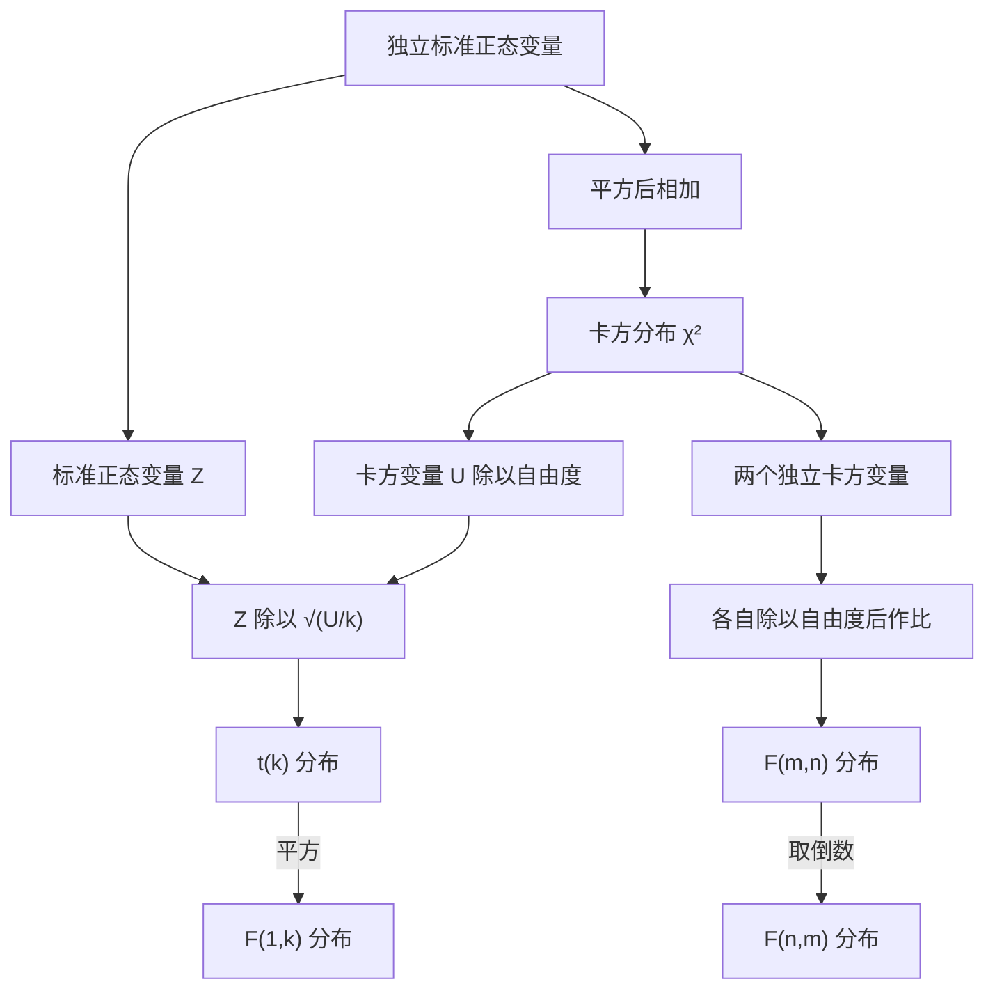
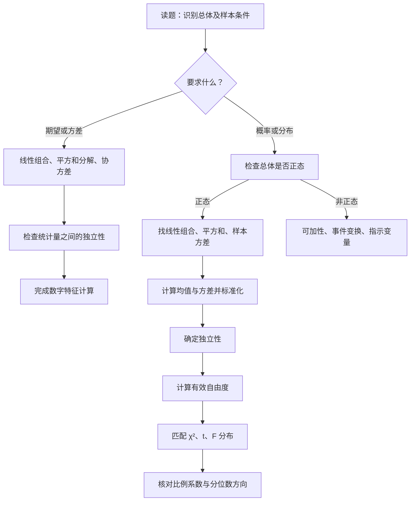

**面向考研数学一：基础知识、抽样分布、统计量构造、历年真题与综合创新题精讲**

## 一、知识体系与考查重点

**2. 复习优先级**

| 核心考点         | 重要程度  | 必须掌握的能力      |
| ------------ | ----- | ------------ |
| 正态总体三大抽样定理   | ★★★★★ | 熟练构造、灵活变形    |
| 卡方分布         | ★★★★★ | 标准化、平方和、自由度  |
| $t$ 分布   | ★★★★★ | 分子分母构造与独立性   |
| $F$ 分布   | ★★★★★ | 方差比、倒数、自由度   |
| 样本均值与方差的数字特征 | ★★★★★ | 计算期望、方差、协方差  |
| 统计量的独立性      | ★★★★★ | 处理样本重叠的复杂题目  |
| 样本残差及重新分组    | ★★★★☆ | 识别隐藏的样本方差    |
| 分位数与尾概率      | ★★★★☆ | 上下尾转换、对称性    |
| 无偏性与一致性      | ★★★★☆ | 区分有限样本与极限性质  |
| 经验分布函数与次序统计量 | ★★★☆☆ | 转化为指示变量及事件概率 |

**这一节最核心的能力，不是背下各种统计量的分布，而是把陌生的统计量拆解成已经认识的随机变量，并正确处理标准化、独立性与自由度。**

只要真正掌握这三个环节，即使考场上出现从未见过的统计量，也可以从定义出发推出它的分布。

## 二、基础知识：从概率论过渡到数理统计

### 2.1 总体、个体、样本与统计量

**（1）总体与样本**

在概率论中，我们通常已经知道随机变量的分布，然后研究它的概率和数字特征。

在数理统计中，问题往往反过来：总体的分布或者某些参数未知，需要根据有限次观测推断总体的性质。

例如，假设某工厂生产的零件长度满足

$$
X\sim N(\mu,\sigma^2).
$$

不知道 $\mu,\sigma^2$ 的具体值，于是抽取 $n$ 个零件进行测量，得到样本

$$
X_1,X_2,\ldots,X_n.
$$

如果它们相互独立，且与总体 $X$ 同分布，就称为**简单随机样本**。

简单随机样本实际上提供了两个极其重要的条件：

- 同分布：每个 $X_i$ 都具有总体的分布和数字特征。
- 相互独立：可以使用独立随机变量的方差公式、分布可加性、联合密度乘积公式等。

如果 $EX=\mu,\ DX=\sigma^2$，那么

$$
EX_i=\mu,\qquad DX_i=\sigma^2,
$$

且当 $i\ne j$ 时，

$$
\operatorname{Cov}(X_i,X_j)=0.
$$

但由样本构造出来的新随机变量，并不一定相互独立。

这是本节第一个重要陷阱。

**（2）统计量的定义**

设 $X_1,\ldots,X_n$ 是简单随机样本，如果

$$
T=g(X_1,X_2,\ldots,X_n)
$$

是样本的函数，而且表达式中不含未知参数，则称 $T$ 为统计量。

例如，当 $\mu,\sigma^2$ 均未知时：

| 表达式                                            | 是否为统计量 |
| ---------------------------------------------- | ------ |
| $\displaystyle\frac1n\sum_{i=1}^nX_i$     | 是      |
| $\displaystyle\sum_{i=1}^nX_i^2$          | 是      |
| $\displaystyle\max_i X_i$                  | 是      |
| $\displaystyle\sum_{i=1}^n(X_i-\bar X)^2$ | 是      |
| $\displaystyle\frac{\bar X-\mu}{\sigma}$   | 否      |
| $\displaystyle\sum_{i=1}^n(X_i-\mu)^2$    | 否      |

最后两个表达式含有未知总体参数，因此严格来说不是统计量，但仍然是可以研究其分布的随机变量。

以后区间估计中会遇到这种含未知参数、但分布不依赖未知参数的量，称为枢轴量。

**（3）统计量本身是随机变量**

样本均值

$$
\bar X=\frac1n\sum_{i=1}^nX_i
$$

不是一个固定的数，而是一个随机变量。

只有实际观测之后得到

$$
\bar x=\frac1n\sum_{i=1}^nx_i
$$

才是确定的数值。

所以我们可以研究

$$
E\bar X,\quad D\bar X,\quad P(\bar X>a)
$$

以及样本均值的概率分布。

**抽样分布，就是统计量的概率分布。**

### 2.2 常用统计量

设 $X_1,\ldots,X_n$ 是来自总体 $X$ 的简单随机样本。

**1. 样本均值**

$$
\boxed{\bar X=\frac1n\sum_{i=1}^nX_i}
$$

用于描述总体的平均水平。

**2. 样本方差**

考研数学通常采用无偏样本方差：

$$
\boxed{ S^2=\frac1{n-1}\sum_{i=1}^n(X_i-\bar X)^2 }
$$

其中 $n\geq2$。

样本标准差为

$$
S=\sqrt{S^2}.
$$

**3. $k$ 阶样本原点矩**

$$
A_k=\frac1n\sum_{i=1}^nX_i^k.
$$

特别地，

$$
A_1=\bar X,\qquad A_2=\frac1n\sum_{i=1}^nX_i^2.
$$

**4. $k$ 阶样本中心矩**

$$
B_k=\frac1n\sum_{i=1}^n(X_i-\bar X)^k.
$$

特别地，

$$
B_1=0,
$$

$$
B_2=\frac1n\sum_{i=1}^n(X_i-\bar X)^2.
$$

注意：

$$
\boxed{B_2=\frac{n-1}{n}S^2}
$$

二阶样本中心矩与通常定义的样本方差并不相同。

**5. 次序统计量**

将样本从小到大排列：

$$
X_{(1)}\leq X_{(2)}\leq\cdots\leq X_{(n)}.
$$

其中

$$
X_{(1)}=\min\{X_1,\ldots,X_n\},
$$

$$
X_{(n)}=\max\{X_1,\ldots,X_n\}.
$$

这一部分常与随机变量函数的分布、最大似然估计结合考查。

## 三、一般总体：样本均值与样本方差

这一部分不要求总体服从正态分布。

### 3.1 样本均值的数字特征

设

$$
EX=\mu,\qquad DX=\sigma^2<+\infty.
$$

则

$$
\boxed{E\bar X=\mu}
$$

和

$$
\boxed{D\bar X=\frac{\sigma^2}{n}}.
$$

推导：

$$
E\bar X =\frac1n\sum_{i=1}^nEX_i =\mu.
$$

由样本相互独立，

$$
D\bar X =\frac1{n^2}\sum_{i=1}^nDX_i =\frac{\sigma^2}{n}.
$$

进一步，

$$
\boxed{E(\bar X^2)=\mu^2+\frac{\sigma^2}{n}}.
$$

这个公式非常重要，尤其在无偏估计、样本均值平方的方差计算中经常出现。

**直观理解**

随着样本容量增大，样本均值的期望始终等于总体均值，但方差越来越小：

$$
D\bar X=\frac{\sigma^2}{n}\longrightarrow0.
$$

所以大量观测的平均值比一次观测更稳定。

注意，方差缩小为原来的 $1/n$，而标准差缩小为原来的 $1/\sqrt n$。

### 3.2 样本线性组合的通用公式

如果

$$
T=\sum_{i=1}^na_iX_i,
$$

那么

$$
\boxed{ET=\mu\sum_{i=1}^na_i}
$$

$$
\boxed{DT=\sigma^2\sum_{i=1}^na_i^2}.
$$

如果还存在另一个线性组合

$$
U=\sum_{i=1}^nb_iX_i,
$$

则

$$
\boxed{ \operatorname{Cov}(T,U) =\sigma^2\sum_{i=1}^na_ib_i }
$$

这三个公式可以统一解决样本均值、样本差值、残差、加权平均以及正态统计量构造等大量题目。

后面会看到，协方差公式还是解决高难度独立性问题的核心。

### 母题1：比较两个统计量的期望与方差

**来源：张宇8套卷，第7套第10题。**

设总体 $X\sim P(\lambda)$，$X_1,\ldots,X_n$ 是简单随机样本，比较

$$
T_1=\frac1n\sum_{i=1}^nX_i
$$

与

$$
T_2=\frac1{n-1}\sum_{i=1}^{n-1}X_i+\frac1nX_n
$$

的期望和方差。

**识别方法**

题目没有要求统计量的分布，只要求比较期望与方差。

因此不需要求复杂的概率分布，直接应用线性组合公式即可。

由于

$$
EX_i=DX_i=\lambda,
$$

所以

$$
ET_1=\lambda, \qquad DT_1=\frac{\lambda}{n}.
$$

而

$$
ET_2=\lambda+\frac{\lambda}{n} >\lambda.
$$

$$
DT_2 =\frac{\lambda}{n-1}+\frac{\lambda}{n^2} >\frac{\lambda}{n}.
$$

因此

$$
\boxed{ET_1<ET_2,\qquad DT_1<DT_2}.
$$

**方法迁移**

以后遇到任意加权统计量，先计算权重之和，再计算权重的平方和。

期望由权重之和决定，方差由权重平方和决定。

千万不要将

$$
D(aX+bY)
$$

误写成

$$
aDX+bDY.
$$

### 3.3 样本方差的核心恒等式

本节最重要的代数恒等式是

$$
\boxed{ \sum_{i=1}^n(X_i-\bar X)^2 =\sum_{i=1}^nX_i^2-n\bar X^2 }
$$

因此

$$
\boxed{ S^2=\frac1{n-1} \left(\sum_{i=1}^nX_i^2-n\bar X^2\right) }.
$$

除此之外，还有一个极其重要的平方和分解：

$$
\boxed{ \sum_{i=1}^n(X_i-\mu)^2 = \sum_{i=1}^n(X_i-\bar X)^2 +n(\bar X-\mu)^2 }
$$

即

$$
\boxed{ \sum_{i=1}^n(X_i-\mu)^2 =(n-1)S^2+n(\bar X-\mu)^2 }.
$$

**推导与理解**

因为

$$
X_i-\mu=(X_i-\bar X)+(\bar X-\mu),
$$

平方求和之后，交叉项消失：

$$
2(\bar X-\mu)\sum_{i=1}^n(X_i-\bar X)=0.
$$

原因是

$$
\boxed{\sum_{i=1}^n(X_i-\bar X)=0}.
$$

这个恒等式不要求正态分布，是纯粹的代数结论。

从几何角度理解，总离差可以分成两部分：样本内部的波动，以及样本均值相对于总体均值的偏移。

这也为后面的卡方分布自由度分解奠定了基础。

### 3.4 为什么样本方差的分母是 $n-1$？

利用上面的恒等式，

$$
(n-1)S^2 =\sum_{i=1}^n(X_i-\mu)^2 -n(\bar X-\mu)^2.
$$

两边取期望：

$$
\begin{aligned} E[(n-1)S^2] &=n\sigma^2-nD\bar X\\ &=n\sigma^2-\sigma^2\\ &=(n-1)\sigma^2. \end{aligned}
$$

因此

$$
\boxed{ES^2=\sigma^2}.
$$

而如果使用分母 $n$，那么

$$
E\left[\frac1n\sum_{i=1}^n(X_i-\bar X)^2\right] =\frac{n-1}{n}\sigma^2.
$$

这个结果系统性地低估了总体方差。

所以在通常的无偏样本方差中，要使用 $n-1$。

**三种常见方差表达式的区别**

| 表达式                                              | 期望                          |
| ------------------------------------------------ | --------------------------- |
| $\displaystyle\frac1n\sum(X_i-\mu)^2$        | $\sigma^2$              |
| $\displaystyle\frac1n\sum(X_i-\bar X)^2$     | $\frac{n-1}{n}\sigma^2$ |
| $\displaystyle\frac1{n-1}\sum(X_i-\bar X)^2$ | $\sigma^2$              |

**记忆原则：以真实均值为中心时除以** $n$**，以样本均值为中心时除以** $n-1$**，才能使估计量无偏。**

### 3.5 样本残差的数字特征

定义残差

$$
R_i=X_i-\bar X.
$$

先注意一个常见错误：

$$
X_i\text{ 与 }\bar X\text{ 不独立}.
$$

因为 $\bar X$ 中本身就含有 $X_i$。

计算其协方差：

$$
\begin{aligned} \operatorname{Cov}(X_i,\bar X) &=\frac1n\sum_{j=1}^n \operatorname{Cov}(X_i,X_j)\\ &=\frac{\sigma^2}{n}. \end{aligned}
$$

所以

$$
\begin{aligned} DR_i &=D(X_i-\bar X)\\ &=\sigma^2+\frac{\sigma^2}{n} -2\frac{\sigma^2}{n}\\ &=\frac{n-1}{n}\sigma^2. \end{aligned}
$$

即

$$
\boxed{D(X_i-\bar X)=\frac{n-1}{n}\sigma^2}.
$$

另外，

$$
\boxed{E(X_i-\bar X)=0}.
$$

### 母题2：样本残差之间的相关系数

**来源：核心题库第4题，李正元练习题。**

证明当 $i\ne j$ 时，

$$
\rho(X_i-\bar X,X_j-\bar X) =-\frac1{n-1}.
$$

**解题过程**

计算协方差：

$$
\begin{aligned} \operatorname{Cov}(R_i,R_j) ={}&\operatorname{Cov}(X_i,X_j)\\ &-\operatorname{Cov}(X_i,\bar X)\\ &-\operatorname{Cov}(\bar X,X_j) +D\bar X\\ ={}&0-\frac{\sigma^2}{n} -\frac{\sigma^2}{n}+\frac{\sigma^2}{n}\\ ={}&-\frac{\sigma^2}{n}. \end{aligned}
$$

所以

$$
\begin{aligned} \rho(R_i,R_j) &=\frac{-\sigma^2/n} {\sqrt{DR_iDR_j}}\\ &=\frac{-\sigma^2/n} {(n-1)\sigma^2/n}\\ &=\boxed{-\frac1{n-1}}. \end{aligned}
$$

**直观理解**

所有残差之和恒为零：

$$
R_1+R_2+\cdots+R_n=0.
$$

因此一个残差增大，其余残差的总和就必须减小。

这正是残差之间负相关的原因。

特别地，当 $n=2$ 时，

$$
R_2=-R_1,
$$

所以

$$
\rho(R_1,R_2)=-1.
$$

**必须掌握的残差公式**

| 数字特征                                       | 结果                          |
| ------------------------------------------ | --------------------------- |
| $ER_i$                                 | $0$                     |
| $DR_i$                                 | $\frac{n-1}{n}\sigma^2$ |
| $\operatorname{Cov}(R_i,R_j),\ i\ne j$ | $-\frac{\sigma^2}{n}$   |
| $\rho(R_i,R_j),\ i\ne j$               | $-\frac1{n-1}$          |
| $\operatorname{Cov}(\bar X,R_i)$       | $0$                     |

这些结论均不要求总体正态（相关系数需要 $\sigma^2>0$）。

最后一行在总体正态时，可以进一步推出样本均值与整个残差向量独立。这是后面正态抽样定理的基础。

### 母题3：隐藏的样本方差与重新分组

**来源：2001年数学一真题，核心题库第7题。**

设

$$
X_1,\ldots,X_{2n}
$$

是来自总体 $N(\mu,\sigma^2)$ 的简单随机样本，记

$$
\bar X=\frac1{2n}\sum_{i=1}^{2n}X_i.
$$

求

$$
Y=\sum_{i=1}^n (X_i+X_{n+i}-2\bar X)^2
$$

的数学期望。

**第一层：如何识别题型？**

看到

$$
\sum(\text{某个随机变量}-\text{某个公共中心})^2
$$

就应当联想到离差平方和。

关键不是把所有平方项直接展开，而是判断能否重新定义一组样本。

**第二层：构造新样本**

令

$$
Z_i=X_i+X_{n+i}, \qquad i=1,\ldots,n.
$$

由于每个 $Z_i$ 所使用的原样本互不重叠，所以 $Z_1,\ldots,Z_n$ 相互独立，且同分布。

有

$$
EZ_i=2\mu,\qquad DZ_i=2\sigma^2.
$$

新样本的均值为

$$
\begin{aligned} \bar Z &=\frac1n\sum_{i=1}^nZ_i\\ &=\frac1n\sum_{i=1}^{2n}X_i\\ &=2\bar X. \end{aligned}
$$

因此

$$
Y=\sum_{i=1}^n(Z_i-\bar Z)^2.
$$

恰好是容量为 $n$ 的新样本的离差平方和。

**第三层：调用一般结论**

$$
E\sum_{i=1}^n(Z_i-\bar Z)^2 =(n-1)DZ_i.
$$

所以

$$
\boxed{EY=2(n-1)\sigma^2}.
$$

**深度拓展：如果要求分布和方差呢？**

原总体正态，因此

$$
Z_i\sim N(2\mu,2\sigma^2).
$$

利用正态样本的抽样分布：

$$
\boxed{\frac{Y}{2\sigma^2}\sim\chi^2(n-1)}.
$$

进一步，

$$
DY=(2\sigma^2)^2\cdot2(n-1),
$$

即

$$
\boxed{DY=8(n-1)\sigma^4}.
$$

这道真题的迁移价值很高。

未来考题完全可以改变原始样本的分组方式，或者将求期望改为求方差、求分布、求概率，而核心仍然是同一种方法。

**重新分组时，自由度由新样本的容量决定，而不是原始样本的总容量决定。**

## 四、统计量的无偏性、一致性与特殊分布

### 4.1 无偏性

如果统计量 $T$ 用来估计总体参数 $\theta$，且满足

$$
\boxed{ET=\theta},
$$

则称 $T$ 是 $\theta$ 的无偏估计量。

例如，

$$
E\bar X=\mu,\qquad ES^2=\sigma^2.
$$

所以 $\bar X$ 是 $\mu$ 的无偏估计量，$S^2$ 是 $\sigma^2$ 的无偏估计量。

但是：

$$
E(S^2)=\sigma^2
$$

不能推出

$$
ES=\sigma.
$$

事实上，

$$
(ES)^2\leq E(S^2)=\sigma^2,
$$

因此

$$
ES\leq\sigma.
$$

通常为严格不等式。

这说明无偏性一般不能通过非线性函数直接传递。

同理，

$$
E\bar X=\mu
$$

不意味着

$$
E\bar X^2=\mu^2.
$$

### 4.2 一致性

如果估计量 $T_n$ 满足

$$
T_n\xrightarrow{P}\theta,
$$

就称其为 $\theta$ 的一致估计量，又称相合估计量。

一致性研究的是样本容量趋于无穷时的表现，而无偏性研究的是固定样本容量时的期望。

二者不是同一个概念。

### 母题4：样本标准差的性质辨析

**来源：1992年数学三真题，核心题库第1题；李林六套卷第6套第9题也考查了同一母题。**

设 $X_1,\ldots,X_n$ 独立同分布，且总体具有有限方差 $\sigma^2>0$，判断：

- $S$ 是否为 $\sigma$ 的无偏估计量？
- $S$ 是否一定为最大似然估计量？
- $S$ 是否为一致估计量？
- $S$ 是否一定与 $\bar X$ 独立？

正确的普遍结论是：$S$ **是** $\sigma$ **的一致估计量。**

证明：

$$
S^2=\frac n{n-1} \left( \frac1n\sum_{i=1}^nX_i^2-\bar X^2 \right).
$$

由大数定律，

$$
\frac1n\sum_{i=1}^nX_i^2 \xrightarrow{P}EX^2,
$$

$$
\bar X\xrightarrow{P}EX=\mu.
$$

故

$$
S^2\xrightarrow{P}EX^2-\mu^2=\sigma^2.
$$

由平方根函数的连续性，

$$
\boxed{S\xrightarrow{P}\sigma}.
$$

特别注意，这里使用独立同分布且一阶绝对矩有限形式的大数定律处理 $X_i^2$，所以不需要额外假设 $EX^4$ 有限。

其他结论不能保证成立：

| 命题                            | 判断依据     |
| ----------------------------- | -------- |
| $S^2$ 对 $\sigma^2$ 无偏 | 正确       |
| $S$ 对 $\sigma$ 无偏     | 一般不成立    |
| $S^2$ 对 $\sigma^2$ 一致 | 正确       |
| $S$ 对 $\sigma$ 一致     | 正确       |
| $\bar X$ 与 $S^2$ 独立   | 正态总体下成立  |
| $S$ 是最大似然估计量              | 需要具体分布模型 |

这一母题虽然来源中包括数学三，但李林模拟题将它重新用于数学一，具有很好的复习价值。

### 4.3 非正态总体下的抽样分布

不要形成“所有样本均值都服从正态分布”的错误印象。

样本均值的精确分布取决于总体分布。

| 总体分布                        | 样本和的分布                               |
| --------------------------- | ------------------------------------ |
| $X\sim N(\mu,\sigma^2)$ | $\sum X_i\sim N(n\mu,n\sigma^2)$ |
| $X\sim P(\lambda)$      | $\sum X_i\sim P(n\lambda)$       |
| $X\sim B(1,p)$          | $\sum X_i\sim B(n,p)$            |
| $X\sim B(m,p)$          | $\sum X_i\sim B(nm,p)$           |

对于一般总体，当样本容量足够大时，中心极限定理可以给出样本均值的近似正态分布，但不是精确正态分布。

### 母题5：0-1分布的样本均值与样本方差

**来源：李正元第六章练习题。**

设

$$
X\sim B(1,p),\qquad 0<p<1.
$$

求 $\bar X$ 的分布，并证明

$$
\frac{n-1}{n}S^2=\bar X(1-\bar X).
$$

**第一问：样本均值的分布**

因为

$$
\sum_{i=1}^nX_i\sim B(n,p),
$$

所以

$$
\boxed{ P\left(\bar X=\frac kn\right) =\binom nkp^k(1-p)^{n-k} }
$$

其中 $k=0,1,\ldots,n$。

注意：

$$
n\bar X\sim B(n,p),
$$

而不是 $\bar X\sim B(n,p)$。

**第二问：样本方差**

由于 $X_i$ 的取值只有0和1，所以

$$
X_i^2=X_i.
$$

利用样本方差恒等式，

$$
\begin{aligned} \frac{n-1}{n}S^2 &=\frac1n\sum_{i=1}^nX_i^2-\bar X^2\\ &=\bar X-\bar X^2\\ &=\boxed{\bar X(1-\bar X)}. \end{aligned}
$$

**深层意义**

这里的样本方差完全由样本均值决定。

因此，对于非退化的伯努利总体，

$$
\bar X\text{ 与 }S^2
$$

并不独立。

这就是反驳“所有简单随机样本的样本均值与样本方差都独立”的一个非常好的反例。

### 4.4 经验分布函数

设总体分布函数为 $F(x)$，定义

$$
\boxed{ F_n(x)=\frac1n\sum_{i=1}^n \mathbf1_{\{X_i\leq x\}} }.
$$

它表示样本中不超过 $x$ 的观测值所占的比例。

### 母题6：经验分布函数的方差

**来源：2025年数学三真题，核心题库第5题。**

求

$$
D[F_n(x)].
$$

令

$$
I_i=\mathbf1_{\{X_i\leq x\}}.
$$

对于固定的 $x$，有

$$
P(I_i=1)=F(x),
$$

因此

$$
I_i\sim B(1,F(x)).
$$

所以

$$
nF_n(x)=\sum_{i=1}^nI_i \sim B(n,F(x)).
$$

立即得到

$$
\boxed{EF_n(x)=F(x)}
$$

和

$$
\boxed{ D[F_n(x)] =\frac{F(x)[1-F(x)]}{n} }.
$$

**创新题拓展**

如果要求

$$
\operatorname{Cov}(F_n(x),F_n(y)),
$$

设 $x\leq y$，由于

$$
\mathbf1_{\{X_i\leq x\}} \mathbf1_{\{X_i\leq y\}} =\mathbf1_{\{X_i\leq x\}},
$$

利用独立样本之间的协方差为零，有

$$
\boxed{ \operatorname{Cov}(F_n(x),F_n(y)) =\frac{F(\min\{x,y\})-F(x)F(y)}n }.
$$

令 $x=y$，就恢复原题的方差公式。

这类创新题的本质是**将频率转化为指示变量的平均值**。

### 4.5 最大值与最小值统计量

设总体分布函数为 $F(x)$。

由样本独立性，

$$
\begin{aligned} P(X_{(n)}\leq x) &=P(X_1\leq x,\ldots,X_n\leq x)\\ &=[F(x)]^n. \end{aligned}
$$

所以

$$
\boxed{F_{X_{(n)}}(x)=[F(x)]^n}.
$$

同理，

$$
\boxed{ F_{X_{(1)}}(x)=1-[1-F(x)]^n }.
$$

若总体是连续型随机变量，密度为 $f(x)$，则

$$
f_{X_{(n)}}(x) =n[F(x)]^{n-1}f(x),
$$

$$
f_{X_{(1)}}(x) =n[1-F(x)]^{n-1}f(x).
$$

这一组公式尤其适合用于下一节的均匀分布参数估计题。

## 五、三大抽样分布：$\chi^2$、$t$、$F$

这是本节最重要的知识模块。

### 5.1 三大分布的统一构造逻辑

所有复杂的正态样本统计量构造题，最终都会回到这几种基本结构。

### 5.2 卡方分布

**1. 定义**

设

$$
Z_1,\ldots,Z_k
$$

相互独立，且均服从 $N(0,1)$，则

$$
U=\sum_{i=1}^kZ_i^2
$$

服从自由度为 $k$ 的卡方分布：

$$
\boxed{U\sim\chi^2(k)}.
$$

必须同时具备：

**标准正态、平方相加、相互独立。**

**2. 数字特征**

如果

$$
U\sim\chi^2(k),
$$

则

$$
\boxed{EU=k,\qquad DU=2k}.
$$

**3. 可加性**

如果

$$
U\sim\chi^2(m),\qquad V\sim\chi^2(n),
$$

并且 $U,V$ 独立，那么

$$
\boxed{U+V\sim\chi^2(m+n)}.
$$

没有独立性，不能直接使用这个结论。

**4. 分布形状和直观含义**

卡方随机变量只能取非负值，它是标准正态变量平方之后累加形成的。

自由度较小时，卡方分布明显右偏；自由度增大时，分布逐渐趋近于对称形态。

由于它是平方和，所以特别适合描述随机变量的波动程度和离差大小。

**5. 自由度到底是什么？**

在卡方分布中，自由度可以理解为构成平方和的独立标准正态分量的个数。

例如，

$$
Z_1^2+Z_2^2\sim\chi^2(2).
$$

但

$$
\frac{(Z_1+Z_2)^2}{2}\sim\chi^2(1).
$$

虽然第二个式子中有两个原始样本，但只有一个标准化后的正态变量。

所以自由度不是数原始变量的数量，而是数**独立标准正态平方项的有效数量**。

### 母题7：卡方分布标准化辨析

**来源：2017年数学一真题，核心题库第9题。**

设 $X_1,\ldots,X_n$ 来自总体 $N(\mu,1)$，判断以下哪一个不服从卡方分布。

| 选项 | 表达式                               |
| -- | --------------------------------- |
| A  | $\sum_{i=1}^n(X_i-\mu)^2$    |
| B  | $2(X_n-X_1)^2$                |
| C  | $\sum_{i=1}^n(X_i-\bar X)^2$ |
| D  | $n(\bar X-\mu)^2$             |

**A项**

因为

$$
X_i-\mu\sim N(0,1),
$$

所以

$$
\sum_{i=1}^n(X_i-\mu)^2\sim\chi^2(n).
$$

正确。

**B项**

由于样本独立，

$$
X_n-X_1\sim N(0,2).
$$

因此标准化之后是

$$
\frac{X_n-X_1}{\sqrt2}\sim N(0,1).
$$

平方可得

$$
\frac{(X_n-X_1)^2}{2}\sim\chi^2(1).
$$

但原选项是

$$
2(X_n-X_1)^2,
$$

相当于标准卡方变量的4倍，并不是标准卡方分布。

B错误。

**C项**

利用正态样本方差的抽样分布，

$$
\sum_{i=1}^n(X_i-\bar X)^2 \sim\chi^2(n-1).
$$

正确。

**D项**

由于

$$
\bar X\sim N\left(\mu,\frac1n\right),
$$

有

$$
\sqrt n(\bar X-\mu)\sim N(0,1).
$$

故

$$
n(\bar X-\mu)^2\sim\chi^2(1).
$$

正确。

所以选B。

**通用结论**

如果

$$
Y\sim N(a,b^2),
$$

那么

$$
\boxed{\frac{(Y-a)^2}{b^2}\sim\chi^2(1)}.
$$

只有先减去均值，再除以标准差并平方，才能保证得到标准卡方分布。

### 5.3 $t$ 分布

**1. 定义**

设

$$
Z\sim N(0,1),\qquad U\sim\chi^2(k),
$$

且 $Z,U$ 相互独立，则

$$
\boxed{ T=\frac{Z}{\sqrt{U/k}}\sim t(k) }.
$$

一定要记住分母中的 $k$。

如果分母写成 $\sqrt U$，那么一般只得到一个经过缩放的 $t$ 随机变量。

**2. 重要性质**

$t$ 分布关于零对称，因此

$$
P(T>0)=P(T<0)=\frac12.
$$

对于 $a>0$，

$$
P(T>a)=P(T<-a),
$$

$$
\boxed{P(|T|>a)=2P(T>a)}.
$$

其尾部比标准正态分布更厚，当自由度趋于无穷时，

$$
t(k)\xrightarrow{d}N(0,1).
$$

**3. 数字特征（补充）**

$$
ET=0,\qquad k>1,
$$

$$
DT=\frac{k}{k-2},\qquad k>2.
$$

当 $k=1$ 时，$t(1)$ 就是标准柯西分布，数学期望不存在。

所以不能仅仅因为分布关于零对称，就断言它的期望为零。

### 母题8：绝对值分母构造 $t$ 分布

**来源：张宇1000题第6章基础题1；张宇8套卷第8套第9题。**

设 $X_1,X_2$ 是来自总体 $N(1,1)$ 的简单随机样本，求

$$
T=\frac{X_1-1}{|1-X_2|}
$$

的分布。

令

$$
Z=X_1-1\sim N(0,1),
$$

$$
U=(X_2-1)^2\sim\chi^2(1).
$$

因为 $X_1,X_2$ 独立，所以 $Z,U$ 独立。

于是

$$
T=\frac{Z}{\sqrt{U/1}} \sim t(1).
$$

即

$$
\boxed{T\sim t(1)}.
$$

**通用结论**

若 $A,B$ 相互独立，且

$$
A\sim N(0,a^2),\qquad B\sim N(0,b^2),
$$

则

$$
\boxed{ \frac ba\frac A{|B|}\sim t(1) }
$$

其中 $a,b>0$。

看到分母中的绝对值，应立即想到

$$
|B|=\sqrt{B^2}.
$$

这就是隐藏卡方分布的典型形式。

### 5.4 $F$ 分布

**1. 定义**

设

$$
U\sim\chi^2(m),\qquad V\sim\chi^2(n),
$$

且 $U,V$ 相互独立。

则

$$
\boxed{ F=\frac{U/m}{V/n}\sim F(m,n) }.
$$

$m$ 是分子自由度，$n$ 是分母自由度。

顺序不能交换。

**2. 倒数性质**

如果

$$
W\sim F(m,n),
$$

那么

$$
\boxed{\frac1W\sim F(n,m)}.
$$

证明非常直接：

$$
\frac1W=\frac{V/n}{U/m}.
$$

**3. 与 $t$ 分布的关系**

如果

$$
T\sim t(k),
$$

那么

$$
T^2=\frac{Z^2/1}{U/k}.
$$

由于

$$
Z^2\sim\chi^2(1),
$$

所以

$$
\boxed{T^2\sim F(1,k)}.
$$

进一步，

$$
\boxed{\frac1{T^2}\sim F(k,1)}.
$$

这两个推论非常重要，是历年真题反复考查的结构。

**4. 数字特征（补充）**

若 $W\sim F(m,n)$，则

$$
EW=\frac n{n-2},\qquad n>2.
$$

当 $n>4$ 时，

$$
DW= \frac{2n^2(m+n-2)} {m(n-2)^2(n-4)}.
$$

复习时优先掌握定义、倒数、平方关系与分位数，不必把复杂的方差公式作为重点记忆内容。

### 母题9：$t$ 分布平方后取倒数

**来源：2003年数学一真题，核心题库第18题。**

设

$$
X\sim t(n),\qquad Y=\frac1{X^2}.
$$

求 $Y$ 的分布。

直接利用

$$
X^2\sim F(1,n),
$$

再取倒数，交换自由度：

$$
\boxed{Y\sim F(n,1)}.
$$

此类题目的难度不大，但非常容易因自由度顺序错误而丢分。

### 5.5 三大分布对照表

| 性质    | $\chi^2(k)$ | $t(k)$   | $F(m,n)$ |
| ----- | --------------- | ------------ | ------------ |
| 基本结构  | 独立标准正态平方和       | 正态除以卡方均值的平方根 | 两个卡方均值之比     |
| 取值范围  | 非负              | 全体实数         | 正数           |
| 关于零对称 | 否               | 是            | 否            |
| 自由度数量 | 1个              | 1个           | 2个           |
| 重要运算  | 独立可加            | 平方转化为F       | 倒数交换自由度      |
| 典型应用  | 样本方差            | 均值推断         | 两总体方差比较      |

## 六、正态总体的抽样分布定理

如果整节内容只能背一组公式，那么就背下面这组。

设

$$
X_1,\ldots,X_n
$$

是来自正态总体

$$
X\sim N(\mu,\sigma^2)
$$

的简单随机样本，其中 $n\geq2,\sigma^2>0$。

### 6.1 三大基本结论

**定理一：样本均值的分布**

$$
\boxed{ \bar X\sim N\left(\mu,\frac{\sigma^2}{n}\right) }
$$

因此

$$
\boxed{ Z=\frac{\sqrt n(\bar X-\mu)}{\sigma} \sim N(0,1) }.
$$

**定理二：样本方差的分布**

$$
\boxed{ U=\frac{(n-1)S^2}{\sigma^2} \sim\chi^2(n-1) }.
$$

**定理三：样本均值与样本方差独立**

$$
\boxed{\bar X\perp S^2}.
$$

这三个定理结合起来，可以构造 $t$ 分布、$F$ 分布，并计算大量统计量的数字特征。

### 6.2 理解样本均值与样本方差为什么独立

这是数学一中值得真正理解的部分。

先令

$$
Z_i=\frac{X_i-\mu}{\sigma}.
$$

则 $Z_1,\ldots,Z_n$ 相互独立，均服从标准正态分布。

考虑标准正态向量

$$
\boldsymbol Z=(Z_1,\ldots,Z_n)^T.
$$

取第一条单位方向为

$$
\boldsymbol e= \frac1{\sqrt n}(1,1,\ldots,1)^T.
$$

那么 $\boldsymbol Z$ 在该方向上的投影为

$$
Y_1=\boldsymbol e^T\boldsymbol Z =\frac{\sqrt n(\bar X-\mu)}{\sigma}.
$$

将这条方向扩充成一组标准正交基，得到

$$
Y_1,Y_2,\ldots,Y_n.
$$

正交变换保持标准多元正态分布，所以这些变量相互独立，且均服从 $N(0,1)$。

同时，

$$
\sum_{i=1}^nZ_i^2 =Y_1^2+\sum_{i=2}^nY_i^2.
$$

由平方和分解，

$$
Y_1^2 =\frac{n(\bar X-\mu)^2}{\sigma^2},
$$

$$
\sum_{i=2}^nY_i^2 =\frac{(n-1)S^2}{\sigma^2}.
$$

于是样本均值由第一个独立正态分量决定，而样本方差由其余 $n-1$ 个独立正态分量决定。

所以

$$
\bar X\perp S^2
$$

且

$$
\frac{(n-1)S^2}{\sigma^2} \sim\chi^2(n-1).
$$

这也解释了为什么样本均值消耗了一个自由度。

这个推导可以帮助你将概率论的正态分布、线性代数的正交变换与数理统计统一起来。常规考题中可以直接使用抽样定理，无需每次重新证明。

### 6.3 五个必须熟练掌握的抽样分布

| 统计表达式                                                  | 分布                |
| ------------------------------------------------------ | ----------------- |
| $\displaystyle\frac{\sqrt n(\bar X-\mu)}{\sigma}$  | $N(0,1)$      |
| $\displaystyle\frac{\sum(X_i-\mu)^2}{\sigma^2}$    | $\chi^2(n)$   |
| $\displaystyle\frac{\sum(X_i-\bar X)^2}{\sigma^2}$ | $\chi^2(n-1)$ |
| $\displaystyle\frac{\sqrt n(\bar X-\mu)}S$         | $t(n-1)$      |
| $\displaystyle\frac{n(\bar X-\mu)^2}{S^2}$         | $F(1,n-1)$    |

记忆时不要孤立地背公式。

首先记住 $Z$、$U$ 及其独立性，然后构造

$$
\frac Z{\sqrt{U/(n-1)}} =\frac{\sqrt n(\bar X-\mu)}S \sim t(n-1).
$$

再平方就得到 $F$ 分布。

### 6.4 已知均值与未知均值的区别

这类题目最大的陷阱是中心化方式不同。

$$
\frac1{\sigma^2}\sum_{i=1}^n(X_i-\mu)^2 \sim\chi^2(n).
$$

但是

$$
\frac1{\sigma^2}\sum_{i=1}^n(X_i-\bar X)^2 \sim\chi^2(n-1).
$$

还有

$$
\frac{n(\bar X-\mu)^2}{\sigma^2} \sim\chi^2(1).
$$

三者满足

$$
\underbrace{\frac{\sum(X_i-\mu)^2}{\sigma^2}}_{\chi^2(n)} = \underbrace{\frac{(n-1)S^2}{\sigma^2}}_{\chi^2(n-1)} + \underbrace{\frac{n(\bar X-\mu)^2}{\sigma^2}}_{\chi^2(1)}.
$$

右侧两个卡方变量相互独立，因此自由度正好满足

$$
n=(n-1)+1.
$$

### 母题10：正态样本的标准化选择题

**来源：2005年数学一真题，核心题库第19题。**

设总体为 $N(0,1)$，样本容量为 $n\geq2$，判断：

| 选项 | 表达式                                                      |
| -- | -------------------------------------------------------- |
| A  | $n\bar X\sim N(0,1)$                                 |
| B  | $nS^2\sim\chi^2(n)$                                  |
| C  | $\frac{(n-1)\bar X}{S}\sim t(n-1)$                   |
| D  | $\frac{(n-1)X_1^2}{\sum_{i=2}^nX_i^2}\sim F(1,n-1)$ |

A、B、C均是经典标准形式的系数或自由度被改动。

正确的对应形式为

$$
\sqrt n\bar X\sim N(0,1),
$$

$$
(n-1)S^2\sim\chi^2(n-1),
$$

$$
\frac{\sqrt n\bar X}{S}\sim t(n-1).
$$

对D项，令

$$
U=X_1^2\sim\chi^2(1),
$$

$$
V=\sum_{i=2}^nX_i^2\sim\chi^2(n-1).
$$

二者相互独立。

于是

$$
\frac{U/1}{V/(n-1)} =\frac{(n-1)X_1^2}{\sum_{i=2}^nX_i^2} \sim F(1,n-1).
$$

所以答案为D。

**真题启示**

正态抽样分布选择题经常围绕以下几个地方设置干扰项：$\sqrt n$ 改成 $n$，$n-1$ 改成 $n$，漏除总体方差，以及将 $F$ 分布的两个自由度颠倒。

这些错误不需要复杂计算，只需要准确还原定义。

### 6.5 样本方差的方差

根据

$$
\frac{(n-1)S^2}{\sigma^2} \sim\chi^2(n-1),
$$

以及

$$
D[\chi^2(n-1)]=2(n-1),
$$

可以得到

$$
\frac{(n-1)^2}{\sigma^4}D(S^2) =2(n-1).
$$

因此

$$
\boxed{ D(S^2)=\frac{2\sigma^4}{n-1} }.
$$

这是正态总体下的重要结论。

注意：

$$
ES^2=\sigma^2
$$

对一般有限方差总体都成立，但

$$
D(S^2)=\frac{2\sigma^4}{n-1}
$$

不能无条件推广到非正态总体。

## 七、统计量数字特征的综合大题

### 母题11：2008年数学一经典综合题

**来源：核心题库第2题。**

设 $X_1,\ldots,X_n$ 来自总体 $N(\mu,\sigma^2)$，定义

$$
T=\bar X^2-\frac1nS^2.
$$

第一问：证明 $T$ 是 $\mu^2$ 的无偏估计量。

第二问：当 $\mu=0,\sigma=1$ 时，求 $D(T)$。

这道题综合了期望、方差、无偏性、卡方分布、独立性，是本节最值得掌握的真题之一。

**第一问：证明无偏性**

目标是证明

$$
ET=\mu^2.
$$

由于

$$
E\bar X^2 =D\bar X+(E\bar X)^2 =\frac{\sigma^2}{n}+\mu^2,
$$

又

$$
ES^2=\sigma^2,
$$

所以

$$
\begin{aligned} ET &=E\bar X^2-\frac1nES^2\\ &=\frac{\sigma^2}{n}+\mu^2 -\frac{\sigma^2}{n}\\ &=\mu^2. \end{aligned}
$$

因此 $T$ 是 $\mu^2$ 的无偏估计量。

**核心思想：先发现原始估计量的偏差，再构造一个统计量将其抵消。**

**第二问：求方差**

当 $\mu=0,\sigma=1$ 时，

$$
n\bar X^2\sim\chi^2(1),
$$

所以

$$
D(\bar X^2)=\frac2{n^2}.
$$

同时

$$
(n-1)S^2\sim\chi^2(n-1),
$$

故

$$
D(S^2)=\frac2{n-1}.
$$

因为正态总体下 $\bar X$ 与 $S^2$ 独立，所以 $\bar X^2$ 与 $S^2$ 也独立。

于是

$$
\begin{aligned} DT &=D\left(\bar X^2-\frac1nS^2\right)\\ &=D(\bar X^2)+\frac1{n^2}D(S^2)\\ &=\frac2{n^2}+\frac2{n^2(n-1)}\\ &=\boxed{\frac2{n(n-1)}}. \end{aligned}
$$

**深度拓展：如果不限制 $\mu=0,\sigma=1$ 呢？**

这是非常自然的创新方向。

设

$$
Y\sim N(a,b^2),
$$

利用标准正态的三阶矩为零、四阶矩为3，可以得到

$$
EY^2=a^2+b^2,
$$

$$
EY^4=a^4+6a^2b^2+3b^4.
$$

因此

$$
\boxed{D(Y^2)=4a^2b^2+2b^4}.
$$

应用到

$$
\bar X\sim N\left(\mu,\frac{\sigma^2}{n}\right),
$$

得到

$$
D(\bar X^2) =\frac{4\mu^2\sigma^2}{n} +\frac{2\sigma^4}{n^2}.
$$

再结合独立性，

$$
\boxed{ D(T)=\frac{4\mu^2\sigma^2}{n} +\frac{2\sigma^4}{n(n-1)} }.
$$

令 $\mu=0,\sigma=1$，就恢复原真题答案。

**进一步迁移：U统计量形式**

原来的统计量还可以改写为

$$
\begin{aligned} T &=\bar X^2-\frac{S^2}{n}\\ &=\frac{(\sum X_i)^2-\sum X_i^2} {n(n-1)}\\ &=\frac2{n(n-1)} \sum_{i<j}X_iX_j. \end{aligned}
$$

由于不同样本相互独立，

$$
E(X_iX_j)=\mu^2.
$$

从而可以直接证明

$$
ET=\mu^2.
$$

这也再次说明，原题第一问实际上不依赖正态性，第二问所用的卡方分布和独立性才依赖正态条件。

### 母题12：最小方差的加权统计量

**来源：张宇1000题第6章基础题7，核心题库第22题。**

设两个独立样本来自具有相同总体方差 $\sigma^2$ 的正态总体，样本容量分别为9和11，对应样本方差为 $S_X^2,S_Y^2$。

比较以下统计量的方差：

$$
S_X^2,\qquad S_Y^2,
$$

$$
S_1^2=\frac12(S_X^2+S_Y^2),
$$

$$
S_2^2=\frac19(4S_X^2+5S_Y^2).
$$

<Tabs items={["方法一：直接计算", "方法二：建立通用的最优化模型"]} defaultIndex={0}>

<Tab value="方法一：直接计算">

根据正态样本方差的方差公式，

$$
D(S_X^2)=\frac{2\sigma^4}{8} =\frac{\sigma^4}{4},
$$

$$
D(S_Y^2)=\frac{2\sigma^4}{10} =\frac{\sigma^4}{5}.
$$

两组样本独立，因此

$$
D(S_1^2) =\frac14\left( \frac{\sigma^4}{4}+\frac{\sigma^4}{5} \right) =\frac9{80}\sigma^4.
$$

$$
D(S_2^2) =\frac1{81}\left( 16\frac{\sigma^4}{4} +25\frac{\sigma^4}{5} \right) =\frac{\sigma^4}{9}.
$$

由于

$$
\frac19<\frac9{80}<\frac15<\frac14,
$$

所以 $S_2^2$ 的方差最小。

</Tab>

<Tab value="方法二：建立通用的最优化模型">

设两个独立无偏估计量 $U,V$ 满足

$$
EU=EV=\theta,
$$

$$
DU=v_1,\qquad DV=v_2.
$$

构造

$$
T=aU+(1-a)V.
$$

则

$$
ET=\theta.
$$

其方差为

$$
DT=a^2v_1+(1-a)^2v_2.
$$

对 $a$ 求导并令其为零：

$$
2av_1-2(1-a)v_2=0.
$$

得到

$$
\boxed{a=\frac{v_2}{v_1+v_2}}.
$$

最小方差为

$$
\boxed{ \min DT=\frac{v_1v_2}{v_1+v_2} }.
$$

本题代入得

$$
a=\frac{1/5}{1/4+1/5}=\frac49.
$$

因此最优组合正是

$$
S_2^2=\frac49S_X^2+\frac59S_Y^2.
$$

</Tab>

</Tabs>

**重要推广：合并样本方差**

如果两个独立正态样本的总体方差相同，样本容量分别为 $m,n$，那么在两个样本方差的确定性无偏线性组合中，最优组合是

$$
\boxed{ S_p^2= \frac{(m-1)S_X^2+(n-1)S_Y^2} {m+n-2} }.
$$

这就是合并样本方差。

并且

$$
\boxed{ \frac{(m+n-2)S_p^2}{\sigma^2} \sim\chi^2(m+n-2) }
$$

$$
\boxed{D(S_p^2)=\frac{2\sigma^4}{m+n-2}}.
$$

在李林880题第21章中，也有直接考查合并样本方差数字特征的题目。

### 母题13：随机权重与独立性

**来源：李正元练习题，核心题库第23题。**

设两个独立正态总体具有相同均值 $\mu$，方差可以不同。分别取得独立样本，记其样本均值与方差为

$$
\bar X,\ S_X^2,\qquad \bar Y,\ S_Y^2.
$$

定义

$$
\alpha=\frac{S_X^2}{S_X^2+S_Y^2},
$$

$$
\beta=\frac{S_Y^2}{S_X^2+S_Y^2},
$$

$$
Z=\alpha\bar X+\beta\bar Y.
$$

求 $EZ$。

**识别关键**

这里 $\alpha,\beta$ 不是常数，而是随机变量。

因此不能直接把它们提到期望符号外。

但正态样本有

$$
\bar X\perp S_X^2,\qquad \bar Y\perp S_Y^2.
$$

又由于两组样本独立，可知

$$
(\bar X,\bar Y)\perp(S_X^2,S_Y^2).
$$

所以两个样本均值分别与随机权重独立。

于是

$$
\begin{aligned} EZ &=E(\alpha\bar X)+E(\beta\bar Y)\\ &=E\alpha\cdot E\bar X +E\beta\cdot E\bar Y\\ &=\mu(E\alpha+E\beta)\\ &=\mu E(\alpha+\beta). \end{aligned}
$$

由于

$$
\alpha+\beta=1,
$$

因此

$$
\boxed{EZ=\mu}.
$$

**通用思想**

随机加权平均的无偏性，不能仅靠权重之和为1来保证。

还要检查随机权重与被加权变量的关系。

本题的突破口并不是计算 $\alpha,\beta$ 的具体分布，而是利用独立性绕开复杂计算。

## 八、统计量分布构造：高难度母题

这一部分是从基础题过渡到创新题的关键。

### 8.1 任意正态线性组合的标准化

如果

$$
X_1,\ldots,X_n\overset{\mathrm{i.i.d.}}{\sim}N(\mu,\sigma^2),
$$

且

$$
L=\sum_{i=1}^na_iX_i,
$$

那么

$$
\boxed{ L\sim N\left( \mu\sum_{i=1}^na_i,\, \sigma^2\sum_{i=1}^na_i^2 \right) }.
$$

因此，当系数不全为零时，

$$
\boxed{ \frac{ \sum a_iX_i-\mu\sum a_i }{ \sigma\sqrt{\sum a_i^2} } \sim N(0,1) }.
$$

如果

$$
\sum_{i=1}^na_i=0,
$$

则均值项自动消失。

例如，

$$
X_1-X_2\sim N(0,2\sigma^2),
$$

$$
X_1+X_2-2X_3\sim N(0,6\sigma^2).
$$

所以考场上看到复杂的正态样本线性组合，先算系数和，再算系数平方和。

### 母题14：统一构造卡方、$t$、$F$ 分布

**来源：李林880题第21章，核心题库第10题。**

设 $X_1,\ldots,X_{2n}$ 是来自 $N(0,1)$ 的简单随机样本，分别求

$$
T_1=\frac12\sum_{i=1}^{2n}X_i^2 +\sum_{i=1}^nX_{2i-1}X_{2i},
$$

$$
T_2=\frac{\sqrt{2n-1}X_1} {\sqrt{\sum_{i=2}^{2n}X_i^2}},
$$

$$
T_3= \frac{(2n-3)\sum_{i=1}^3X_i^2} {3\sum_{i=4}^{2n}X_i^2}
$$

的分布。

**第一问：配方构造卡方分布**

将相邻两项组合：

$$
\begin{aligned} T_1 &=\frac12\sum_{i=1}^n (X_{2i-1}^2+2X_{2i-1}X_{2i}+X_{2i}^2)\\ &=\sum_{i=1}^n \left(\frac{X_{2i-1}+X_{2i}}{\sqrt2}\right)^2. \end{aligned}
$$

令

$$
Z_i=\frac{X_{2i-1}+X_{2i}}{\sqrt2}.
$$

由于

$$
X_{2i-1}+X_{2i}\sim N(0,2),
$$

所以 $Z_i\sim N(0,1)$。

不同的 $Z_i$ 使用不重叠的样本，因此独立。

故

$$
\boxed{T_1\sim\chi^2(n)}.
$$

**第二问：构造 $t$ 分布**

令

$$
Z=X_1\sim N(0,1),
$$

$$
U=\sum_{i=2}^{2n}X_i^2\sim\chi^2(2n-1).
$$

二者独立。

所以

$$
T_2=\frac{Z}{\sqrt{U/(2n-1)}} \sim t(2n-1).
$$

即

$$
\boxed{T_2\sim t(2n-1)}.
$$

**第三问：构造 $F$ 分布**

令

$$
U=\sum_{i=1}^3X_i^2\sim\chi^2(3),
$$

$$
V=\sum_{i=4}^{2n}X_i^2\sim\chi^2(2n-3).
$$

二者独立。

故

$$
T_3=\frac{U/3}{V/(2n-3)} \sim F(3,2n-3).
$$

即

$$
\boxed{T_3\sim F(3,2n-3)}.
$$

**母题总结**

三个式子看起来不同，但只使用了同一个思想：

**先识别标准正态分量，再检查独立性，最后按照定义组合。**

### 8.2 独立性判断的四个层次

| 层次  | 情形         | 判断方法           |
| --- | ---------- | -------------- |
| 第一层 | 样本下标完全不重叠  | 独立变量的函数独立      |
| 第二层 | 样本均值与样本方差  | 正态抽样定理         |
| 第三层 | 有重叠的正态线性组合 | 计算协方差          |
| 第四层 | 正态变量与复杂平方和 | 分解成正态分量，证明联合独立 |

其中第三、第四层是高质量模拟题和创新题的重要来源。

### 母题15：有重叠样本的 $t$ 分布构造

**来源：李林880题第21章，核心题库第16题。**

设 $X_1,X_2,X_3$ 相互独立，且均服从 $N(0,\sigma^2)$，证明

$$
T=\sqrt{\frac23} \frac{X_1+X_2+X_3}{|X_2-X_3|} \sim t(1).
$$

<Steps>

<Step>

### 第一阶段：分别标准化 [!toc]

令

$$
A=X_1+X_2+X_3,
$$

$$
B=X_2-X_3.
$$

则

$$
A\sim N(0,3\sigma^2),
$$

$$
B\sim N(0,2\sigma^2).
$$

所以

$$
Z=\frac A{\sqrt3\sigma}\sim N(0,1),
$$

$$
U=\frac{B^2}{2\sigma^2}\sim\chi^2(1).
$$

</Step>

<Step>

### 第二阶段：解决独立性 [!toc]

这是本题真正的难点。

分子与分母都含有 $X_2,X_3$，因此不能根据下标不重叠判断独立。

但是 $A,B$ 是同一组独立正态变量的线性组合，因此它们联合正态。

计算

$$
\begin{aligned} \operatorname{Cov}(A,B) &=\operatorname{Cov}(X_1+X_2+X_3,X_2-X_3)\\ &=DX_2-DX_3\\ &=\sigma^2-\sigma^2=0. \end{aligned}
$$

因为联合正态条件下，不相关等价于独立，所以

$$
A\perp B.
$$

进一步，

$$
Z\perp U.
$$

</Step>

<Step>

### 第三阶段：按定义构造 [!toc]

$$
\begin{aligned} \frac{Z}{\sqrt{U/1}} &=\frac{A/(\sqrt3\sigma)} {|B|/(\sqrt2\sigma)}\\ &=\sqrt{\frac23}\frac A{|B|}\\ &=T. \end{aligned}
$$

因此

$$
\boxed{T\sim t(1)}.
$$

</Step>

</Steps>

**必须掌握的通用技巧：系数向量正交**

设

$$
A=\sum_{i=1}^na_iX_i, \qquad B=\sum_{i=1}^nb_iX_i.
$$

因为

$$
\operatorname{Cov}(A,B) =\sigma^2\sum_{i=1}^na_ib_i,
$$

所以对于同方差的独立正态样本，

$$
\boxed{ \sum_{i=1}^na_ib_i=0 \Longrightarrow A\perp B }.
$$

换句话说，只需要检查两个系数向量是否正交。

本题的系数向量为

$$
\boldsymbol a=(1,1,1),
$$

$$
\boldsymbol b=(0,1,-1).
$$

两者内积为

$$
\boldsymbol a\cdot\boldsymbol b=0+1-1=0.
$$

因此独立性可以迅速得到。

这是数学一中线性代数与概率论相结合的一个非常实用的技巧。

### 母题16：新观测值与样本均值的差

**来源：李林880题第21章、核心题库第17题、汤家凤八套卷第8套第10题。**

设 $X_1,\ldots,X_n,X_{n+1}$ 来自总体 $N(\mu,\sigma^2)$，前 $n$ 个样本的均值与方差分别为 $\bar X,S^2$。

求常数 $a,b$，使

$$
\frac{a(X_{n+1}-\bar X)}S\sim t(b).
$$

<Steps>

<Step>

### 第一步：计算分子的分布 [!toc]

由于 $X_{n+1}$ 与前 $n$ 个样本独立，

$$
E(X_{n+1}-\bar X)=0,
$$

$$
D(X_{n+1}-\bar X) =\sigma^2+\frac{\sigma^2}{n}.
$$

所以

$$
X_{n+1}-\bar X \sim N\left(0,\frac{n+1}{n}\sigma^2\right).
$$

标准化得

$$
Z=\frac{\sqrt{n/(n+1)}(X_{n+1}-\bar X)} {\sigma} \sim N(0,1).
$$

</Step>

<Step>

### 第二步：构造分母 [!toc]

$$
U=\frac{(n-1)S^2}{\sigma^2} \sim\chi^2(n-1).
$$

</Step>

<Step>

### 第三步：证明独立性 [!toc]

$X_{n+1}$ 与前 $n$ 个样本独立，而 $\bar X$ 与 $S^2$ 独立。

因此

$$
(X_{n+1},\bar X)\perp S^2.
$$

故 $Z\perp U$。

</Step>

<Step>

### 第四步：构造 $t$ 分布 [!toc]

$$
\frac Z{\sqrt{U/(n-1)}} = \sqrt{\frac n{n+1}} \frac{X_{n+1}-\bar X}{S} \sim t(n-1).
$$

所以取正的标准化系数，

$$
\boxed{ a=\sqrt{\frac n{n+1}}, \qquad b=n-1 }.
$$

若不限制 $a>0$，由于 $t$ 分布对称，负的相反数也满足条件。

</Step>

</Steps>

**拓展一：改求 $F$ 分布**

平方即可得到

$$
\boxed{ \frac{n(X_{n+1}-\bar X)^2}{(n+1)S^2} \sim F(1,n-1) }.
$$

**拓展二：改求数字特征**

因为

$$
Y=\frac{n(X_{n+1}-\bar X)^2}{(n+1)\sigma^2} \sim\chi^2(1),
$$

所以

$$
\boxed{EY=1,\qquad DY=2}.
$$

这道母题能一次覆盖标准化、正态独立性、卡方、$t$、$F$ 分布与数字特征。

## 九、两组正态样本的综合问题

### 9.1 两组样本均值之差

设两个相互独立的正态样本来自总体

$$
X\sim N(\mu_1,\sigma_1^2),
$$

$$
Y\sim N(\mu_2,\sigma_2^2),
$$

样本容量分别为 $m,n$。

则

$$
\boxed{ \bar X-\bar Y \sim N\left( \mu_1-\mu_2,\, \frac{\sigma_1^2}{m}+\frac{\sigma_2^2}{n} \right) }.
$$

如果两个总体方差相同，均为 $\sigma^2$，那么

$$
\frac{\bar X-\bar Y-(\mu_1-\mu_2)} {\sigma\sqrt{1/m+1/n}} \sim N(0,1).
$$

将总体标准差替换为独立的样本标准差或合并样本标准差，就可以进一步构造 $t$ 分布。

### 9.2 两样本方差之比

设上述两个独立样本的样本方差分别为 $S_X^2,S_Y^2$。

则

$$
U=\frac{(m-1)S_X^2}{\sigma_1^2} \sim\chi^2(m-1),
$$

$$
V=\frac{(n-1)S_Y^2}{\sigma_2^2} \sim\chi^2(n-1).
$$

两者独立，因此

$$
\boxed{ \frac{S_X^2/\sigma_1^2}{S_Y^2/\sigma_2^2} \sim F(m-1,n-1) }.
$$

整理为

$$
\boxed{ \frac{\sigma_2^2S_X^2} {\sigma_1^2S_Y^2} \sim F(m-1,n-1) }.
$$

只有当两个总体方差相等时，才可以直接得到

$$
\frac{S_X^2}{S_Y^2}\sim F(m-1,n-1).
$$

### 母题17：两总体方差不同

**来源：2023年数学一真题，核心题库第21题。**

设两个相互独立的正态样本分别来自

$$
X\sim N(\mu_1,\sigma^2),
$$

$$
Y\sim N(\mu_2,2\sigma^2).
$$

样本容量分别为 $n,m$，对应样本方差为 $S_1^2,S_2^2$。

构造服从 $F$ 分布的统计量。

**解题过程**

$$
U=\frac{(n-1)S_1^2}{\sigma^2} \sim\chi^2(n-1),
$$

$$
V=\frac{(m-1)S_2^2}{2\sigma^2} \sim\chi^2(m-1).
$$

二者独立。

所以

$$
\begin{aligned} \frac{U/(n-1)}{V/(m-1)} &=\frac{S_1^2/\sigma^2}{S_2^2/(2\sigma^2)}\\ &=\frac{2S_1^2}{S_2^2}. \end{aligned}
$$

因此

$$
\boxed{ \frac{2S_1^2}{S_2^2} \sim F(n-1,m-1) }.
$$

<Callout type="warn" title="易错点">

总体均值是否相同并不重要，因为样本方差已经进行了各自的中心化。

真正需要关注的是两个总体的方差比例以及各自样本容量。

</Callout>

### 母题18：二维正态分布与抽样分布综合

**来源：汤家凤八套卷第7套第9题。**

设二维总体

$$
(X,Y)\sim N\left(0,0;1,4;\frac12\right),
$$

$$
(X_1,Y_1),\ldots,(X_n,Y_n)
$$

是来自该总体的简单随机样本。

令

$$
S^2=\frac1{n-1} \sum_{i=1}^n (X_i-Y_i-\bar X+\bar Y)^2.
$$

求

$$
T=\frac{3n\bar X^2}{S^2}
$$

的分布。

<Steps>

<Step>

### 第一步：识别隐藏总体 [!toc]

令

$$
Z=X-Y.
$$

因为 $(X,Y)$ 联合正态，所以 $Z$ 服从正态分布。

计算

$$
\operatorname{Cov}(X,Y) =\rho\sigma_X\sigma_Y =\frac12\cdot1\cdot2=1.
$$

因此

$$
DZ=1+4-2=3.
$$

所以

$$
Z\sim N(0,3).
$$

题目中的样本方差实际上是 $Z_i=X_i-Y_i$ 的样本方差。

故

$$
V=\frac{(n-1)S^2}{3} \sim\chi^2(n-1).
$$

</Step>

<Step>

### 第二步：识别分子 [!toc]

由于

$$
\bar X\sim N\left(0,\frac1n\right),
$$

所以

$$
U=n\bar X^2\sim\chi^2(1).
$$

</Step>

<Step>

### 第三步：处理独立性 [!toc]

$$
\operatorname{Cov}(X,Z) =\operatorname{Cov}(X,X-Y) =DX-\operatorname{Cov}(X,Y) =0.
$$

又因为 $(X,Z)$ 联合正态，所以

$$
X\perp Z.
$$

结合样本向量之间的独立性，可知整个 $X$ 样本与整个 $Z$ 样本独立。

因此

$$
U\perp V.
$$

</Step>

<Step>

### 第四步：构造 $F$ 分布 [!toc]

$$
\frac{U/1}{V/(n-1)} =\frac{3n\bar X^2}{S^2}.
$$

故

$$
\boxed{ T\sim F(1,n-1) }.
$$

</Step>

</Steps>

**进一步的思考**

实际上，对任意具有有限协方差矩阵的二维联合正态总体，样本均值向量与中心化后的残差向量相互独立。因此即使 $X$ 与 $X-Y$ 本身不独立，也可以通过这一更一般的正态抽样性质证明 $\bar X$ 与 $Z$ 的样本方差独立。

这表明，同一道高难度题目可能有不止一种独立性证明路径。

本题很适合作为综合训练，因为它贯通了二维正态分布、协方差、随机变量函数分布、样本方差和 $F$ 分布。

## 十、概率计算、分位数与最小样本容量

### 10.1 上侧分位数的定义

设随机变量 $U$ 具有连续分布。

上侧 $\alpha$ 分位数 $u_\alpha$ 满足

$$
\boxed{P(U>u_\alpha)=\alpha}.
$$

所以

$$
P(U\leq u_\alpha)=1-\alpha.
$$

考研数理统计中，通常采用上侧分位数的记号，但必须以具体题目定义为准。

**$t$ 分布分位数**

设

$$
T\sim t(n).
$$

由对称性，

$$
\boxed{t_{1-\alpha}(n)=-t_\alpha(n)}.
$$

当 $0<\alpha<1/2$ 时，

$$
P(|T|>t_\alpha(n))=2\alpha.
$$

因此

$$
\boxed{ P\left(|T|\leq t_{\alpha/2}(n)\right)=1-\alpha }.
$$

**$F$ 分布分位数**

利用倒数性质，

$$
\boxed{ F_\alpha(m,n) =\frac1{F_{1-\alpha}(n,m)} }.
$$

当两个自由度相同时，

$$
F_\alpha(n,n)F_{1-\alpha}(n,n)=1.
$$

这里的倒数关系并不意味着 $F$ 分布关于1对称，而是意味着相同自由度时，随机变量与其倒数具有相同分布。

### 母题19：从 $t$ 分布尾概率转化为 $F$ 分布尾概率

**来源：2013年数学一真题，核心题库第20题。**

设

$$
X\sim t(n),\qquad Y\sim F(1,n),
$$

且

$$
P(X>c)=\alpha,\qquad 0<\alpha<\frac12.
$$

求

$$
P(Y>c^2).
$$

因为

$$
X^2\sim F(1,n),
$$

所以

$$
Y\overset d=X^2.
$$

又因为 $t$ 分布关于零对称，且 $\alpha<1/2$，所以 $c>0$。

于是

$$
\begin{aligned} P(Y>c^2) &=P(X^2>c^2)\\ &=P(X>c)+P(X<-c)\\ &=2P(X>c)\\ &=\boxed{2\alpha}. \end{aligned}
$$

<Callout type="warn" title="关键陷阱">

这里只需要 $Y$ 与 $X^2$ 同分布，不需要 $X,Y$ 独立。

因为题目只要求单个随机变量的边缘概率，而不是它们的联合概率。

若将问题改为

$$
P(Y\leq c^2),
$$

答案就是

$$
\boxed{1-2\alpha}.
$$

</Callout>

### 母题20：$F$ 分布的上下侧概率转换

**来源：李林880题第21章基础题；李林六套卷第2套第16题采用了相同思想。**

设

$$
X\sim F(n,n), \qquad P(X>a)=0.05.
$$

求

$$
P\left(X>\frac1a\right).
$$

由于

$$
\frac1X\sim F(n,n),
$$

即 $X$ 与 $1/X$ 同分布，故

$$
\begin{aligned} P\left(X>\frac1a\right) &=P\left(\frac1X<a\right)\\ &=P(X<a)\\ &=1-P(X>a)\\ &=\boxed{0.95}. \end{aligned}
$$

**拓展：双侧分位数**

若

$$
W\sim F(m,n),
$$

并要求

$$
P(W<a)=P(W>b)=\frac\alpha2,
$$

则

$$
\boxed{ a=\frac1{F_{\alpha/2}(n,m)} }
$$

$$
\boxed{ b=F_{\alpha/2}(m,n) }.
$$

李永乐六套卷第1套第10题正是这种构造与分位数相结合的题型。

### 10.2 正态样本的最小样本容量

因为

$$
\bar X\sim N\left(\mu,\frac{\sigma^2}{n}\right),
$$

所以

$$
\begin{aligned} P(|\bar X-\mu|<\varepsilon) &=P\left( \left|\frac{\sqrt n(\bar X-\mu)}{\sigma}\right| <\frac{\varepsilon\sqrt n}{\sigma} \right)\\ &=2\Phi\left(\frac{\varepsilon\sqrt n}{\sigma}\right)-1. \end{aligned}
$$

若要求

$$
P(|\bar X-\mu|<\varepsilon)\geq1-\alpha,
$$

则

$$
\frac{\varepsilon\sqrt n}{\sigma} \geq z_{\alpha/2}.
$$

因此

$$
\boxed{ n_{\min} =\left\lceil \frac{\sigma^2z_{\alpha/2}^2}{\varepsilon^2} \right\rceil }.
$$

这里使用上侧分位数记号。

### 母题21：精确样本容量计算

**来源：李林880题第21章基础题。**

设

$$
X\sim N(3.4,6^2).
$$

若要求

$$
P(1.4<\bar X<5.4)\geq0.95,
$$

求样本容量的最小值。

已知

$$
\Phi(1.96)=0.975.
$$

因为

$$
P(1.4<\bar X<5.4) =P(|\bar X-3.4|<2),
$$

所以

$$
2\Phi\left(\frac{2\sqrt n}{6}\right)-1 \geq0.95.
$$

因此

$$
\frac{\sqrt n}{3}\geq1.96.
$$

解得

$$
n\geq34.5744.
$$

故

$$
\boxed{n_{\min}=35}.
$$

**与第四章的区别**

如果只知道总体期望和方差，而不知道具体分布，可以使用切比雪夫不等式给出保证概率的充分条件。

但本题明确给出了正态总体，可以直接使用精确的正态抽样分布。

因此不应优先使用切比雪夫不等式，否则得到的通常不是所要求的精确最小样本容量。

### 母题22：平均绝对误差与样本容量

**来源：张宇8套卷第3套第9题。**

设

$$
X\sim N(\mu,2^2).
$$

若要求

$$
E|\bar X-\mu|\leq0.1,
$$

求最小样本容量。

由于

$$
\bar X-\mu\sim N\left(0,\frac4n\right),
$$

令 $Z\sim N(0,1)$，则

$$
\bar X-\mu\overset d=\frac2{\sqrt n}Z.
$$

标准正态变量的绝对值期望为

$$
\begin{aligned} E|Z| &=2\int_0^{+\infty} z\frac1{\sqrt{2\pi}}e^{-z^2/2}\,dz\\ &=\sqrt{\frac2\pi}. \end{aligned}
$$

所以

$$
E|\bar X-\mu| =\frac2{\sqrt n}\sqrt{\frac2\pi}.
$$

由题意，

$$
\frac2{\sqrt n}\sqrt{\frac2\pi} \leq0.1.
$$

两边平方得

$$
n\geq\frac{800}{\pi}\approx254.65.
$$

故

$$
\boxed{n_{\min}=255}.
$$

原模拟题解析使用了稍有偏差的中间近似值，但最终整数答案正确。这里采用精确表达式进行计算。

**区分三种误差**

| 题目要求                                | 首选方法         |
| ----------------------------------- | ------------ |
| $E(\bar X-\mu)^2$               | 样本均值的方差      |
| $E\|\bar X-\mu\|$               | 正态绝对值的期望     |
| $P(\|\bar X-\mu\|>\varepsilon)$ | 抽样分布或切比雪夫不等式 |

其中，对于正态总体，

$$
E(\bar X-\mu)^2=\frac{\sigma^2}{n},
$$

$$
E|\bar X-\mu| =\frac{\sigma}{\sqrt n}\sqrt{\frac2\pi}.
$$

不要将平均绝对误差与均方误差混为一谈。

## 十一、本节最危险的陷阱：独立性

独立性往往是区分基础题和高难度题的关键。

### 11.1 边缘正态不意味着联合正态

设

$$
X\sim N(0,1),\qquad Y\sim N(0,1).
$$

仅凭两个边缘分布，不能断言：

$$
X+Y\text{ 服从正态分布},
$$

$$
X^2+Y^2\sim\chi^2(2),
$$

$$
\frac{X^2}{Y^2}\sim F(1,1).
$$

能够直接得到的只是

$$
X^2\sim\chi^2(1), \qquad Y^2\sim\chi^2(1).
$$

**来源：2002年数学三真题、张宇1000题及李林880题均收录了这类辨析题。**

例如，令 $Y=H X$，其中 $H$ 独立于 $X$，且等概率取 $-1,1$。

那么 $X,Y$ 都是标准正态变量，且不相关，但

$$
X+Y
$$

以 $1/2$ 的概率等于零，并不服从正态分布。

因此“不相关推出独立”的关键前提是联合正态，而不是各自服从正态分布。

### 11.2 样本均值与样本方差独立，不等于单个样本与样本方差独立

**代表性易错题**

**来源：李林六套卷第1套第10题、李林880题第21章。**

设正态总体为 $N(0,\sigma^2)$，判断

$$
T=\frac{X_1^2}{\sigma^2} +\frac{(n-1)S^2}{\sigma^2}
$$

是否服从 $\chi^2(n)$。

虽然

$$
\frac{X_1^2}{\sigma^2}\sim\chi^2(1),
$$

且

$$
\frac{(n-1)S^2}{\sigma^2}\sim\chi^2(n-1),
$$

但两项不独立。

因此不能使用卡方分布的可加性。

进一步可以严格验证，令

$$
Z_i=\frac{X_i}{\sigma}, \qquad U=\sum_{i=1}^n(Z_i-\bar Z)^2.
$$

计算得

$$
\operatorname{Cov}(Z_1^2,U) =2\left(1-\frac1n\right)>0.
$$

所以

$$
DT =2n+4\left(1-\frac1n\right)>2n.
$$

而 $\chi^2(n)$ 的方差应当为 $2n$。

故

$$
\boxed{T\not\sim\chi^2(n)}.
$$

注意：仅仅发现两个变量不独立，只能说明不能使用独立卡方变量的可加性；若要严格否定其和恰好服从目标卡方分布，还应给出方差等进一步证据。本题上面的计算完成了这一点。

### 11.3 不相关与独立的区别

李正元练习题还要求证明，当总体正态且均值为零时，

$$
\operatorname{Cov}(X_1,S^2)=0.
$$

原因是 $S^2$ 在全部样本同时变号时保持不变，而 $X_1S^2$ 会改变符号。

由联合分布的对称性，

$$
E(X_1S^2)=0.
$$

故

$$
\operatorname{Cov}(X_1,S^2)=0.
$$

但这并不能推出

$$
X_1\perp S^2.
$$

因为 $S^2$ 不服从正态分布，不能使用联合正态条件下的不相关推出独立的定理。

**本节独立性关系总表**

| 随机变量关系                     | 一般独立同分布样本 | 正态样本  |
| -------------------------- | --------- | ----- |
| $X_i,X_j$，$i\ne j$ | 独立        | 独立    |
| $\bar X,S^2$           | 不保证独立     | 独立    |
| $X_i,\bar X$           | 非退化时不独立   | 不独立   |
| $X_i,S^2$              | 不保证独立     | 一般不独立 |
| $\bar X,X_i-\bar X$    | 不相关       | 独立    |
| 两个不同样本残差                   | 负相关       | 负相关   |
| 不重叠样本的函数                   | 独立        | 独立    |
| 正交的样本线性组合                  | 不相关       | 独立    |

## 十二、面向未来考研创新题的统一解题算法

以后遇到一个从未见过的统计量，不要急于判断它是什么分布。先按照下面的流程拆解。

### 12.1 第一眼识别统计量的结构

| 题目特征                                        | 优先联想       |
| ------------------------------------------- | ---------- |
| $\sum a_iX_i$                           | 线性组合       |
| $\sum(X_i-\bar X)^2$                    | 样本方差       |
| $\sum(X_i-\mu)^2$                       | 卡方平方和      |
| $(\sum a_iX_i)^2$                       | 一个正态分量的平方  |
| $\frac{\text{正态变量}}{\sqrt{\text{平方和}}}$ | $t$ 分布 |
| $\frac{\text{平方和}}{\text{平方和}}$         | $F$ 分布 |
| $E(\bar X^2-aS^2)$                      | 无偏修正       |
| 两组样本方差的加权平均                                 | 合并样本方差     |
| 随机权重与样本均值的乘积                                | 独立性        |
| 样本中满足条件的比例                                  | 指示变量与二项分布  |

### 12.2 卡方分布题的标准步骤

先将每个平方项改写成标准正态变量的平方，再证明这些标准正态变量相互独立，最后计算自由度。

如果题目包含交叉项，应优先尝试配方。

如果题目包含样本均值，应优先尝试平方和分解。

### 12.3 $t$ 分布题的标准步骤

首先构造

$$
Z\sim N(0,1).
$$

其次构造

$$
U\sim\chi^2(k).
$$

然后证明 $Z,U$ 独立。

最后写出

$$
T=\frac Z{\sqrt{U/k}}\sim t(k).
$$

**自由度只取决于分母的卡方变量，而不是分子用了几个样本，也不是题目一共给了多少个样本。**

### 12.4 $F$ 分布题的标准步骤

分别构造

$$
U\sim\chi^2(m),\qquad V\sim\chi^2(n).
$$

证明二者独立。

再分别除以各自自由度：

$$
\boxed{ \frac{U/m}{V/n}\sim F(m,n) }.
$$

如果题目询问平方后的 $t$ 随机变量，直接使用

$$
t^2(k)\sim F(1,k)
$$

的分布关系即可。

## 十三、综合创新训练

以下四道题为基于真题与练习题构造的原创迁移训练。建议先独立思考，再看解析。

### 创新题1：正交线性组合与三大分布

设

$$
X_1,X_2,X_3,X_4 \overset{\mathrm{i.i.d.}}{\sim}N(\mu,\sigma^2).
$$

令

$$
A=X_1+X_2-X_3-X_4,
$$

$$
B=X_1-X_2,\qquad C=X_3-X_4.
$$

求

$$
T=\frac A{\sqrt{B^2+C^2}}
$$

的分布。

<Accordions>

<Accordion title="解析">

先计算：

$$
A\sim N(0,4\sigma^2),
$$

$$
B,C\sim N(0,2\sigma^2).
$$

对应系数向量为

$$
\boldsymbol a=(1,1,-1,-1),
$$

$$
\boldsymbol b=(1,-1,0,0),
$$

$$
\boldsymbol c=(0,0,1,-1).
$$

三个向量两两正交，所以 $A,B,C$ 联合正态且相互独立。

令

$$
Z=\frac A{2\sigma}\sim N(0,1),
$$

$$
U=\frac{B^2+C^2}{2\sigma^2} \sim\chi^2(2).
$$

于是

$$
\frac Z{\sqrt{U/2}} =\frac A{\sqrt{B^2+C^2}}.
$$

因此

$$
\boxed{T\sim t(2)}.
$$

自然地还可以得到

$$
T^2\sim F(1,2).
$$

这道题的关键不是原样本分组互不重叠，而是正态线性组合的正交独立性。

</Accordion>

</Accordions>

### 创新题2：一般线性组合与样本方差是否独立

设 $X_1,\ldots,X_n$ 是来自正态总体 $N(\mu,\sigma^2)$ 的简单随机样本，$n\geq2,\sigma^2>0$。

令

$$
T=\sum_{i=1}^na_iX_i.
$$

问什么条件下 $T$ 与 $S^2$ 独立？

<Accordions>

<Accordion title="解析">

记

$$
\bar a=\frac1n\sum_{i=1}^na_i.
$$

则

$$
T=n\bar a\bar X+ \sum_{i=1}^n(a_i-\bar a)X_i.
$$

第一部分是样本均值方向，第二部分是残差方向。

若

$$
a_1=a_2=\cdots=a_n=a,
$$

则

$$
T=na\bar X.
$$

由于

$$
\bar X\perp S^2,
$$

所以

$$
T\perp S^2.
$$

反过来，利用正态四阶矩与平方和分解，可以证明

$$
\operatorname{Cov} \left((T-ET)^2,(n-1)S^2\right) = 2\sigma^4\sum_{i=1}^n(a_i-\bar a)^2.
$$

如果 $T$ 与 $S^2$ 独立，则右侧必为零，故

$$
a_i=\bar a,\qquad i=1,\ldots,n.
$$

因此充要条件是

$$
\boxed{a_1=a_2=\cdots=a_n}.
$$

这说明样本均值之所以特殊，根本原因在于其方向与所有残差方向正交。

</Accordion>

</Accordions>

### 创新题3：不用正态性构造无偏估计量

设 $X_1,\ldots,X_n$ 是一般总体的简单随机样本，且

$$
EX=\mu,\qquad DX=\sigma^2.
$$

求 $a,b$，使

$$
T=a\bar X^2+bS^2
$$

对任意这样的 $\mu,\sigma^2$，均为 $\mu^2+\sigma^2$ 的无偏估计量。

<Accordions>

<Accordion title="解析">

由于

$$
E\bar X^2=\mu^2+\frac{\sigma^2}{n},
$$

$$
ES^2=\sigma^2,
$$

所以

$$
ET=a\mu^2+ \left(\frac an+b\right)\sigma^2.
$$

为了使其恒等于

$$
\mu^2+\sigma^2,
$$

必须满足

$$
a=1, \qquad \frac an+b=1.
$$

因此

$$
\boxed{a=1,\qquad b=\frac{n-1}{n}}.
$$

也就是

$$
T=\bar X^2+\frac{n-1}{n}S^2.
$$

再利用样本方差恒等式，

$$
\boxed{ T=\frac1n\sum_{i=1}^nX_i^2 }.
$$

恰好是二阶样本原点矩。

本题将2008年数学一真题中的无偏修正方法，与下一节的矩估计进行了连接。

</Accordion>

</Accordions>

### 创新题4：两组正态样本构造新的 $t$ 分布

设两个独立正态样本来自相同总体 $N(\mu,\sigma^2)$，容量分别为 $m,n$。

样本均值分别为 $\bar X,\bar Y$，样本方差分别为 $S_X^2,S_Y^2$。

求

$$
T= \frac{\bar X-\bar Y} {\sqrt{ \left(\frac1m+\frac1n\right) \frac{(m-1)S_X^2+(n-1)S_Y^2}{m+n-2} }}
$$

的分布。

<Accordions>

<Accordion title="解析">

首先，

$$
\bar X-\bar Y \sim N\left(0,\sigma^2\left(\frac1m+\frac1n\right)\right).
$$

所以

$$
Z= \frac{\bar X-\bar Y} {\sigma\sqrt{1/m+1/n}} \sim N(0,1).
$$

其次，由独立卡方变量的可加性，

$$
U=\frac{(m-1)S_X^2+(n-1)S_Y^2}{\sigma^2} \sim\chi^2(m+n-2).
$$

根据正态抽样定理和两样本独立性，有 $Z\perp U$。

因此

$$
T=\frac Z{\sqrt{U/(m+n-2)}}
$$

服从

$$
\boxed{T\sim t(m+n-2)}.
$$

这正是两独立正态总体在方差相同但未知时，对均值差进行统计推断的基础。

</Accordion>

</Accordions>

## 十四、配套题库的刷题路线

先完成真题母题，再针对薄弱方法进行专项训练。

### 第一轮：优先完成核心真题

| 核心题库编号 | 来源       | 必须掌握的方法              |
| ------ | -------- | -------------------- |
| 第2题    | 2008年数学一 | 无偏修正、卡方数字特征          |
| 第7题    | 2001年数学一 | 样本重新分组               |
| 第9题    | 2017年数学一 | 卡方标准化                |
| 第18题   | 2003年数学一 | $t$、$F$ 分布转换 |
| 第19题   | 2005年数学一 | 正态样本抽样定理             |
| 第20题   | 2013年数学一 | 双侧尾概率转换              |
| 第21题   | 2023年数学一 | 两总体方差比               |
| 第1题    | 1992年数学三 | 一致性与无偏性              |
| 第5题    | 2025年数学三 | 经验分布函数               |
| 第13题   | 1999年数学三 | 两组样本构造 $t$ 分布    |

### 第二轮：专项强化题

| 资料         | 推荐练习            | 强化能力                      |
| ---------- | --------------- | ------------------------- |
| 张宇1000题第6章 | 第1—7题           | 基础抽样分布、方差比较               |
| 张宇强化篇第8章   | 第1—7题           | 非正态样本、数字特征、样本容量           |
| 张宇强化篇第8章   | 第9、11、12题       | $F$ 分布、分位数、$t$ 构造 |
| 李林880第21章  | 题库顺序第3、9、10、20题 | 复杂卡方及三大分布构造               |
| 李林880第21章  | 题库顺序第4—8题       | 概率与分位数                    |
| 李林880第21章  | 题库顺序第16—19题     | 最小方差、样本残差                 |
| 李林880第21章  | 题库顺序第21—23题     | 联合正态、创新综合                 |
| 李正元第6章     | 第7、10、11题       | 伯努利样本、随机权重、残差             |
| 李正元第6章     | 第8、9、12—14题     | 抽样分布和概率计算                 |

练习题编号以相应题库的章节编号为准。

### 第三轮：高质量模拟题

| 模拟题来源         | 推荐程度  | 训练目标         |
| ------------- | ----- | ------------ |
| 李林六套卷第1套第10题  | ★★★★★ | 卡方可加性的独立性陷阱  |
| 李林六套卷第6套第9题   | ★★★★★ | 样本标准差的一致性    |
| 汤家凤八套卷第7套第9题  | ★★★★★ | 二维正态与F分布综合   |
| 汤家凤八套卷第8套第10题 | ★★★★★ | 新样本与样本均值之差   |
| 汤家凤八套卷第3套第10题 | ★★★★★ | 非标准t分布构造     |
| 张宇8套卷第1套第8题   | ★★★★★ | 已知均值与样本均值的区别 |
| 张宇8套卷第3套第9题   | ★★★★☆ | 平均绝对误差       |
| 张宇8套卷第7套第10题  | ★★★★☆ | 加权样本数字特征     |
| 李永乐六套卷第1套第10题 | ★★★★☆ | F分布上下分位数     |

<Callout type="warn" title="联合密度归一化与卡方分布辨析">

张宇强化篇第8章第10题的联合密度需要检查归一化。

题给联合密度为

$$
f(x,y)=\frac1{4\pi} e^{-\frac{x^2+(y-1)^2}{8}}.
$$

但该函数在全平面上的积分为2，而不是1。正确的归一化系数应为 $1/(8\pi)$。

即使修正归一化系数，题目所问的

$$
\frac{4X^2}{(Y-1)^2}
$$

也应服从 $F(1,1)$ 随机变量的4倍所对应的分布，而不是标准 $F(1,1)$ 分布。

所以这道题不应强行选择某个选项。

另外，2017年数学一母题中的错误卡方选项，可以通过同时核对期望与方差严格排除，而不能仅凭缩放后期望改变就认定不是任何自由度的卡方分布。

</Callout>

## 十五、考前必背公式速查表

### 一般总体

$$
\boxed{ E\bar X=\mu,\qquad D\bar X=\frac{\sigma^2}{n} }
$$

$$
\boxed{ E\bar X^2=\mu^2+\frac{\sigma^2}{n} }
$$

$$
\boxed{ ES^2=\sigma^2 }
$$

$$
\boxed{ \sum(X_i-\bar X)^2 =\sum X_i^2-n\bar X^2 }
$$

$$
\boxed{ \sum(X_i-\mu)^2 =(n-1)S^2+n(\bar X-\mu)^2 }
$$

$$
\boxed{ \operatorname{Cov}(X_i,\bar X) =\frac{\sigma^2}{n} }
$$

$$
\boxed{ D(X_i-\bar X) =\frac{n-1}{n}\sigma^2 }
$$

$$
\boxed{ \rho(X_i-\bar X,X_j-\bar X) =-\frac1{n-1},\quad i\ne j }
$$

### 正态总体

$$
\boxed{ \bar X\sim N\left(\mu,\frac{\sigma^2}{n}\right) }
$$

$$
\boxed{ \frac{(n-1)S^2}{\sigma^2} \sim\chi^2(n-1) }
$$

$$
\boxed{\bar X\perp S^2}
$$

$$
\boxed{ D(S^2)=\frac{2\sigma^4}{n-1} }
$$

$$
\boxed{ \frac{\sqrt n(\bar X-\mu)}S \sim t(n-1) }
$$

$$
\boxed{ \frac{n(\bar X-\mu)^2}{S^2} \sim F(1,n-1) }
$$

### 三大分布的构造

$$
\boxed{ \sum_{i=1}^kZ_i^2\sim\chi^2(k) }
$$

其中各 $Z_i$ 相互独立且服从标准正态分布。

$$
\boxed{ \frac Z{\sqrt{U/k}}\sim t(k) }
$$

其中 $Z\sim N(0,1)$、$U\sim\chi^2(k)$，且二者独立。

$$
\boxed{ \frac{U/m}{V/n}\sim F(m,n) }
$$

其中 $U\sim\chi^2(m)$、$V\sim\chi^2(n)$，且二者独立。

$$
\boxed{ T\sim t(n)\Longrightarrow T^2\sim F(1,n) }
$$

$$
\boxed{ W\sim F(m,n)\Longrightarrow\frac1W\sim F(n,m) }
$$

## 十六、掌握程度自检

学完本节之后，建议用下面的标准判断自己是否真正掌握，而不仅仅是记住题目答案。

- 能区分总体、样本、样本值与统计量。
- 能独立推导样本均值的期望与方差。
- 能解释为什么无偏样本方差的分母为 $n-1$。
- 能推导样本残差之间的相关系数。
- 能利用大数定律证明样本方差的一致性。
- 能判断哪些公式需要正态总体条件。
- 能熟练使用正态总体三大抽样定理。
- 能从定义独立构造 $\chi^2,t,F$ 分布。
- 能判断重叠样本构造的正态线性组合是否独立。
- 能正确计算所有抽样分布的自由度。
- 能处理样本重新分组、隐藏平方和与随机权重。
- 能进行两样本抽样分布的构造。
- 能计算分位数、尾概率和精确最小样本容量。
- 能独立完整解决2008年数学一的无偏估计与方差综合题。
- 能解决未见过的复杂统计量分布构造题。

## 十七、本节最终总结

《统计量》这一节实际上可以压缩为两条主线。

**第一条：一般总体的数字特征。**

以样本均值、样本方差、残差为基础，利用期望、方差、协方差以及平方和分解解决问题。这条主线通常不需要正态假设。

**第二条：正态总体的精确抽样分布。**

从独立标准正态变量出发，通过标准化、平方、求和、作比，构造卡方分布、$t$ 分布和 $F$ 分布，并结合正态总体的独立性定理处理复杂统计量。

面对创新题，优先检查三个问题：

$$
\boxed{\text{如何标准化？}}
$$

$$
\boxed{\text{为什么相互独立？}}
$$

$$
\boxed{\text{自由度到底是多少？}}
$$

只要这三个问题能够严谨解决，大多数数学一抽样分布题就有了明确的解题路径。

而2001年数学一的重新分组题、2008年数学一的无偏估计综合题、2017年数学一的卡方辨析题，以及李林880题中的重叠正态线性组合题，是值得优先反复练习的四类母题。它们分别代表了统计量识别、数字特征计算、标准化和独立性这四项最核心的能力，也是进一步学习第五章第二节《点估计》与第三节《区间估计与假设检验》的基础。
