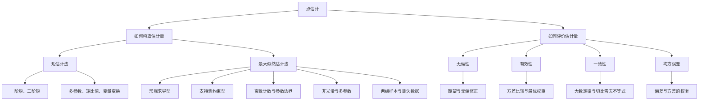
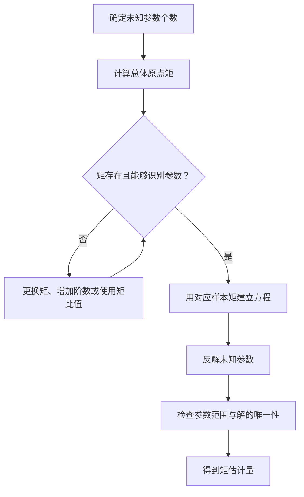
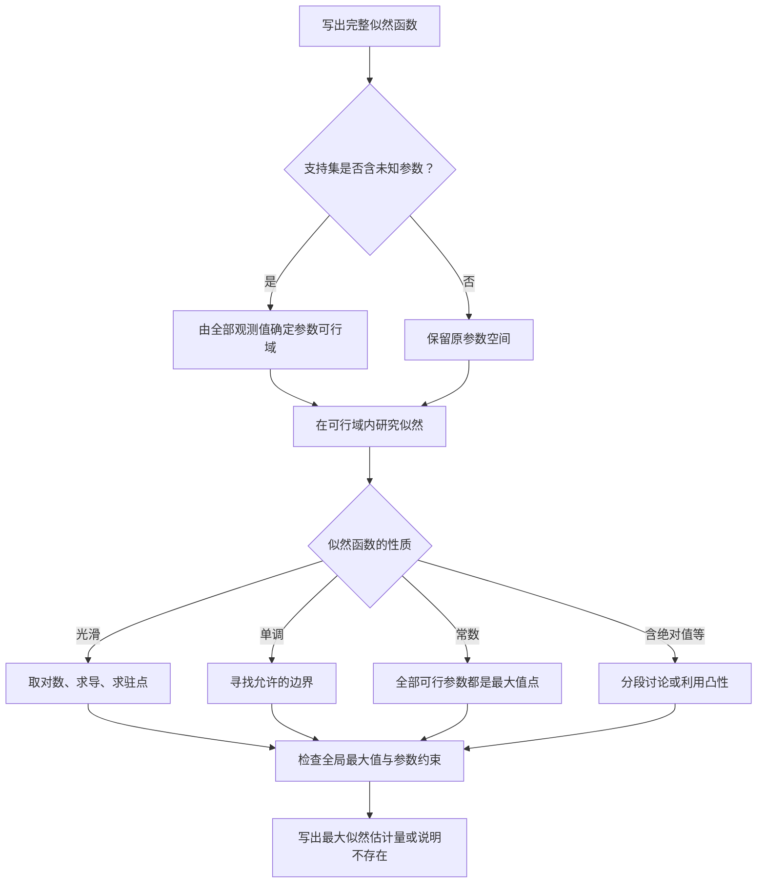
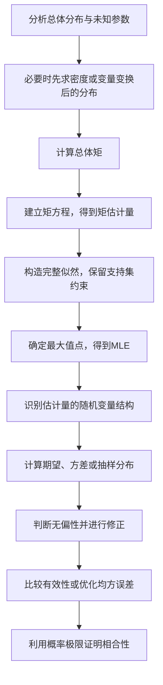

**考研数学一专题精讲：矩估计、最大似然估计、无偏性、有效性与一致性**

本节是数理统计中极其重要的一个专题。它不仅考查参数估计本身，还能够将前面学过的随机变量函数的分布、数字特征、次序统计量、正态总体抽样分布、大数定律等知识串联起来，形成综合解答题。

## 知识框架

本节实际上围绕两个根本问题展开：

**第一个问题：如何根据样本构造一个估计量？**

主要使用矩估计法和最大似然估计法。

**第二个问题：构造出的估计量究竟好不好？**

主要从无偏性、有效性、一致性以及均方误差等角度进行评价。

必须把这两个问题区分开。最大似然估计量不一定无偏，矩估计量也不一定无偏；无偏估计量不一定相合，更不一定具有最小均方误差。

**0.2 真题母题地图**

| 核心题型          | 代表性真题                | 复习优先级 |
| ------------- | -------------------- | ----- |
| 常规矩估计与最大似然估计  | 1997、2009年           | ★★★★★ |
| 随机变量变换与参数估计   | 2013、2014、2017、2018年 | ★★★★★ |
| 支持集含有未知参数     | 2000、2015年           | ★★★★★ |
| 最大值、最小值与无偏修正  | 2003、2016、2024年      | ★★★★★ |
| 离散型总体与分类计数    | 2002、2006、2010年      | ★★★★★ |
| 正态总体参数估计      | 2011、2012、2019、2023年 | ★★★★★ |
| 两组样本联合似然      | 2022年                | ★★★★★ |
| 均方误差最优化       | 2024年                | ★★★★★ |
| 寿命分布与删失似然     | 2020、2026年           | ★★★★★ |
| 多参数估计         | 张宇、李林、李正元练习题         | ★★★★  |
| 非唯一、非光滑最大似然估计 | 张宇8套卷、李林六套卷          | ★★★★  |

## 第一部分 基础概念与底层原理

### 一、什么是参数估计？

**1.1 从概率论到数理统计**

在概率论中，我们通常已知总体分布及其参数，再求概率、期望、方差。

例如，已知

$$
X\sim N(10,4)
$$

要求计算 $P(X>12)$。

但数理统计的方向恰好相反。

假设某机器生产零件的长度服从

$$
X\sim N(\mu,\sigma^2)
$$

其中 $\mu,\sigma^2$ 未知。我们通过抽取样本

$$
X_1,X_2,\ldots,X_n
$$

来推测总体参数 $\mu,\sigma^2$。

因此：

| 概率论          | 数理统计      |
| ------------ | --------- |
| 已知总体，研究样本及事件 | 已知样本，推断总体 |
| 已知参数         | 参数未知      |
| 从模型推导数据性质    | 从数据反推模型参数 |

参数估计本质上就是从有限的样本信息中，尽可能准确地恢复未知的总体参数。

**1.2 估计量与估计值**

设未知参数为 $\theta$，构造统计量

$$
\widehat\theta=T(X_1,\ldots,X_n)
$$

作为 $\theta$ 的估计，这个统计量称为**估计量**。

抽样后，得到具体观测值

$$
x_1,x_2,\ldots,x_n,
$$

将其代入统计量得到

$$
\widehat\theta_{\mathrm{obs}} =T(x_1,\ldots,x_n),
$$

称为估计值。

| 对象   | 本质       | 例子                  |
| ---- | -------- | ------------------- |
| 未知参数 | 未知但固定的常数 | $\mu$           |
| 估计量  | 随机变量、统计量 | $\overline X$   |
| 估计值  | 具体数值     | $\overline x=3$ |

这是理解无偏性的前提。

我们可以讨论估计量的数学期望、方差、分布，但不能将某一次得到的估计值是否恰好等于真参数，作为判断无偏性的依据。

**1.3 统计量不能含有未知参数**

例如，总体服从 $N(\mu,\sigma^2)$，若 $\mu$ 未知，则

$$
\frac1n\sum_{i=1}^n(X_i-\mu)^2
$$

虽然其期望等于 $\sigma^2$，但它含有未知参数 $\mu$，不是可以直接用来估计 $\sigma^2$ 的统计量。

而

$$
S^2=\frac1{n-1}\sum_{i=1}^n(X_i-\overline X)^2
$$

只依赖样本，可以作为估计量。

如果 $\mu$ 已知，前一个式子又可以成为合法的估计量。

**因此，做参数估计题时首先要弄清楚：哪些参数已知，哪些参数未知。**

### 二、必须熟练掌握的样本数字特征

上一节统计量的知识，是本节所有计算的基础。

设 $X_1,\ldots,X_n$ 为简单随机样本，且

$$
E(X)=\mu,\qquad D(X)=\sigma^2.
$$

记 $n>1$ 时：

$$
\overline X=\frac1n\sum_{i=1}^nX_i,
$$

$$
S^2=\frac1{n-1}\sum_{i=1}^n(X_i-\overline X)^2,
$$

$$
A_k=\frac1n\sum_{i=1}^nX_i^k.
$$

其中 $A_k$ 为样本 $k$ 阶原点矩。

**2.1 核心公式**

| 统计量                     | 数字特征                                              |
| ----------------------- | ------------------------------------------------- |
| $\overline X$       | $E\overline X=\mu$                            |
| $\overline X$       | $D\overline X=\dfrac{\sigma^2}{n}$            |
| $\overline X^2$     | $E\overline X^2=\mu^2+\dfrac{\sigma^2}{n}$    |
| $A_2$               | $EA_2=\mu^2+\sigma^2$                         |
| $S^2$               | $ES^2=\sigma^2$                               |
| $A_2-\overline X^2$ | $E(A_2-\overline X^2)=\dfrac{n-1}{n}\sigma^2$ |

其中最重要的恒等式为

$$
\boxed{ \sum_{i=1}^n(X_i-\overline X)^2 =\sum_{i=1}^nX_i^2-n\overline X^2 }
$$

所以

$$
\boxed{ A_2-\overline X^2=\frac{n-1}{n}S^2 }
$$

这个公式在矩估计、最大似然估计和无偏估计中都会反复出现。

**2.2 一个需要特别注意的区别**

$$
\overline{X^2}=\frac1n\sum_{i=1}^nX_i^2
$$

与

$$
\overline X^2=\left(\frac1n\sum_{i=1}^nX_i\right)^2
$$

是完全不同的统计量。

前者是先平方再平均，后者是先平均再平方。

而且

$$
\overline{X^2}-\overline X^2\geq0.
$$

后面许多矩估计与无偏修正题，本质上就是利用这两个量之间的差别。

## 第二部分 矩估计法

### 三、矩估计的基本原理

**3.1 为什么可以用样本矩代替总体矩？**

设总体的 $k$ 阶原点矩为

$$
\mu_k=E(X^k),
$$

相应的样本原点矩为

$$
A_k=\frac1n\sum_{i=1}^nX_i^k.
$$

当 $E|X^k|<\infty$ 时，由大数定律，

$$
A_k\xrightarrow{P}\mu_k.
$$

也就是说，样本容量足够大时，样本矩通常会接近总体矩。

如果总体矩与未知参数之间存在函数关系

$$
E(X)=g(\theta),
$$

那么用样本均值替代总体均值：

$$
\overline X=g(\widehat\theta_M).
$$

再反解参数：

$$
\boxed{\widehat\theta_M=g^{-1}(\overline X)}
$$

这就是矩估计法的核心思想。

矩估计不是机械地令 $\theta=\overline X$，而是**先建立总体矩与参数的关系，再用对应的样本矩替换总体矩。**

**3.2 单参数与多参数矩估计**

一个未知参数时，优先考虑

$$
E(X)=A_1=\overline X
$$

所对应的矩方程，即令总体一阶矩等于样本一阶矩。

若一阶矩不含未知参数、不能唯一确定参数或不存在，再考虑二阶矩：

$$
E(X^2)=A_2.
$$

两个未知参数时，通常联立

$$
\begin{cases} E(X)=A_1,\\ E(X^2)=A_2. \end{cases}
$$

也可以等价地使用

$$
\begin{cases} E(X)=\overline X,\\ D(X)=A_2-\overline X^2. \end{cases}
$$

注意这里对应总体方差的样本矩是

$$
\boxed{\frac1n\sum_{i=1}^n(X_i-\overline X)^2}
$$

而不是分母为 $n-1$ 的无偏样本方差。

**3.3 矩估计标准解题流程**

### 四、矩估计常见题型与母题

**题型一：一阶矩可以直接反解参数**

**母题1：1997年数学一真题**

设总体密度为

$$
f(x;\theta)= \begin{cases} (\theta+1)x^\theta,&0<x<1,\\ 0,&\text{其他}, \end{cases}
$$

其中 $\theta>-1$，求 $\theta$ 的矩估计量与最大似然估计量。

这里先求矩估计，最大似然估计部分稍后再讲。

**第一步：计算总体一阶矩。**

$$
\begin{aligned} E(X) &=\int_0^1x(\theta+1)x^\theta\,dx\\ &=(\theta+1)\int_0^1x^{\theta+1}\,dx\\ &=\frac{\theta+1}{\theta+2}. \end{aligned}
$$

**第二步：建立矩方程。**

$$
\frac{\theta+1}{\theta+2}=\overline X.
$$

**第三步：反解参数。**

$$
\theta+1=\theta\overline X+2\overline X.
$$

所以

$$
\boxed{ \widehat\theta_M =\frac{2\overline X-1}{1-\overline X} }
$$

由于样本值几乎必然在 $(0,1)$ 内，因此 $\widehat\theta_M>-1$，满足参数域约束。

**母题推广：幂函数型密度**

设

$$
f(x;a)=ax^{a-1},\qquad 0<x<1,\quad a>0.
$$

则

$$
E(X^k)=\frac{a}{a+k}.
$$

特别地，

$$
E(X)=\frac a{a+1}.
$$

故

$$
\boxed{\widehat a_M=\frac{\overline X}{1-\overline X}}
$$

李林880题第十二章、张宇1000题数理统计部分均有如下变式：

$$
f(x;\theta)=\sqrt\theta\,x^{\sqrt\theta-1}.
$$

只需令 $a=\sqrt\theta$，立即得到

$$
\boxed{ \widehat\theta_M =\left(\frac{\overline X}{1-\overline X}\right)^2 }
$$

这类题不必每次重新进行积分，识别密度的统一结构即可。

**题型二：一阶矩不含参数，需要使用二阶矩**

**母题2：2018年数学一、三真题的模型及汤家凤八套卷第1套第22题**

设总体密度为

$$
f(x;\theta)=\frac1{2\theta}e^{-|x|/\theta}, \qquad x\in\mathbb R,\quad\theta>0.
$$

求 $\theta$ 的矩估计量。

这是双指数分布，也称拉普拉斯分布。

由于密度关于原点对称，

$$
E(X)=0.
$$

一阶矩中没有未知参数 $\theta$，无法用来估计参数。

改用二阶矩：

$$
\begin{aligned} E(X^2) &=\frac1\theta\int_0^\infty x^2e^{-x/\theta}\,dx\\ &=2\theta^2. \end{aligned}
$$

建立矩方程：

$$
\frac1n\sum_{i=1}^nX_i^2=2\theta^2.
$$

由于 $\theta>0$，有

$$
\boxed{ \widehat\theta_M =\sqrt{\frac1{2n}\sum_{i=1}^nX_i^2} }
$$

**深层理解：对称性是重要的题型信号**

当总体密度关于原点对称，且相关矩存在时，

$$
EX=EX^3=EX^5=\cdots=0.
$$

这时不应继续尝试更高阶的奇数矩，而应该改用偶数矩。

类似模型：

| 总体                      | 一阶矩     | 二阶矩              |
| ----------------------- | ------- | ---------------- |
| $N(0,\sigma^2)$     | $0$ | $\sigma^2$   |
| $U(-\theta,\theta)$ | $0$ | $\theta^2/3$ |
| 拉普拉斯分布                  | $0$ | $2\theta^2$  |

所以，对张宇1000题中的 $U(-\theta,\theta)$：

$$
\boxed{ \widehat\theta_M =\sqrt{\frac3n\sum_{i=1}^nX_i^2} }
$$

这三道题实际上是同一个母题。

**题型三：矩存在，但直接积分困难——利用变量变换**

**母题3：2013年数学一、三真题**

设

$$
f(x;\theta)= \begin{cases} \dfrac{\theta^2}{x^3}e^{-\theta/x},&x>0,\\ 0,&\text{其他}, \end{cases} \qquad\theta>0.
$$

求 $\theta$ 的矩估计量和最大似然估计量。

先求总体期望：

$$
E(X)=\theta^2\int_0^\infty \frac1{x^2}e^{-\theta/x}\,dx.
$$

令

$$
t=\frac\theta x,\qquad dt=-\frac{\theta}{x^2}\,dx.
$$

于是

$$
\begin{aligned} E(X) &=\theta\int_0^\infty e^{-t}\,dt\\ &=\theta. \end{aligned}
$$

因此

$$
\boxed{\widehat\theta_M=\overline X}
$$

而最大似然估计量为

$$
\boxed{ \widehat\theta_L =\frac{2n}{\displaystyle\sum_{i=1}^n1/X_i} }
$$

值得注意的是：同一个总体中，矩估计量使用样本的算术平均值，而最大似然估计量使用与调和平均值有关的统计量。

**进阶理解**

令

$$
Y=\frac1X.
$$

通过变量变换可以得到

$$
f_Y(y)=\theta^2ye^{-\theta y},\qquad y>0.
$$

这恰好是2009年数学一真题所使用的密度模型。

因此，2013年这道题并不是一个完全独立的新模型，而是2009年模型的倒数变换。

**遇到复杂密度时，应特别关注指数部分中的结构：**

| 指数部分                             | 优先尝试的变换        |
| -------------------------------- | -------------- |
| $e^{-\lambda x^a}$           | $Y=X^a$    |
| $e^{-\theta/x}$              | $Y=1/X$    |
| $x^{a-1}$，且 $0<x<1$     | $Y=-\ln X$ |
| $e^{-\|x\|/\theta}$          | $Y=\|X\|$  |
| $e^{-(x-\mu)^2/(2\sigma^2)}$ | 标准化、平方或绝对值     |
| 对数正态型密度                          | $Y=\ln X$  |

这些变换可以同时简化期望、方差、似然函数及估计量分布的计算。

但要注意：对变换后的样本使用矩估计，与直接对原总体使用通常的一阶矩估计，可能得到不同结果。题目指定使用哪一种矩时，应遵循题意。

**题型四：多个未知参数的矩估计**

**母题4：李正元第七章填空题、均匀分布双端点模型**

设

$$
X\sim U(a,b),\qquad a<b,
$$

其中 $a,b$ 均未知。

求 $a,b$ 的矩估计量。

**第一步：计算总体期望和方差。**

$$
E(X)=\frac{a+b}{2},
$$

$$
D(X)=\frac{(b-a)^2}{12}.
$$

**第二步：建立矩估计方程。**

记

$$
B_n=A_2-\overline X^2.
$$

则

$$
\begin{cases} \dfrac{a+b}{2}=\overline X,\\[4pt] \dfrac{(b-a)^2}{12}=B_n. \end{cases}
$$

**第三步：利用参数关系确定符号。**

由于 $b>a$，

$$
b-a=\sqrt{12B_n}.
$$

解得

$$
\boxed{ \widehat a_M=\overline X-\sqrt{3B_n} }
$$

$$
\boxed{ \widehat b_M=\overline X+\sqrt{3B_n} }
$$

其中

$$
B_n=\frac1n\sum_{i=1}^nX_i^2-\overline X^2.
$$

这是非退化样本下的估计结果。若所有样本值相同，矩方程只给出 $a=b$，不满足原来的严格参数约束。

**推广：位置参数与尺度参数**

如果总体能够写成

$$
X=a+bZ,\qquad b>0,
$$

其中 $Z$ 的分布已知，那么

$$
E(X)=a+bE(Z),
$$

$$
D(X)=b^2D(Z).
$$

记

$$
E(Z)=\mu_Z,\qquad D(Z)=v_Z>0,
$$

则可以直接得到

$$
\boxed{\widehat b_M=\sqrt{\frac{B_n}{v_Z}}}
$$

$$
\boxed{\widehat a_M=\overline X-\widehat b_M\mu_Z}
$$

例如李林880题中的双参数平移指数分布：

$$
X=\lambda_1+\lambda_2Z,\qquad Z\sim\operatorname{Exp}(1).
$$

因为 $EZ=DZ=1$，所以

$$
\boxed{\widehat\lambda_{2,M}=\sqrt{B_n}}
$$

$$
\boxed{\widehat\lambda_{1,M}=\overline X-\sqrt{B_n}}
$$

掌握位置—尺度结构，就能统一解决许多双参数矩估计题。

**题型五：使用矩比值消去复杂参数函数**

**强化母题：张宇1000题·参数估计与假设检验第1题**

设

$$
P(X=k)=-\frac{\theta^k}{k\ln(1-\theta)}, \qquad k=1,2,\ldots,\quad 0<\theta<1.
$$

计算一阶矩：

$$
E(X) =-\frac{\theta}{(1-\theta)\ln(1-\theta)}.
$$

计算二阶矩：

$$
E(X^2) =-\frac{\theta}{(1-\theta)^2\ln(1-\theta)}.
$$

直接用一阶矩反解 $\theta$ 比较困难，因为同时出现了对数和有理式。

但是两式相除：

$$
\frac{E(X)}{E(X^2)}=1-\theta.
$$

因此利用样本矩替换得到

$$
\boxed{\widehat\theta_M=1-\frac{A_1}{A_2}}
$$

这是一种利用多个矩的关系构造的广义矩型估计。它不意味着两个经验矩一定能够同时精确匹配总体矩。

**迁移技巧：当某个总体矩难以反解参数时，不一定要硬解方程，可以考虑利用另一个矩作差、作商或消元。**

## 第三部分 最大似然估计法

### 五、最大似然估计的本质

**5.1 直观理解**

假设一枚硬币正面向上的概率为 $p$。独立抛掷10次，观察到8次正面、2次反面。

那么不同的 $p$ 对于这一观测结果，具有不同的似然大小。

当 $p$ 接近 $0.8$ 时，这组样本结果比 $p$ 接近 $0.1$ 时更加符合模型。

最大似然估计法就是在所有允许的参数取值中，寻找使已经观察到的数据具有最大似然的参数值。

**5.2 似然函数的定义**

若总体为离散型随机变量，

$$
L(\theta) =\prod_{i=1}^nP_\theta(X=x_i).
$$

若总体为连续型随机变量，

$$
L(\theta)=\prod_{i=1}^nf(x_i;\theta).
$$

最大似然估计值定义为

$$
\boxed{ \widehat\theta_L \in\underset{\theta\in\Theta}{\operatorname{argmax}} L(\theta) }
$$

其中 $\Theta$ 为参数空间。

连续型总体中，似然函数是联合密度关于参数的函数，并不是样本恰好取这组数值的概率。

这里要特别注意两次角色转换：

- 构造似然函数时，样本观测值固定，未知参数是自变量。
- 求得最大似然估计值的表达式后，再将 $x_i$ 换成 $X_i$，得到随机的估计量。

**5.3 为什么取对数？**

当 $L(\theta)>0$ 时，由于对数函数严格单调递增，

$$
\underset{\theta}{\operatorname{argmax}}L(\theta) = \underset{\theta}{\operatorname{argmax}}\ln L(\theta).
$$

记

$$
\ell(\theta)=\ln L(\theta).
$$

则

$$
\ell(\theta)=\sum_{i=1}^n\ln f(x_i;\theta).
$$

取对数能够将乘积变成求和，将指数和幂函数变成较简单的代数表达式。

**5.4 最大似然估计的标准判断流程**

**这里最重要的不是求导，而是判断似然函数应当在哪个参数范围内取最大值。**

考研中不少难题正是利用了这一点。

### 六、常规求导型最大似然估计

**母题5：2009年数学一真题**

设

$$
f(x;\lambda)= \begin{cases} \lambda^2xe^{-\lambda x},&x>0,\\ 0,&\text{其他}, \end{cases} \qquad\lambda>0.
$$

求 $\lambda$ 的矩估计量与最大似然估计量。

**（1）矩估计**

$$
E(X)=\lambda^2\int_0^\infty x^2e^{-\lambda x}\,dx =\frac2\lambda.
$$

所以

$$
\boxed{\widehat\lambda_M=\frac2{\overline X}}
$$

**（2）最大似然估计**

写出似然函数：

$$
\begin{aligned} L(\lambda) &=\prod_{i=1}^n\lambda^2x_i e^{-\lambda x_i}\\ &=\lambda^{2n} \left(\prod_{i=1}^nx_i\right) e^{-\lambda\sum_{i=1}^nx_i}. \end{aligned}
$$

取对数：

$$
\ell(\lambda) =2n\ln\lambda +\sum_{i=1}^n\ln x_i -\lambda\sum_{i=1}^nx_i.
$$

求导：

$$
\ell'(\lambda)=\frac{2n}{\lambda}-\sum_{i=1}^nx_i.
$$

令导数等于零：

$$
\lambda=\frac{2n}{\sum_{i=1}^nx_i}.
$$

又有

$$
\ell''(\lambda)=-\frac{2n}{\lambda^2}<0.
$$

所以该驻点是唯一的全局最大值点。

故

$$
\boxed{ \widehat\lambda_L=\frac2{\overline X} }
$$

本题两种估计量完全相同，但这不是普遍规律。

**6.1 一个非常重要的似然结构**

将2009年真题与其他历年真题放在一起，可以归纳出两种高频形式。

**模型A：率参数型**

$$
L(\theta)\propto\theta^a e^{-b\theta}, \qquad a,b>0.
$$

则

$$
\ell'(\theta)=\frac a\theta-b.
$$

因此在完整正半轴参数域内，

$$
\boxed{\widehat\theta_L=\frac ab}
$$

**模型B：尺度参数型**

$$
L(\theta)\propto\theta^{-a}e^{-b/\theta}, \qquad a,b>0.
$$

则

$$
\ell'(\theta)=-\frac a\theta+\frac b{\theta^2}.
$$

因此

$$
\boxed{\widehat\theta_L=\frac ba}
$$

更一般地，

$$
L(\theta)\propto\theta^{-a}e^{-b/\theta^r}, \qquad r>0,
$$

有

$$
\boxed{ \widehat\theta_L=\left(\frac{br}{a}\right)^{1/r} }
$$

前提是参数域为正半轴、相关系数为正，并且不存在额外的支持集约束。

| 对应题目      | 似然函数关于参数的部分                              | 最大似然估计              |
| --------- | ---------------------------------------- | ------------------- |
| 2009年真题   | $\lambda^{2n}e^{-\lambda\sum x_i}$   | $2n/\sum X_i$   |
| 2013年真题   | $\theta^{2n}e^{-\theta\sum1/x_i}$    | $2n/\sum1/X_i$  |
| 2018年真题   | $\theta^{-n}e^{-\sum\|x_i\|/\theta}$ | $\sum\|X_i\|/n$ |
| 正态方差估计    | $v^{-n/2}e^{-Q/(2v)}$                | $Q/n$           |
| 2020年寿命真题 | $\theta^{-mn}e^{-R/\theta^m}$        | $(R/n)^{1/m}$   |

看似不同的五类试题，本质上都是少数几种单变量最值问题。

### 七、变换型密度与最大似然估计

**母题6：1997年数学一真题的第二问**

回到前面的密度：

$$
f(x;\theta)=(\theta+1)x^\theta, \qquad 0<x<1.
$$

似然函数为

$$
L(\theta)=(\theta+1)^n \left(\prod_{i=1}^nx_i\right)^\theta.
$$

取对数：

$$
\ell(\theta) =n\ln(\theta+1)+\theta\sum_{i=1}^n\ln x_i.
$$

求导：

$$
\ell'(\theta)=\frac n{\theta+1}+\sum_{i=1}^n\ln x_i.
$$

令其等于零：

$$
\theta+1=-\frac n{\sum_{i=1}^n\ln x_i}.
$$

由于 $0<x_i<1$，所以 $\ln x_i<0$，解满足 $\theta>-1$。

又因为

$$
\ell''(\theta)=-\frac n{(\theta+1)^2}<0,
$$

所以

$$
\boxed{ \widehat\theta_L =-\frac n{\sum_{i=1}^n\ln X_i}-1 }
$$

**更深层的方法：化归到指数分布**

令

$$
Y=-\ln X.
$$

则对于 $y>0$，

$$
P(Y>y)=P(X<e^{-y}) =e^{-(\theta+1)y}.
$$

所以

$$
Y\sim\operatorname{Exp}(\theta+1),
$$

这里指数分布参数采用率参数。

因此

$$
\widehat{\theta+1} =\frac1{\overline Y} =-\frac n{\sum_{i=1}^n\ln X_i}.
$$

与前面的结果完全一致。

对李林880题的变式

$$
f(x;\theta)=\sqrt\theta\,x^{\sqrt\theta-1},
$$

只需令 $a=\sqrt\theta$，就有

$$
\boxed{ \widehat\theta_L =\left(\frac n{\sum_{i=1}^n\ln X_i}\right)^2 }
$$

**7.1 最大似然估计的不变性**

如果 $\widehat\theta_L$ 是 $\theta$ 的最大似然估计量，那么按照参数函数诱导的似然定义，参数函数

$$
\eta=g(\theta)
$$

的最大似然估计量可以取

$$
\boxed{\widehat\eta_L=g(\widehat\theta_L)}
$$

前提是原最大似然估计存在。

例如泊松总体

$$
X\sim P(\lambda),
$$

已有

$$
\widehat\lambda_L=\overline X.
$$

要求

$$
p=P(X=0)=e^{-\lambda}
$$

的最大似然估计量，则直接得到

$$
\boxed{\widehat p_L=e^{-\overline X}}
$$

张宇1000题和李林880题均有这一类考查。

但要区分：

$$
\text{最大似然估计具有不变性}
$$

并不意味着

$$
\text{无偏估计也具有同样的不变性}.
$$

这一点是本节非常重要的概念陷阱。

## 第四部分 支持集含未知参数的最大似然估计

### 八、端点型最大似然估计

这是本节最值得重点掌握的难点之一。

很多考生看到最大似然估计，就直接取对数、求导、令导数等于零。

然而，当密度的非零区间依赖未知参数时，最大值往往出现在参数可行域的边界上，根本不存在通常意义上的驻点。

**母题7：2015年数学一、三真题**

设

$$
f(x;\theta)= \begin{cases} \dfrac1{1-\theta},&\theta\leq x\leq1,\\ 0,&\text{其他}, \end{cases} \qquad\theta<1.
$$

即

$$
X\sim U(\theta,1).
$$

求 $\theta$ 的矩估计量与最大似然估计量。

**（1）矩估计**

$$
E(X)=\frac{\theta+1}{2}.
$$

因此

$$
\boxed{\widehat\theta_M=2\overline X-1}
$$

**（2）最大似然估计**

令

$$
x_{(1)}=\min_i x_i.
$$

因为所有样本都必须满足

$$
\theta\leq x_i\leq1,
$$

所以对参数的限制是

$$
\theta\leq x_{(1)}.
$$

完整的似然函数可写为

$$
L(\theta)= \begin{cases} (1-\theta)^{-n},&\theta\leq x_{(1)},\ \theta<1,\\ 0,&\text{其他允许参数}. \end{cases}
$$

在可行范围内，

$$
L'(\theta)=n(1-\theta)^{-n-1}>0.
$$

因此似然函数单调递增，最大值在最大允许参数处取得。

故

$$
\boxed{\widehat\theta_L=X_{(1)}}
$$

**核心思想**

总体下端点未知时，要保证下端点不超过所有样本值，所以最小样本值决定了下端点能够取到的位置。

类似地，上端点未知时，往往由最大样本值决定。

**母题8：均匀分布 $U(0,\theta)$ 的完整模型**

这一模型同时出现在2024年真题、李正元练习题、张宇1000题及李林880题中，是全节最重要的综合母题之一。

设

$$
X\sim U(0,\theta),\qquad\theta>0,
$$

使用端点处取非零值的常见密度版本。

记

$$
M=X_{(n)}=\max(X_1,\ldots,X_n).
$$

**（1）矩估计**

$$
EX=\frac\theta2.
$$

所以

$$
\boxed{\widehat\theta_M=2\overline X}
$$

**（2）最大似然估计**

$$
L(\theta)=\theta^{-n}\mathbf1_{\{\theta\geq x_{(n)}\}}.
$$

其中指示函数表示必须满足全部样本都落在支持集内。

参数可行域为

$$
\theta\geq x_{(n)}.
$$

由于 $\theta^{-n}$ 在正半轴单调递减，最大值在最小可行参数处取得。

故

$$
\boxed{\widehat\theta_L=M}
$$

这里完全不需要令导数等于零。

**8.1 均匀分布端点估计统一表**

| 总体                                | 参数可行条件                              | 最大似然估计量                                       |
| --------------------------------- | ----------------------------------- | --------------------------------------------- |
| $U(0,\theta)$                 | $\theta\geq X_{(n)}$           | $X_{(n)}$                                |
| $U(\theta,1)$                 | $\theta\leq X_{(1)}$           | $X_{(1)}$                                |
| $U(-\theta,\theta)$           | $\theta\geq\max_i\|X_i\|$       | $\max_i\|X_i\|$                           |
| $U(0,1/\theta)$               | $0<\theta\leq1/X_{(n)}$        | $1/X_{(n)}$                              |
| $U(a,b)$                      | $a\leq X_{(1)},b\geq X_{(n)}$ | $\widehat a=X_{(1)},\widehat b=X_{(n)}$ |
| $U(\theta_0,\theta_0+\theta)$ | $\theta\geq X_{(n)}-\theta_0$  | $X_{(n)}-\theta_0$                       |

以上采用包含端点的密度版本，且双端点模型要求样本极差为正。

不要机械地记住“最大似然估计取最大值”或“取最小值”。应该记住：

**先确定可行域，再根据似然函数的单调性寻找最大值点。**

### 九、最大似然估计不唯一

**母题9：张宇8套卷第4套第22题**

张宇1000题、李林880题也收录了同类型题目。

设

$$
X\sim U\left(\theta-\frac12,\theta+\frac12\right), \qquad\theta\in\mathbb R.
$$

求矩估计量和全部最大似然估计量，并判断

$$
T=\frac{X_{(1)}+X_{(n)}}2
$$

是否无偏。

**（1）矩估计**

由对称性，

$$
EX=\theta.
$$

所以

$$
\boxed{\widehat\theta_M=\overline X}
$$

**（2）全部最大似然估计**

由于均匀分布的区间长度恒为1，密度恒为1。

完整似然为

$$
L(\theta)= \begin{cases} 1,&\theta-\dfrac12\leq x_i\leq\theta+\dfrac12 \text{ 对所有 }i\text{ 成立},\\ 0,&\text{其他}. \end{cases}
$$

全部样本落在区间内，等价于

$$
\theta-\frac12\leq x_{(1)}
$$

以及

$$
x_{(n)}\leq\theta+\frac12.
$$

因此

$$
x_{(n)}-\frac12 \leq\theta\leq x_{(1)}+\frac12.
$$

该区间内似然函数处处等于1，所以

$$
\boxed{ X_{(n)}-\frac12 \leq\widehat\theta_L \leq X_{(1)}+\frac12 }
$$

任何始终落在这一可行区间内的统计量，都可以作为最大似然估计量。

这包括区间左端点、右端点以及中点。

**（3）判断中点是否无偏**

利用均匀分布的最大值、最小值期望公式：

$$
EX_{(1)} =\theta-\frac12+\frac1{n+1},
$$

$$
EX_{(n)} =\theta+\frac12-\frac1{n+1}.
$$

所以

$$
E(T)=\frac12(EX_{(1)}+EX_{(n)})=\theta.
$$

因此

$$
\boxed{ T=\frac{X_{(1)}+X_{(n)}}2 \text{ 是 }\theta\text{ 的无偏估计量} }
$$

**更简洁的对称性证明**

因为总体关于 $\theta$ 对称，所以

$$
X_{(1)}-\theta \overset d= -(X_{(n)}-\theta).
$$

故

$$
EX_{(1)}+EX_{(n)}=2\theta.
$$

不必计算复杂积分，也能证明中点估计量无偏。

**9.1 李林六套卷第3套第10题的变式**

若

$$
X\sim U[\theta,\theta+1],
$$

则可行域为

$$
\boxed{ X_{(n)}-1\leq\widehat\theta_L\leq X_{(1)} }
$$

所以 $X_{(1)}$、$X_{(n)}-1$ 以及

$$
\frac{X_{(1)}+X_{(n)}-1}{2}
$$

均可作为最大似然估计量。

而 $X_{(1)}+1$ 不在可行域内，因此不是最大似然估计量。

这一类题的关键在于：**区间长度固定时，似然可能不依赖参数的具体位置，而只依赖参数是否可行。**

### 十、平移指数分布与最小次序统计量

**母题10：2000年与2003年数学一真题的综合模型**

设

$$
f(x;\theta)= \begin{cases} 2e^{-2(x-\theta)},&x\geq\theta,\\ 0,&x<\theta, \end{cases} \qquad\theta>0.
$$

在核心题库中，2000年真题侧重最大似然估计，2003年真题侧重最小次序统计量与无偏性。李林880题、张宇1000题和汤家凤模拟卷又对这一模型进行了综合考查。

**（1）矩估计量**

注意

$$
X-\theta\sim\operatorname{Exp}(2).
$$

因此

$$
EX=\theta+\frac12.
$$

所以

$$
\boxed{\widehat\theta_M=\overline X-\frac12}
$$

**（2）最大似然估计量**

似然函数为

$$
L(\theta) =2^ne^{-2\sum x_i+2n\theta} \mathbf1_{\{0<\theta\leq x_{(1)}\}}.
$$

在可行域内，

$$
L(\theta)\propto e^{2n\theta},
$$

单调递增。

故

$$
\boxed{\widehat\theta_L=X_{(1)}}
$$

**（3）最小值的分布**

令 $T=X_{(1)}$。

当 $t\geq\theta$ 时，

$$
\begin{aligned} P(T>t) &=P(X_1>t,\ldots,X_n>t)\\ &=\left[e^{-2(t-\theta)}\right]^n\\ &=e^{-2n(t-\theta)}. \end{aligned}
$$

于是

$$
F_T(t)= \begin{cases} 0,&t<\theta,\\ 1-e^{-2n(t-\theta)},&t\geq\theta. \end{cases}
$$

从而

$$
T-\theta\sim\operatorname{Exp}(2n).
$$

因此

$$
\boxed{ET=\theta+\frac1{2n}}
$$

$$
\boxed{DT=\frac1{4n^2}}
$$

**（4）无偏性判断与修正**

矩估计量：

$$
E\left(\overline X-\frac12\right) =\theta.
$$

它是无偏的。

最大似然估计量：

$$
EX_{(1)}=\theta+\frac1{2n}\neq\theta.
$$

它有偏，而且偏大。

修正后：

$$
\boxed{ T_1=\overline X-\frac12,\qquad T_2=X_{(1)}-\frac1{2n} }
$$

均为无偏估计量。

**（5）比较有效性**

$$
D(T_1)=\frac1{4n},
$$

$$
D(T_2)=\frac1{4n^2}.
$$

当 $n>1$ 时，

$$
D(T_2)<D(T_1).
$$

所以修正后的最小值估计量更有效。

**一般化结论**

如果

$$
X=\theta+Y,\qquad Y\sim\operatorname{Exp}(\lambda),
$$

其中率参数 $\lambda$ 已知，则

$$
\boxed{ \widehat\theta_M=\overline X-\frac1\lambda }
$$

$$
\boxed{\widehat\theta_L=X_{(1)}}
$$

$$
\boxed{ X_{(1)}-\theta\sim\operatorname{Exp}(n\lambda) }
$$

$$
\boxed{ T=X_{(1)}-\frac1{n\lambda} }
$$

为无偏修正后的估计量，且

$$
D(T)=\frac1{n^2\lambda^2}.
$$

<Callout type="warn" title="必须注意的严格性问题">

2003年真题的密度采用 $x>\theta$，部分模拟题也采用严格不等号，但仍直接将 $X_{(1)}$ 写作最大似然估计。

从严格数学意义上说，如果坚持使用端点处密度为零的版本，那么可行域为

$$
\theta<x_{(1)},
$$

似然在该开区间内严格递增，只能趋近上确界，不能在 $x_{(1)}$ 处取得最大值。

连续型分布在单个点上修改密度值，并不改变概率分布。教材和考研通常采用等价的闭端点密度版本，给出 $X_{(1)}$ 作为标准估计结果。

实际答题时，应理解这一差别；尤其当题目专门考查最大值是否存在时，不能忽略严格不等号与参数空间。

</Callout>

### 十一、幂函数型端点分布：最大值模型的统一推广

**母题11：2016年数学一、三真题**

设总体密度为

$$
f(x;\theta)= \begin{cases} \dfrac{3x^2}{\theta^3},&0<x<\theta,\\ 0,&\text{其他}, \end{cases} \qquad\theta>0.
$$

从总体中抽取容量为3的简单随机样本，令

$$
T=\max(X_1,X_2,X_3).
$$

求 $T$ 的密度，并确定常数 $a$，使 $aT$ 为 $\theta$ 的无偏估计量。

**第一步：求总体分布函数。**

当 $0<x<\theta$ 时，

$$
F_X(x)=\int_0^x\frac{3t^2}{\theta^3}\,dt =\frac{x^3}{\theta^3}.
$$

**第二步：求最大值的分布函数。**

$$
F_T(t)=[F_X(t)]^3 =\frac{t^9}{\theta^9}, \qquad 0<t<\theta.
$$

**第三步：求密度。**

$$
f_T(t)= \begin{cases} \dfrac{9t^8}{\theta^9},&0<t<\theta,\\ 0,&\text{其他}. \end{cases}
$$

**第四步：计算期望。**

$$
ET=\int_0^\theta t\frac{9t^8}{\theta^9}\,dt =\frac9{10}\theta.
$$

要求

$$
E(aT)=\theta,
$$

所以

$$
a\frac9{10}\theta=\theta.
$$

故

$$
\boxed{a=\frac{10}{9}}
$$

**11.1 推广成一个统一母模型**

设

$$
f(x;\theta)=\frac{kx^{k-1}}{\theta^k}, \qquad 0<x<\theta,\quad k>0,
$$

其中 $k$ 已知，$\theta>0$ 未知。

那么

$$
F_X(x)=\left(\frac x\theta\right)^k.
$$

记最大次序统计量

$$
M=X_{(n)}.
$$

则

$$
F_M(x)=\left(\frac x\theta\right)^{kn},
$$

$$
f_M(x)=\frac{knx^{kn-1}}{\theta^{kn}}, \qquad 0<x<\theta.
$$

所以对正数 $r$，

$$
\boxed{ E(M^r)=\frac{kn}{kn+r}\theta^r }
$$

特别地，

$$
\boxed{EM=\frac{kn}{kn+1}\theta}
$$

$$
\boxed{E(M^2)=\frac{kn}{kn+2}\theta^2}
$$

于是得到以下统一结果：

| 求解目标                        | 结果                                       |
| --------------------------- | ---------------------------------------- |
| $\theta$ 的矩估计           | $\dfrac{k+1}{k}\overline X$          |
| $\theta$ 的最大似然估计（闭端点版本） | $M$                                  |
| $\theta$ 的无偏修正估计        | $\dfrac{kn+1}{kn}M$                  |
| $\theta^r$ 的无偏估计        | $\dfrac{kn+r}{kn}M^r$                |
| $D(M)$                  | $\dfrac{kn\theta^2}{(kn+1)^2(kn+2)}$ |
| 修正后的估计量方差                   | $\dfrac{\theta^2}{kn(kn+2)}$         |

2016年真题就是 $k=3,n=3$ 的情况。

李林880题第十二章中要求证明

$$
\frac{3n+1}{3n}X_{(n)}
$$

和

$$
\frac43\overline X
$$

均为无偏估计量，实际上就是该模型 $k=3$ 的直接应用。

而均匀分布 $U(0,\theta)$，就是 $k=1$ 的特殊情况。

掌握这一母模型，便可以同时解决均匀分布、幂函数分布、最大值分布、无偏修正、有效性比较及均方误差问题。

## 第五部分 离散总体、分类计数与非线性似然

### 十二、离散型总体的最大似然估计

离散型总体最重要的解题技巧，是将逐个观测值的概率乘积转化为分类频数的幂函数。

假设

$$
P_\theta(X=a_j)=p_j(\theta), \qquad j=1,\ldots,k.
$$

样本中 $a_j$ 出现了 $N_j$ 次，那么

$$
\boxed{ L(\theta)=\prod_{j=1}^kp_j(\theta)^{N_j} }
$$

其中

$$
N_1+\cdots+N_k=n.
$$

如果观察到的是类别计数而非有顺序的样本，则严格地说还会有多项式系数

$$
\frac{n!}{N_1!\cdots N_k!}.
$$

但因为它不含未知参数，所以在最大似然优化中可以省略。

**母题12：2002年数学一真题**

总体分布律为

| $X$ | $0$        | $1$                 | $2$        | $3$         |
| ------- | -------------- | ----------------------- | -------------- | --------------- |
| $P$ | $\theta^2$ | $2\theta(1-\theta)$ | $\theta^2$ | $1-2\theta$ |

其中

$$
0<\theta<\frac12.
$$

样本观测值为

$$
3,1,3,0,3,1,2,3.
$$

求矩估计值和最大似然估计值。

**（1）矩估计**

总体期望：

$$
\begin{aligned} EX &=2\theta(1-\theta)+2\theta^2 +3(1-2\theta)\\ &=3-4\theta. \end{aligned}
$$

样本均值为

$$
\overline x=\frac{16}{8}=2.
$$

所以

$$
3-4\theta=2.
$$

故

$$
\boxed{\widehat\theta_M=\frac14}
$$

**（2）最大似然估计**

先整理频数：

| 样本值 | 出现次数 |
| --- | ---- |
| 0   | 1    |
| 1   | 2    |
| 2   | 1    |
| 3   | 4    |

因此

$$
\begin{aligned} L(\theta) &=(\theta^2)^1 [2\theta(1-\theta)]^2 (\theta^2)^1 (1-2\theta)^4\\ &=4\theta^6(1-\theta)^2(1-2\theta)^4. \end{aligned}
$$

取对数并忽略常数项：

$$
\ell(\theta)=6\ln\theta+2\ln(1-\theta) +4\ln(1-2\theta)+C.
$$

求导：

$$
\ell'(\theta) =\frac6\theta-\frac2{1-\theta} -\frac8{1-2\theta}.
$$

令其为零，通分整理得到

$$
24\theta^2-28\theta+6=0.
$$

解得

$$
\theta=\frac{7\pm\sqrt{13}}{12}.
$$

结合参数空间

$$
0<\theta<\frac12,
$$

只能取

$$
\theta=\frac{7-\sqrt{13}}{12}.
$$

又由于

$$
\ell''(\theta) =-\frac6{\theta^2} -\frac2{(1-\theta)^2} -\frac{16}{(1-2\theta)^2}<0,
$$

所以它是唯一最大值点。

故

$$
\boxed{ \widehat\theta_L=\frac{7-\sqrt{13}}{12} }
$$

**12.1 这一类题的解题经验**

离散型最大似然估计中，最容易出错的地方不是求导，而是频数统计错误、合并同类项错误，以及没有根据参数空间舍去不合法的根。

如果似然能够整理成

$$
L(\theta)\propto \theta^a(1-\theta)^b,
$$

其中 $a,b>0$，则立刻有

$$
\boxed{\widehat\theta_L=\frac a{a+b}}
$$

该模型能够统一解决伯努利分布、二项分布、几何分布，以及许多看起来复杂的分类计数问题。

例如几何分布：

$$
P(X=k)=p(1-p)^{k-1}, \qquad k=1,2,\ldots
$$

其似然函数为

$$
L(p)=p^n(1-p)^{\sum x_i-n}.
$$

所以对于内点情形，

$$
\boxed{ \widehat p_L=\frac n{\sum X_i} =\frac1{\overline X} }
$$

这也是李林880题和李正元练习题中的典型模型。

### 十三、参数空间的边界问题

**母题13：2006年数学一、三真题**

设

$$
f(x;\theta)= \begin{cases} \theta,&0<x<1,\\ 1-\theta,&1\leq x<2,\\ 0,&\text{其他}, \end{cases}
$$

其中 $0<\theta<1$。

记 $N$ 为样本中小于1的观测值个数。

**（1）矩估计**

$$
\begin{aligned} EX &=\theta\int_0^1x\,dx +(1-\theta)\int_1^2x\,dx\\ &=\frac32-\theta. \end{aligned}
$$

所以形式上的矩估计量为

$$
\boxed{\widehat\theta_M=\frac32-\overline X}
$$

但某些有限样本可能使该表达式落在参数空间外。这是矩估计并不自动满足参数约束的典型例子。

**（2）最大似然估计**

$$
L(\theta)=\theta^N(1-\theta)^{n-N}.
$$

当 $0<N<n$ 时，

$$
\boxed{\widehat\theta_L=\frac Nn}
$$

若 $N=0$，则

$$
L(\theta)=(1-\theta)^n.
$$

在 $0<\theta<1$ 内严格递减，最大值无法取得。

若 $N=n$，则

$$
L(\theta)=\theta^n.
$$

在 $0<\theta<1$ 内严格递增，最大值也无法取得。

所以严格结论是：

$$
\begin{cases} \widehat\theta_L=N/n,&0<N<n,\\ \text{最大似然估计不存在},&N=0\text{ 或 }N=n. \end{cases}
$$

只有将参数空间扩充为 $[0,1]$，才能无条件写成 $N/n$。

**13.1 一个值得警惕的张宇模拟题**

考虑如下总体：

$$
f(x;\alpha)= \begin{cases} \dfrac{2x}{\alpha^2},&0\leq x\leq\alpha,\\ 0,&\text{其他}, \end{cases} \qquad \alpha>1.
$$

要求

$$
p=P(0<X<\sqrt\alpha)
$$

的最大似然估计。

先计算

$$
p=\int_0^{\sqrt\alpha}\frac{2x}{\alpha^2}\,dx =\frac1\alpha.
$$

令 $M=X_{(n)}$。

似然关于 $\alpha$ 的部分为

$$
L(\alpha)\propto\alpha^{-2n},
$$

且需要同时满足

$$
\alpha>1,\qquad \alpha\geq M.
$$

如果 $M>1$，最大似然估计为

$$
\widehat\alpha_L=M,
$$

进而

$$
\boxed{\widehat p_L=\frac1M}.
$$

然而，如果 $M\leq1$，可行参数范围是 $(1,\infty)$，似然严格递减，不能取得最大值。

并且

$$
P(M\leq1)=\alpha^{-2n}>0.
$$

因此严格来说，该题还需要讨论最大似然估计不存在的情形，而不能仅写 $1/M$ 作为适用于所有样本的结果。

这也说明：**支持集约束和题目原本给出的参数空间必须取交集。**

### 十四、两个离散参数的联合估计

**母题14：李永乐六套卷第1套第22题**

设总体分布律为

| $X$ | 0        | 1            | 2         |
| ------- | -------- | ------------ | --------- |
| $P$ | $pq$ | $p(1-q)$ | $1-p$ |

其中 $p,q\in(0,1)$ 未知。

记相应的样本频数为 $N_0,N_1,N_2$，且均大于零。

求两个参数的矩估计量和最大似然估计量。

**（1）矩估计**

$$
EX=p(1-q)+2(1-p)=2-p-pq,
$$

$$
EX^2=p(1-q)+4(1-p)=4-3p-pq.
$$

对应的样本矩为

$$
A_1=\frac{N_1+2N_2}{n},
$$

$$
A_2=\frac{N_1+4N_2}{n}.
$$

两式相减，

$$
A_2-A_1=2-2p=\frac{2N_2}{n}.
$$

所以

$$
\widehat p_M=1-\frac{N_2}{n} =\frac{N_0+N_1}{n}.
$$

再将结果代回矩方程，得到

$$
\widehat{pq}=\frac{N_0}{n}.
$$

因此

$$
\boxed{ \widehat p_M=\frac{N_0+N_1}{n},\qquad \widehat q_M=\frac{N_0}{N_0+N_1} }
$$

**（2）最大似然估计**

$$
\begin{aligned} L(p,q) &=(pq)^{N_0}[p(1-q)]^{N_1}(1-p)^{N_2}\\ &=p^{N_0+N_1}(1-p)^{N_2} q^{N_0}(1-q)^{N_1}. \end{aligned}
$$

似然函数被分解为只含 $p$ 和只含 $q$ 的两个部分。

所以可以分别最大化，直接得到

$$
\boxed{ \widehat p_L=\frac{N_0+N_1}{n},\qquad \widehat q_L=\frac{N_0}{N_0+N_1} }
$$

**概率结构的理解**

注意

$$
p=P(X\in\{0,1\}),
$$

而

$$
q=P(X=0\mid X\in\{0,1\}).
$$

这正对应两个估计量：

$$
\widehat p =\frac{\text{属于类别0或1的次数}}{\text{总次数}},
$$

$$
\widehat q =\frac{\text{类别0的次数}}{\text{类别0或1的总次数}}.
$$

因此，遇到多个概率参数时，不必一定直接进行复杂的多元求导。先尝试按照概率结构进行分解，往往能够转化成多个熟悉的单参数问题。

## 第六部分 非光滑似然与多参数优化

### 十五、含绝对值的最大似然估计：中位数模型

**母题15：李林880题及分类模拟题**

设

$$
f(x;\mu)=\frac12e^{-|x-\mu|}, \qquad x\in\mathbb R.
$$

其中位置参数 $\mu$ 未知。

观测值为

$$
1028,\quad968,\quad1007.
$$

求 $\mu$ 的矩估计值与最大似然估计值。

**（1）矩估计**

由于分布关于 $\mu$ 对称，

$$
EX=\mu.
$$

所以

$$
\widehat\mu_M=\overline X.
$$

代入数据：

$$
\widehat\mu_M=\frac{1028+968+1007}{3}=1001.
$$

**（2）最大似然估计**

$$
L(\mu)=2^{-n}e^{-\sum|x_i-\mu|}.
$$

最大化似然，等价于最小化

$$
Q(\mu)=\sum_{i=1}^n|x_i-\mu|.
$$

这正是绝对距离之和的最小值问题。

将样本排序：

$$
968\leq1007\leq1028.
$$

绝对距离之和在样本中位数处最小，因此

$$
\boxed{\widehat\mu_L=1007}
$$

**15.1 为什么绝对距离之和在中位数处最小？**

设排序后的样本为

$$
x_{(1)}\leq\cdots\leq x_{(n)}.
$$

在不包含样本值的某个区间内，若 $\mu$ 左侧有 $k$ 个样本，右侧有 $n-k$ 个样本，则

$$
Q'(\mu)=k-(n-k)=2k-n.
$$

当左侧样本少于一半时，

$$
Q'(\mu)<0,
$$

函数递减。

当左侧样本多于一半时，

$$
Q'(\mu)>0,
$$

函数递增。

所以：

当 $n=2m+1$ 为奇数时，

$$
\boxed{\widehat\mu_L=X_{(m+1)}}
$$

当 $n=2m$ 为偶数时，

$$
\boxed{ X_{(m)}\leq\widehat\mu_L\leq X_{(m+1)} }
$$

区间内所有值都使似然最大。

**15.2 均值与中位数的联系**

| 优化目标                        | 最优统计量      |
| --------------------------- | ---------- |
| $\min_a\sum(X_i-a)^2$   | 样本均值       |
| $\min_a\sum\|X_i-a\|$   | 样本中位数      |
| $\min_a\max_i\|X_i-a\|$ | 最大值与最小值的中点 |

这三个数学优化问题与三类位置参数估计紧密相关。

正态分布的未知均值对应平方误差和；拉普拉斯分布的未知位置对应绝对误差和；未知中心的固定宽度均匀分布，其可行区间中点则对应第三类极差中心问题。

### 十六、多参数最大似然估计

**16.1 正态总体的两个参数**

设

$$
X_1,\ldots,X_n\sim N(\mu,\sigma^2),
$$

两个参数均未知。

令 $v=\sigma^2$。

似然函数为

$$
L(\mu,v) =(2\pi v)^{-n/2} \exp\left[-\frac1{2v}\sum_{i=1}^n(x_i-\mu)^2\right].
$$

取对数：

$$
\ell(\mu,v) =-\frac n2\ln(2\pi v) -\frac1{2v}\sum_{i=1}^n(x_i-\mu)^2.
$$

对 $\mu$ 求偏导：

$$
\frac{\partial\ell}{\partial\mu} =\frac1v\sum_{i=1}^n(x_i-\mu).
$$

得到

$$
\widehat\mu_L=\overline X.
$$

再对 $v$ 求偏导：

$$
\frac{\partial\ell}{\partial v} =-\frac n{2v} +\frac1{2v^2}\sum_{i=1}^n(x_i-\mu)^2.
$$

代入 $\mu=\overline x$，得到

$$
\boxed{ \widehat\sigma_L^2 =\frac1n\sum_{i=1}^n(X_i-\overline X)^2 }
$$

注意分母是 $n$，而不是 $n-1$。

为什么能够保证全局最大值？

利用平方和分解：

$$
\sum_{i=1}^n(x_i-\mu)^2 =\sum_{i=1}^n(x_i-\overline x)^2 +n(\overline x-\mu)^2.
$$

对于任意固定的 $v>0$，只有 $\mu=\overline x$ 才能使似然最大。

所以先确定均值，再对方差进行单参数优化，就可以证明结果确实为全局最大值。

非退化样本下结论成立；所有样本值相等时，似然可随方差趋于零而无界。

**16.2 一次固定一个参数：剖面似然思想**

**强化母题：张宇1000题第15题对应的Pareto分布模型**

设

$$
f(x;\alpha,\beta) =\frac{\alpha\beta^\alpha}{x^{\alpha+1}}, \qquad x\geq\beta,
$$

其中 $\alpha,\beta>0$ 未知。

似然函数为

$$
L(\alpha,\beta) =\alpha^n\beta^{n\alpha} \prod_{i=1}^nx_i^{-(\alpha+1)}, \qquad0<\beta\leq x_{(1)}.
$$

对于任意固定的 $\alpha>0$，有

$$
L(\alpha,\beta)\propto\beta^{n\alpha}.
$$

因此关于 $\beta$ 单调递增。

所以必有

$$
\boxed{\widehat\beta_L=X_{(1)}}
$$

将其代入对数似然：

$$
\ell(\alpha) =n\ln\alpha +n\alpha\ln x_{(1)} -(\alpha+1)\sum_{i=1}^n\ln x_i.
$$

求导：

$$
\ell'(\alpha) =\frac n\alpha+n\ln x_{(1)} -\sum_{i=1}^n\ln x_i.
$$

所以对于非退化样本，

$$
\boxed{ \widehat\alpha_L =\frac n{\displaystyle\sum_{i=1}^n \ln(X_i/X_{(1)})} }
$$

这一模型的核心不是直接联立两个偏导等于零。

而是先利用一个参数对应的单调性确定边界，然后将原来的多元优化转化为单变量优化。

**16.3 李林880题：双参数平移指数分布**

设

$$
f(x;\lambda_1,\lambda_2) =\frac1{\lambda_2} e^{-(x-\lambda_1)/\lambda_2}, \qquad x\geq\lambda_1,\quad\lambda_2>0.
$$

对于固定的 $\lambda_2$，似然关于 $\lambda_1$ 单调递增。

因此

$$
\widehat\lambda_{1,L}=X_{(1)}.
$$

再代入求 $\lambda_2$：

$$
\boxed{ \widehat\lambda_{2,L} =\overline X-X_{(1)} }
$$

采用闭端点版本、非退化样本时成立。

可见，Pareto分布、均匀分布双端点模型、平移指数分布虽然密度形式不同，但是解题思想高度一致。

## 第七部分 估计量的评价：无偏性、有效性、一致性

### 十七、无偏性

**17.1 定义与直观理解**

设 $T=T(X_1,\ldots,X_n)$ 是未知参数 $\theta$ 的估计量。

如果对所有允许的 $\theta$，都有

$$
\boxed{E_\theta(T)=\theta}
$$

则称 $T$ 为 $\theta$ 的无偏估计量。

偏差定义为

$$
\boxed{\operatorname{Bias}_\theta(T)=E_\theta(T)-\theta}
$$

无偏并不是说每一次估计都准确，而是说反复抽样得到的估计结果，其平均值等于真实参数。

**17.2 无偏修正的两种常见形式**

如果已知

$$
ET=c\theta,
$$

其中 $c\neq0$ 为已知常数，则

$$
\boxed{T^*=\frac Tc}
$$

是 $\theta$ 的无偏估计量。

如果

$$
ET=\theta+c,
$$

其中 $c$ 为已知常数，则

$$
\boxed{T^*=T-c}
$$

为无偏估计量。

例如前面的均匀分布最大值属于第一种情况，平移指数分布最小值属于第二种情况。

### 十八、无偏性题型一：系数比较法

**母题17：2010年数学一真题**

设总体分布律为

| $X$ | 1              | 2                     | 3              |
| ------- | -------------- | --------------------- | -------------- |
| $P$ | $1-\theta$ | $\theta-\theta^2$ | $\theta^2$ |

其中 $0<\theta<1$。

记 $N_i$ 为样本中取值等于 $i$ 的次数。

确定常数 $a_1,a_2,a_3$，使

$$
T=a_1N_1+a_2N_2+a_3N_3
$$

成为 $\theta$ 的无偏估计量，并求 $DT$。

**（1）利用计数变量的期望**

$$
EN_1=n(1-\theta),
$$

$$
EN_2=n(\theta-\theta^2),
$$

$$
EN_3=n\theta^2.
$$

所以

$$
\begin{aligned} ET &=n[a_1(1-\theta)+a_2(\theta-\theta^2) +a_3\theta^2]\\ &=n[a_1+(a_2-a_1)\theta +(a_3-a_2)\theta^2]. \end{aligned}
$$

无偏性要求该式对所有 $0<\theta<1$ 恒等于 $\theta$。

比较各项系数：

$$
\begin{cases} na_1=0,\\ n(a_2-a_1)=1,\\ n(a_3-a_2)=0. \end{cases}
$$

所以

$$
\boxed{a_1=0,\qquad a_2=a_3=\frac1n}
$$

于是

$$
\boxed{T=\frac{N_2+N_3}{n}}
$$

**（2）求方差**

注意

$$
P(X\in\{2,3\}) =(\theta-\theta^2)+\theta^2=\theta.
$$

因此

$$
N_2+N_3\sim B(n,\theta).
$$

故

$$
\boxed{ DT=\frac{\theta(1-\theta)}n }
$$

**18.1 更高效的思路：合并事件**

如果直接观察到

$$
P(X\geq2)=\theta,
$$

那么定义

$$
I_i=\mathbf1_{\{X_i\geq2\}},
$$

便有

$$
EI_i=\theta.
$$

所以

$$
\frac1n\sum_{i=1}^nI_i
$$

自然就是无偏估计量。

这类题可以通过构造指示变量，将复杂的类别计数问题化归为伯努利试验。

另外，各类别计数 $N_1,N_2,N_3$ 一般不独立，不能直接使用

$$
D(N_2+N_3)=DN_2+DN_3.
$$

多项分布计数满足

$$
\operatorname{Cov}(N_i,N_j)=-np_ip_j, \qquad i\neq j.
$$

合并事件后直接识别二项分布，是更简洁的解法。

**母题18：李正元练习题——样本方差的无偏系数**

设

$$
EX=\mu,\qquad DX=\sigma^2,
$$

求常数 $a,b$，使

$$
T=a\sum_{i=1}^nX_i^2+b\overline X^2
$$

为 $\sigma^2$ 的无偏估计量。

利用

$$
EX_i^2=\sigma^2+\mu^2,
$$

以及

$$
E\overline X^2=\frac{\sigma^2}{n}+\mu^2.
$$

于是

$$
ET= \left(an+\frac bn\right)\sigma^2 +(an+b)\mu^2.
$$

要求对所有允许的总体均值和方差都有 $ET=\sigma^2$。

故

$$
\begin{cases} an+\dfrac bn=1,\\ an+b=0. \end{cases}
$$

解得

$$
\boxed{ a=\frac1{n-1},\qquad b=-\frac n{n-1} }
$$

于是

$$
T=\frac1{n-1} \left(\sum X_i^2-n\overline X^2\right)=S^2.
$$

本题实际上揭示了无偏样本方差为什么具有分母 $n-1$ 的形式。

### 十九、无偏性题型二：平方、开方及非线性变换

**19.1 无偏性通常不能经过非线性变换而保持**

如果

$$
ET=\theta,
$$

那么

$$
E(T^2)=DT+(ET)^2.
$$

所以

$$
\boxed{E(T^2)=\theta^2+DT}
$$

只要 $DT>0$，就有

$$
E(T^2)>\theta^2.
$$

因此 $T^2$ 不是 $\theta^2$ 的无偏估计量。

这正是李林六套卷第5套第9题考查的内容。

对于方差有限的无偏估计量，

$$
DT>0
$$

是

$$
T^2\text{ 不是 }\theta^2\text{ 的无偏估计量}
$$

的充分必要条件。

**19.2 2007年真题的迁移思想**

对于一阶矩法得到的估计量

$$
T=2\overline X-\frac12,
$$

即使已经证明 $ET=\theta$，也不能推出

$$
E(T^2)=\theta^2.
$$

必须加入方差项。

如果想构造 $\theta^2$ 的无偏估计量，且能够找到 $DT$ 的无偏估计量 $V$，那么可以尝试

$$
\boxed{T^2-V}
$$

因为

$$
E(T^2-V)=\theta^2+DT-DT=\theta^2.
$$

**19.3 利用不同样本的乘积构造无偏估计量**

设

$$
EX=\mu.
$$

那么

$$
EX_1^2=\mu^2+\sigma^2,
$$

一般不等于 $\mu^2$。

但是由于 $X_1,X_2$ 相互独立，

$$
E(X_1X_2)=EX_1EX_2=\mu^2.
$$

所以

$$
\boxed{X_1X_2}
$$

是 $\mu^2$ 的无偏估计量。

使用全部样本可以构造

$$
T=\frac1{n(n-1)} \sum_{i\neq j}X_iX_j.
$$

进一步整理，

$$
\boxed{ T=\overline X^2-\frac{S^2}{n} }
$$

同样满足 $ET=\mu^2$。

这是一个非常有价值的创新题构造方法。

**19.4 利用凸凹性判断估计偏差**

如果 $T\geq0$，并且

$$
ET=\theta^2,
$$

那么由于平方根函数是凹函数，由 Jensen 不等式得到

$$
E\sqrt T\leq\sqrt{ET}=\theta.
$$

当 $T$ 非退化且 $\theta>0$ 时，严格小于成立。

所以：

$$
\boxed{ T\text{ 对 }\theta^2\text{ 无偏} \not\Rightarrow \sqrt T\text{ 对 }\theta\text{ 无偏} }
$$

例如，样本方差 $S^2$ 是 $\sigma^2$ 的无偏估计量，但样本标准差 $S$ 通常不是 $\sigma$ 的无偏估计量。

Jensen 不等式可以作为拓展理解；考试中也可以直接通过方差恒等式证明这一结论。

### 二十、无偏性题型三：构造参数函数的无偏估计

**母题19：张宇1000题**

设

$$
X\sim P(\lambda),
$$

仅抽取一个样本 $X_1$，要求 $e^{-2\lambda}$ 的无偏估计量。

很多人会直接选择

$$
e^{-2X_1},
$$

因为 $X_1$ 是 $\lambda$ 的无偏估计量。

这是错误的。

利用泊松分布的级数结构：

$$
\begin{aligned} E(t^{X_1}) &=\sum_{k=0}^\infty t^ke^{-\lambda}\frac{\lambda^k}{k!}\\ &=e^{-\lambda}e^{t\lambda}\\ &=e^{\lambda(t-1)}. \end{aligned}
$$

要使

$$
E(t^{X_1})=e^{-2\lambda},
$$

只需令

$$
t-1=-2.
$$

即 $t=-1$。

因此

$$
\boxed{T=(-1)^{X_1}}
$$

就是 $e^{-2\lambda}$ 的无偏估计量。

当观测值 $x_1=3$ 时，估计值为

$$
\boxed{-1}
$$

虽然 $e^{-2\lambda}>0$，但无偏估计量的每一次取值并不一定落在目标参数函数的值域内。

无偏性要求的是总体意义下的期望相等。

**一般化**

对于泊松分布，

$$
\boxed{E(t^X)=e^{\lambda(t-1)}}
$$

因此对任意实数 $c$，

$$
\boxed{ (1-c)^X }
$$

是 $e^{-c\lambda}$ 的无偏估计量，约定零次幂为1。

若使用全部样本，

$$
S=\sum_{i=1}^nX_i\sim P(n\lambda),
$$

则

$$
\boxed{ \left(1-\frac cn\right)^S }
$$

同样是 $e^{-c\lambda}$ 的无偏估计量。

这一类题的底层方法，是先求出某个统计量函数的期望表达式，再与目标参数函数匹配，而不是简单地将参数替换成其估计量。

### 二十一、有效性：如何比较两个无偏估计量？

假设 $T_1,T_2$ 均为 $\theta$ 的无偏估计量。

如果

$$
D(T_1)\leq D(T_2)
$$

对所有允许的参数成立，并至少在某些参数值处严格小于，则 $T_1$ 在这种方差意义下比 $T_2$ 更有效。

直观地说，两个估计量的期望都等于真参数，但方差较小的估计量更加稳定。

**母题20：李正元第七章、李林880题中的均匀分布综合题**

设

$$
X\sim U(0,\theta).
$$

比较两个无偏估计量

$$
T_1=2\overline X,
$$

$$
T_2=\frac{n+1}{n}X_{(n)}
$$

的有效性。

前面已经证明两者无偏。

对于第一个估计量，

$$
DX=\frac{\theta^2}{12},
$$

所以

$$
D(T_1)=4D(\overline X) =\frac{\theta^2}{3n}.
$$

对于第二个估计量，记 $M=X_{(n)}$，有

$$
EM=\frac n{n+1}\theta,
$$

$$
EM^2=\frac n{n+2}\theta^2.
$$

所以

$$
DM =\frac{n\theta^2}{(n+1)^2(n+2)}.
$$

因此

$$
D(T_2) =\left(\frac{n+1}{n}\right)^2DM =\frac{\theta^2}{n(n+2)}.
$$

当 $n>1$ 时，

$$
n+2>3,
$$

于是

$$
\boxed{ D(T_2)<D(T_1) }
$$

故第二个估计量更有效。

**21.1 为什么最大值反而比全部样本平均值更有效？**

这看起来违背直觉：最大值只保留了一个数，而平均值使用了所有数据。

但这是因为未知参数 $\theta$ 决定的是均匀分布的上端点。

当总体上界未知时，最大的观测值直接告诉我们上端点至少有多大，携带了非常重要的边界信息。

相反，样本均值容易受到许多远离上界的观测值的影响。

两者的方差之比为

$$
\frac{D(T_2)}{D(T_1)} =\frac3{n+2}.
$$

随着样本量增大，第二个估计量的方差优势会越来越明显。

| 样本容量 $n$ | $D(T_1)/\theta^2$ | $D(T_2)/\theta^2$ |
| ------------ | --------------------- | --------------------- |
| 1            | $1/3$             | $1/3$             |
| 5            | $1/15$            | $1/35$            |
| 10           | $1/30$            | $1/120$           |
| 100          | $1/300$           | $1/10200$         |

前者的方差按 $1/n$ 量级下降，后者按 $1/n^2$ 量级下降。

这说明，选择什么样的统计量，取决于参数在总体模型中的作用，而不是简单地认为样本均值总是最优。

### 二十二、最优权重与线性组合

**母题21：张宇1000题**

设 $T_1,T_2$ 是相互独立的无偏估计量，并且

$$
D(T_2)=2D(T_1)>0.
$$

要求构造

$$
T=aT_1+bT_2
$$

使其无偏且方差最小。

**第一步：利用无偏性。**

$$
ET=(a+b)\theta.
$$

因此

$$
a+b=1.
$$

**第二步：写出方差。**

记

$$
DT_1=v,\qquad DT_2=2v.
$$

由独立性，

$$
DT=a^2v+b^2(2v).
$$

代入 $b=1-a$：

$$
DT=v[3a^2-4a+2].
$$

配方：

$$
DT=3v\left(a-\frac23\right)^2+\frac23v.
$$

所以

$$
\boxed{a=\frac23,\qquad b=\frac13}
$$

**22.1 一般公式：独立无偏估计量的最优权重**

若

$$
DT_1=V_1>0,\qquad DT_2=V_2>0,
$$

且二者不相关，那么

$$
\boxed{ a^*=\frac{V_2}{V_1+V_2},\qquad b^*=\frac{V_1}{V_1+V_2} }
$$

最小方差为

$$
\boxed{ D_{\min}=\frac{V_1V_2}{V_1+V_2} }
$$

权重与各自的方差成反比。

对于多个相互不相关的无偏估计量，在所有方差均为正的情况下，最优权重为

$$
\boxed{ a_i^*=\frac{1/V_i}{\sum_{j=1}^m1/V_j} }
$$

**22.2 如果估计量不独立怎么办？**

设

$$
C=\operatorname{Cov}(T_1,T_2).
$$

那么

$$
D[aT_1+(1-a)T_2] =a^2V_1+(1-a)^2V_2+2a(1-a)C.
$$

当 $V_1+V_2-2C>0$ 时，对 $a$ 优化可得

$$
\boxed{ a^*=\frac{V_2-C}{V_1+V_2-2C} }
$$

若题目还要求权重非负，则需要将最优值与约束区间 $[0,1]$ 一起考虑。

这一扩展将本节与第三章协方差、相关系数以及高等数学中的二次函数最优化结合起来。

### 二十三、一致性（相合性）

**23.1 定义**

设 $T_n$ 为根据容量为 $n$ 的样本构造的估计量。

如果对任意 $\varepsilon>0$，

$$
\lim_{n\to\infty} P_\theta(|T_n-\theta|\geq\varepsilon)=0,
$$

则称 $T_n$ 为 $\theta$ 的相合估计量。

记作

$$
\boxed{T_n\xrightarrow P\theta}
$$

无偏性强调固定样本容量时，估计量的平均值是否正确。

一致性强调样本容量趋于无穷时，估计量是否以很高的概率接近真参数。

**23.2 三种主要证明方法**

| 估计量结构          | 优先方法         |
| -------------- | ------------ |
| 样本均值及样本矩       | 大数定律         |
| 无偏估计量且方差趋于零    | 切比雪夫不等式      |
| 最大值、最小值        | 直接计算偏离概率     |
| 样本均值的连续函数      | 大数定律与连续映射    |
| 有偏但偏差趋于零、方差趋于零 | 均方误差或切比雪夫不等式 |

**方法一：利用大数定律**

设

$$
T_n=g(\overline X),
$$

且 $g$ 在 $EX$ 处连续。

由大数定律，

$$
\overline X\xrightarrow P EX.
$$

所以

$$
T_n\xrightarrow P g(EX).
$$

如果

$$
g(EX)=\theta,
$$

则 $T_n$ 是相合估计。

**母题22：2014年数学一真题**

设总体分布函数为

$$
F(x;\theta)= \begin{cases} 1-e^{-x^2/\theta},&x\geq0,\\ 0,&x<0, \end{cases} \qquad\theta>0.
$$

求 $EX,EX^2$，求最大似然估计量，并讨论相合性。

由分布函数求导：

$$
f(x;\theta)=\frac{2x}{\theta}e^{-x^2/\theta}, \qquad x>0.
$$

令

$$
Y=X^2.
$$

则

$$
P(Y>y)=e^{-y/\theta}.
$$

所以

$$
Y\sim\operatorname{Exp}(1/\theta).
$$

因此

$$
EX^2=EY=\theta.
$$

同时由积分计算可以得到

$$
EX=\frac{\sqrt{\pi\theta}}2.
$$

似然关于 $\theta$ 的部分为

$$
L(\theta)\propto \theta^{-n}e^{-\sum x_i^2/\theta}.
$$

所以

$$
\boxed{ \widehat\theta_L=\frac1n\sum_{i=1}^nX_i^2 }
$$

根据大数定律，

$$
\frac1n\sum_{i=1}^nX_i^2 \xrightarrow P EX^2=\theta.
$$

故

$$
\boxed{\widehat\theta_L\xrightarrow P\theta}
$$

并且由于

$$
D(X^2)=\theta^2,
$$

还可以得到

$$
E\widehat\theta_L=\theta,\qquad D\widehat\theta_L=\frac{\theta^2}{n}.
$$

从而也可以使用切比雪夫不等式证明一致性。

<Tabs items={["方法二：利用切比雪夫不等式", "方法三：利用最大值和最小值的分布"]} defaultIndex={0}>

<Tab value="方法二：利用切比雪夫不等式">

如果已经知道

$$
ET_n=\theta,\qquad DT_n\longrightarrow0,
$$

那么

$$
P(|T_n-\theta|\geq\varepsilon) \leq\frac{DT_n}{\varepsilon^2} \longrightarrow0.
$$

所以

$$
\boxed{ ET_n=\theta,\quad DT_n\to0 \quad\Longrightarrow\quad T_n\xrightarrow P\theta }
$$

更一般地，只要

$$
ET_n\to\theta,\qquad DT_n\to0,
$$

同样可以推出一致性。

</Tab>

<Tab value="方法三：利用最大值和最小值的分布">

继续考虑

$$
X\sim U(0,\theta), \qquad M=X_{(n)}.
$$

由于 $M\leq\theta$ 几乎必然成立，所以对于 $0<\varepsilon<\theta$，

$$
\begin{aligned} P(|M-\theta|\geq\varepsilon) &=P(M\leq\theta-\varepsilon)\\ &=\left(\frac{\theta-\varepsilon}{\theta}\right)^n\\ &=\left(1-\frac\varepsilon\theta\right)^n\\ &\longrightarrow0. \end{aligned}
$$

因此

$$
\boxed{M\xrightarrow P\theta}
$$

注意，$M$ 本身是有偏估计量，但是它仍然是相合估计量。

这说明一致性不要求估计量在每一个有限样本容量下都无偏。

</Tab>

</Tabs>

**23.3 无偏性与一致性的逻辑关系**

| 命题               | 是否正确 | 说明                               |
| ---------------- | ---- | -------------------------------- |
| 无偏一定相合           | 错误   | $T_n=X_1$ 可以无偏但不随 $n$ 集中 |
| 相合一定无偏           | 错误   | 均匀分布最大值有偏但相合                     |
| 无偏且方差趋零一定相合      | 正确   | 切比雪夫不等式                          |
| 偏差趋零且方差趋零一定相合    | 正确   | 均方误差趋零                           |
| 最大似然估计一定无偏       | 错误   | 正态未知均值下的方差MLE                    |
| 最大似然估计在任意模型下一定相合 | 错误   | 需要适当的模型条件                        |

## 第八部分 均方误差与现代综合题

### 二十四、均方误差的本质

2024年真题所考查的均方误差，是本节非常重要的综合知识点。

设 $T$ 是 $\theta$ 的估计量。

定义

$$
\operatorname{MSE}(T) =E[(T-\theta)^2].
$$

通过加减 $ET$：

$$
T-\theta=(T-ET)+(ET-\theta).
$$

平方后求期望，交叉项为零，所以

$$
\boxed{ \operatorname{MSE}(T) =DT+(ET-\theta)^2 }
$$

也就是

$$
\boxed{ \text{均方误差}=\text{方差}+\text{偏差平方} }
$$

因此无偏性与估计精度不是完全相同的概念。

一个稍微有偏、但方差非常小的估计量，其整体误差可能比无偏估计量更小。

### 二十五、2024年数学一、三真题：最重要的MSE母题

设

$$
X\sim U(0,\theta),
$$

其中 $\theta>0$ 未知。

记

$$
Y=X_{(n)},\qquad T_c=cY.
$$

求：

（1）使 $T_c$ 为 $\theta$ 的无偏估计量的常数 $c$。

（2）使

$$
h(c)=E(cY-\theta)^2
$$

最小的 $c$。

**第一问：无偏估计**

最大值的期望为

$$
EY=\frac n{n+1}\theta.
$$

要求

$$
cEY=\theta.
$$

所以

$$
\boxed{c_{\mathrm{U}}=\frac{n+1}{n}}
$$

**第二问：均方误差最小**

展开：

$$
\begin{aligned} h(c) &=E(c^2Y^2-2c\theta Y+\theta^2)\\ &=c^2EY^2-2c\theta EY+\theta^2. \end{aligned}
$$

代入

$$
EY^2=\frac n{n+2}\theta^2,
$$

得到

$$
h(c)=\theta^2 \left( \frac n{n+2}c^2-\frac{2n}{n+1}c+1 \right).
$$

对 $c$ 求导：

$$
h'(c)=2\theta^2 \left( \frac n{n+2}c-\frac n{n+1} \right).
$$

令其为零：

$$
\frac n{n+2}c=\frac n{n+1}.
$$

故

$$
\boxed{ c_{\mathrm{MSE}}=\frac{n+2}{n+1} }
$$

又因为

$$
h''(c)=\frac{2n\theta^2}{n+2}>0,
$$

所以该点为唯一最小值点。

**25.1 比较两种修正系数**

无偏修正系数：

$$
c_{\mathrm U}=1+\frac1n.
$$

均方误差最优修正系数：

$$
c_{\mathrm{MSE}}=1+\frac1{n+1}.
$$

因此

$$
c_{\mathrm{MSE}}<c_{\mathrm U}.
$$

也就是说，最小均方误差的估计量没有完全纠正最大值估计的向下偏差，而是保留了一点偏差，用来换取更小的方差。

进一步计算可得：

| 估计方法    | 估计量                     | 偏差                             | 均方误差                                |
| ------- | ----------------------- | ------------------------------ | ----------------------------------- |
| 原最大值估计  | $Y$                 | $-\theta/(n+1)$            | $\dfrac{2\theta^2}{(n+1)(n+2)}$ |
| 无偏修正    | $\dfrac{n+1}{n}Y$   | $0$                        | $\dfrac{\theta^2}{n(n+2)}$      |
| MSE最优修正 | $\dfrac{n+2}{n+1}Y$ | $-\dfrac{\theta}{(n+1)^2}$ | $\dfrac{\theta^2}{(n+1)^2}$     |

MSE最优估计虽然有偏，但它在 $cY$ 这一类估计量中具有最小的均方误差。

**25.2 任意倍数估计量的统一公式**

设 $T_c=cY$，希望估计 $\theta$。

只要 $EY^2>0$，有

$$
\operatorname{MSE}(cY) =c^2EY^2-2c\theta EY+\theta^2.
$$

所以形式上的最优系数为

$$
\boxed{ c^*=\frac{\theta EY}{EY^2} }
$$

而无偏修正系数为

$$
\boxed{ c_{\mathrm U}=\frac{\theta}{EY} }
$$

特别地，如果

$$
EY=a\theta,\qquad EY^2=b\theta^2,
$$

其中 $a,b$ 为已知常数且 $a\neq0,b>0$，那么

$$
\boxed{c_{\mathrm U}=\frac1a}
$$

$$
\boxed{c_{\mathrm{MSE}}=\frac ab}
$$

这两个结果非常值得掌握。

注意，如果最优系数中仍然含有未知参数 $\theta$，它就不能直接作为实际可计算的估计量系数。

**25.3 将2016年真题与2024年真题结合**

这是很自然的一类综合变式。

设

$$
f(x;\theta)=\frac{kx^{k-1}}{\theta^k}, \qquad0<x<\theta.
$$

令 $M=X_{(n)}$。

已知

$$
EM=\frac{kn}{kn+1}\theta,
$$

$$
EM^2=\frac{kn}{kn+2}\theta^2.
$$

所以使 $cM$ 无偏的系数为

$$
\boxed{ c_{\mathrm U}=\frac{kn+1}{kn} }
$$

使 $cM$ 均方误差最小的系数为

$$
\boxed{ c_{\mathrm{MSE}}=\frac{kn+2}{kn+1} }
$$

这就是将2016年幂函数型次序统计量与2024年均方误差模型进行融合后得到的推广结论。

遇到新的总体密度，只要能够求出最大值的一阶矩、二阶矩，就能够复用这一套解法。

## 第九部分 正态总体的参数估计专题

正态总体是本节另一个必须独立掌握的知识系统。

它能够同时考查正态变量的线性组合、卡方分布、绝对值变换、样本均值与样本方差的数字特征，以及矩估计和最大似然估计。

### 二十六、正态总体参数估计公式体系

设

$$
X_1,\ldots,X_n\sim N(\mu,\sigma^2).
$$

| 已知条件                   | 待估参数           | 最大似然估计量                               |
| ---------------------- | -------------- | ------------------------------------- |
| $\sigma^2$ 已知      | $\mu$      | $\overline X$                     |
| $\mu$ 已知           | $\sigma^2$ | $\dfrac1n\sum(X_i-\mu)^2$         |
| $\mu,\sigma^2$ 均未知 | $\mu$      | $\overline X$                     |
| $\mu,\sigma^2$ 均未知 | $\sigma^2$ | $\dfrac1n\sum(X_i-\overline X)^2$ |

**26.1 均值已知与未知时的本质差别**

当 $\mu$ 已知时，

$$
\frac{\sum_{i=1}^n(X_i-\mu)^2}{\sigma^2} \sim\chi^2(n).
$$

当 $\mu$ 未知时，

$$
\frac{\sum_{i=1}^n(X_i-\overline X)^2}{\sigma^2} \sim\chi^2(n-1).
$$

因为

$$
\sum_{i=1}^n(X_i-\overline X)=0,
$$

所以 $n$ 个离差之间存在一个线性约束，只有 $n-1$ 个自由度。

这个差别直接决定了方差估计量的无偏性。

### 二十七、2011年数学一真题：正态方差MLE的抽样性质

设

$$
X\sim N(\mu_0,\sigma^2),
$$

其中 $\mu_0$ 已知、$\sigma^2$ 未知。

求 $\sigma^2$ 的最大似然估计量，并求它的期望、方差。

**（1）最大似然估计**

由正态总体最大似然估计公式，

$$
\boxed{ T=\widehat\sigma_L^2 =\frac1n\sum_{i=1}^n(X_i-\mu_0)^2 }
$$

**（2）求估计量的分布**

因为

$$
\frac{X_i-\mu_0}{\sigma}\sim N(0,1),
$$

且相互独立，所以

$$
\sum_{i=1}^n \left(\frac{X_i-\mu_0}{\sigma}\right)^2 \sim\chi^2(n).
$$

即

$$
\boxed{\frac{nT}{\sigma^2}\sim\chi^2(n)}
$$

**（3）利用卡方分布数字特征**

设

$$
Y\sim\chi^2(n),
$$

则

$$
EY=n,\qquad DY=2n.
$$

所以

$$
ET=\frac{\sigma^2}{n}n=\sigma^2,
$$

$$
DT=\frac{\sigma^4}{n^2}\cdot2n.
$$

故

$$
\boxed{ ET=\sigma^2,\qquad DT=\frac{2\sigma^4}{n} }
$$

**27.1 如果题目改成均值未知**

此时

$$
T=\widehat\sigma_L^2=\frac{n-1}{n}S^2.
$$

并且

$$
\frac{nT}{\sigma^2}\sim\chi^2(n-1).
$$

因此

$$
\boxed{ ET=\frac{n-1}{n}\sigma^2 }
$$

$$
\boxed{ DT=\frac{2(n-1)}{n^2}\sigma^4 }
$$

可见此时MLE有偏。

无偏修正为

$$
\boxed{ S^2=\frac n{n-1}T }
$$

且

$$
\boxed{ D(S^2)=\frac{2\sigma^4}{n-1} }
$$

这也是李林880题、张宇1000题中大量正态方差估计题的基础。

### 二十八、2012年数学一真题：正态变量作差消去未知均值

设

$$
X\sim N(\mu,\sigma^2),
$$

$$
Y\sim N(\mu,2\sigma^2),
$$

且 $X,Y$ 相互独立。

令

$$
Z=X-Y.
$$

从总体 $Z$ 中抽取简单随机样本 $Z_1,\ldots,Z_n$，求 $\sigma^2$ 的最大似然估计量，并证明无偏性。

**第一层：求新总体的分布**

因为 $X,Y$ 相互独立，所以

$$
EZ=\mu-\mu=0,
$$

$$
DZ=\sigma^2+2\sigma^2=3\sigma^2.
$$

正态变量的独立线性组合仍服从正态分布，故

$$
\boxed{Z\sim N(0,3\sigma^2)}
$$

相应密度为

$$
f_Z(z) =\frac1{\sqrt{6\pi}\sigma} e^{-z^2/(6\sigma^2)}, \qquad z\in\mathbb R.
$$

**第二层：化归到均值已知的正态方差估计**

由于新总体的均值为零，

$$
\widehat{3\sigma^2}_L =\frac1n\sum_{i=1}^nZ_i^2.
$$

所以

$$
\boxed{ \widehat\sigma_L^2 =\frac1{3n}\sum_{i=1}^nZ_i^2 }
$$

**第三层：无偏性**

$$
EZ_i^2=3\sigma^2.
$$

因此

$$
E\widehat\sigma_L^2 =\frac1{3n}\sum_{i=1}^n3\sigma^2 =\sigma^2.
$$

故无偏。

**28.1 综合题的重要思想**

当未知均值妨碍估计方差时，可以寻找能够消去均值的变量组合。

例如对于独立同分布的 $X_1,X_2$，

$$
X_1-X_2\sim N(0,2\sigma^2).
$$

所以

$$
\boxed{\frac12(X_1-X_2)^2}
$$

是 $\sigma^2$ 的无偏估计量。

推广到李林880题中的

$$
T=k\sum_{i=1}^{n-1}(X_{i+1}-X_i)^2,
$$

因为每个平方差的期望都是 $2\sigma^2$，所以

$$
ET=2k(n-1)\sigma^2.
$$

由无偏性，

$$
\boxed{k=\frac1{2(n-1)}}
$$

这里求期望不需要相邻差值之间独立。

但如果进一步求方差，必须注意相邻差值共享样本，通常不是相互独立的。

### 二十九、2017年与2023年真题：正态绝对矩

**29.1 必须掌握的两个公式**

若

$$
Z\sim N(0,\sigma^2),
$$

则

$$
\boxed{E|Z|=\sigma\sqrt{\frac2\pi}}
$$

因为

$$
E|Z|^2=EZ^2=\sigma^2,
$$

所以

$$
\boxed{ D|Z|=\sigma^2\left(1-\frac2\pi\right) }
$$

其推导为

$$
\begin{aligned} E|Z| &=2\int_0^\infty z\frac1{\sqrt{2\pi}\sigma} e^{-z^2/(2\sigma^2)}\,dz\\ &=\sigma\sqrt{\frac2\pi}. \end{aligned}
$$

**母题23：2023年数学一、三真题**

设 $X_1,X_2$ 为来自 $N(\mu,\sigma^2)$ 的简单随机样本。

若

$$
T=a|X_1-X_2|
$$

是 $\sigma$ 的无偏估计量，求 $a$。

首先，

$$
X_1-X_2\sim N(0,2\sigma^2).
$$

因此差值的标准差是 $\sqrt2\sigma$。

由正态绝对矩公式，

$$
E|X_1-X_2| =\sqrt2\sigma\sqrt{\frac2\pi} =\frac{2\sigma}{\sqrt\pi}.
$$

所以

$$
E(T)=a\frac{2\sigma}{\sqrt\pi}.
$$

令其等于 $\sigma$，得到

$$
\boxed{a=\frac{\sqrt\pi}{2}}
$$

**29.2 李林六套卷第1套第9题**

设 $\mu$ 已知，并要求

$$
T=k\sum_{i=1}^n|X_i-\mu|
$$

是 $\sigma$ 的无偏估计量。

由于

$$
E|X_i-\mu|=\sigma\sqrt{\frac2\pi},
$$

所以

$$
kn\sigma\sqrt{\frac2\pi}=\sigma.
$$

得到

$$
\boxed{ k=\frac1n\sqrt{\frac\pi2} }
$$

这两道题是同一个核心公式的不同应用。

区别在于2023年真题先作差，导致正态分布的方差变成 $2\sigma^2$。

**母题24：2017年数学一、三真题**

实际观察的是绝对误差

$$
Z_i=|X_i-\mu|,
$$

其中

$$
X_i\sim N(\mu,\sigma^2),
$$

且 $\mu$ 已知。

求 $Z_i$ 的密度，并分别求 $\sigma$ 的一阶矩估计量和最大似然估计量。

**（1）半正态密度**

令

$$
U=X-\mu\sim N(0,\sigma^2).
$$

由于 $Z=|U|$，当 $z>0$ 时，

$$
f_Z(z)=f_U(z)+f_U(-z).
$$

所以

$$
\boxed{ f_Z(z)= \begin{cases} \dfrac{2}{\sqrt{2\pi}\sigma} e^{-z^2/(2\sigma^2)},&z>0,\\ 0,&\text{其他}. \end{cases} }
$$

**（2）一阶矩估计**

$$
EZ=\sigma\sqrt{\frac2\pi}.
$$

所以

$$
\boxed{ \widehat\sigma_M =\sqrt{\frac\pi2}\overline Z }
$$

**（3）最大似然估计**

似然关于 $\sigma$ 的部分为

$$
L(\sigma)\propto \sigma^{-n} e^{-\sum z_i^2/(2\sigma^2)}.
$$

令 $v=\sigma^2$，则

$$
L(v)\propto v^{-n/2}e^{-\sum z_i^2/(2v)}.
$$

因此

$$
\widehat v_L=\frac1n\sum Z_i^2.
$$

利用最大似然估计的不变性，

$$
\boxed{ \widehat\sigma_L =\sqrt{\frac1n\sum Z_i^2} }
$$

**29.3 比较两种估计量的性质**

矩估计量满足

$$
E\widehat\sigma_M=\sigma,
$$

且

$$
D(\widehat\sigma_M) =\frac{\sigma^2}{n} \left(\frac\pi2-1\right).
$$

最大似然估计量满足

$$
E(\widehat\sigma_L^2)=\sigma^2,
$$

但

$$
E\widehat\sigma_L<\sigma.
$$

因此

$$
\boxed{ \widehat\sigma_M\text{ 无偏，而 } \widehat\sigma_L\text{ 有偏} }
$$

两者又都是相合估计量。

这道真题几乎可以串联整个本节的知识：变量变换、概率密度、矩估计、最大似然估计、无偏性、方差及一致性。

## 第十部分 两组样本与二维总体的联合估计

### 三十、两组样本联合似然的基本原理

设

$$
X_1,\ldots,X_n
$$

来自总体 $X$，而

$$
Y_1,\ldots,Y_m
$$

来自总体 $Y$。

两个总体具有共同的未知参数 $\theta$，且两组样本相互独立。

那么联合似然函数为

$$
\boxed{ L(\theta)= \prod_{i=1}^nf_X(x_i;\theta) \prod_{j=1}^mf_Y(y_j;\theta) }
$$

注意，这些观测不一定同分布，但只要相互独立，就仍然能够将联合密度写成乘积。

不能简单地先对两个总体分别估计参数，然后随意取平均值作为联合最大似然估计。

### 三十一、2022年数学一、三真题：不同尺度的指数分布

设 $X_1,\ldots,X_n$ 来自期望为 $\theta$ 的指数总体，$Y_1,\ldots,Y_m$ 来自期望为 $2\theta$ 的指数总体，两组样本独立。

求 $\theta$ 的最大似然估计量及其方差。

<Tabs items={["方法一：联合似然法", "方法二：同尺度化"]} defaultIndex={0}>

<Tab value="方法一：联合似然法">

两个总体的密度分别为

$$
f_X(x)=\frac1\theta e^{-x/\theta},\qquad x>0,
$$

$$
f_Y(y)=\frac1{2\theta}e^{-y/(2\theta)},\qquad y>0.
$$

因此

$$
\begin{aligned} L(\theta) &=\prod_{i=1}^n\frac1\theta e^{-x_i/\theta} \prod_{j=1}^m\frac1{2\theta}e^{-y_j/(2\theta)}\\ &=2^{-m}\theta^{-(n+m)} \exp\left[ -\frac{\sum x_i+\frac12\sum y_j}{\theta} \right]. \end{aligned}
$$

这是标准尺度参数型似然。

因此

$$
\boxed{ \widehat\theta_L =\frac{\displaystyle\sum_{i=1}^nX_i+ \frac12\sum_{j=1}^mY_j}{n+m} }
$$

由于

$$
EX_i=\theta,\qquad EY_j=2\theta,
$$

所以

$$
E\widehat\theta_L=\theta.
$$

同时

$$
DX_i=\theta^2,\qquad DY_j=4\theta^2.
$$

由相互独立，

$$
\begin{aligned} D\widehat\theta_L &=\frac{n\theta^2+\frac14m\cdot4\theta^2}{(n+m)^2}\\ &=\frac{\theta^2}{n+m}. \end{aligned}
$$

所以

$$
\boxed{ D\widehat\theta_L=\frac{\theta^2}{n+m} }
$$

</Tab>

<Tab value="方法二：同尺度化">

这是更值得掌握的解法。

注意

$$
X_i\sim\operatorname{Exp}(1/\theta),
$$

同时

$$
\frac{Y_j}{2}\sim\operatorname{Exp}(1/\theta).
$$

于是

$$
X_1,\ldots,X_n,\frac{Y_1}{2},\ldots,\frac{Y_m}{2}
$$

实际上构成容量为 $n+m$ 的同分布独立样本。

而指数分布的均值参数MLE就是样本均值。

所以直接得到

$$
\widehat\theta_L =\frac{\sum X_i+\frac12\sum Y_j}{n+m}.
$$

由于每个同尺度观测的方差均为 $\theta^2$，估计量方差也可以立即得到。

</Tab>

</Tabs>

**31.1 一般化**

设第 $j$ 组样本

$$
X_{j,1},\ldots,X_{j,n_j}
$$

来自均值为 $c_j\theta$ 的指数分布，所有观测相互独立，且 $c_j>0$ 已知。

令

$$
N=\sum_{j=1}^kn_j.
$$

则

$$
\boxed{ \widehat\theta_L =\frac1N\sum_{j=1}^k\sum_{i=1}^{n_j} \frac{X_{j,i}}{c_j} }
$$

并且

$$
\boxed{ E\widehat\theta_L=\theta,\qquad D\widehat\theta_L=\frac{\theta^2}{N} }
$$

这也可以解释为两个独立无偏估计量的最优加权组合。

### 三十二、张宇1000题：两组均匀分布的联合估计

设

$$
X_1,X_2\sim U(0,2\theta),
$$

$$
Y_1,Y_2,Y_3\sim U(0,4\theta),
$$

两组样本相互独立，求 $\theta$ 的最大似然估计量及方差。

<Steps>

<Step>

### 第一步：确定全部样本对参数的约束 [!toc]

第一组要求

$$
\theta\geq\frac{\max(X_1,X_2)}2.
$$

第二组要求

$$
\theta\geq\frac{\max(Y_1,Y_2,Y_3)}4.
$$

因此

$$
\theta\geq \max\left\{ \frac{X_1}{2},\frac{X_2}{2}, \frac{Y_1}{4},\frac{Y_2}{4},\frac{Y_3}{4} \right\}.
$$

在可行域内，

$$
L(\theta)\propto\theta^{-5},
$$

单调递减。

故

$$
\boxed{ \widehat\theta_L= \max\left\{ \frac{X_1}{2},\frac{X_2}{2}, \frac{Y_1}{4},\frac{Y_2}{4},\frac{Y_3}{4} \right\} }
$$

</Step>

<Step>

### 第二步：同尺度化计算分布 [!toc]

因为

$$
\frac{X_i}{2}\sim U(0,\theta),
$$

$$
\frac{Y_j}{4}\sim U(0,\theta),
$$

所以估计量就是容量为5的均匀总体样本的最大值。

于是

$$
E\widehat\theta_L=\frac56\theta,
$$

$$
E(\widehat\theta_L^2)=\frac57\theta^2.
$$

故

$$
\begin{aligned} D\widehat\theta_L &=\frac57\theta^2-\frac{25}{36}\theta^2\\ &=\frac5{252}\theta^2. \end{aligned}
$$

所以

$$
\boxed{ D\widehat\theta_L=\frac5{252}\theta^2 }
$$

</Step>

</Steps>

**32.1 不同总体联合估计的统一认识**

| 总体类型    | 同尺度化之后的估计量    |
| ------- | ------------- |
| 指数分布    | 全部标准化观测的平均值   |
| 均匀分布    | 全部标准化观测的最大值   |
| 零均值正态分布 | 全部标准化观测的平方平均值 |

这里真正重要的不是记忆不同总体的复杂似然，而是判断不同组的数据能否通过已知常数进行标准化，使它们来自同一个总体。

### 三十三、二维总体的最大似然估计

**强化母题：李林880题第十二章、张宇1000题强化部分**

设二维总体联合密度为

$$
f(x,y;\theta) =\frac2{\theta^2}e^{-(2x+y)/\theta}, \qquad x>0,\ y>0.
$$

抽取二维简单随机样本

$$
(X_1,Y_1),\ldots,(X_n,Y_n).
$$

求 $\theta$ 的最大似然估计量。

联合似然为

$$
L(\theta) =2^n\theta^{-2n} \exp\left[ -\frac{\sum_{i=1}^n(2x_i+y_i)}{\theta} \right].
$$

故

$$
\boxed{ \widehat\theta_L =\frac1{2n}\sum_{i=1}^n(2X_i+Y_i) }
$$

也可以进一步分解联合密度：

$$
f(x,y;\theta) =\left(\frac2\theta e^{-2x/\theta}\right) \left(\frac1\theta e^{-y/\theta}\right).
$$

因此 $X,Y$ 独立，并且

$$
EX=\frac\theta2,\qquad EY=\theta.
$$

于是 $2X$ 与 $Y$ 具有相同的指数分布，均值均为 $\theta$。

从而

$$
E\widehat\theta_L=\theta,
$$

$$
\boxed{ D\widehat\theta_L=\frac{\theta^2}{2n} }
$$

如果二维总体内部的 $X,Y$ 不独立，则不能擅自将联合密度写成边缘密度乘积，而必须从真实联合密度或

$$
f_{X,Y}(x,y)=f_X(x)f_{Y\mid X}(y\mid x)
$$

出发。

这也是二维分布与参数估计结合时常见的综合考点。

## 第十一部分 寿命实验、可靠度与删失似然

这是核心文档中最后一个大类，2020年、2026年真题以及多份模拟卷均涉及这一方向。

与传统参数估计相比，这类题目更强调从实际观测方式中判断似然函数如何构造。

### 三十四、2020年数学一、三真题：Weibull寿命分布

设元件寿命 $T$ 的分布函数为

$$
F(t)= \begin{cases} 1-e^{-(t/\theta)^m},&t\geq0,\\ 0,&t<0, \end{cases}
$$

其中 $m>0$ 已知，$\theta>0$ 未知。

**（1）求生存概率与条件生存概率**

生存函数为

$$
\boxed{ P(T>t)=e^{-(t/\theta)^m} }
$$

由于

$$
\{T>s+t\}\subseteq\{T>s\},
$$

所以

$$
\begin{aligned} P(T>s+t\mid T>s) &=\frac{P(T>s+t)}{P(T>s)}\\ &=\exp\left[ -\frac{(s+t)^m-s^m}{\theta^m} \right]. \end{aligned}
$$

故

$$
\boxed{ P(T>s+t\mid T>s) =e^{-[(s+t)^m-s^m]/\theta^m} }
$$

当 $m=1$ 时，才化为通常的指数分布无记忆性。

**（2）求最大似然估计**

对分布函数求导：

$$
f(t;\theta) =\frac{mt^{m-1}}{\theta^m} e^{-t^m/\theta^m}, \qquad t>0.
$$

因此

$$
L(\theta)\propto \theta^{-mn} e^{-\sum t_i^m/\theta^m}.
$$

令

$$
R=\sum_{i=1}^nt_i^m.
$$

则

$$
\ell'(\theta) =-\frac{mn}{\theta} +\frac{mR}{\theta^{m+1}}.
$$

令其为零，得到

$$
n\theta^m=R.
$$

因此

$$
\boxed{ \widehat\theta_L= \left(\frac1n\sum_{i=1}^nT_i^m\right)^{1/m} }
$$

**34.1 更深层的变量变换**

令

$$
Y=T^m.
$$

则

$$
P(Y>y)=e^{-y/\theta^m}.
$$

因此 $Y$ 服从均值为 $\theta^m$ 的指数分布。

所以

$$
\widehat{\theta^m}_L=\frac1n\sum T_i^m.
$$

再利用不变性即可得到 $\widehat\theta_L$。

这道题与1991年数学三真题、李正元第七章Weibull模型、2014年数学一真题具有高度一致的结构。

### 三十五、删失数据：为什么没有失效的元件也提供信息？

假设一个元件的寿命服从指数分布。

如果我们观察到元件恰好在时刻 $t$ 失效，那么该观测对于连续型寿命模型的似然贡献为

$$
f(t;\theta).
$$

但如果实验进行到时刻 $t$ 就停止，而该元件仍未失效，那么我们只知道

$$
T>t.
$$

此时观测提供的似然信息是

$$
P(T>t)=1-F(t;\theta).
$$

这种没有观察到完整寿命，只知道寿命超过某个时刻的情况，称为**右删失**。

| 观测方式                | 已知信息             | 似然贡献                          |
| ------------------- | ---------------- | ----------------------------- |
| 完整寿命观测              | 元件在 $t$ 时刻失效 | $f(t;\theta)$             |
| 右删失观测               | 元件至少存活到 $t$  | $1-F(t;\theta)$           |
| 仅知道失效发生在 $t$ 之前 | $T\leq t$    | $F(t;\theta)$             |
| 仅知道寿命位于某区间          | $a<T\leq b$ | $F(b;\theta)-F(a;\theta)$ |

这张表是处理不同寿命实验的基础。

### 三十六、2026年数学一、三真题：定数截尾寿命实验

设元件寿命服从均值为 $\theta>0$ 的指数分布：

$$
f(x;\theta)=\frac1\theta e^{-x/\theta}, \qquad x>0.
$$

对 $n$ 个独立元件同时进行实验，观察到第 $k$ 个失效时停止。

**第一问：只观察第一件失效**

令

$$
T=\min(X_1,\ldots,X_n).
$$

当 $t>0$ 时，

$$
\begin{aligned} P(T>t) &=P(X_1>t,\ldots,X_n>t)\\ &=e^{-nt/\theta}. \end{aligned}
$$

所以

$$
\boxed{ f_T(t)=\frac n\theta e^{-nt/\theta}, \qquad t>0 }
$$

即

$$
T\sim\operatorname{Exp}(n/\theta).
$$

因此

$$
ET=\frac\theta n,
$$

$$
DT=\frac{\theta^2}{n^2}.
$$

要使

$$
aT
$$

是 $\theta$ 的无偏估计量，应有

$$
a\frac\theta n=\theta.
$$

故

$$
\boxed{a=n}
$$

并且

$$
\boxed{D(nT)=\theta^2}
$$

**36.1 这一问的深层含义**

虽然同时参加实验的元件越来越多，但是如果始终只观察第一个元件失效的时刻，估计量 $nT$ 的方差并没有随 $n$ 增大而减小。

事实上，

$$
nT\sim\operatorname{Exp}(1/\theta).
$$

它的分布完全不依赖 $n$。

所以 $nT$ 虽然始终是无偏估计量，却不是相合估计量。

这是一个非常典型的“无偏不一定相合”的真题模型。

**第二问：观察到第 $k$ 件失效**

设观察到的失效时刻为

$$
t_1\leq t_2\leq\cdots\leq t_k.
$$

此时还有 $n-k$ 个元件在 $t_k$ 时刻仍然存活。

已经失效的 $k$ 个元件对应

$$
\prod_{i=1}^kf(t_i;\theta) =\theta^{-k} e^{-\sum_{i=1}^kt_i/\theta}.
$$

仍然存活的 $n-k$ 个元件对应

$$
[P(X>t_k)]^{n-k} =e^{-(n-k)t_k/\theta}.
$$

因此，省略与 $\theta$ 无关的排列系数，

$$
L(\theta) =\theta^{-k} \exp\left[ -\frac{\sum_{i=1}^kt_i+(n-k)t_k}{\theta} \right].
$$

原题也直接给出了这种似然形式。

令

$$
R=\sum_{i=1}^kt_i+(n-k)t_k.
$$

称为总暴露时间或累计工作时间。

则

$$
\ell(\theta)=-k\ln\theta-\frac R\theta.
$$

求导：

$$
\ell'(\theta)=-\frac k\theta+\frac R{\theta^2}.
$$

因此

$$
\boxed{ \widehat\theta_L =\frac{\sum_{i=1}^kT_i+(n-k)T_k}{k} }
$$

即

$$
\boxed{ \text{平均寿命MLE} =\frac{\text{所有元件累计工作时间}}{\text{已观察到的失效次数}} }
$$

注意这里分母为 $k$，而不是最初投入实验的元件总数 $n$。

**36.2 验证两个特殊情形**

当 $k=n$ 时，全部寿命均已观察到：

$$
\widehat\theta_L =\frac1n\sum_{i=1}^nT_i =\overline X.
$$

退化为普通指数分布均值的最大似然估计。

当 $k=1$ 时：

$$
\widehat\theta_L =T_1+(n-1)T_1=nT_1.
$$

恰好得到第一问中的无偏估计量。

**36.3 进一步理解：为什么总工作时间这么重要？**

记 $T_0=0$，则

$$
R=\sum_{i=1}^k(n-i+1)(T_i-T_{i-1}).
$$

在第 $i-1$ 个元件失效之后，第 $i$ 个元件失效之前，共有 $n-i+1$ 个元件在工作。

所以区间累计工作时间为

$$
(n-i+1)(T_i-T_{i-1}).
$$

将所有阶段的累计工作时间相加，得到总暴露时间。

借助指数分布的无记忆性，可以进一步证明这些加权间隔是相互独立、均值为 $\theta$ 的指数变量。因此

$$
\boxed{ E\widehat\theta_L=\theta,\qquad D\widehat\theta_L=\frac{\theta^2}{k} }
$$

这一性质揭示了真正决定估计精度的，是实际观察到的失效次数 $k$。

当 $k\to\infty$ 时，可以由切比雪夫不等式证明该估计量相合；若始终只观察固定数量的失效，则方差不会趋于零。

这属于真题模型的进一步拓展。

### 三十七、李正元练习题：不同的定时截尾实验

设元件寿命服从率参数为 $\lambda$ 的指数分布。

从总体中抽取 $n$ 个元件，实验在预定时间 $T_0$ 结束，只知道其中有 $k$ 个失效，且 $0<k<n$。

这里没有记录具体失效时间，因此不能使用上一题的完整寿命似然。

每个元件在 $T_0$ 前失效的概率为

$$
p=P(T\leq T_0)=1-e^{-\lambda T_0}.
$$

所以失效个数

$$
K\sim B(n,p).
$$

从二项分布得到

$$
\widehat p=\frac kn.
$$

于是

$$
1-e^{-\widehat\lambda T_0}=\frac kn.
$$

反解得到

$$
\boxed{ \widehat\lambda =-\frac1{T_0}\ln\left(1-\frac kn\right) }
$$

**37.1 不同寿命实验的区别**

| 实验方式             | 观测信息                 | 主要估计方法    |
| ---------------- | -------------------- | --------- |
| 全部寿命             | 所有失效时刻               | 完整样本似然    |
| 第 $k$ 件失效时停止 | 前 $k$ 个失效时刻及停止时刻 | 定数截尾似然    |
| 固定时间停止且记录失效时刻    | 具体失效时间及删失时间          | 密度与生存概率乘积 |
| 固定时间停止且只记录失效数量   | 二项计数                 | 二项似然与参数反解 |

因此，寿命实验题不能仅仅看到“指数分布”就套用样本均值。首先要确定究竟观察到了什么信息。

## 第十二部分 常见分布参数估计总表

### 三十八、核心分布的矩估计与MLE

以下结论均采用常规参数化，并在相应MLE确实存在的条件下成立。

| 总体分布                         | 未知参数           | 矩估计量                              | 最大似然估计量                    |
| ---------------------------- | -------------- | --------------------------------- | -------------------------- |
| $B(1,p)$                 | $p$        | $\overline X$                 | $\overline X$          |
| $B(m,p)$，$m$ 已知      | $p$        | $\overline X/m$               | $\overline X/m$        |
| $P(\lambda)$             | $\lambda$  | $\overline X$                 | $\overline X$          |
| 几何分布，从1开始                    | $p$        | $1/\overline X$               | $1/\overline X$        |
| 指数分布，率为 $\lambda$        | $\lambda$  | $1/\overline X$               | $1/\overline X$        |
| 指数分布，均值为 $\theta$        | $\theta$   | $\overline X$                 | $\overline X$          |
| $U(0,\theta)$            | $\theta$   | $2\overline X$                | $X_{(n)}$             |
| $U(\theta,1)$            | $\theta$   | $2\overline X-1$              | $X_{(1)}$             |
| $U(-\theta,\theta)$      | $\theta$   | $\sqrt{3A_2}$                 | $\max_i\|X_i\|$        |
| $N(\mu,\sigma^2)$        | $\mu$      | $\overline X$                 | $\overline X$          |
| 正态总体，均值已知                    | $\sigma^2$ | $\overline{(X-\mu)^2}$        | $\overline{(X-\mu)^2}$ |
| 正态总体，均值未知                    | $\sigma^2$ | $A_2-\overline X^2$           | $A_2-\overline X^2$    |
| 拉普拉斯尺度模型                     | $\theta$   | $\sqrt{A_2/2}$                | $\overline{\|X\|}$     |
| 拉普拉斯位置模型                     | $\mu$      | $\overline X$                 | 样本中位数                      |
| $f(x)=ax^{a-1},\ 0<x<1$ | $a$        | $\overline X/(1-\overline X)$ | $-n/\sum\ln X_i$       |

注意，伯努利、泊松等分布如果采用严格的开参数空间，在退化样本下MLE可能不存在；均匀分布的端点型MLE采用常见闭端点密度版本。

### 三十九、常用次序统计量公式

记

$$
m=X_{(1)},\qquad M=X_{(n)}.
$$

对于连续型总体，

$$
\boxed{F_M(x)=F(x)^n}
$$

$$
\boxed{F_m(x)=1-[1-F(x)]^n}
$$

$$
\boxed{f_M(x)=nF(x)^{n-1}f(x)}
$$

$$
\boxed{f_m(x)=n[1-F(x)]^{n-1}f(x)}
$$

常见分布下的结果：

| 总体                                | 次序统计量性质                                        |
| --------------------------------- | ---------------------------------------------- |
| $U(0,\theta)$                 | $EM=n\theta/(n+1)$                         |
| $U(0,\theta)$                 | $Em=\theta/(n+1)$                          |
| $U(a,b)$                      | $EM=a+n(b-a)/(n+1)$                        |
| $U(a,b)$                      | $Em=a+(b-a)/(n+1)$                         |
| $\operatorname{Exp}(\lambda)$ | $m\sim\operatorname{Exp}(n\lambda)$        |
| 平移指数分布                            | $m-\theta\sim\operatorname{Exp}(n\lambda)$ |
| $F(x)=(x/\theta)^k$           | $E(M^r)=kn\theta^r/(kn+r)$                 |

## 第十三部分 综合创新题训练

以下五道为原创训练题。

建议先独立完成，再看解题思路。

### 四十、创新题一：参数同时出现在密度与支持集中

设

$$
f(x;\theta)= \begin{cases} \dfrac{2x}{\theta^2},&0\leq x\leq\theta,\\ 0,&\text{其他}, \end{cases} \qquad\theta>0.
$$

取容量为 $n$ 的简单随机样本。

求矩估计量、最大似然估计量，构造最大似然估计量的无偏修正，并求使 $cX_{(n)}$ 的均方误差最小的常数 $c$。

<Accordions>

<Accordion title="解题思路">

这是2016年真题与2024年真题的结合。

总体期望为

$$
EX=\frac23\theta.
$$

因此

$$
\boxed{\widehat\theta_M=\frac32\overline X}
$$

由于支持集要求

$$
\theta\geq X_{(n)},
$$

而似然与 $\theta^{-2n}$ 成正比，因此

$$
\boxed{\widehat\theta_L=X_{(n)}}
$$

令 $M=X_{(n)}$，则

$$
F_M(x)=\left(\frac x\theta\right)^{2n}.
$$

所以

$$
EM=\frac{2n}{2n+1}\theta,
$$

$$
EM^2=\frac{2n}{2n+2}\theta^2.
$$

无偏修正：

$$
\boxed{T_{\mathrm U}=\frac{2n+1}{2n}M}
$$

MSE最优修正：

$$
\boxed{c^*=\frac{2n+2}{2n+1}}
$$

**考查目标：**&#x2060;识别幂函数型支持集，利用次序统计量矩公式，同时解决三类估计问题。

</Accordion>

</Accordions>

### 四十一、创新题二：不同方差的正态总体联合估计

设两组样本相互独立，

$$
X_1,\ldots,X_n\sim N(0,\theta),
$$

$$
Y_1,\ldots,Y_m\sim N(0,4\theta),
$$

其中 $\theta>0$ 未知。

求 $\theta$ 的最大似然估计量、期望与方差。

<Accordions>

<Accordion title="解题思路">

利用同尺度化思想：

$$
Y_j/2\sim N(0,\theta).
$$

于是全部标准化观测构成容量为 $n+m$ 的正态样本。

所以

$$
\boxed{ \widehat\theta_L =\frac{\sum X_i^2+\frac14\sum Y_j^2}{n+m} }
$$

并且

$$
\frac{(n+m)\widehat\theta_L}{\theta} \sim\chi^2(n+m).
$$

因此

$$
\boxed{E\widehat\theta_L=\theta}
$$

$$
\boxed{ D\widehat\theta_L=\frac{2\theta^2}{n+m} }
$$

**考查目标：**&#x2060;将2022年两组样本联合估计的思想迁移到2011年正态方差估计模型。

</Accordion>

</Accordions>

### 四十二、创新题三：双侧指数分布的参数函数估计

设

$$
f(x;\theta)=\frac1{2\theta}e^{-|x|/\theta}, \qquad \theta>0.
$$

求 $\theta^2$ 的最大似然估计量，并构造一个对应的无偏修正估计量。

<Accordions>

<Accordion title="解题思路">

由2018年真题模型，

$$
T=\widehat\theta_L=\frac1n\sum|X_i|.
$$

利用MLE不变性，

$$
\boxed{\widehat{\theta^2}_L=T^2}
$$

又有

$$
ET=\theta,\qquad DT=\frac{\theta^2}{n}.
$$

所以

$$
ET^2 =DT+(ET)^2 =\left(1+\frac1n\right)\theta^2.
$$

因此无偏修正为

$$
\boxed{ T^*=\frac n{n+1} \left(\frac1n\sum|X_i|\right)^2 }
$$

**考查目标：**&#x2060;区分最大似然估计的不变性与无偏性的不变性。

</Accordion>

</Accordions>

### 四十三、创新题四：方差未知时估计均值的平方

设 $X_1,\ldots,X_n$ 为简单随机样本，

$$
EX=\mu,\qquad DX=\sigma^2,
$$

其中 $\mu,\sigma^2$ 均未知，$n>1$。

求常数 $a,b$，使

$$
T=a\overline X^2+bS^2
$$

为 $\mu^2$ 的无偏估计量。

<Accordions>

<Accordion title="解题思路">

利用

$$
E\overline X^2=\mu^2+\frac{\sigma^2}{n},
$$

$$
ES^2=\sigma^2.
$$

因此

$$
ET=a\mu^2+\left(\frac an+b\right)\sigma^2.
$$

比较系数：

$$
\begin{cases} a=1,\\ \dfrac an+b=0. \end{cases}
$$

所以

$$
\boxed{a=1,\qquad b=-\frac1n}
$$

$$
\boxed{T=\overline X^2-\frac1nS^2}
$$

**考查目标：**&#x2060;将李正元方差系数比较题反向改造成均值平方的无偏估计题。

</Accordion>

</Accordions>

### 四十四、创新题五：区分无偏性、相合性与均方误差

设 $X_1,\ldots,X_n$ 为来自总体 $X$ 的简单随机样本，

$$
EX=\theta,\qquad DX=\sigma^2>0.
$$

考虑三个估计量：

$$
T_1=X_1,
$$

$$
T_2=\overline X+\frac1n,
$$

$$
T_3=2\overline X.
$$

判断各估计量的无偏性与相合性。

<Accordions>

<Accordion title="解答">

| 估计量       | 期望               | 方差                | 无偏性  | 相合性   |
| --------- | ---------------- | ----------------- | ---- | ----- |
| $T_1$ | $\theta$     | $\sigma^2$    | 无偏   | 不相合   |
| $T_2$ | $\theta+1/n$ | $\sigma^2/n$  | 有偏   | 相合    |
| $T_3$ | $2\theta$    | $4\sigma^2/n$ | 一般有偏 | 一般不相合 |

其中，由大数定律，

$$
T_2\xrightarrow P\theta,
$$

而

$$
T_3\xrightarrow P2\theta.
$$

所以除 $\theta=0$ 的特殊情形外，$T_3$ 不相合。

对应均方误差为

$$
\operatorname{MSE}(T_1)=\sigma^2,
$$

$$
\operatorname{MSE}(T_2)=\frac{\sigma^2}{n}+\frac1{n^2},
$$

$$
\operatorname{MSE}(T_3)=\frac{4\sigma^2}{n}+\theta^2.
$$

**考查目标：**&#x2060;真正理解估计量的偏差、方差和概率极限，而不是只记忆几个概念的定义。

</Accordion>

</Accordions>

## 第十四部分 考场题型识别与标准解题策略

### 四十五、看到什么特征，就应该想到什么方法？

| 题干特征                                | 应立即想到的方法        |
| ----------------------------------- | --------------- |
| 求矩估计                                | 计算总体矩，建立样本矩方程   |
| 总体关于原点对称                            | 奇数阶矩可能为零，考虑偶数阶矩 |
| 一个矩难以反解参数                           | 考虑其他矩、矩比值       |
| 两个未知参数                              | 联立前两阶矩          |
| 密度中出现 $e^{-x^a}$                | 考虑幂变换           |
| 密度中出现 $x^{a-1}$，范围为 $(0,1)$ | 考虑 $-\ln X$ |
| 密度非零区间含参数                           | 首先确定参数可行域       |
| 支持集上界未知                             | 考虑最大次序统计量       |
| 支持集下界未知                             | 考虑最小次序统计量       |
| 固定长度的均匀区间                           | MLE可能不唯一        |
| 指数中出现 $\|x-\theta\|$            | 最小化绝对距离和、中位数    |
| 只给各类别出现次数                           | 分类计数似然          |
| 求参数函数的MLE                           | 最大似然估计不变性       |
| 求无偏修正系数                             | 计算估计量的期望        |
| 无偏条件含多个未知参数                         | 比较各参数项的系数       |
| 求平方后的无偏性                            | 使用方差恒等式         |
| 比较两个无偏估计量                           | 比较方差            |
| 求最优线性组合                             | 先列无偏约束，再优化方差    |
| 求最小均方误差                             | 展开平方或利用偏差—方差分解  |
| 正态变量的平方和                            | 卡方分布            |
| 正态变量的绝对值                            | 半正态分布、绝对矩       |
| 两组样本含共同参数                           | 联合似然、同尺度化       |
| 证明估计量相合                             | 大数定律或切比雪夫不等式    |
| 最大值、最小值相合性                          | 直接计算偏离概率        |
| 寿命实验提前停止                            | 区分失效与删失信息       |

### 四十六、综合解答题的通用书写模板

对于同时考查矩估计、最大似然估计及估计量性质的综合题，可以采用如下固定流程。

当然，具体题目没有要求的步骤不需要全部写出来。

但在思考时，应当知道每一个步骤依赖哪些知识，这样遇到新增的小问时就不会无从下手。

## 第十五部分 本节最容易出现的错误

### 四十七、20个高频陷阱

| 序号 | 错误认识                  | 正确理解                     |
| -- | --------------------- | ------------------------ |
| 1  | 估计量与估计值相同             | 一个是统计量，一个是具体数值           |
| 2  | 估计量可以含未知参数            | 必须是可由样本及已知量计算的统计量        |
| 3  | 矩估计就是样本均值             | 应由总体矩与参数的关系反解            |
| 4  | 一阶矩无法估计就不会做           | 可以考虑二阶矩或其他矩              |
| 5  | 矩估计的样本方差分母为 $n-1$ | 通常使用分母为 $n$ 的二阶中心样本矩 |
| 6  | 最大似然估计必须求导等于零         | 可能在边界、常值区间或不可导点取得        |
| 7  | 写似然时省略支持集             | 支持集可能决定最终答案              |
| 8  | 求出的驻点必定是MLE           | 还需要验证最大值和参数范围            |
| 9  | 最大似然估计一定存在            | 开参数域或退化样本下可能不存在          |
| 10 | 最大似然估计一定唯一            | 固定宽度均匀分布、中位数模型可能不唯一      |
| 11 | 矩估计一定无偏               | 非线性矩估计常常有偏               |
| 12 | 最大似然估计一定无偏            | 正态方差、均匀分布最大值均有反例         |
| 13 | 无偏估计量平方后仍无偏           | 通常会增加方差项                 |
| 14 | 样本方差无偏，所以样本标准差无偏      | 开平方不保持无偏性                |
| 15 | 无偏就代表估计精度最高           | 还需要比较方差或MSE              |
| 16 | 无偏一定相合                | 固定使用 $X_1$ 的估计量就是反例  |
| 17 | 最大值、最小值总是独立           | 一般存在相关性                  |
| 18 | 多项类别计数相互独立            | 类别计数通常负相关                |
| 19 | 指数分布的参数总是均值           | 要区分率参数和尺度参数              |
| 20 | 提前停止实验时只用已失效数据        | 未失效观测也提供生存信息             |

## 第十六部分 推荐刷题顺序与掌握标准

### 四十八、第一轮：建立基础模型

建议先完成核心文档中的这些题目。

| 题目           | 主要训练目标    |
| ------------ | --------- |
| 第2题：1997年真题  | 矩估计与常规MLE |
| 第4题：2009年真题  | 指数型密度似然   |
| 第5题：2013年真题  | 倒数变量变换    |
| 第8题：2000年真题  | 支持集约束     |
| 第9题：2003年真题  | 最小值分布与无偏性 |
| 第10题：2015年真题 | 均匀分布端点估计  |
| 第11题：2016年真题 | 最大值与无偏修正  |
| 第16题：2006年真题 | 计数型似然     |
| 第21题：2011年真题 | 正态方差抽样分布  |

第一轮的目标是能够独立完成各个基本模型，不依赖解析。

### 四十九、第二轮：掌握综合母题

| 题目           | 主要训练目标         |
| ------------ | -------------- |
| 第6题：2014年真题  | 变量变换、MLE与相合性   |
| 第3题：2002年真题  | 离散概率、计数似然及参数限制 |
| 第12题：2024年真题 | 均方误差优化         |
| 第18题：2010年真题 | 无偏系数比较与二项计数    |
| 第22题：2012年真题 | 正态变量变换后进行估计    |
| 第23题：2017年真题 | 半正态分布、矩估计、MLE  |
| 第24题：2018年真题 | 拉普拉斯分布及估计性质    |
| 第25题：2022年真题 | 两组样本联合估计       |
| 第26题：2023年真题 | 正态绝对矩          |
| 第30题：2020年真题 | 寿命分布与变量变换      |
| 第31题：2026年真题 | 删失似然与总暴露时间     |

第二轮要求能够说明为什么使用当前方法，以及如果改变某个条件，解题过程应该怎样变化。

### 五十、第三轮：使用高质量模拟题与强化练习进行迁移

| 来源            | 推荐题型        | 训练目的       |
| ------------- | ----------- | ---------- |
| 张宇1000题       | 两组均匀分布联合估计  | 复杂支持集与同尺度化 |
| 张宇1000题       | Pareto双参数估计 | 单调性与剖面似然   |
| 张宇1000题       | 泊松参数函数无偏估计  | 非线性期望构造    |
| 张宇1000题       | 最优无偏线性组合    | 方差优化       |
| 张宇8套卷第4套第22题  | 固定宽度均匀分布    | 非唯一MLE     |
| 李林六套卷第1套第9题   | 正态绝对矩       | 无偏修正       |
| 李林六套卷第3套第10题  | 非唯一MLE判断    | 参数可行域      |
| 李林六套卷第5套第9题   | 平方后的无偏性     | 充要条件       |
| 李林880题        | 双参数平移指数分布   | 矩估计与边界MLE  |
| 李林880题        | 拉普拉斯位置参数    | 非光滑最优化     |
| 李正元练习题        | 均匀分布综合大题    | 无偏、有效、相合   |
| 李正元练习题        | 样本方差系数比较    | 参数恒等式      |
| 李正元练习题        | 定时截尾实验      | 区分观测信息     |
| 汤家凤八套卷第1套第22题 | 拉普拉斯尺度参数    | 一阶矩失效及MLE  |
| 李永乐六套卷第1套第22题 | 双概率参数估计     | 分类似然分解     |

对于已经在真题中掌握的同类题，没有必要无差别重复刷题。重点是看强化题新增了什么结构：额外参数、不同的支持集、不同的观察方式，还是新的评价指标。

## 第十七部分 本节核心知识最终浓缩

### 五十一、需要形成条件反射的15个公式

**① 矩估计方程**

$$
\boxed{E(X^k)=\frac1n\sum_{i=1}^nX_i^k}
$$

这里表示将总体矩与经验矩匹配后求解未知参数。

**② 最大似然估计**

$$
\boxed{ \widehat\theta_L\in \operatorname{argmax}_{\theta\in\Theta}L(\theta) }
$$

**③ 独立样本似然**

$$
\boxed{L(\theta)=\prod_{i=1}^nf(x_i;\theta)}
$$

**④ 最大值分布函数**

$$
\boxed{F_{X_{(n)}}(x)=F(x)^n}
$$

**⑤ 最小值分布函数**

$$
\boxed{F_{X_{(1)}}(x)=1-[1-F(x)]^n}
$$

**⑥ 无偏性**

$$
\boxed{ET=\theta}
$$

**⑦ 方差恒等式**

$$
\boxed{ET^2=DT+(ET)^2}
$$

**⑧ 样本均值平方的期望**

$$
\boxed{E\overline X^2=\mu^2+\frac{\sigma^2}{n}}
$$

**⑨ 均方误差分解**

$$
\boxed{\operatorname{MSE}(T)=DT+(ET-\theta)^2}
$$

**⑩ 倍数估计量的MSE最优系数**

$$
\boxed{c^*=\frac{\theta EY}{EY^2}}
$$

**⑪ 相合性的充分条件**

$$
\boxed{ ET_n\to\theta,\quad DT_n\to0 \Rightarrow T_n\xrightarrow P\theta }
$$

**⑫ 正态总体均值已知时**

$$
\boxed{ \frac{\sum(X_i-\mu)^2}{\sigma^2}\sim\chi^2(n) }
$$

**⑬ 正态总体均值未知时**

$$
\boxed{ \frac{\sum(X_i-\overline X)^2}{\sigma^2} \sim\chi^2(n-1) }
$$

**⑭ 正态绝对矩**

$$
\boxed{ Z\sim N(0,\sigma^2) \Rightarrow E|Z|=\sigma\sqrt{\frac2\pi} }
$$

**⑮ 指数寿命删失估计**

$$
\boxed{ \widehat\theta_L =\frac{\sum_{i=1}^kT_i+(n-k)T_k}{k} }
$$

### 五十二、最终应该达到什么水平？

掌握标准：

- 能准确区分已知参数、未知参数、统计量和观测值。
- 能选择适当的总体矩，完成单参数与多参数矩估计。
- 能写出包含支持集约束的完整似然函数。
- 能判断最大值应通过求导、单调性、边界还是分段讨论获得。
- 能识别最大似然估计不唯一或不存在的特殊情形。
- 能通过变量变换，将陌生密度化归到熟悉的分布。
- 能计算估计量的期望、方差，并构造无偏修正。
- 能正确比较有效性，处理最优权重与均方误差。
- 能独立证明最大值、最小值以及样本矩估计量的相合性。
- 能处理两组样本、二维总体和寿命删失数据的联合似然。
- 能将2016年、2024年次序统计量母题进行推广。
- 能将2022年两组样本真题迁移到不同分布。
- 能解释2026年寿命实验中为什么未失效的元件也必须进入似然函数。

## 总结：本节真正的三条主线

**第一条主线：构造估计量。**

$$
\text{总体矩} \longrightarrow \text{样本矩} \longrightarrow \text{矩估计}
$$

$$
\text{观测信息} \longrightarrow \text{似然函数} \longrightarrow \text{参数最优化}
$$

**第二条主线：研究估计量。**

$$
\text{估计量} \longrightarrow \text{分布、期望、方差} \longrightarrow \text{无偏性、有效性、均方误差}
$$

**第三条主线：研究估计量随样本容量变化的性质。**

$$
n\to\infty \longrightarrow \text{大数定律或概率不等式} \longrightarrow \text{一致性}
$$

本节不应被理解为大量孤立的参数估计公式。它的本质是利用概率分布构造统计量，再利用数字特征、概率极限和数学最优化评价统计量。

优先彻底掌握**均匀分布端点估计、平移指数分布、正态方差估计、正态绝对矩、两组样本联合估计、均方误差、寿命删失似然**这七个母模型。它们能够覆盖绝大多数重要的解题机制，并为下一节的区间估计与假设检验建立坚实的基础。
