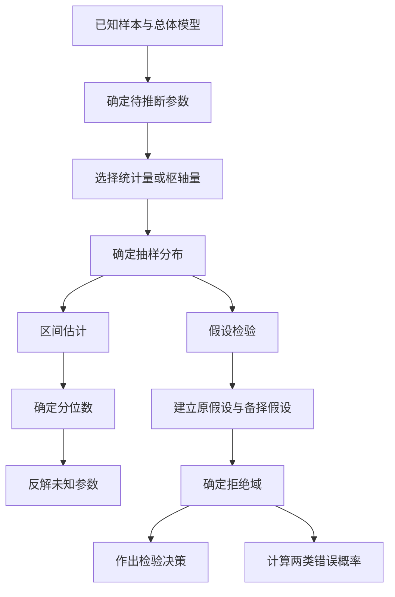
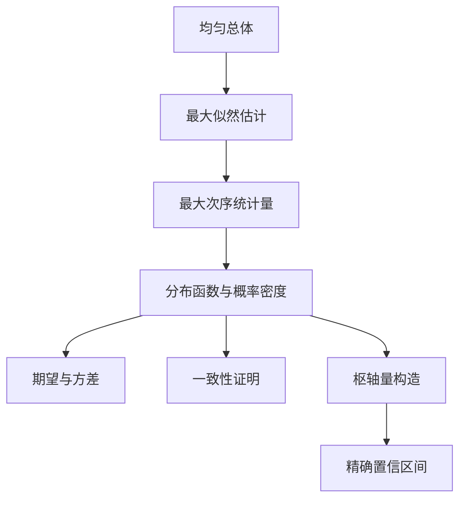
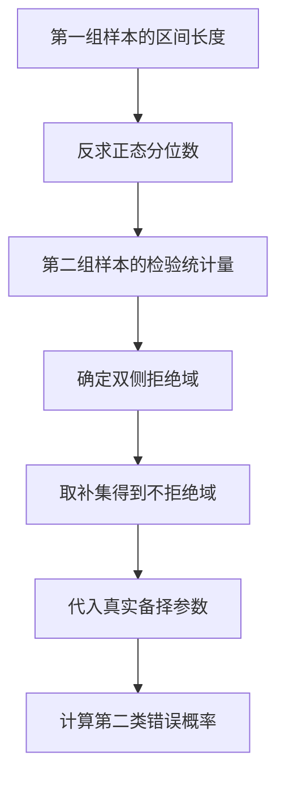
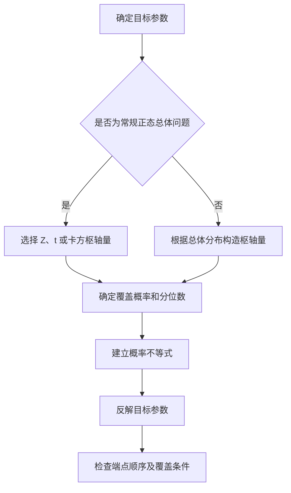
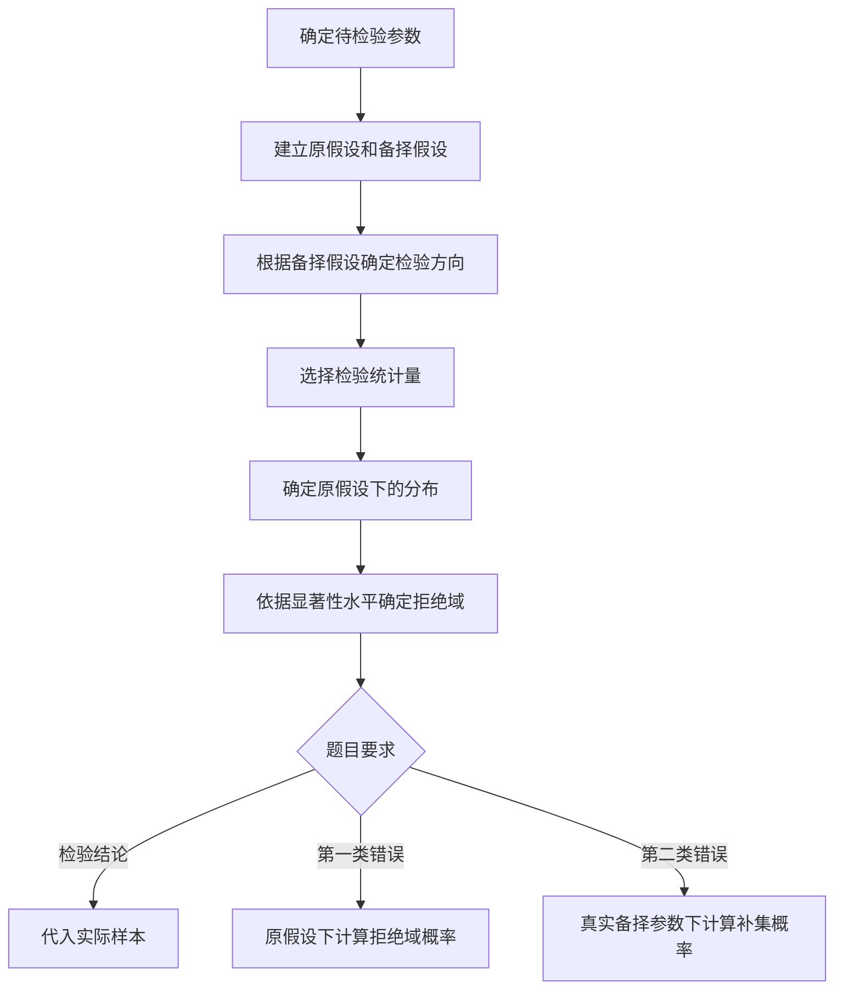

本节是概率论与数理统计的收尾部分，也是将前面所学的随机变量分布、数字特征、中心极限定理、抽样分布、参数估计综合起来进行应用的一节。

它的核心并不是记忆大量统计公式，而是掌握两种基本的统计推断思想：

- **区间估计：** 根据样本数据，推断未知总体参数可能处于什么范围。
- **假设检验：** 根据样本数据，判断是否有足够证据否定关于总体参数的某种假设。

这两种方法在数学本质上高度统一。只要真正掌握了抽样分布、枢轴量、概率事件转化这三项基本功，就可以解决绝大多数常规题以及相当一部分创新题。

## 基础知识体系

### 为什么需要区间估计与假设检验？

**1. 从点估计到区间估计**

上一节学习过矩估计法和最大似然估计法。

例如，对于正态总体

$$
X\sim N(\mu,\sigma^2),
$$

抽取简单随机样本

$$
X_1,X_2,\ldots,X_n,
$$

可以用样本均值

$$
\widehat\mu=\overline X =\frac1n\sum_{i=1}^nX_i
$$

作为总体均值的估计量。

假设测得样本均值为100。

可以估计总体均值为100，但总体均值未必真的等于100。

点估计只能提供一个估计值，却没有告诉我们：

- 这个估计值的精确程度如何？
- 真实参数偏离估计值多少是合理的？
- 样本量增大后，估计精度会如何变化？

因此需要区间估计。

例如，构造一个置信度为95%的置信区间：

$$
(98,102).
$$

区间估计不仅提供估计中心，还通过区间宽度反映估计的不确定性。

**2. 从区间估计到假设检验**

假设某工厂宣称生产的零件平均长度为100毫米，但抽样测得平均长度为98毫米。

能否据此认为工厂的生产标准发生了变化？

不能直接判断。

因为即使总体均值确实为100，样本均值也可能由于随机波动而等于98。

真正需要判断的是：

> 如果总体均值确实为100，那么当前样本所表现出的偏差是否过于异常？

如果偏差在正常随机波动范围之内，就不拒绝原假设；如果偏差大到在原假设成立时极少发生，就拒绝原假设。

这便是假设检验的基本思想。

### 本节的知识框架

全节可以归纳为六类核心能力。

| 核心能力    | 需要掌握的内容                    | 学习优先级 |
| ------- | -------------------------- | ----- |
| 抽样分布    | 正态、$t$、$\chi^2$ 分布 | 极高    |
| 常规区间估计  | 正态总体均值、方差                  | 极高    |
| 非常规区间估计 | 枢轴量、次序统计量、参数变换             | 极高    |
| 假设检验    | 单侧、双侧、拒绝域                  | 极高    |
| 两类错误    | 第一类错误、第二类错误、功效             | 极高    |
| 综合性质    | 样本量、置信区间长度、检验与区间的联系        | 高     |

### 预备知识：标准误与抽样分布

设

$$
X_1,X_2,\ldots,X_n \overset{\mathrm{i.i.d.}}{\sim}N(\mu,\sigma^2).
$$

定义样本均值和样本方差：

$$
\overline X=\frac1n\sum_{i=1}^nX_i,
$$

$$
S^2=\frac1{n-1} \sum_{i=1}^n(X_i-\overline X)^2.
$$

根据本章第一节的抽样分布知识：

$$
E(\overline X)=\mu,
$$

$$
D(\overline X)=\frac{\sigma^2}{n},
$$

$$
\boxed{ \overline X\sim N\left(\mu,\frac{\sigma^2}{n}\right) }
$$

**1. 标准误**

样本均值的标准差称为样本均值的标准误：

$$
\boxed{ \operatorname{SE}(\overline X) =\frac{\sigma}{\sqrt n} }
$$

当总体标准差未知时，通常用

$$
\widehat{\operatorname{SE}}(\overline X) =\frac S{\sqrt n}
$$

估计标准误。

务必区分以下四个量。

| 量                             | 含义       |
| ----------------------------- | -------- |
| $\sigma^2$                | 总体方差     |
| $\sigma$                  | 总体标准差    |
| $\dfrac{\sigma^2}{n}$     | 样本均值的方差  |
| $\dfrac{\sigma}{\sqrt n}$ | 样本均值的标准误 |

2025年数学一真题重点考查这一点。

**2. 必须熟练掌握的抽样分布**

| 条件        | 枢轴量                                              | 分布                |
| --------- | ------------------------------------------------ | ----------------- |
| 总体正态，方差已知 | $\dfrac{\overline X-\mu}{\sigma/\sqrt n}$    | $N(0,1)$      |
| 总体正态，方差未知 | $\dfrac{\overline X-\mu}{S/\sqrt n}$         | $t(n-1)$      |
| 总体正态，均值未知 | $\dfrac{(n-1)S^2}{\sigma^2}$                 | $\chi^2(n-1)$ |
| 总体正态，均值已知 | $\dfrac{\sum_{i=1}^n(X_i-\mu)^2}{\sigma^2}$ | $\chi^2(n)$   |

这些公式就是本节常规题型的全部基础。

**3. 为什么方差未知时使用 $t$ 分布？**

不是简单地把 $\sigma$ 换成 $S$，然后仍然认为统计量服从标准正态分布。

正确推导为：

$$
Z=\frac{\sqrt n(\overline X-\mu)}{\sigma} \sim N(0,1),
$$

$$
V=\frac{(n-1)S^2}{\sigma^2} \sim\chi^2(n-1).
$$

正态总体中，$\overline X$ 与 $S^2$ 相互独立，因此 $Z$ 与 $V$ 相互独立。

根据 $t$ 分布的定义：

$$
\frac{Z}{\sqrt{V/(n-1)}}\sim t(n-1).
$$

代入得

$$
\boxed{ \frac{\sqrt n(\overline X-\mu)}S \sim t(n-1) }
$$

这就是未知方差时使用 $t$ 分布的理论来源。

### 分位数：本节最容易混淆的符号

为避免不同教材中的记号冲突，以下讲解统一采用**上侧分位数**，遇到题目另有规定时再作转换。

**1. 标准正态分布的上侧分位数**

设

$$
Z\sim N(0,1),
$$

定义 $z_\alpha$ 满足

$$
P(Z>z_\alpha)=\alpha.
$$

于是

$$
\Phi(z_\alpha)=1-\alpha.
$$

由于标准正态分布关于原点对称：

$$
P(Z<-z_\alpha)=\alpha.
$$

因此

$$
\boxed{ P(-z_{\alpha/2}<Z<z_{\alpha/2}) =1-\alpha }
$$

**2. 双侧与单侧的区别**

例如，显著性水平为0.05：

- 单侧检验：将全部0.05的概率放在一端。
- 双侧检验：左右两端各分配0.025的概率。

常用临界值如下。

| 上侧概率 $\alpha$ | $z_\alpha$ |
| ----------------- | --------------- |
| 0.10              | 1.282           |
| 0.05              | 1.645           |
| 0.025             | 1.960           |
| 0.01              | 2.326           |
| 0.005             | 2.576           |

对应的常用双侧置信区间：

| 置信度 | 临界值   |
| --- | ----- |
| 90% | 1.645 |
| 95% | 1.960 |
| 99% | 2.576 |

**3. $t$ 分布分位数**

若

$$
T\sim t(\nu),
$$

定义

$$
P(T>t_\alpha(\nu))=\alpha.
$$

利用对称性：

$$
P\left( -t_{\alpha/2}(\nu)<T<t_{\alpha/2}(\nu) \right)=1-\alpha.
$$

其中 $\nu$ 为自由度。

**4. 卡方分布分位数**

若

$$
V\sim\chi^2(\nu),
$$

定义

$$
P(V>\chi^2_\alpha(\nu))=\alpha.
$$

卡方分布与正态分布不同：

- 取值非负。
- 不关于原点对称。
- 左右分位数不能通过添加负号得到。

等尾概率区间为

$$
\boxed{ P\left( \chi^2_{1-\alpha/2}(\nu) <V< \chi^2_{\alpha/2}(\nu) \right)=1-\alpha }
$$

注意这里

$$
\chi^2_{1-\alpha/2}(\nu) < \chi^2_{\alpha/2}(\nu).
$$

**分位数的下标越小，不代表分位数数值越小。** 对于上侧分位数，恰好相反。

## 区间估计

### 置信区间的基本概念

**1. 定义**

设未知参数为 $\theta$，构造两个统计量

$$
L=L(X_1,\ldots,X_n),
$$

$$
U=U(X_1,\ldots,X_n).
$$

如果对于参数空间内的所有 $\theta$，有

$$
\boxed{ P_\theta(L<\theta<U)=1-\alpha }
$$

则称随机区间

$$
(L,U)
$$

为参数 $\theta$ 的置信度为 $1-\alpha$ 的精确置信区间。

更一般地，覆盖率不低于 $1-\alpha$ 的区间也称为相应置信水平的置信区间。

其中：

| 名称          | 符号             |
| ----------- | -------------- |
| 置信下限        | $L$        |
| 置信上限        | $U$        |
| 置信度         | $1-\alpha$ |
| 未覆盖概率（精确情形） | $\alpha$   |
| 区间长度        | $U-L$      |

**2. 正确理解置信度95%**

这是一个很容易出现概念错误的地方。

在经典频率学派统计中，未知总体参数 $\theta$ 是固定的，而区间端点是随样本变化的随机变量。

假如重复进行大量独立抽样，每次都按照同一种方法构造95%置信区间，那么长期来看，约95%的这些区间会包含真实参数。

并不是说抽样完成、区间端点确定之后，固定参数仍然有95%的概率位于该区间。

**随机的是区间，不是未知参数。**

**3. 置信区间不是唯一的**

只要区间构造方法满足覆盖概率要求，就可以成为置信区间。

例如可以将总未覆盖概率 $\alpha$ 分配为

$$
\alpha_1+\alpha_2=\alpha.
$$

只有选择

$$
\alpha_1=\alpha_2=\frac\alpha2
$$

时，才是通常所说的等尾置信区间。

考研中常规的正态总体双侧均值置信区间，默认通常采用等尾形式。

### 区间估计的统一方法：枢轴量法

这是本节最重要的方法之一。

**1. 什么是枢轴量？**

枢轴量是由样本和未知参数共同构成、但其概率分布不依赖未知参数的随机量。

例如

$$
T(X_1,\ldots,X_n,\mu) =\frac{\overline X-\mu}{S/\sqrt n}
$$

虽然表达式中含有未知参数 $\mu$，但在正态总体条件下，

$$
T\sim t(n-1).
$$

其分布与未知参数 $\mu,\sigma^2$ 无关，因此是一个枢轴量。

注意：枢轴量可以含有未知参数，因此不一定是严格意义上的统计量。

**2. 统一解题四步法**

第一步，构造枢轴量

$$
T=T(X_1,\ldots,X_n,\theta).
$$

第二步，确定其概率分布。

第三步，根据置信度选取常数 $a,b$，使

$$
P_\theta(a<T<b)=1-\alpha.
$$

第四步，对不等式

$$
a<T(X_1,\ldots,X_n,\theta)<b
$$

进行等价变形，将未知参数 $\theta$ 单独解出来。

最终得到

$$
P_\theta(L<\theta<U)=1-\alpha.
$$

这个方法不仅适用于正态总体，也适用于均匀分布、指数分布以及其他非标准分布。

遇到创新题时，不必急着寻找背过的区间公式，而应优先思考能否构造枢轴量。

## 正态总体的区间估计

### 题型一：总体方差已知，求总体均值的置信区间

**1. 公式推导**

设

$$
X\sim N(\mu,\sigma^2),
$$

其中 $\sigma^2$ 已知，$\mu$ 未知。

由

$$
\frac{\overline X-\mu}{\sigma/\sqrt n} \sim N(0,1),
$$

可得

$$
P\left( -z_{\alpha/2} < \frac{\overline X-\mu}{\sigma/\sqrt n} < z_{\alpha/2} \right)=1-\alpha.
$$

反解 $\mu$，得到

$$
\boxed{ \left( \overline X-z_{\alpha/2}\frac{\sigma}{\sqrt n}, \overline X+z_{\alpha/2}\frac{\sigma}{\sqrt n} \right) }
$$

代入具体样本观测值后，就是

$$
\boxed{ \overline x\pm z_{\alpha/2}\frac{\sigma}{\sqrt n} }
$$

这类区间可以统一理解为

$$
\boxed{ \text{估计中心}\pm \text{临界值}\times\text{标准误} }
$$

**母题1：1996年数学三真题**

设

$$
X\sim N(\mu,0.9^2),
$$

样本容量为9，测得

$$
\overline x=5.
$$

求 $\mu$ 的95%置信区间。

<Steps>

<Step>

### 第一步：确定标准误。 [!toc]

$$
\frac{\sigma}{\sqrt n} =\frac{0.9}{3}=0.3.
$$

</Step>

<Step>

### 第二步：确定分位数。 [!toc]

$$
1-\alpha=0.95,
$$

所以

$$
z_{\alpha/2}=z_{0.025}=1.96.
$$

</Step>

<Step>

### 第三步：计算区间半宽度。 [!toc]

$$
d=1.96\times0.3=0.588.
$$

因此所求置信区间为

$$
\boxed{(4.412,5.588)}
$$

</Step>

</Steps>

**2. 大样本非正态总体的处理**

若未给出总体正态条件，但已知

$$
E(X)=\mu,\qquad D(X)=\sigma^2,
$$

当样本量充分大时，根据中心极限定理：

$$
\frac{\overline X-\mu}{\sigma/\sqrt n} \xrightarrow{d}N(0,1).
$$

因此可以构造近似置信区间：

$$
\boxed{ \overline x\pm z_{\alpha/2}\frac{\sigma}{\sqrt n} }
$$

公式虽然一样，但理论依据和准确程度不同。

**代表题：1993年数学三真题**

已知

$$
D(X)=1,\qquad n=100,\qquad \overline x=5.
$$

求总体均值的近似95%置信区间。

计算得

$$
d=1.96\times\frac1{10}=0.196.
$$

所以

$$
\boxed{(4.804,5.196)}
$$

因为总体分布未知，所以只能称为近似置信区间。

<Callout type="warn" title="张宇1000题中的一道陷阱">

强化篇参数估计与假设检验第24题，给出总体方差为1、样本容量为16、样本均值为 $a$，要求95%置信区间。

按原题通常的正态近似意图，答案为

$$
(a-0.49,a+0.49).
$$

但严格而言，原题没有说明总体正态，样本容量16也不能保证正态近似足够准确。

因此必须区分：

| 条件          | 正态均值区间的性质 |
| ----------- | --------- |
| 总体正态，方差已知   | 精确区间      |
| 总体非正态，样本充分大 | 近似区间      |
| 总体未知，样本较小   | 无法保证指定覆盖率 |

若题目要求完全不依赖总体分布，还可以利用切比雪夫不等式构造保守区间：

$$
P\left( |\overline X-\mu|\ge d \right) \le\frac{\sigma^2}{nd^2}.
$$

令

$$
\frac{\sigma^2}{nd^2}=\alpha,
$$

得到

$$
d=\frac{\sigma}{\sqrt{n\alpha}}.
$$

因此区间

$$
\boxed{ \left( \overline X-\frac{\sigma}{\sqrt{n\alpha}}, \overline X+\frac{\sigma}{\sqrt{n\alpha}} \right) }
$$

的覆盖概率至少为 $1-\alpha$。

这是第四章切比雪夫不等式与本节区间估计的一个重要综合方向。

</Callout>

### 题型二：总体方差未知，求总体均值的置信区间

**1. 核心公式**

对于正态总体，若 $\sigma^2$ 未知，则

$$
T=\frac{\overline X-\mu}{S/\sqrt n} \sim t(n-1).
$$

因此

$$
\boxed{ \mu\text{ 的双侧置信区间} = \left( \overline x-t_{\alpha/2}(n-1)\frac{s}{\sqrt n}, \overline x+t_{\alpha/2}(n-1)\frac{s}{\sqrt n} \right) }
$$

**母题2：2005年数学三真题**

设零件长度服从

$$
N(\mu,\sigma^2),
$$

两个参数均未知。

抽取16个零件，测得

$$
\overline x=20,\qquad s=1.
$$

求 $\mu$ 的90%置信区间。

首先识别三个条件：

$$
n=16,\qquad n-1=15,\qquad \alpha=0.10.
$$

由于总体方差未知，使用 $t$ 分布。

又因为是双侧置信区间，所以使用

$$
t_{0.05}(15).
$$

标准误估计为

$$
\frac s{\sqrt n}=\frac14.
$$

最终得到

$$
\boxed{ \left( 20-\frac14t_{0.05}(15), 20+\frac14t_{0.05}(15) \right) }
$$

本题的四个选项，本质上就是在考查：

- 自由度究竟是16还是15？
- 分位数下标究竟是0.1还是0.05？

只要理解抽样分布与双侧概率分配，就不会出错。

**2. 变式：题目不给样本方差，而给残差平方和**

1995年数学三真题以及李林880假设检验第3题均考查这一变式。

若题目给出

$$
Q^2=\sum_{i=1}^n(X_i-\overline X)^2,
$$

则

$$
S^2=\frac{Q^2}{n-1}.
$$

于是

$$
S=\frac{Q}{\sqrt{n-1}}.
$$

代入 $t$ 枢轴量：

$$
\boxed{ T= \frac{\sqrt{n(n-1)}(\overline X-\mu)}Q \sim t(n-1) }
$$

相应置信区间为

$$
\boxed{ \overline x\pm t_{\alpha/2}(n-1) \frac{q}{\sqrt{n(n-1)}} }
$$

如果题目改为给出

$$
V=\frac1n\sum_{i=1}^n(X_i-\overline X)^2,
$$

也应先转换：

$$
S^2=\frac n{n-1}V.
$$

不要看到类似样本方差的表达式就直接代入。

### 题型三：求总体方差的置信区间

这是比均值置信区间更容易出现端点顺序错误的一类题目。

<Tabs items={["总体均值未知", "总体均值已知"]} defaultIndex={0}>

<Tab value="总体均值未知">

对于正态总体，

$$
V=\frac{(n-1)S^2}{\sigma^2} \sim\chi^2(n-1).
$$

记

$$
a=\chi^2_{1-\alpha/2}(n-1),
$$

$$
b=\chi^2_{\alpha/2}(n-1).
$$

有

$$
0<a<b,
$$

且

$$
P\left( a<\frac{(n-1)S^2}{\sigma^2}<b \right)=1-\alpha.
$$

因为 $\sigma^2>0$，反解得到

$$
\frac{(n-1)S^2}{b} <\sigma^2< \frac{(n-1)S^2}{a}.
$$

因此

$$
\boxed{ \left( \frac{(n-1)s^2}{\chi^2_{\alpha/2}(n-1)}, \frac{(n-1)s^2}{\chi^2_{1-\alpha/2}(n-1)} \right) }
$$

这是采用上侧分位数记号的结果。

</Tab>

<Tab value="总体均值已知">

若真实总体均值 $\mu$ 已知，可以使用

$$
\frac{\sum_{i=1}^n(X_i-\mu)^2}{\sigma^2} \sim\chi^2(n).
$$

相应置信区间为

$$
\boxed{ \left( \frac{\sum_{i=1}^n(x_i-\mu)^2} {\chi^2_{\alpha/2}(n)}, \frac{\sum_{i=1}^n(x_i-\mu)^2} {\chi^2_{1-\alpha/2}(n)} \right) }
$$

区别就在于：

| 总体均值 | 分子                            | 自由度       |
| ---- | ----------------------------- | --------- |
| 已知   | $\sum(X_i-\mu)^2$         | $n$   |
| 未知   | $\sum(X_i-\overline X)^2$ | $n-1$ |

</Tab>

</Tabs>

**母题3：李正元第七章第17题**

配件内径服从正态分布

$$
X\sim N(\mu,\sigma^2).
$$

已知

$$
n=16,\qquad \overline x=3.05,\qquad s=0.4.
$$

分别求总体均值、总体方差的90%置信区间。

**第（1）问：总体均值。**

总体方差未知，因此使用 $t$ 分布。

已知上侧分位数

$$
t_{0.05}(15)\approx1.753.
$$

于是

$$
d=1.753\times\frac{0.4}{4} =0.1753.
$$

所以

$$
\boxed{ \mu\text{ 的置信区间为 }(2.875,3.225) }
$$

**第（2）问：总体方差。**

采用卡方分布。

$$
(n-1)s^2 =15\times0.4^2=2.4.
$$

由分布表，按上侧分位数记号：

$$
\chi^2_{0.05}(15)\approx24.996,
$$

$$
\chi^2_{0.95}(15)\approx7.261.
$$

得到

$$
\left( \frac{2.4}{24.996}, \frac{2.4}{7.261} \right).
$$

即

$$
\boxed{ \sigma^2\text{ 的置信区间为 }(0.0960,0.3305) }
$$

**3. 母题要点**

第一，均值与方差采用不同的抽样分布。

第二，均值置信区间通常关于样本均值对称，但方差置信区间通常不对称。

第三，卡方区间中较大的分位数放在下限的分母，较小的分位数放在上限的分母。

第四，两个参数各自具有90%的置信度，并不意味着两个区间同时包含真实参数的概率也是90%。

**4. 变式：求总体标准差**

若已经得到

$$
\sigma^2\in(L,U),
$$

由于平方根函数在正数范围内严格递增，所以可以得到同一置信度的区间

$$
\boxed{ \sigma\in(\sqrt L,\sqrt U) }
$$

不必重新构造枢轴量。

## 置信区间的性质与逆向问题

### 题型四：根据区间端点反求其他量

**母题4：2016年数学一真题**

设总体服从正态分布，已知样本均值为

$$
\overline x=9.5.
$$

总体均值的95%双侧置信区间的上限为10.8，求该置信区间。

常规等尾双侧均值置信区间具有形式

$$
(\overline x-d,\overline x+d).
$$

因此

$$
d=10.8-9.5=1.3.
$$

下限为

$$
9.5-1.3=8.2.
$$

答案为

$$
\boxed{(8.2,10.8)}
$$

这道题无需知道样本容量，也无需知道总体方差是否已知。

**核心推广**

对于常规正态总体等尾双侧均值区间 $(L,U)$，有

$$
\boxed{ \overline x=\frac{L+U}{2} }
$$

$$
\boxed{ d=\frac{U-L}{2} }
$$

已知其中任意两个量，便可以确定第三个量。

但不能将这一对称性质推广到所有置信区间，特别是方差区间和均匀分布端点区间。

### 题型五：已知置信区间，反求置信度

**母题5：李林880参数估计第3题**

设

$$
X\sim N(\mu,8), \qquad n=36.
$$

若以

$$
(\overline X-1,\overline X+1)
$$

作为总体均值的置信区间，求其置信度。

这一类题不要寻找临界值，而是直接根据置信度的定义计算覆盖概率。

$$
\begin{aligned} P(\overline X-1<\mu<\overline X+1) &=P(|\overline X-\mu|<1). \end{aligned}
$$

由于

$$
\overline X\sim N\left(\mu,\frac8{36}\right),
$$

所以

$$
\frac{\overline X-\mu}{\sqrt2/3} \sim N(0,1).
$$

从而

$$
\begin{aligned} P(|\overline X-\mu|<1) &=P\left( |Z|<\frac{3\sqrt2}{2} \right)\\ &=2\Phi\left(\frac{3\sqrt2}{2}\right)-1. \end{aligned}
$$

答案为

$$
\boxed{ 2\Phi\left(\frac{3\sqrt2}{2}\right)-1 }
$$

**通用结论**

若总体正态且方差已知，则区间

$$
(\overline X-d,\overline X+d)
$$

的置信度为

$$
\boxed{ 2\Phi\left(\frac{d\sqrt n}{\sigma}\right)-1 }
$$

这一公式可以解决已知区间宽度反求置信度、比较区间覆盖率等问题。

### 题型六：置信区间长度及其影响因素

对于已知方差的正态总体均值区间，长度为

$$
\boxed{ L=2z_{\alpha/2}\frac{\sigma}{\sqrt n} }
$$

其中半宽度为

$$
d=z_{\alpha/2}\frac{\sigma}{\sqrt n}.
$$

**1. 区间长度的变化规律**

| 变化条件   | 区间长度的变化 |
| ------ | ------- |
| 置信度提高  | 变长      |
| 置信度降低  | 变短      |
| 样本容量增大 | 变短      |
| 样本容量减小 | 变长      |
| 总体方差增大 | 变长      |
| 总体方差减小 | 变短      |

以上结论均是在其他条件保持不变时成立。

特别注意：

$$
L\propto\frac1{\sqrt n}.
$$

如果希望区间长度缩小为原来的一半，样本容量就必须增大到原来的4倍；若希望缩小为原来的三分之一，则样本容量必须增大到原来的9倍。

**2. 张宇1000题强化篇第25题**

设

$$
X\sim N(\mu,2^2),\qquad n=9.
$$

求95%置信区间长度的数学期望 $E(L)$。

由公式得

$$
L=2z_{0.025}\frac23 =\frac43z_{0.025}.
$$

由于 $\sigma,n,\alpha$ 都是确定的，所以 $L$ 是常数。

因此

$$
\boxed{ E(L)=\frac43z_{0.025} }
$$

这里需要区分：

- 方差已知时，常规均值置信区间的长度是确定的。
- 方差未知时，区间长度含有随机变量 $S$，因此本身也是随机变量。

未知方差时，

$$
L=2t_{\alpha/2}(n-1)\frac S{\sqrt n}.
$$

故

$$
E(L)=\frac{2t_{\alpha/2}(n-1)}{\sqrt n}E(S).
$$

一般不能直接令

$$
E(S)=\sigma.
$$

尽管

$$
E(S^2)=\sigma^2,
$$

但由于平方根为非线性函数，通常有

$$
E(S)<\sigma.
$$

这是无偏估计性质与置信区间长度的综合考点。

### 题型七：根据估计精度反求样本容量

**母题6：李正元第七章第18题**

反应时间服从正态分布，规划时估计总体标准差为0.05秒。

希望在95%的置信度下，使平均反应时间的估计误差不超过0.01秒。

求最小样本容量。

<Steps>

<Step>

### 第一步：将估计误差转化为区间半宽度。 [!toc]

$$
d=1.96\frac{0.05}{\sqrt n}.
$$

</Step>

<Step>

### 第二步：建立不等式。 [!toc]

$$
1.96\frac{0.05}{\sqrt n}\le0.01.
$$

整理得到

$$
\sqrt n\ge9.8,
$$

即

$$
n\ge96.04.
$$

</Step>

<Step>

### 第三步：向上取整。 [!toc]

$$
\boxed{n_{\min}=97}
$$

这里将题目提供的标准差估计值作为样本量规划所用的标准差。如果实际总体标准差不同，实际覆盖与精度可能随之变化。

</Step>

</Steps>

**通用公式**

若要求置信度为 $1-\alpha$，最大允许误差为 $d$，则

$$
\boxed{ n_{\min} = \left\lceil \frac{z_{\alpha/2}^2\sigma^2}{d^2} \right\rceil }
$$

其中 $\lceil x\rceil$ 表示向上取整。

若题目给的是区间总长度不得超过 $L_0$，则应令

$$
d=\frac{L_0}{2}.
$$

不能将区间总长度直接当作估计误差。

## 非标准分布的区间估计与综合题

这是本节最值得深入学习的部分。

区间估计综合题常需先求某个随机变量的分布，再构造置信区间。

### 题型八：均匀分布的最大次序统计量与精确置信区间

**母题7：李林880参数估计第24题**

**推荐掌握程度：★★★★★**

设总体

$$
X\sim U(0,\theta),\qquad \theta>0,
$$

$X_1,\ldots,X_n$ 为简单随机样本，$\widehat\theta$ 为 $\theta$ 的最大似然估计量。

要求：

（Ⅰ）求 $E(\widehat\theta)$ 和 $D(\widehat\theta)$。

（Ⅱ）证明 $\widehat\theta$ 是 $\theta$ 的一致估计量。

（Ⅲ）若以

$$
(\widehat\theta,a\widehat\theta)
$$

作为 $\theta$ 的置信区间，其置信度为95%，求 $a$。

这道题综合了五个重要考点。

**第（Ⅰ）问：最大似然估计与数字特征**

总体概率密度为

$$
f(x;\theta)= \begin{cases} \dfrac1\theta,&0<x<\theta,\\ 0,&\text{其他}. \end{cases}
$$

记

$$
M=X_{(n)}=\max\{X_1,\ldots,X_n\}.
$$

似然函数在可行范围内为

$$
L(\theta)=\theta^{-n}.
$$

最大似然估计必须满足所有样本值不超过 $\theta$，因此可行范围的下边界为 $M$。

由于

$$
\theta^{-n}
$$

关于 $\theta$ 单调递减，按均匀分布端点的常规密度版本，可得

$$
\boxed{\widehat\theta=M}
$$

这里不能使用常规的求导令零方法，而应利用似然函数的单调性和参数的可行范围。

严格来说，如果坚持使用开区间端点密度为零的版本，则似然函数只有上确界而不在该边界取得；考研通常采用闭端点的等价密度版本处理此类最大似然估计问题。

**求最大次序统计量的分布函数**

当 $0<x<\theta$ 时，

$$
\begin{aligned} F_M(x) &=P(M\le x)\\ &=P(X_1\le x,\ldots,X_n\le x)\\ &=\prod_{i=1}^nP(X_i\le x)\\ &=\left(\frac x\theta\right)^n. \end{aligned}
$$

完整分布函数为

$$
F_M(x)= \begin{cases} 0,&x\le0,\\ \left(\dfrac x\theta\right)^n,&0<x<\theta,\\ 1,&x\ge\theta. \end{cases}
$$

因此密度为

$$
f_M(x)= \begin{cases} \dfrac{nx^{n-1}}{\theta^n}, &0<x<\theta,\\ 0,&\text{其他}. \end{cases}
$$

计算期望：

$$
\begin{aligned} E(M) &=\int_0^\theta x \frac{nx^{n-1}}{\theta^n}\,\mathrm dx\\ &=\frac n{n+1}\theta. \end{aligned}
$$

所以

$$
\boxed{ E(\widehat\theta)=\frac n{n+1}\theta }
$$

进一步，

$$
E(M^2)=\frac n{n+2}\theta^2.
$$

因此

$$
\begin{aligned} D(M) &=E(M^2)-[E(M)]^2\\ &=\frac n{n+2}\theta^2 -\frac{n^2}{(n+1)^2}\theta^2\\ &=\frac{n\theta^2}{(n+1)^2(n+2)}. \end{aligned}
$$

即

$$
\boxed{ D(\widehat\theta) =\frac{n\theta^2}{(n+1)^2(n+2)} }
$$

**重要推论：无偏估计量**

由于

$$
E(M)=\frac n{n+1}\theta,
$$

最大似然估计量不是无偏估计量。

但可以修正为

$$
\boxed{ \widetilde\theta=\frac{n+1}{n}M }
$$

满足

$$
E(\widetilde\theta)=\theta.
$$

**第（Ⅱ）问：证明一致性**

要证明

$$
M\xrightarrow{P}\theta,
$$

只需证明对于任意 $\varepsilon>0$，

$$
P(|M-\theta|\ge\varepsilon)\to0.
$$

由于

$$
0<M<\theta
$$

几乎处处成立，因此当 $0<\varepsilon<\theta$ 时，

$$
\begin{aligned} P(|M-\theta|\ge\varepsilon) &=P(M\le\theta-\varepsilon)\\ &=\left(\frac{\theta-\varepsilon}{\theta}\right)^n\\ &=\left(1-\frac\varepsilon\theta\right)^n\\ &\longrightarrow0. \end{aligned}
$$

当 $\varepsilon\ge\theta$ 时，相应概率为零。

故

$$
\boxed{ \widehat\theta\xrightarrow{P}\theta }
$$

这说明：

**有偏估计量也可以是一致估计量。**

最大似然估计量的偏差为

$$
E(M)-\theta=-\frac{\theta}{n+1},
$$

它虽然不恒等于零，但随着样本容量增大趋于零。

**第（Ⅲ）问：精确置信区间**

按照置信区间的定义，

$$
P(M<\theta<aM)=0.95.
$$

显然必须有 $a>1$。

由于 $M<\theta$ 几乎处处成立，所以

$$
\begin{aligned} P(M<\theta<aM) &=P\left(M>\frac\theta a\right)\\ &=1-P\left(M\le\frac\theta a\right)\\ &=1-\left(\frac{\theta/a}{\theta}\right)^n\\ &=1-a^{-n}. \end{aligned}
$$

令

$$
1-a^{-n}=0.95,
$$

得

$$
a^{-n}=0.05.
$$

最终

$$
\boxed{a=20^{1/n}}
$$

因此所求95%置信区间为

$$
\boxed{ (M,20^{1/n}M) }
$$

**母题要点**

整个解题过程并没有使用正态分布、$t$ 分布或卡方分布的置信区间公式。

只需要知道最大次序统计量的分布函数，就可以直接构造精确置信区间。

这才是处理非标准分布创新题的核心能力。

### 重要模拟题：李林六套卷第6套第22题

**推荐掌握程度：★★★★★**

这道模拟题与上一道李林880母题属于同一个知识体系，但进一步考查枢轴量法。

仍设

$$
X\sim U(0,\theta),
$$

记

$$
M=\max\{X_1,\ldots,X_n\}.
$$

题目首先要求求出最大似然估计量并判断无偏性，然后判断下列区间是否为置信度 $1-\alpha$ 的置信区间：

$$
\left( \frac M{(1-\alpha/2)^{1/n}}, \frac M{(\alpha/2)^{1/n}} \right).
$$

<Steps>

<Step>

### 第一步：构造枢轴量 [!toc]

令

$$
T=\frac M\theta.
$$

对于 $0<t<1$，

$$
\begin{aligned} F_T(t) &=P\left(\frac M\theta\le t\right)\\ &=P(M\le\theta t)\\ &=\left(\frac{\theta t}{\theta}\right)^n\\ &=t^n. \end{aligned}
$$

因此

$$
\boxed{ F_T(t)= \begin{cases} 0,&t\le0,\\ t^n,&0<t<1,\\ 1,&t\ge1. \end{cases} }
$$

其分布不再依赖未知参数 $\theta$。

这正是一个枢轴量。

</Step>

<Step>

### 第二步：确定双侧分位点 [!toc]

令

$$
a=\left(\frac\alpha2\right)^{1/n},
$$

$$
b=\left(1-\frac\alpha2\right)^{1/n}.
$$

则

$$
P(T<a)=a^n=\frac\alpha2,
$$

$$
P(T>b)=1-b^n=\frac\alpha2.
$$

从而

$$
P(a<T<b)=1-\alpha.
$$

</Step>

<Step>

### 第三步：反解未知参数 [!toc]

由

$$
a<\frac M\theta<b
$$

得到

$$
\frac Mb<\theta<\frac Ma.
$$

所以置信区间为

$$
\boxed{ \left( \frac M{(1-\alpha/2)^{1/n}}, \frac M{(\alpha/2)^{1/n}} \right) }
$$

与题目给出的区间一致，故答案为正确。

</Step>

</Steps>

**关键推广：统一处理所有倍数型区间**

如果未来题目直接给出

$$
(c_1M,c_2M),\qquad 1\le c_1<c_2,
$$

要求置信度，可以直接计算：

$$
\begin{aligned} P(c_1M<\theta<c_2M) &=P\left( \frac1{c_2}<\frac M\theta<\frac1{c_1} \right)\\ &=c_1^{-n}-c_2^{-n}. \end{aligned}
$$

因此

$$
\boxed{ \text{置信度}=c_1^{-n}-c_2^{-n} }
$$

特别地，当 $c_1=1$ 时，

$$
\boxed{ \text{置信度}=1-c_2^{-n} }
$$

李林880的单尾区间与李林六套卷的等尾区间，其实都包含在这个统一公式之中。

**更深一层的推广**

由

$$
F_T(t)=t^n
$$

可知

$$
\boxed{ \left(\frac M\theta\right)^n\sim U(0,1) }
$$

这是概率积分变换的应用。

构造服从标准均匀分布的枢轴量时，可直接使用这一结论。

### 题型九：参数的函数与置信区间变换

**母题8：2000年数学三真题、李林880第23题**

设样本观测值为

$$
0.50,\quad1.25,\quad0.80,\quad2.00.
$$

已知

$$
Y=\ln X\sim N(\mu,1).
$$

求：

（Ⅰ）$b=E(X)$。

（Ⅱ）$\mu$ 的95%置信区间。

（Ⅲ）$b$ 的95%置信区间。

**第（Ⅰ）问：求总体期望**

由

$$
X=e^Y
$$

可得

$$
E(X)=E(e^Y).
$$

正态随机变量的指数矩满足

$$
E(e^{tY})=e^{t\mu+t^2/2}.
$$

取 $t=1$，得

$$
\boxed{ b=e^{\mu+1/2} }
$$

**第（Ⅱ）问：构造均值的置信区间**

注意，原始随机变量 $X$ 不是正态分布，正态的是

$$
Y=\ln X.
$$

因此必须先将样本取对数。

样本均值为

$$
\begin{aligned} \overline y &=\frac14 (\ln0.50+\ln1.25+\ln0.80+\ln2.00)\\ &=\frac14\ln(0.50\times1.25\times0.80\times2.00)\\ &=\frac14\ln1=0. \end{aligned}
$$

由于

$$
Y\sim N(\mu,1), \qquad n=4,
$$

使用已知方差的正态区间：

$$
\overline y\pm1.96\frac1{\sqrt4}.
$$

得到

$$
\boxed{(-0.98,0.98)}
$$

**第（Ⅲ）问：对区间作单调变换**

因为

$$
b=e^{\mu+1/2}
$$

是 $\mu$ 的严格递增函数，所以

$$
-0.98<\mu<0.98
$$

等价于

$$
e^{-0.48}<b<e^{1.48}.
$$

因此

$$
\boxed{ b\text{ 的95\%置信区间为 } (e^{-0.48},e^{1.48}) }
$$

**通用结论**

设 $(L,U)$ 是参数 $\theta$ 的置信区间。

若 $g$ 严格递增，则

$$
\boxed{ (g(L),g(U)) }
$$

是 $g(\theta)$ 的同置信度区间。

若 $g$ 严格递减，则

$$
\boxed{ (g(U),g(L)) }
$$

是 $g(\theta)$ 的同置信度区间。

例如，当 $\theta>0$ 时：

| 目标参数                | 相应置信区间                                            |
| ------------------- | ------------------------------------------------- |
| $e^\theta$      | $(e^L,e^U)$                                   |
| $\ln\theta$     | $(\ln L,\ln U)$，要求 $L>0$                  |
| $\sqrt\theta$   | $(\sqrt L,\sqrt U)$，要求 $L\ge0$            |
| $\dfrac1\theta$ | $\left(\dfrac1U,\dfrac1L\right)$，要求 $L>0$ |

如果 $g$ 在相关参数范围上不单调，就不能机械地只变换两个端点。可以求区间上 $g$ 的值域以构造覆盖率至少不降低的区间，但其覆盖率未必仍然恰好等于原置信度。

### 创新题拓展：指数分布的枢轴量

以下为针对本节知识结构设计的原创变式。

设总体概率密度为

$$
f(x;\lambda)= \begin{cases} \lambda e^{-\lambda x},&x>0,\\ 0,&x\le0, \end{cases}
$$

其中 $\lambda>0$ 未知。

求 $\lambda$ 的精确双侧置信区间。

**方法一：利用指数分布与卡方分布的关系**

因为

$$
X_i\sim\operatorname{Exp}(\lambda),
$$

所以

$$
2\lambda X_i\sim\chi^2(2).
$$

根据独立卡方随机变量的可加性：

$$
\boxed{ 2\lambda\sum_{i=1}^nX_i \sim\chi^2(2n) }
$$

这就是需要构造的枢轴量。

记

$$
W=\sum_{i=1}^nX_i.
$$

于是

$$
P\left( \chi^2_{1-\alpha/2}(2n) <2\lambda W< \chi^2_{\alpha/2}(2n) \right)=1-\alpha.
$$

反解得到

$$
\boxed{ \left( \frac{\chi^2_{1-\alpha/2}(2n)}{2W}, \frac{\chi^2_{\alpha/2}(2n)}{2W} \right) }
$$

**方法二：如果未知参数是总体期望**

指数分布的总体期望为

$$
\theta=E(X)=\frac1\lambda.
$$

直接对上述区间取倒数，并颠倒端点次序：

$$
\boxed{ \left( \frac{2W}{\chi^2_{\alpha/2}(2n)}, \frac{2W}{\chi^2_{1-\alpha/2}(2n)} \right) }
$$

**方法要点**

不同分布适合构造不同的枢轴量。

| 总体模型                                   | 优先考虑的枢轴量                   |
| -------------------------------------- | -------------------------- |
| 正态总体，估计均值                              | $\overline X-\mu$ 的标准化 |
| 正态总体，估计方差                              | 残差平方和除以总体方差                |
| 均匀分布 $U(0,\theta)$                 | $X_{(n)}/\theta$      |
| 指数分布 $\operatorname{Exp}(\lambda)$ | $2\lambda\sum X_i$     |
| 位置参数模型                                 | $X_i-\theta$ 或其统计量     |
| 尺度参数模型                                 | $X_i/\theta$ 或其统计量     |

构造枢轴量的核心，是通过平移、缩放或其他变换，将未知参数从概率分布中消除。

## 假设检验的基础理论

### 假设检验的基本思想

假设检验建立在小概率原理之上。

假如原假设 $H_0$ 成立，那么某些极端样本结果出现的概率很小。

若实际抽样出现这样的极端结果，则有理由怀疑原假设。

需要注意的是：

**小概率事件并不是不可能事件。**

因此，假设检验并不是数学上的严格反证法，而是允许出现错误的统计决策方法。

**1. 原假设与备择假设**

原假设记为

$$
H_0.
$$

备择假设记为

$$
H_1.
$$

例如：

$$
H_0:\mu=100, \qquad H_1:\mu\ne100.
$$

通常将现有标准、无差异状态或者需要控制误拒风险的情况放在原假设中。

将希望通过数据获得证据支持的变化方向放在备择假设中。

**2. 检验统计量**

检验统计量用于度量样本结果与原假设之间的偏离程度。

例如，当总体方差已知时，

$$
Z=\frac{\overline X-\mu_0}{\sigma/\sqrt n}.
$$

如果原假设

$$
H_0:\mu=\mu_0
$$

成立，则

$$
Z\sim N(0,1).
$$

当 $|Z|$ 很大时，说明样本均值与原假设中的均值相差了很多个标准误。

**3. 拒绝域与不拒绝域**

设检验的拒绝域为 $W$。

当样本落入 $W$ 时，拒绝原假设；当样本落入补集 $W^c$ 时，不拒绝原假设。

传统考研题目经常使用“接受原假设”的表达方式，但统计学中更准确的说法是“不拒绝原假设”。

**没有足够证据否定，并不等于已经证明正确。**

### 第一类错误与第二类错误

这是本节近年来数学一题库中非常重要的概念。

**1. 两类错误的定义**

| 真实情况         | 不拒绝 $H_0$ | 拒绝 $H_0$ |
| ------------ | ------------- | ------------ |
| $H_0$ 为真 | 正确            | 第一类错误        |
| $H_0$ 为假 | 第二类错误         | 正确           |

第一类错误：原假设正确，却拒绝原假设，简称弃真错误。

第二类错误：原假设错误，却没有拒绝原假设，简称取伪错误。

**2. 两类错误的概率**

若原假设是简单假设

$$
H_0:\theta=\theta_0,
$$

则第一类错误概率为

$$
\boxed{ \alpha=P_{\theta_0}(W) }
$$

若某个具体备择参数为 $\theta_1$，则第二类错误概率为

$$
\boxed{ \beta(\theta_1)=P_{\theta_1}(W^c) }
$$

对于复合原假设，显著性水平通常要求

$$
\boxed{ \sup_{\theta\in\Theta_0}P_\theta(W)\le\alpha }
$$

即控制原假设参数范围内最坏情况下的误拒概率。

**3. 检验功效**

检验功效是原假设为假时，正确拒绝原假设的概率。

记为

$$
\pi(\theta)=P_\theta(W).
$$

对于备择参数，

$$
\boxed{ \pi(\theta)=1-\beta(\theta) }
$$

功效越高，说明检验越有能力发现真实存在的变化。

**4. 第一类错误与第二类错误是否互补？**

一般情况下，

$$
\boxed{\alpha+\beta\ne1}
$$

因为两者是在不同真实参数条件下计算的概率。

真正互补的是：

$$
P_{\theta_0}(W)+P_{\theta_0}(W^c)=1,
$$

以及

$$
P_{\theta_1}(W)+P_{\theta_1}(W^c)=1.
$$

也就是

$$
\alpha+(1-\alpha)=1
$$

和

$$
(1-\beta)+\beta=1.
$$

不能把不同总体参数下的概率直接相加。

### 如何判断单侧检验与双侧检验？

**1. 根据备择假设确定方向**

| 备择假设                  | 检验类型 | 拒绝方向 |
| --------------------- | ---- | ---- |
| $H_1:\mu\ne\mu_0$ | 双侧检验 | 两端   |
| $H_1:\mu>\mu_0$   | 右侧检验 | 右端   |
| $H_1:\mu<\mu_0$   | 左侧检验 | 左端   |

以标准化均值统计量为例：

$$
Z=\frac{\overline X-\mu_0}{\sigma/\sqrt n}.
$$

右侧检验的拒绝域：

$$
\boxed{Z>z_\alpha}
$$

左侧检验的拒绝域：

$$
\boxed{Z<-z_\alpha}
$$

双侧检验的拒绝域：

$$
\boxed{|Z|>z_{\alpha/2}}
$$

**2. 题目文字的识别**

| 题目问法     | 通常采用的备择假设             |
| -------- | --------------------- |
| 是否存在显著差异 | $H_1:\mu\ne\mu_0$ |
| 是否发生变化   | $H_1:\mu\ne\mu_0$ |
| 是否显著提高   | $H_1:\mu>\mu_0$   |
| 是否超过标准   | $H_1:\mu>\mu_0$   |
| 是否显著下降   | $H_1:\mu<\mu_0$   |
| 是否低于规定值  | $H_1:\mu<\mu_0$   |

不能先看样本均值偏大还是偏小，再决定单侧检验的方向。

检验方向应当由研究问题预先确定，否则可能破坏显著性水平的控制。

**对应模拟题：张宇8套卷第3套第10题**

设两个独立正态总体的方差相同，检验两总体均值是否存在显著差异，第一类错误概率为 $\alpha$。

正确假设为

$$
\boxed{ H_0:\mu_1=\mu_2, \qquad H_1:\mu_1\ne\mu_2 }
$$

这是双侧检验，与相应 $1-\alpha$ 的置信区间相联系。

原题正确选项为C。

需要注意：双侧检验虽然将概率 $\alpha$ 分配到两端，但整个检验的显著性水平仍然是 $\alpha$，而不是 $\alpha/2$。

## 正态总体假设检验的核心题型

### 题型十：已知总体方差，检验总体均值

**母题9：2025年数学一真题**

**推荐掌握程度：★★★★★**

设

$$
X_1,\ldots,X_n\sim N(\mu,2),
$$

$\overline X$ 为样本均值。

检验

$$
H_0:\mu\le1, \qquad H_1:\mu>1.
$$

在显著性水平 $\alpha$ 下，求拒绝域。

其中 $z_\alpha$ 为标准正态分布上侧 $\alpha$ 分位数。

<Steps>

<Step>

### 第一步：确定样本均值的分布 [!toc]

由独立正态样本可知

$$
\boxed{ \overline X\sim N\left(\mu,\frac2n\right) }
$$

注意，总体分布 $N(\mu,2)$ 中的2是方差，不是标准差。

所以样本均值的标准误为

$$
\sqrt{\frac2n}.
$$

</Step>

<Step>

### 第二步：确定检验方向 [!toc]

备择假设为

$$
H_1:\mu>1.
$$

所以采用右侧检验。

样本均值越大，就越有证据表明 $\mu>1$。

因此拒绝域应具有形式

$$
W=\{\overline X>c\}.
$$

</Step>

<Step>

### 第三步：在原假设边界确定临界值 [!toc]

由于原假设是

$$
\mu\le1,
$$

不能简单地说原假设成立就有 $\mu=1$。

但对于右尾事件，

$$
P_\mu(\overline X>c) = 1-\Phi\left( \frac{c-\mu}{\sqrt{2/n}} \right).
$$

它关于 $\mu$ 单调递增。

所以在原假设范围内，误拒概率最大的位置是边界

$$
\mu=1.
$$

在此边界下，

$$
Z= \frac{\overline X-1}{\sqrt{2/n}} \sim N(0,1).
$$

令

$$
P_{\mu=1}(Z>z_\alpha)=\alpha.
$$

得到拒绝域

$$
\frac{\overline X-1}{\sqrt{2/n}}>z_\alpha.
$$

反解得

$$
\boxed{ W= \left\{ \overline X> 1+\sqrt{\frac2n}z_\alpha \right\} }
$$

原题选D。

</Step>

</Steps>

**这道真题的四个核心考点**

| 考点      | 正确处理                      |
| ------- | ------------------------- |
| 方差与标准差  | 总体标准差为 $\sqrt2$       |
| 样本均值标准误 | $\sqrt{2/n}$          |
| 检验方向    | 右侧检验                      |
| 复合原假设   | 在最不利边界 $\mu=1$ 控制误拒概率 |

**通用推广**

设

$$
X\sim N(\mu,\sigma^2),
$$

方差已知。

对于

$$
H_0:\mu\le\mu_0, \qquad H_1:\mu>\mu_0,
$$

拒绝域为

$$
\boxed{ \overline X> \mu_0+z_\alpha\frac{\sigma}{\sqrt n} }
$$

对于

$$
H_0:\mu\ge\mu_0, \qquad H_1:\mu<\mu_0,
$$

拒绝域为

$$
\boxed{ \overline X< \mu_0-z_\alpha\frac{\sigma}{\sqrt n} }
$$

对于

$$
H_0:\mu=\mu_0, \qquad H_1:\mu\ne\mu_0,
$$

拒绝域为

$$
\boxed{ |\overline X-\mu_0| >z_{\alpha/2}\frac{\sigma}{\sqrt n} }
$$

这三个公式本质上都是2025年这道题的变式。

### 题型十一：总体方差未知，检验总体均值

**母题10：1998年数学一真题**

某次考试成绩服从正态分布，从中抽取36位考生，测得

$$
\overline x=66.5,\qquad s=15.
$$

问在显著性水平0.05下，能否认为全体考生的平均成绩为70分？

给定上侧分位数

$$
t_{0.025}(35)=2.0301.
$$

**标准大题解答过程**

<Steps>

<Step>

### 第一步：提出假设。 [!toc]

$$
H_0:\mu=70, \qquad H_1:\mu\ne70.
$$

由于检验的是平均分是否等于70，所以采用双侧检验。

</Step>

<Step>

### 第二步：选择统计量。 [!toc]

总体方差未知，因此使用

$$
T=\frac{\overline X-70}{S/\sqrt n}.
$$

在原假设成立时，

$$
T\sim t(35).
$$

</Step>

<Step>

### 第三步：确定拒绝域。 [!toc]

由于

$$
\alpha=0.05,
$$

拒绝域为

$$
W=\{|T|>2.0301\}.
$$

</Step>

<Step>

### 第四步：计算统计量观测值。 [!toc]

$$
t_{\mathrm{obs}} =\frac{66.5-70}{15/\sqrt{36}} =-1.4.
$$

</Step>

<Step>

### 第五步：作出决策。 [!toc]

由于

$$
|t_{\mathrm{obs}}|=1.4<2.0301,
$$

所以观测结果未落入拒绝域。

因此

$$
\boxed{\text{不拒绝 }H_0}
$$

在显著性水平0.05下，现有样本没有提供足够证据说明总体平均成绩与70分存在显著差异。

</Step>

</Steps>

<Callout type="warn" title="容易出现的错误">

本题样本均值明显小于70，但不能因此直接选择左侧检验。

因为题目的研究问题是“是否等于70”，而不是“是否小于70”。

</Callout>

### 题型十二：左侧单边 $t$ 检验

**李林880假设检验第4题**

设

$$
X\sim N(\mu,\sigma^2),
$$

其中 $\sigma^2$ 未知。

检验

$$
H_0:\mu\ge\mu_0, \qquad H_1:\mu<\mu_0.
$$

求显著性水平为 $\alpha$ 的拒绝域。

构造统计量

$$
T=\frac{\overline X-\mu_0}{S/\sqrt n}.
$$

在原假设边界

$$
\mu=\mu_0
$$

时，

$$
T\sim t(n-1).
$$

由于备择假设要求均值偏小，应使用左侧拒绝域：

$$
\boxed{ W= \left\{ \frac{\overline X-\mu_0}{S/\sqrt n} <-t_\alpha(n-1) \right\} }
$$

**为什么复合原假设仍然使用边界？**

写成

$$
T= \frac{\overline X-\mu}{S/\sqrt n} + \frac{\mu-\mu_0}{S/\sqrt n}.
$$

在 $H_0$ 下，

$$
\mu-\mu_0\ge0.
$$

因此，与边界情况相比，统计量向较大值移动，进入左尾拒绝域的概率不会增大。

所以最不利边界仍然为

$$
\mu=\mu_0.
$$

这是复合原假设边界法的又一个典型应用。

### 题型十三：正态总体方差的假设检验

**1. 基本统计量**

设总体均值未知，检验

$$
H_0:\sigma^2=\sigma_0^2.
$$

构造

$$
\boxed{ V=\frac{(n-1)S^2}{\sigma_0^2} }
$$

在原假设成立时，

$$
V\sim\chi^2(n-1).
$$

根据备择假设不同，拒绝域分别为：

| 备择假设                            | 拒绝域                                                                 |
| ------------------------------- | ------------------------------------------------------------------- |
| $H_1:\sigma^2>\sigma_0^2$   | $V>\chi^2_\alpha(n-1)$                                         |
| $H_1:\sigma^2<\sigma_0^2$   | $V<\chi^2_{1-\alpha}(n-1)$                                     |
| $H_1:\sigma^2\ne\sigma_0^2$ | $V<\chi^2_{1-\alpha/2}(n-1)$ 或 $V>\chi^2_{\alpha/2}(n-1)$ |

卡方检验的双侧拒绝域一般不对称，不能使用绝对值形式。

**母题11：张宇8套卷第8套第10题**

**推荐掌握程度：★★★★★**

设

$$
X\sim N(\mu,\sigma^2),
$$

两个参数均未知。

检验

$$
H_0:\sigma^2\le8, \qquad H_1:\sigma^2>8.
$$

给定

$$
n=25,\qquad s^2=14,\qquad \alpha=0.05,
$$

以及

$$
\chi^2_{0.05}(24)=36.415.
$$

要求判断检验结果以及可能犯哪一类错误。

<Steps>

<Step>

### 第一步：构造卡方检验统计量 [!toc]

由于总体均值未知，

$$
V=\frac{(n-1)S^2}{8}.
$$

在原假设边界 $\sigma^2=8$ 下，

$$
V\sim\chi^2(24).
$$

更一般地，

$$
V= \frac{\sigma^2}{8} \cdot \frac{(n-1)S^2}{\sigma^2}.
$$

当 $\sigma^2\le8$ 时，前面的比例系数不超过1，因此右尾拒绝概率在边界处最大。

</Step>

<Step>

### 第二步：确定拒绝域 [!toc]

由于

$$
H_1:\sigma^2>8,
$$

采用右侧检验：

$$
V>36.415.
$$

</Step>

<Step>

### 第三步：代入观测值 [!toc]

$$
v_{\mathrm{obs}} =\frac{24\times14}{8} =42.
$$

因为

$$
42>36.415,
$$

所以拒绝原假设。

</Step>

<Step>

### 第四步：判断可能犯的错误 [!toc]

既然已经拒绝 $H_0$，如果 $H_0$ 实际为真，那么就犯了第一类错误。

因此正确答案为

$$
\boxed{\text{拒绝 }H_0,\text{ 可能犯第一类错误}}
$$

对应原题选项C。

</Step>

</Steps>

**同类题：李林880假设检验第6题**

某生产线要求标准差不超过15克，抽取10袋，测得样本标准差为30克。

建立假设

$$
H_0:\sigma^2\le225, \qquad H_1:\sigma^2>225.
$$

统计量观测值为

$$
v_{\mathrm{obs}} =\frac{9\times30^2}{15^2} =36.
$$

已知

$$
\chi^2_{0.05}(9)=16.919.
$$

因为

$$
36>16.919,
$$

所以拒绝原假设，认为生产波动显著超过允许标准。

这道题还给出样本均值为998克，但在当前方差检验中，该数值不需要使用。

**要先明确检验的究竟是均值还是方差，再选择题目信息。**

## 显著性水平与拒绝域的关系

### 题型十四：比较不同显著性水平下的检验结论

**母题12：2018年数学一真题**

**推荐掌握程度：★★★★★**

设总体

$$
X\sim N(\mu,\sigma^2),
$$

其中方差已知。

对总体均值进行双侧检验：

$$
H_0:\mu=\mu_0, \qquad H_1:\mu\ne\mu_0.
$$

比较显著性水平0.05与0.01下的检验结论。

<Steps>

<Step>

### 第一步：写出拒绝域 [!toc]

当

$$
\alpha=0.05
$$

时，

$$
W_{0.05}=\{|Z|>1.96\}.
$$

当

$$
\alpha=0.01
$$

时，

$$
W_{0.01}=\{|Z|>2.576\}.
$$

因此

$$
\boxed{ W_{0.01}\subset W_{0.05} }
$$

</Step>

<Step>

### 第二步：理解拒绝域的包含关系 [!toc]

在同一个标准双侧检验中，显著性水平越小，允许犯第一类错误的概率就越小，因此拒绝原假设所需的证据更强。

| 统计量绝对值 | 5%水平 | 1%水平 |
| ------ | ---- | ---- |
| 1.5    | 不拒绝  | 不拒绝  |
| 2.2    | 拒绝   | 不拒绝  |
| 3.0    | 拒绝   | 拒绝   |

因此必然成立的推论是：

$$
\boxed{ \alpha=0.05\text{ 时不拒绝} \Longrightarrow \alpha=0.01\text{ 时不拒绝} }
$$

以及

$$
\boxed{ \alpha=0.01\text{ 时拒绝} \Longrightarrow \alpha=0.05\text{ 时拒绝} }
$$

原题正确选项为D。

</Step>

</Steps>

**必须掌握的判断规律**

对于使用相同统计量、拒绝域随显著性水平嵌套的常规检验：

| 显著性水平改变         | 拒绝域 | 第一类错误控制 | 第二类错误概率 |
| --------------- | --- | ------- | ------- |
| $\alpha$ 减小 | 缩小  | 更严格     | 不减      |
| $\alpha$ 增大 | 扩大  | 更宽松     | 不增      |

这里的第二类错误比较，是在样本量、真实备择参数及其他条件保持不变时进行的。

### 张宇1000题中的集合包含变式

张宇1000题数理统计第22题给出两个拒绝域：

$$
W_1=\{|\overline X|>1\},
$$

$$
W_2=\{|\overline X|>2\}.
$$

比较它们对应的第一类错误概率 $\alpha_1,\alpha_2$。

由于

$$
W_2\subset W_1,
$$

因此

$$
P_{H_0}(W_2)\le P_{H_0}(W_1).
$$

所以必有

$$
\boxed{\alpha_1\ge\alpha_2}
$$

题库解析也指出：原题按常规命题意图选择 $\alpha_1>\alpha_2$，但仅凭原题给出的总体期望条件，严格来说无法保证严格不等式。

必须额外满足

$$
P_{H_0}(1<|\overline X|\le2)>0,
$$

才能推出

$$
\alpha_1>\alpha_2.
$$

例如，某个离散总体可能使得样本均值的绝对值从不落在1与2之间，那么两个拒绝域的概率就可能相等。

这是一个值得吸取的命题经验：

**集合的真包含并不必然导致概率的严格不等。**

## 两类错误概率的计算

### 题型十五：已知拒绝域，计算第二类错误概率

**母题13：2021年数学一真题**

**推荐掌握程度：★★★★★**

设

$$
X_1,\ldots,X_{16}\sim N(\mu,4).
$$

检验

$$
H_0:\mu\le10, \qquad H_1:\mu>10.
$$

拒绝域为

$$
W=\{\overline X\ge11\}.
$$

问当实际

$$
\mu=11.5
$$

时，犯第二类错误的概率。

<Steps>

<Step>

### 第一步：确定原假设真假 [!toc]

真实参数为

$$
\mu=11.5>10.
$$

因此原假设错误。

此时如果不拒绝原假设，就会犯第二类错误。

</Step>

<Step>

### 第二步：写出错误事件 [!toc]

拒绝域为

$$
W=\{\overline X\ge11\}.
$$

所以不拒绝域为

$$
W^c=\{\overline X<11\}.
$$

因此

$$
\boxed{ \beta(11.5) =P_{\mu=11.5}(\overline X<11) }
$$

</Step>

<Step>

### 第三步：在真实参数下确定分布 [!toc]

由于

$$
\overline X\sim N\left(\mu,\frac4{16}\right),
$$

在实际 $\mu=11.5$ 时，

$$
\overline X\sim N\left(11.5,\frac14\right).
$$

标准误为

$$
\frac12.
$$

</Step>

<Step>

### 第四步：标准化 [!toc]

$$
\begin{aligned} \beta(11.5) &=P_{\mu=11.5}(\overline X<11)\\ &=P\left( Z<\frac{11-11.5}{0.5} \right)\\ &=\Phi(-1)\\ &=1-\Phi(1). \end{aligned}
$$

最终

$$
\boxed{\beta=1-\Phi(1)}
$$

原题选B。

</Step>

</Steps>

**本题进一步变式**

如果继续要求第一类错误概率，则必须回到原假设边界 $\mu=10$。

$$
\begin{aligned} \alpha &=P_{\mu=10}(\overline X\ge11)\\ &=1-\Phi\left(\frac{11-10}{0.5}\right)\\ &=1-\Phi(2). \end{aligned}
$$

所以

$$
\boxed{\alpha=1-\Phi(2)}
$$

如果要求检验功效，则

$$
\boxed{ \pi(11.5)=1-\beta(11.5)=\Phi(1) }
$$

**本类题最重要的原则**

确定拒绝域时，使用原假设下的分布；计算第二类错误概率时，使用实际备择参数下的分布。

这两个步骤绝不能混淆。

### 题型十六：同时计算第一类错误和第二类错误

**母题14：张宇1000题数理统计第23题**

设

$$
X_1,X_2\sim N(\mu,1),
$$

两样本相互独立。

检验

$$
H_0:\mu=2, \qquad H_1:\mu=4.
$$

拒绝域为

$$
W=\{\overline X>3\}.
$$

求第一类错误概率 $\alpha$ 和第二类错误概率 $\beta$。

由抽样分布，

$$
\overline X\sim N\left(\mu,\frac12\right).
$$

**第一类错误概率**

原假设成立，意味着真实参数为

$$
\mu=2.
$$

第一类错误事件为拒绝原假设，即

$$
\overline X>3.
$$

于是

$$
\begin{aligned} \alpha &=P_{\mu=2}(\overline X>3)\\ &=1-\Phi\left( \frac{3-2}{1/\sqrt2} \right)\\ &=1-\Phi(\sqrt2). \end{aligned}
$$

**第二类错误概率**

备择假设成立，意味着真实参数为

$$
\mu=4.
$$

第二类错误事件为不拒绝原假设，即

$$
\overline X\le3.
$$

于是

$$
\begin{aligned} \beta &=P_{\mu=4}(\overline X\le3)\\ &=\Phi\left( \frac{3-4}{1/\sqrt2} \right)\\ &=\Phi(-\sqrt2)\\ &=1-\Phi(\sqrt2). \end{aligned}
$$

故

$$
\boxed{ \alpha=\beta=1-\Phi(\sqrt2) }
$$

原题选A。

**为什么这道题中两类错误概率相等？**

因为拒绝域的临界值3恰好是两个假设均值2和4的中点，并且样本均值在两个假设下的方差相同。

### 两类错误概率的通用公式

设

$$
X\sim N(\mu,\sigma^2),
$$

检验两个简单假设

$$
H_0:\mu=\mu_0, \qquad H_1:\mu=\mu_1,
$$

其中

$$
\mu_1>\mu_0.
$$

设拒绝域为

$$
W=\{\overline X>c\}.
$$

记标准误为

$$
\tau=\frac{\sigma}{\sqrt n}.
$$

则

$$
\boxed{ \alpha=1-\Phi\left(\frac{c-\mu_0}{\tau}\right) }
$$

$$
\boxed{ \beta=\Phi\left(\frac{c-\mu_1}{\tau}\right) }
$$

利用正态分布的对称性，也可写成

$$
\boxed{ \beta=1-\Phi\left(\frac{\mu_1-c}{\tau}\right) }
$$

**1. 如果要求两类错误概率相等**

令

$$
\alpha=\beta.
$$

由于 $\Phi$ 严格递增，因此

$$
c-\mu_0=\mu_1-c.
$$

解得

$$
\boxed{ c=\frac{\mu_0+\mu_1}{2} }
$$

对应的两类错误概率为

$$
\boxed{ \alpha=\beta =1-\Phi\left( \frac{(\mu_1-\mu_0)\sqrt n}{2\sigma} \right) }
$$

**2. 如果给定显著性水平，求临界值**

由

$$
\alpha =1-\Phi\left( \frac{c-\mu_0}{\sigma/\sqrt n} \right)
$$

得到

$$
\boxed{ c=\mu_0+z_\alpha\frac{\sigma}{\sqrt n} }
$$

**3. 如果继续求第二类错误概率**

将临界值代入：

$$
\begin{aligned} \beta(\mu_1) &=\Phi\left( \frac{c-\mu_1}{\sigma/\sqrt n} \right)\\ &=\Phi\left( z_\alpha-\frac{(\mu_1-\mu_0)\sqrt n}{\sigma} \right). \end{aligned}
$$

因此

$$
\boxed{ \beta(\mu_1) =\Phi\left( z_\alpha-\frac{(\mu_1-\mu_0)\sqrt n}{\sigma} \right) }
$$

这是右侧正态均值检验中最重要的第二类错误公式。

**4. 功效函数**

对于右侧检验，

$$
\boxed{ \pi(\mu) =\Phi\left( \frac{(\mu-\mu_0)\sqrt n}{\sigma} -z_\alpha \right) }
$$

它揭示了检验功效的变化规律。

在其他条件不变、真实参数位于右侧备择区域时：

| 条件变化          | 检验功效 |
| ------------- | ---- |
| 样本量增大         | 提高   |
| 总体方差减小        | 提高   |
| 真实均值偏离原假设边界更远 | 提高   |
| 显著性水平增大       | 提高   |

检验功效提高，就意味着第二类错误概率下降。

### 题型十七：离散总体中的两类错误

**张宇1000题数理统计第24题**

设离散型总体的分布律为

$$
\begin{array}{c|ccc} X&1&2&3\\ \hline P&\theta^2&2\theta(1-\theta)&(1-\theta)^2 \end{array}
$$

检验

$$
H_0:\theta=0.1, \qquad H_1:\theta=0.9.
$$

抽取三个独立样本，拒绝域为

$$
W=\{X_1=1,X_2=1,X_3=1\}.
$$

求第二类错误概率。

在 $H_1$ 成立时，

$$
\theta=0.9.
$$

于是

$$
P_{\theta=0.9}(X_i=1)=0.9^2.
$$

利用独立性，

$$
\begin{aligned} P_{\theta=0.9}(W) &=P(X_1=1,X_2=1,X_3=1)\\ &=(0.9^2)^3\\ &=0.9^6. \end{aligned}
$$

所以

$$
\boxed{ \beta=1-0.9^6=0.468559 }
$$

进一步，第一类错误概率为

$$
\boxed{ \alpha=0.1^6=10^{-6} }
$$

**方法要点**

因为它说明假设检验的本质并不依赖正态分布。

遇到离散型总体，只要知道原假设和备择假设下的联合分布，就能根据拒绝域直接计算两类错误概率。

对于离散型检验，还要注意是否包含拒绝域边界，因为单点可能具有正概率。不能像连续型分布那样随意将严格不等号与非严格不等号互换。

## 区间估计与假设检验的综合

### 区间估计与双侧检验的等价关系

设总体正态、方差已知。

均值的 $1-\alpha$ 双侧等尾置信区间为

$$
I= \left( \overline X-z_{\alpha/2}\frac{\sigma}{\sqrt n}, \overline X+z_{\alpha/2}\frac{\sigma}{\sqrt n} \right).
$$

对假设

$$
H_0:\mu=\mu_0, \qquad H_1:\mu\ne\mu_0
$$

进行显著性水平为 $\alpha$ 的双侧检验。

拒绝条件是

$$
\left| \frac{\overline X-\mu_0}{\sigma/\sqrt n} \right|>z_{\alpha/2}.
$$

整理后得到

$$
|\overline X-\mu_0| >z_{\alpha/2}\frac{\sigma}{\sqrt n}.
$$

这意味着 $\mu_0$ 落在相应闭置信区间之外。

因此，在对应检验与区间构造相匹配、边界约定一致的前提下，

$$
\boxed{ \mu_0\text{ 不在置信区间内} \iff \text{拒绝 }H_0 }
$$

$$
\boxed{ \mu_0\text{ 在置信区间内} \iff \text{不拒绝 }H_0 }
$$

对于连续型统计量，边界的开闭不影响覆盖率与检验水平。

**例：用区间估计解决1998年数学一真题**

前面求得

$$
\overline x=66.5,\quad s=15,\quad n=36.
$$

因此95%置信区间为

$$
66.5\pm2.0301\times\frac{15}{6}.
$$

即

$$
(61.42475,71.57525).
$$

由于70位于区间内，所以在相应5%的双侧 $t$ 检验中不拒绝原假设。

与前面直接计算 $t$ 统计量的方法完全一致。

### 单侧置信区间与单侧检验的关系

方差已知时，总体均值的 $1-\alpha$ 单侧置信下限为

$$
\boxed{ L=\overline X-z_\alpha\frac{\sigma}{\sqrt n} }
$$

相应的单侧置信区间为

$$
(L,+\infty).
$$

对于右侧检验

$$
H_0:\mu\le\mu_0, \qquad H_1:\mu>\mu_0,
$$

若

$$
L>\mu_0,
$$

则

$$
\overline X-z_\alpha\frac{\sigma}{\sqrt n} >\mu_0.
$$

整理得到

$$
\boxed{ \overline X> \mu_0+z_\alpha\frac{\sigma}{\sqrt n} }
$$

这正是右侧 $Z$ 检验的拒绝条件。

同样，单侧置信上限为

$$
\boxed{ U=\overline X+z_\alpha\frac{\sigma}{\sqrt n} }
$$

对于左侧检验，若

$$
U<\mu_0,
$$

则拒绝相应原假设。

张宇1000题数理统计第21题所考查的，就是这种单侧置信区间与检验之间的转化。

### 综合母题：李永乐六套卷第3套第9题

**推荐掌握程度：★★★★★**

这是一道有代表性的综合模拟题。

设

$$
X\sim N(\mu,4).
$$

独立抽取两组简单随机样本，样本量分别为16和64。

已知第一组样本给出的置信度为 $1-\alpha$ 的双侧均值置信区间长度为2。

利用第二组样本，在显著性水平 $\alpha$ 下检验

$$
H_0:\mu=5, \qquad H_1:\mu\ne5.
$$

求当真实 $\mu=6$ 时，犯第二类错误的概率。

<Steps>

<Step>

### 第一步：利用区间长度求临界值 [!toc]

总体标准差为

$$
\sigma=2.
$$

第一组样本容量为

$$
n_1=16.
$$

置信区间长度为

$$
L=2z_{\alpha/2}\frac{\sigma}{\sqrt{n_1}}.
$$

代入得

$$
2=2z_{\alpha/2}\frac24.
$$

因此

$$
\boxed{z_{\alpha/2}=2}
$$

</Step>

<Step>

### 第二步：利用第二组样本确定检验统计量 [!toc]

第二组样本容量为

$$
n_2=64.
$$

标准误为

$$
\frac{\sigma}{\sqrt{n_2}}=\frac14.
$$

于是

$$
Z=\frac{\overline X-5}{1/4} =4(\overline X-5).
$$

在原假设成立时，

$$
Z\sim N(0,1).
$$

双侧拒绝域为

$$
|Z|>2.
$$

即

$$
|\overline X-5|>0.5.
$$

所以不拒绝域为

$$
\boxed{ 4.5\le\overline X\le5.5 }
$$

</Step>

<Step>

### 第三步：在真实备择参数下计算概率 [!toc]

实际总体均值为6，因此

$$
\overline X\sim N\left(6,\frac1{16}\right).
$$

第二类错误概率为

$$
\begin{aligned} \beta(6) &=P_{\mu=6}(4.5\le\overline X\le5.5)\\ &=\Phi\left(\frac{5.5-6}{1/4}\right) -\Phi\left(\frac{4.5-6}{1/4}\right)\\ &=\Phi(-2)-\Phi(-6)\\ &=\Phi(6)-\Phi(2). \end{aligned}
$$

故

$$
\boxed{\beta=\Phi(6)-\Phi(2)}
$$

原题选B。

</Step>

</Steps>

**综合考点**

本题的关键是四个知识点之间的转换。

其中最容易发生的错误是第一组样本与第二组样本容量混用。

第一组样本只用于确定置信度对应的临界值；第二组样本才用于实际假设检验。

**双侧检验第二类错误的通用结论**

设总体方差已知，双侧检验

$$
H_0:\mu=\mu_0, \qquad H_1:\mu\ne\mu_0.
$$

记

$$
\tau=\frac{\sigma}{\sqrt n}, \qquad c=z_{\alpha/2}.
$$

不拒绝域为

$$
\mu_0-c\tau \le\overline X\le \mu_0+c\tau.
$$

若真实参数为 $\mu_1$，则

$$
\boxed{ \beta(\mu_1) = \Phi\left( c-\frac{\mu_1-\mu_0}{\tau} \right) - \Phi\left( -c-\frac{\mu_1-\mu_0}{\tau} \right) }
$$

令

$$
\delta=\frac{(\mu_1-\mu_0)\sqrt n}{\sigma},
$$

也可以写成

$$
\boxed{ \beta(\mu_1)=\Phi(c-\delta)+\Phi(c+\delta)-1 }
$$

这类公式不必机械背诵，考试时先写出不拒绝域，再在真实参数下标准化，通常更加稳妥。

### 进阶综合：同时限制两类错误概率，反求样本量

以下为补充设计的综合变式。

设

$$
X\sim N(\mu,4),
$$

检验

$$
H_0:\mu\le10, \qquad H_1:\mu>10.
$$

要求显著性水平为0.05，并且当真实均值为12时，第二类错误概率不超过0.10。

问至少抽取多少个样本？

<Steps>

<Step>

### 第一步：由第一类错误要求确定临界值 [!toc]

右侧检验拒绝域为

$$
\overline X> 10+z_{0.05}\frac2{\sqrt n}.
$$

由于

$$
z_{0.05}=1.645,
$$

所以

$$
c=10+\frac{3.29}{\sqrt n}.
$$

</Step>

<Step>

### 第二步：计算第二类错误概率 [!toc]

在真实参数

$$
\mu=12
$$

下，

$$
\begin{aligned} \beta(12) &=P_{12}(\overline X\le c)\\ &=\Phi\left( \frac{c-12}{2/\sqrt n} \right)\\ &=\Phi(1.645-\sqrt n). \end{aligned}
$$

</Step>

<Step>

### 第三步：利用第二类错误概率限制 [!toc]

要求

$$
\Phi(1.645-\sqrt n)\le0.10.
$$

由于

$$
\Phi(-1.282)\approx0.10,
$$

所以

$$
1.645-\sqrt n\le-1.282.
$$

于是

$$
\sqrt n\ge2.927,
$$

$$
n\ge8.567329.
$$

向上取整：

$$
\boxed{n_{\min}=9}
$$

</Step>

</Steps>

**通用样本量公式**

对于方差已知的右侧正态均值检验，若希望在真实均值 $\mu_1>\mu_0$ 时满足第二类错误概率不超过 $\beta_0$，则

$$
\boxed{ n_{\min} = \left\lceil \frac{\sigma^2(z_\alpha+z_{\beta_0})^2} {(\mu_1-\mu_0)^2} \right\rceil }
$$

在常见的 $\alpha,\beta_0<0.5$ 情况下可直接使用此式。

这一题型将抽样分布、正态分位数、显著性水平、第二类错误与样本量规划全部联系在了一起。

## 其他拓展知识

以下知识用于拓展，建议在掌握核心题型后学习。

### 两个正态总体均值差的推断

设两个总体相互独立：

$$
X\sim N(\mu_1,\sigma_1^2),
$$

$$
Y\sim N(\mu_2,\sigma_2^2).
$$

样本容量分别为 $m,n$。

**1. 两总体方差均已知**

根据正态分布的可加性，

$$
\overline X-\overline Y \sim N\left( \mu_1-\mu_2, \frac{\sigma_1^2}{m}+\frac{\sigma_2^2}{n} \right).
$$

因此枢轴量为

$$
Z= \frac{ (\overline X-\overline Y)-(\mu_1-\mu_2) }{ \sqrt{\sigma_1^2/m+\sigma_2^2/n} } \sim N(0,1).
$$

均值差的置信区间为

$$
\boxed{ \overline X-\overline Y \pm z_{\alpha/2} \sqrt{\frac{\sigma_1^2}{m}+\frac{\sigma_2^2}{n}} }
$$

**2. 方差未知但相等**

若

$$
\sigma_1^2=\sigma_2^2=\sigma^2,
$$

且 $\sigma^2$ 未知，则定义合并样本方差

$$
S_p^2= \frac{(m-1)S_X^2+(n-1)S_Y^2}{m+n-2}.
$$

相应枢轴量为

$$
\boxed{ T= \frac{ (\overline X-\overline Y)-(\mu_1-\mu_2) }{ S_p\sqrt{\frac1m+\frac1n} } \sim t(m+n-2) }
$$

由此可构造均值差的置信区间，也可以检验

$$
H_0:\mu_1=\mu_2.
$$

如果两总体方差未知且不相等，则不能直接套用这个合并方差公式。

**3. 两总体方差之比**

若两个正态样本独立，则

$$
\frac{S_X^2/\sigma_1^2}{S_Y^2/\sigma_2^2} \sim F(m-1,n-1).
$$

因此可以利用 $F$ 分布对

$$
\frac{\sigma_1^2}{\sigma_2^2}
$$

进行区间估计，或者检验两总体方差是否相等。

其构造思路与前面的卡方区间相同：先确定枢轴量的概率分布，再通过分位数反解参数，不必额外记忆大量孤立公式。

### $p$ 值的直观理解

在固定的常规假设检验中，$p$ 值可以理解为在原假设成立的前提下，得到至少与当前观测结果一样极端的统计量结果的概率。对于复合原假设，通常取原假设范围内适当的最坏情况概率。

以标准正态双侧检验为例，

$$
p=2[1-\Phi(|z_{\mathrm{obs}}|)].
$$

对于右侧检验，

$$
p=1-\Phi(z_{\mathrm{obs}}).
$$

对于左侧检验，

$$
p=\Phi(z_{\mathrm{obs}}).
$$

判断规则为

$$
\boxed{ p\le\alpha \Longrightarrow \text{拒绝 }H_0 }
$$

$$
\boxed{ p>\alpha \Longrightarrow \text{不拒绝 }H_0 }
$$

对于2018年数学一的真题，如果在5%的水平下没有拒绝原假设，那么 $p$ 值超过0.05，自然也超过0.01，因此在1%的水平下同样不拒绝原假设。

需要明确，$p$ 值不是原假设成立的概率，也不是当前检验结论正确的概率。

## 解题方法的统一归纳

### 区间估计题的识别

| 题目特征            | 优先使用的方法          |
| --------------- | ---------------- |
| 正态总体，已知方差，求均值区间 | 正态 $Z$ 枢轴量   |
| 正态总体，未知方差，求均值区间 | $t(n-1)$ 枢轴量 |
| 正态总体，求方差区间      | 卡方枢轴量            |
| 大样本，总体分布未知      | 中心极限定理近似         |
| 要求分布无关的覆盖率下界    | 切比雪夫不等式          |
| 已知区间宽度，求置信度     | 直接计算覆盖概率         |
| 已知估计精度，求样本量     | 半宽度不等式           |
| 均匀分布端点估计        | 最大值分布、比例枢轴量      |
| 指数分布参数估计        | 样本和、卡方分布         |
| 求未知参数的函数区间      | 单调变换             |

**通用步骤**

### 假设检验题的识别

先判断题目要求的是设计拒绝域，还是计算错误概率。

如果题目已给出拒绝域，通常不需要重新设计检验，而是直接根据拒绝域和真实参数计算概率。

| 题目要求          | 应当使用的方法        |
| ------------- | -------------- |
| 给定显著性水平，求拒绝域  | 在原假设下确定分布      |
| 给定样本值，作出检验决策  | 计算统计量并比较临界值    |
| 给定拒绝域，求第一类错误  | 原假设下求拒绝域概率     |
| 给定拒绝域，求第二类错误  | 备择参数下求不拒绝域概率   |
| 求检验功效         | 备择参数下求拒绝域概率    |
| 比较不同显著性水平     | 比较拒绝域包含关系      |
| 给定两类错误限制，求样本量 | 先定临界值，再限制第二类错误 |

**统一解题流程**

## 高频易错点与陷阱

<Callout type="warn" title="必须避免的十八个错误">

| 序号 | 常见错误                      | 正确理解                       |
| -- | ------------------------- | -------------------------- |
| 1  | 将 $N(\mu,4)$ 中的4当作标准差 | 标准差为2                      |
| 2  | 将样本均值方差当作标准误              | 标准误为 $\sigma/\sqrt n$  |
| 3  | 方差未知仍使用精确 $Z$ 区间      | 正态总体下使用 $t$ 区间         |
| 4  | $t$ 分布自由度写成 $n$   | 常规单样本均值问题为 $n-1$       |
| 5  | 混淆残差平方和与样本方差              | 残差平方和为 $(n-1)S^2$      |
| 6  | 双侧区间使用 $z_\alpha$    | 等尾双侧使用 $z_{\alpha/2}$ |
| 7  | 单侧检验仍然除以2                 | 单侧使用 $z_\alpha$       |
| 8  | 混淆上侧与下侧分位数                | 先确认题目定义                    |
| 9  | 卡方分布使用对称性                 | 卡方分布不对称                    |
| 10 | 方差区间端点顺序写反                | 大分位数放在下限分母                 |
| 11 | 所有置信区间都关于估计值对称            | 只有某些标准区间具有此性质              |
| 12 | 置信度提高，区间变短                | 其他条件固定时区间变长                |
| 13 | 样本容量向下取整                  | 最小样本量必须向上取整                |
| 14 | 将 $M/\theta$ 当作均匀分布   | 其分布函数为 $t^n$           |
| 15 | 将不拒绝原假设理解为证明原假设           | 仅表示证据不足                    |
| 16 | 计算第二类错误时使用原假设参数           | 应使用真实备择参数                  |
| 17 | 认为 $\alpha+\beta=1$   | 两者一般不互补                    |
| 18 | 认为显著性水平越小越容易拒绝            | 常规嵌套检验中恰好相反                |

</Callout>

## 补充训练题

以下为10道原创变式练习。建议先独立完成，再查看解析。

### 基础巩固题

**练习1：逆向求置信区间**

设

$$
X\sim N(\mu,9), \qquad n=36.
$$

已知样本均值的95%双侧等尾置信区间的下限为7.02。

求样本均值和置信上限。

<Accordions>

<Accordion title="参考解析">

半宽度为

$$
d=1.96\times\frac36=0.98.
$$

因此

$$
\boxed{\overline x=8}
$$

$$
\boxed{U=8.98}
$$

</Accordion>

</Accordions>

**练习2：反求置信度**

设

$$
X\sim N(\mu,16), \qquad n=64.
$$

若以

$$
(\overline X-1,\overline X+1)
$$

作为 $\mu$ 的置信区间，求其置信度。

<Accordions>

<Accordion title="参考解析">

标准误为

$$
\frac48=\frac12.
$$

故置信度为

$$
\boxed{2\Phi(2)-1}
$$

</Accordion>

</Accordions>

**练习3：非标准形式的样本方差**

设

$$
X\sim N(\mu,\sigma^2),
$$

两个参数均未知，样本容量为10。

记

$$
Q=\sum_{i=1}^{10}(X_i-\overline X)^2.
$$

求总体均值的95%置信区间。

<Accordions>

<Accordion title="参考解析">

注意这里定义的是 $Q$，而不是 $Q^2$。

$$
S^2=\frac Q9.
$$

所以置信区间为

$$
\boxed{ \overline X\pm t_{0.025}(9)\sqrt{\frac Q{90}} }
$$

</Accordion>

</Accordions>

**练习4：单侧检验**

设

$$
X\sim N(\mu,9), \qquad n=25.
$$

在显著性水平0.05下检验

$$
H_0:\mu\ge10, \qquad H_1:\mu<10.
$$

求用样本均值表示的拒绝域。

<Accordions>

<Accordion title="参考解析">

左侧拒绝域为

$$
\overline X< 10-1.645\frac35.
$$

所以

$$
\boxed{W=\{\overline X<9.013\}}
$$

</Accordion>

</Accordions>

### 强化综合题

**练习5：均匀分布枢轴量**

设

$$
X\sim U(0,\theta),
$$

记

$$
M=X_{(n)}.
$$

若以

$$
(M,2M)
$$

作为 $\theta$ 的置信区间，求其置信度。

若要求置信度至少为0.99，则样本容量最少为多少？

<Accordions>

<Accordion title="参考解析">

由均匀分布枢轴量的结论，

$$
P(M<\theta<2M)=1-2^{-n}.
$$

要求

$$
1-2^{-n}\ge0.99.
$$

即

$$
2^n\ge100.
$$

由于

$$
2^6=64,\qquad2^7=128,
$$

因此

$$
\boxed{n_{\min}=7}
$$

</Accordion>

</Accordions>

**练习6：参数函数变换**

设未知参数 $\theta>0$ 的95%置信区间为

$$
(2,5).
$$

分别求

$$
\frac1\theta,\qquad \theta^2,\qquad e^{-\theta}
$$

的相应置信区间。

<Accordions>

<Accordion title="参考解析">

利用单调性，三个区间分别为

$$
\boxed{ \left(\frac15,\frac12\right) }
$$

$$
\boxed{(4,25)}
$$

$$
\boxed{(e^{-5},e^{-2})}
$$

</Accordion>

</Accordions>

**练习7：两类错误的综合计算**

设

$$
X\sim N(\mu,4), \qquad n=25.
$$

检验

$$
H_0:\mu=10, \qquad H_1:\mu=12.
$$

拒绝域为

$$
W=\{\overline X>11\}.
$$

求第一类错误概率和第二类错误概率。

<Accordions>

<Accordion title="参考解析">

样本均值的标准误为

$$
\tau=\frac25=0.4.
$$

临界值11正好位于两个假设均值的中点，因此

$$
\boxed{ \alpha=\beta=1-\Phi(2.5) }
$$

</Accordion>

</Accordions>

**练习8：双侧检验功效**

设

$$
X\sim N(\mu,4), \qquad n=16.
$$

检验

$$
H_0:\mu=0, \qquad H_1:\mu\ne0.
$$

拒绝域为

$$
W=\{|\overline X|>1\}.
$$

求显著性水平，以及真实 $\mu=2$ 时的第二类错误概率。

<Accordions>

<Accordion title="参考解析">

在 $\mu=0$ 时，

$$
\overline X\sim N(0,1/4).
$$

故

$$
\boxed{ \alpha=2[1-\Phi(2)] }
$$

实际 $\mu=2$ 时，

$$
\begin{aligned} \beta(2) &=P_2(-1\le\overline X\le1)\\ &=\Phi(-2)-\Phi(-6). \end{aligned}
$$

所以

$$
\boxed{ \beta(2)=\Phi(6)-\Phi(2) }
$$

</Accordion>

</Accordions>

**练习9：非正态总体精确置信区间**

设

$$
X\sim U(\theta,\theta+1),
$$

其中 $\theta$ 未知。

令

$$
m=X_{(1)}=\min\{X_1,\ldots,X_n\}.
$$

利用最小次序统计量构造形如

$$
(m-a,m)
$$

的95%置信区间，求 $a$。

<Accordions>

<Accordion title="参考解析">

因为

$$
X_i-\theta\sim U(0,1),
$$

所以

$$
m-\theta
$$

是 $n$ 个标准均匀随机变量中的最小值。

当 $0<a<1$ 时，

$$
P(m-\theta\ge a)=(1-a)^n.
$$

于是

$$
\begin{aligned} P(m-a<\theta<m) &=P(0<m-\theta<a)\\ &=1-(1-a)^n. \end{aligned}
$$

令

$$
1-(1-a)^n=0.95,
$$

得到

$$
\boxed{ a=1-0.05^{1/n} }
$$

这道题是李林均匀分布最大次序统计量母题的自然变形，由最大值改为最小值，由尺度参数改为位置参数。

</Accordion>

</Accordions>

**练习10：离散总体假设检验**

设

$$
X_i\sim B(1,p),\qquad i=1,2,3,4,
$$

样本相互独立。

检验

$$
H_0:p=0.2, \qquad H_1:p=0.8.
$$

拒绝域为

$$
W=\left\{\sum_{i=1}^4X_i\ge3\right\}.
$$

求两类错误概率。

<Accordions>

<Accordion title="参考解析">

记

$$
Y=\sum_{i=1}^4X_i\sim B(4,p).
$$

第一类错误概率为

$$
\begin{aligned} \alpha &=P_{p=0.2}(Y\ge3)\\ &=\binom43(0.2)^3(0.8)+(0.2)^4\\ &=0.0272. \end{aligned}
$$

第二类错误概率为

$$
\begin{aligned} \beta &=P_{p=0.8}(Y\le2)\\ &=(0.2)^4 +4(0.8)(0.2)^3 +6(0.8)^2(0.2)^2\\ &=0.1808. \end{aligned}
$$

故

$$
\boxed{\alpha=0.0272,\qquad\beta=0.1808}
$$

</Accordion>

</Accordions>

## 考前公式速查表

### 区间估计核心公式

以下均采用上侧分位数记号，双侧区间采用等尾构造。

| 参数与条件       | 置信度 $1-\alpha$ 的置信区间                                                                                 |
| ----------- | -------------------------------------------------------------------------------------------------------- |
| 正态均值，方差已知   | $\overline x\pm z_{\alpha/2}\dfrac{\sigma}{\sqrt n}$                                                |
| 正态均值，方差未知   | $\overline x\pm t_{\alpha/2}(n-1)\dfrac{s}{\sqrt n}$                                                |
| 正态方差，均值未知   | $\left(\dfrac{(n-1)s^2}{\chi^2_{\alpha/2}(n-1)},\dfrac{(n-1)s^2}{\chi^2_{1-\alpha/2}(n-1)}\right)$ |
| 均匀分布端点，单尾构造 | $\left(M,\dfrac{M}{\alpha^{1/n}}\right)$                                                             |
| 均匀分布端点，等尾构造 | $\left(\dfrac{M}{(1-\alpha/2)^{1/n}},\dfrac{M}{(\alpha/2)^{1/n}}\right)$                             |

正态均值区间长度：

$$
\boxed{L=2z_{\alpha/2}\frac{\sigma}{\sqrt n}}
$$

已知方差时按最大误差规划样本量：

$$
\boxed{ n_{\min} =\left\lceil \frac{z_{\alpha/2}^2\sigma^2}{d^2} \right\rceil }
$$

### 假设检验核心公式

对于均值检验，设检验统计量为 $T_0$，相应上侧分位数为 $c_\alpha$。

| 检验方向 | 拒绝域                         |
| ---- | --------------------------- |
| 右侧   | $T_0>c_\alpha$         |
| 左侧   | $T_0<-c_\alpha$        |
| 双侧   | $\|T_0\|>c_{\alpha/2}$ |

这里 $T_0$ 在原假设边界下服从标准正态分布或 $t$ 分布。

方差已知时：

$$
\boxed{ Z=\frac{\overline X-\mu_0}{\sigma/\sqrt n} }
$$

方差未知时：

$$
\boxed{ T=\frac{\overline X-\mu_0}{S/\sqrt n} }
$$

检验正态总体方差、总体均值未知时：

$$
\boxed{ V=\frac{(n-1)S^2}{\sigma_0^2} }
$$

两类错误：

$$
\boxed{ \alpha=P_{H_0}(W) }
$$

上式针对简单原假设或精确达到显著性水平的边界情形。

$$
\boxed{ \beta(\theta_1)=P_{\theta_1}(W^c) }
$$

功效：

$$
\boxed{ \pi(\theta_1)=1-\beta(\theta_1) }
$$

## 本节真题与练习题复习优先级

### 最值得反复研究的母题

按知识覆盖面、代表性与迁移价值安排复习顺序。

| 优先级 | 题目来源            | 必须掌握的能力             |
| --- | --------------- | ------------------- |
| S   | 2025年数学一        | 单侧拒绝域、标准误、复合假设边界    |
| S   | 2021年数学一        | 第二类错误概率             |
| S   | 2018年数学一        | 显著性水平与拒绝域包含关系       |
| S   | 李林880参数估计第24题   | 最大似然、次序统计量、一致性、置信区间 |
| S   | 李林六套卷第6套第22题    | 非标准分布枢轴量            |
| S   | 李永乐六套卷第3套第9题    | 区间长度与第二类错误综合        |
| A   | 1998年数学一        | 完整双侧 $t$ 检验     |
| A   | 2016年数学一        | 置信区间的对称性            |
| A   | 张宇8套卷第8套第10题    | 单侧方差检验与错误类型         |
| A   | 张宇1000题数理统计第23题 | 两类错误的同时计算           |
| A   | 李正元第七章第17题      | 均值与方差的区间估计          |
| A   | 2000年数学三        | 参数函数的置信区间           |
| A   | 李正元第七章第18题      | 样本量规划               |
| B   | 张宇1000题数理统计第24题 | 离散总体的假设检验           |
| B   | 李林880参数估计第3题    | 反求置信度               |
| B   | 2005年数学三        | $t$ 区间的自由度与分位数  |

### 掌握标准

掌握标准：

- 能从抽样分布推导正态总体均值的两种置信区间。
- 能推导卡方分布下总体方差的置信区间。
- 能区分标准差、方差与标准误。
- 能正确使用单侧、双侧和不同分布的分位数。
- 能根据区间长度反求样本量和置信度。
- 能通过次序统计量构造均匀分布参数的精确区间。
- 能处理参数的单调函数对应的置信区间。
- 能独立建立原假设、备择假设与拒绝域。
- 能解释复合原假设为什么常常需要在边界处确定临界值。
- 能计算第一类错误、第二类错误及检验功效。
- 能判断不同显著性水平下检验结论的逻辑关系。
- 能将区间估计和假设检验相互转化。
- 面对不熟悉的总体分布，仍然能通过概率定义分析问题。

## 全节总结

本节看起来有大量公式，实际上可以浓缩为三个数学问题。

**第一个问题：样本统计量服从什么分布？**

这依赖于概率论与本章第一节的抽样分布知识。

**第二个问题：如何利用一个概率等式反解未知参数？**

这就是区间估计的本质：

$$
\boxed{ P_\theta(a<T(X,\theta)<b)=1-\alpha }
$$

**第三个问题：在某个真实参数条件下，样本落入指定区域的概率是多少？**

这就是假设检验及两类错误计算的本质：

$$
\boxed{ \alpha=P_{H_0}(W),\qquad \beta=P_{H_1}(W^c) }
$$

其中复合假设应进一步明确具体参数或最不利边界。

从整门概率论的角度来看，本节综合了前面学习的几乎所有重要工具：

| 前面章节            | 在本节中的应用                 |
| --------------- | ----------------------- |
| 第一章 随机事件与概率     | 拒绝域、补事件、错误概率            |
| 第二章 随机变量及其分布    | 枢轴量、分布函数、次序统计量          |
| 第三章 数字特征        | 标准误、估计量的期望与方差           |
| 第四章 大数定律与中心极限定理 | 一致性、大样本近似区间             |
| 第五章第一节 统计量      | $Z,t,\chi^2,F$ 抽样分布 |
| 第五章第二节 点估计      | 估计中心、最大似然估计             |

**学习本节的最高目标，是将区间估计和假设检验重新转化为自己已经熟悉的概率计算与不等式变形问题。**

只要具备这种能力，即使未来考研数学一改变总体分布、改变统计量形式、改变拒绝域结构，或者将参数估计与假设检验融合在同一道综合题中，也不需要依赖背过的原题，而能够从基本原理出发独立解决。
